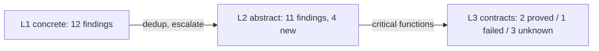

# LunaFlow


[](https://mooncakes.io/docs/riantr/LunaFlow)
[](https://github.com/riantr/LunaFlow/releases)
[](LICENSE)
[](https://mooncakes.io/docs/riantr/LunaFlow)

Trace-driven, three-proof-strength control-flow, taint, value-range, slicing and
contract analysis for MoonBit modules published on
[mooncakes.io](https://mooncakes.io/). The output is one Markdown report with
embedded Mermaid diagrams — no server, no HTML, no images.

The analyzer never compiles the module it analyses. It parses the MoonBit
source it is pointed at, executes a model of it, and writes the evidence out:
every finding carries the method that produced it, a confidence, and a
`file:line`.

One analyzer · three evidence strengths · one Markdown report.

## Features

* A funnel, not a mode switch

  `--level 1|2|3` is cumulative and `--funnel` runs all three. L1 deduplicates
  its findings, L2 splits its results into *confirmed* and *new*, and L3 is
  applied only to functions with an L1/L2 finding plus every function that
  already carries a contract. Functions escalated without a contract are
  reported as **specification gaps** — the funnel's explicit to-do list. When a
  target has no annotations, L3 reports **0 VCs and the gaps**, not invented
  proofs.

* A control-flow graph you can argue with

  The CFG is built from the parsed statement tree: branch nodes with `true` and
  `false` edges, loop heads with back edges, merge points, and `dead` nodes for
  statements after an unconditional exit. Execution paths come from the trace
  and are rendered beside the diagram. Dead code and unreachable nodes are
  **static** findings; non-termination is a **static + dynamic** finding; path
  coverage is **dynamic** and exact only for the executed trials. Each finding
  carries its method and confidence.

* Taint with stated rules

  Sources are entry-function parameters (and `@env.args` when the frontend sees
  it). Propagation follows recorded definitions and the variables each
  statement read; array reads inherit container taint; `length()` inherits
  receiver taint; a tainted loop condition taints the numeric loop counters
  (implicit flow). Sinks are array indices and allocation sizes. The rules and
  their imprecision — field- and index-insensitive, no alias analysis, depth-6
  calls, unsupported `match` arms — are printed in every report.

* Values at every point

  L1 records every `def` event keyed by function, source line and variable, so
  report §6.1 is a per-program-point value table and the JSONL trace has the
  full stream. L2 adds may-ranges from the abstract fixpoint. The distinction
  is explicit: observed samples are not a proof, and the abstract interval is
  an over-approximation at widening.

* Slices over the trace

  The dynamic dependence graph is built from `def`/`cond`/`index`/`call`
  events. Backward slicing walks to sources, forward slicing walks to sinks and
  returns. Criteria are `<var>@<fn>`, `<fn>:<line>` or a bare `<var>`. A slice
  is exact for the recorded trace, not a static closure; `--function` ensures
  the target function is executed before slicing.

* Contracts that admit ignorance

  Specifications are MoonBit comments: `//@ requires`, `//@ ensures`,
  `//@ invariant`, `//@ assigns`. L3 generates WP-style verification
  conditions for index bounds, allocation sizes, division, assertions and
  postconditions at every return and tail expression. Each VC is `proved`,
  `failed` or `unknown`; `unknown` is an honest third state, not a failure.
  This is a three-state interval prover, not an SMT-backed WP.

* Markdown is the UI

  Reports use `flowchart TD` for CFGs and slices, `flowchart LR` for taint and
  the funnel. Labels are sanitized, node counts are capped (8 CFGs, 90 nodes per
  diagram, 40 taint/slice nodes), and every node and table row carries a
  `file:line`. The artifacts are diff-friendly and render on GitHub, GitLab and
  VS Code.

* Version pinning you can reproduce

  A bare coordinate or `@latest` is resolved once by `moon fetch`, then pinned:
  the report records the resolved version, the source root
  (`.repos/<author>/<module>/<version>`) and the declared target. The analyzer
  never compiles the target, so heavy modules are analyzable without their
  dependencies. The optional Cobertura bridge is the only path that needs a
  buildable target.

## What you get

The module is a library plus an executable, so "what you get" is a set of
**data structures and reports**, not a running service:

| You call | You get back | Shape |
|---|---|---|
| `LunaFlow analyze <coord>` | report, trace, summary | `.md`, `_trace.jsonl`, `_summary.json` |
| `LunaFlow analyze --funnel` | the same three artefacts plus L2 alarms and L3 VCs | report §3 / §5.2 / §6.3 / §8 |
| `LunaFlow analyze --level 2` | L1 baseline + abstract may-analysis | report §5.2, §6.3 |
| `LunaFlow analyze --level 3` | L1 + L2 + contract VCs | report §8 |
| `LunaFlow analyze --slice "<crit>"` | dynamic backward/forward slice | Mermaid graph + statement table |
| `LunaFlow analyze --coverage cov.xml` | compiled-suite coverage mapped onto CFG nodes | report §4.4 |
| `LunaFlow analyze --list-functions` | function, file, statement count | `FUNCTION<TAB>FILE<TAB>STATEMENTS` |
| `@app.load_module(root, coord, version, limit)` | the parsed module and its ingestion statistics | `(ModuleAst, ScanStats)` |
| `@app.check_contracts(ast, ["f"])` | the verification conditions of a function | `ProofResult` |
| `@app.run_abstract(ast, max_functions, max_steps)` | the L2 findings of a module | `AbsResult` |

Every one of those is a **pure function or an explicit data value**. There is no
hidden global state and no network: the same inputs give the same bytes, which
is why `moon test` can assert on them and why the gate can check the
repository's own claims.

The three artefacts are the point of the tool. The **report** is the human
artefact — ten sections, Mermaid diagrams, `file:line` on every claim. The
**trace** is the audit evidence: one JSON object per event, 27 MB for a
doubleML run, and the reason the numbers above are checkable rather than
asserted. The **summary** is the machine artefact: counters a CI gate can read
without parsing prose.

## Install

```sh
moon add riantr/LunaFlow@0.1.3
```

That is a **module** dependency, and it belongs in the consumer's `moon.mod`.
`moon add` writes it for you, so the file ends up holding:

```toml
import {
  "riantr/LunaFlow@0.1.3",
}
```

The library is the package `riantr/LunaFlow/src/app`, and the **package**
import belongs in the consumer's `moon.pkg`:

```moonbit nocheck
///|
import {
  "riantr/LunaFlow/src/app",
}
```

The two blocks look alike and are not the same thing. `moon.mod` names a
*module* and pins the version it resolved; `moon.pkg` names a *package* inside
a module and takes **no version at all**. A version in a `moon.pkg` import is
not a newer spelling — it is an import the toolchain cannot find:

```
Cannot find import 'riantr/LunaFlow/src/app@0.1.0' in my/app/src/thing@0.1.0
```

The `src/` in the package path is part of the package's name, not a prefix the
toolchain strips. A module's **library** packages live under `src/` and its
**executables** under `cmd/`; the registry lists them under exactly those
paths — so `riantr/LunaFlow/src/app` is a package and
`riantr/LunaFlow/app` is not found.

For the same reason there is no `@latest`: the version is parsed as semver, so
`latest`, `^0.1.0`, `>=0.1.0`, `0.1` and `v0.1.0` are all rejected. A bare
`moon add riantr/LunaFlow` resolves the newest release and pins the concrete
version it found — that is the "latest" this toolchain has.

The package can be given a shorter name, which is the closest thing here to
Python's `from x import y as z`:

```moonbit nocheck
///|
import {
  "riantr/LunaFlow/src/app" @lf,
}
```

so that the call is `@lf.load_module(...)`. The alias belongs to the
**package**, not to a file: every file in that package sees it, and an import
statement inside a `.mbt` file is rejected outright — *"Invalid import
declaration here. Move this declaration to `moon.pkg`."*

`src/cli` is the executable in the same module — the command line over the same
library. Registry entry:
[mooncakes.io/docs/riantr/LunaFlow@0.1.3](https://mooncakes.io/docs/riantr/LunaFlow@0.1.3).

From a checkout of the module directory, the same executable runs directly:

```sh
moon run src/cli -- analyze <author>/<module>[@<version>|@latest]
```

`moonx` — the registry runner — does **not** apply to this module. The reason is
a backend constraint, and it is spelled out under
[What the release was checked on](#what-the-release-was-checked-on).

### What the release was checked on

`moon 0.1.20261102`, carrying `moonc v0.10.19+bee578715` — the toolchain every
number in this file was measured on.

The module is **native-only** by design: the analyzer reaches the filesystem
and spawns `moon fetch` through `moonbitlang/async/fs` and
`moonbitlang/async/process`, and those packages do not exist on the wasm, wasm-gc
or js backends. `preferred_target` is `native` and `supported_targets` is
`+native` rather than a claim that other targets were tried and failed.

`moonx` — the registry runner that executes a published package without
installing it — is **wasm-only**: its `--target` option takes `wasm` as its one
possible value. The natural self-check

```sh
moonx riantr/LunaFlow@latest riantr/LunaFlow@latest
```

therefore cannot work here. MEASURED against the published 0.1.0, it fails
with *"Prebuilt wasm asset does not exist"*, and the reason is a backend
constraint: `moon build src/cli --target wasm` reports *"Package
'riantr/LunaFlow/src/cli' does not support target backend 'wasm'. Supported
backends: [native]"*. The registry confirms it from the other side — the
published manifest carries `"supported-targets": "+native"` and
`has_package: false`, where every wasm-capable sibling module has
`has_package: true`. The wasm backend also has no process spawning, so the
`moon fetch` that resolves a registry coordinate could not exist there either.

Even on a wasm-capable build the invocation would have to carry the
subcommand: `moonx` passes everything after the package coordinate to the
program, and this CLI takes `analyze` as its first argument —

```sh
moonx riantr/LunaFlow/src/cli@latest analyze riantr/LunaFlow@latest
```

The equivalent self-check is native, and it needs no registry entry at all:

```sh
moon run src/cli -- analyze --dir .
```

**The release is CI-driven.** Pushing the release tag runs
`.github/workflows/publish.yml`, which re-runs this gate, checks that the
README names the released version, publishes to mooncakes with the
`MOONCAKES_RIANTR_TOKEN` secret, and creates the GitHub Release. Nothing is
published from a workstation.

Before every release the dependency pin is brought to the registry latest —
`moon add --upgrade moonbitlang/async@<latest>` — and the whole gate is
re-run against it. `moon update` on its own only refreshes the registry
index: it leaves `moon.mod` untouched (MEASURED: exit 0, `moon.mod` byte-for-
byte unchanged), so a release that trusted it would ship against a stale pin.
The workflow runs `moon update`, then checks the pin against the registry and
reports the drift.

### What changed in 0.1.1

**0.1.0 was published, and this release fixes what it exposed.** 0.1.0 carried
a README that said the module "is not published yet" — a sentence that was
true when it was written and false the moment the CI published it — and test
counts from before the CI fixes. The registry serves the README as the
module's documentation page, so a stale README there is a defect in the
product, not in the repository.

This release also carries the three defects that the Linux CI runner found in
0.1.0, which are described below.

### What changed in 0.1.0

**This is the first release, and it is the first release under this name.**
The module was developed as `moonflow/moonflow` and was published nowhere — the
registry has no such coordinate and no consumer depended on it — so the rename
to `riantr/LunaFlow` breaks nobody. It also aligns the coordinate with the
product name and with the sibling modules in this account. The module's
`repository` is [github.com/riantr/LunaFlow](https://github.com/riantr/LunaFlow),
where the release artefacts and the CI live.

The interesting part of this release is not the rename but the **deep QA pass
that preceded it**, which found and fixed two defects that mattered for a tool
whose whole job is reading untrusted modules:

- **A hostile module could abort the process.** 5,000 nested `if` statements and
  2,000 nested parentheses exhausted the native stack
  (`0xC0000409`, STATUS_STACK_BUFFER_OVERRUN). The parser now refuses
  constructs nested deeper than 256 levels and records them as a **parse gap**
  instead: the region is skipped whole and counted as one unsupported
  statement, so the frontend-coverage number in the report stays honest rather
  than reading 100 % on a file that was skipped. This is pinned by
  `hardening_test.mbt` and by `scripts/qa/depth_sweep.mjs`.
- **A hostile module could steer the report path.** The output file name is
  built from the analysed module's own `moon.mod`, and only `/` was
  neutralised, so a `version` field of `..\..\..\..\escaped` wrote the report,
  the trace and the summary into an arbitrary directory. The stem now goes
  through a whitelist sanitiser, and `scripts/qa/path_traversal.mjs` is the
  regression.
- **A `--dir` scan could describe someone else's code.** The source walker
  skipped `_build`, `.git`, `.repos`, `target` and `node_modules`, but not
  `.mooncakes` — the directory the toolchain vendors a module's dependencies
  into. A self-scan of this repository therefore reported **384 parsed files,
  362 of them from the vendored `moonbitlang/async` module**: every file,
  function and statement count in that report described a third party's code.
  `.mooncakes` is skipped as well now, and `scripts/qa/vendor_isolation.mjs`
  plants one file behind every skipped directory name and asserts that exactly
  the module's own source is parsed.

Three smaller fixes came out of the same pass: `--out` with no value wrote
into the working directory instead of failing; `//@ assigns \nothing` recorded
a target literally named `\nothing`; and a function whose only annotation was
`//@ invariant` produced no verification conditions at all, because the
contract was considered absent. The published surface grew by those fixes and
nothing else changed shape.

**Three more defects surfaced when the release ran on the Linux CI runner**,
and they are worth naming because each one produced a *green* result that
meant nothing:

- **The version was scanned out of the `moon fetch` log**, which is free-form
  text whose shape differs between platforms. On Linux the scan took
  everything up to the next `" to "` and produced the version
  `0.164.64\nSuccess\nSuccessfully fetched …` — a name that matches no
  directory. The analyzer then read an empty tree and reported **0 statements,
  0 coverage, 0 findings, exit 0**. The filesystem is now the authority: the
  version is cut at the first character that cannot be part of a version, and
  a candidate is only accepted when the directory it names really exists.
- **The harness looked for the built CLI under the wrong name.** The MoonBit
  native target names the executable `cli.exe` on *every* platform, Linux
  included, where the file is an ELF binary with a Windows extension. The
  resolver picked the name by platform, so on the runner the CLI never ran and
  the failure surfaced three steps later as a missing output file.
- **The vendored-tree regression asserted the wrong thing.** It checked that
  the report does not contain the string `_build/`, but the report records the
  analysed root and the harness's scratch directory lives under `_build/`. It
  now asserts on ingested *content* — a foreign file name and a foreign
  function — and it was checked against a reverted fix to prove it can go
  red.

A green result that describes nothing is worse than a red one, because it is
indistinguishable from a real one. That is the whole reason the release is
gated in CI rather than run by hand: the runner is a different machine, and
these three defects were invisible on the machine that wrote the code.

### Packages and targets

| Package | Kind | Native | Wasm | Wasm-GC | JS |
|---|---|---:|---:|---:|---:|
| `riantr/LunaFlow/src/app` | library | yes | — | — | — |
| `riantr/LunaFlow/src/cli` | executable | yes | — | — | — |

A `—` means the package's own `moon.pkg` restricts it that way: the module is
native-only because its IO, process and filesystem dependencies are native-only.

## Layout

```
LunaFlow.png               the mark this README shows
LunaFlow_Logo.png          the same artwork at 1024x1024
LICENSE                    MIT
moon.mod                   module metadata (native target)
src/app/                   14 library files: parser, CFG, L1 interpreter,
                           L2 abstract interpreter, L3 contracts, funnel,
                           taint/slice, report renderer
src/app/*_test.mbt         37 tests in 7 files
src/cli/main.mbt           async native CLI
fixtures/vuln_demo/        taint / dead-code / infinite-loop / contract fixture
features/                  acceptance scenarios in Gherkin
docs/design.md             design, comparison, acceptance criteria (A1-A18)
docs/qa/REPORT.md          deep QA report (security, coverage, metrics)
reports/                   generated reports for the validation modules
scripts/verify.mjs         dependency-free acceptance checker
scripts/qa/                dependency-free QA harnesses
```

The library has **one external dependency**: `moonbitlang/async`, for the
filesystem and process access the CLI needs. The frontend is a structural
parser for the MoonBit subset the analyses need; `match` arms, closures,
`impl` bodies and functional `for` are counted as gaps, not silently dropped.

## Verification

The gate, and the result it produced for this version:

| Command | Result |
|---|---|
| `moon fmt --check` | exit 0 |
| `moon check --target native` | exit 0, 135 warnings, 0 errors |
| `moon test src/app --target native` | **37 passed, 0 failed** |
| `moon build src/cli --target native` | exit 0 |
| `node scripts/verify.mjs` | **87 passed, 0 failed** |
| `node scripts/qa/gherkin.mjs` | **7 passed, 0 failed** |
| `node scripts/qa/e2e.mjs` | **56 passed, 0 failed** |
| `node scripts/qa/fuzz.mjs` | **110 passed, 0 failed** |
| `node scripts/qa/path_traversal.mjs` | **7 passed, 0 failed** |
| `node scripts/qa/deep_nesting_probe.mjs` | **2 passed, 0 failed** |
| `node scripts/qa/vendor_isolation.mjs` | **13 passed, 0 failed** |
| `node scripts/qa/cli_resolver.mjs` | **3 passed, 0 failed** |
| `node scripts/qa/verify_published.mjs 0.1.3` | **4 passed, 0 failed** |
`moon 0.1.20261102`, native backend, Windows 11, warm `.repos` cache. The
measured runs committed with the reports:

| Module | Files | Statements | L1 events | L2 findings | L3 VCs | Dead | Taint sinks | Time |
| --- | ---: | ---: | ---: | ---: | ---: | ---: | ---: | ---: |
| `riantr/moonbit_doubleML@latest` → 0.164.62 | 220 | 43,822 | 162,708 | 127 (115 new) | 0 (no specs) | 137 | 102 | 6.0 s |
| `riantr/moonbit_static_analysis@latest` → 0.4.43 | 164 | 14,505 | 27,785 | 47 | 0 (no specs) | 48 | 103 | 3.0 s |
| `fixtures/vuln_demo` | 1 | 36 | 889 | 11 | 2 / 1 / 3 | 3 | 28 | 5 ms |
| `LunaFlow` itself (`--dir .`) | 22 | 3,497 | 17,957 | 24 | 2 / 1 / 3 | 24 | 3 | 0.15 s |

**Reproduction status (2026-11-10).** The rows above are the committed
artefacts, pinned to the versions resolved on the day they were generated. On
2026-11-10 `@latest` resolved to `0.164.64` and `0.4.45`. Re-running the
documented parameters (`--trials 4 --max-functions 120`) reproduces the
doubleML L1 numbers exactly — 43,822 statements, 162,708 trace events, 102
taint sinks, 137 dead-code findings, 2,520 functions, 2.9 s — while L2 lands at
126 findings instead of the committed 127. `scripts/verify.mjs` validates the
committed artefacts by pinned file name; `scripts/qa/e2e.mjs` validates fresh
runs against the same thresholds.

`scripts/qa/` also carries the rest of the deep-QA tooling: `warn_census.mjs`
(warning triage), `metrics.mjs` (size/complexity plus line coverage from the
Cobertura report), `dup.mjs` (clone detection), `load.mjs` (peak memory and
parallel throughput), `depth_sweep.mjs` (the nesting-degradation curve),
`vendor_isolation.mjs` (a `--dir` scan must not ingest the vendored dependency
tree), `cli_resolver.mjs` (the built CLI has to be found under either name
the toolchain produces) and `verify_published.mjs` (install the **published**
version from a clean consumer and call its API — the check that a green gate
cannot give you, because the gate checks the commit and this checks what the
registry serves). The report for the last deep QA pass is `docs/qa/REPORT.md`.

Two things deliberately **not** claimed. No production-load testing has been
done, and no comparison against another analyzer on the same workload has been
run. The comparison baseline in `docs/design.md` §8 covers Frama-C /
TrustInSoft Analyzer, Joern, CodeQL, SVF and Soot as a **design** comparison,
not as a measured head-to-head.

## What this is not

* **Not sound.** L1 reports what happened on synthesized inputs. L2 reports what
  the abstract input set cannot exclude. L3 proves individual VCs from
  specifications. Absence of a finding is never a proof.
* **Not a full MoonBit frontend.** Unsupported syntax is measured and reported
  (0.13 % of statements on doubleML, 2.68 % on static_analysis). Expression and
  statement nesting beyond 256 levels is refused as a recorded parse gap rather
  than risked on the native stack.
* **Not alias-aware.** Taint is field- and index-insensitive, with a depth-6
  interprocedural cutoff; loop-counter implicit taint is deliberately
  conservative and can over-report.
* **Not trace-complete.** Slices and ranges cover the recorded trace only.
  Function names are not package-qualified, so a name-only criterion can match
  several packages (three packages define `render_reports` in static_analysis).
* **Not SMT-backed.** L3 is a WP-style VC generator with an interval decision
  procedure. Loop invariants are not yet placed per loop, so loop-dependent
  goals are havocked to `unknown`. The `//@` syntax is ACSL-inspired but adapted
  to MoonBit comments; ACSL itself targets C.
* **Not a database.** Reports, traces and summaries are plain files: diffable,
  human-readable, reproducible. `riantr/tesseract` was evaluated as a storage
  dependency — 0.1.17 raises the durable-memory ceiling to 9999 entries, but its
  dependency footprint is ~28 MB, so it is not adopted. If cross-run queries
  are needed, an optional SQLite sidecar is the smaller change.

## Quick Start

```sh
# analyze a published module; @latest is resolved once and pinned
moon run src/cli --target native -- analyze riantr/moonbit_doubleML@latest --out reports

# the full funnel, with a slice on a variable
moon run src/cli --target native -- analyze riantr/moonbit_doubleML@latest \
  --out reports --funnel --slice "theta_hat@aggregate_coef_se"

# a local checkout, no registry resolution
moon run src/cli --target native -- analyze --dir fixtures/vuln_demo \
  --out reports --funnel --slice "i@copy_prefix"

# focus on one function in a large module
moon run src/cli --target native -- analyze riantr/moonbit_static_analysis@latest \
  --function render_reports --slice "buf@render_reports" --out reports

# compiled coverage, when the target builds
moon coverage analyze
moon coverage report -f cobertura -o cov.xml
moon run src/cli --target native -- analyze <coord> --coverage cov.xml --out reports
```

The binary is `_build/native/debug/build/src/cli/cli.exe`.

## Example

The funnel section is computed, not narrated. This is the fixture run:

```text
L1 concrete: 12 findings
L2 abstract: 11 findings, 4 new
L3 contracts: 2 proved / 1 failed / 3 unknown
```



The contract table for the same run (excerpt):

| Function | VC kind | Status | Goal |
| --- | --- | --- | --- |
| `get_checked` | index-bounds | proved | `((n >= 0) && (n < values.length()))` |
| `get_checked` | ensures | unknown | `(values[n] >= 0)` |
| `get_unsafe` | index-bounds | unknown | `((n >= 0) && (n < values.length()))` |
| `get_negative` | index-bounds | failed | `((n >= 0) && (n < values.length()))` |
| `double` | ensures | proved | `((n + n) >= 0)` |

`get_negative`'s contract says `n < 0`, which refutes `0 <= n`; that is a
failed proof, reported as one. `get_unsafe` has no upper bound, so the index
condition is unknown rather than guessed.

## Gates and drift detectors

* `moon test` pins the fixture's static findings: 3 dead, 1 unreachable,
  1 infinite loop, and the L3 proved/failed/unknown split.
* `scripts/verify.mjs` fails on missing sections, invalid Mermaid structure,
  empty slices, missing L2/L3 counters, coverage below 95 %, or a runtime above
  60 s.
* `scripts/qa/gherkin.mjs` states the acceptance criteria as executable
  scenarios, including the two hostile-input regressions.
* `docs/design.md` §10 lists the quantified acceptance table (A1–A18); the
  measured column is updated from real runs, not from intent.
* Determinism: two runs produce identical `summary.json` except `elapsed_ms`,
  and a byte-identical trace.

## Used By

- `src/cli` — the executable in this module, the command line over the same
  library.
- `scripts/qa/` — seventeen dependency-free harnesses and tools; eleven of them
  drive the built binary as a real process against the fixture, the two
  registry modules and a hostile-input corpus.
- `docs/design.md` — the design record for the implementation in `src/app`.

Outside this repository: **none that the registry knows about.** The registry
lists 0 dependents for `riantr/LunaFlow`, and nothing is claimed here that
cannot be named.

## Attribution

- License: MIT (see `LICENSE`).
- The documentation layout of this README follows the
  [`riantr/tesseract`](https://mooncakes.io/docs/riantr/tesseract@0.1.17)
  module, whose release notes are a model of stating exactly what changed and
  what did not.
- The comparison baseline in `docs/design.md` §8 covers Frama-C /
  TrustInSoft Analyzer, Joern, CodeQL, SVF and Soot. Every place this module
  answers differently from those tools is a **stated limitation** in
  [What this is not](#what-this-is-not), not an omission.
