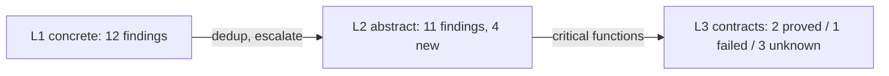

# LunaFlow


[](https://mooncakes.io/docs/riantr/LunaFlow)
[](https://github.com/riantr/LunaFlow/releases)
[](LICENSE)
[](https://mooncakes.io/docs/riantr/LunaFlow)

Trace-driven, three-proof-strength control-flow, taint, value-range, slicing and
contract analysis for MoonBit modules published on
[mooncakes.io](https://mooncakes.io/). The output is one Markdown report with
embedded Mermaid diagrams — no server, no HTML, no images.

The analyzer never compiles the module it analyses. It parses the MoonBit
source it is pointed at, executes a model of it, and writes the evidence out:
every finding carries the method that produced it, a confidence, and a
`file:line`.

One analyzer · three evidence strengths · one Markdown report.

## Features

* A funnel, not a mode switch

  `--level 1|2|3` is cumulative and `--funnel` runs all three. L1 deduplicates
  its findings, L2 splits its results into *confirmed* and *new*, and L3 is
  applied only to functions with an L1/L2 finding plus every function that
  already carries a contract. Functions escalated without a contract are
  reported as **specification gaps** — the funnel's explicit to-do list. When a
  target has no annotations, L3 reports **0 VCs and the gaps**, not invented
  proofs.

* A control-flow graph you can argue with

  The CFG is built from the parsed statement tree: branch nodes with `true` and
  `false` edges, loop heads with back edges, merge points, and `dead` nodes for
  statements after an unconditional exit. Execution paths come from the trace
  and are rendered beside the diagram. Dead code and unreachable nodes are
  **static** findings; non-termination is a **static + dynamic** finding; path
  coverage is **dynamic** and exact only for the executed trials. Each finding
  carries its method and confidence.

* Taint with stated rules

  Sources are entry-function parameters (and `@env.args` when the frontend sees
  it). Propagation follows recorded definitions and the variables each
  statement read; array reads inherit container taint; `length()` inherits
  receiver taint. Sinks are array indices and allocation sizes. The rules and
  their imprecision — field- and index-insensitive, no alias analysis, depth-6
  calls, unsupported `match` arms — are printed in every report.

  The **abstract** layer's taint is **labelled** and **kill-exact**: it carries
  the *set* of parameters whose values may have reached the value, the set is
  killed at an assignment and re-bound with the right-hand side's sources, and
  a taint finding says which parameter was untrusted — *"tainted value from
  parameter `len` may reach an array index"*. The abstract layer has **no
  implicit flow**: a tainted loop condition does not taint the loop's counter,
  because the counter does not carry the bound's taint. What the counter does
  carry is a *bound* — and the layer states that relation where a relation
  between two numbers belongs, in its value domain, so the honest claim (the
  index may be out of bounds) survives. The measurement is in
  `docs/qa/IFDS_PHASE1.md`. The **dynamic** layer keeps its implicit flow: it
  reports what it observed on a concrete path.

* Values at every point

  L1 records every `def` event keyed by function, source line and variable, so
  report §6.1 is a per-program-point value table and the JSONL trace has the
  full stream. L2 adds may-ranges from the abstract fixpoint. The distinction
  is explicit: observed samples are not a proof, and the abstract interval is
  an over-approximation at widening.

* Slices over the trace

  The dynamic dependence graph is built from `def`/`cond`/`index`/`call`
  events. Backward slicing walks to sources, forward slicing walks to sinks and
  returns. Criteria are `<var>@<fn>`, `<fn>:<line>` or a bare `<var>`. A slice
  is exact for the recorded trace, not a static closure; `--function` ensures
  the target function is executed before slicing.

* Contracts that admit ignorance

  Specifications are MoonBit comments: `//@ requires`, `//@ ensures`,
  `//@ invariant`, `//@ assigns`. L3 generates WP-style verification
  conditions for index bounds, allocation sizes, division, assertions and
  postconditions at every return and tail expression. Each VC is `proved`,
  `failed` or `unknown`; `unknown` is an honest third state, not a failure.
  This is a three-state interval prover, not an SMT-backed WP.

* Finding families that state their own limits

  Every finding kind has a **code** (`DEAD-CODE`, `TAINT-INDEX`, …) and a
  **contract**: the property it asserts, the assumption under which that is
  sound, and what it does *not* cover. `--explain-all` prints the roster,
  `--explain <code>` prints one contract, and `--families` / `--exclude-families`
  select by code. `--metrics` prints the ADEQUACY block — what was read, what was
  understood, what was entered, what was found — and every line in it carries
  its own coverage.

* A finding you can feed back in

  Every other table says **what** was found. `--counterexamples` says **what to
  feed the code** so that it happens again: for each finding an execution
  produced, the smallest input that reproduces it on its own — report §5.12.
  The input is minimal over the analyser's own candidate set, in the order the
  analyser lists those candidates in, so *"smallest"* is a statement about an
  order and not about the world, and the report says so in the same breath.
  The reproduction is checked against the finding's **site** — its family, its
  place, its function — and not against its evidence, because the evidence
  carries the observed value and the observed value is exactly what the
  smaller input changes. The L2 families are may-claims over the whole input
  set and the CFG families are claims about the program's shape: neither has
  an input to minimise, and the report counts them apart instead of
  pretending otherwise.

* An evolved value analysis, and the memory-safety classes it reaches

  The value analysis asks what a value's **range** is; the evolved value
  analysis asks what happens when the value is **used**. It finds the index
  that escapes its array, the divisor that may be zero, the integer operation
  that leaves its type's range, the `Option` that may be `None` where it is
  unwrapped, the element read before it was written, and the conversion that
  saturates silently. Each class was mapped onto what MoonBit actually does by
  running the real toolchain — and MoonBit's integer arithmetic **wraps
  instead of trapping**, so an overflow there is a silent wrong value rather
  than a crash. The classes MoonBit's type system makes impossible — use after
  free, pointer arithmetic, memory leaks, format strings — are in the roster as
  RESERVED families whose contracts say why they never fire.

* A memory layout model, in the terms the language actually has

  MoonBit has no addresses: no pointer type, no address space, no `size_of`, and
  the byte order is spelled out in the API rather than inherited from the
  machine. So the model is not a smaller hardware model — it is the **placement**
  question. The **global region** is evaluated once, in dependency order, because
  MoonBit resolves top-level bindings by dependency and not by file order. Every
  **allocation site** is classified as global, frame, heap or foreign by a static
  escape analysis, so the answer does not depend on which inputs a run sampled.
  And `--stability` re-samples the analysis and says, row by row, **which
  findings depend on the sample** — the abstract ones do not, and the observed
  ones do, and the report says so instead of letting a reader assume otherwise.

* A foreign address space, and the isolation between the two

  The C boundary is where an address appears, and it appears on the **other**
  side of it: MoonBit has no pointer type, so the foreign address space is not
  something the language has. The analyzer therefore models **two** spaces —
  the MoonBit one and the foreign one — and says, per parameter and per return
  value, which side it lands on: a **value** is copied, a **heap pointer** is
  the address of a MoonBit object, and an **`#external` type** is an address the
  C side owns. The set of pointer types is not guessed; it is the set the
  toolchain's own ownership diagnostic fires for, measured one type at a time.
  Six families then report what the boundary costs — a C symbol declared with
  two signatures, an object given away and then used, a calling convention that
  relies on a default the toolchain says will change, a declaration the
  published target cannot build, an address that cannot be named, and a
  constant that reaches two different C symbols. The first two are defects
  **the compiler does not catch**, and both were confirmed against the real
  toolchain.

* A concurrency model, and the class of defect that actually exists here

  MoonBit tasks do **not** run MoonBit code on several OS threads — measured,
  not assumed: a spin-lock whose spin loop contains no `await` **hangs**. So a
  task yields only at an await point, and the defect class is **interleaving
  sensitivity**, not a thread-level data race. The report says so in those
  words, and it says in §5.8.5 that a thread-level data race is **not**
  covered. The model finds the read-modify-write that an await point splits
  from its read, the read whose value is used after an await point while
  another task writes the cell, the circular lock order that deadlocks, and
  the lock that is never given back. A shared cell is a `Ref` a task
  **captures**, keyed by the function that binds it, and two tasks may
  interleave only if their owners may run at the same time — so the
  mutex-protected counter and the counter only one task touches are **not**
  reported.

* An IPC and buffer model, for the reads that can come back short

  MoonBit's own IPC goes through the core's `BinaryReader` and `BinaryWriter`
  traits, and those traits have a contract that the language does not enforce.
  Everything about it was **measured against the core**, not read off a
  documentation page: a `read_into` into a 16-byte sentinel buffer returned
  **3** and left the other 13 bytes at their old value, so a read can leave a
  **stale tail**; at the end of the stream the read returns **0** and `read()`
  returns `None`, so `0` is both "no progress" and "the stream ended"; a peeked
  **view** read `78 79 7A` after two reads had reused the reader's one buffer;
  and a **pending write is not a snapshot** — the reader received the bytes the
  buffer held when the write was *handed over*, not when it was issued. The
  model finds the read whose count is discarded, the loop that therefore cannot
  see the end of the stream, the view used after the reader ran again, and the
  buffer a task writes while the function that started it uses it too. One
  measurement **refused** to support a family: `write` is exhaustive — it loops
  until every byte is handed over — so there is no partial-write defect here,
  and none is claimed. The safe shapes are not reported: the read with its
  count kept, the view used *before* the next read, and the task with a buffer
  of its own.

* Markdown is the UI

  Reports use `flowchart TD` for CFGs and slices, `flowchart LR` for taint and
  the funnel. Labels are sanitized, node counts are capped (8 CFGs, 90 nodes per
  diagram, 40 taint/slice nodes), and every node and table row carries a
  `file:line`. The artifacts are diff-friendly and render on GitHub, GitLab and
  VS Code.

* Version pinning you can reproduce

  A bare coordinate or `@latest` is resolved once by `moon fetch`, then pinned:
  the report records the resolved version, the source root
  (`.repos/<author>/<module>/<version>`) and the declared target. The analyzer
  never compiles the target, so heavy modules are analyzable without their
  dependencies. The optional Cobertura bridge is the only path that needs a
  buildable target.

## What you get

The module is a library plus an executable, so "what you get" is a set of
**data structures and reports**, not a running service:

| You call | You get back | Shape |
|---|---|---|
| `LunaFlow analyze <coord>` | report, trace, findings, summary | `.md`, `_trace.jsonl`, `_findings.jsonl`, `_summary.json` |
| `LunaFlow analyze --funnel` | the same four artefacts plus L2 alarms and L3 VCs | report §3 / §5.2 / §6.3 / §8 |
| `LunaFlow analyze --level 2` | L1 baseline + abstract may-analysis | report §5.2, §6.3 |
| `LunaFlow analyze --level 3` | L1 + L2 + contract VCs | report §8 |
| `LunaFlow analyze --slice "<crit>"` | dynamic backward/forward slice | Mermaid graph + statement table |
| `LunaFlow analyze --coverage cov.xml` | compiled-suite coverage mapped onto CFG nodes | report §4.4 |
| `LunaFlow analyze --list-functions` | function, file, statement count | `FUNCTION<TAB>FILE<TAB>STATEMENTS` |
| `LunaFlow analyze --max-cfg-functions <n>` | how many functions the CFG pass covers (default 600) | report §2 states what was not covered |
| `LunaFlow analyze --max-findings <n>` | how many rows a findings table may show (default 300) | the rest are in `_findings.jsonl`, and the table states the family mix of the whole set |
| `LunaFlow analyze --families <codes>` | only the finding families named, by code | the same report, filtered |
| `LunaFlow analyze --exclude-families <codes>` | everything *except* the families named | the same report, filtered |
| `LunaFlow analyze --exclude <name>` | skip a directory name while walking (repeatable) | the same report |
| `LunaFlow analyze --metrics` | the ADEQUACY block: read, understood, entered, found | four `METRICS` lines |
| `LunaFlow analyze --per-function` | every function entered as an entry point, with the step budget and the `--max-functions` cap lifted | the same report, with no budget on the dynamic layer |
| `LunaFlow analyze --per-package` | **the default**: the module scanned package by package, each package with its own step budget | the same report, with a package table and one trace per package |
| `LunaFlow analyze --module-wide` | one step budget for the whole module, spent on the first packages in file order | the same report, with **one** trace file and no package table |
| `LunaFlow analyze --stability` | re-sample the analysis and report which findings depend on the sample | report §5.6 |
| `LunaFlow analyze --counterexamples` | re-run each finding an execution produced on its own input, and shrink that input to the smallest one that still reproduces it | report §5.12 |
| `LunaFlow analyze --level 2` + the EVA | the memory-safety and undefined-behaviour classes | report §5.3 |
| `LunaFlow --explain <code>` | one family's contract — property, assumption, exclusions | three clauses, no scan |
| `LunaFlow --explain-all` | the roster of every family and the property it asserts | one block, no scan |
| `@app.load_module(root, coord, version, limit)` | the parsed module and its ingestion statistics | `(ModuleAst, ScanStats)` |
| `@app.check_contracts(ast, ["f"])` | the verification conditions of a function | `ProofResult` |
| `@app.run_abstract(ast, max_functions, max_steps)` | the L2 findings of a module | `AbsResult` |

Every one of those is a **pure function or an explicit data value**. There is no
hidden global state and no network: the same inputs give the same bytes, which
is why `moon test` can assert on them and why the gate can check the
repository's own claims.

The three artefacts are the point of the tool. The **report** is the human
artefact — ten sections, Mermaid diagrams, `file:line` on every claim. The
**trace** is the audit evidence: one JSON object per event, 34 MB for a
doubleML run, and the reason the numbers above are checkable rather than
asserted. The **summary** is the machine artefact: counters a CI gate can read
without parsing prose.

## Install

```sh
moon add riantr/LunaFlow@0.1.40
```

That is a **module** dependency, and it belongs in the consumer's `moon.mod`.
`moon add` writes it for you, so the file ends up holding:

```toml
import {
  "riantr/LunaFlow@0.1.40",
}
```

The library is the package `riantr/LunaFlow/src/app`, and the **package**
import belongs in the consumer's `moon.pkg`:

```moonbit nocheck
///|
import {
  "riantr/LunaFlow/src/app",
}
```

The two blocks look alike and are not the same thing. `moon.mod` names a
*module* and pins the version it resolved; `moon.pkg` names a *package* inside
a module and takes **no version at all**. A version in a `moon.pkg` import is
not a newer spelling — it is an import the toolchain cannot find:

```
Cannot find import 'riantr/LunaFlow/src/app@0.1.0' in my/app/src/thing@0.1.0
```

The `src/` in the package path is part of the package's name, not a prefix the
toolchain strips. A module's **library** packages live under `src/` and its
**executables** under `cmd/`; the registry lists them under exactly those
paths — so `riantr/LunaFlow/src/app` is a package and
`riantr/LunaFlow/app` is not found.

For the same reason there is no `@latest`: the version is parsed as semver, so
`latest`, `^0.1.0`, `>=0.1.0`, `0.1` and `v0.1.0` are all rejected. A bare
`moon add riantr/LunaFlow` resolves the newest release and pins the concrete
version it found — that is the "latest" this toolchain has.

The package can be given a shorter name, which is the closest thing here to
Python's `from x import y as z`:

```moonbit nocheck
///|
import {
  "riantr/LunaFlow/src/app" @lf,
}
```

so that the call is `@lf.load_module(...)`. The alias belongs to the
**package**, not to a file: every file in that package sees it, and an import
statement inside a `.mbt` file is rejected outright — *"Invalid import
declaration here. Move this declaration to `moon.pkg`."*

`src/cli` is the executable in the same module — the command line over the same
library. Registry entry:
[mooncakes.io/docs/riantr/LunaFlow@0.1.40](https://mooncakes.io/docs/riantr/LunaFlow@0.1.40).

From a checkout of the module directory, the same executable runs directly:

```sh
moon run src/cli -- analyze <author>/<module>[@<version>|@latest]
```

**`moonx` runs this module.** The registry runner executes a published package
without installing it, and the natural self-check is:

```sh
moonx riantr/LunaFlow@latest riantr/LunaFlow@latest
```

That is the **standard form**, and it is the peer's form too — the two
analyzers are invoked identically, so a command that works on one works on
the other:

```sh
moonx riantr/LunaFlow@latest riantr/LunaFlow@latest
moonx riantr/moonbit_static_analysis@latest riantr/moonbit_static_analysis@latest
```

The full flag list is in [CLI reference](#cli-reference).

That works, and it is what the root package is for: `moonx` resolves the ROOT
package of a module coordinate, so a module with no root executable fails with
*"Prebuilt wasm asset does not exist"*. This module has one — a thin forwarder
to `src/command` — and the registry publishes its **wasm** artifact, because
`moonx --target` accepts no other value.

The CLI also accepts a **bare target**, which is what `moonx` passes as the
program's first argument:

```sh
moonx riantr/LunaFlow@latest riantr/LunaFlow@latest   # the bare coordinate IS the target
moon run src/cli -- riantr/LunaFlow@latest              # the same thing, locally
moonx riantr/LunaFlow@latest .                         # a path IS the target too
moonx riantr/LunaFlow@latest                            # no target at all: the current directory
```

**The target slot follows the peer analyzer's rule**, so the two tools take the
same invocation:

| Target | What it is | What happens |
|---|---|---|
| `author/module[@version]` | a coordinate | it is fetched through `moon fetch` and analysed |
| `./path`, `/abs/path`, `C:\path` | a path | it is analysed where it stands |
| nothing | the default | the **current directory** is analysed |

A bare coordinate is an implicit `analyze`. A path is a path — but a path that
LOOKS like a coordinate (`fixtures/vuln_demo`) is a coordinate, and the registry
is asked for it. The peer analyzer resolves it the same way, and it is why a
local path needs the `./`.

### What the release was checked on

`moon 0.1.20261126` (ccd306a, 2026-11-26), carrying `moonc v1.0.0-rc1+3c0520448`
— the toolchain the numbers in [Verification](#verification) were measured on,
and the one the whole gate was run against for this release. The CI runner
installs whatever the CDN serves as `latest` on the day it runs, so this row is
a measurement of a moving target, and it is kept honest by re-running the whole
gate against the newest toolchain before every release. The older
`moon 0.1.20261102`, carrying `moonc v0.10.19+bee578715`, is still
supported and is what the core-compatibility contract is measured against, so
both build this module. The reason that is checked rather than hoped for is
under [The core compatibility contract](#the-core-compatibility-contract).

The module is **native, wasm and js**. The analyzer reaches the filesystem and
spawns `moon fetch`, and the async runtime implements both on native and wasm
only — so the `fs` and `process` call sites sit behind `#cfg` guards with
stubs for the backends that have no filesystem, and the js build is a REAL
build rather than a skipped one. `supported_targets` is `+native+wasm+js`, and
`preferred_target` is `wasm` because the registry publishes ONE artifact per
version and `moonx --target` takes `wasm` as its one possible value.

The wasm backend really does work, and it is not a degraded build:

```sh
moon run . --target wasm -- analyze riantr/moonbit_static_analysis@latest --out reports
```

That fetches the target, analyses it and writes the report from the wasm
artifact — the same numbers as the native run.

**wasm-gc is not supported, and it is not a choice.** MEASURED, and the reason
is now precise. The upstream `moonbitlang/core/async/fs` and
`moonbitlang/core/async/process` ship `native` and `wasm` implementations
only, and their whole import block is guarded by
`#cfg(any(target="native", target="wasm"))` — on every other backend those
packages compile to nothing, and each call site becomes *"value not found in
package"*. On the pristine tree that was **11 errors** in `src/app/scan.mbt`
(`process.run`, `fs.readdir`, `fs.exists`, `fs.kind`, `fs.Unknown`,
`fs.Directory`, `fs.Regular`, `fs.read_text`) and, once those are gone,
**3 more** in `src/command/command.mbt` (`fs.write_text`, `fs.read_text`,
`fs.mkdir`).

Those guards are what took the library to wasm-gc in the first place. The module
now **declares** its supported set — `supported_targets = "+native+wasm+js"` in
`moon.mod` — so the toolchain refuses the backend before it compiles anything:

```text
Package 'riantr/LunaFlow/src/app' does not support target backend 'wasm-gc'.
Supported backends: [js, native, wasm]
```

The *executable* still cannot be built there either, and that blocker is upstream:
the core's wasm-gc async stub has no `run_async_main`, so

```
Error: [4021] Value run_async_main not found in package `moonbitlang/core/async`.
```

`async fn main` is the only way to reach the async runtime, and a plain
`fn main` may not call an async function — `Error: [4149]`, on every backend
alike. So wasm-gc stays out of the published set, and it is upstream's to fix.

### The host contract

The published wasm is not self-contained. It imports **108 host symbols**, and
the HOST has to provide every one of them when the module is instantiated:
`moonx` supplies them from the async runtime bundled with the *user's*
MoonBit toolchain.

| Import module | Symbols | Served by |
|---|---:|---|
| `moonbitlang/async` | 95 | the toolchain's bundled core |
| `__moonbit_fs_unstable` | 12 | the toolchain's bundled core |
| `wasi_snapshot_preview1` | 1 | the host runtime's WASI |

The ABI module name is still `"moonbitlang/async"` even though the package
path is now `moonbitlang/core/async`: a wasm import's module name comes from
the FFI declaration in the source, and the source still declares it that way.
What changed is the SET of symbols, and the set grew — so the floor is a
**toolchain**, not a pinned dependency, and a host that still carries the
standalone `moonbitlang/async` module cannot instantiate this artifact.

MEASURED against the toolchain this release was verified on:
`moonbitlang/core` 0.10.19+bee578715 declares 272 host symbols and covers
**107 of 107** of the artifact's core-extern imports. The contract is measured
from the artifact's own import section by `scripts/qa/host_requirements.mjs`
and recorded in `docs/host_requirements.txt`.

### The core compatibility contract

The runtime comes from the toolchain, so the version of `moonbitlang/core`
this module builds against is **the user's toolchain**, not a pin here. That
is the point of the swap — and it is also a hazard, because the core's API is
allowed to change shape between toolchains, and this module has to build
against all of them.

MEASURED, the hard way: the first attempt at this release passed on
`moon 0.1.20261102` (core 0.10.19) and **failed on the CI runner**, which
installs the newest MoonBit — `moon 0.1.20261104`, core 0.10.20:

```text
Error: [4014]
  ╭─[ src/app/scan.mbt:284:12 ]
 284 │     stdout=@process.read_from_process(),
    │            ──────────────┬─────────────
    │                          ╰─────────────── Expr Type Mismatch
       has type : (ReadFromProcess, SharedProcessOutput)
       wanted   : ProcessOutput
```

The capture call was written against the older core. Between the two:

| Declaration | core 0.10.19 | core 0.10.20 |
|---|---|---|
| `read_from_process()` | `-> &ProcessOutput` | `-> (ReadFromProcess, SharedProcessOutput) raise` |
| `run`'s `stdout~` | `&ProcessOutput = @stdio.stdout` | `ProcessOutput = Inherit` |

So the fix is not a patch to one call — it is to **use only the part of the
API that is the same in both**, and to let the filesystem be the authority:

- the fetch runs `moon fetch --quiet`, so it prints nothing on success and its
  error reaches the user directly;
- the version comes from the directories the fetch wrote, not from parsing a
  log;
- the child inherits the parent's streams, so nothing has to be captured.

That is also a better design than the one it replaced. The version used to be
scanned out of the `moon fetch` log, and that scan was the source of two
separate defects — a garbage version on the Linux runner (a green run over an
empty tree) and a version of `"."` on Windows. With the log gone, that whole
class of bug is gone by construction.

**AND THE DIRECTORIES ARE ORDERED, NOT JUST LISTED — AND THE ORDER WAS WRONG.**
The analyser pins the **newest** of the directories the fetch wrote. A
toolchain module's version is a DATE with a build hash on the end —
`0.1.20261126+3c0520448` — and the comparison read the **whole** segment as a
number, so the hash made it unparseable, **every** toolchain version degraded
to `[0, 1, 0]`, compared **equal** to every other toolchain version, and the
first directory in the list won. The list is sorted, so the **oldest** won.
MEASURED 2026-11-28: `moonx riantr/LunaFlow@latest moonbitlang/core@latest`
analysed `0.1.20261102+97801ee1b` while the registry's latest was
`0.1.20261126+3c0520448` — **24 days** older, and **1,444** files against
**1,542**. The segment is now read as its **leading number** (`20261126`), every
segment is compared rather than the first three, and a tie is broken by the
byte order of the two strings, so the comparison is an **order** and not a
coincidence.

**AND THE CHECK IS A CHECK, NOT A COMMENT.** `scripts/qa/version_pin.mjs`
plants a **decoy** — a version directory one day older than the registry's
latest, in a scratch probe of its own, so the candidate list holds a **wrong
answer** and the check has something to reject. It asserts that the version the
analyser analysed is the registry's latest, that it is the newest of the
fetched versions under a **second implementation** of the rule written in
JavaScript, and that the tree it read is the module and not the decoy.
MEASURED: with the fix reverted the check goes **red** and names what it
analysed — the decoy, `files=1` — and with the fix it is green, `files=1,542`.
`scripts/qa/version_pin_falsify.mjs` proves the check can fail: a candidate
**newer** than the registry's latest turns it red, a registry version that
cannot be fetched takes it to **UNKNOWN** (exit 2) rather than to a pass, and
the ordinary run stays green.

**The contract is checked, not hoped for.**
`scripts/qa/core_compat.mjs` fetches the registry's newest `moonbitlang/core`,
finds every core on the machine, and compares the declarations this module
actually uses — the parameters it passes and the return type, because a
parameter it does not pass may change shape without breaking anything, while
a return type that changes always does. MEASURED: **12 declarations, identical in
every core compared** — the registry's newest (`moonbitlang/core@0.1.20261117+06da1ed44`
at the time of writing) plus every core on the machine. **The count of cores is the
machine's, and it moves**; the invariant is the 12 declarations, all of them
identical.

**And ONE MORE declaration, which is TEST-ONLY.** The property-based tests import
the toolchain's own `moonbitlang/core/quickcheck` — the package inside the
`moonbitlang/core` the toolchain bundles — and nothing else:

```moonbit
import {
  "moonbitlang/core/quickcheck" @coreqc
} for "test"
```

So the gate compares a **13th** declaration, `quickcheck.check`, and it is counted
separately because the two contracts are different:

| | what it is | what a core without it means |
|---|---|---|
| the **12** | dependencies of the published library | the library does not build there |
| the **1** | a dependency of this module's **tests** only | the library still builds there; only the tests do not |

The gate therefore reports a missing **test-only** declaration as a NOTE, not as a
break, and still reports a *renamed* one as a break — a core that declares
`check` with a different signature would break the tests, and that is real.
MEASURED: the `count` label the tests pass is compared, every core in the
contract declares it with the same signature, and a core with `count` renamed to
`cases` is reported as *"no parameter with label count"* — the gate catches the
rename that let 0.1.23 fail on the runner.

**And a fetch that unpacked nothing is not a compatibility break.** `moon fetch`
creates the destination directory before it unpacks, so an interrupted fetch leaves
an **empty** tree — and the next fetch says *"already exists"* and unpacks nothing.
The gate would then compare the module's declarations against an empty tree and
report that the newest core declares **none** of them, which is not what happened.
MEASURED: this happened on 2026-11-17, and the core was fine. The gate now checks
the fetched tree for **content**, clears an unusable one and fetches again, and
reports a fetch that cannot obtain the core as *"the core's compatibility is
UNKNOWN"*, never as an incompatible declaration.

**And a LABEL is part of the API, not just a type.** MEASURED, the hard way: the
release after that one failed on the CI runner at the very first check, with

```text
Error: [4085]
  ╭─[ src/command/command.mbt:1103:35 ]
 1103 │   @fs.mkdir(path, recursive=true, allow_exist=true) catch {
    │                                   ─────┬─────
    │                                        ╰─────── This function has no parameter with label allow_exist~.
```

The newest core — 0.10.21, the one the runner's toolchain bundles — **renamed** that
parameter: `allow_exist~` became `allow_existing~`. The *types* are unchanged, so a
comparison that looked at types alone saw nothing, and this gate reported *"12
declarations identical in every core"* on the very commit that could not compile.

Two things were wrong, and both are fixed:

- the **call** passed a label that one core no longer declares. It passes none now.
  The label was redundant anyway: the error it suppresses is AlreadyExists, and the
  call's `catch` swallows every error — so the behaviour is the same on every core,
  and a label that was renamed under this module is never passed again;
- the **gate** never compared a label at all. It collected a call's arguments with
  the opening parenthesis still attached, so the first argument looked like a nested
  call and *no* argument was ever recognised as a labelled one — `fs.mkdir` read as
  `path : StringView | -> Unit` for a call that passes `recursive=true,
  allow_exist=true`. And it took a parameter's whole head (`"recursive~ : Bool"`) as
  its name, so no label could ever match a declared parameter. Both are fixed, and a
  label the core does not declare is now **reported as a break**.

The gate prints the labels it compares, so the difference is visible instead of
inferred:

```text
  ok   fs.mkdir  path : StringView | recursive~ : Bool = false | -> Unit
```

**The release is CI-driven.** Pushing the release tag runs
`.github/workflows/publish.yml`, which re-runs this gate, checks that the
README names the released version, publishes to mooncakes with the
`MOONCAKES_RIANTR_TOKEN` secret, and creates the GitHub Release. Nothing is
published from a workstation.

**There is no dependency pin any more.** The async runtime comes from the
toolchain-bundled `moonbitlang/core` module, so `moon.mod` has no import
block at all — there is nothing that can drift from the registry, and nothing
that can disagree with the host that instantiates the artifact. The CI check
enforces the swap itself: a `moonbitlang/async` dependency coming back is an
error, not a warning.

The trade is a real one, and it is worth stating plainly.
`moonbitlang/core/async` is still marked **experimental** by the core team, so
every package that uses it says so in
`options("allow-experimental-packages": ...)`. And the minimum host toolchain
moved up with the swap, because the artifact now asks the host for more symbols
than the standalone module provided.

### What changed in 0.1.40

**THE DEFAULT OUTPUT DIRECTORY WAS THE REPOSITORY'S OWN COMMITTED CORPUS, AND A SELF-CHECK OVERWROTE THE EVIDENCE IT WAS MEANT TO BE COMPARED AGAINST. 0.1.40 IS THE RELEASE THAT CARRIES THE FIX — and the fix is a DECISION that was written down and then made: the 2026-11-25 QA round diagnosed this failure mode, left the behaviour unchanged and said, in so many words, "it is a decision for the maintainers". This is that decision.** The published interface does not change: the `.mbti` this release publishes is byte-identical to the one 0.1.39 published, so no consumer's build can break.

**THE DEFECT, MEASURED ON THIS REPOSITORY.** A bare `moonx riantr/LunaFlow@latest` wrote **13** files into `reports/` — and `reports/` is, in this repository, the **COMMITTED CORPUS**: the report, the sidecar and the summary of the two corpora and of the fixture. The self-check therefore **overwrote the evidence it was supposed to be compared against**, and the overwrite read as a change in the analysis. MEASURED again while this release was being prepared: the same 13 files, `riantr_LunaFlow_0.1.39.*`, written into the corpus by a run with no `--out`.

**THE FIX: THE DEFAULT IS A BUILD DIRECTORY.** It is `_build/qa/lunaflow` now. A build directory is what it is for — it is disposable, it is never tracked, and a run that nobody asked to keep leaves **nothing** behind in the tree it was pointed at. The corpus is still WRITTEN there, **deliberately**: the measurement driver passes `--out reports` on purpose, and the corpus stays committed evidence.

**AND THE REPORT NO LONGER PRINTS A COMMAND THAT OVERWRITES THE CORPUS.** The reproduction line in the report's §10 used to read `--out reports/`. In a tree that carries a corpus, `reports/` IS the corpus, so the command the report handed to a reader was a command that **overwrote the evidence**. The output directory is not in `ReportInput` — adding a field to a `pub(all)` struct would break every consumer that builds one — so the command now says **nothing** about it and the default applies.

**THE CHECK MEASURES THE REPOSITORY'S OWN CORPUS, BEFORE AND AFTER.** `scripts/qa/default_output.mjs` runs the analyser with no `--out` and asserts that the committed corpus is **byte-identical** afterwards — the same files, the same sizes, the same SHA-256 — and that the artefacts landed in the default build directory and in **nothing** else. **The default is READ OUT OF THE TOOL'S OWN SOURCE** — `Opts::default()` in `src/command/command.mbt` — because a check that carries the answer it is looking for cannot tell a fix from a coincidence, and cannot notice a change to the declaration. Its expectation is a **parameter**, so it can be asked a different question, and `scripts/qa/default_output_falsify.mjs` uses that: pointed at the old default (`reports`) the check goes **red** and says where the artefacts are not. **7** checks in the check, **13** in the falsifier.

**AND THE GHERKIN SCENARIO CARRIES IT TOO.** The malformed-command-line scenario now asserts that nothing is written into the **corpus directory** as well as into the working directory — the two are different directories, and only the second was checked.

**AND THE GATE WAS BLIND — THE CHECK THAT WAS SUPPOSED TO PROTECT THE CORPUS DELETED IT, AND 63 GREEN STEPS DID NOT SEE IT.** MEASURED 2026-11-28, while this release was being prepared: the first version of the new default-output check **cleared** the directory it was told to expect artefacts in, and its falsifier pointed that at the **old default** — which IS this repository's committed corpus. So the check DELETED all **28** corpus files — **194,178,849** bytes of committed evidence — and the gate came back **GREEN**, because **NOTHING IN IT LOOKED AT THE WORKING TREE**. `git status` showed 28 deleted files; the gate said "63 passed, 0 failed". The files were restored from the index, and the tree is clean again: **28** tracked, **28** on disk.

**THE BLIND SPOT WAS NOT THE CHECK — IT WAS THE QUESTION THE GATE WAS ASKING.** A gate that runs 63 checks and says GREEN has answered "did every check agree with what it claimed?". It has NOT answered "is the tree still the tree?". Those are different questions, and only the second one catches a check that destroys what it measures. So the gate now ends with **two** steps that ask it: `scripts/qa/tree_intact.mjs` asks **git's own three** questions — is every tracked file still on disk, is the corpus byte-identical to the index, and did a check leave stray files under the corpus — and it is **last** on purpose, because a step that runs early cannot see what a later step did. `scripts/qa/tree_intact_falsify.mjs` proves it can go red on a tracked file **deleted**, on a corpus file **overwritten**, and on a **stray** file, against git repositories of its own.

**AND THE CHECK THAT DELETED THE CORPUS WAS REWRITTEN, NOT PATCHED.** The default is now **read out of the tool's own source** instead of carried by the check, so a change to the declaration cannot pass unnoticed; the expected directory is cleared **only when it is inside the build tree**, so the corpus is never cleared whatever the expectation is; and every falsifier case runs against a **replica**, so the real corpus is never the thing at risk.

**THE PUBLISHED INTERFACE DOES NOT CHANGE.** The `.mbti` at `v0.1.39` and the one this release publishes are **byte-identical** — **26,207** bytes, **1,279** lines each — so `scripts/qa/release_interface.mjs` finds **0** breaks a consumer can see. The default lives in a private `Opts` and in the usage text, and neither is published.

**THE MEASUREMENT MOVED, BECAUSE THIS TREE MEASURES ITSELF.** The per-package measurement was re-run with the driver. On this tree: **7,926 → 7,927** statements, and the trace grew by the one statement. The two corpus rows did not move — they measure **pinned** corpora.

**AND THE PUBLISHED RELEASE IS THIS TREE — MEASURED, NOT ASSERTED.** `moonx riantr/LunaFlow@0.1.40` over this tree and the local build over the same tree agree on **every one of the eighteen counters** — files **68**, functions **1,234**, statements **7,927**, unsupported **382**, trace events **230,893**, steps **28,459**, taint sinks **45**, range variables **421**, dead code **0**, unreachable **0**, infinite loop **0**, level **1**, findings **72** — and the two findings sidecars are **IDENTICAL**: **72** rows each, and **not one** of them differs in its message or in its evidence.

**AND THE PUBLISHED DEFAULT OUTPUT DIRECTORY IS THE BUILD DIRECTORY.** MEASURED against the registry's own copy: a bare `moonx riantr/LunaFlow@latest` writes **4** files into `_build/qa/lunaflow`, into **nothing** in the working directory, and into **nothing** in `reports/` — and a corpus placed in the tree before the run is **byte-identical** afterwards, the same sizes and the same SHA-256. The report it prints names **no** output directory: `LunaFlow analyze <coord>@latest --funnel`.

**AND THE PUBLISHED PACKAGE CARRIES NEITHER THE CORPUS NOR A RAW TRACE.** Measured from what the registry serves: **183** files, **3,745,009** bytes unpacked, the largest entry `LunaFlow_Logo.png` at **993,480** bytes, **0** raw traces and **0** corpus files — package digest `626ca51d8ae49ebc1fe7471e2265ce39c4b2b3a896a1cc8f6b9c7555788452fc`.

**AND THE GATE IS GREEN, ALL OF IT: 65 steps, 65 passed, 0 failed, 0 unknown.** The tests are **360** on all three targets. The last two steps are new: `tree_intact_falsify.mjs` proves the tree check can go red, and `tree_intact.mjs` asks it — **last**, because a step that runs early cannot see what a later step did.

### What changed in 0.1.39

**`@latest` PINNED THE OLDEST VERSION, AND THE REPORT DESCRIBED A TREE 24 DAYS OLDER THAN THE ONE THAT WAS ASKED FOR. 0.1.39 IS THE RELEASE THAT CARRIES THE FIX — and it is the first one that does: the published 0.1.38 still pins the OLDEST version the fetch left behind, for every module whose version carries a build hash, which is every module the toolchain itself ships. The published interface does not change: the `.mbti` this release publishes is byte-identical to the one 0.1.38 published, so no consumer's build can break.**

**THE DEFECT, MEASURED ON THE TOOLCHAIN'S OWN STANDARD LIBRARY.** `moonx riantr/LunaFlow@latest moonbitlang/core@latest` analysed `moonbitlang/core` **0.1.20261102+97801ee1b** while the registry's latest was **0.1.20261126+3c0520448** — **24 days** newer — and the report's title named the OLDER tree. Every number in that report described the older tree: **1,444** files against the **1,542** of the tree that was asked for, **14,967** functions against **15,836**, **99,586** statements against **105,518**.

**THE CAUSE IS THE COMPARISON, NOT THE FETCH.** The analyser pins the **newest** of the directories the fetch wrote, and the version comes from the FILESYSTEM rather than from a parsed log — that part was right. But a toolchain module's version is a DATE with a build hash on the end — `0.1.20261126+3c0520448` — and the comparison read the **whole** third segment as a number, so the hash made it unparseable: **every** toolchain version degraded to `[0, 1, 0]`, compared **equal** to every other toolchain version, and the first directory in the list won. The list is sorted, so the **oldest** won. `parse_int` returned its fallback for the whole segment the moment it met the `+`.

**THE SCOPE IS EXACTLY THE MODULES THAT CARRY A BUILD HASH.** The three-number versions — `riantr/moonbit_doubleML@0.164.68`, `riantr/moonbit_static_analysis@0.6.0` — were never affected, and the committed corpus over them did not move. The toolchain's own modules all carry the hash, and all of them were affected.

**THE FIX.** A version segment is read as its **leading number** (`20261126`), **every** segment is compared rather than the first three, and a tie is broken by the byte order of the two strings — so the comparison is an **order** and not "whichever directory the list handed over first". `parse_int` keeps its strict semantics on purpose: it reads CLI arguments and numbers in the tree, and a leading-digits rule there would change what `--max-functions 100abc` means. The fix is at the version layer, where the hash actually is.

**THE FALSIFICATION IS PROVEN, NOT ASSUMED.** `scripts/qa/version_pin.mjs` plants a **DECOY** — a version directory one day older than the registry's latest, in a scratch probe of its own — so the candidate list holds a **wrong answer** and the check has something to reject. MEASURED: **with the fix reverted the check goes red and names what it analysed — the decoy, `files=1`** — and with the fix it is green, `files=1,542`. `scripts/qa/version_pin_falsify.mjs` proves the check can fail: a candidate **newer** than the registry's latest turns it red, a registry version that cannot be fetched takes it to **UNKNOWN** (exit 2) rather than to a pass, and the ordinary run stays green. Both are **gate steps now** — in the local gate and in CI.

**THE PUBLISHED INTERFACE DOES NOT CHANGE.** The `.mbti` at `v0.1.38` and the one this release publishes are **byte-identical** — **26,207** bytes, **1,279** lines each — so `scripts/qa/release_interface.mjs` finds **0** breaks a consumer can see. The two new helpers are private.

**AND THE MEASUREMENT MOVED, BECAUSE THIS TREE MEASURES ITSELF.** The per-package measurement was re-run with the driver after the version bump, not edited by hand. On this tree: **871 → 873** functions entered, **27,585 → 27,610** steps, **139,746 → 139,896** events, **22,707,387 → 22,729,567** bytes of trace, largest entry **21,939,394 → 21,961,574**. The two corpus rows did not move: they measure **pinned** corpora.

**AND THE GATE IS GREEN, ALL OF IT: 61 steps, 61 passed, 0 failed, 0 unknown.** The tests are **360** on all three targets.


**AND THE PARITY THIS RELEASE WAS FOR IS MEASURED: `@latest` NOW SAYS WHAT THIS TREE SAYS.** `moonx riantr/LunaFlow@latest` over this tree resolves **0.1.39** — the artefact it writes is named `riantr_LunaFlow_0.1.39` — and its summary was compared with the local build's, field by field: **all 18 counters are equal** — files **68**, functions **1,234**, statements **7,926**, unsupported **382**, trace events **230,893**, steps **28,459**, taint sinks **45**, range variables **421**, dead code **0**, unreachable **0**, infinite loop **0**, level **3**, findings **120** — and the two findings sidecars are **IDENTICAL**: **120** rows each, and **not one** of them differs in its message or in its evidence. **The published release is the tree.** Before this release the same comparison said otherwise: the published 0.1.38 pinned the OLDEST version the fetch left behind, so it analysed a tree 24 days older than the one that was asked for.

**THE PUBLISHED BYTES, MEASURED FROM THE REGISTRY'S OWN COPY — not from this tree.** A local build says what this source produces; it does not say what a reader downloads. So the record below is the cached package the registry served, `~/.moon/registry/cache/riantr/LunaFlow/0.1.39.zip`:

| what | measurement |
|---|---|
| the published package | **1,980,777 bytes** |
| SHA-256 | `dcfaee7a80981ffae5daea6e3127d9d6648bee98bf4e895df38c4ff9e5d7440b` |
| what is in it | **179** files, **3,686,749** bytes unpacked, largest entry `LunaFlow_Logo.png` at **993,480** bytes, and **no raw trace** — the traces stay in the repository |
| a clean consumer resolving it | `scripts/qa/verify_published.mjs 0.1.39` → **4 of 4 PASS**, `moon add` pins `riantr/LunaFlow@0.1.39`, the consumer builds and runs, and the published library API answers |
| the published artefact over the fixture corpus | `scripts/qa/published_items.mjs 0.1.39` → **14 of 14 PASS**, and the published report matches the local build's on the same corpus — **29 findings** each. The published artefact also carries the **counterexample section**: its table and its sidecar agree, and the sidecar is **byte-identical** to the local build's — **2,204 bytes**, **9** rows |
| the check that would catch a published artefact that does not | `scripts/qa/published_items_falsify.mjs 0.1.39` → **6 of 6 PASS**, on **copies** of the local artefacts |

That is the release verified through the artefact a reader actually gets. It cannot be checked from the tree, which is why it is a separate row. And the **package the registry read** is the one the envelope check measured against the **real archive**: **179** files, **3,686,749** bytes unpacked, largest entry **993,480** bytes — inside the envelope the registry has already accepted (**46,274,868** and **39,479,846**).
### What changed in 0.1.38

**THE RECURSION GUARD WAS SILENT, AND A TRUNCATED ANALYSIS LOOKED LIKE A CLEAN ONE. 0.1.38 IS THE RELEASE THAT CARRIES THE FIX — and it is the first one that does: the published 0.1.37 was cut from `7cccda8` (2026-11-24, 23:12), and the fix landed the next morning (`32ca2e9`, 2026-11-25, 07:52), so the version the registry served until now truncated recursion SILENTLY. The published interface does not change: the `.mbti` this release publishes is byte-identical to the one 0.1.37 published, so no consumer's build can break.**

**THE DEFECT.** The L1 interpreter followed a call chain until the recursion depth budget was spent, and then returned `VUnknown` — no claim, no event, no trace. A guard that returns "unknown" without saying so is not a guard: the report read as a clean run where the analyser had stopped looking.

**THE FIX REPORTS THE TRUNCATION; IT DOES NOT DEEPEN THE ANALYSIS.** The depth limit itself is unchanged — it is **6**, at `src/command/command.mbt:1044` — and **no** `--max-depth` flag was added, because the scope of this fix is the REPORT, not the budget. At the guard the interpreter now emits an UNDECIDED `BUDGET-EXCEEDED` claim and an `EvBudget` trace event, exactly as the step budget already does. **No new family was needed**: `BUDGET-EXCEEDED` already means "an analysis budget was exhausted", and the two budgets are told apart by the claim's MESSAGE and EVIDENCE, the same way the L1 and the L2 step budgets already share the family. The claim is made **once per function run**, mirroring the step budget's own flag.

**MEASURED, ON PROBES THE ANALYSER RUNS ITSELF.**

| probe | before the fix | after the fix |
|---|---|---|
| a self-recursive function | 0 claims | **1** claim, verdict `unknown`, evidence `max_depth=6 depth=6 call=r_rec` |
| a mutually recursive pair | 0 claims | **2** claims, one per entry point |
| an ordinary, non-recursive call chain | 0 claims | **0** claims — the analyser must not claim a depth budget for an ordinary call |

**THE FALSIFICATION IS PROVEN, NOT ASSUMED.** With the fix reverted the two new test files fail CLEANLY — `expected 1, actual 0` and `false is not true`, no panic and no abort — and with it they pass. A test that aborts the binary takes the other tests' results down with it, so every read of a claim is guarded. **12** new test blocks, in `src/app/recursion_test.mbt` (**6**) and `src/app/recursion_wbtest.mbt` (**6**): 339 → 351, on all three targets.

**THE ATTRIBUTION NEEDS CORRECTING, AND IT MATTERS.** The L2's loss of `INDEX-OOB` over a recursive call is NOT recursion's: the L2 does not follow user calls at all — a disclosed limitation — so it loses that claim on an ordinary, non-recursive call too. What the recursion fix repairs is the L1's depth guard.

**AND THE PUBLISHED 0.1.37 SAID 71 FINDINGS WHERE THIS TREE SAYS 72 — THE DIFFERENCE IS THE FIX, MEASURED ON THE SAME TREE WITH THE SAME INVOCATION.** The published 0.1.37 and the build of this tree were both run over this tree, with the same arguments, and their two summaries were compared field by field:

| counter | published 0.1.37 | this tree | what moved |
|---|---|---|---|
| trace events | 230,666 | **230,667** | the fix's one `EvBudget` event |
| findings | 71 | **72** | the fix's one `BUDGET-EXCEEDED` claim |
| files · functions · statements | 68 · 1,230 · 7,888 | 68 · 1,230 · 7,888 | nothing |
| unsupported statements | 382 | 382 | nothing |
| steps | 28,434 | 28,434 | nothing |
| taint sinks | 45 | 45 | nothing |
| range variables | 416 | 416 | nothing |
| dead code · unreachable · infinite loop | 0 · 0 · 0 | 0 · 0 · 0 | nothing |
| level | 1 | 1 | nothing |

**Sixteen** counters are equal and **two** moved, and the findings sidecars say the same thing: the one claim that is new is `BUDGET-EXCEEDED | src/app/parser.mbt:1300` — verdict `unknown`, evidence `max_depth=6 depth=6 call=parse_expr` — the analyser's own recursive-descent parser reaching the depth budget while it analyses its own source. The other **71** findings are identical, claim for claim: **not one** of them changed its message or its evidence. A budget cannot be answered by a guard, because THE BUDGET IS THE BOUND, so the claim is REGISTERED in `src/app/selfscan_guards_wbtest.mbt` rather than guarded away.

**THE COMMITTED ARTEFACTS DID NOT MOVE, AND THAT WAS MEASURED, NOT ASSUMED.** `doubleML` **0.164.68** reports **19** `BUDGET-EXCEEDED` claims and `static_analysis` **0.6.0** reports **34** — every one of them a **step**-budget claim (`max_steps=2000`), and **not one** a depth-budget claim (`max_depth`). So `reports/` was NOT regenerated and the published totals stand.

**THE PUBLISHED INTERFACE DOES NOT CHANGE.** The `.mbti` at `v0.1.37` and the one this release publishes are **byte-identical** — **26,207** bytes, **1,279** lines each — so `scripts/qa/release_interface.mjs` finds **0** breaks a consumer can see. The recursion guard lives inside the interpreter, and `Interp` is a private type: no declaration changed shape, so no consumer's build can break.**

**AND THE MEASUREMENT WAS RE-RUN AFTER THE VERSION BUMP, AND EVERY COUNTER CAME BACK THE SAME.** The per-package measurement names this tree's traces after the module coordinate, so a version bump renames them; the artefact was regenerated with the driver, not edited by hand. On this tree: **871** functions, **27,585** steps, **139,746** events, **22,707,387** bytes of trace, largest entry **21,939,394** — every one of them the number the committed artefact already carried, and the two corpus rows the same: `static_analysis` **0.6.0** at **76,591,727** bytes module-wide and **112,175,918** per package, `doubleML` **0.164.68** at **80,035,384**. **Only the trace FILE NAMES moved, and they moved with the version in them.**

**AND THE GATE IS GREEN, ALL OF IT: 59 steps, 59 passed, 0 failed, 0 unknown.** The tests are **358** on all three targets.

**AND THE PARITY THIS RELEASE WAS FOR IS MEASURED: `@latest` NOW SAYS WHAT THIS TREE SAYS.** `moonx riantr/LunaFlow@latest` over this tree resolves **0.1.38** — the artefact it writes is named `riantr_LunaFlow_0.1.38` — and its summary was compared with the local build's, field by field: **all eighteen counters are equal** — files **68**, functions **1,230**, statements **7,888**, unsupported **382**, trace events **230,667**, steps **28,434**, taint sinks **45**, range variables **416**, dead code **0**, unreachable **0**, infinite loop **0**, level **1**, findings **72** — and the two findings sidecars are **IDENTICAL**: **72** rows each, and **not one** of them differs in its message or in its evidence. **The published release is the tree.** Before this release the same comparison said otherwise: the published 0.1.37 was one event and one claim short, and that gap WAS the fix.

**THE PUBLISHED BYTES, MEASURED FROM THE REGISTRY'S OWN COPY — not from this tree.** A local build says what this source produces; it does not say what a reader downloads. So the record below is the cached package the registry served, `~/.moon/registry/cache/riantr/LunaFlow/0.1.38.zip`:

| what | measurement |
|---|---|
| the published package | **2,132,359 bytes** |
| SHA-256 | `8c7da2df2800a3ab6d1253f0c76f10236b57a0257ed76a71f5f01fd71b2770c4` |
| what is in it | **186** files, **5,516,792** bytes unpacked, largest entry `LunaFlow_Logo.png` at **993,480** bytes, and **no raw trace** — the traces stay in the repository |
| a clean consumer resolving it | `scripts/qa/verify_published.mjs 0.1.38` → **4 of 4 PASS**, `moon add` pins `riantr/LunaFlow@0.1.38`, the consumer builds and runs, and the published library API answers |
| the published artefact over the fixture corpus | `scripts/qa/published_items.mjs 0.1.38` → **14 of 14 PASS**, and the published report matches the local build's on the same corpus — **29 findings** each. The published artefact also carries the **counterexample section**: its table and its sidecar agree, and the sidecar is **byte-identical** to the local build's — **2,204 bytes**, **9** rows |
| the check that would catch a published artefact that does not | `scripts/qa/published_items_falsify.mjs 0.1.38` → **6 of 6 PASS**, on **copies** of the local artefacts |

That is the release verified through the artefact a reader actually gets. It cannot be checked from the tree, which is why it is a separate row. And the **package the registry read** is the one the envelope check measured against the **real archive**: **186** files, **5,516,792** bytes unpacked, largest entry **993,480** bytes — inside the envelope the registry has already accepted (**46,274,868** and **39,479,846**).

### What changed in 0.1.37

**THE DEFAULT SCAN NOW RUNS PACKAGE BY PACKAGE. A scan with no mode flag does what `--per-package` did, and `--module-wide` is the new name for what it used to do. The measurement that justified the mode is the measurement that decided the default: a module-wide budget is spent on the FIRST packages in file order, so the rest of the tree is never interpreted.**

**WHAT CHANGED, EXACTLY.**

- **The CLI's default.** `Opts.per_package` is now **true**, so `LunaFlow analyze` scans package by package and writes **one trace file per package**. The flag `--per-package` still exists and still means the same thing — it is now the default, stated explicitly.
- **The new flag `--module-wide`.** One step budget for the WHOLE module, spent on the first packages in file order, and **one** trace file for the module. This is what the scan used to do by default, and it is still the right choice when the modules compared are of very different sizes, because then the per-package budget multiplies the work by the package count.
- **The library.** `run_module_packages(..., per_package?)` now **defaults to true**. `run_module` is **unchanged** and stays the **module-wide** runner: its `max_total_steps` means "the module's budget", and a budget that silently became a per-package one would change what the number MEANS for every caller that already passes it — a change no signature check would catch. `release_interface.mjs` still finds **0** breaks a consumer can see.
- **The count cap stays module-wide.** `--max-functions` bounds the dynamic layer's entry points across the whole module, because a reader who asked for "150 functions" did not ask for "150 functions per package".

**THE COMMITTED ARTEFACTS WERE REGENERATED** under the new default, with the same recipe (`--funnel --trials 4` and one slice each), and the numbers moved because the mode reads more:

| corpus | what moved | module-wide | the per-package default |
|---|---|---|---|
| `static_analysis` 0.6.0 | L1 events | 464,097 | **676,331** |
| | taint sinks | 188 | **293** |
| | findings | 406 | **517** |
| | trace files | 1 | **17** |
| `doubleML` 0.164.68 | — | one package, so the mode changes nothing | |
| `fixtures/vuln_demo` | — | one package; the trace is **byte-identical** | |

**AND THE REGISTRY MOVED UNDER THE MEASUREMENT.** doubleML is now **0.164.68**, not 0.164.66, so the committed artefact names the version the registry served and the measurement was re-run against that same corpus. The fixture's trace is **byte-identical** across the two modes — one package, one file, the same bytes — which is the cleanest possible statement that the mode changes nothing when there is only one package.

**AND THE DEFAULT FLIP BROKE THREE CHECKERS — ONE OF THEM HAD BEEN PASSING FOR THE WRONG REASON.** A run writes **one trace file per package** now, and three harnesses still assumed one file per run. The gherkin runner **named** the trace, so it read a file that does not exist and the scenario crashed. The e2e harness named it too, and it read a **leftover** from a run before the flip: it compared that leftover with itself and called the run deterministic. And the coverage check demanded the report's wording "the step budget was not reached", which the per-package report words as "none of them was reached". **THE E2E ONE MATTERS MOST: its size ceiling took the FIRST trace file in the directory — which, for the static-analysis module, was a **0-byte** file — and called it the run's evidence.** The trace is now **FOUND**: every `*_trace.jsonl` in the output directory, sorted, and **summed**, and the output directory is emptied before the run, for the same reason the module runs already emptied theirs. A check that measures nothing is not a check, and this one measured nothing **and passed**.

**AND THE PUBLISHED 0.1.37 REPRODUCED THIS TREE EXACTLY AS IT STOOD AT THE RELEASE.** The peer round was run again against the published release, and `moonx riantr/LunaFlow@latest .` over the tree of that day agrees with the local build on **every** counter: 66 files, 1,202 functions, 7,746 statements, 230,577 events, 28,420 steps, 48 L2 findings, 45 taint sinks, VCs 2 / 1 / 3 — and their findings sidecars are **byte-identical**. The published release writes **ten** traces, one per package, exactly as the local build does: the new default is what a reader gets, not only what the source says. The peer analyzer's own verdict on the tree did not move: **73 of 76** files fully understood, **0** findings withheld, and all **3** actionable findings in the deliberately vulnerable fixture corpus, none in the source that ships.

**AND THE PEER ROUND WAS RUN AGAIN OVER THE TREE THAT CARRIES THE FIX, AND THE ONE DIFFERENCE IS THE FIX.** Over the tree as it stands now the published **0.1.37** and the local build agree on **every** counter except **two**: the published release reports **230,666** trace events and **119** findings, the local build **230,667** and **120**. Everything else is identical — 68 files, 1,230 functions, 7,888 statements, 28,434 steps, 48 L2 findings, 45 taint sinks, VCs 2 / 1 / 3. The difference is exactly the one claim the recursion fix adds and the one trace event it writes: **one of each**.

**AND THE GATE IS GREEN, ALL OF IT: 59 steps, 59 passed, 0 failed, 0 unknown.** The tests are **358** on all three targets — 0.1.37 shipped **339**, the recursion fix that followed it added **12**, the sink test that closed the last untested family added **1**, the two CFG self-loop tests added **2**, and the four allocation tests that closed the last whitebox-only families added **4**. 0.1.37 itself shipped with the same **54** steps as 0.1.36 — the default flip added no step, because the claims it needed went into the checks that already existed — and a **55th** was added after the release, when one of the gates turned out to be **blind**. A **56th** followed the peer round: `scripts/qa/peer_scan.mjs` was CI step 56 all along and was **not** in the local gate, so a local 55/55 could sit beside a red CI — and did, for five commits, until the peer round named the failing step. The **57th and 58th** closed what that investigation exposed: the peer scan's own falsifier, which CI ran and the gate did not, and `scripts/qa/gate_parity.mjs`, which asserts the one-way invariant the failure taught — **every check CI runs must also be run by the local gate**.
**AND ONE OF THE GATES WAS BLIND — the coverage-route check could not fail, and it said it could.** `scripts/qa/coverage_route.mjs` strips comments and string literals before it looks for the identifiers the coverage reporter's lexer reserves, and its stripper treated a `#|` as the start of a block string closed by `|#`. **MoonBit's multi-line string has NO terminator** — the literal opens with `#|`, every content line carries the prefix, and it ends at the first line that does not. So the closer was never found, and the stripper blanked **the rest of the file**. MEASURED by evaluating the stripper out of the tracked source: the check read **20,964** of the tree's code lines where it reads **24,321** now — **3,357 more, 16.0 % more**. `src/command/command.mbt` was the worst case: its 65-line usage text is one multi-line literal, and the **1,158** code lines after it were invisible.

**THE CONSEQUENCE WAS A CHECK THAT MEASURED NOTHING AND SAID OK.** A reserved identifier planted after that literal left the check **green** — proved on a **copy**, by a falsifier that now ships: `scripts/qa/coverage_route_falsify.mjs` plants one in three places (after a multi-line literal, in a file with no literal, and before any literal) and asserts the check goes **red** for the right reason and names the file, plus a **control** it must not notice. **11 checks.**

**AND THE 0.1.27 NOTES HAD SAID IT WAS ALREADY FALSIFIED.** They published "the gate is **falsified** against both failure modes: it is proved to fail, not assumed to" — and no falsifier for this check ever existed in the repository. It is true from this fix on, and it was false for the seven days in between.


**THE PEER ROUND FOUND A REAL DEFECT, IN THE LOADER.** `moonx riantr/moonbit_static_analysis@latest .` over this tree reported `src/app/scan.mbt` as a file it could not parse — and that file IS the loader: the file that walks the tree. The cause was a tuple pattern in a `for` header (`for (rel, pkg) in st.files`), one of the peer's three known blind spots, which 0.1.36 had introduced. The tuple is now unpacked inside the loop, and the peer reads the file whole again: **73 of 76** files understood (**96.0 %**), the three gaps are exactly the ones in `docs/qa/PEER_PARSE_GAPS.json`, and **0** findings are withheld. The peer's own classification of the tree improved with it (`unreliable` 44 → **39**).

**THE CHECKERS THAT CARRIED THE OLD CORPUS VERSION WERE FIXED, NOT PATCHED.** **Seven** of them named the corpus version in their own source, and the registry moved doubleML from 0.164.66 to 0.164.68 while this was being written. A checker that carries the version stops finding the artefact the day the registry moves, and then compares **nothing**, which looks exactly like a pass. **Four** of them now **FIND** the committed artefact in the tree's own reports directory — through one shared helper, `scripts/qa/committed_artefact.mjs` — and the README's table row says which version it names. The other three still carry a version **on purpose**, and each says why: `verify.mjs` validates a named artefact, the envelope falsifier must name a real path to build a failing package, and the measurement driver pins the corpus it measured and falls back to the newest one that is there.

**THE PUBLISHED BYTES, MEASURED FROM THE REGISTRY'S OWN COPY — not from this tree.** A local build says what this source produces; it does not say what a reader downloads. So the record below is the cached package the registry served, `~/.moon/registry/cache/riantr/LunaFlow/0.1.37.zip`:

| what | measurement |
|---|---|
| the published package | **2,092,218 bytes** |
| SHA-256 | `2bcb6b9dbf89e56c0ee0d50e379f9131e0cd1f6e90e72803e39c5dda9f54b635` |
| what is in it | **180** files, **5,396,019** bytes unpacked, largest entry `LunaFlow_Logo.png` at **993,480** bytes, and **no raw trace** — the traces stay in the repository |
| a clean consumer resolving it | `scripts/qa/verify_published.mjs 0.1.37` → **4 of 4 PASS**, `moon add` pins `riantr/LunaFlow@0.1.37`, the consumer builds and runs, and the published library API answers |
| the published artefact over the fixture corpus | `scripts/qa/published_items.mjs 0.1.37` → **14 of 14 PASS**, and the published report matches the local build's on the same corpus — **29 findings** each. The published artefact also carries the **counterexample section**: its table and its sidecar agree, and the sidecar is **byte-identical** to the local build's — **2,204 bytes**, **9** rows |
| the check that would catch a published artefact that does not | `scripts/qa/published_items_falsify.mjs 0.1.37` → **6 of 6 PASS**, on **copies** of the local artefacts |

That is the release verified through the artefact a reader actually gets. It cannot be checked from the tree, which is why it is a separate row. And the **package the registry read** is the one the envelope check measured against the **real archive**: **180** files, **5,396,019** bytes unpacked, largest entry **993,480** bytes — inside the envelope the registry has already accepted (**46,274,868** and **39,479,846**).

### What changed in 0.1.36

**THE SCAN CAN NOW RUN PACKAGE BY PACKAGE, and the measurement says exactly what that buys: it gets PAST the analysis cap on a module that has several packages, and it does NOT get past the publish ceiling. The ceiling is a limit on the TOTAL size of the evidence, and more coverage means MORE evidence — so the mode moves the publish problem away, not past it.**

**THE MODE.** A MoonBit package is the directory that holds its `moon.pkg`. The step budget is a bound on the WORK, and the work of a module is the work of its packages — so a module-wide budget is spent on the FIRST packages in file order, and the rest of the tree is never interpreted. `--per-package` gives each package its own budget: a module of N packages has a budget of N times the one. The `--max-functions` count cap stays **module-wide** — a reader who asked for "150 functions" did not ask for "150 functions per package". The trace is written **one file per package**, and the report gains a package table: what each package cost, and whether its own budget was reached.

**THE MEASUREMENT (A) — THE ANALYSIS CAP.** Three corpora, three modes: `--module-wide`, `--per-package` (**the default since 0.1.37**), and `--per-function` with no budget at all, which is the ceiling the analyser can reach. Measured with `--trials 4` on the corpora as they are fetched — doubleML is **0.164.68** now, the version the registry serves.

| corpus | packages | `--module-wide` | `--per-package` (the default) | every function |
|---|---|---|---|---|
| this tree | 10 | 873 functions · 27,610 steps · 139,896 events · **65 of 68** files | **873** functions · 27,610 steps · 139,896 events · **65 of 68** files | 873 · 27,610 · 139,896 · 65 of 68 |
| `riantr/moonbit_static_analysis@latest` | 17 | 711 functions · 100,958 steps · 464,053 events · **70 of 270** files | **1,231** functions · 137,326 steps · 676,287 events · **132 of 270** files | 1,457 · 157,232 · 887,177 · 158 of 270 |
| `riantr/moonbit_doubleML@latest` | **1** | 274 functions · 100,020 steps · 508,366 events · **27 of 220** files | **274** functions · 100,020 steps · 508,366 events · **27 of 220** files | 1,411 · 466,031 · 2,107,384 · 145 of 220 |

**THE MODE IS WORTH EXACTLY WHAT THE PACKAGE COUNT SAYS.** On the static-analysis module the per-package budget takes the scan from **711** functions to **1,231** — **sixteen of the seventeen packages whole**, and only `src/flow` spending its own budget — and it reads **132 of 270** files against the module-wide **70 of 270**. On this tree the module-wide budget is never reached, so the two modes are the same scan. And on **doubleML the mode does NOTHING AT ALL**: that module is **FLAT** — one `moon.pkg`, at its root, so all **220** of its files sit in the root package. There is one package, the package's budget IS the module's budget, and every number above is identical on both sides. That last fact is what decides the publish question.

**THE MEASUREMENT (B) — THE PUBLISH CEILING.** The ceiling is the envelope the registry has ALREADY accepted, read from `docs/qa/PUBLISH_ENVELOPE.json`: the whole package at **46,274,868** bytes unpacked and the largest single entry at **39,479,846**. The per-package mode splits the TRACE, so the largest-entry half is the half it could have addressed:

| corpus | mode | trace files | total bytes | largest entry |
|---|---|---|---|---|
| this tree | module-wide | 1 | 22,729,567 | 22,729,567 |
| this tree | `--per-package` | **10** | 22,729,567 | **21,961,574** |
| `static_analysis` | module-wide | 1 | 76,591,727 | 76,591,727 |
| `static_analysis` | `--per-package` | **17** | **112,175,918** | **78,902,704** |
| `doubleML` | module-wide | 1 | 80,035,384 | 80,035,384 |
| `doubleML` | `--per-package` | **1** | 80,035,384 | 80,035,384 |

**THE ANSWER IS NO, AND THERE ARE THREE REASONS, ALL MEASURED.**

1. **The TOTAL is the binding constraint, and a split does not touch it.** The parts sum to the whole: this tree's ten files add up to the same **22,729,567** bytes its one file held. And the mode interprets MORE, so the total GROWS — on the static-analysis module from **76,591,727** to **112,175,918** bytes, because the extra coverage is extra evidence.
2. **The LARGEST ENTRY does not reliably shrink either.** On the static-analysis module it GREW, from **76,591,727** to **78,902,704** bytes: `src/flow` holds **478,594** of the module's **676,287** events, so the coverage gain inside the biggest package outweighed the split. The split only helps when one package does not hold the whole module — and on this tree it took the largest entry from **22,729,567** to **21,961,574**, a **3.4 %** shave, because `src/app` holds almost everything.
3. **The module whose trace BROKE the envelope is a single-package module.** The upload that 0.1.35's first attempt refused carried an **80,863,997**-byte entry — the doubleML trace, `reports/riantr_moonbit_doubleML@latest_0.164.64_trace.jsonl` as it was named then — and doubleML's files are all in its root package, so that trace **cannot be split at all**: one package, one file, **80,035,384** bytes either way.

**SO THE WAY PAST THE PUBLISH CEILING IS THE ONE 0.1.35 TOOK**: the raw traces stay in the repository and out of the package. The per-package mode's contribution is to the ANALYSIS cap, and that one is real.

**AND THE MEASUREMENT IS REPRODUCIBLE, NOT JUST PUBLISHED.** `scripts/qa/measure_per_package.mjs` is the driver that produced the numbers above, and `docs/qa/PER_PACKAGE_MEASUREMENTS.json` is its output — **tracked**, and it names the corpus version it measured, so a re-run on a newer corpus says so instead of quietly reporting the old numbers. Run it again and the numbers come back; and the table above is compared with that artefact by `scripts/qa/readme_table.mjs`, so a table that drifts away from the measurement goes **red** instead of standing there. The driver now **prints the rows of the table above, ready to paste** — the numbers used to be retyped by hand, and they were retyped wrong once, which is how the table came to disagree with the artefact it was measured from. And the checker compares not only the table but the **prose that repeats these numbers** — here, and in `docs/design.md` §7.2 — because a number that drifts in the prose is published just as loudly as one that drifts in the table.

**THE REGISTER GREW BY ONE CLAIM, AND FOUR MORE WERE FIXED RATHER THAN REGISTERED.** The analyser now makes **61** claims about its own source, was **60**, and the per-package mode's own code is the reason: **five** new claims, of which **four** were answered by making that code better rather than by writing them down. The package's functions and counters are now looked up **by name** — a package is NAMED, not indexed, and a name is not an index — so `functions_by_package` and the trace splitter hold no index that could be out of bounds, and the self-scan's `INDEX-OOB`, `TAINT-INDEX` and `TAINT-INDEX-RANGE` claims on them are GONE. The **fifth** is REGISTERED: `parser.mbt parse_file` **BUDGET-EXCEEDED**, the interpreter's own 2,000-step budget running out inside the parser — the same family as the `is_op`, `ffi_signature`, `run_function` and `top_funcs` rows, and a budget cannot be answered by a guard, because the budget IS the bound.

**THE PUBLISHED INTERFACE GROWS, ADDITIVELY.** Declared here, field by field:

- **New functions**: `run_module_packages(ModuleAst, RunOptions, per_function?, max_total_steps?, per_package?) -> (RunResult, Array[PackageRun])`, `module_packages(ModuleAst) -> Array[String]`, `package_of_files(ModuleAst) -> Map[String, String]`, and `SourceFile::set_package_path(SourceFile, String) -> Unit`.
- **New type**: `PackageRun`, a `pub struct` holding one package's counts.
- **New optional parameter**: `render_report(..., packages? : Array[PackageRun])`. It has a default, so **every existing call still compiles**.
- **`SourceFile` gained a field**, `package_path : String`. `SourceFile` is a plain `pub struct`, so the field is private to the package and a consumer that only reads the type is unaffected.

No declaration **changed shape**, so no consumer's build can break: `scripts/qa/release_interface.mjs` compares the `.mbti` at `v0.1.35` with the one this release publishes and finds **0** breaks a consumer can see. `run_module` itself is **unchanged** — it is the per-package runner without the breakdown, so a caller that does not want the mode compiles and behaves exactly as before.

**THE NEW CHECKS.** `scripts/qa/per_package.mjs` measures the mode: every package the report names is a directory of the tree that holds a `moon.pkg`; the per-package traces hold **every** event of the module, **once**; every event of a package's trace belongs to that package; the report's package table adds up to the module's counts; the report states the rule it followed; the module-wide mode writes **one** trace file and the per-package mode writes **one per package**; and with the **same one-step budget** the module-wide scan enters **one** function while the per-package scan enters one in **every** package. `scripts/qa/per_package_falsify.mjs` proves it can go red, on **copies**: an event in the wrong package's trace, a trace that lost an event, a package table that does not add up, a report that states the module-wide rule — and a **control** it must not notice. The gate is **54 steps** and the tests are **337**.

**THE FLAGS.** `--per-package` is the new one: scan package by package, each package with its own step budget, and write one trace file per package. `--max-total-steps <n>` is the budget, default **100000**, and under `--per-package` it is the budget of **each** package rather than of the module. `--max-functions` still bounds the dynamic layer's entry points, module-wide. `--per-function` lifts both.

**THE PUBLISHED BYTES, MEASURED FROM THE REGISTRY'S OWN COPY — not from this tree.** A local build says what this source produces; it does not say what a reader downloads. So the record below is the cached package the registry served, `~/.moon/registry/cache/riantr/LunaFlow/0.1.36.zip`:

| what | measurement |
|---|---|
| the published package | **2,073,778 bytes** |
| SHA-256 | `9ca710c56f28b1890de188c8ba5f0fa7275a9c3701d23a4f13a16b9a4ec20785` |
| what is in it | **178** files, **5,282,722** bytes unpacked, largest entry `LunaFlow_Logo.png` at **993,480** bytes, and **no raw trace** — the traces stay in the repository |
| a clean consumer resolving it | `scripts/qa/verify_published.mjs 0.1.36` → **4 of 4 PASS**, `moon add` pins `riantr/LunaFlow@0.1.36`, the consumer builds and runs, and the published library API answers |
| the published artefact over the fixture corpus | `scripts/qa/published_items.mjs 0.1.36` → **14 of 14 PASS**, and the published report matches the local build's on the same corpus — **29 findings** each. The published artefact also carries the **counterexample section**: its table and its sidecar agree, and the sidecar is **byte-identical** to the local build's — **2,204 bytes**, **9** rows |
| the check that would catch a published artefact that does not | `scripts/qa/published_items_falsify.mjs 0.1.36` → **6 of 6 PASS**, on **copies** of the local artefacts |

That is the release verified through the artefact a reader actually gets. It cannot be checked from the tree, which is why it is a separate row. And the **package the registry read** is the one the envelope check measured against the **real archive**: **178** files, **5,282,722** bytes unpacked, largest entry **993,480** bytes — inside the envelope the registry has already accepted (**46,274,868** and **39,479,846**).

### What changed in 0.1.35

**THE DEFAULT SCAN NO LONGER STOPS AT 150 FUNCTIONS. It enters EVERY function of the module, and the bound that stops it is a budget on the WORK — the module's step count — not a count of functions. Two real defects came out of the lifting, and both are fixed. The published interface grows, additively: one constant and one optional parameter.**

**THE MEASUREMENT THAT DECIDED IT.** The cap was not a sample of a module — it was the module's **first directory**. Measured on three corpora, the default against `--per-function`:

| corpus | default (150 functions) | every function |
|---|---|---|
| this tree | **7,608** events · 74 findings · 6 sinks | **850** functions · **130,844** events · 111 findings · 39 sinks |
| `riantr/moonbit_doubleML@latest` | **243,472** events · 3,516 findings · 192 sinks | **1,411** functions · **2,103,552** events · 4,630 findings · 1,225 sinks |
| `riantr/moonbit_static_analysis@latest` | **11,520** events · 195 findings · 7 sinks | **1,436** functions · **884,300** events · 533 findings · 310 sinks |

At the **file** level the default read **8 of 64** files here, **20 of 220** on doubleML and **18 of 262** on the static-analysis module — a whole directory's worth of files, and nothing after it. With the cap lifted: **61 of 64**, **145 of 220**, **153 of 262**.

**THE ABSTRACT LAYER WAS NEVER CAPPED.** Its counts are identical on both sides — **47** findings here, **3,316** on doubleML, **188** on the static-analysis module — because `run_abstract` was already bounded by a step budget over the whole module. Only the **dynamic** layer moved.

**WHY A BUDGET AND NOT A BIGGER COUNT.** The same 150 functions cost **3,011** steps here and **47,835** on doubleML — a **16×** spread. A count is not a bound on work, and a file-order count takes whole directories and leaves whole directories uninterpreted. So the cap became a **work budget**, the same shape the abstract layer already had.

**THE DEFAULT SCAN'S BOUND IS 100,000 STEPS.** It covers this tree's **850** functions (**25,153** steps) with **4.0×** headroom, and it is the bound that keeps a large module bounded: on doubleML the budget is spent after **275** of the module's **1,411** functions, and on the static-analysis module after **711** of **1,437**. So the honest statement is *"every function, until the module's step budget is spent"* — and report §2 says exactly that, in the **Entry selection** row, so a reader can tell a complete analysis from a truncated one without inferring it.

**THE COST, MEASURED.** The committed artefacts: doubleML **16.1 s** (was 11.8 s) and a **77.1 MB** trace (was 37.6 MB); the static-analysis module **8.4 s** (was 1.6 s) and a **73.1 MB** trace (was 1.7 MB). The A12 trace ceiling moves with them, **64 MB → 128 MB**, as it has moved before. The self-scan over this tree reads **1,068 ms** (was 743 ms) and enters **850** functions where it entered 150.

**THE PACKAGE THE REGISTRY COULD NOT READ, AND WHY IT COULD NOT.** The first upload of this release was **refused**: `400 Bad Request, detail: Invalid ZIP archive` — and the message names no limit, so the cause had to be measured rather than guessed. `moon publish` packs the working tree minus the files the ignore rules match, and the package carried the **raw traces**: **162,703,756** bytes unpacked and an **80,863,997**-byte entry. The largest archive the registry had served — **0.1.34**, read from the registry's own copy — carried **46,274,868** bytes and a **39,479,846**-byte entry. The compressed size was never the constraint: the registry serves a **14,725,180**-byte package (`moonbitstack/mooncrypt@0.5.2`), larger than the one it refused.

**THE TRACES STAY IN THE REPOSITORY; THE PACKAGE DOES NOT CARRY THEM.** One `.gitignore` line keeps the raw traces out of the archive while they stay committed, and the artefacts a reader uses — the report, the sidecar, the summary — stay in it. The package this release publishes is **172 files**, and its largest entry is **993,480** bytes. **That is what 0.1.35 published, and this section is its record: the rule changed afterwards — the whole corpus leaves the package now — and the record is not rewritten.** See [The corpus is not in the package](#the-corpus-is-not-in-the-package). `scripts/qa/package_envelope.mjs` keeps the package inside the envelope the registry has already accepted, so a release that would be refused fails **here** instead.

**TWO REAL DEFECTS CAME OUT OF THE LIFTING, AND BOTH ARE FIXED.** `contract_above` walked up the source lines with no upper bound, while the loop below it had one — and `start_line` is a parameter of a **published** function, so a caller could read past the end of the file. `P::peek` had no lower bound where `P::peek_at` had one. Both are fixed in the source rather than registered: a claim about this source that a guard can answer is **fixed**.

**THE REGISTER WAS REWRITTEN, because the analyser now makes more claims about itself.** The lifted scan raised the claims from **29** to **60**, in **35** sites, and the register — which is generated from the measurement and refuses to emit a table whose counts disagree with it — was rewritten to match. The register's matcher was **tightened** in the same pass: a row without a trailing `...` now answers exactly one function, so a row for `P::peek` can no longer answer for `P::peek_at`.

**AND THE COUNTEREXAMPLE SAID THE WRONG INPUT, and the GATE caught it.** With the
limit at **64** the minimisation reaches findings it never reached before — and
one of them made the minimiser record an argument that was **not** one of the
analyser's own candidates, with the candidate index **−1**. The cause: the
function under analysis may **write into the array it was given** — MoonBit's
arrays are mutable and aliased — so by the time the counterexample was
recorded, the array no longer held the value the walk had chosen. The
minimiser now reads every candidate index **before** it runs anything, while
the values are still the ones the walk handed over, and the argument it
records is the candidate at that index. `scripts/qa/counterexamples.mjs` was
the check that caught it, and two new tests pin it.

**AND THE COUNTEREXAMPLE LIMIT WAS RAISED, because it was silently dropping findings.** With the limit at **20**, **27 of the 50** dynamic findings were left out of the minimisation; at **64**, **0** are left out — **44** reproduced and **6** that no input reproduced, and the report **lists those six**. The rule is restated: every claim an execution produced is **reproduced or listed as one no input reproduced**, and the minimisation must leave **0** findings out by its limit.

**THE NEW CHECKS.** `scripts/qa/l1_coverage.mjs` measures the coverage rule: the default scan is truncated by no bound at all, it entered **exactly the module's analysable universe** — the number the abstract layer's own scope line names — the step budget stops it when it is made small, the count cap stops it when it is made small, the budget the run used is the one the source declares, and the report's coverage rows agree with the metrics that state them. `scripts/qa/l1_coverage_falsify.mjs` proves it can go red, on **copies**. `scripts/qa/package_envelope.mjs` measures the package the registry has to be able to read — the file set is **git's own** answer to "which files are not ignored", and the packer was **measured** to agree with it — and `scripts/qa/package_envelope_falsify.mjs` proves that can go red too, on **copies**. The gate is **52 steps** and the tests are **332**.

**THE FLAGS.** `--max-functions` still bounds the dynamic layer's entry points, but its default is now **0** — no cap — and it is for a caller who wants a count of its own. `--max-total-steps <n>` is the new one: the module-wide step budget, default **100000**, `0` meaning no budget. `--per-function` lifts both.

**THE PUBLISHED INTERFACE, DECLARED.**

- `pub const DEFAULT_MAX_TOTAL_STEPS : Int32 = 100000` — the default module-wide step budget of the dynamic layer.
- `run_module(ast, opts, per_function?, max_total_steps?)` — the new optional parameter, defaulting to `DEFAULT_MAX_TOTAL_STEPS`.
- `RunResult` gained three fields — `max_total_steps`, `stopped_by_budget`, `stopped_by_count`. It is a plain `pub struct` with private fields, so this is **not** a breaking change.

**THE PUBLISHED BYTES, MEASURED FROM THE REGISTRY'S OWN COPY — not from this tree.** A local build says what this source produces; it does not say what a reader downloads. So the record below is the cached package the registry served, `~/.moon/registry/cache/riantr/LunaFlow/0.1.35.zip`:

| what | measurement |
|---|---|
| the published package | **2,043,877 bytes** |
| SHA-256 | `0269cc5859feb58c411434a7c064dc44ad7a8138875a72973eb253eddb844df0` |
| what is in it | **172** files, **5,187,128** bytes unpacked, largest entry `LunaFlow_Logo.png` at **993,480** bytes, and **no raw trace** — the traces stay in the repository |
| a clean consumer resolving it | `scripts/qa/verify_published.mjs 0.1.35` → **4 of 4 PASS**, `moon add` pins `riantr/LunaFlow@0.1.35`, the consumer builds and runs, and the published library API answers |
| the published artefact over the fixture corpus | `scripts/qa/published_items.mjs 0.1.35` → **14 of 14 PASS**, and the published report matches the local build's on the same corpus — **29 findings** each. The published artefact also carries the **counterexample section**: its table and its sidecar agree, and the sidecar is **byte-identical** to the local build's — **2,204 bytes**, **9** rows |
| the check that would catch a published artefact that does not | `scripts/qa/published_items_falsify.mjs 0.1.35` → **6 of 6 PASS**, on **copies** of the local artefacts |

That is the release verified through the artefact a reader actually gets. It cannot be checked from the tree, which is why it is a separate row.

### What changed in 0.1.34

**A FINDING NOW COMES WITH THE INPUT THAT REPRODUCES IT, AND THE REGISTER OF THE ANALYSER'S CLAIMS ABOUT ITS OWN SOURCE IS NOW CHECKED INSTEAD OF ONLY WRITTEN. The published interface grows — additively, and every declaration is declared at the end of this section.**

**THE COUNTEREXAMPLE: THE SMALLEST INPUT THAT REPRODUCES A FINDING.** Section 5.12 of a report now says, for every finding an execution produced, the smallest input that reproduces it **on its own**, and a `_counterexamples.jsonl` sidecar carries the same table in machine form.

"Smallest" has a boundary, and the boundary is stated rather than implied. The input is minimal over **the analyser's own candidate set** — the values `value.mbt` synthesizes for a parameter's type, in the order that file lists them — and over the analyser's own **product walk**, with the last parameter varying fastest. The counterexample is the **first** input in that walk that reproduces the finding, so **every input before it was tried and did not reproduce**. It is not a globally minimal program and not a minimal source, and the report says so in those words.

The reproduction is matched on the finding's **SITE** — its family, its file, its line and its function — and never on its message or its evidence, because the evidence carries the observed value and the observed value is exactly what the smaller input changes. The **entry** is the function the finding sits in, entered on its own, so no call graph is needed.

**WHAT IS NOT A CLAIM ABOUT AN INPUT IS COUNTED APART, AND WHAT IS LEFT OUT IS NAMED.** The CFG families are claims about the program's shape and the L2 families are may-claims over the whole input set: neither has an input to minimise, and both are counted in their own number — **67** on this tree. A finding an execution produced that **no** input reproduced is **listed**, with its message, because a count is not a list.

**IT IS OPT-IN AND BOUNDED.** `--counterexamples` turns the section on, `--counterexample-limit <n>` bounds how many findings are minimised (default **20**), and a shared budget of **4,000** inputs bounds the work. A bound that stopped the minimisation is reported, not hidden.

MEASURED on this tree: **8** counterexamples for the **9** findings an execution produced, **22** inputs tried in total, **1** finding with no counterexample — `BUDGET-EXCEEDED` at `src/app/ffi.mbt:391`, a claim about the analyser's own step budget and so not a claim about an input — **0** left out by the limit. Over the fixture corpus: **9** counterexamples for **9** findings, **12** inputs tried, e.g. `lookup(values = [], index = 0)` and `copy_prefix(buffer = [], len = 1)`.

**THE REGISTER DRIFTED, AND IT IS NOW CHECKED.** `src/app/selfscan_guards_wbtest.mbt` holds the register: every claim the analyser makes about its **own** source, and the guard that answers it. It was measured on 2026-11-22 against **26** claims. The tree makes **29** — three of them `INDEX-OOB` in `rule_dimension_matrix`, a function that section 5.11 added afterwards, and **nobody had answered them**. That is exactly what the register itself calls *"a claim nobody has answered, and that is the kind that hides a real defect"*.

`scripts/qa/selfscan_register.mjs` re-measures the register on every run. Every claim the analyser makes about this source must be **in** the register with the count that was measured; every claim in the register must **still** be made; the headline count must be the count that was measured; the register's own rows must add up to that headline; every family it names must be a family the analyser **has**, read from `src/app/model.mbt` rather than from a list the checker carries; and every site it names must still be in the source. The comparison does not depend on the toolchain: the claims come from this module's **own** parser (`src/app/parser.mbt`) reading this module's **own** source, so a newer MoonBit does not move them. A difference means the **tree** changed, which is exactly when the register has to be written again.

`scripts/qa/selfscan_register_falsify.mjs` proves the check can fail. It breaks the register **on a copy** — a dropped claim, a count that was not measured, a stale headline, a claim that is not made, a family that does not exist — and asserts that the check goes red **and names the right reason**, plus a control it must not notice.

**THE `srcs_label` CLAIM, MEASURED RATHER THAN ASSUMED.** The counterexample for `srcs_label` (`srcs = [""]`) says the analyser reproduces its own claim there. The claim is a **MAY**-claim the analyser cannot discharge, because the interpreter does not model `String::split` and so does not know the array's length — and the answer is `split`'s contract, not a guard in the source. MEASURED on this toolchain: `"".split(":")` has **length 1**; `split` yields at least one part for every input, so `parts[parts.length() - 1]` is `parts[0]` and reads **inside** the array. The claim is **registered, not fixed**: there is nothing to reach. The register now states the measurement, and a test pins the empty source.

**MEASURED, before and after.** "Before" is what `v0.1.33` published; "after" is this tree.

| what | before | after |
|---|---:|---:|
| the analyser's claims about its own source | 26 registered | **29 registered, 29 measured** |
| claims with no registered answer | **3** | **0** |
| the self-scan's L2 findings | 44 | **47** |
| `moon check` warnings, native / wasm / js | 79 / 79 / 90 | **80 / 80 / 91** |
| `moon test src/app`, each of the three targets | 309 | **325** |
| the peer's actionable findings in `src/` | 0 | **0** |
| the gate | 41 steps | **48 steps** |

The **+1 warning** is `missing_priv` on `struct Minimizer` in the new file: the toolchain's standing suggestion for an internal type, the same one it makes for `struct Interp` and six others in this package, whose opaque types the published `.mbti` lists on purpose. The **L2 count moved 44 → 47** because section 5.11's matrix is new source in `src/app/report.mbt` and the analyser analyses its own source — and the three claims it added are the three the register had missed. Every one of them is guarded by the loop bounds in the source.

**THE PUBLISHED INTERFACE GROWS, ADDITIVELY.** Declared here, field by field:

- **New function**: `minimize_counterexamples(ModuleAst, RunOptions, Array[Finding], Int32, Int32) -> MinimizeResult`.
- **New types**: `Counterexample` and `MinimizeResult`, both `pub(all)` structs, plus the method `Counterexample::input_text`.
- **New optional parameters**: `render_report(..., counterexamples? : MinimizeResult?)` and `run_function(..., inputs? : Array[InputSet])`. Both have defaults, so **every existing call still compiles**.

No declaration **changed shape**, so no consumer's build can break: `scripts/qa/release_interface.mjs` compares the `.mbti` at `v0.1.33` with the one this release publishes and finds **0** breaks a consumer can see. A consumer that constructs a `Counterexample` or a `MinimizeResult` by struct literal has to add the fields; a consumer that only reads them is unaffected.

**THE PUBLISHED BYTES, MEASURED FROM THE REGISTRY'S OWN COPY — not from this tree.** A local build says what this source produces; it does not say what a reader downloads. So the record below is the cached package the registry served, `~/.moon/registry/cache/riantr/LunaFlow/0.1.34.zip`:

| what | measurement |
|---|---|
| the published package | **2,407,451 bytes** |
| SHA-256 | `2d7d50354c4794e0a30c26a197232738c0d2c5b022aa0d8ac04719da6d3e884c` |
| a clean consumer resolving it | `scripts/qa/verify_published.mjs 0.1.34` → **4 of 4 PASS**, `moon add` pins `riantr/LunaFlow@0.1.34`, the consumer builds and runs, and the published library API answers |
| the published artefact over the fixture corpus | `scripts/qa/published_items.mjs 0.1.34` → **14 of 14 PASS**, and the published report matches the local build's on the same corpus — **29 findings** each. The published artefact also carries the **counterexample section**: its table and its sidecar agree, and the sidecar is **byte-identical** to the local build's — **2,204 bytes**, **9** rows |
| the check that would catch a published artefact that does not | `scripts/qa/published_items_falsify.mjs 0.1.34` → **6 of 6 PASS**, on **copies** of the local artefacts |

That is the release verified through the artefact a reader actually gets. It cannot be checked from the tree, which is why it is a separate row.

### What changed in 0.1.33

**A finding now carries a VERDICT, two guards that were one-sided are total, and a dead definition the peer was right about is gone. The published interface changes additively, with one removal — both are declared at the end of this section.**

**THE VERDICT: a claim the analyser could not decide is now reported as one.** Before this, a finding was a CLAIM or it was nothing, and a claim the analyser could not decide simply did not exist — so a report that never mentions it reads exactly like a report about a module with no claims to make. A claim can end in **three** ways, and now two of them are states a finding can be in: decided (`VerdictCertain`), and not decided (`VerdictUnknown`) — the third, *absent*, is the one that used to be indistinguishable from *clean*. `Finding` carries `verdict : FindingVerdict`:

| verdict | meaning |
|---|---|
| `VerdictCertain` | the analyser decided the claim |
| `VerdictUnknown` | the analyser **could not** decide it, and says so — with the reason |

`Finding::new` has the same eight arguments and produces `VerdictCertain`, so a consumer that BUILDS findings through it is unaffected. `Finding::undecided` is the producer for the other state. The **policy** is fail-closed and it is one table: an undecided claim about **safety** is an **error** — safety was not established — any other undecided claim a **warning**, never *informational*. `undecided_severity` is that table, `Finding::severity` reads it, and `undecided_findings` / `count_undecided` are the accessors the report uses.

The producer is the analyser's **own step budget**: a function whose loop runs past the interpreter's 2,000 steps was never finished, so nothing about the rest of it was decided. That fires on the corpora (8 in doubleML, 1 in the static-analysis module) and it is reachable from the command line.

The **report** gained a `Verdict` column in every findings table and a section, *"Claims that could not be decided"*, that counts them and gives the reason. The `_findings.jsonl` sidecar gained `"verdict"`, and it carries the policy's severity rather than the family's, so the table and the sidecar cannot disagree.

**TWO GUARDS WERE ONE-SIDED, AND THE SELF-SCAN SAID SO.** Running the analyser over its own source put **28** MAY-claims in `src/`. Twenty-six were answered by a guard already in the source; **two were not**, and they were fixed rather than registered:

- `render_tokens` bounded its token range only from **above**, so a negative start read before the first token. The range is clamped at zero now.
- `arg_value` bounded its argument index only from **above**, so a negative index read before the first argument. The guard is `i >= 0 &&` now.

MEASURED: `render_tokens`' two claims are **gone** from the self-scan. `arg_value`'s claim **survives** — the analyser still cannot prove the array's length — but its evidence moved from `index [-999999,1000001]` to `index [1,1000001]`, which is the analyser **seeing** the new lower bound. The self-scan's L2 count moved **46 → 44**.

The other 26 are **registered** in `src/app/selfscan_guards_wbtest.mbt`, and that file states its own limit rather than papering over it: a test exists for every guard the package can reach honestly (13 tests), and the ones it cannot reach are named with the file that pins them instead.

**A DEAD DEFINITION WHOSE SIGNATURE LIED, AND THE PEER WAS RIGHT ABOUT IT.** `src/app/scan.mbt` held **two** definitions of `walk_dir`:

```moonbit
#cfg(any(target="native", target="wasm"))
async fn walk_dir(dir, rel, st, limit, depth, excludes) -> Unit   // SIX

#cfg(not(any(target="native", target="wasm")))
async fn walk_dir(dir, rel, st, limit, depth) -> Unit             // FIVE
```

The guards are mutually exclusive, so no build ever saw both — and `moon check --target js` had been reporting the five-parameter one as **`Unused function 'walk_dir'`** on every backend it compiled. A definition nothing calls, whose shape disagrees with the definition it stands in for, is dead code that lies to every reader and to every analyser that does not evaluate `#cfg`. It is **deleted**; on a backend with no filesystem, `load_module` returns an empty module and never walks anything.

**`WalkState` left the published interface**, and that is the one removal in this release. It is the walker's own state type: it was never part of any signature a consumer could name, and once the walker was confined to the targets that have a filesystem, the type had to follow it. The compiler had been saying so — *"Unused type 'WalkState'"* on js, *"consider marking it as `priv`"* on native — and it is `priv` now.

**THE THREE QA HARNSESSES THAT MAKE THE ABOVE STAY TRUE.** None of them is decoration; each fails on a regression:

- `scripts/qa/cfg_signatures.mjs` — **a signature must not depend on the target.** Within a compilation unit, every definition of one name must take the same number of parameters. That is the invariant the peer could not check, and it is the defect class the dead `walk_dir` belonged to. Its falsifier, `cfg_signatures_falsify.mjs`, breaks the invariant **on a copy** of the tree and asserts the check goes red **and names the right function**.
- `scripts/qa/peer_scan.mjs` — the peer's verdict on this source, as a step that has to stay green. It excludes the deliberately-vulnerable fixture corpus and **prints the exclusion**, and it exits **2** — "could not decide" — rather than passing quietly when the registry is unreachable.
- `scripts/qa/finding_verdicts.mjs` — the verdict mechanism itself, exercised against a module whose loop is past the interpreter's budget.

**MEASURED, before and after, on this tree:**

| what | before | after |
|---|---:|---:|
| `moon check` warnings, native / wasm / js | 80 / 80 / 105 | **79 / 79 / 90** |
| `moon test src/app`, each of the three targets | 296 | **309** |
| the peer's actionable findings in `src/` | 10 | **0** |
| the analyser's claims about its own source | 28 | **26** |
| the self-scan's L2 findings | 46 | **44** |

**What the artefacts did, stated precisely, because it is easy to say this wrongly.** The QA-round commit that fixed the guards **did not touch `reports/` at all** — measured: `git diff --stat e7f2e9c..HEAD -- reports/` is empty. The committed artefacts were regenerated by the commit that preceded it, and **the two traces that carry the corpora's evidence are byte-identical to 0.1.32's**: `git diff --stat v0.1.32..HEAD` over `riantr_moonbit_doubleML@latest_0.164.64_trace.jsonl` and `local_module_0.0.0_trace.jsonl` is empty. What DID move there is the third artefact, and it moved because the **corpus** moved, not because the analyser did: `riantr/moonbit_static_analysis` went **0.5.0 → 0.5.3** between the registry's answer and this tree, so its committed set is the 0.5.3 one (254 → 262 files, 17,450 → 17,797 statements, 198 → 195 findings), and the two `.md` reports carry the new `Verdict` column. That is recorded in full under **Reproduction status (2026-11-22)**, in the Verification section.

**THE PUBLISHED INTERFACE CHANGES.** Declared here, field by field:

- **`Finding` gained a member**: `verdict : FindingVerdict`. `Finding` is a plain `pub struct`, so its members are not callable from a consumer, but a consumer that constructs one by **struct literal** must add the field — and `Finding::new` does not need to change.
- **`FindingVerdict`** is new, a `pub(all)` enum with `VerdictCertain` and `VerdictUnknown`, plus `FindingVerdict::code`, `::equal` and `::not_equal`.
- **New functions**: `Finding::undecided`, `Finding::severity`, `undecided_severity`, `undecided_findings`, `count_undecided`.
- **Removed**: the type `WalkState`. It was not in any callable signature, and no declaration that remains names it.

`scripts/qa/release_interface.mjs` enforces exactly that list against `.mbti` at `v0.1.32` and the notes above.

**THE PUBLISHED BYTES, MEASURED FROM THE REGISTRY'S OWN COPY — not from this tree.** A local build says what this source produces; it does not say what a reader downloads. So the record below is the cached package the registry served, `~/.moon/registry/cache/riantr/LunaFlow/0.1.33.zip`:

| what | measurement |
|---|---|
| the published package | **2,337,805 bytes** |
| SHA-256 | `ea383ea1acc554d7ba12b2a599cdc9ba3e34e537d64ee7c33a4c74444be27d19` |
| a clean consumer resolving it | `scripts/qa/verify_published.mjs 0.1.33` → **4 of 4 PASS**, `moon add` pins `riantr/LunaFlow@0.1.33`, the consumer builds and runs, and the published library API answers |

That is the release verified through the artefact a reader actually gets. It cannot be checked from the tree, which is why it is a separate row.

### What changed in 0.1.32

**The SIZE of a `+`-built array is computed, not inherited from the elements'. The published interface is UNCHANGED, and that is measured rather than claimed.**

**The defect.** `abs_binop` had no case for two arrays, so an array built by `+`
— MoonBit's concatenation — had **no value at all**: it was TOP, and
`.length()` on a TOP fell back to the receiver's own sources, the **elements'**
taint. So the claim about the size named the element, and when the count was a
constant the claim was false outright: `[user] + [user]` holds **two**
elements, and the claim said that a tainted value from parameter `user` might
control the allocation size.

**The repair.** The concatenation has a value now, and the two taints stay
apart:

| | the result |
|---|---|
| the **count** | the **sum** of the two counts — `a + b` holds `a.len + b.len` elements |
| the **size's** taint | the union of the two **size** taints — the sources that decide the COUNT |
| the **contents'** taint | the union of the two **contents'** taints — the sources that decide the VALUES |

`xs + [user]` has a count that `xs` decides and a content that `user` decides,
and the claim about the size must name the first and not the second. Phase 2's
`AbsVal::AArr` already carried the size's taint as its third component, so
**no new value-domain shape is needed** — this is a case in a match.

**`+` and `push` build the same array, and now the model says so.** `acc + [x]`
and `acc.push(x)` append the same element, and the model has always known the
count of a **push**-built one. MEASURED over two shapes that build the same
array the two ways, the L2's answer is now **identical**: both report
`INDEX-OOB … index [0,0] vs length [0,6]`. The phase does not invent a rule
for `+`; it makes the model treat the two ways of building an array the same.

**MEASURED**, the analyser built from this tree, over the three committed
corpora, before and after, with the same flags (`--funnel --trials 4` and one
slice each):

| corpus | measurement | before | after |
|---|---|---:|---:|
| `fixtures/vuln_demo` | sidecar rows / L2 rows | 29 / 9 | **29 / 9 — unchanged** |
| `riantr/moonbit_static_analysis@0.5.0` | sidecar rows / L2 rows | 198 / 93 | **198 / 93 — unchanged** |
| `riantr/moonbit_doubleML@0.164.64` | sidecar rows | 3,504 | **3,519** |
| `riantr/moonbit_doubleML@0.164.64` | L2 table rows | 2,515 | **2,503** |
| `riantr/moonbit_doubleML@0.164.64` | `TAINT-ALLOC` | 959 | **945** |
| `riantr/moonbit_doubleML@0.164.64` | `TAINT-INDEX` | 326 | **328** |
| `riantr/moonbit_doubleML@0.164.64` | `INDEX-OOB` | 682 | **709** |
| `riantr/moonbit_doubleML@0.164.64` | the L2's steps | 185,516 | **272,316** |

**The trade is a real one and it is registered in BOTH directions.**
`docs/qa/IFDS_PHASE3_LEDGER.json` names the **fourteen** allocation-size claims
the repair **removed** and the **twenty-nine** it **added**, with the class each
belongs to and the reason, and `scripts/qa/plus_size.mjs` fails if a removed
claim comes back **or** an added claim goes missing.

* The **fourteen removed** claims were **true**: their count is the **trip
  count** of a loop that grows a `+`-built array — the number of distinct ids,
  the number of kept units, the number of distinct event times — and the trip
  count is a function of the tainted input. The model does not carry the loop
  bound's taint into the count, so the count's taint comes out clean and the
  claim is lost. **A coverage cost of fourteen findings, registered rather than
  silent**, and the trip count is the next phase's work.
* The **twenty-nine added** claims are the index rules reaching a class of
  arrays they could not reach before: the container is now **known** to be an
  array, so `INDEX-OOB` and `TAINT-INDEX` apply to it, exactly as they already
  applied to every push-built array (682 such claims on this corpus). The index
  is in bounds in the source — the counter is bounded by the array's **own**
  length, through a binding (`n = arr.length()`) the model does not relate to
  the array — and the count's lower bound is 0, so the model's own value domain
  **cannot refute** the claim.

**M1 now PASSES.** M1 is "no lost sink": every taint site the L2 found must
also be a site the independent flow-sensitive fixpoint found. Over doubleML the
L2's sites went **1,090 → 1,078** and the sites the L2 has and the fixpoint
does not went **3 → 0** — so the check that failed at
`did_aggregation.mbt:202/203/204` in 0.1.31 passes now. **The harness is not
weakened**: the same definition, the same reference, the same comparison, and
no site removed from either side. The reference's own surplus grew by nine,
which is the other side of the same trade.

**THE ASSERTIONS COME IN PAIRS**, so a repair that made every `+`-built size
clean would pass the first half and fail the second: a count the caller really
does choose must still be claimed, and the claim must name the caller and not
the element. Twelve assertions in `src/app/plus_size_wbtest.mbt` — six on the
**value** the layer computes and six on the **claims** it files — and
`scripts/qa/plus_size.mjs` runs the **analyser** over six shapes end to end and
checks the same thing, plus the ledger. Four cases **falsify** the repair — the
change reverted, the count's taint inheriting the contents' again, the count
dropped, and the count's taint dropped — and each fails the assertions it
should, with the source restored **byte-identically** afterwards. Those four
cases ship as `scripts/qa/plus_size_falsify.mjs`: a manual, local tool, because
it rewrites tracked files — it refuses to run on a dirty tree and it is
deliberately not a gate step.

**The published interface is UNCHANGED**, and that is **measured**, not claimed:
`abs_binop` is a private `fn` and is absent from `src/app/pkg.generated.mbti`,
and `AbsVal`'s shape — `AArr(Int32, Int32, Array[String])` — is not touched.
`scripts/qa/release_interface.mjs` compares the `.mbti` at every release's tag
against that version's notes and fails when the version being prepared breaks
the published interface without saying so; this release declares **no break**.

**The plan is in `docs/qa/IFDS_PHASE3.md`, and the measurement corrected two of
its expectations** — that only `TAINT-ALLOC` could move, and that three claims
would go rather than fourteen. Both corrections are recorded in the plan, and
the acceptance record is `docs/qa/IFDS_PHASE3_ACCEPTANCE.md`.

### What changed in 0.1.31

**A container's SIZE taint is not its CONTENTS' taint any more, and the value domain says so. The change is published: `AbsVal`'s array case grew a component, so a consumer that constructs an `AbsVal::AArr` has to change.**

**The defect.** A cell held **one** source set, and for an array that set meant
"the elements may come from these sources". Reading the **length** produced a
cell with the **same** source set, so an array whose element was tainted had a
tainted length — and the count of the elements says **nothing** about the taint
of the values in them. The claim it produced was false: *"a tainted value from
parameter `n` may control an allocation size"*, where `n` said how **many**
elements there were and not **what** they were.

**The repair.** `AbsVal`'s array value carries the **size's** taint, and the
size's taint is computed where the size is produced:

| where the array comes from | the count is | the size's taint is |
|---|---|---|
| a literal `[e1, e2]` | fixed by the code | **empty** — the count is 1 whatever the elements are |
| `Array::make(n, x)` | `n` | the sources of `n` |
| a parameter `xs : Array[T]` | the caller's choice | the parameter's own source |
| `a.push(x)` | the old count plus one | the old size's taint |
| a join of two arrays | the two counts together | the union of the two size taints |

And the contents' taint stops carrying the size's: for `Array::make(n, x)` it is
the **element's** sources, not the union of all the arguments.

**MEASURED**, the analyser built from this tree, over the three committed
corpora, before and after, with the same flags:

| corpus | L2 findings before | L2 findings after |
| --- | ---: | ---: |
| `fixtures/vuln_demo` | 15 | 15 |
| `riantr/moonbit_static_analysis@0.5.0` | 188 | 188 |
| `riantr/moonbit_doubleML@0.164.64` | 3,321 | **3,301** |

Nothing else moved: the L1 events, the steps, the dead-code counts, the VCs and
the taint sinks are identical on all three corpora. The **only** family that
moved is `TAINT-INDEX`, and it moved by exactly the **twenty** claims that
`docs/qa/IFDS_PHASE2_LEDGER.json` names — every one of them read against the
source: **two** are self-refuting (the tainted parameter fixes only a loop's
trip count, so its value cannot change the index), and **eighteen** are in
bounds but data-dependent, which is a **coverage cost** and is registered
rather than left silent.

**M1 is not weakened.** Over doubleML the Phase-1 spike's M1 still **fails**, at
the same three sites — `did_aggregation.mbt:202`, `:203` and `:204` — because
they are the length of an array built by `+`, which is `ATop`, and
`.length()` on an `ATop` is a different rule from the one this release
repairs. The claim there is **true** (the count of distinct event times is a
function of the tainted inputs), so the layer is still **more complete** than
the reference, and the reference is still not a complete reference.

**The assertions come in pairs**, so a repair that made every size clean would
pass the first half and fail the second: a container whose **contents** are
tainted and whose count is **not** the untrusted input's to choose must produce
**no** allocation-size claim, and a size that **is** the untrusted input's to
choose must still produce one — and must name only the sources that decide the
size. Ten assertions in `src/app/size_taint_wbtest.mbt`, and
`scripts/qa/size_taint.mjs` runs the **analyser** over nine shapes end to end
and checks the same thing, plus the ledger. Four cases **falsify** the repair —
the change reverted, the size inheriting the contents' again, the contents
inheriting the size's again, and every size clean — and each fails the
assertions it should, with the source restored **byte-identically** afterwards.
Those four cases ship as `scripts/qa/size_taint_falsify.mjs`: a manual, local
tool, because it rewrites tracked files — it refuses to run on a dirty tree
and it is deliberately not a gate step.

**The published-interface change, declared here.**

| before | after |
| --- | --- |
| `pub(all) enum AbsVal { AArr(Int32, Int32) }` | `pub(all) enum AbsVal { AArr(Int32, Int32, Array[String]) }` |

`AbsVal` is `pub(all)`, so its variants are **public**, and a consumer that
**constructs** an `AbsVal::AArr` — or that **matches** one with two fields —
does not compile against 0.1.31. The third component is the **size's** taint:
the sources whose values decide how many elements the array has. It is **not**
the contents' taint, and that distinction is the whole point of the change.

This declaration is **enforced**, not trusted:
`scripts/qa/release_interface.mjs` compares the `.mbti` at every release's tag
against that version's notes, and fails when the version being prepared breaks
the published interface without saying so. It found its own first gap the day
it was written — the `ReportOptions.max_findings` field of 0.1.30.

**Published as `riantr/LunaFlow@0.1.31`, and the page is frozen.** The registry
takes a version's README **at the moment it publishes it**, so the 0.1.31 page
is the README as it stood at that tag — and at that tag the Verification
table's row still named **0.1.30**, because 0.1.31 was not published yet and
the check could not be measured against it. The row is corrected **here**,
after the publish, so the next page carries it; the same thing happened for
0.1.25 (fixed in 0.1.26) and for 0.1.30. The **declaration** is in the tag, so
the published page carries it: `scripts/qa/release_interface.mjs` fails the tag
without it.

### What changed in 0.1.30

**The findings table is BOUNDED, five rules that could never fire are alive, and the taint engine is a kill-exact fixpoint instead of a blanket rule. All three were found by measurement, and each one is now checked by a command that RUNS it.**

**The bound.** A findings table can be long enough to bury the finding you were
looking for, so it is capped at **300 rows** and the cap is stated in the table
itself: the marker row reads *(truncated at 300 of 2541 rows)*, and the note
under it says which of the whole set were not shown. **No finding is lost to the
bound** — every one of them is in the report's `_findings.jsonl` sidecar, one
JSON object per finding, and the count table above the rows is the **whole set,
family by family**: it sums to exactly the number the marker names. Measured on
the committed doubleML artefact, the L2's table shows 300 of **2,541**, its count
table sums to **2,541**, and the sidecar holds **3,640**.

**D1 — five rules that could never fire.** Five rules matched only the `::`
spelling of a qualified path, and the parser renders a qualified path with a
DOT — so `Array::make` never arrived, and the rules were **dead code**: the
`TAINT-ALLOC` family reported **0** findings on any input, and the
allocation-size VC and the L1's allocation taint never fired either. They answer
to both spellings now, and the same repair covers the other route to the same
call (`Array.make(n, 0)` is a *method* call, not a qualified path). The family
that could not fire now reports **969** findings in the committed artefact.

**D2 — the de-duplication dropped the file.** The findings array is the
module's, and the key that kept it from growing had no file in it: the same
finding at the same line in two files collided, and the second was dropped. The
key carries the file now, and it is still exact *within* a file. Measured on
doubleML with D2 alone, that is **+312** findings.

**The taint engine.** The L2's taint was a blanket rule: a tainted value
anywhere near a loop bound made the counter tainted. It is a **labelled,
kill-exact, flow-sensitive fixpoint** now, with a shipped harness
(`scripts/qa/ifds_spike.mjs`) that measures it against the L2 on three corpora —
M1 (no lost sink), M2 (the rule's contribution), M3 (the model's coverage) — and
a falsification mode that breaks each check on purpose and requires it to fail.

**The published-interface changes, declared here.** The taint is a set of sources
now, and a findings table has a cap, so the published `app` package changes with
both:

| before | after |
| --- | --- |
| `pub struct AbsCell { v : AbsVal, t : TaintMode }` | `pub struct AbsCell { v : AbsVal, srcs : Array[String] }` |
| `pub fn AbsCell::new(AbsVal, TaintMode) -> Self` | `pub fn AbsCell::new(AbsVal, Array[String]) -> Self` |
| `pub(all) enum TaintMode { TClean, TMaybe, TTainted }` | **removed** |
| `pub fn TaintMode::{code, equal, join, not_equal}` | **removed** |
| `pub(all) struct ReportInput { … abs_universe : Int32 }` | `pub(all) struct ReportInput { … abs_universe : Int32, cfg_universe : Int32 }` |
| `pub(all) struct ReportOptions { max_cfg : Int32, max_taint_nodes : Int32, max_slice_nodes : Int32, max_path_events : Int32 }` | `pub(all) struct ReportOptions { … max_findings : Int32 }` |

`TaintMode` is gone because a set of sources is not a mode. `AbsCell`'s fields are
private, so a consumer can build a cell but cannot read it — the practical break is
`AbsCell::new`'s second argument and `TaintMode`'s disappearance. `ReportInput` and
`ReportOptions` are `pub(all)`, so their fields are **public**, and a consumer that
builds one has to name the new field: `cfg_universe` on the first, and
`max_findings` — the cap on a findings table — on the second. **A consumer that
called `AbsCell::new`, or that builds a `ReportInput` or a `ReportOptions`, does not
compile against 0.1.30.** Those are the changes in this release that need a change
on the consumer's side.

`render_report` also grew an **optional** parameter, `findings_out? : Array[Finding]`.
That one is additive: it has a default, so every existing call still compiles.

**These declarations are checked, not remembered.** `scripts/qa/release_interface.mjs`
compares the `.mbti` of every released version against that version's notes and
fails when a break is not declared — it found the `ReportOptions` row above the
first time it ran.

**Four defects, found by measuring and repaired.** A boolean **literal** was
modelled as a value that can be neither true nor false, and the contradiction
pruned the branch that guarded a loop body — so the sinks inside it were never
seen. The value domain could not relate two arrays' lengths, so eight
provably-in-range accesses were reported. And a size that is provably constant
was reported as a size untrusted input chose — the finding refuted itself, with
the evidence `Array.make([1,1])` for a one-element array. The fix is the guard,
not the model: a size whose interval is a singleton is not a size untrusted
input chose.

**The numbers moved because the layer had been silent, not because it got
stricter.** The L2's findings on doubleML went **1,282 → 3,305** (the five dead
rules and the de-duplication key) and then **3,321** (the boolean literal), and
the L1's taint sinks went **123 → 199**. These are the measurements taken
**as the tree changed** during that release — `docs/qa/IFDS_SPIKE.md` §7 has
the table the dead-rule repair was measured with — not the committed
artefact's counts, which are the ones the measured table above publishes.

**And the checks are shipped.** `scripts/qa/loop_acceptance.mjs` re-checks the
three items by **running** them, and `scripts/qa/readme_table.mjs` re-derives
every number this page publishes — a published measurement goes stale the
moment the tree moves, and this page had let one. Each check was broken on
purpose and had to fail.

### What changed in 0.1.29

**The abstract layer now analyses the WHOLE module, and the 87 deprecated core
APIs are gone. Both were found by a deep QA pass over this module's own source,
and both are measurements rather than opinions.**

**The scope.** `--max-functions` (default **150**) capped the **dynamic** layer's
entry points, and it used to cap the **abstract** layer too: the two took the same
number, so on a 957-function module the L2 analysed 150 functions — **16 %** — and
report §5.2 printed `_No findings._` with no scope caveat. A reader could not tell
that 84 % of the module had never been looked at. The two caps now bound different
things: `--max-functions` still bounds the dynamic layer and therefore the trace
(which is what it was always for), and the abstract layer is bounded by its own
**total** step budget instead. Measured on this module's own source:

| | before | after |
|---|---:|---:|
| L2 abstract findings (default scope) | **1** | **46** |
| L2 abstract findings (`--max-functions 1000`) | 46 | **46** |

The second row is the fix: the L2 reads the same on both sides, and the cap moves
the dynamic layer alone. On doubleML the L2 goes from **187** findings to **1,282**
(220 files, 30,258 statements), and report §5.2 now states the scope in words — *"The
abstract layer analysed 1411 of 1411 — every function the abstract layer can
analyse, in 167271 steps."* The cost is registered, not hidden: the doubleML report
grows from **134 KB to 445 KB** (87 % of the documented A12 limit) and the run from
8.0 s to **10.8 s**. The L1 trace is **byte-identical** — the same 38,549,443 bytes,
the same SHA256 — so nothing about the dynamic layer moved.

**The deprecations.** 87 warnings were calls to core APIs the toolchain has marked
deprecated: 36 × `StringBuilder::new()`, 28 × `Map::new()`, 17 × `String::to_string()`,
4 × `not(x)`, 1 × `Show`, 1 × `Ref::new`. All 87 are migrated to the forms the
compiler names. The migration was driven by **the compiler's own site list**, not by
a blanket replace — only 17 of the 37 `.to_string()` calls were deprecated, because
the other 20 are on a `String` and only a `StringView` receiver is — and it had to be
a **loop**: the compiler flags a deprecated *impl* at one site, so fixing that site
moves the warning to the next one. `moon check` goes from **167 to 79 warnings** on
native and wasm (90 on js), and **`deprecated` is 0** — on this toolchain *and* on
the newest one (`moon 0.1.20261117`), where the whole gate was re-run side by side.

**One published-interface change**, declared here: `ReportInput` — a `pub(all)`
struct no consumer can construct — gains the field `abs_universe : Int32`, which
carries the module's analysable-function count to the report. It is one line in
`src/app/pkg.generated.mbti`.

**What else is in this release.** A **Phase-0 IFDS spike** (`docs/qa/IFDS_SPIKE.md`):
a flow-sensitive, kill-exact, labelled taint fixpoint over the module's own CFG,
measured against the L2 on three corpora. It loses **no sink** on any of them, and
it found **three real defects in this module** — the allocation-size family is dead
code, the finding de-duplication omits the file, and a boolean **literal** is
modelled inexactly, so the branch that holds a loop body is pruned and the body is
never analysed. (The spike first blamed an *exact array length* for the third one;
the repair falsified that attribution — an empty array's length IS exactly 0, and
the length was 0 because the array never grew. `docs/qa/IFDS_SPIKE.md` §7 has the
measurement.) Repairing the three turned up a **fourth**: a size that is provably
constant was reported as a size untrusted input chose, and the finding refuted
itself — `Array.make([1,1])` for a one-element array.

The spike is a **measurement, not a feature**: no CLI flag, no report line, no
funnel place, and **zero** published declarations — and so are the repairs. The
published `pkg.generated.mbti` is byte-identical to the one the release before
them published.

A **deep QA report of the 0.1.29 pass** (`docs/qa/REPORT_0_1_29.md`) — sixteen
dimensions plus a registry self-check and a peer scan, with every finding
attributed. Two of
the harness defects it records were fixed in the same pass, and both are the same
shape: **a harness that measures something other than what it just produced.** The
E2E harness ran whatever `cli.exe` was on disk, so it measured the analyser as it
*was*; it now **builds what it tests**. And it read the **first** file matching the
artefact's name prefix, in a directory that accumulates one set of files per resolved
version — so it measured a **nine-day-old** artefact while the run had just written a
new one. It now empties the directory before each run.

The committed `riantr/moonbit_static_analysis` artefact moved with that module's own
release, **0.4.50 → 0.5.0** (254 files, 17,428 statements, 184 L2 findings), and the
acceptance verifier's pin follows it.

**The gate is 28 steps and the deep-QA driver is 30, both green, on this toolchain
and on the newest one. 229/229 tests on native, wasm and js.** The committed
artefacts are regenerated by this release's build, and the recipe in
[Verification](#verification) reproduces all three of them.

### What changed in 0.1.28

**`moon coverage analyze` works again — with the DEFAULT report format — and a
gate holds it there.**

**The coverage route had two independent causes, and the note that excused it
was wrong twice.**

The first was a **stale build tree**, not a source defect. `_build/native` still
held the `.trace.source` files of the 2026-11-10 build, written before the
module was renamed, and their 368 coverage points pointed at lines of
`src/cli/main.mbt` that no longer exist. The reporter discovers trace sources
**recursively from the current directory**, so any stale trace under the
repository poisons every report — and `moon coverage clean` does not remove
them. Moving that tree out fixed it, and the Cobertura route then worked: the
old claim that *"the Cobertura route fails"* was false.

The second was **this tree's**. The default report format (`simp_caret`) is the
only one that *parses* the covered sources, and the reporter's lexer
**reserves** identifiers the MoonBit compiler accepts — `method` and
`abstract` among them. One parameter named `method` and one field named
`abstract` made three files unreadable to it. They are renamed now: `method`
became `conv_method`, and `ReportInput.abstract` became
**`ReportInput.abstract_result`** — the name the deep-QA report had already
asked for, while it was still only a compiler warning. The bare
`moon coverage analyze` now runs, exit 0, and the whole tree parses.

**One published field was renamed.** `ReportInput.abstract` is now
`ReportInput.abstract_result`. It is the only API-visible change in this
release: a consumer that constructs a `ReportInput` renames that one field,
and everything else stays source-compatible.

**A gate holds the route.** `scripts/qa/coverage_route.mjs` fails on a reserved
identifier and on a stale trace tree, and CI runs it — together with the
coverage route itself, so a reserved word the peer adds later is caught too.
The gate is **falsified** against both failure modes: it is proved to fail, not
assumed to.

**The coverage number is re-measured.** On a clean trace set it is **57.35 %**
(4,052 / 7,065 coverable lines of `src/app`), the same figure in two
independent test runs. The old **44.25 %** row was a measurement of a smaller
tree, taken through a route that was broken.

**The analyser is unchanged in behaviour.** The source change is a rename; the
committed artefacts still reproduce exactly (`scripts/verify.mjs` 87/87,
`e2e.mjs` 56/56), and the finding counts are the same as 0.1.27's.

### What changed in 0.1.27

**The analyser now tests itself with generated programs, and the core
compatibility contract covers the new import.**

**Property-based tests over the analyser.** The hand-written tests in this
package state **one case each**: *"a division by a divisor that is not zero is
not reported"* pins one program, and the guard tests pin one guarded program. A
property states the **invariant** once and checks it over generated inputs, so
it covers the shape space a hand-written case cannot. Three properties now run
on every target:

| Property | What it states |
|---|---|
| a literal divisor is a division by zero **exactly when the literal is zero** | the generated value decides the expected verdict |
| a guarded divisor is **never** a division by zero, whatever the shape | paired with the unguarded twin, which always is one |
| the analyser produces a verdict for **every generated shape** | no parse issue, no missing function, no crash |

**MEASURED, and this is the part that matters: the properties catch the defect
class.** Run against the **pre-fix** parser — the tree at v0.1.24, before
`guard` was modelled — they **fail**:

```text
test "PROBE: a guarded divisor is never a division by zero" failed
QuickCheck falsified after 1 test(s)
counterexample: (0, 0)
```

The hand-written test caught that defect too. What the property adds is that the
invariant now holds for **every generated divisor and program shape**, and that
the **shrink** reports the *smallest* failing input rather than the one that was
written down.

**The generator is bounded, and that is not a detail.** `Arbitrary for Int32`
draws from the whole 32-bit range, so the first version of this file sized work
from a generated count, built a program with **billions** of statements, and
**never finished**. Every generated *count* is clamped; the generated *values*
are not, because the analyser reads a literal's value and the whole range is
meaningful — MEASURED: `count / 0` reports one division by zero, `count / 10`
reports none, `count / -5` reports none, and the extremes (`2147483647`,
`-2147483648`) report none and parse without an issue.

**The driver is the toolchain's own core, not the registry module.**
`moonbitlang/core/quickcheck` ships inside the `moonbitlang/core` every
toolchain bundles, so it is imported **for tests only**:

```moonbit
import {
  "moonbitlang/core/quickcheck" @coreqc
} for "test"
```

`moon.mod` keeps its **empty** import block, the published library declares no
dependency, and the published artifact is **byte-identical** with and without
these tests (2,041,711 bytes, the same SHA256). The registry module
`moonbitlang/quickcheck` would have needed an import block in `moon.mod` —
which is the one thing this module's architecture is built to avoid. The cost
is **within noise**: three properties over 300 generated cases measure 3.91 s
against 4.01 s for the same suite without them, alternating and minimum of four.

**And the core-compatibility contract now covers that import.** The gate
compares a **13th** declaration, `quickcheck.check`, and counts it separately
from the 12 the published library depends on — because a core without the
package breaks this module's **tests**, not its library. Two things had to be
fixed in the gate for it to see the declaration at all, and both were real:

- a declaration with **type parameters** was invisible — the core spells it
  `pub fn[A : Arbitrary + @shrink.Shrink] check(...)`, and the pattern required
  the name to follow `fn` directly;
- a parameter whose **type contains parentheses** ended the parameter scan
  early — `property : (A) -> Bool raise?` is the first parameter, and the scan
  stopped at its `)`, so the whole signature read as one parameter named
  `property : (A` and the `count` label was reported as a label no core
  declares.

MEASURED: the gate now reports *"12 library + 1 test-only declaration(s)
identical in every core compared"*, and it **catches a rename** — a core with
`count` renamed to `cases` is reported as *"no parameter with label count"*.
Every core in the contract, including the oldest one the README supports
(`0.1.20261102`), declares it with the same signature.

### What changed in 0.1.26

**A documentation release, and it exists because of how the registry fixes a
page.**

The registry takes a version's README **at the moment it publishes it**: the
page for 0.1.25 is the README as it stood at that tag, and nothing afterwards
can change it. The Verification table has one row that prints a copyable
command with a version in it — `node scripts/qa/verify_published.mjs
<version>` — and that row was corrected on master *after* the 0.1.25 publish,
so the **0.1.25 page still names 0.1.24** in it. A reader copying that line
there verifies the version before the one they installed.

This release carries the correction, so the 0.1.26 page names **0.1.26** in that
row, and the command it prints verifies the version the reader is looking at.

**The row is measured, not asserted.** After the 0.1.25 publish,
`node scripts/qa/verify_published.mjs 0.1.25` passes **4 of 4** from a clean
consumer — `moon add` resolves and pins the version, the consumer builds and
runs, and the published library API answers — and the same check runs the same
way against this release.

**Nothing else changed.** The analyser, the source and the three committed
artefacts are byte-identical to 0.1.25, and the gate is the same 26 steps with
the same counts: **173 / 173 / 198 warnings**, 0 errors, and **220 tests**
passed on native, wasm and js.

### What changed in 0.1.25

**A QA pass over another module found two gaps in the parser, and this one closes
them.**

The pass starts from the command a user would type —

```sh
moonx moonbitlang/quickcheck@latest
```

— and it fails:

```text
Error: Prebuilt wasm asset does not exist
```

That is **not** a defect in quickcheck. It is a **library module**: it has no root
executable, so the registry publishes no wasm artifact for it and `moonx` has
nothing to run. The module itself is published and healthy (`build_status =
success`); it is `moonx`'s *runner* that needs a root package, exactly as this
module's own README says. The way in is its **source**, and analysing that source
is what exposed the two gaps below.

**Gap 1 — `guard` was not modelled at all.** MoonBit's `guard` is a statement that
refines the state and, when the condition fails, runs an `else` block instead. The
parser had no rule for it, so it fell through to the expression branch, the
refinement was lost, and the analyser reported a division by zero on a divisor the
guard excludes.

The proof is a probe, not an argument. Three functions, each dividing `count` by
`total`:

| Function | Body | Reported before |
|---|---|---|
| `guarded` | `guard total > 0 else { return 0 }` … `count / total` | **DIVISION-BY-ZERO** |
| `unguarded` | no guard … `count / total` | DIVISION-BY-ZERO |
| `guarded_by_if` | `if total <= 0 { return 0 }` … `count / total` | clean |

`guarded` and `unguarded` reported the **same** thing, and `guarded_by_if` was
clean — so the analyser was blind to the refinement a `guard` writes, and only to
that. After this release `guarded` is clean and `unguarded` still reports.

**`guard`'s semantics were measured on the toolchain, not assumed.** In a function
declared `-> String`, `guard total > 0 else { "0%" }` returns **"0%"** when the
condition is false: the `else` block's value **is** the return value, and the else
path never falls through. So `guard c else { body }` is an `if` whose *then* branch
is empty and whose *else* branch returns.

**Gap 2 — a parameterised `test` block was parsed wrongly.** MoonBit's benchmark-style
blocks bind a parameter:

```moonbit
test (b : @bench.T) { ... }
```

The parser consumed the `(` and used it as the name, so the block was reported as
*"function 'test (' has no body"* — **5 parse issues** in quickcheck, one per
block. The parameter list is now left to the function head and rendered without
being consumed, so the block is named `test (b : @bench.T)`.

**The measured effect, over `moonbitlang/quickcheck` 0.15.1 — the published 0.1.24
artifact and this build, same tree, same recipe:**

| | published 0.1.24 | this build |
|---|---:|---:|
| Functions extracted | 370 | **375** |
| Statements understood | 1,519 | **1,549** |
| Statements unsupported | 358 | **355** |
| Frontend coverage | 80.9 % | **81.3 %** |
| Parse issues | 5 | **0** |
| L2 findings | 4 | **2** |

The two findings that disappeared were **false positives**: `format_percent` in
`src/internal/state/coverage.mbt` divides by `total`, and guards it with
`guard total > 0 else { "0%" }`. The two that remain are honest ones — an
`INTEGER-OVERFLOW` on `count * 10000` (true as an abstraction, unreachable in
practice: it needs 214,748 tests) and an `UNSUPPORTED` info row on
`finish_report`, whose purpose *is* to abort on a tainted value.

**The fix is parser-local.** `src/app/parser.mbt` gains the `guard` branch and the
parameterised-`test` branch; `src/app/abs.mbt` gains the **symmetric** join rule
that makes the desugaring sound — a branch that **returns** contributes no join, on
either side of the `if`, so the state after `if c { } else { return }` is the
then-branch's refined state rather than a join with a branch that left the
function. No other analyser file changed, and five new tests pin the two gaps.

**And the analyser still finds exactly what it found everywhere else.** The
self-scan over this tree is **31 rows, 0 removed, 0 added** against the published
0.1.24; the fixture's report and trace are **byte-identical**; doubleML's 38.5 MB
trace is **byte-identical**; and the static-analysis module, at the version the
registry serves now, gives the same **20 rows, 0 removed, 0 added**.

### What changed in 0.1.24

**A toolchain drift broke the 0.1.23 release, and this one fixes it.**

The 0.1.23 tag was cut, and the CI runner — which installs the **newest** MoonBit, not
the one the gate was verified against — failed at the very first check:

```text
Error: [4085]
  ╭─[ src/command/command.mbt:1103:35 ]
 1103 │   @fs.mkdir(path, recursive=true, allow_exist=true) catch {
    │                                   ─────┬─────
    │                                        ╰─────── This function has no parameter with label allow_exist~.
───╯
Failed with 171 warnings, 1 errors.
```

**The core renamed a parameter.** The runner's toolchain was `moon 0.1.20261117`, whose
core is 0.10.21; this module had been verified against `moon 0.1.20261104`, core
0.10.20. Between them:

| Declaration | core 0.10.20 | core 0.10.21 |
|---|---|---|
| `fs.mkdir`'s last parameter | `allow_exist~ : Bool = false` | `allow_existing~ : Bool = false` |

The types are identical. The **label** is not, and a label is part of the call.

**The fix in the source is one argument.** The call passes no such label now: the
parameter it suppressed raised AlreadyExists, and the call's `catch` swallows every
error anyway, so the behaviour is the same on every core. That matters more than it
looks — this module has to build against every toolchain a user may have, and a label
that was renamed under it cannot be passed at all.

**The fix in the gate is the one that matters.** The gate had reported *"12 declarations
identical in every core"* on the very commit that could not compile, and it was wrong
for a reason worth stating plainly: **it never compared a label.** It collected a
call's arguments with the opening parenthesis still attached, so the first argument
looked like a nested call and *no* argument was ever recognised as a labelled one —
`fs.mkdir` read as `path : StringView | -> Unit` for a call that passes `recursive=true,
allow_exist=true`. And it took a parameter's whole head (`"recursive~ : Bool"`) as its
name, so no label could ever match a declared parameter. Both are fixed, and a label the
core does not declare is now reported as a break.

MEASURED, locally, on the runner's own toolchain (`moon 0.1.20261117`, core
0.10.21+06da1ed44): a probe that passes `allow_exist=true` fails there with the same
message the runner printed, and this module compiles with **171 / 171 / 196 warnings, 0
errors** on native, wasm and js, with **215 tests passed on each of the three**.

**The analyser is unchanged.** The change is in the CLI layer's `ensure_dir`, not in
`src/app`, so the analyser finds exactly what it found: the self-scan over this tree
is **31 rows, 0 removed, 0 added** against the published 0.1.22, and the three
committed artefacts are unchanged.

**And the core-compatibility text 0.1.23 was cut to publish finally reaches the page.**
0.1.23 was tagged to carry it and never published, because the runner failed first, so
the registry kept serving 0.1.22 — whose page said *"identical in **3** cores"* in the
prose and *"identical in **2** cores"* in the gate table, and named a core version two
registry releases behind the current one. This page now states the invariant — **12
declarations, identical in every core compared** — and says that a fetch which unpacked
nothing is **UNKNOWN**, never a compatibility break.

### What changed in 0.1.22

**The peer analyzer found a defect in this module's own source — and this release
fixes it.**

The cross-check is not decorative. `riantr/moonbit_static_analysis` was pointed at
this module's source, and it reported **14 actionable findings**. Most were its own
limits, but **one was real, and it was in this module**:

```
src/app/conc.mbt:1676:3 - warning: parameter 'tasks' may not be used (UnusedParam)
```

`conc_cycles(edges, tasks, reach)` was handed the task list and **never read it**. The
MoonBit compiler said the same thing independently — `Warning (unused_value): Unused
variable 'tasks'` — and the parameter is now gone, along with its argument. The
function's results are unchanged: the self-scan over this tree is **31 rows before and
after, with 0 rows removed and 0 added**, and the three committed artefacts regenerate
**byte-identically**, traces included.

**The other 13 are the peer's limits, and each was established by a probe rather than
by reading.**

| count | what it is | why it is not a defect here |
|---:|---|---|
| 10 | `ArgTypeMismatch` and `UnusedParam` in `src/app/scan.mbt` | **The peer does not model `#cfg`.** `walk_dir` is defined twice — 6 parameters for native/wasm, 5 for the js stub — and the peer binds the name to the stub, so it reports the real 6-argument call sites as arity errors and the empty stub's parameters as unused |
| 2 | `DivisionByZero` and `NegativeIndex` in `fixtures/eva_demo/lib.mbt` | the fixture's **deliberate** defects, and LunaFlow reports the same two at the identical file, line and column |
| 1 | `DeadStore` on `x` in `fixtures/eva_demo/lib.mbt:138` | literally true — the initial `None` is overwritten on both branches — but the fixture's stated contract is about the **unwrap** being safe, and LunaFlow correctly reports nothing there |

The `#cfg` claim is reproduced by a **25-line file** with two `#cfg` definitions of one
name: the peer says *"too many arguments to 'gated': expected 1, got 2"*, exactly as it
does for `walk_dir`.

**And the peer is behind the language in three places.** It parses **46 of 49** of this
module's `.mbt` files; LunaFlow parses **49 of 49**. Each gap is now pinned to a
construct and reproduced by a minimal probe:

| the construct | the peer's error |
|---|---|
| a block string with bare `#|` continuation lines | `expected ')'` |
| a `for` whose pattern is on the next line | ``unexpected token `,` `` |
| a tuple pattern in a `for` header | `expected loop variable` |

The peer's other 505 notices are its subset boundary, not findings: 129 printed
`if`-as-expression notices (MoonBit's `if` **expression**, as in `AInt(if al < bl { al }
else { bl }, …)` — `if` **statements** are fine), 11 closure literals, and 365
aggregated by shape.

**The warning counts drop by one on every target** — **171 / 171 / 196** — because the
fixed code adds none and removes one.

**The timing does not move.** With the two builds alternating and the **minimum** of
five rounds each, over the same trees and the same recipe, the deltas are the
machine's noise: **+2.4 %** on doubleML, **-0.5 %** on the static-analysis module,
**0 %** on the fixture and **-1 %** on this module's own tree. The table is in
[Verification](#verification). Over the **published wasm** artefact, the same
comparison reads the same rows as the local build: **319 rows, 0 removed, 0 added**.

### What changed in 0.1.21

**A documentation-only release — and the reason is a fact about how the registry
publishes a README.**

The 0.1.20 release corrected two measurement cells in this file **after** the tag was
cut: the self-scan row and the regression counts. A tag cannot be re-published, and the
registry serves the README **as it stood at the tag**, so the page for 0.1.20 shows
numbers the analyser never printed — `6,010 / 9,736 / 6` and `28 rows | 30 rows`. A
reader who copied the install line from that page got a working release; a reader who
read its measurement table got a table that does not exist.

A release is the only thing the registry serves, so the fix is a release.

**The analyser is unchanged.** No source file is touched: the published 0.1.21 artefact
is the same program as 0.1.20's, and it finds the same things.

**And the correction was re-measured through the registry's own runner** — the
published wasm artefact, fetched and executed by `moonx`, not the local build. That is
a stronger check than a local run, because it is the artefact a reader actually gets.

| Tree | published 0.1.19 | published 0.1.20 / 0.1.21 | Difference |
|---|---|---|---|
| LunaFlow itself (49 files) | 29 rows | 31 rows | **2 removed, 4 added** |
| `riantr/moonbit_doubleML@0.164.64` (220 files) | 319 rows | 319 rows | **none** |
| `riantr/moonbit_static_analysis@0.4.50` (239 files) | 20 rows | 20 rows | **none** |

The **2 removed** rows are the `TAINT-INDEX` and the `INDEX-OOB` that the index/length
relation's single-length limitation produced **on the analyser's own source**; the **4
added** are one per new family, each on its fixture's defect half. The two **real**
modules do not move by a single row.

**The published artefact and the local build are the same analyser**, compared row by
row over the same tree:

| Comparison | Rows | Removed | Added |
|---|---:|---:|---:|
| published 0.1.21 vs the local build, over LunaFlow's own tree | 29 | 0 | 0 |
| published 0.1.21 vs the local build, over `moonbit_doubleML` | 319 | 0 | 0 |
| published 0.1.21 vs the local build, over `moonbit_static_analysis` | 20 | 0 | 0 |

**And the self-scan row, as the published artefact prints it:**

| Module | Files | Statements | L1 events | L2 findings | L3 VCs | Dead | Taint sinks | Time |
| --- | ---: | ---: | ---: | ---: | ---: | ---: | ---: | ---: |
| `LunaFlow` itself (`--dir .`) | 49 | 6,022 | 9,892 | 1 | 2 / 1 / 3 | 0 | 7 | 0.43 s |

The **4 IPC rows** in that self-scan all sit in `fixtures/ipc_demo/` — the analyser's
own source has **none**, which is the invariant `scripts/qa/root_package.mjs` holds.

**The timing rows carry over unchanged**, because the artefact is the same program:
the wasm comparison below reads **5.59 s** for 0.1.20 and for 0.1.21 alike.

### What changed in 0.1.20

**Four classes that safe MoonBit cannot express are real at a C boundary — and this
release reports them there.**

The roster carries `MEMORY-LEAK`, `USE-AFTER-FREE`, `POINTER-ARITHMETIC` and
`FORMAT-STRING` as **reserved**: MoonBit has no raw pointer, no `free`, no format
string and no pointer arithmetic to be wrong, so the evolved value analysis can never
produce them, and their contracts say so. That was true, and it was incomplete: the
classes are real on the **other** side of a C boundary, and the analyzer can see the
MoonBit side of that boundary. Four new families do it now.

| The reserved class | The family that covers it at the boundary | How it is recognised |
|---|---|---|
| `MEMORY-LEAK` | `FFI-ALLOCATION-NOT-RELEASED` | a C function that **allocates** — its name says so and it returns an address — and nothing in the module ever releases the allocation |
| `FORMAT-STRING` | `FFI-FORMAT-STRING` | a parameter **named** like a format, holding a string the module did not write out |
| `POINTER-ARITHMETIC` | `FFI-ADDRESS-OOB` | a constant base plus a constant offset, past the end of the region the module carved |
| `USE-AFTER-FREE` | `FFI-DOUBLE-FREE`, `FFI-USE-AFTER-FREE`, `FFI-USE-AFTER-MOVE` | already there since 0.1.16 — the same class, seen from the other direction |

The reserved contracts keep their "NOT APPLICABLE IN MOONBIT" wording and now **name**
the family that covers their class at the boundary, so `--explain MEMORY-LEAK` answers
the question a reader is actually asking.

Each family's contract also states what it does **not** cover, because the C source is
invisible and the **name** is all the analyzer has:

- a **release** is recognised by the symbol's name (`free`, `release`, `destroy`,
  `close`, …);
- an **allocation** needs the name (`alloc`, `mmap`, `create`, `reserve`, …) **and** a
  return type that is an address — an `#external` type, which is one by construction, or
  an integer, which may be one. That second half is what keeps `map_page` out of the
  set: a function that returns an `Int32` is not an allocation on the strength of its
  name alone;
- a **format slot** is recognised by the parameter's name (`fmt`, `format`, `template`,
  `spec`, `pattern`), and the rule is the one GCC's `-Wformat-security` uses: a format
  slot with **no other argument after it**, and a value that comes from **outside** the
  function that makes the call;
- a **region** is nameable only when its base and its size are both **constants**, and
  an **address** only when both halves are.

**And the MoonBit-side answer to `MEMORY-LEAK` is `UNBOUNDED-GROWTH`.** The collector
reclaims unreachable storage, so storage cannot leak in safe MoonBit — but a
**module-level collection that is only ever added to**, inside a **loop whose trip count
the analyzer cannot bound**, holds every element it is given for as long as the module
lives. That is the nearest real exhaustion the language allows. What is *not* claimed:
a collection that is trimmed somewhere, a **local** collection (it dies with the
function that made it), and a collection filled in a loop the analyzer **can** bound.

**Two real defects, both found by the analyzer's own source.**

- **One defect was reported once per visit.** The FFI walk descended into nested
  statements itself, and the collector it used descended as well: a double free inside
  an `if` was reported **three** times, at three different lines. The collector is now
  the one that does **not** descend, and the nested defect is reported **once** — the
  same as the flat one next to it.
- **The index/length relation could hold only ONE length.** An index can be below
  several lengths at once: `for i in 0..<xs.length()` says the index is below `xs`'s
  length, and a guard `if i >= other.length() { continue }` says it is below `other`'s
  length too. The relation kept one and dropped the other, so an index that was
  **provably inside** the array it indexes was reported as an offset that untrusted
  input chose. The relation now holds the whole **set**, and a join keeps the
  **intersection** of its two sides.

**No regression, and it is proved over the same tree — twice.** The **local build** and
the **published 0.1.19** were both run over the **same** trees, and the finding sets
were compared row by row.

| Tree | Published 0.1.19 | Local build | Difference |
|---|---|---|---|
| LunaFlow itself (49 files) | 29 rows | 31 rows | **2 removed, 4 added** |
| `riantr/moonbit_doubleML@0.164.64` (220 files) | 319 rows | 319 rows | **none** |
| `riantr/moonbit_static_analysis@0.4.50` (239 files) | 20 rows | 20 rows | **none** |

The **two rows that go away** are the `TAINT-INDEX` and the `INDEX-OOB` the relation's
single-length limitation produced **on the analyzer's own source** — the second defect
above. The **four rows that appear** are one per new family, each on the fixture's
defect half. On the two **real** modules — 220 and 239 files — **not one row moves**:
the new families do not fire on a module with no C boundary and no unbounded
collection, and the relation fix does not change what the analyzer says about them.

**The numbers.** Tests move 191 → **215** (24 new ones: the three FFI families with
their safe halves, the growth family with its three safe halves, the double-count fix,
and the two relation cases); the CLI-surface checks move 106 → **122**; the library is
21 files and the test suite 19 files; the finding roster moves 37 → **41**; and the
warning counts stay exactly where they were — **172 / 172 / 197** — because the new
code adds none.

### What changed in 0.1.19

**The analyzer read `for i in 0..<n` as no loop at all — and this release fixes the
parser, not the symptom.**

The self-check found **two** out-of-bounds findings in the analyzer's own source,
and **both** were false positives. Both sat inside a range loop, and the cause was
in the frontend: the lexer emitted `..` and `<` as **two tokens**, so the parser
never saw a range. The `for` loop degraded to an iterator of `0`, **the loop body
was left behind**, and its statements became statements of the enclosing function.
The guard that said the index was inside the array was in that body, so it never
reached the abstract state, the index could not be narrowed, and the index was
reported as out of bounds.

The range is now a first-class expression — `ExprKind::ERange(start, end,
inclusive)` — and the frontend learned it end to end:

| Where | What it does now |
|---|---|
| the lexer | `..<` and `..<=` are lexed as **one** operator (`..` stays the fallback) |
| the parser | the range is read in every `for .. in` form, the body is **kept**, and the trip count is recorded |
| the interpreter | the loop runs its **real** trip count, and the bound is evaluated **once** |
| the abstract layer | the binder gets the range's interval, and the relation that says the binder is below an array's length when the range's end **is** that length |

The range's semantics are the toolchain's, measured: `0..<3` is 0, 1, 2 and
`0..<=3` is 0, 1, 2, 3; the end is evaluated once; and a range is only legal in a
`for .. in` loop — the compiler says so.

**Four more defects of the same family, all found by the same self-check.**

| Defect | What it did | The fix |
|---|---|---|
| a comparison of two **overlapping** intervals | `x < 0` with `x` in `[-1000000, 1000000]` read as **impossible**: both branches were "unreachable" and the code after them was analysed as dead | a comparison can hold when the smallest left value is below the largest right one, and can fail when the largest left value reaches the smallest right one |
| the **widening** of a loop variable | a counter that starts at 0 lost its lower bound, so an index that cannot be negative became one that might be | only the bound that **moved** goes to the top; the other one stays where it was |
| the state after a branch that **returns** | the state after `if cond { return }` was a **join** with a branch that left the function, so the narrowing the guard was written to give was thrown away | the state after the `if` is the **false** branch's state |
| an index **inside** an array | the index's interval and the array's length interval are independent numbers, so the comparison of them said the index MAY be past the end even when the code says it cannot be | the relation "this index is below that array's length" is kept as its own fact — set by a comparison, by the false side of its opposite, and by a range whose end is that length |

**And the loop model itself was wrong in two ways, in the same family.**

- The body of a `for .. in` loop was analysed on the loop's **own** state, so a
  body that grows an array (`arr.push(x)`) **erased** the fact that the loop may
  run **zero** times.
- The body was analysed **once**, so an array the loop grows looked like it had
  exactly **one** element — and every refinement of that length was then wrong.

Both are fixed: the body is analysed on a **copy** of the loop's entry state, once
**per iteration**, with the state joined and widened between the iterations — the
way a `while` loop is analysed.

**A tainted index is only claimed when the container is known to be an array.** The
abstract layer's tainted-index rule claims that "a tainted value may reach an array
index or a buffer offset". That claim needs the container to **be** an array: the
analyzer reads a container's type from its **declared** type, and a **field** of a
struct is opaque to it — the frontend does not carry a struct's field types. A
container it cannot see may well be a **Map**, where the index is a **key**: a key
cannot be out of bounds, and it is not an offset that untrusted input chose. The
dynamic layer sees the container's **runtime** type and files the witnessed claim;
the abstract layer files the may-claim only where it can stand behind the words
"array index".

**No regression, and it is proved over the same tree.** The **local build** and the
**published 0.1.18** were both run over the **same** tree, and every summary number
is the same (45 files, 816 functions, 9 497 events, 2/1/3 VCs, 0 dead, 5 taint
sinks) with **one** difference in the statements — 5 528 → **5 569** — and it is
the point: the new parser understands **41 more statements** in the old tree,
because a range loop's body is no longer left behind. The findings: **47** rows
become **23**, and **every** one of the 24 that went away was a false positive —
21 `UNREACHABLE` (every one of them a claim that a condition the code can satisfy
was impossible), 2 `INDEX-OOB` (the two this release is about) and 1 `TAINT-INDEX`
that the dynamic layer had already reported at the same line. **Nothing new
appears.**

**The numbers.** Tests move 166 → **191** (25 new ones: the range's parsing and
trip count, the guard narrowing, the length refinement, the coupled index, the
relation, the loop model and the tainted-index rule); the CLI-surface checks stay
at **106**; the library is 21 files and the test suite 18 files; the finding roster
stays at **37** — this release fixes what they say, it does not add any.

### What changed in 0.1.18

**A peek is a view only when the value is used AS one — and 0.1.17's rule
reported the analyzer's own `peek` calls thirteen times.**

0.1.17 shipped the IPC model with the rule "the analyzer matches the METHOD
NAME". That rule is right about the core's API and **wrong about `peek`**:
`peek` is a common name, and a **parser has one** — and it returns a
**token**, not a view. The self-scan caught it: the analyzer's own source
produced **thirteen** `IPC-VIEW-STALE` findings, from **four** distinct
`peek` results, every one of them a false positive.

The fix is not a whitelist of names; it is **evidence**. A `peek` is treated
as a view only when the analyzer can *see* the value used as one:

| Evidence | What it is |
|---|---|
| the binding is annotated `BytesView` | the source says what it is |
| the value is passed to a parameter declared `BytesView` | the module's own signature says so |
| the value is handed to the core's writer — `write`, `write_reader` | the core's signature says so |
| the value is the receiver of a method only a view has — `to_owned`, `exact_view`, `get_view`, … | only a `BytesView` has them |
| the value is passed to a callee the analyzer **cannot see** — a function of another module | its parameter types are not visible, so the argument MAY be a view |

A peek whose result is only **matched on** is not a view, and is not
reported. The result: the analyzer's own source now reports **zero** IPC
findings, and the fixture still reports exactly its four.

**Two more defects of the same family, both fixed.** A name holds **one**
view: a new binding of it replaces the old one, so two `let t = p.peek()`
lines no longer make two views out of one name. And a stale view that is used
**twice** is **one** finding, not one per use.

**`BytesView` is a pointer type, and that was measured.** The FFI model's
pointer-type set is the set the toolchain's own **E0055** fires for, one type
at a time — and `BytesView` was missing from it. Measured: an
`extern "C" fn takes_view(v : BytesView)` trips **E0055** exactly as a
`Bytes` parameter does. A `BytesView` that crosses the boundary is an address,
so it needs the same ownership annotation, and it now gets
`FFI-UNANNOTATED-OWNERSHIP` when it has none.

**No regression, and it is proved over the same tree.** The **local build** and
the **published 0.1.17** were both run over the **same** tree: every summary
number is identical (45 files, 806 functions, 5 483 statements, 9 973 events,
25 findings, 2/1/3 VCs, 4 taint sinks) and every finding family matches
**exactly** — with one exception, and the exception is the point:
`IPC-VIEW-STALE` is **14** in the published 0.1.17 (thirteen false positives
plus the fixture's one) and **1** in this build.

**The numbers.** Tests move 162 → **166** (four new ones: the evidence rule,
the once-only report, the shadowed binding, and the `BytesView` pointer type);
the CLI-surface checks move 103 → **106**, and the two new ones scan **the
analyzer's own source** and assert that it reports **no** IPC finding at all.
The families stay at **37** — this release fixes what they say, it does not
add any.

### What changed in 0.1.17

**The analyzer now checks memory safety on both sides of a boundary: the C
boundary, and MoonBit's own IPC.**

The question was asked in two halves — *shared memory, IPC and buffers* — and
the C half was already there from 0.1.13. What was missing was the IPC half,
and the way to find out what the IPC contract even **is**: the core's
`BinaryReader` and `BinaryWriter` traits. So the release starts with
measurements, because the contract is not what a reader expects.

**A read can come back SHORT, and the bytes past the count were never
written.** Measured: a 16-byte buffer pre-filled with `0xFF`, a pipe with 3
bytes in it, one `read_into` → returned **3**, and the buffer afterwards was
`61 62 63 FF FF FF … FF`. The count is the only thing that says so. A program
that discards it cannot tell a short read from a full one, and it reads the
bytes that were there before.

**The offset is the caller's job.** Measured: `read_into(buf, offset=8)`
returned 3 and wrote at `buf[8..11]`; `buf[0..8)` was untouched. Nothing
advances the offset for you.

**EOF is zero.** Measured: at the end of the stream `read_into` returns **0**
and `read()` returns **None**. So `0` is both "no progress" and "the stream
ended", and a loop that discards the count cannot tell them apart.

**A peeked view goes stale, and the core says so.** "The caller of `peek`
MUST NOT use the returned slice after any other `BinaryReader` operation is
invoked on the same reader" — because the reader keeps **one** buffer and
reuses it. Measured: peeked `61 62 63`; after two `read()` calls the **same
view** read `78 79 7A`.

**A pending write is not a snapshot.** Measured: a 4-byte buffer of 'A' handed
to `write`, then overwritten with 'B' while the write was still pending → the
reader received `42 42 42 42`, the 'B's, not the 'A's that were in the buffer
when the write was issued. So a buffer the parent keeps using after the task
started is a buffer whose bytes the two sides can both decide.

**One measurement refused to support a family, and it is in the report.**
`write` is **exhaustive** — it loops until every byte has been handed over
(measured: 5 bytes written and read 2 at a time → 5 bytes in 3 reads) — so
there is no partial-write defect at the `write` level, and this release does
not claim one.

**Four families, under their own method `L2-IPC`, in report §5.9:**

| Code | What it asserts |
|---|---|
| `IPC-PARTIAL-READ` | a read's count is discarded and the buffer is then used, so the bytes past the count are the bytes that were there before |
| `IPC-READ-EOF` | a loop reads until the stream ends with the count discarded, so the loop cannot see the end |
| `IPC-VIEW-STALE` | a view into a reader's buffer is read after the reader has reused that buffer, so the bytes it shows are not the bytes that were read |
| `IPC-BUFFER-SHARED` | a buffer is written by a task and used by the function that started it, so the two writes can land in the same bytes |

**Three more families on the C side, under `L2-FFI`:** `FFI-DOUBLE-FREE` (the
same object handed to a C function that frees it, twice), `FFI-USE-AFTER-FREE`
(an object the C side freed, used afterwards) and `FFI-LENGTH-MISMATCH` (the C
side is told a length that is not the length of the object it is given). The C
source is not visible, so a **release is recognised by the symbol's name** —
and the family contract says so, so the limit is stated rather than implied.

**The parser learned the byte literal.** `b"abc"` is how MoonBit writes a
`Bytes`, and the lexer splits it into an identifier and a string. Left alone,
the identifier was read as a name and the string as a second expression, so a
call that takes a byte buffer **lost an argument** — which is exactly where a
byte buffer crosses the C boundary and its length has to be checked. It is now
its own expression kind.

**The safe shapes are not reported.** The fixture holds the defect and the
shape next to it: the read with its count **kept** is not reported, the view
used **before** the next read is not reported, and the task with a buffer of
its **own** is not reported. A check that fires on the safe half is a false
positive, so the gate asserts both halves — 84 → **103** checks.

**What the model does not cover is in the report.** §5.9.4 lists it: a reader
the analyzer does not recognise by name, a length that comes **from** the
stream (the taint families are where a source has to be declared for that), a
buffer reached through a field or a container, a view that was copied, a count
that is used but an offset that is not advanced, and the C side of a socket.

**The numbers.** Tests move 146 → **162** (sixteen new ones); the finding
roster moves 30 → **37** families; the library is 22 files and the test suite
16; the CLI-surface checks move 84 → **103**. The self-scan row moves too, and
the reason is worth stating: the module gained 83 functions, and
`--max-functions` (150 by default) selects the **first** 150 — so the analysed
set changed, not the analyzer. Measured: the **new** analyzer over the **old**
tree reproduces the 0.1.16 row exactly (42 files, 5 150 statements, 10 576
events, 3 dead, 19 findings), and over the new tree it is 45 files, 5 483
statements, 9 973 events, 0 dead and 25 findings.

### What changed in 0.1.16

**The analyzer now models what happens when more than one task runs.**

The question was asked in the sharpest form: *race conditions across all
execution paths, deadlocks, resource conflicts* — and the answer had to start
with a measurement, because the interesting thing about MoonBit's concurrency
is that it is not what a race-condition checker expects.

**MoonBit tasks do not run MoonBit code on several OS threads.** That was
measured, not assumed: a spin-lock whose spin loop contains no `await`
**hangs** — the spinner printed its marker and the second task never printed at
all, because it never got to run. The runtime's thread pool
(`max_worker_count = 1024` by default) executes the **blocking I/O**; the
coroutine waits on the event-loop thread.

So a task yields **only at an await point**, and an await point is where another
task may run. That makes the defect class here **interleaving sensitivity**,
not a thread-level data race — there is no second thread for a MoonBit value
to race with. The report says *interleaving sensitivity*, and it says in
§5.8.5 that a thread-level data race is **not** covered.

The measurement that pins the defect down: a read-modify-write with **no** await
inside it loses nothing (8 tasks × 200 000 increments = exactly 1 600 000
counted), while a read-**await**-write over a shared `Ref[Int]` lost **21 000 of
24 000** updates — and the **same interleaving every run**. The interleaving
space is finite and reproducible, so a conflict can be **found** rather than
waited for. That is why the model is a state-space model and not a sampler.

**Four families, under their own method `L2-CONC`, in report §5.8:**

| Code | What it asserts |
|---|---|
| `CONC-RACE-LOST-UPDATE` | a task reads a shared cell and writes it back after an await point, and another writer of that cell can run at the same time — the write is not atomic with its read, so the update can be lost |
| `CONC-RACE-STALE-READ` | a task reads a shared cell, the value is used after an await point, and another task writes that cell without a common lock |
| `CONC-DEADLOCK-CYCLE` | the tasks take the locks in a circular order — each holds a lock the next one wants — so none of them can proceed |
| `CONC-RESOURCE-UNRELEASED` | a lock is acquired and not released on that path, so every later acquire of it waits forever |

**The model is careful about which tasks may interleave.** A closure handed to
a spawn API is a task; the closure's body is parsed into a **function of its
own** so the model can walk it. A closure written **inside a loop** is created
once per iteration, so more than one instance of that body may be running at
once — and two instances of the same body conflict exactly as two different
tasks would. A shared cell is a `Ref` a task **captures** from the function
that spawned it, keyed by the function that binds it, so two functions that
each bind `counter` are two cells and not one. And two tasks may interleave
**only if their owners may run at the same time**: the tasks of two functions
that never call each other do not interleave, and the model does not report a
conflict between them.

**The safe shapes are not reported.** The fixture holds the defect and the
shape next to it: the same counter under a mutex is **not** reported (the two
accesses are ordered by a common lock), and a counter only one task touches is
**not** reported (there is nothing to lose the update against). A check that
fires on the safe half is a false positive, so the gate asserts both halves.

**What the model does not cover is in the report.** §5.8.5 lists it: no
thread-level data race, no release on another path, no resource that is not a
lock, no task the model does not see, no `Ref` reached through a field or a
container, and nothing on the C side.

**The parser keeps a closure body instead of throwing it away.** The function
literal was parsed and **discarded**, which is why a task body was invisible.
It is now a function of its own — and the parser no longer lets the
call-argument depth leak into the closure's body, which used to swallow the
newline between two statements and merge them into one. The await point between
a read and a write is exactly what the model looks for, and it was being
merged away.

**Two QA tools changed.** `scripts/qa/core_compat.mjs` now strips **string
literals** before it looks for call sites: the fixtures embed MoonBit source
in block strings, and a package named in one of those is sample code, not a
call of this module. The block-string syntax was MEASURED, not guessed — it
opens with `#|`, every line carries the `#|` prefix, and a line whose content
after the prefix is empty is an **empty line** of the string, not the end of
it. The gate's count is unchanged at 12 declarations, and the two that failed
before were the two that were never calls. And `scripts/qa/root_package.mjs`
gained the gate for the concurrency fixture: 70 → **84** checks, and the new
ones assert the defect halves *and* the safe halves.

**The numbers.** Tests move 134 → **146** (twelve new ones, all about the
concurrency model); the finding roster moves 26 → **30** families; the
library is 21 files and the test suite 15; the CLI-surface checks move 70 →
**84**. The self-scan row moves too, and the reason is worth stating: the
module gained 81 functions, and `--max-functions` (150 by default) selects the
**first** 150 — so the analysed set changed, not the analyzer. Measured: with
the budget lifted, this analyzer and the published 0.1.15 produce **identical**
numbers over the same tree (99 752 trace events, 130 L2 findings), and over
the old tree they agree exactly as well (39 files, 642 functions, 4 601
statements, 16 674 events).

### What changed in 0.1.15

**The invocation is now the peer's invocation, and the README says so in one
place.**

`moonx riantr/LunaFlow@latest riantr/LunaFlow@latest` was already the standard
self-check form — it is the shape `riantr/moonbit_static_analysis` publishes,
and it was measured, not assumed: the peer scans itself with exactly this
shape, materialising the published version under `.repos/` exactly as this
analyzer does. What was missing was a **single canonical place** that says so,
and a table of the flags.

**The CLI reference.** The peer publishes

```
moonx riantr/moonbit_static_analysis@latest <target> [flags]
```

and this release publishes the same line for this module:

```
moonx riantr/LunaFlow@latest <target> [flags]
```

with the same `<target>` semantics — a registry coordinate
(`author/module[@version]`) or a path, and the current directory when the
target is omitted — and a table of the 25 flags the command line accepts.
Two tools that take the same invocation can be compared side by side, which
is the point: the two analyzers are alternatives, and a reader who has to
learn a different command line for each is being asked to do the work twice.

**The Quick Start leads with the no-install form.** The peer's quick start
opens with *"Scan another project — no dependency, no changes"* and the
`moonx` line; this one now opens the same way, with the checkout forms
below it.

**The exit code is not a verdict.** MEASURED on both tools: a target that
cannot be located prints an error and still exits 0, because MoonBit exposes
no process-exit entry point in the packages available here. The peer
documents this; now so does this README, because a caller who trusts the
exit code will read a failed run as a clean one.

**Two QA tools changed.** `scripts/qa/headings.mjs` no longer reads a shell
comment inside a fenced code block as a heading — it made a README with code
examples look like it had six extra top-level sections, and the comparison
against the peer's README reported a difference that was not one. And
`scripts/qa/root_package.mjs` gained the gate the peer has for its own
family table: **the set of flags the README documents is the set the CLI's
argument parser accepts**, in both directions. A flag added to the code
without a README line fails the gate, and a README line for a flag the code
does not accept fails it too. It caught its own gap the first time it ran —
`--backward` was documented inside a combined row — and it was proved to
fail by planting a flag that does not exist.

**The numbers.** Tests stay at **134**; the warning count stays at 150 on
native and wasm and 175 on js; the library is 18 files and the test suite 14
files; the finding roster stays at 26 families. The gate's CLI-surface checks
move 66 → **70** — the four new ones are the CLI reference and the two
invocation lines it asserts. No `.mbt` file changed, so the self-scan row
did not move either.

### What changed in 0.1.14

**The report's own reproduction command now resolves.**

This release is one defect, found by running the **published 0.1.13** over the
published coordinate with `moonx` and then running the command the report
printed.

**The defect.** The report's §10 *Reproduction* section prints the command that
reproduces the analysis. The coordinate a run was asked for may already carry a
version marker — `riantr/LunaFlow@latest` — and the report appended `@latest`
to it unconditionally. The printed command was therefore:

```text
LunaFlow analyze riantr/LunaFlow@latest@latest --out reports/ --funnel
```

and the registry refuses it:

```text
Error: Invalid package coordinate `riantr/LunaFlow@latest@latest`
Caused by:
    must contain a single version marker
```

A coordinate may carry **only one** version marker. A report that prints a
command which does not work is worse than one that prints none, and this was
reachable from the documented self-check path — the same `moonx` invocation
that found it is the one whose report carried the broken line.

**The fix.** The version marker is stripped from the coordinate before anything
is composed with it, so the reproduction line is the coordinate the reader was
asked for, and the report title carries the **resolved** version rather than
both:

| | 0.1.13 printed | 0.1.14 prints |
|---|---|---|
| §10 Reproduction | `riantr/LunaFlow@latest@latest` | `riantr/LunaFlow@latest` |
| Report title | `riantr/LunaFlow@latest@0.1.13` | `riantr/LunaFlow@0.1.14` |

Both forms now name a coordinate that resolves. §1 still shows the coordinate
**as requested** and the resolved version separately, which is where the
difference between the two belongs.

Three tests pin it: the helper strips exactly one marker, the rendered report
carries no doubled marker, and the reproduction line is the coordinate that
resolves.

**The numbers.** Tests 131 → **134**; the gate's CLI-surface checks stay at
**66**; the library is 18 files and the test suite 14 files; the finding
roster stays at 26 families. The warning count moves 149 → **150** on native
and wasm and 174 → **175** on js: the one extra notice is the pre-existing
`reserved_keyword` notice on `ReportInput.abstract`, now hit a second time
because the new test builds a report input of its own.

### What changed in 0.1.13

**The foreign address space: the C boundary, modelled as a second address
space — and the isolation between the two.**

This is the second half of the memory-model work. 0.1.12 modelled the MoonBit
side (the global region, the allocation classes, the layout-stability
self-check); this release models the **other** side: the address space the C
code lives in, and what may cross the boundary.

**MoonBit has no addresses at all** — no pointer type, no address arithmetic,
no address space. So the foreign address space does not live in the language;
it lives on the other side of the C boundary, and everything the analyzer
knows about it has to be *measured*, not assumed:

| The question | What the toolchain says |
|---|---|
| What is the C form? | `extern "C" fn name(args) -> Ret = "c_symbol"` — and the `= "c_symbol"` part is **required** (E4140/E3002 without it). |
| Which targets accept it? | **native only.** The wasm backend rejects `extern "C"` (E4156); native rejects a *module import* (`fn f() = "pkg" "path"`) with the same code. The two forms are not interchangeable. |
| What is `#external type T`? | An **opaque** type. Natively it is a GC-managed external object — the toolchain's own `moonbit.h` builds one with `moonbit_make_external_object(finalize, payload_size)` — so the **payload belongs to the C side**. |
| How does a `String` cross? | As `uint16_t *` (`moonbit_string_t`): the C side receives the **address** of a MoonBit heap object. A `Bytes` crosses as `uint8_t *`. |
| How do the scalars cross? | By value. `Int` arrives as a 32-bit signed integer, `Int64` as a 64-bit one, `Double` as a C `double` in a **floating-point register** — read through an `int64_t` prototype it arrives as garbage, which is exactly what a wrong C prototype does to a value. |
| Is there an 8-bit integer? | **No.** `Int8`/`UInt8` do not exist; `Int16`/`UInt16` do. |
| Who owns a pointer parameter? | The toolchain **refuses** one without `#borrow(x)`/`#owned(x)` (E0055) and says the current default — `#owned` — "will be changed in the future". |
| Does the compiler enforce it? | **No.** Using an `#owned` argument *after* the call compiles clean. |
| Does the compiler catch two claims about one C symbol? | **No.** Two declarations of the same symbol with different signatures compile clean — and the C function has ONE prototype. |

**1. Two spaces, and a table for each.** The model has the **MoonBit** space
(reference-counted heap, global region, frame) and the **foreign** space (what
the C code owns, plus the payload of an `#external` object). A C call is where
a value crosses from one to the other, and the **declared type** says which
side it lands on — so the analyzer classifies every parameter and every return
value:

| Declared type | Space | Why |
|---|---|---|
| `Int`, `Int32`, `Int64`, `UInt`, `Double`, `Bool`, `Char` | **value** | copied by value; the C side receives the bits |
| `String`, `Bytes`, `Array`, `Option`, `Result`, `Map`, a `struct` | **heap pointer** | the C side receives the **address** of a MoonBit object — and this is the case that needs an ownership annotation |
| `#external type T` | **foreign address** | the payload belongs to the C side |
| a plain `type T` | **heap pointer** | opaque, but a MoonBit value |
| a fieldless `enum` | **value** | no heap representation |

The pointer set is not guessed: it is the set the toolchain's own E0055 fires
for, measured one type at a time — `String`, `StringView`, `Bytes`, `Array`,
`FixedArray`, `Option`, `Result`, `Map`, a user's `struct`, an `enum` that
carries a field, and a plain opaque `type`; and *not* the scalars, *not* a
tuple, and *not* an `#external` type.

**2. Six new finding families, in their own section and their own method.**
Report **§5.7 The foreign address space** carries the declarations, the named
addresses, the calls, and the findings, all filed under the method `L2-FFI`
so they are never mixed into the classic abstract findings:

| Code | What it asserts |
|---|---|
| `FFI-SIGNATURE-CONFLICT` | one C symbol is declared with two different MoonBit signatures — so one of the two claims is wrong. **The toolchain does not notice this.** |
| `FFI-USE-AFTER-MOVE` | an object given to C as `#owned` is used afterwards, although the C side owns it from the call on. **The toolchain does not enforce this either.** |
| `FFI-UNANNOTATED-OWNERSHIP` | a pointer parameter relies on the toolchain's current default, which the toolchain says will change. |
| `FFI-TARGET-MISMATCH` | the module declares a foreign function its **published** target cannot build — and a `#cfg(target = "native")` guard is respected, so a guarded declaration is not a false positive. |
| `FFI-ADDRESS-UNKNOWN` | a slot the module fills with a constant at one call site and computes at another: if it carries an address, the region cannot be named. |
| `FFI-ADDRESS-CONFLICT` | the same constant reaches two different C symbols: if it is an address, at most one of them can own it. |

**3. The named addresses.** The analyzer does **not** claim that an integer
argument to a C function is an address — it may be an address, a length or a
plain value, and nothing in the MoonBit source says which. What it does is
collect every fixed number that crosses the boundary, with the symbols it
reaches and the other fixed numbers it travels with:

| Constant | C symbols | Along with | Sites |
|---|---|---|---|
| `0x40000000` | `map_page`, `poke` | `0x1000`, `0x7` | `map_page@lib.mbt:47`, `poke@lib.mbt:60` |

**4. A value from C is a FOREIGN value.** A C call used to be an *unknown*
function to the interpreter, so its result was `?`. It is now a distinct
value — `foreign(read_reg)` — that says where it came from, and the report
shows it in the value tables.

**5. What the boundary does NOT cost.** A `#borrow` cannot be checked: the C
side is invisible to the analyzer, and the compiler does not enforce it
either. The report says so in those words rather than implying a check that
is not there.

**The numbers.** Tests 107 → **131**; the gate's CLI-surface checks 51 → **66**;
the library is 18 files and the test suite 14 files; the finding roster is 26
families. The self-scan row moved because the analyzer is one of the modules
it analyses — and because the new fixture is one of the files it reads.

### What changed in 0.1.12

**The memory layout: the global region, the allocation classes, and a
self-check that says which conclusions depend on the run.**

The request behind this release was a hardware memory model — stack, heap,
global region and physical addresses; per-architecture word size, alignment,
endianness and memory maps; MMIO registers and address spaces; and a guarantee
that no conclusion depends on the layout of one lucky run. **MoonBit has none
of the hardware**, and that is not an opinion — it was measured:

| The question | What the toolchain says |
|---|---|
| Is there a pointer type? | **No.** No `unsafe_ptr`, no `Pointer`, no address arithmetic anywhere in the core. |
| Is there an address space? | **No.** No MMIO, no physical address, no `mmap`. |
| Is the word size the target's? | **No.** `Int` is 32 bits on native *and* on wasm: it wraps after 2^30 on both. The toolchain's own Why3 prelude pins the same range. |
| Is the byte order the machine's? | **No.** Only `_be` and `_le` variants exist — the *program* chooses the order. |
| Is there layout introspection? | **No.** No `size_of`, no `align_of`, no reflection. |
| Is there an ARM or RISC-V target? | **No.** The targets are `wasm`, `wasm-gc`, `js`, `native`, `llvm`. |
| What *is* there? | A GC, immutable values, and **one** route to a raw address: `extern "C"` with `#external type`, which the wasm backend rejects. |

So the honest translation is not a smaller hardware model — it is the
**placement** question, which has a real answer in MoonBit, plus the
**soundness** question, which is the part that actually mattered.

**1. The global region.** Top-level `let` and `const` bindings were not parsed
at all: they were skipped, so every read of a global was an *unknown* value.
They are now parsed, and the region is evaluated **once, in dependency order**,
because MoonBit resolves top-level bindings by dependency and not by file
order. The fixture proves it:

```moonbit
let derived : Int32 = base + 2   // reads a global declared LATER
let base : Int32 = 10
```

`derived` is **12**, not unknown — and the order in the file does not matter.
The global region's values are computed *outside* the trials, so a global's
value does not depend on the input the analyzer happened to sample.

**A top-level binding is immutable**: `let mut` at the top level is a **parse
error** (E3002), measured against the real compiler. So a global is a constant
of the module. The analyzer still leaves a global unknown when the module
assigns to it, because the analyzer does not compile the target and cannot know
that the assignment is an error.

**And the globals are where a real defect shows up.** A global whose
initializer leaves the type's range is now reported *at the initializer*:

| The global | What MoonBit computes | What the analyzer says |
|---|---|---|
| `let overflowing : Int32 = 2147483647 + 1` | `-2147483648` | `INTEGER-OVERFLOW`, at the global's line |

**2. The allocation classes.** Every allocation site is classified by where it
can live, and the classification is **static** — computed over the AST, so it
does not depend on which inputs a run sampled:

| Class | Meaning |
|---|---|
| **GLOBAL** | bound to a top-level name: it lives in the module's global region. |
| **FRAME** | created in a function and never leaves it: a frame allocation would be sound for it. |
| **HEAP** | escapes — returned, stored into another object, or handed to a call the analyzer cannot see into. |
| **FOREIGN** | came from outside the analysed module: its region is not the analyzer's to name. |

The escape rules are the interesting part, and two of them are easy to get
wrong: `a.set(0, 7)` **mutates** the allocation and does not hand it over,
while `consume(b)` **does** — and a call nested inside a larger expression
(`consume(b) + x`) hands its arguments over too. The fixture carries all
three shapes, and the analyzer puts each one where it belongs.

**3. The layout-stability self-check.** This is the part that answers "does
the conclusion depend on one run's luck?", and it is now a measurement rather
than a promise. `--stability` re-runs the analysis at several sample sizes and
compares the findings row by row:

| Finding | Engine | Rows | In every run | Depends on the sample? |
|---|---|---:|---:|---|
| `TAINT-INDEX` | L2-abstract | 1 | 1 | no |
| `UNREACHABLE` | L2-abstract | 18 | 18 | no |
| `TAINT-INDEX-RANGE` | dynamic+symbolic | 2 | **0** | **yes** |

That last row is the whole point: on LunaFlow's own source the
`TAINT-INDEX-RANGE` class appears **only** in the main run, so it is a
property of the *sample*, not of the program — and the report says so instead
of letting a reader take it for a finding. The abstract layer's classes do not
depend on the sample, and the check confirms it: they are a may-analysis over
the whole input abstraction, not a sample of it.

**4. A tail value, and a frontend fact that came with it.** A MoonBit function
body ends with its last **expression**, and that expression is the function's
value: `fn f() -> Int { 42 }` returns 42. The analyzer returned Unit for
every such function, which hid the globals behind them. Now the tail value is
the function's value — and the value is looked up by the statement's id, so
the expression is not evaluated twice and its side effects do not run twice.

**5. The parse issues are listed, not just counted.** The report printed
`| Parse issues | 3 |` and nothing else, so a reader could not tell *what* the
frontend could not model — and the FFI declarations are exactly the
constructs a reader needs to know about. They are listed now, with the
location and the reason.

**The numbers.** Tests 93 → **107**; the gate's CLI-surface checks 41 → **51**;
the library is 17 files and the test suite 13 files. The self-scan row moved
because the analyzer is one of the modules it analyses.

### What changed in 0.1.11

**A self-check with the published 0.1.10 against LunaFlow's own source found a
filing bug, and this release fixes it.**

The self-check ran the **published 0.1.10** module — `moonx` over the released
coordinate — over this repository's source, not the local build. Two results came
out of it. The first is the good one: the published wasm build's report is
**byte-identical** to the local native build's report, down to the finding list —
only the wall-clock line differs. The second is a real inconsistency, and it is
in the EVA itself.

**`INDEX-OOB` was filed in the wrong section.** The family roster declares six
EVA families, and `INDEX-OOB` is one of them. But its finding was produced by the
interval proof and filed with the mode `L2-abstract`, so the report put it in
§5.2 *L2 abstract findings* — while §5.3, the section that documents what the
EVA covers, listed only five of the six classes it claims. A reader auditing
"does this tool find out-of-bounds accesses?" would look at the EVA section and
not find it.

The fix is the filing, not the proof. The interval comparison is unchanged — the
array's length and the index's range are both known, so it covers the whole
input abstraction — and the finding now carries the mode `L2-EVA` and is listed
with the other evolved value findings:

| | before | after |
|---|---:|---:|
| classes listed in report §5.3 | 5 | **6** |
| EVA findings on the fixture | 9 | **11** |
| `INDEX-OOB` rows in §5.2 (classic) | 2 | **0** |

The proof is still the interval one; the check now lives with the other five in
`src/app/eva.mbt`, and the report says so in one sentence rather than leaving
the reader to infer it.

**Two tests changed, and one of them was wrong.** The new test pins the filing
contract: an out-of-bounds index carries the mode `L2-EVA` and no longer appears
among the classic findings. The other one asserted the mode of *every* finding
in a loop instead of the mode of the finding it meant to check, so it only
passed while the out-of-bounds class happened to be filed the classic way. It
now asserts what it says: the tainted-index finding's mode.

**The QA gate grew two checks** that would have caught this: every class the
roster declares as evolved must appear **inside the evolved section** of the
report, and no evolved class may appear in the classic one. The old check
scanned the whole report for the code, which is why it passed while the class
sat in the wrong section.

### What changed in 0.1.10

**The capability boundary now reaches the EVOLVED VALUE ANALYSIS: the
memory-safety and undefined-behaviour classes, mapped onto what MoonBit
actually does.**

The value analysis that existed before this one asked ONE question about a
value: *what is its range?* The evolved value analysis — EVA — asks the second
question, which is the one a defect actually turns on: **what happens when this
value is USED?** An index that escapes its array, a divisor that may be zero,
an integer operation that leaves its type's range, an `Option` that may be
`None` where it is unwrapped, an element read before it was written, a
conversion that saturates — every one of those is decidable from the ranges the
abstract interpreter already computes, so EVA is not a second engine: it rides
on the L2 fixpoint and asks the extra questions where the values are computed.

**Every class was mapped by RUNNING the real toolchain, not by reading it.**
The list you asked for is the classic C memory-safety taxonomy, and MoonBit is
not a C-like language, so each class had to be settled against what MoonBit
really does:

| The class | What MoonBit does — MEASURED | The family |
|---|---|---|
| buffer overflow | `Buffer` GROWS, so there is no fixed capacity to overflow; a fixed-size array's bounds are checked | `INDEX-OOB` |
| out-of-bounds read/write | `a[5]` on a three-element array is `RuntimeError: unreachable` at `Array::at`; so is `a[-1]` | `INDEX-OOB` |
| integer overflow | integer arithmetic **WRAPS silently** — `Int::MAX_VALUE + 1` is `Int::MIN_VALUE`, with no panic and no diagnostic | `INTEGER-OVERFLOW` |
| division by zero | `100 / 0` is `RuntimeError: divide by zero`, and `100 % 0` is `RuntimeError: remainder by zero` | `DIVISION-BY-ZERO` |
| null pointer dereference | there are no null pointers; `None.unwrap()` is `RuntimeError: unreachable` at `Option::unwrap` | `NONE-DEREF` |
| uninitialized memory read | `UninitializedArray::make(3)` read before `set` returns an **indeterminate value** and does NOT panic | `UNINITIALIZED-READ` |
| use-after-free | no raw pointers, the collector owns the storage, values are immutable | RESERVED |
| illegal pointer arithmetic | no pointer type in safe MoonBit | RESERVED |
| memory leak | the collector reclaims unreachable storage; there is no manual free | RESERVED |
| format string | there are **no format strings**: the language interpolates with a typed syntax and the core has no printf-style formatting | RESERVED |
| invalid type cast | `as` is a trait-object downcast and nothing else — a numeric `as` is a compile error; `Double::to_int` **saturates** silently | `INVALID-CAST` |

**The four RESERVED families are in the roster on purpose.** A roster that
silently omitted them would read as "this tool does not look for that", which
is a different claim from "that cannot happen here". So `--explain
USE-AFTER-FREE` answers, and its contract says why it never fires:

```text
USE-AFTER-FREE  UseAfterFree

  property    a value may be used after the storage it referred to was released

  assumption  NOT APPLICABLE IN MOONBIT: safe MoonBit has no raw pointers, the
              collector owns the storage, and values are immutable -- there is
              nothing to free and nothing to dangle

  excluded    nothing -- and note the kind is RESERVED: safe MoonBit cannot
              express the defect
```

The roster went from ten families to **twenty**, and every one of them has a
contract.

**The one that is worth more here than elsewhere.** `INTEGER-OVERFLOW` is the
class MoonBit makes WORSE than a trapping language. `Int::MAX_VALUE + 1` is
`Int::MIN_VALUE` in MoonBit, silently: the program keeps running with a value
the author did not intend. In a language that traps, the bug is a crash; here it
is silent corruption, which is exactly the kind of defect an analyzer is for.
MoonBit's `Int` is a **32-bit** signed integer — measured, not assumed:
`Int::MAX_VALUE + 1` is `-2147483648` — and `Int64` is 64-bit.

**The fixture carries the defects AND the ordinary shapes next to them.**
`fixtures/eva_demo/` has a positive half and a negative half, and it compiles
and runs under the real toolchain: every claim below was executed, not
inferred.

| The fixture's function | What the real runtime did | What the analyzer said |
|---|---|---|
| `overflow_literal` | returned `-2147483648` | `INTEGER-OVERFLOW`, confidence 0.95 |
| `divide_by_zero` | `RuntimeError: divide by zero` | `DIVISION-BY-ZERO`, confidence 0.95 |
| `index_past_end` | `RuntimeError: unreachable` at `Array::at` | `INDEX-OOB`, confidence 0.95 |
| `unwrap_none` | `RuntimeError: unreachable` at `Option::unwrap` | `NONE-DEREF` |
| `read_uninitialized` | returned **13036** — the garbage in the slot, silently | `UNINITIALIZED-READ` |
| `saturating_cast` | returned `2147483647` | `INVALID-CAST` |
| `safe_sum`, `safe_divisor`, `safe_index`, `safe_some`, `safe_some_on_both_branches`, `safe_initialized`, `safe_cast` | all ran and returned the right answer | **nothing reported** |

The negative half is the half that matters: a check that fires on
`safe_some_on_both_branches` is a false positive, and a check that does not
fire on `read_uninitialized` is a check that does not work.

**The facts are FLOW-SENSITIVE, and that was a bug first.** The idiomatic
mutable Option is

```moonbit
let mut x : Int32? = None
if flag { x = Some(1) } else { x = Some(2) }
x.unwrap()
```

A monotone accumulation reports that as a None dereference, because `None` went
in. It is not one: `x` is `Some` on both paths out. So the EVA facts are
joined with the abstract state, branch by branch, and the join is of the two
BRANCHES and not of the branches and the state before them.

**And the EVA work uncovered a real frontend bug.** The type annotation used to
run on through the initializer: `let x : Int32 = 5` recorded the type as
`"Int32 = 5"` and **the initializer was dropped**. Every `let` with a type
annotation therefore bound an *unknown* value — and an unknown value makes the
interpreter explore every branch, so the trace was full of paths that could not
happen. Measured on one identical tree:

| | before | after |
|---|---:|---:|
| statements understood | 3,283 | **3,341** |
| statements unsupported | 183 | **171** |
| frontend coverage | 94.7 % | **95.1 %** |
| trace events | 15,656 | 11,865 |

The coverage went UP and the event count went DOWN, and both directions are
right: the analyzer now understands more of the tree, and it stops inventing
paths through values it could not see.

**There is one published-signature change, and it is unavoidable.**
`FindingKind` gained ten variants, so a consumer that matches on it
*exhaustively* must add a case. There is no way to add a finding family
without a new kind — the kind IS the code the family is addressed by. Every
other published shape is unchanged: `load_module`, `run_module` and
`render_report` grew optional arguments, and no published struct gained a
field.

The EVA findings carry their own mode, `L2-EVA`, so report §5.3 lists them
apart from the classic abstract findings. The test suite is **92 tests**, up
from 73, and the gate's CLI-surface checks are **39**, up from 31.

### What changed in 0.1.9

**The five options the peer analyzer has and this one did not: `--exclude`,
`--families`, `--explain`, `--metrics`, `--per-function`.**

0.1.8 aligned the *input* surface with `riantr/moonbit_static_analysis`. This
release finishes the alignment by closing the *option* surface. The peer could
be told which directories to skip, which finding families to report, what a
family actually means, how much of the target it really understood, and it
could be pushed into every function instead of the first few. Now this one can
do the same, under the same rules.

**The families are the codes the report already shows.** There is no second
vocabulary to learn: a family is addressed by the code that appears on the
finding's own row.

```sh
moonx riantr/LunaFlow@latest --explain-all
```

```text
families: code, title, and the property each one asserts

  DEAD-CODE  DeadCode  --  a statement is unreachable after an unconditional exit
  UNREACHABLE  Unreachable  --  no execution reaches this statement: the flow arriving at it has already left the block
  INFINITE-LOOP  InfiniteLoop  --  the loop cannot terminate: its condition holds for every input and it has no break
  TAINT-INDEX  TaintedIndex  --  a tainted value may reach an array index or a buffer offset
  TAINT-INDEX-RANGE  TaintedIndexInRange  --  a tainted value reaches an index that is in range on every observed path
  TAINT-ALLOC  TaintedAllocation  --  a tainted value may control an allocation size
  RANGE-VIOLATION  RangeViolation  --  a value's range may be violated: an assertion may fail, or a size may be negative
  PARSE-GAP  ParseGap  --  a construct the frontend could not model, folded into the statement it belongs to
  BUDGET-EXCEEDED  BudgetExceeded  --  an analysis budget was exhausted, so the rest of the function was not analysed
  UNSUPPORTED  UnsupportedSink  --  a tainted value may reach abort/panic
```

The peer addresses its families by an `MSA-NNN` id; this one uses the finding's
own code. The **stability rule the peer wants is kept either way** — a code is
never renamed, because the code is what a reader sees in the report and what a
CI gate matches on.

**Each family carries a contract, and the contract is what `--explain` prints.**
Three clauses, and the third one is the interesting one: it says what the
finding does *not* cover.

```sh
moonx riantr/LunaFlow@latest --explain TAINT-INDEX
```

```text
TAINT-INDEX  TaintedIndex

  property    a tainted value may reach an array index or a buffer offset

  assumption  the taint source set was complete, and the sink was reached on an observed path

  excluded    an index the runtime clamps, and a value the source model did not mark tainted
```

`PARSE-GAP` is declared and never produced: the frontend folds an unmodelled
construct into the statement it belongs to and counts it as *unsupported*
instead, and the contract says so rather than pretending the family fires.

**Two profile rules, and they are the peer's.** A code the roster does not know
is a **WARNING** and the scan still runs — a typo in a filter must not silently
produce an empty report:

```text
WARNING	unknown family code in --exclude-families: TAINT-* (the roster is DEAD-CODE, UNREACHABLE, ...)
```

A code in **both** the include and the exclude set is an **ERROR** and the scan
does not run at all — the two rules contradict each other, and which one won
would otherwise be an accident of the order of two `if`s:

```text
ERROR	the profile includes and excludes the same family code: DEAD-CODE
```

Neither the peer nor this one supports a glob in a family list, and the peer
rejects `TAINT-*` in exactly the same way. The codes are literal.

**A CONTRACT REQUEST IS NOT A SCAN.** `--explain` and `--explain-all` answer
and stop *before* the profile is validated and before a single file is read, so
a contract request cannot be broken by the tree it is run in — and it needs no
target at all.

**`--metrics` prints the ADEQUACY block: how much of the target was really
understood.** Four TAB-separated lines, and every one of them carries its own
coverage — a number without its coverage is half a number.

```text
METRICS	read	files=1	parsed=1	partial=0	understood=100.0%
METRICS	stmts	statements=32	understood=32	unsupported=0	understood-share=100.0%
METRICS	funcs	functions=12	entered=12	skipped=0	entered-share=100.0%
METRICS	findings	total=12	error=6	warning=2	info=4
```

The `findings` total counts the **deduped reportable set** — the CFG findings,
the dynamic infinite-loop and budget findings, the taint sinks (already deduped
by site) and the abstract findings. It is not the raw observation list, which
holds one entry per trial and per loop iteration and would report dozens of
findings where the report shows twelve.

**`--per-function` lifts the `--max-functions` cap.** The peer's `--per-function`
switches the behavioural lens from the module to each function. LunaFlow's L1
already enters functions rather than executing module-level statements, so
there is no module-mode to toggle — the counterpart is the cap, and the option
lifts it: every function becomes an entry point. Measured on this module's own
source at `--trials 4`:

| | entered (of 428 extracted) | trace events | wall |
|---|---:|---:|---:|
| capped (default 150) | 150 (35.0 %) | 13,195 | 0.15 s |
| `--per-function` | **353 (82.4 %)** | **74,645** | 0.23 s |

The cost is real and it was measured on a module that is not this one: on
`riantr/moonbit_doubleML@0.164.64` (2,520 functions) the capped run takes
**4.1 s** and the uncapped one **65 s**, with 2,150,934 trace events instead
of 218,391. The cap is what keeps a large module bounded, so this stays
opt-in.

**`--exclude` skips a directory name**, and it is repeatable. It is the same
built-in skip list plus yours: `_build`, `.git`, `.mooncakes`, `.repos`,
`target` and `node_modules` are always skipped, and `--exclude vendor` adds a
name of your own. Measured on a two-directory tree, the files read went **2 →
1** and the functions extracted **2 → 1**.

**The public API grew by optional parameters and new functions only.** The
published signatures are unchanged for a caller that does not use the new
arguments: `load_module` takes an optional exclude list, `run_module` an
optional `per_function` flag, `render_report` an optional `per_function` flag.
No field was added to a published struct, so nothing that already compiles
against this module stops compiling.

**The gate moved with it.** `scripts/qa/root_package.mjs` grew from 21 checks
to **31**: the roster and one contract, an unknown code, families accepted,
an unknown code in a family list, the both-sets error, an excluded directory
present before and gone after, the metrics block, and `--per-function` entering
more functions than the cap allows. The analyser itself did not change
behaviourally — the same 73 tests pass, the wasm artifact is unchanged, and the
host contract is still **108 imports, 107 covered**.

### What changed in 0.1.8

**The input surface now matches `riantr/moonbit_static_analysis`, and the
default target is the current directory.**

The peer analyzer takes one positional target and defaults it to `.`. This
release adopts that rule, so the two tools take the same invocation:

| Target | What it is | What happens |
|---|---|---|
| `author/module[@version]` | a coordinate | fetched through `moon fetch` and analysed |
| `./path`, `/abs/path`, `C:\path` | a path | analysed where it stands |
| nothing | the default | the **current directory** is analysed |

```sh
moonx riantr/LunaFlow@latest .                          # the current directory
moonx riantr/LunaFlow@latest ./src/app                  # a tree, where it stands
moonx riantr/LunaFlow@latest riantr/LunaFlow@latest      # a coordinate, fetched
moonx riantr/LunaFlow@latest                             # no target: the current directory
```

**What changed in the parser.** The target slot used to accept a coordinate or
nothing: a path was refused, and a run with no target at all printed the usage
text. It now accepts a coordinate or a **path**, and it defaults to `.`. The
resolution rule is the peer's, and it was settled by measurement rather than by
reading: `moonx riantr/moonbit_static_analysis@latest fixtures/vuln_demo`
resolves that string as a COORDINATE and fails in the registry, while
`moonx riantr/moonbit_static_analysis@latest ./fixtures/vuln_demo` scans the
directory. This analyzer now answers the same way for both.

`--dir` still names a tree and `analyze` is still accepted as a subcommand —
both are in the published documentation and in every QA harness, so neither
was removed. The report says which of the two it analysed: the `pinning` line
now reads *"the current directory, by default"* when the target was defaulted,
and *"explicit local directory"* when it was named.

**The gate moved with it.** `root_package.mjs` used to assert that a local
path is REFUSED; that assertion encoded the old contract, and it was replaced
by the new one: the report's own `root` line has to name the tree that was
analysed, so a tree mistaken for another one cannot pass. The step count went
from 16 to 21 — four new checks for the default target, the `.` target, the
positional path and the `--dir` spelling, and one for the usage text naming
the default.

The analyser itself did not change: the same 73 tests pass, the wasm artifact
is unchanged, and the host contract is still **108 imports, 107 covered**.

### What changed in 0.1.7

**The module now builds and tests for JavaScript, and the library reaches
wasm-gc as well.**

`supported_targets` is `+native+wasm+js`. The question this release answers is
whether the analyzer's backends can be widened without touching what it
analyses, and the answer turned out to be: **yes, and the change is small** —
but removing `@fs`/`@process` is *necessary, not sufficient*. Two separate
things stood in the way, and neither is about the filesystem.

- **The filesystem and process calls sit behind `#cfg` guards now.** There are
  13 such call sites, in two files: ten in `src/app/scan.mbt` and three in
  `src/command/command.mbt`. Each one moves into a guarded declaration with a
  stub for the backends that have no filesystem, because `#cfg` guards
  *declarations* — a statement inside a function body cannot be guarded, so the
  `@fs.mkdir` call had to move into a helper of its own. The counters moved
  into `ScanStats::add_file` for the same reason: left in the caller, the
  `mut` fields would be unused on js and the compiler would reject the build.
- **On Node, the command line arrives one element later.** `env.args()` is
  `process.argv` there, so the node executable AND the script path come first:
  `[node, script.js, "analyze", ...]` where every other backend gives
  `[exe, "analyze", ...]`. The CLI read `args[1]` as the command, so on js it
  read the script path and printed the usage text instead of analysing. It is
  one helper now, and it is the only js-specific line in the source.

The result, measured rather than asserted:

| | native | wasm | js | wasm-gc |
|---|---:|---:|---:|---:|
| `moon check` (whole module) | 0 errors | 0 errors | **0 errors** | 1 error |
| `moon check src/app` | 0 errors | 0 errors | **0 errors** | **0 errors** |
| `moon test src/app` | 73/73 | 73/73 | **73/73** | **73/73** |

The wasm-gc column is measured with the target set widened past what the
module publishes. The libraries compile there and their 73 tests pass; the
EXECUTABLES do not, and the reason is upstream:

```
Error: [4021] Value run_async_main not found in package `moonbitlang/core/async`.
```

The core's wasm-gc async stub has no `run_async_main`, and `async fn main` is
the only way to reach the async runtime — a plain `fn main` may not call an
async function (`Error: [4149]`, on every backend alike). So wasm-gc is left
out of the published set: adding it would break the build.

**What js actually buys.** The js build compiles, runs under Node, and the
library's 73 tests pass there. But js has no filesystem in the core, so the
js *CLI* can only analyse what it is handed in-process; it cannot walk a
directory or write a report. The value is to **library consumers**:
`riantr/LunaFlow/src/app` is the analyzer — text in, CFG / taint / slice /
contracts out — and it now runs inside a Node or wasm-gc host as well as a
MoonBit one.

The wasm artifact is unchanged: `moon check --target wasm` still reports 131
warnings and 0 errors, and the host contract is still **108 imports, 107 of
them covered** by the bundled core.

### What changed in 0.1.6

**This release is what the peer analyzer found when it was pointed at this module.**

`moonx riantr/moonbit_static_analysis@latest riantr/LunaFlow@latest` scans
LunaFlow's own source. On 0.4.45 — and unchanged on 0.4.46 — it reported **3
actionable findings** against 229 rows: an unused parameter and two unused
locals. **All three were true**, and the MoonBit compiler's own `unused_value`
warning confirmed every one of them.

- **A contract clause carried the wrong line.** `parse_spec_expr` took a `line`
  and never used it. A clause is parsed out of ONE line of a file, so every
  contract expression claimed to be on line 1 of the file — and a reader who
  followed the pointer landed on the top of the file. The lexer now takes the
  base line (`lex_at`), and each clause of a contract carries the line it was
  actually written on.
- **Two unread bindings.** The `if` expression read its condition and its
  then-block into two locals it never used. They are discarded explicitly now;
  the parse is unchanged.

**Running our own analyzer over our own source then found five more false
positives**, and the MoonBit compiler contradicted every one of them: it
reports unreachable code in the fixture and nowhere else. Two causes, both
fixed:

- **A slice `a[i:j]` was not modelled.** `return line[i + 1:j].to_string()`
  became a return with an unmodelled expression plus three shredded fragments,
  and the fragments that followed the exit inherited its deadness. Slices are
  modelled now (`ESlice`), and because a slice is clamped by the runtime it
  carries the taint of its parts but raises no out-of-bounds claim.
- **A `while true` whose body holds a construct the parser does not model was
  called infinite.** The `break` inside such a construct is invisible to the
  CFG, so the loop looked non-terminating and the code after it looked dead.
  The analyzer now claims only what it can support: a loop with an unmodelled
  construct in its body is **not** proven infinite, and the code after it is
  **not** proven unreachable. A fully modelled `while true` is still reported —
  refusing to guess must not cost the real finding.

Measured on this module's own source: dead-code findings **8 → 3**, unreachable
**2 → 1**, infinite loops **2 → 1** — and the 3 / 1 / 1 that remain are the
vulnerability fixture's, which exists to be found. At that point on doubleML
and on the peer module every number was unchanged, and the committed doubleML
artefact was byte-identical apart from the wall clock.

**The second peer run, pointed at this working tree, and the one file neither
side could read.** `moonx riantr/moonbit_static_analysis@latest .` asks the
peer to scan the tree as it stands rather than the published module. It
reports **0 actionable findings** against 243 rows — 232 notices and 11
unreliable, nothing withheld: all three defects above are gone. The row left
worth acting on is the file it cannot parse — `src/command/command.mbt`,
`expected ')'` — and turning that one around found a defect on **our** side as
well, in the same construct:

- **A MoonBit multiline string (`#|`) was lexed as a string that ended at the
  end of its first line.** The construct is a *string literal*, not a comment:
  `#|` opens it, the text after the marker is the first chunk, every following
  line whose first non-blank characters are `#|` is one more chunk, and the
  value is the chunks joined with `"\n"`. The old lexer took the rest of the
  first line and left the rest of the literal in the token stream, so
  `usage()` was shredded into thirty-odd statements, the function was not
  recognised as a function at all, and the statements around it were counted
  as unsupported. The literal is modelled now, and so is the newline that ends
  its last chunk line: without that newline the statement after the literal
  was parsed as part of it, which is how one `let` in a test file became one
  unsupported statement instead of three understood ones.

Measured after it: on this module's own source the statements understood went
**3,346 → 3,093**, the unsupported statements **195 → 175**, and the functions
extracted **395 → 396** — the `usage()` function is a function again. (The
measured-runs table above re-measures the tree after this release's own test
file was added, and again after the 0.1.7 backend guards, the 0.1.8 argument
parser and the 0.1.9 family roster, so it reads 30 files and 3,283
statements.) On the peer module,
which writes its own block strings, the statements understood went
**12,997 → 12,970** and the unsupported statements **611 → 595**; on doubleML
every number is unchanged, and the committed doubleML artefact is byte-identical
apart from the wall clock. The test suite is **73 tests**, up from 59.

**The host floor moved with the toolchain, and the contract was re-measured.**
The published artifact imports **108 host symbols** now, one more than 0.1.5:
`fd_util/pipe`. That symbol comes from the toolchain's own runtime, not from
this module's source — the module itself did not grow a single host call — so
the floor is still a toolchain and not a pinned dependency. What changed is
that the set grew, and a host that carries the older core cannot instantiate
this artifact. The contract is measured, not asserted: against the core the
release was verified on (`moonbitlang/core` 0.10.19+bee578715) **107 of 107**
of the artifact's core-extern imports are covered, and
`docs/host_requirements.txt` records the list.

### What changed in 0.1.5

**This release fixes the parser, and the false findings it produced.**

`riantr/moonbit_static_analysis` runs LunaFlow against its own source and
reports what it finds. On 0.4.45 that produced **136 findings — 37 dead-code,
98 taint-index, 1 budget — and every one of them was a false positive.** All of
them had the same cause in LunaFlow's frontend: the parser shredded a construct
it does not model into one statement per fragment, and the fragments that
followed a `return` inherited its deadness.

- **Seven root causes, all in the frontend.** A struct literal was not
  modelled, so `{ a: x, b: 2, }` became one statement per field — and it ate
  the enclosing block's closing brace, which truncated the function. A binary
  expression did not continue across a newline. A `match` expression leaked
  its arms. `::` was lexed but not parsed, so `return CART::Leaf(...)` left its
  tail behind. A string or character literal whose content was `{` was counted
  as a brace, and the block ran on past the end of the function, taking the
  functions after it with it. A `for` that destructures left its loop body
  behind as a block. And an `if` without an `else` was treated as an
  unconditional exit, so the code after a guarded `return` was called
  unreachable.
- **The repair is two layers.** The constructs above are now *modelled* — the
  qualified path, the qualified record literal, the destructuring `for`, the
  named argument, the `if` expression, the function literal. And the parser no
  longer lets an unmodelled construct shred itself: a tail it has no rule for
  is folded into the statement it belongs to and counted as unsupported. The
  second layer generalises — without it the next construct the parser does
  not know would shred itself again.
- **Taint sinks are deduplicated by site**, not by whole-finding equality; the
  observed value is in the evidence, so one read observed in many trials became
  dozens of rows. And a tainted index whose observed value was *inside* the
  array is now a warning that says so; only an index witnessed out of range,
  or one whose bounds cannot be resolved, stays an error.
- **"No findings" no longer reads as "clean".** The CFG pass covers the first
  600 functions in file order, so the rest of a large module can carry no CFG
  finding. The report now says so in its ingestion table, and
  `--max-cfg-functions` makes the window configurable.

Measured on identical trees: dead-code findings on the static-analysis module
**37 → 0** and on doubleML **137 → 0**; taint sinks on the static-analysis
module **98 → 5**. The statement count for doubleML *fell* from 43,822 to
29,853, because the old number counted the shredded fragments and the
truncated function bodies. The full adjudication, including the one place the
peer report's own attribution was wrong, is in
[The cross-check against another analyzer's module](#the-cross-check-against-another-analyzers-module).

### What changed in 0.1.4

**This release moves the runtime to the toolchain and makes the module runnable
from the registry.**

- **The runtime comes from the toolchain.** The dependency on
  `moonbitlang/async` is gone; the async runtime is
  `moonbitlang/core/async`, part of the `moonbitlang/core` module the
  toolchain already bundles. `moon.mod` has no import block any more. The
  trade is stated above: the package is experimental, and the minimum host
  toolchain moved up, because the artifact asks the host for a bigger set of
  symbols than the standalone module provided. The set is measured, not
  asserted — 108 host imports, 107 of them covered by the bundled core, and
  the contract is in `docs/host_requirements.txt`.
- **The module has a root package, and `moonx` runs it.**
  `moonx riantr/LunaFlow@latest riantr/LunaFlow@latest` is the self-check, and
  it works. That needed three things: a root package that is an executable
  (without one, `moonx` says *"Prebuilt wasm asset does not exist"*), a
  wasm artifact for the registry to publish (`preferred_target = "wasm"`), and
  a CLI that treats a bare coordinate as an implicit `analyze`.
- **The module builds and runs for wasm, and the library also builds for js.**
  `supported_targets` is `+native+wasm+js`, and the wasm artifact fetches,
  analyses and writes the report. The js build is real — the library is checked
  and its 73 tests run there — but it has no filesystem, so the js *library* is
  what gains: text in, analysis out. wasm-gc is still excluded, and the reason
  is upstream's — see [The host contract](#the-host-contract).
- **The fetch log is gone, and with it a whole class of bug.** The version used
  to be scanned out of the `moon fetch` log — free-form text whose shape differs
  between platforms. It is now taken from the directories the fetch wrote. The
  log scan was the source of two separate defects (a garbage version on the
  Linux runner, a green run over an empty tree; a version of `"."` on Windows),
  and removing it removes both by construction. The Windows case is the
  sharper one: the fetch log prints the resolved path, and when the module name
  is a SUFFIX of the repository directory name — `moonbit_LunaFlow` for the
  module `LunaFlow` — the text after the name starts with `\.repos\`. A dot is
  a version character, so the token came out as `"."`. That candidate was then
  accepted because `base + "/."` **exists**: it resolves to the base directory
  itself. Analysing the module with itself therefore pinned the analysis to
  the BASE directory, and the report claimed the resolved version was `"."`.
- **The module builds against every core a user may have.** The runtime comes
  from the toolchain, so the core's API is allowed to change shape between
  toolchains — and it did, between core 0.10.19 and 0.10.20, in the middle of
  this release. The details are under
  [The core compatibility contract](#the-core-compatibility-contract); the
  short version is that the fetch no longer captures the child's output, so it
  uses only the API that is the same in both, and
  `scripts/qa/core_compat.mjs` checks the rest.

The package layout changed with the root package. The CLI implementation moved
out of `src/cli` and into `src/command`, because the module now has two
executables (the root package and `src/cli`) and two main packages cannot
import each other — the toolchain's own message says *"Move reusable APIs into a
non-main package and keep main packages as entrypoints"*. `moon run src/cli`
and `moon run .` both work, and there is one implementation behind them.

### What changed in 0.1.1

**0.1.0 was published, and this release fixes what it exposed.** 0.1.0 carried
a README that said the module "is not published yet" — a sentence that was
true when it was written and false the moment the CI published it — and test
counts from before the CI fixes. The registry serves the README as the
module's documentation page, so a stale README there is a defect in the
product, not in the repository.

This release also carries the three defects that the Linux CI runner found in
0.1.0, which are described below.

### What changed in 0.1.0

**This is the first release, and it is the first release under this name.**
The module was developed as `moonflow/moonflow` and was published nowhere — the
registry has no such coordinate and no consumer depended on it — so the rename
to `riantr/LunaFlow` breaks nobody. It also aligns the coordinate with the
product name and with the sibling modules in this account. The module's
`repository` is [github.com/riantr/LunaFlow](https://github.com/riantr/LunaFlow),
where the release artefacts and the CI live.

The interesting part of this release is not the rename but the **deep QA pass
that preceded it**, which found and fixed two defects that mattered for a tool
whose whole job is reading untrusted modules:

- **A hostile module could abort the process.** 5,000 nested `if` statements and
  2,000 nested parentheses exhausted the native stack
  (`0xC0000409`, STATUS_STACK_BUFFER_OVERRUN). The parser now refuses
  constructs nested deeper than 256 levels and records them as a **parse gap**
  instead: the region is skipped whole and counted as one unsupported
  statement, so the frontend-coverage number in the report stays honest rather
  than reading 100 % on a file that was skipped. This is pinned by
  `hardening_test.mbt` and by `scripts/qa/depth_sweep.mjs`.
- **A hostile module could steer the report path.** The output file name is
  built from the analysed module's own `moon.mod`, and only `/` was
  neutralised, so a `version` field of `..\..\..\..\escaped` wrote the report,
  the trace and the summary into an arbitrary directory. The stem now goes
  through a whitelist sanitiser, and `scripts/qa/path_traversal.mjs` is the
  regression.
- **A `--dir` scan could describe someone else's code.** The source walker
  skipped `_build`, `.git`, `.repos`, `target` and `node_modules`, but not
  `.mooncakes` — the directory the toolchain vendors a module's dependencies
  into. A self-scan of this repository therefore reported **384 parsed files,
  362 of them from the vendored `moonbitlang/async` module**: every file,
  function and statement count in that report described a third party's code.
  `.mooncakes` is skipped as well now, and `scripts/qa/vendor_isolation.mjs`
  plants one file behind every skipped directory name and asserts that exactly
  the module's own source is parsed.

Three smaller fixes came out of the same pass: `--out` with no value wrote
into the working directory instead of failing; `//@ assigns \nothing` recorded
a target literally named `\nothing`; and a function whose only annotation was
`//@ invariant` produced no verification conditions at all, because the
contract was considered absent. The published surface grew by those fixes and
nothing else changed shape.

**Three more defects surfaced when the release ran on the Linux CI runner**,
and they are worth naming because each one produced a *green* result that
meant nothing:

- **The version was scanned out of the `moon fetch` log**, which is free-form
  text whose shape differs between platforms. On Linux the scan took
  everything up to the next `" to "` and produced the version
  `0.164.64\nSuccess\nSuccessfully fetched …` — a name that matches no
  directory. The analyzer then read an empty tree and reported **0 statements,
  0 coverage, 0 findings, exit 0**. The filesystem is now the authority: the
  version is cut at the first character that cannot be part of a version, and
  a candidate is only accepted when the directory it names really exists.
- **The harness looked for the built CLI under the wrong name.** The MoonBit
  native target names the executable `cli.exe` on *every* platform, Linux
  included, where the file is an ELF binary with a Windows extension. The
  resolver picked the name by platform, so on the runner the CLI never ran and
  the failure surfaced three steps later as a missing output file.
- **The vendored-tree regression asserted the wrong thing.** It checked that
  the report does not contain the string `_build/`, but the report records the
  analysed root and the harness's scratch directory lives under `_build/`. It
  now asserts on ingested *content* — a foreign file name and a foreign
  function — and it was checked against a reverted fix to prove it can go
  red.

A green result that describes nothing is worse than a red one, because it is
indistinguishable from a real one. That is the whole reason the release is
gated in CI rather than run by hand: the runner is a different machine, and
these three defects were invisible on the machine that wrote the code.

### Packages and targets

| Package | Kind | Native | Wasm | Wasm-GC | JS |
|---|---|---:|---:|---:|---:|
| `riantr/LunaFlow` (root) | executable | yes | yes | — | yes |
| `riantr/LunaFlow/src/app` | library | yes | yes | yes | yes |
| `riantr/LunaFlow/src/command` | library | yes | yes | yes | yes |
| `riantr/LunaFlow/src/cli` | executable | yes | yes | — | yes |

A `—` means the runtime does not implement what the package needs there. The
analyzer needs the filesystem and process spawning, and the async runtime
implements both on native and wasm only — on js and on wasm-gc the `fs` and
`process` packages compile to nothing, so those call sites sit behind `#cfg`
guards and the package builds without them.

The wasm-gc column is measured with the target set widened past what the
module publishes: the LIBRARIES compile and their 73 tests pass there, but the
EXECUTABLES cannot, because the core's wasm-gc async stub has no
`run_async_main`. So `supported_targets` is `+native+wasm+js` and wasm-gc is
not published — publishing it would break the build.

## CLI reference

```
moonx riantr/LunaFlow@latest <target> [flags]
```

This is the same shape `riantr/moonbit_static_analysis` publishes, so the two
analyzers take the same invocation:

```
moonx riantr/moonbit_static_analysis@latest <target> [flags]
```

| flag | meaning |
|---|---|
| `<target>` | registry coordinate (`author/module[@version]`) or a path. Omit it to scan the current directory. |
| `--dir <dir>` | a tree to analyse, where it stands. It is the older spelling of the target slot and stays because every QA harness uses it. |
| `--out <dir>` | where the report, the summary and the trace are written (default **`_build/qa/lunaflow`** — a build directory, so a run nobody asked to keep leaves nothing behind in the tree it was pointed at). |
| `--funnel` | run the full funnel — L1 dynamic, L2 abstract, L3 contracts, taint and slicing — instead of L1 alone. It also sets `--level 3`. |
| `--level <n>` | the analysis level (default `1`). |
| `--trials <n>` | how many samples the dynamic layer runs (default `8`). |
| `--max-functions <n>` | an explicit cap on the functions the **dynamic** layer enters as entry points (default `0`, no cap). The default bound is the step budget below; this flag is for a caller who wants a count of its own. It does **not** cap the abstract layer: that one analyses the whole module, is bounded by its own step budget, and report §5.2 states how much of the module it covered. |
| `--max-total-steps <n>` | the **step budget** of the dynamic layer (default `100000`; `0` means no budget). It is **each package's own** budget by default, and the **module's** own under `--module-wide`. The default scan enters **every** function of the module, and this is the bound that stops it — a bound on the work, not on the count of functions. Report §2 says which bound stopped the scan. |
| `--slice <criterion>` | the slicing criterion, spelled exactly — a criterion that names no function yields an empty slice **and** one fewer function run. |
| `--forward` | the slice direction: forward from the criterion. |
| `--backward` | the slice direction: backward to the criterion (the default). |
| `--coverage <path>` | a compiled-coverage file to bridge in. |
| `--max-cfg <n>` | the CFG depth cap (default `8`). |
| `--max-cfg-functions <n>` | how many functions get a CFG (default `600`). |
| `--max-taint <n>` | how many taint sinks are rendered (default `40`). |
| `--max-slice <n>` | how many slice rows are rendered (default `40`). |
| `--max-findings <n>` | how many rows a findings table may show (default `300`). The findings the table does not show are in the report's `_findings.jsonl` sidecar, and a truncated table states the family mix of the whole set, so the bound costs no finding. |
| `--function <name>` | focus on one function in a large module. |
| `--list-functions` | list the functions the target exposes, then stop. |
| `--exclude <dir>` | a directory name to skip. Repeatable. It exists because a dot-directory rule cannot catch everything. |
| `--families <codes>` | report **only** these families, by their stable code. The codes are the ones `--explain-all` prints. |
| `--exclude-families <codes>` | report everything **except** these families. |
| `--explain <code>` | print that family's **contract** — what it asserts, the assumption it rests on, and what it does **not** cover — then stop. No scan runs. The value is mandatory, for the same reason `--slice`'s is: a bare word after the flag could equally be the value or the target. |
| `--explain-all` | the whole roster, each family's three parts, then stop. No scan runs. |
| `--metrics` | print the adequacy block: how much was checked, not what was found. It changes no finding count above it. |
| `--per-function` | enter the analysis at each **function** rather than at the module. |
| `--per-package` | scan **package by package**, each package with its own step budget. A module of N packages has a budget of N times the one, and the trace is written one file per package. **This is the default.** |
| `--module-wide` | one step budget for the **whole module**, spent on the first packages in file order, and one trace file for the module. This is what the scan did by default before 0.1.37. |
| `--stability` | re-run the analysis at several sample sizes and report which findings depend on the sample. |
| `--counterexamples` | re-run each finding an execution produced on its own input, and shrink that input to the smallest one that still reproduces it — report §5.12. It re-runs the analyser, so it is opt-in. |
| `--counterexample-limit <n>` | how many findings the counterexample minimisation may cover (default `64`). The findings it leaves out are counted in the report. |
| `--quiet` | print less. |

The **self-check** is the target slot pointed at this module itself, and it is
the one invocation both tools answer the same way:

```sh
moonx riantr/LunaFlow@latest riantr/LunaFlow@latest
moonx riantr/moonbit_static_analysis@latest riantr/moonbit_static_analysis@latest
```

Each fetches its own published version with `moon fetch`, materialises it
under `.repos/`, and analyses it there — measured, not asserted: the peer
scanned `217 files under .repos/riantr/moonbit_static_analysis/0.4.46`, and
this analyzer scanned `39 files` under `.repos/riantr/LunaFlow/0.1.14`.

> **The CLI cannot exit non-zero.** MoonBit exposes no process-exit entry point
> in the packages available here, so a target that cannot be located prints an
> error and still exits 0 — **a caller must read the output, not the exit
> code**. MEASURED on both tools: a missing target exits 0 on this analyzer
> and on the peer.

## Layout

```
LunaFlow.png               the mark this README shows
LunaFlow_Logo.png          the same artwork at 1024x1024
LICENSE                    MIT
moon.mod                   module metadata (native, wasm and js)
moon.pkg                    the ROOT package: the executable moonx resolves
main.mbt                    the root entrypoint, a forwarder to src/command
src/app/                   21 library files: parser, CFG, L1 interpreter,
                           L2 abstract interpreter, L3 contracts, funnel,
                           taint/slice, family roster, evolved value
                           analysis, memory layout model, foreign address
                           space model, concurrency model, IPC and buffer
                           model, index/length relation, report renderer
src/app/*_test.mbt         223 tests in 20 files
src/command/                the CLI implementation, as a library
src/cli/main.mbt           the published CLI entrypoint
fixtures/vuln_demo/        taint / dead-code / infinite-loop / contract fixture
fixtures/eva_demo/         the evolved value analysis fixture: the defect
                           classes and the ordinary shapes next to them
fixtures/memory_demo/      the memory layout fixture: the global region, the
                           allocation classes, the tail value, and the
                           collection that only grows
fixtures/ffi_demo/         the foreign address space fixture: the C boundary,
                           the ownership contract, the named addresses, and
                           the classes safe MoonBit cannot express -- the
                           allocation that is never released, the format slot,
                           the address past the end of its region -- each
                           with its safe half next to it
fixtures/conc_demo/        the concurrency fixture: the lost update, the
                           deadlock, the unreleased lock, and the safe
                           shapes next to them
fixtures/ipc_demo/          the IPC and buffer fixture: the short read, the
                           invisible end of the stream, the stale view, the
                           shared buffer, and the safe shapes next to them
features/                  acceptance scenarios in Gherkin
docs/design.md             design, comparison, acceptance criteria (A1-A18)
docs/qa/REPORT_0_1_29.md   deep QA report of the 0.1.29 pass, kept as that
                           pass's record (security, coverage, metrics, the
                           registry self-check and the peer scan)
docs/qa/REPORT.md          the deep QA report of the 0.1.3 pass — kept as
                           that pass's record
docs/qa/IFDS_SPIKE.md      the Phase-0 IFDS spike: four measurements and
                           their verdict
docs/qa/IFDS_PHASE1.md    IFDS Phase 1: the labelled, kill-exact taint
                           engine, the blanket rule's replacement, the CFG
                           defect and the coverage accounting
docs/qa/LOOP_ACCEPTANCE.md  the LOOP's three items and the one command that
                           re-checks each of them
docs/host_requirements.txt  the published wasm's host contract, measured
reports/                   generated reports for the validation modules
scripts/verify.mjs         dependency-free acceptance checker
scripts/qa/                dependency-free QA harnesses
```

The library has **no external dependency**. The filesystem and process access
the CLI needs come from `moonbitlang/core/async`, part of the `moonbitlang/core`
module the toolchain already bundles — so there is no version to pin, and no way
for the build and the host to disagree about which runtime is in play. The
frontend is a structural parser for the MoonBit subset the analyses need;
`match` arms, `impl` bodies and functional `for` are counted as gaps, not
silently dropped. A construct the parser has no rule for at all is folded into
the statement it belongs to and counted as unsupported, so it cannot shred
itself into statements of its own. A slice `a[i:j]` is modelled — it is one
expression, and because the runtime clamps it, it raises no out-of-bounds
claim.

## Verification

The gate, and the result it produced for this version:

| Command | Result |
|---|---|
| `moon fmt --check` | exit 0 |
| `moon check --target native` | exit 0, 82 warnings, 0 errors |
| `moon check --target wasm` | exit 0, 82 warnings, 0 errors |
| `moon check --target js` | exit 0, 93 warnings, 0 errors |
| `moon test src/app --target native` | **360 passed, 0 failed** |
| `moon test src/app --target wasm` | **360 passed, 0 failed** |
| `moon test src/app --target js` | **360 passed, 0 failed** |
| `node scripts/qa/coverage_route.mjs` | **2 passed, 0 failed** (no reserved identifier, no stale trace) — and it reads the **whole** tree: the string-stripper it uses understands MoonBit's multi-line string, which has **no terminator**, so nothing after one is invisible to it |
| `node scripts/qa/coverage_route_falsify.mjs` | **11 passed, 0 failed** — the coverage-route check goes red on a reserved identifier planted **after a multi-line literal**, in a file with no literal and before any literal, and names the file; and it stays green on a control (on **copies** of the tree; the tracked sources are never touched) |
| `moon coverage report -f simp_caret` | exit 0 — the **default** format reads the whole tree |
| `moon build src/cli --target native` | exit 0 |
| `moon build src/cli --target js` | exit 0 |
| `moon build . --target wasm` | exit 0 |
| `moon build . --target js` | exit 0 |
| `node scripts/verify.mjs` | **87 passed, 0 failed** |
| `node scripts/qa/readme_table.mjs` | **every count in the measured table above matches the tree** (the artefact rows against their summaries, the self-scan row against a live run, the test count against a live run) **and the committed artefact's own totals match the prose that publishes them** **and the per-package measurement table matches the artefact the measurement driver wrote — in the table, in the prose that repeats it, and in `docs/design.md` §7.2** |
| `node scripts/qa/exact_counts.mjs` | **every check agrees** — the drift detector compares a published count with a measured count by **exact equality** and never by order: a threshold is the one shape that can pass vacuously, and the check reads the source with comments and strings stripped, so a comparison only *mentioned* in prose is not a comparison |
| `node scripts/qa/exact_counts_falsify.mjs` | **every check agrees** — the exact-counts check goes red when the drift detector's count comparison is weakened to an ordering one, and it stays green when the comparison is only mentioned in a comment or in a message (on a **copy** of the detector; the tracked source is never touched) |
| `node scripts/qa/release_interface.mjs` | **every check agrees** — the published `.mbti` of every released version against that version's release notes, and the version being prepared against the notes it will ship with |
| `node scripts/qa/loop_acceptance.mjs` | **every check pass** — the LOOP's three items (the bounded findings table, D1 + D2, the Phase-1 spike), each checked by running it |
| `node scripts/qa/size_taint.mjs` | **every check agrees** — the analyser over nine shapes: a container's SIZE taint is not its CONTENTS' taint, in both directions, and the twenty doubleML claims the repair removed stay removed |
| `node scripts/qa/plus_size.mjs` | **every check agrees** — the analyser over six shapes: the size of a `+`-built array is the SUM of the two counts and names only the sources that decide the COUNT, and the claims the repair removed stay removed |
| `node scripts/qa/gate_verdicts.mjs` | **every check agrees** — a FAIL, an UNKNOWN and a PASS are three different things, the shipped checks exit 2 when they cannot decide, the runner resolves its own default list on the platform it runs on, and the failure summary carries **the reason** a step printed under its verdict and **the way out** it offered with it |
| `node scripts/qa/finding_verdicts.mjs` | **every check agrees** — a claim the analyser could not decide is reported as UNDECIDED, with the reason, and the policy decides what an undecided claim means |
| `node scripts/qa/metamorphic.mjs` | **every check agrees** — the findings do not depend on the source's spelling: the same program with other identifiers, with its functions in another order, or with `a + b` written as `b + a`, makes the same claims |
| `node scripts/qa/cfg_signatures.mjs` | **every check agrees** — a signature does not depend on the target: every definition of one name in a compilation unit takes the same number of parameters |
| `node scripts/qa/cfg_signatures_falsify.mjs` | **every check agrees** — the signature check goes red when the invariant is broken, and it names the function that broke it (on a **copy** of the tree; the source is not touched) |
| `node scripts/qa/peer_scan.mjs` | **every check agrees** — the peer analyzer reports **no actionable finding in this project's own source**; the fixture corpus is deliberately vulnerable, so it is excluded, and the exclusion is printed. The verdict has a **coverage** as well as a count: the peer must withhold **no** finding, and the files it did not fully parse must be exactly the ones in `docs/qa/PEER_PARSE_GAPS.json` — **75 of 78** files fully understood. **It is a gate step now**, so a local run and CI measure the same thing |
| `node scripts/qa/peer_scan_falsify.mjs` | **every check agrees** — the peer-scan check goes red when a gap is not recorded, when a gap that does not exist is recorded, when a construct's error kind is not the peer's own, and when the peer's report says it withheld a finding; and it stays green on a rewording it must not notice (on **copies** of the ledger and of the peer's captured report; the tracked files are never touched) |
| `node scripts/qa/version_pin.mjs` | **every check agrees** — the version `@latest` resolves to: the analyser analyses the **registry's latest**, not the oldest version the fetch left behind. The candidate list is given a **decoy** — a version directory one day older, in a scratch probe of its own — so the answer is a choice and not the only possibility, and the tree that was read is checked by its file count. MEASURED: with the fix reverted the check went **red** and named the decoy it had analysed (`files=1`); with the fix it analyses the registry's version (`files=1,542`) |
| `node scripts/qa/version_pin_falsify.mjs` | **5 passed, 0 failed** — the version-pin check goes red on a candidate **newer** than the registry's latest, and reaches **no verdict** (exit 2) on a registry version that cannot be fetched; and it stays green on the ordinary run |
| `node scripts/qa/default_output.mjs` | **7 passed, 0 failed** — the default output directory: a run with no `--out` writes into `_build/qa/lunaflow` and into **nothing** else, and the **committed corpus is byte-identical** afterwards — the same files, the same sizes, the same SHA-256. The default is **read out of the tool's own source**, not carried by the check, and the expected directory is only ever cleared when it is **inside the build tree** — the corpus is never cleared. MEASURED: with the old default the same check wrote 13 files into `reports/` and went **red** |
| `node scripts/qa/default_output_falsify.mjs` | **13 passed, 0 failed** — the default-output check goes red when it is pointed at the **old** default (`reports`), when it is handed a **source** that declares the old default, and when it runs against a replica whose corpus is at stake — and in every one of those cases **the corpus survives**. Every case runs against a **replica**, so the real corpus is never the thing at risk |
| `node scripts/qa/tree_intact.mjs` | **4 passed, 0 failed** — the tree is still the tree: every tracked file is still on disk, the committed corpus is byte-identical to the index, and no stray file was left under the corpus. Git's own three answers, and the step is **last** on purpose — a step that runs early cannot see what a later step did |
| `node scripts/qa/tree_intact_falsify.mjs` | **8 passed, 0 failed** — the tree-intact check goes red on a tracked file **deleted**, on a corpus file **overwritten**, and on a **stray** file left under the corpus, and it says the right reason each time. Every case runs against a git repository of its own |
| `powershell -NoProfile -ExecutionPolicy Bypass -File scripts\qa\gate.ps1` | **65 passed, 0 failed, 0 unknown** — the local gate, all of it: **65** steps on this release, and the last two are the tree checks. The runner reads the three verdicts apart — **0** is a pass, **1** is a failure, **2** is "could not be verified" — and an unexpected exit code is a failure, because the gate fails closed |
| `node scripts/qa/gate_parity.mjs` | **every check agrees** — every check CI runs is also a step of the local gate (the one-way invariant that a CI-only check broke once: a local 55/55 sat beside a red CI for five commits). The comparison is per SCRIPT, not per argument string, because CI runs `readme_table.mjs --no-selfscan` and `moon test --enable-coverage` where the gate runs the stricter full forms — those are reported as argument differences, not drift. The harmless direction (a gate check CI does not run) is **noted**, not failed. Proved to go red on **copies**: a local step removed is reported, a CI check that vanished stops being reported, and the unmodified pair gives the same answer |
| `node scripts/qa/selfscan_register.mjs` | **every check agrees** — the register of the analyser's claims about its own source against a live self-scan: every claim is registered with the count that was measured, every registered claim is still made, the headline is the measured count, the rows add up to it, every family it names is a family the analyser has, every site it names is still in the source, and every claim an execution produced is either reproduced by an input or **listed in the report as one no input reproduced** |
| `node scripts/qa/selfscan_register_falsify.mjs` | **every check agrees** — the register check goes red on a dropped claim, a count that was not measured, a stale headline, a claim that is not made and a family that does not exist, and it stays green on a rewording it must not notice (on a **copy** of the register; the tracked source is never touched) |
| `node scripts/qa/l1_coverage.mjs` | **every check agrees** — the default scan's coverage rule, measured: the default scan is truncated by no bound at all, the step budget stops it when it is made small, the count cap stops it when it is made small, the budget the run used is the one the source declares, and the report's coverage rows agree with the metrics that state them |
| `node scripts/qa/l1_coverage_falsify.mjs` | **every check agrees** — the coverage check goes red when the metrics and the report disagree about how many functions were entered, when a truncation the report does not state is in the metrics, and when the report states the old count cap; and it stays green on a change that says nothing about the coverage (on **copies** of the artefacts; the tracked files are never touched) |
| `node scripts/qa/package_envelope.mjs` | **6 passed, 0 failed** — the package the registry can read: the tree's own file set (**git's** ignore rules, not a re-implementation of them) is measured against the envelope the registry has already accepted, read from `docs/qa/PUBLISH_ENVELOPE.json`, and it says in both directions whether the corpus is packed (it must **not** be — neither the raw traces nor the reports, the sidecars and the summaries) and tracked (it must be); when one of them is not tracked it says WHICH ignore rule matched it and prints the command that stages it, because the rule that keeps the corpus out of the package is the same rule that makes a plain `git add` refuse it |
| `node scripts/qa/package_envelope_falsify.mjs` | **25 passed, 0 failed** — the envelope check goes red on a package that carries more unpacked bytes than the registry has accepted, on one that carries a single file bigger than the registry has accepted, on a report that IS packed, on a report that is not tracked, and on a trace that is packed or untracked; it goes red on a package with no trace at all, so it cannot pass vacuously; the failure it reports NAMES the way out — which ignore rule matched the trace, and the command that stages it — and it says `git add` alone when no rule matches, so the advice is never the wrong one; that command is then taken from the check's OWN output and run against a replica of this tree, so the advice is **proved to work**, not merely printed; and it stays green on a control (on **copies**; the tracked files are never touched) |
| `node scripts/qa/per_package.mjs` | **21 passed, 0 failed** — the per-package mode: every package the report names is a directory that holds a `moon.pkg`, the per-package traces hold every event exactly once and every event belongs to its own package, the report's package table adds up to the module, the report states the rule it followed, the two modes agree when no budget was reached, and with the **same one-step budget** the module-wide scan enters **1** function while the per-package scan enters one in **every** package — and, since the mode is the DEFAULT, that the **default** scan writes one trace per package, states the per-package rule and is identical to the explicit `--per-package` scan, while `--module-wide` writes one trace and no package table |
| `node scripts/qa/per_package_falsify.mjs` | **12 passed, 0 failed** — the per-package check goes red when an event lands in the wrong package's trace, when a trace loses an event, when the report's package table does not add up, when the report states the module-wide rule, and when the **default** scan's metrics carry no packages line at all; and it stays green on a control (on **copies**; the tracked files are never touched) |
| `node scripts/qa/published_items.mjs 0.1.39` | **14 passed, 0 failed** — the **published** artefact over the fixture corpus: the bounded tables, the lossless sidecar, D1, D2, and now the counterexample section — its table and its sidecar agree, and they are byte-identical to the local build's |
| `node scripts/qa/published_items_falsify.mjs 0.1.39` | **6 passed, 0 failed** — the published-artefact check goes red when the local counterexamples differ by one byte, and when they are absent altogether (on a **copy** of the local artefacts) |
| `node scripts/qa/gherkin.mjs` | **7 passed, 0 failed** — the acceptance scenarios, and a tree where the CLI binary was never built is **UNKNOWN** (exit 2) rather than a failure: a check that cannot RUN says nothing about the tree, and reporting it as a failure accuses the tree of being broken |
| `node scripts/qa/e2e.mjs` | **70 passed, 0 failed** — the fixture, the two validation modules and the full doubleML run, with the trace **found** in the output directory and **summed** over the packages, and the output directory emptied before the run so no earlier run's file can be read |
| `node scripts/qa/fuzz.mjs` | **110 passed, 0 failed** |
| `node scripts/qa/path_traversal.mjs` | **7 passed, 0 failed** |
| `node scripts/qa/deep_nesting_probe.mjs` | **2 passed, 0 failed** |
| `node scripts/qa/vendor_isolation.mjs` | **13 passed, 0 failed** |
| `node scripts/qa/cli_resolver.mjs` | **6 passed, 0 failed** — the built CLI has to be found under either name the toolchain produces, and a harness that needs it must **stop with exit 2** and name the cause when it is not there: a missing binary says nothing about the tree, so it is UNKNOWN, never a failure that accuses the tree of being broken |
| `node scripts/qa/root_package.mjs` | **122 passed, 0 failed** |
| `node scripts/qa/dimension_matrix.mjs` | **every check agrees** — the rule × dimension matrix counts the findings the tables show: every row adds up to its own total, every column to its own, and every cell is the count of the findings of that family that that method found — over the three committed artefacts and over a live run |
| `node scripts/qa/counterexamples.mjs` | **every check agrees** — the counterexamples say what the report says: the table and the `_counterexamples.jsonl` sidecar agree row by row, every counterexample names a finding the report SHOWS, every argument IS the candidate its index points at, and the prose counts are the counts the sidecars imply — over the fixture and over a live self-scan of this tree |
| `node scripts/qa/counterexamples_falsify.mjs` | **every check agrees** — the counterexample check goes red when an argument is not its candidate, when a counterexample names a finding the report does not show, when a row disagrees with the sidecar and when a prose count is unsupported (on **copies** of the artefacts; the tracked files are never touched), and it stays green on a rewording it must not notice |
| `node scripts/qa/host_requirements.mjs` | **107 imports, 106/106 covered** (+1 WASI import served by the host runtime) |
| `node scripts/qa/core_compat.mjs` | **15 library + 1 test-only declaration(s) identical in every core compared** |
| `node scripts/qa/verify_published.mjs 0.1.39` | **4 passed, 0 failed** |
`moon 0.1.20261126` (ccd306a, 2026-11-26), native backend, Windows 11, warm `.repos` cache.

**The gate has THREE verdicts, not two.** A check can end in three ways, and
the difference between them is the difference between *"the tree is broken"*
and *"nobody knows"*. Exit **0** is a pass; exit **1** is a **FAIL** — the
check ran, and a claim did not agree; exit **2** is an **UNKNOWN** — the check
could not produce a verdict at all, because the registry was unreachable, the
analyser wrote no findings, or there was nothing to compare. The harnesses
under `scripts/qa/` already used exit 2 for that, and for that alone; the gate
did not read it, so *"I could not verify"* was printed as `FAIL(2)` and
weighed the same as a real defect. It does now, and the gate's own exit code
says which of the two bad things happened: **1** for a FAIL, **2** for an
UNKNOWN with no FAIL. An UNKNOWN still blocks — a release whose interface
check could not run is not a release — but it is reported as **unverified**
rather than as a broken tree, so it is re-run rather than fixed.
`node scripts/qa/gate_verdicts.mjs` checks all of that, and the runner itself
is tracked at `scripts/qa/gate.ps1` with its step list at
`scripts/qa/gate-steps.json`, so the gate is reviewable instead of living in a
scratch directory. The runner also resolves **its own** default list when it is
called without an argument, and that path has to resolve on the platform the
runner runs on — a Windows separator is not a separator on Linux — so the check
asks the runner for its list (`gate.ps1 -ListOnly`) and compares it with the
shipped one.

**The ANALYSER has three verdicts too, and they are the same three.** A finding
is a CLAIM, and a claim can end in three ways: the analyser decided it, the
analyser decided it is false, or the analyser **could not decide it at all**.
Before this, the third one had nowhere to go: the claim was simply absent, and
an absent claim is indistinguishable from a claim that was decided and found
clean — which is exactly the price Phase 3 paid, where fourteen true claims
vanished and the report could not say *why*. A finding now carries a **verdict**
(`certain` or `unknown`), the findings table has a **Verdict column**, the
sidecar carries it per finding, and the report has a section — **5.10 Claims
that could not be decided** — that lists them with the reason instead of
leaving the reader to infer them from a row that is not there.

**And the report now says WHO found what, not only what was found — 5.11, the
rule × dimension matrix.** Every other table answers "what was found"; this one
crosses the families against the analysis method that produced them, so a reader
can tell a claim resting on **one** kind of evidence from a claim resting on
**two** without reading the Method column of every row. It carries row totals
(the family counts) and column totals (the method counts), so it adds up in
public; a cell with no findings reads `·`, so a lens that did not fire is visible
rather than blank; and it **names** the families more than one method found,
because that is the fact a reader deciding what to act on actually needs.

MEASURED on this tree: 30 families over 8 methods, and **exactly one** of them —
`TAINT-INDEX` — is corroborated by two lenses (`dynamic+symbolic` and
`L2-abstract`). The other 29 rest on a single kind of evidence. That is a fact
about coverage that no per-family count can express, and it is the difference
between a report that lists findings and a report that tells you how much to
trust each one.

**The matrix is pinned by eight tests, and those tests are pinned by a
falsifier.** The tests run in `moon test src/app` on all three targets, so a
regression that drops the totals, the `·`, or the corroboration sentence fails
the gate. One of them pins the thing the section is *for*: the matrix and the
findings table are rendered from the **same** findings, and the test asserts
that the matrix's counts are the counts of the rows a reader can see — because
a matrix wired to the wrong set of findings would still add up, and would still
look like a matrix.

**And the matrix is checked against the REPORT, not only against itself.**
`scripts/qa/dimension_matrix.mjs` is a **gate step**: it reads the report, and
it checks that every row adds up to its own total, every column to its own,
every cell is the count of the findings of that family that that method found,
and the grand total is the number of findings the tables were given — including
the rows a truncated table left out, which the report states. It runs over the
three **committed artefacts** (the published reports, where a wrong matrix is
wrong in public) and over a **live run** of the analyser, which is what proves
the wiring on the tree as it stands now. MEASURED: **56 of 56 checks pass**, and
the live self-scan's matrix agrees with its own tables cell for cell — 30
families over 8 methods, 76 findings, no truncation.

`scripts/qa/matrix_falsify.mjs` is the proof that these checks can fail: **a
manual, local tool**, because it mutates the real source, and it is deliberately
not a gate step — the same arrangement `plus_size_falsify.mjs` and
`size_taint_falsify.mjs` use, for the same reason. It breaks the matrix **five**
ways, one at a time, and asserts that the check **about that defect** goes red.
MEASURED: **13 of 13 checks pass**, and it found a real defect in its first run —
the test that was supposed to pin the corroboration sentence asserted only that
the family name appeared *somewhere* in the output, and `TAINT-INDEX` also
appears as a row label, so it passed with the sentence's list emptied. The test
asserts the sentence now, and the falsifier's F3 case is what caught it.

The last two falsification cases are the ones the **unit tests cannot catch**,
and that is why the gate step exists: the tests call `rule_dimension_matrix`
directly, so a matrix wired to the wrong sink — or not rendered at all — still
passes every one of them. The falsifier mutates the wiring, asserts that the
**unit tests stayed green** and that the **report-level check went red**, and
that is the proof that the two kinds of check are not the same check twice.

**AND THE REPORT NOW SAYS WHAT TO FEED IT — 5.12, the counterexamples.** Every
other table answers *"what was found"*; this one answers *"what makes it
happen again"*. For each finding an **execution** produced, it re-runs that
finding on its own input and reports the smallest input that reproduces it.
On the fixture: `lookup(values = [], index = 0)` reproduces the out-of-bounds
read, and `copy_prefix(buffer = [], len = 1)` reproduces the tainted index.

The word **smallest** is bounded, and the section says so in the same breath:
the input is minimal over the **analyser's own candidate set**, in the order
the analyser lists those candidates in — the candidate product, with the last
parameter varying fastest. It is not a globally minimal program, and it is not
a minimal source. The reproduction is checked against the finding's **site**
(its family, its place, its function) and not against its message or its
evidence, because the evidence carries the observed value and the observed
value is exactly what the smaller input changes.

**WHAT HAS NO COUNTEREXAMPLE IS COUNTED APART, AND THE COUNT IS NOT A
SUBSTITUTE FOR THE LIST.** The L2 families are may-claims over the whole input
set and the CFG families are claims about the program's shape: neither has an
input to minimise, and §5.12 says how many findings were in that class —
**67** on this tree. The findings an execution produced and **no** input
reproduced are **listed**, with their message, and on this tree there is
**one** — and it is the most honest answer the feature can give:
`BUDGET-EXCEEDED` at `src/app/ffi.mbt:391` is a claim about the analyser's
own step budget, and no input reproduces a budget.

MEASURED on this tree: **9** findings an execution produced, **8** of them
with a counterexample, **1** without, and **22** inputs tried in total. The
minimisation is opt-in (`--counterexamples`), because it re-runs the analyser,
and it is bounded — a limit on the findings and a budget on the inputs tried —
and the report says when a bound stopped it.

**The MINIMALITY is pinned by a unit test, and the pin has teeth.** The test
module guards its index, so the **first** input of the product does not reach
the read, and the test asserts that every input **before** the counterexample's
fails to reproduce the finding. A minimiser that returned the first input it
found would pass a test that only checked "something came back", and fail this
one. `scripts/qa/minimize_falsify.mjs` is the proof that the pin can fail: a
**manual, local** tool, because it mutates the real source, and it is
deliberately not a gate step — the arrangement `matrix_falsify.mjs` already
uses. It breaks the minimiser **three** ways (the walk stops at the first
input; the walk takes the last reproducing input; the counterexample
under-reports the inputs it tried) and asserts that the test **about the
minimality** goes red. It also MEASURES the division of labour: the
report-level check is **blind** to the second and third of those, because a
non-minimal counterexample produces artefacts that are internally consistent —
so the minimality is pinned by the unit test and by nothing else, and the
falsifier says so with a measurement instead of an assertion.

**And the artefacts are checked against the REPORT, not only against
itself.** `scripts/qa/counterexamples.mjs` is a **gate step**: it reads the
report and the `_counterexamples.jsonl` sidecar and checks that the table and
the sidecar agree row by row, that every counterexample names a finding the
report **shows**, that every argument **is** the candidate its index points at,
and that the counts in the section's prose are the counts the sidecars imply.
It runs over the **fixture** and over a **live self-scan** of this tree — the
self-scan is there because the fixture has no finding that no input
reproduces, and a check that never sees one is a check that never fires.
`scripts/qa/counterexamples_falsify.mjs` is its proof: it mutates **copies**
of the artefacts (an argument that is not its candidate, a counterexample that
names a finding the report does not show, a row that disagrees with the
sidecar, a prose count the sidecar does not support, a without-count the
without-list does not support) and asserts that the check goes red on each —
plus a **control**, a rewording the check must NOT notice, so a checker that
failed on every possible edit cannot pass for a checker that works.

**What an undecided claim MEANS is a policy, and the policy is fail-closed.**
An undecided claim about a **safety** property is an **error**: the module's
safety is then not established, and *"we could not decide"* is not *"it is
fine"*. An undecided claim about anything else is a **warning** — worth
knowing, and not by itself a safety claim. An undecided claim is never merely
informational: `info` is how this project renders the families that never fire,
and a claim that could not be decided is not a claim that never applies. The
policy lives in one table, `src/app/policy.mbt`, because adding a family should
be a decision somebody has to make.

The producer today is the analyser's own **step budget**: a loop that runs past
it means the rest of the function was never analysed, so nothing about it was
decided — and that is now said in words rather than implied by silence.
`node scripts/qa/finding_verdicts.mjs` drives the analyser into that state and
checks all of it: the vocabulary, the producer, the policy, the column, and the
count.

**THE METAMORPHIC GATE: the findings must not depend on how the source is
written down.** A check that runs the analyser once measures ONE shape of the
input. `node scripts/qa/metamorphic.mjs` runs it over the same program written
several ways and compares the claims:

- **RENAME** — the same program with different identifiers makes the same
  claims. An analyser whose claims depend on the *name* of a local is not
  analysing the program.
- **REORDER** — the same program with its functions in another order makes the
  same claims. A finding that depends on how many functions happen to precede
  it is a finding about the file order, and the report already says the CFG
  pass takes the FIRST functions in file order.
- **SWAP** — `a + b` and `b + a` make the same claims. The count of a
  `+`-built array is the sum of the two counts, and a sum does not remember
  which side was first.

And two more, because a metamorphic gate that cannot fail is decoration: the
comparison must be able to **tell two programs apart** (a program whose claims
really are different gets a different signature), and the same program analysed
**twice** must give the same findings **in the same order** — a hash-order
artefact would show up there and nowhere else.

**The gate is run against the NEWEST toolchain too**, because the CI runner installs
that one — the 0.1.23 release failed on the runner for exactly this reason. On
`moon 0.1.20261119` (738607b, 2026-11-19; core 0.10.22+124d61d05), installed into a
scratch home next to the verified one: `moon check` gave **82 / 82 / 107 warnings,
0 errors** on native / wasm / js, `moon test src/app` gave **296 passed, 0 failed**
on each of the three, `moon build src/cli --target native`, `moon build src/cli
--target js`, `moon build . --target wasm` and `moon build . --target js` were exit
0, and `moon fmt --check` was exit 0. **Those are the counts of the tree of that
day** — a snapshot of one run on two toolchains, like the Phase-3 table in
`docs/qa/` — and the live ones are in the gate table above. **`deprecated` is 0 on
both toolchains** —
which is the point of migrating the 87 deprecated APIs: the fix holds on the
toolchain the runner will actually take. The warning counts are **not** identical
any more — **82 / 82 / 107** against the verified toolchain's **80 / 80 / 105**,
on that day's tree —
and the difference is **exactly two warnings per target, all of them the same
code**: `[0029] unused_package`, *"Unused package 'moonbitlang/core/async'"* (and
on js, of `…/async/fs` and `…/async/process`), at `moon.pkg:32` and
`src/cli/moon.pkg:13`. The newer core resolves the import where the older one did
not, so an import the project keeps **deliberately** — the runtime comes from the
toolchain — is now **reported** rather than resolved; it is **recorded, not
silenced**. Every other warning code is identical in count on both toolchains, on
all three targets.
The toolchain the CDN serves as `latest` **has been rebuilt** repeatedly — it was
`moon 0.1.20261117` when the previous release was verified, and this release was
verified on `moon 0.1.20261126` — but the runner takes whatever `latest` is on
the day it runs, so this row is a measurement of a moving target and is kept
honest by re-running it against the newest one before every release.
**AND THE NUMBERS DID NOT MOVE WITH THE TOOLCHAIN.** MEASURED on
`moon 0.1.20261126` (ccd306a, 2026-11-26), the toolchain this release was
verified on: `moon check` gave **82 / 82 / 93** warnings and **0** errors on
native / wasm / js — the same three cells the gate table above publishes — and
`moon test src/app` gave **360 passed, 0 failed** on each of the three. The measured
runs committed with the reports — the
**Time** column is the `elapsed_ms` of the committed artefact itself, so every cell is
traceable to a file in `reports/`:

| Module | Files | Statements | L1 events | L2 findings | L3 VCs | Dead | Taint sinks | Time |
| --- | ---: | ---: | ---: | ---: | ---: | ---: | ---: | ---: |
| `riantr/moonbit_doubleML@latest` → 0.164.68 | 220 | 30,333 | 508,422 | 3,356 | 0 (no specs) | 0 | 265 | 16.0 s |
| `riantr/moonbit_static_analysis@latest` → 0.6.0 | 270 | 18,336 | 676,331 | 190 | 0 (no specs) | 0 | 293 | 12.3 s |
| `fixtures/vuln_demo` | 1 | 32 | 604 | 15 | 2 / 1 / 3 | 3 | 8 | 4 ms |
| `LunaFlow` itself (`--dir .`) | 68 | 7,927 | 230,893 | 48 | 2 / 1 / 3 | 0 | 45 | 1,245 ms |

The last row has no committed artefact — the self-scan is a run over this
tree — so its time is the **minimum of five** runs, which is also how the deltas
below are measured. The wall clock is the **one noisy cell** in that table: five
runs over the tree this commit names read **2,092 ms** to **2,168 ms**, while every
count — files, statements, events, L2 findings, VCs, dead, sinks — came back
**identical on every one of them**. The counts are the deterministic measure; the time is
an observation of this machine under this load.

**THE JUMP FROM 1,108 ms IS THE MACHINE, MEASURED PAIRED, NOT THE CHANGE.** The same tree **without** the recursion fix — the fix is one claim and one trace event — read **2,036 ms** to **2,343 ms** over five runs on this machine minutes earlier, and the tree **with** it read **2,092 ms** to **2,168 ms** minutes later. The two ranges overlap, and the medians — **2,100 ms** without the fix, **2,142 ms** with it — differ by **42 ms**, which is smaller than the **307 ms** spread the same binary showed over its own five runs. One further run, taken **immediately after the rebuild**, read **4,687 ms**: the binary was cold, and it is not in the published set. The change costs one claim and one event, and the wall clock does not see them.

The same holds for the three
committed artefacts: the committed doubleML artefact read **16.0 s**, and the
count it carries is the artefact's own. **The doubleML wall clock moved with
the machine, not with the analyser:** the same corpus read **10.0 s** when
0.1.33 was published and **11.7 s – 12.9 s** over four runs on this machine
today, while every count in the row is unchanged and the artefact's **trace
and findings sidecar are byte-identical**. The measured window ends before
the report is rendered (`src/command/command.mbt`: the clock is read before
`render_report` is called), so a new REPORT SECTION is not inside it.
**272,316** L2 steps are the deterministic measure behind it. Every Time cell in
the table above is the `elapsed_ms` of the artefact it names, so the cell and the
file always agree; what they do **not** promise is comparability across releases,
because the machine and its load are not part of the artefact. MEASURED, on the
same idle machine minutes apart: the doubleML artefact read 13.4 s on one run and
10.0 s on the next with **identical** counts, and the static-analysis one read
5.4 s, then 2.6 s, then 1.6 s — a 3.4× spread with nothing in the report
changed. The time is a machine measurement; the counts are the claim.

**The table above is CHECKED, not remembered.** Every count in it is a
measurement, and a measurement goes stale the moment the tree moves — which it
did, twice, in one session. The D1+D2 commit left the **previous release's**
numbers in the row: the tree at `7e35063` measures **53 files, 6,579 statements
and 59 L2 findings** — measured with the analyser built from that tree — where
the row still read 51 / 6,388 / 46, so the commit's own effect was missing from
the table that reports it. The fourth-defect repair left the **previous
commit's** numbers in it: 6,776 statements where the tree read 6,780, and a test
count of 262 where the tests read 264. Nothing noticed, because every gate step
that touched this README checked its HEADINGS or its version references, and no
step compared its NUMBERS with anything.

`node scripts/qa/readme_table.mjs` closes that. It compares the three
committed-artefact rows against the summaries they came from, the self-scan row
against a **LIVE run** of the analyser over this tree, the two places that
repeat the self-scan numbers against the row, and the gate table's test count
against a **LIVE run** of the tests. The CI runner runs the OFFLINE half
(`--no-selfscan`): it installs the NEWEST toolchain, and a count the newest
parser reads differently from the one that measured these numbers would fail
there for a reason that has nothing to do with this tree. The live measurement
is the LOCAL release-prep check, where the toolchain is the one that produced
the numbers.

**It also measures the committed artefact's OWN totals and compares them with
the prose that publishes them** — the L2 table's total (the marker row), the
sidecar's row count, the size of the family that could not fire, and the share
of the L2 table's findings that sit in test files. Those four numbers
**drifted once already**: Phase 2 regenerated the artefact, and the prose in
"What changed in 0.1.30" kept the **previous** artefact's totals (2,535 and
3,524) while the artefact said 2,515 and 3,504. Nothing caught it, because
the live table was compared with the summaries and the prose that repeats the
artefact's own totals was compared with nothing. It is measured from the
artefact now, and `node scripts/qa/readme_table.mjs --no-selfscan --falsify`
inverts those expectations on purpose and requires every one of them to fail —
so the detector is proved to be able to fail, not merely to be green.

The three committed artefacts are regenerated by this tree's build, with
`--funnel --trials 4` and one slice each (`theta_hat@aggregate_coef_se` for doubleML,
`buf@render_reports` for the static-analysis module, `i@copy_prefix` for the fixture).
`node scripts/verify.mjs` checks all three, and the version in each file name is the
version the registry served when it was generated.

**The L2 column has moved four times, and each move has a cause.** At 0.1.29 it moved
from **187** to **1,282** because the abstract layer's scope stopped being the
dynamic layer's entry-point cap and became the whole module — all **1,411**
functions — and the report says so in §5.2. It moved again, **1,282 → 3,305**,
because five taint rules matched only the `::` spelling of a qualified path and so
could never fire on any input; one of them is the L2's own source of allocation
findings. Repairing them turned dead code into findings, and the finding count
went up because the layer had been silent, not because it got stricter. It moved
once more, **3,305 → 3,321**, because the layer's value domain modelled a boolean
**literal** as a value that can be neither true nor false, and a contradiction
propagates: `if !flag { ... }` was pruned, the loop that grew an array was pruned
with it, and the allocation sites inside were never seen. The repair is one line
— a literal is exact — and the two real sinks it was hiding came back
(`did_aggregation.mbt:229` and `:231` in doubleML).

**And it moved once more, this time DOWN, 3,321 → 3,301.** The value domain let a
container's **size** inherit its **contents'** taint: `Array::make(n, x)` made
the array's elements carry `n`'s taint, and reading an element back produced a
value whose taint was the **count's**, not the element's. The repair puts the
size's taint in the array VALUE and leaves the contents' taint to the contents,
so the size's taint is computed where the size is read. It took **20**
`TAINT-INDEX` claims on doubleML back and added none — and **every one of the
20 was adjudicated against the source**: two were self-refuting (the tainted
parameter fixed only a loop's trip count, so its value could not change the
index), and eighteen were in-bounds but data-dependent, which is a **coverage
cost** and is registered in `docs/qa/IFDS_PHASE2_LEDGER.json` rather than left
silent. `docs/qa/IFDS_PHASE2.md` §9 carries the adjudication.

**The same repair took back some findings, and every one of them was a false
positive.** On doubleML the L2 lost **3** `INDEX-OOB` findings, on the
static-analysis module **1**, and on this tree **11**; each was checked against
the source and each was wrong — an index that the source proves is in range, or
a read that a short-circuiting guard means never happens. On this tree the eight
that were in one function whose accesses are provably in range are gone, and the
layer can now tell that shape from the same code with one of the two pushes
removed. `docs/qa/IFDS_PHASE1.md` §8 carries the measurement.

**The L1 event column moved with it, for the same reason.** The repaired
allocation rule now records an `EvAlloc`, so the trace carries the allocation it
was silently skipping: **237,904 → 243,528** events on doubleML, and the taint
sinks went **118 → 195**. The taint sinks are the L1's own allocation-taint rule,
one of the same five. The **other two artefacts' event counts did not move at
all** — the static-analysis module is still 17,029 and the fixture still 604.

Phase 1 then took **11** of doubleML's findings back — the ones the L2's blanket
taint rule invented — while leaving **2** that name a real source parameter. On
the static-analysis module it took **30** back (**220 → 190**). Every finding it
removed was a claim the layer had already made honestly at the same site: the
`INDEX-OOB` finding was already there.

**The absolute times move with the machine, so the comparison that counts is the
controlled one.** Over the same 220-file module, with the two builds alternating and
the **minimum** of three rounds each: the **0.1.19 native build** and the **0.1.20
native build** measured **6.36 s** and **6.40 s** — the new checks cost **0.6%** where
the local QA harness runs. Over the **published wasm** artifacts — the ones the registry
serves — the same comparison reads **5.11 s** for 0.1.19 and **5.59 s** for 0.1.20, so
the new checks cost **9.5%** there. (0.1.21 is the same program, republished, and reads
the same.) The difference is the artefact: the native build is
a debug build whose time is dominated by the interpreter, and the wasm one is a
release build that pays the new checks in full.

**And 0.1.22's change costs nothing, measured the same way.** The pre-fix native
build and this one, alternating over the same module with the same recipe,
measured:

| Run | pre-fix | this build | delta |
|---|---:|---:|---:|
| `riantr/moonbit_doubleML@latest` | 6.08 s | 6.23 s | **+2.4 %** |
| `riantr/moonbit_static_analysis@latest` | 1.30 s | 1.30 s | **-0.5 %** |
| `fixtures/vuln_demo` | 4 ms | 4 ms | **0 %** |
| `LunaFlow` itself (`--dir .`) | 398 ms | 394 ms | **-1 %** |

The change removes one unused parameter and adds no work, so the deltas are the
machine's noise, not the code's.

**Reproduction status (2026-11-19).** The rows above are the committed
artefacts, pinned to the versions resolved on the day they were generated. They were
**regenerated by this release's build**, and both registry artefacts' **traces are
byte-identical** to the ones they replace, while the L2 column moved — because the
abstract layer's scope is now the whole module instead of the dynamic layer's
entry-point cap. What moved on the registry side is the static-analysis module's own
version, and neither move is a regression:

- the **static-analysis module** is now **0.5.0** — the registry served a newer version
  — and it is a bigger module than the 0.4.46 the previous artefacts were made from
  (199 → 254 files, 12,970 → 17,428 statements);
- **doubleML** moved from 29,853 to **30,258** statements — the **0.1.19 parser fix**:
  a range loop's body used to be left behind, and the statements in it were never
  counted — and from 187 to **1,282** L2 findings, which is the abstract layer's scope
  moving from 150 functions to all **1,411** of them.

The earlier rows said 43,822 statements, 137 dead-code findings and 102 taint sinks for
doubleML, and 14,505 / 48 / 103 for the static-analysis module. The reason is
in the next section — the old numbers counted the shredded fragments of
constructs the parser did not model, and a shredded fragment ate the closing
brace of its function, so whole function bodies were truncated. The committed
numbers are now the honest ones: neither module has an unreachable statement,
and the analyzer says so.

**Reproduction status (2026-11-20).** The artefacts were regenerated on this
tree with the recipe above, and they reproduce **byte-identically** — all three
traces, all three findings sidecars; the reports differ in their wall time and
in the one sentence of §5.2 that names the L2's rules (it now names three of
them, not two).
**The recipe had drifted, and this is where it says so:** the artefacts
committed earlier on the same day were generated with the **default `--trials
8`** instead of the documented `--trials 4`, so they no longer matched the
recipe, the doubleML trace had doubled to 69.6 MB, and the 64 MB ceiling had to
be raised to 96 MB to hold it. The artefacts are back on the documented recipe,
the trace is **37.6 MB** again, and the ceiling is back to **64 MB**. The traces
are **not** byte-identical to the ones the 0.1.29 release committed: the
repaired allocation rule records an `EvAlloc`, so the trace carries the
allocation it was silently skipping.

**Reproduction status (2026-11-22).** The artefacts were regenerated on this
tree with the same recipe (`--funnel --trials 4` and one slice each), and two
things moved.

- **The static-analysis module moved from 0.5.0 to 0.5.3.** The registry served
  a newer version, and the artefact records the version it was generated from,
  so its committed set is now the **0.5.3** one and the acceptance verifier's
  pin follows it. Its counts moved with it: **254 → 262** files, **17,450 →
  17,797** statements, **198 → 195** findings. That is the corpus moving, not
  the analyser: the **doubleML** and **fixture** artefacts are on the same
  corpora as before, and both of their **traces are byte-identical** to the
  ones they replace.
- **The findings tables gained a Verdict column, and the sidecar a `verdict`
  key.** That is the analyser changing: a claim it could not decide is now
  reported as one, so the doubleML artefact's eight exhausted-budget findings
  and the static-analysis module's one are `unknown` rather than `certain`.

LunaFlow's OWN row moves because the analyzer is one of the modules it analyses, and
because the new checks are new source: 0.1.7 moved the statement count, 3,126 →
3,145, when the `#cfg` guards and the stubs behind them became statements, the
0.1.8 release moved it again to 3,150 and the L1 events from 12,560 to 12,552,
because the analyzer now reads its own source through the rewritten argument
parser, and 0.1.10 moved it once more — to 3,687 statements and 12,651 events
— because the family roster and the evolved value analysis are new source, and
because the type-annotation fix in the frontend recovered 58 statements that
the parser had been dropping. The 0.1.11 patch moved it once more, to 3,706
statements and 12,739 events, because the out-of-bounds check moved into the
evolved value engine; the two extra findings are the analyzer reporting its own
new branches as unreachable for the abstract input. The 0.1.12 release moved it
again, to 4,076 statements and 13,295 events, because the memory-layout model
is new source and because the tail-value fix changed what the analyzer
understands. The 0.1.13 release moved it again, to 4,574 statements and 16,634
events, because the foreign-address-space model is new source, because the
fixture that exercises the C boundary is a new file, and because the analyzer
now understands the FFI declarations it used to count as parse issues. The
0.1.14 patch moved it once more, to 4,601 statements and 16,674 events, because
the coordinate fix and its three tests are new source. At that release the
evolved value analysis reported **exactly one** finding on LunaFlow's own
tree, and it was the deliberate overflow in the memory fixture's global
initializer. **That figure is a 0.1.14 figure and it does not hold any more:
the EVA reports 32 findings on this tree, 14 of them in the library's own
source under `src/`.** Eight of the 23 it used to report there were in one
function whose accesses are provably in range — the layer could not relate two
arrays' lengths — and they are gone: the relation is in the value domain now,
and a paired fixture says the layer can tell that shape from the same code with
one of the two pushes removed. The number to read is the one in the table above.

On this tree the row reads **68 files, 7,927 statements, 230,893 events, 48 L2
findings, 0 dead and 45 taint sinks**, and it moved for the three reasons this
paragraph has been naming all along: the new checks are new source, and the
analyzer is one of the modules it analyses. The **L2** column moved for a third
reason — the layer's blanket taint rule was replaced, and the five findings it
had invented on this tree (four in `src/app/interp.mbt`, one in the fixture) are
not in the 47 — and for a fourth: the value domain now relates two arrays'
lengths, so the eight false positives in `family_count_table` are not in the 47
either. And it moved for a fifth reason, the one the **QA round of 2026-11-22**
brought: two of the claims the analyzer made about this tree were claims it
could not decide, and the guards that answer them were **incomplete**. They are
complete now, and the two claims are gone — see [the QA round](#the-qa-round-of-2026-11-22).

The row moved once more after that round, and the reason is the same one again:
**§5.11, the rule × dimension matrix, is new source in `src/app/report.mbt`**, and
the analyzer analyses its own source. MEASURED: the matrix added **163 statements**
(7,045 → 7,208) and **3 L2 findings** (44 → 47), and all three are `INDEX-OOB` on
`rule_dimension_matrix` itself — `src/app/report.mbt:1502`, `:1525` and `:1553`,
one per loop that indexes a parallel array under a bound the layer cannot prove.
The check that ties the matrix to the findings it crosses added **15 more
statements** (7,208 → 7,223) and **no findings**: it is a test, and a test that
asserts what the report already says cannot make a new claim. Nothing else
moved: the traces and the findings sidecars of the three committed
artefacts are **byte-identical** to the ones they replace (git shows the `.md` and
the `_summary.json`, and no trace or sidecar), because §5.11 is a rendering of
findings that already existed and creates none. An addition that produced new
CLAIMS would be a different thing from an addition that crosses the claims already
there, and the trace is where that difference shows.

The row moved once more for **§5.12, the counterexamples**, and the reason is
the same one again: the minimiser is new source in `src/app/minimize.mbt`, and
the analyser analyses its own source. MEASURED: **+278 statements**
(7,223 → 7,501) and the **L2 count did NOT move** — it stayed at **47** —
because the one claim the new source produced was **fixed rather than
registered**. The minimiser's `value_arr_eq` indexed two arrays whose lengths
the layer cannot relate, so it reported an `INDEX-OOB` on itself
(`src/app/minimize.mbt:128`); the guard `if i >= b.length() { return false }`
was added, and the claim is gone. That is the rule this repository already
states for itself: a claim about this source that is not answered by a guard
is fixed, and only a claim the analyser cannot reach is registered in
`src/app/selfscan_guards_wbtest.mbt`.

The **events** moved by **+2** (10,249 → 10,251) and the **files** by **+2**
(62 → 64): the minimiser and its whitebox test are two new files in
`src/app/`. The **L1 events** are the trace's own record of the interpreter's
work, and the new file adds statements for it to walk.

The row moved once more for **the register check**, and the reason is the same one
again: the analyser analyses its own source, and the register's new content is
a doc comment and one pinned assertion. MEASURED: **+1 statement**
(7,501 → 7,502), the **events** did NOT move (10,251), the **files** did NOT
move (64), and the **L2 count did NOT move** — it stayed at **47**. What moved
is the number of claims the analyser makes about this tree that the register
answers: it went from **26 registered** to **29 registered and 29 measured**.
The three that were missing came with the matrix in section 5.11, and the
register was not written again after it — which is the failure this release
fixes, and the reason the register is now re-measured on every run instead of
only written once.

`scripts/verify.mjs` validates the committed artefacts by pinned file name;
`scripts/qa/e2e.mjs` validates fresh runs against the same thresholds.

The artefacts are regenerated with this recipe, and the slice criterion has to
be spelled **exactly** — a criterion that names no function yields an empty
slice *and* one fewer function run, so every number in the report moves while
nothing looks broken:

```sh
moon run src/cli --target native -- analyze --dir fixtures/vuln_demo \
  --out reports --funnel --trials 4 --slice "i@copy_prefix"
moon run src/cli --target native -- analyze riantr/moonbit_static_analysis@latest \
  --out reports --funnel --trials 4 --slice "buf@render_reports"
moon run src/cli --target native -- analyze riantr/moonbit_doubleML@latest \
  --out reports --funnel --trials 4 --slice "theta_hat@aggregate_coef_se"
```

**A CORPUS FILE THAT IS NEW IS COMMITTED WITH `git add -f`**, because the
whole of `reports/` is matched by an ignore rule — the rule that keeps the
corpus out of the published package. A plain `git add` refuses it, and the
envelope check prints the exact command when a corpus file is on disk but
not in the index. See [The corpus is not in the package](#the-corpus-is-not-in-the-package).

**There is NO `--max-functions` cap in that recipe, and adding one changes every
L1 number.** Measured on the committed artefacts: with `--max-functions 120` the
doubleML run produces **198,694** trace events; without it, **508,422**. The cap
binds the **dynamic** layer's entry points, and with them the trace.

**What bounds that recipe now is the STEP BUDGET, not a count of functions.**
The default scan enters **every** function of the module and stops when the
**100,000**-step budget is spent — a bound on the work, not on how
many functions there are — and since 0.1.37 that budget is **each package's
own**. Measured on the committed artefacts: the doubleML run is **one**
package, so its budget is the module's, and it stops after **100,020** steps
and **508,422** trace events; the static-analysis one has **17** packages and
spends **137,326** steps across them for **676,331** events — **sixteen of the
seventeen packages whole**, and only `src/flow` spending its own budget; and
the fixture's budget is never reached, so **every one of its 12** functions is
entered. `--max-total-steps <n>` raises the budget; `--per-function` lifts it, and `--module-wide` spends it once for the whole module.

**The abstract layer's scope is NOT that cap.** It analyses the whole module — all
**1,411** doubleML functions — and is bounded by its own step budget instead, so the
L2 row of the funnel reads **3326 findings, 1411 functions, 272404 steps** in *both*
runs — the capped run's L1 row drops to 120 functions and its L2 row does not move.
Report §5.2 states that scope in words, so a reader can tell a complete analysis
from a truncated one instead of having to infer it.

**"The whole module" includes the module's test files' HELPERS, but not its
`test` blocks.** The scanner reads every `.mbt` file it finds — it excludes build
and vendored trees, not `_test.mbt` — and the abstract layer's universe filters
on the **function**, so a plain helper in a test file is analysed and a
`test "..." { }` block is not. For doubleML that is **129 of 220 files**. What says
how much of the output is about test code is the finding split: on the committed
doubleML artefact, **486 of the 2,541** findings in §5.2 (**19.1 %**) are in the
129 files named `*_test.mbt` — and every one of them is in a helper, not in a
test block.

The committed artefacts are the **no-count-cap** run, and re-running the recipe above with
this release's build reproduces all three of them **byte-identically** — traces
included.

The module version is part of the artefact's file name, so a new release of a
validation module means a new file and a new pin in `scripts/verify.mjs`. One
more trap: a run that starts while `moon fetch` is still extracting the module
measures a partial tree, so the numbers are re-measured after the fetch
settles.

`scripts/qa/` also carries the rest of the deep-QA tooling: `warn_census.mjs`
(warning triage), `metrics.mjs` (size/complexity plus line coverage from the
Cobertura report), `dup.mjs` (clone detection), `load.mjs` (peak memory and
parallel throughput), `depth_sweep.mjs` (the nesting-degradation curve),
`vendor_isolation.mjs` (a `--dir` scan must not ingest the vendored dependency
tree), `cli_resolver.mjs` (the built CLI has to be found under either name
the toolchain produces, and a harness that needs it must say **UNKNOWN** — exit
2 — when it is not there, instead of failing later on a missing output file),
`root_package.mjs` (the root package `moonx` resolves
has to be an executable, has to build for wasm, and has to accept a bare
coordinate), `host_requirements.mjs` (the published wasm's host imports have to
be covered by the toolchain's bundled core), `core_compat.mjs` (every
declaration this module uses has to be the same in every core a user may
have) and `verify_published.mjs` (install
the **published** version from a clean consumer and call its API — the check
that a green gate cannot give you, because the gate checks the commit and this
checks what the registry serves). `coverage_route.mjs` is the coverage gate: it
fails on an identifier the coverage reporter **reserves** (the reporter's lexer
is stricter than the compiler) and on a **stale trace tree** under the
repository, either of which makes `moon coverage analyze` fail outright. The
report of the last deep QA pass is
`docs/qa/REPORT_0_1_29.md` — it covers the 0.1.29 release candidate tree (the
published 0.1.28 plus the Phase-0 IFDS spike, the abstract layer's scope fix and the
deprecation migration), is dated 2026-11-19, and measures sixteen dimensions plus
the registry self-check and a peer scan. The 0.1.3 pass is kept as
`docs/qa/REPORT.md`: it is a record of that pass, not a claim about this version.

Two things deliberately **not** claimed. No production-load testing has been
done, and no head-to-head comparison against another analyzer **on the same
workload** has been run — the two analyzers were pointed at different modules,
so the numbers are not comparable. The comparison baseline in
`docs/design.md` §8 covers Frama-C / TrustInSoft Analyzer, Joern, CodeQL, SVF
and Soot as a **design** comparison, not as a measured head-to-head.

### The corpus is not in the package

**THE REPORTS, THE SIDECARS, THE SUMMARIES AND THE RAW TRACES ALL LEAVE THE PACKAGE NOW, AND ALL OF THEM STAY IN THE REPOSITORY. The rule is one line — `/reports/` in `.gitignore` — and it is measured, not assumed.**

**WHY THE RULE MOVED.** The raw traces were the reason the corpus was excluded at
all: the 0.1.35 upload was refused for carrying **162,703,756** bytes unpacked and
an **80,863,997**-byte entry, and the raw traces are the biggest files in this
tree — **192,307,782** bytes of them, on disk. The **reports, the sidecars and the
summaries** were kept in the package on the grounds that they are "the artefacts a
reader uses" — **nine** files, **1,871,067** bytes unpacked, measured on the
committed corpus. That ground does not hold: the corpus is evidence **about** this
tree, the repository carries it, and a package a reader downloads does not need a
copy of the measurements of the project that shipped it.

**WHAT IT COSTS AND WHAT IT BUYS.** The package loses **nine** files and
**1,871,067** bytes unpacked. Nothing a reader needs is lost: the analyser, the
library API and the CLI are all still in it. And the package a release would
publish is **measured**, not remembered — `scripts/qa/package_envelope.mjs` prints
its own file count and byte total on every run.

**THE MECHANISM IS MEASURED, IN BOTH DIRECTIONS.** An ignore rule matches a file
**even when the file is tracked**, and the packer leaves every matched file out —
the nineteen raw traces were tracked *and* ignored at the same time, and the
registry's own copy of **0.1.38** carries none of them. `git ls-files --cached
--ignored --exclude-standard` is git's own answer to "which files are ignored",
it is what the envelope check measures, and it now lists **28** files under
`reports/` — the whole corpus — where it listed **19** before.

**AND THE FILES STAY TRACKED, BECAUSE AN IGNORE RULE DOES NOT UNTRACK ANYTHING.**
`git ls-files` still lists all **28** of them, the tree stays clean, and the
corpus is in the repository's history. **A corpus file that is NEW is committed
with `git add -f`** — a plain `git add` refuses it, because the rule that keeps
the corpus out of the package is the very rule that makes git ignore it — and when
one of them is missing from the index, the envelope check says **WHICH** ignore
rule matched it and prints the command that stages it.

**THE CHECK NOW ASKS BOTH HALVES.** `scripts/qa/package_envelope.mjs` says that
**no** report, sidecar or summary is packed, and that **every** one of them is
still tracked by git — the corpus leaves the package, it does not leave the
repository. Its falsifier proves both halves: **F3** puts a report back into the
package and the check goes red; **F8** takes the reports out of the index and the
check goes red and names the command; and **E1** takes the printed commands from
the check's own output and runs them against a replica of this tree that carries
both a trace and a report.

**THE OLDER RELEASE NOTES KEEP THEIR OWN RECORD.** The 0.1.35 section still says
that the artefacts stayed in the package, because that is what **0.1.35**
published, and rewriting a release's record would falsify it.

### The pre-release rehearsal

**THE ONE QUESTION THE REST OF THE HARNESS CANNOT ASK: does the registry still
serve what the reports record?** Every other checker finds the artefact in
`reports/` and compares the README against IT — `node scripts/qa/readme_table.mjs`
does exactly that, and correctly. So the tree is internally consistent however old
the artefact is. Nothing compared the artefact against what `@latest` resolves to,
and the gap was not hypothetical: measured on **2026-11-26**, both corpora had
moved while every check stayed green.

**IT FOUND DRIFT, AND THE DRIFT WAS REPAIRED.** The committed artefacts were
regenerated with the same recipe against the corpus the registry serves — doubleML
**0.164.68**, static-analysis **0.6.0** — and every published number was
rewritten from the new artefacts. The rehearsal now exits **0**: every corpus still
resolves to the version its artefact records.

| corpus | the artefact that was | the artefact that is | what moved |
| --- | --- | --- | --- |
| `riantr/moonbit_doubleML` | 0.164.66 | **0.164.68** | statements 30,284 → 30,333; L2 3,326 → 3,356; findings 3,610 → 3,640 |
| `riantr/moonbit_static_analysis` | 0.5.4 | **0.6.0** | files 263 → 270; statements 17,843 → 18,336; events 673,492 → 676,331; sinks 291 → 293; findings 513 → 517 |

**AND THE RECIPE WAS PROVED, NOT ASSUMED.** The recipe is RECONSTRUCTED from the
artefact, so a difference could have been the recipe rather than the corpus.
Measured: re-running **0.164.66** with the recipe the committed artefact states —
`--funnel --trials 4 --slice theta_hat@aggregate_coef_se` — reproduces it
**counter for counter** (all **19** counters identical), and the report differs in
**three lines** only: the coordinate asked for, the pinning strategy, and the wall
clock. The same recipe on **0.6.0** reproduces the static-analysis artefact the same
way — the same **19** counters, and the module coordinate the only difference. So the
difference the rehearsal reports is the CORPUS and nothing else.

`node scripts/qa/release_rehearsal.mjs` re-runs the **published recipe** against
`@latest` for every registry corpus that has a committed artefact, and compares the
result with the artefact. **The recipe is reconstructed from the artefact, not
hardcoded**: the level comes from its summary and the slice target is parsed from its
own report heading (`### backward slice on \`buf@render_reports\``). The one constant
is `--trials 4`, the documented release recipe in [§7.2](../docs/design.md) — and the
constant is stated because **comparing counts across different flags is the trap**: an
earlier round of this repository compared a `--trials 8` run against a `--trials 4`
artefact and read the difference as drift.

It exits **1** when a corpus moved, **2** when the registry could not be reached
(UNKNOWN, not drift), and **0** when every corpus still resolves to its artefact's
version. It does **not** rewrite this file: a tool that edits its own press release
can hide the regression it exists to expose, so it PRINTS the rows to publish and a
human applies them.

```sh
node scripts/qa/release_rehearsal.mjs                     # every corpus
node scripts/qa/release_rehearsal.mjs --corpus static_analysis
```

**IT IS A MANUAL CI WORKFLOW, ON PURPOSE.**
`.github/workflows/release-rehearsal.yml` is `workflow_dispatch` only. A registry
moving is not the fault of the commit that happens to be pushed, and a job that fails
every push for a reason the pusher cannot fix is a job people learn to ignore. The
event this exists for is a **release**, so it is run before one — which is also the
reason it is not one of the local gate's steps.
### The QA round of 2026-11-25

Two questions, asked of the tree that 0.1.37 shipped: **is every finding family pinned by a test**, and **what happens when the interpreter runs out of depth**.

#### The first question: forty-one families, and the one nothing pins

The roster is **41** finding families. **Five** of them are RESERVED — `PARSE-GAP`,
`USE-AFTER-FREE`, `POINTER-ARITHMETIC`, `MEMORY-LEAK` and `FORMAT-STRING` — and they
never fire, by construction. Of the **36** that do — **measured on the 0.1.37 tree, and
kept here as that measurement; the paragraphs below state what changed since**:

| coverage | families |
| --- | --- |
| blackbox **and** whitebox | **6** — `DEAD-CODE`, `UNREACHABLE`, `INFINITE-LOOP`, `TAINT-INDEX`, `INDEX-OOB`, `FFI-SIGNATURE-CONFLICT` |
| blackbox only | **26** |
| whitebox only | **3** — `TAINT-ALLOC`, `RANGE-VIOLATION`, `BUDGET-EXCEEDED` |
| **no test at all** | **1** — `UNSUPPORTED`, produced at `src/app/abs.mbt:1245` |

**AND THAT LAST ROW IS NOW EMPTY.** The audit reported `UNSUPPORTED` as the one
family of the 36 with no test at all, and the fix is one test in `src/app/eva_test.mbt`:
a tainted value that reaches `abort` is reported as `UNSUPPORTED`, with the evidence
naming the callee, the mode the abstract layer files it under, and the function it was
found in — **plus a control in the same test**, the same sink called with a literal
argument, which must produce no claim at all. Without the control a rule that reported
every `abort` would pass. The count is now **9 / 27 / 0 / 0**: nine families with
both a blackbox and a whitebox test (`BUDGET-EXCEEDED` joined them with the recursion
fix, and `TAINT-ALLOC` and `RANGE-VIOLATION` with the allocation tests below),
twenty-seven blackbox only, **none** whitebox only, and **none untested**.

**THE FALSIFICATION IS PROVEN, NOT ASSUMED.** With the producing site at
`src/app/abs.mbt:1249` re-pointed at another family, the new test fails at exactly the
line that claims the count — `expected 1, actual 0`, no panic and no abort — and with
the site restored it passes. A test that still passes when the behaviour it claims to
pin is removed is not a test.

**AND THE NAME READS LIKE SOMETHING IT IS NOT, WHICH IS WHY THE GAP HID.**
`UNSUPPORTED` sounds like "a construct the parser could not model" — and that is
`PARSE-GAP`, a RESERVED family that never becomes a finding. `UNSUPPORTED` is
`UnsupportedSink`, a **taint-sink** family: `abort`, `panic` and `fail` are sinks the
L2 treats specially because the parser does not model what they do to control flow.
The contract in `family.mbt` says so; the name does not. The test now pins the
difference by asserting the message, which reads *"may reach abort/panic"*.

**AND THE LAST TWO WHITEBOX-ONLY FAMILIES WERE WHITEBOX-ONLY BY PLACEMENT, NOT BY
NATURE.** The audit reported `TAINT-ALLOC` and `RANGE-VIOLATION` as covered by
`alloc_rules_wbtest.mbt` and nothing else. But that file's own `abs_count` calls
`run_abstract(ast, 10, 1000)` — **exactly** what `eva_test.mbt`'s `eva_count` calls —
so the same source string is measured by the same layer, and only the FILE KIND
differed. Four tests in `src/app/eva_test.mbt` now drive both families from a source,
each with a control:

| family | positive | control |
| --- | --- | --- |
| `TAINT-ALLOC` | `Array::make(n, 0)` with an untrusted `n` → exactly 1, message *"may control an allocation size"*, naming `n` | `Array::make(4, 0)` → **0** |
| `RANGE-VIOLATION` | the same source → exactly 1, message *"allocation size may be negative"* | a constant size → **0** |

The two families are separate on purpose, and the same source carries both: a size can
be tainted and provably non-negative, or untainted and negative. The assertions pin
WHICH range violation it is — `family.mbt` has two production sites for it, and the
negative-size message is the one this source produces.

**THE FALSIFICATIONS ARE PROVEN, AND FOR `TAINT-ALLOC` THEY RUN IN OPPOSITE
DIRECTIONS.** Making the family never fire (`abs.mbt:1195` → `if false`) reddens the
**positive** and leaves the control green; making it always fire (`|| constant_size`)
leaves the positive green and reddens the **control**. A test that survived both would
measure nothing. For `RANGE-VIOLATION` the sign test (`abs.mbt:1209`) was removed the
same way: positive red, control green. Each falsification was measured by the FAILING
TEST NAME out of a whole-suite run, not by parsing a summary line — two earlier
versions of that harness were wrong, and both were wrong in the MEASUREMENT: one could
not tell a compile failure from a test failure, and one passed a filter with spaces
through a shell, so `size` arrived as a positional DIRECTORY argument
(*"Failed to canonicalize input filter directory `size`"*).

#### The second question: the corpus contains no recursion at all

**ZERO** of the **251** embedded sources in the test corpus and **ZERO** of the **6**
fixture files contain a self-recursive function, and **ZERO** mutually recursive
pairs. That was measured with **two independent algorithms** — one that matches the
braces of a body, one that slices the body out by text — and the two agree exactly,
so the zero is not one parser's opinion.

The analyser's **own** source is the opposite: **61** self-recursive functions and
**16** mutually recursive pairs. The shape it sees most is the shape no test pins.

**THE SELF-LOOP HANDLING IS CORRECT — AND IT WAS UNPINNED UNTIL THE TESTS BELOW.** An
empty loop body makes `last_node` fall back to the header, so the CFG carries the
self-loop `h → h`; the empty-body and the with-body variants produce the **same 5**
findings (`UNREACHABLE`, `DEAD-CODE`, `INFINITE-LOOP` ×3). But the measurement found
**0 of the 242** `#|` blocks in the corpus with an empty loop body, and **0 of 713**
loops in the analyser's own source — so the shape was right by the fallback in
`last_node` and not by a test. That is now closed: `src/app/cfg_test.mbt` asserts the
self-loop (`from == to` with kind `EBack`) for an empty body, and the **control**
beside it asserts that the same loop WITH a body keeps its back edge on two different
nodes. Without the control a CFG that collapsed every loop to a self-loop would pass.
The falsification is proved: with the fallback at `cfg.mbt:195` re-pointed, the test
fails at the line that claims the count (`expected 1, actual 0`) while the **control
stays green** — so the falsification moves the one thing the test claims and nothing
else. `src/app/cfg.mbt` is byte-identical to HEAD afterwards.

#### And the round found a real defect: recursion lost its findings, silently

**THE DEPTH GUARD RETURNED `VUnknown` AND SAID NOTHING.** `src/app/interp.mbt`
followed a call chain until the depth budget was spent, and then returned
`VUnknown` — **no claim, no event, no trace**. A truncated analysis was
indistinguishable from a clean one: the report said "nothing to report" where it
should have said "I stopped looking".

**THE FIX REPORTS THE TRUNCATION; IT DOES NOT DEEPEN THE ANALYSIS.** The depth limit
itself is unchanged — it is **6**, at `src/command/command.mbt:1044` — and no
`--max-depth` flag was added, because the scope of this fix is the **report**, not
the budget. At the guard the interpreter now emits an **undecided**
`BUDGET-EXCEEDED` claim and an `EvBudget` trace event, exactly as the step budget
already does. **No new family was needed**: `BUDGET-EXCEEDED` already means "an
analysis budget was exhausted", and the two budgets are told apart by the claim's
**message** and **evidence**, the same way the L1 and the L2 step budgets already
share the family. The claim is made **once per function run**, mirroring the step
budget's own flag.

**THE ATTRIBUTION NEEDS CORRECTING, AND IT MATTERS: THE L2's LOSS IS NOT
RECURSION'S.** The L2 does not follow user calls at all — a disclosed limitation,
"the analyzer follows the call graph one function at a time" — so its `INDEX-OOB`
loss happens on an ordinary, **non-recursive** call too. What the recursion fix
repairs is the **L1's** depth guard.

#### MEASURED

| probe | before | after |
| --- | --- | --- |
| a self-recursive function | **0** claims, no event | **1** claim — verdict `unknown`, evidence `max_depth=6 depth=6 call=r_rec` |
| a mutually recursive pair | **0** claims | **2** claims — one per entry point |
| an ordinary, **non-recursive** call chain | **0** claims | **0** claims — the analyser must not claim a depth budget for an ordinary call |

**THE FALSIFICATION IS PROVEN, NOT ASSUMED.** With the fix reverted the two new test
files fail **cleanly** — `expected 1, actual 0` and `false is not true`, no panic and
no abort — and with it they pass **9 of 9**. A test that aborts the binary takes the
other tests' results down with it, so every read of a claim is guarded.

**THE RECURSION FIX MOVED NOTHING IN THE COMMITTED ARTEFACTS, AND THAT WAS MEASURED, NOT ASSUMED.**
`doubleML` 0.164.68 and `static_analysis` 0.6.0 each report **0** depth-budget
findings — **19** and **34** step-budget findings, unchanged — so the fix itself
changed no published total. (`reports/` WAS regenerated afterwards, and for a
different reason: the **registry** moved the corpora, not the fix. See the
pre-release rehearsal above.)

**AND THE ANALYSER'S OWN SOURCE NOW MAKES ONE MORE CLAIM, AND IT IS REGISTERED.**
The self-scan says **62** claims where it said **61**: `parser.mbt parse_if` reaches
the depth budget at `src/app/parser.mbt:1300`, with the evidence
`max_depth=6 depth=6 call=parse_expr` — the analyser's own recursive-descent parser.
A budget cannot be answered by a guard, because **the budget is the bound**, so the
claim is **registered** in `src/app/selfscan_guards_wbtest.mbt` rather than guarded
away. `node scripts/qa/selfscan_register.mjs` → **83 passed, 0 failures**.

**AND THE SECOND DEFECT THE ROUND FOUND WAS DIAGNOSED, NOT CHANGED.** The CLI's
default output directory is the repository's own committed `reports/`, and a
**non-existent** target exits **0** and writes "0 files / 0 findings" into it — that
is how the committed artefact was overwritten once. The behaviour is **unchanged**
here: it is a decision for the maintainers, not a defect this fix patches. What the
round adds is the **written-down** failure mode, and the finding that the gate is
innocent — all **55** steps were run individually with a tree check and **none**
writes to `reports/`.

**AND THE MAINTAINERS HAVE NOW MADE THAT DECISION — 0.1.40 CHANGES THE DEFAULT
OUTPUT DIRECTORY.** The default is a **build directory** now,
`_build/qa/lunaflow`, so a run nobody asked to keep leaves nothing behind in the
tree it was pointed at. See [What changed in 0.1.40](#what-changed-in-0-1-40) for
the measurement, the check and the falsifier. The **non-existent** target that
exits **0** is a separate defect and is **still open**: it writes into the build
directory now, so it can no longer overwrite the corpus, but it still claims a
clean scan of a tree that is not there.

### The QA round of 2026-11-23

Two rounds, the same day. The second one asked two questions the first one
could not, because the first one had to be asked before the release.

#### The first round: a register that had drifted

The same three views as the round before, over the tree as it stood then: the
**peer** analyser, the **published** LunaFlow, and the **local** build. The
published and the local build are the same program at two versions, so the
difference between their reports is exactly what the unpublished work changed.

```sh
moonx riantr/LunaFlow@latest . --out _build/qa/peer_round/published --funnel
moonx riantr/moonbit_static_analysis@latest . --exclude _build
moon run src/cli --target native -- analyze --dir . --out _build/qa/peer_round/local --funnel
```

**THE PUBLISHED 0.1.33 AND THE LOCAL BUILD AGREE ON EVERY NUMBER.** Over that
tree, both reported **64 files, 1,176 functions, 7,502 statements, 377
unsupported statements, 10,251 events, 3,040 steps, 0 dead, 0 unreachable, 0
infinite, 8 taint sinks, 60 range variables, level 3, 47 L2 findings, 2 / 1 / 3
VCs and 76 findings**. The unpublished work changed no claim: the counterexample
minimiser is a new *pass* over findings that already existed, and it adds a
section and a sidecar rather than a finding.

**AND THE ROUND FOUND SOMETHING THE PEER COULD NOT: A REGISTER THAT HAD
DRIFTED.** The register of the analyser's claims about its own source said
**26** claims. The analyser makes **29**. The three that nobody had answered
were all `INDEX-OOB` in `rule_dimension_matrix` — the function section 5.11
added, in a release whose own notes recorded that it added three L2 findings.
The register was not wrong about the code; it was **stale**, which is the same
failure with a different name: a claim nobody has answered is a claim nobody
has looked at.

The three are **guarded** — the loops bound the indexes by the lengths they
index — so nothing is reachable, and the right answer is to **register** them,
not to change the code. They are registered, and the register is now
**re-measured on every run** by `scripts/qa/selfscan_register.mjs` and proved
able to fail by `scripts/qa/selfscan_register_falsify.mjs`.

#### The second round: the published artefact, and the coverage of the peer's verdict

By the time this round ran, **0.1.34** was published — so the published tool
and the tree were the same program, and two new questions were worth asking.
The first is the one this repository's own rule points at: *the registry serves
a different artefact, and a reader runs that one.* The second is the one the
peer check's own wording had been leaving open.

**THE PUBLISHED ARTEFACT DID CARRY THE COUNTEREXAMPLES, AND NOTHING HAD CHECKED
THAT.** §5.12 shipped in 0.1.34, and every check of it measured the **local
build** — the tree. The registry serves the wasm artefact CI built, and a
release whose notes name the counterexamples but whose published artefact does
not carry them would be a release that does not contain the feature it
advertises. MEASURED: the published CLI writes the `_counterexamples.jsonl`
sidecar, its §5.12 table agrees with it row by row, and the sidecar is
**byte-identical** to the local build's — **2,204 bytes** each, **9** rows, over
the fixture corpus. A published tool that computed a *different* minimal input
than the tree would be a different analyser wearing the same version number.

So `scripts/qa/published_items.mjs` grew a **fourth item**, and
`scripts/qa/published_items_falsify.mjs` proves it can go red: it breaks a
**copy** of the local artefacts — one byte changed in the counterexample
sidecar, and the sidecar removed altogether — and asserts that the check goes
red and names the right reason.

**THE PEER'S VERDICT HAS A COVERAGE, AND THE CLAIM WAS QUIETER THAN THE
MEASUREMENT.** "The peer reports no actionable finding in this project's own
source" was true, and it was true over **71 of the 74** files the peer read:
the peer stops at the first parse error in **3** of them, and for those files it
has **no verdict at all**. The claim was published without saying so.

MEASURED, from the peer's own report: `PARSED 71/74 files understood (95.9 %);
3 more read only up to their first parse error`, and the three are the ones the
README already names — `src/command/command.mbt`, `src/app/ffi.mbt`,
`src/app/ipc.mbt`, each stopped by a construct the peer does not model. The
peer also reports the findings it **withheld** — the ones it knew about in a
file it could not parse — and that is **0**, so nothing the peer knew is
missing from the claim.

`scripts/qa/peer_scan.mjs` now measures that boundary instead of assuming it:
the peer must withhold **no** finding, the set of partly-read files must be
**exactly** the set recorded in `docs/qa/PEER_PARSE_GAPS.json`, and each gap
must be the construct the peer names. A new partly-read file — or a peer that
now understands one of them — turns the check **red on purpose**, because the
published claim has to be written again.
`scripts/qa/peer_scan_falsify.mjs` proves it can fail, on **copies** of the
ledger and of the peer's own captured report.

**WHAT THE ROUNDS CHANGED.**

| what | before | after |
|---|---|---|
| the analyser's claims about its own source | 26 registered | **29 registered, 29 measured** |
| claims with no registered answer | **3** | **0** |
| the peer's actionable findings in `src/` | 0 | **0** |
| the peer's files it fully understood | not published | **73 of 76**, the other 3 pinned in `docs/qa/PEER_PARSE_GAPS.json` |
| the peer check's own checks | 1 | **6** |
| the published-artefact check's checks | 11 | **14** |
| the gate | 46 steps | **52 steps** |

#### The third round: the default scan's bound

The question was the analyser's own biggest limit, asked in the sharpest form:
*can the default scan enter every function?* The answer was no, and it was
no because of a **count**: `--max-functions`, default **150**, took the
module's **first** 150 functions in file order.

**MEASURED, BEFORE ANYTHING CHANGED.** The cap was not a sample of a module —
it was a **directory** of one. On this tree the default scan read **8 of 64**
files, all of them in `src/app/`; on doubleML **20 of 220**; on the
static-analysis module **18 of 262**. The abstract layer was never affected:
its counts are identical with the cap and without it, because
`run_abstract` was already bounded by a step budget over the whole module.

**THE CAP WAS THE WRONG SHAPE.** The same 150 functions cost **3,011** steps
here and **47,835** on doubleML — a **16×** spread — so a count of functions
is not a bound on work. The cap became a **step budget** over the module, the
same shape the abstract layer already used, and the default is now
**100,000** steps.

**THE BUDGET IS A BOUND ON THE WORK, SO THE COVERAGE STILL VARIES WITH THE
MODULE.** This tree's **850** functions cost **25,153** steps, so every one of
them is entered. doubleML's **1,411** functions cost more than the budget, so
the scan enters **275** of them and the report says so. That is the honest
statement: *"every function, until the module's step budget is spent"*.

**AND TWO REAL DEFECTS CAME OUT OF IT.** `contract_above` walked up the source
lines with no upper bound, while the loop below it had one — and `start_line`
is a parameter of a **published** function, so a caller could read past the end
of the file. `P::peek` had no lower bound where `P::peek_at` had one. Both are
**fixed**: a claim about this source that a guard can answer is fixed, and
only a claim the analyser cannot reach is registered.

**THE REGISTER WAS REWRITTEN FROM THE MEASUREMENT.** The lifted scan raised
the claims from **29** to **60** in **35** sites, so the register was rewritten
to match — and its matcher was **tightened** in the same pass, so a row for
`P::peek` can no longer answer for `P::peek_at`. The counterexample limit
went **20 → 64** because at **20** the minimisation left **27 of the 50**
dynamic findings out; at **64** it leaves **0** out, and the report lists the
**6** that no input reproduced.

**AND THE GATE CAUGHT THE COUNTEREXAMPLE LYING ABOUT ITS INPUT.** One of the
findings the raised limit reached made the minimiser record an argument that
was not one of the analyser's own candidates, with the candidate index **−1**:
the function under analysis had written into the array it was given, so the
value was no longer the value the walk had chosen. The minimiser now reads
the candidate index of every input **before** it runs anything, and records the
candidate at that index. Two new tests pin it.

#### The fourth round: the package the registry can read

The release was ready — the gate green, the commit made — and the registry
**refused the upload**: `400 Bad Request, detail: Invalid ZIP archive`, twice,
with the same message. The archive was a **valid** zip locally and the
registry's own fetch path worked, so the cause had to be measured rather than
guessed.

**THE SIZE, MEASURED IN EVERY DIRECTION.** `moon publish` packs the working
tree minus the files the ignore rules match, and the package carried the raw
traces: **162,703,756** bytes unpacked and an **80,863,997**-byte entry. The
largest archive the registry had served — **0.1.34**, read from the registry's
own copy — carried **46,274,868** bytes unpacked and a **39,479,846**-byte
entry. And the **compressed** size was never the constraint: the registry
serves a **14,725,180**-byte package (`moonbitstack/mooncrypt@0.5.2`), larger
than the one it refused.

**THE TRACES STAY IN THE REPOSITORY; THE PACKAGE DOES NOT CARRY THEM.** One
`.gitignore` line keeps the raw traces out of the archive while they stay
committed, and the artefacts a reader uses — the report, the sidecar, the
summary — stay in it. The package this release publishes is **172 files**, and
its largest entry is **993,480** bytes.

**THE RULE MOVED AFTER THIS ROUND**, and the round keeps its own record: the
whole corpus leaves the package now, not only the raw traces. See
[The corpus is not in the package](#the-corpus-is-not-in-the-package).

**AND THE LIMIT IS A CHECK NOW, not a story.** `scripts/qa/package_envelope.mjs`
measures the package the tree would publish — with **git's own** ignore rules,
not a re-implementation of them — and keeps it inside the envelope the registry
has already accepted; it also says, in both directions, whether the traces are
packed (they must not be) and tracked (they must be).
`scripts/qa/package_envelope_falsify.mjs` proves that every one of those checks
can go red, on **copies**.

### The QA round of 2026-11-22

This tree was put through **two** of the published analyzers — the two the
README documents as a self-check — and the answers were taken as work to do,
not as a report to file.

```sh
moonx riantr/LunaFlow@latest . --out _build/qa/qa_lf_tree --funnel
moonx riantr/moonbit_static_analysis@latest . --exclude _build
```

**The first one — this analyzer, published, over this tree.** The published
`0.1.32` read **61 files, 6,983 statements, 10,249 events, 46 L2 findings** and
reported **75 findings** in all; the local build of the same tree reported
**the same 75, row for row**, and the only difference between the two sidecars
is the `verdict` key the local build adds: **74 `certain` and 1 `unknown`**. The
`unknown` one is the interpreter's step budget in `src/app/ffi.mbt` — the claim
the analyser could not decide, now reported as one. Two published artefacts that
agree on every row is worth more than either of them alone.

**The second one — the peer, over this tree.** The peer reported **13 actionable
findings**, and the triage is the interesting part:

- **Three** are in `fixtures/eva_demo/lib.mbt`. That corpus is **deliberately
  vulnerable** — it is what this analyzer is tested against — so a finding there
  is the tool working.
- **Ten** are in `src/app/scan.mbt`, and **every one of them was real**. The file
  held **two definitions of `walk_dir`**: one with six parameters, for the
  backends with a filesystem, and one with **five**, for the backends without
  one. The MoonBit compiler confirmed the second definition independently —
  `Unused function 'walk_dir'` — and it was never called on any backend. An
  analyser that does not evaluate `#cfg` sees both definitions and reads the two
  live calls as *"too many arguments to 'walk_dir': expected 5, got 6"*.

The dead definition is **gone**, and the peer now reports **no actionable finding
in this project's own source** — three, all in the fixture corpus.

**What the round changed.**

| what | before | after |
|---|---|---|
| `walk_dir` definitions in `src/app/scan.mbt` | 2, with different arities | 1 |
| the peer's actionable findings in `src/` | 10 | **0** |
| `moon check` warnings, native / wasm / js | 80 / 80 / 105 | **79 / 79 / 90** |
| the analyser's claims about this tree | 28 | **26** |
| the tests | 296 | **309** |

Two of the claims the analyzer made about this tree were claims it could not
decide, and the guards that answer them were **incomplete**: `render_tokens`
bounded its token range only from **above**, and `arg_value` bounded its
argument index only from **above**. Both are total now — and the claims are
gone with them: the L2 count moved **46 → 44**. The other **26** claims are
answered by guards that were already there, and they are **registered** in
`src/app/selfscan_guards_wbtest.mbt`, one test per site.

**Two checks make the round re-runnable**, because a QA result that lives only
in a chat is not a QA result:

- `node scripts/qa/cfg_signatures.mjs` — **a signature must not depend on the
  target**. Within a compilation unit, every definition of one name must take
  the same number of parameters. That is the invariant the peer could not
  check, and it is the defect class the dead `walk_dir` belonged to.
  `cfg_signatures_falsify.mjs` breaks the invariant on a **copy** of the tree
  and asserts that the check goes red, and that it names the right function.
- `node scripts/qa/peer_scan.mjs` — **the peer's verdict on this source**. The
  cross-check above, as a step that has to stay green. It needs the registry,
  so it exits **2** — "could not decide" — when it cannot reach it, rather
  than passing quietly.

### The cross-check against another analyzer's module

`riantr/moonbit_static_analysis` runs LunaFlow against its own source and
reports what it finds. On 0.4.45 that was **136 findings: 37 dead-code, 98
taint-index, 1 budget**. Every one of them was a false positive, and the
adjudication is worth recording because the reasons are not what the report
said.

**What the report got right.** The 21 rows in `src/flow/laws_test.mbt` were
multi-line `return` expressions whose continuation lines were parsed as
statements of their own, and the ones after the `return` inherited its
deadness. That was true, and it was LunaFlow's bug.

**What the report got wrong.** The 16 rows in `src/parser/parser.mbt` were
attributed to a nested `return` being treated as an exit of the enclosing
block. They were not: the cause was a struct literal being shredded into one
statement per field. And the observation that the verdict "is not a function
of the file's own bytes" had no mechanism until the positional 600-function CFG
window was found — a file's findings depended on how many functions preceded
it, and the window is now disclosed in the report and configurable with
`--max-cfg-functions`.

**The five root causes, all in the frontend.**

1. A struct literal was not modelled, so `{ a: x, b: 2, }` became one
   statement per fragment, and it ate the enclosing block's closing brace —
   which truncated the function.
2. A binary expression did not continue across a newline, so each continuation
   line became its own statement.
3. A `match` expression leaked its arms into the enclosing statement list.
4. `::` was lexed but not parsed, so `return CART::Leaf(...)` left the tail
   behind as statements. `::` is not a list-cons operator in MoonBit —
   `1 :: [2]` is a parse error in the real toolchain — so it is only ever a
   qualified path.
5. A string or character literal whose content was `{` was counted as a brace.
   `match rsplit_at(seg, "{") {` stopped the arm scanner at the string, the
   block ran on past the end of the function, and the functions after it were
   lost.

Two more were found while fixing those: a `for` that destructures
(`for k, v in entries`) left its loop body behind as a block, and an `if`
without an `else` was treated as an unconditional exit, so the code after a
guarded `return` was called unreachable.

**The repair is two layers.** The constructs above are now *modelled* — the
qualified path, the qualified record literal, the destructuring `for`, the
named argument, the `if` expression, the function literal. And the parser no
longer lets an unmodelled construct shred itself: a tail it has no rule for is
folded into the statement it belongs to and counted as unsupported, instead of
becoming statements of its own. The second layer is the one that generalises —
without it the next construct the parser does not know would shred itself
again, and the dead-code verdict would come back with it.

**Measured, on identical trees.**

| | published 0.1.4 | 0.1.5 |
|---|---:|---:|
| `moonbit_static_analysis@0.4.45` — dead code | 37 | **0** |
| `moonbit_static_analysis@0.4.45` — taint sinks | 98 | **5** |
| `moonbit_doubleML@0.164.64` — dead code | 137 | **0** |
| `moonbit_doubleML@0.164.64` — statements | 43,822 | **29,853** |
| `moonbit_doubleML@0.164.64` — frontend coverage | 99.87 % | **98.94 %** |

The statement count went **down** because it was wrong before: the old number
counted the shredded fragments, and a shredded fragment ate the closing brace
of its function, so whole function bodies were truncated. A per-function
cross-check against the published build confirms it — the two builds agree on
all 2,514 functions of doubleML, and the 184 functions where the new count is
*higher* are the ones the old build truncated (`sensitivity_analysis` was 3
statements, it is 13).

The taint sinks fell for two different reasons, and the two are worth telling
apart. 93 of the 98 rows on the peer module came from just two sites: the sink
list was deduplicated by whole-finding equality, and the observed value is in
the evidence, so one read observed in many trials became dozens of rows. The
sinks are now deduplicated by site. The other 5 were a bounds question the old
analysis did not ask: a tainted index whose observed value was *inside* the
array is now a warning that says so, and only an index that was witnessed out
of range — or one whose bounds could not be resolved — stays an error.

**What is still not covered.** The CFG pass builds the CFG for the first 600
functions in file order, so the other 1,920 functions of doubleML can carry no
CFG finding; the report says so in the ingestion table rather than letting
"no findings" read as "clean". The taint synthesizer's string candidates carry
no `::` or `/` shapes, so branches that depend on those shapes are not
explored. Nested function declarations are consumed as one unit and are not
analysed on their own. And the peer's own attribution of the 16 parser rows
was wrong in a way that would have sent the next fix in the wrong direction —
which is why the correction belongs here and not only in the fix.

**And the other direction: the peer, pointed at this module.** The same
command with the arguments the other way round —
`moonx riantr/moonbit_static_analysis@latest riantr/LunaFlow@latest` — asks
the peer to scan *this* source. It reports 3 actionable findings against 229
rows: an unused parameter and two unused locals, all three real, all three
confirmed by the MoonBit compiler. They are fixed in the revision above, and
0.4.46 reports them exactly as 0.4.45 did. The remaining 215 rows are the
peer's own scope notes, not defects: 215 of them say that an `if` expression,
a `match` arm, a struct, an enum or a test declaration is outside the subset
the peer analyses — and the `if` expression is a construct **this** module
models and the peer does not. The peer also cannot parse one file of this
module (`src/command/command.mbt`), and it says so rather than guessing.

**That one file is a shared blind spot, and both sides were wrong about it.**
MoonBit's multiline string literal -- the `#|` form -- is a *string*, not a
comment: `#|` opens it, the text after the marker is the first chunk, every
following line whose first non-blank characters are `#|` is one more chunk, and
the value is the chunks joined with `"\n"`. There is no `|#` terminator (a bare
`#` is a lexing error in MoonBit), and a bare `#|` line is an **empty chunk**,
not the end of the literal. The peer's model trims the chunks and joins them
with a space, and reads the bare `#|` as the closer, so it stops the literal
two lines into `usage()` and reads the rest as code. This module's model was
wrong in a different way: it took the rest of the first line and left the rest
of the literal in the token stream, so `usage()` was shredded into thirty-odd
statements and the function was not recognised at all. The semantics were
settled against the toolchain **by value** -- "does `moon check` accept it"
measures nothing here, because the toolchain accepts every shape of this
construct -- and `usage()`'s value is now byte-identical to the toolchain's
(1569 characters, same hash).

## What this is not

* **Not sound.** L1 reports what happened on synthesized inputs. L2 reports what
  the abstract input set cannot exclude. L3 proves individual VCs from
  specifications. Absence of a finding is never a proof.
* **Not a full MoonBit frontend.** Unsupported syntax is measured and reported
  (1.06 % of statements on doubleML, 4.39 % on static_analysis). Expression and
  statement nesting beyond 256 levels is refused as a recorded parse gap rather
  than risked on the native stack.
* **Not alias-aware.** Taint is field- and index-insensitive, with a depth-6
  interprocedural cutoff; loop-counter implicit taint is deliberately
  conservative and can over-report.
* **Not trace-complete.** Slices and ranges cover the recorded trace only.
  Function names are not package-qualified, so a name-only criterion can match
  several packages (three packages define `render_reports` in static_analysis).
* **Not SMT-backed.** L3 is a WP-style VC generator with an interval decision
  procedure. Loop invariants are not yet placed per loop, so loop-dependent
  goals are havocked to `unknown`. The `//@` syntax is ACSL-inspired but adapted
  to MoonBit comments; ACSL itself targets C.
* **Not a database.** Reports, traces and summaries are plain files: diffable,
  human-readable, reproducible. `riantr/tesseract` was evaluated as a storage
  dependency — 0.1.17 raises the durable-memory ceiling to 9999 entries, but its
  dependency footprint is ~28 MB, so it is not adopted. If cross-run queries
  are needed, an optional SQLite sidecar is the smaller change.

## Quick Start

### Scan a published module — no dependency, no changes

```sh
moonx riantr/LunaFlow@latest riantr/moonbit_doubleML@latest
```

`moonx` downloads the **prebuilt wasm** that mooncakes built for the published
version, caches it, and runs it — no clone, no local build, and no install
step. The target is a registry coordinate (`author/module[@version]`) or a
path; omit it to scan the current directory. This is the same invocation
`riantr/moonbit_static_analysis` takes, so the two analyzers are used the
same way.

### Run it from a checkout

```sh
# analyze a published module; @latest is resolved once and pinned
moon run src/cli --target native -- analyze riantr/moonbit_doubleML@latest --out reports

# the full funnel, with a slice on a variable
moon run src/cli --target native -- analyze riantr/moonbit_doubleML@latest \
  --out reports --funnel --slice "theta_hat@aggregate_coef_se"

# a local checkout, no registry resolution
moon run src/cli --target native -- analyze --dir fixtures/vuln_demo \
  --out reports --funnel --slice "i@copy_prefix"

# focus on one function in a large module
moon run src/cli --target native -- analyze riantr/moonbit_static_analysis@latest \
  --function render_reports --slice "buf@render_reports" --out reports

# compiled coverage, when the target builds
moon coverage analyze -- -f summary
moon coverage report -f cobertura -o cov.xml
moon run src/cli --target native -- analyze <coord> --coverage cov.xml --out reports
```

The `-- -f summary` is not decoration for a module that uses a **reserved word**.
The default report format (`simp_caret`) is the only one that **parses** the
covered sources, and the reporter's own lexer reserves a few identifiers that
the MoonBit compiler accepts — `method` and `abstract` are two of them. A module
that uses one of them makes the default format fail with *"cannot parse source
file '…': N lexical error(s)"*, and then the run produces no coverage data at
all. This module's own tree avoids them, so the bare `moon coverage analyze`
works here; the other **8 of the 9** formats read the same data without parsing
the source, so `-- -f summary` (or `-f caret`, `-f cobertura`, …) is the route
that works for every module. The Cobertura bridge is one of them, so the
compiled-coverage path above is unaffected.

The binary is `_build/native/debug/build/src/cli/cli.exe`, and the root
package's is `_build/native/debug/build/LunaFlow.exe`.

### The self-check

The target slot pointed at this module itself:

```sh
moonx riantr/LunaFlow@latest riantr/LunaFlow@latest
```

The flags are in [CLI reference](#cli-reference), and the peer publishes the
same list under the same name.

## Example

The funnel section is computed, not narrated. This is the fixture run:

```text
L1 concrete: 12 findings
L2 abstract: 11 findings, 4 new
L3 contracts: 2 proved / 1 failed / 3 unknown
```



The contract table for the same run (excerpt):

| Function | VC kind | Status | Goal |
| --- | --- | --- | --- |
| `get_checked` | index-bounds | proved | `((n >= 0) && (n < values.length()))` |
| `get_checked` | ensures | unknown | `(values[n] >= 0)` |
| `get_unsafe` | index-bounds | unknown | `((n >= 0) && (n < values.length()))` |
| `get_negative` | index-bounds | failed | `((n >= 0) && (n < values.length()))` |
| `double` | ensures | proved | `((n + n) >= 0)` |

`get_negative`'s contract says `n < 0`, which refutes `0 <= n`; that is a
failed proof, reported as one. `get_unsafe` has no upper bound, so the index
condition is unknown rather than guessed.

## Gates and drift detectors

* `moon test` pins the fixture's static findings: 3 dead, 1 unreachable,
  1 infinite loop, and the L3 proved/failed/unknown split.
* `scripts/verify.mjs` fails on missing sections, invalid Mermaid structure,
  empty slices, missing L2/L3 counters, coverage below 95 %, or a runtime above
  60 s.
* `scripts/qa/gherkin.mjs` states the acceptance criteria as executable
  scenarios, including the two hostile-input regressions.
* `scripts/qa/size_taint.mjs` runs the analyser over nine shapes and checks
  that a container's SIZE taint is not its CONTENTS' taint — in both
  directions — and that the twenty doubleML claims the repair removed stay
  removed (`docs/qa/IFDS_PHASE2_LEDGER.json`).
* `scripts/qa/counterexamples.mjs` checks the counterexamples against the
  report that states them, over the fixture and over a live self-scan, and
  `scripts/qa/counterexamples_falsify.mjs` proves it can go red on copies.
* `scripts/qa/selfscan_register.mjs` re-measures the register of the
  analyser's claims about its own source, and
  `scripts/qa/selfscan_register_falsify.mjs` proves it can go red on a copy.
* `scripts/qa/peer_scan.mjs` is the peer's verdict on this source, with its
  **coverage** measured, and `scripts/qa/peer_scan_falsify.mjs` proves that
  can go red on copies.
* `scripts/qa/l1_coverage.mjs` measures the default scan's coverage rule --
  every function entered, the step budget as the bound -- and
  `scripts/qa/l1_coverage_falsify.mjs` proves it can go red on copies.
* `scripts/qa/published_items.mjs` and `scripts/qa/verify_published.mjs`
  check the **published** artefact — the one a reader downloads — rather
  than the tree, and `scripts/qa/published_items_falsify.mjs` proves the
  first can go red.
* `docs/design.md` §10 lists the quantified acceptance table (A1–A18); the
  measured column is updated from real runs, not from intent.
* Determinism: two runs produce identical `summary.json` except `elapsed_ms`,
  and a byte-identical trace.

## Used By

- `src/cli` — the executable in this module, the command line over the same
  library.
- `src/command` — the CLI implementation, shared by `src/cli` and the root
  package that `moonx` resolves.
- `scripts/qa/` — sixty-eight `.mjs` harnesses and tools (plus the `cli_bin.mjs`
  helper the drivers share and the `gate.ps1` + `gate-steps.json` runner). Most
  are dependency-free; twenty-eight of them drive the built binary as a real
  process against the fixture, the two registry modules and a hostile-input
  corpus, two more drive the **published** module through `moonx`, and the rest
  read committed artefacts or run the compiler.
- `docs/design.md` — the design record for the implementation in `src/app`.

Outside this repository: **none that the registry knows about.** The registry
lists 0 dependents for `riantr/LunaFlow`, and nothing is claimed here that
cannot be named.

## Attribution

- License: MIT (see `LICENSE`).
- The documentation layout of this README follows the
  [`riantr/tesseract`](https://mooncakes.io/docs/riantr/tesseract@0.1.17)
  module, whose release notes are a model of stating exactly what changed and
  what did not.
- The comparison baseline in `docs/design.md` §8 covers Frama-C /
  TrustInSoft Analyzer, Joern, CodeQL, SVF and Soot. Every place this module
  answers differently from those tools is a **stated limitation** in
  [What this is not](#what-this-is-not), not an omission.
