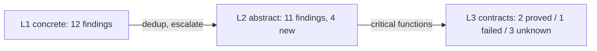

# LunaFlow


[](https://mooncakes.io/docs/riantr/LunaFlow)
[](https://github.com/riantr/LunaFlow/releases)
[](LICENSE)
[](https://mooncakes.io/docs/riantr/LunaFlow)

Trace-driven, three-proof-strength control-flow, taint, value-range, slicing and
contract analysis for MoonBit modules published on
[mooncakes.io](https://mooncakes.io/). The output is one Markdown report with
embedded Mermaid diagrams — no server, no HTML, no images.

The analyzer never compiles the module it analyses. It parses the MoonBit
source it is pointed at, executes a model of it, and writes the evidence out:
every finding carries the method that produced it, a confidence, and a
`file:line`.

One analyzer · three evidence strengths · one Markdown report.

## Features

* A funnel, not a mode switch

  `--level 1|2|3` is cumulative and `--funnel` runs all three. L1 deduplicates
  its findings, L2 splits its results into *confirmed* and *new*, and L3 is
  applied only to functions with an L1/L2 finding plus every function that
  already carries a contract. Functions escalated without a contract are
  reported as **specification gaps** — the funnel's explicit to-do list. When a
  target has no annotations, L3 reports **0 VCs and the gaps**, not invented
  proofs.

* A control-flow graph you can argue with

  The CFG is built from the parsed statement tree: branch nodes with `true` and
  `false` edges, loop heads with back edges, merge points, and `dead` nodes for
  statements after an unconditional exit. Execution paths come from the trace
  and are rendered beside the diagram. Dead code and unreachable nodes are
  **static** findings; non-termination is a **static + dynamic** finding; path
  coverage is **dynamic** and exact only for the executed trials. Each finding
  carries its method and confidence.

* Taint with stated rules

  Sources are entry-function parameters (and `@env.args` when the frontend sees
  it). Propagation follows recorded definitions and the variables each
  statement read; array reads inherit container taint; `length()` inherits
  receiver taint; a tainted loop condition taints the numeric loop counters
  (implicit flow). Sinks are array indices and allocation sizes. The rules and
  their imprecision — field- and index-insensitive, no alias analysis, depth-6
  calls, unsupported `match` arms — are printed in every report.

* Values at every point

  L1 records every `def` event keyed by function, source line and variable, so
  report §6.1 is a per-program-point value table and the JSONL trace has the
  full stream. L2 adds may-ranges from the abstract fixpoint. The distinction
  is explicit: observed samples are not a proof, and the abstract interval is
  an over-approximation at widening.

* Slices over the trace

  The dynamic dependence graph is built from `def`/`cond`/`index`/`call`
  events. Backward slicing walks to sources, forward slicing walks to sinks and
  returns. Criteria are `<var>@<fn>`, `<fn>:<line>` or a bare `<var>`. A slice
  is exact for the recorded trace, not a static closure; `--function` ensures
  the target function is executed before slicing.

* Contracts that admit ignorance

  Specifications are MoonBit comments: `//@ requires`, `//@ ensures`,
  `//@ invariant`, `//@ assigns`. L3 generates WP-style verification
  conditions for index bounds, allocation sizes, division, assertions and
  postconditions at every return and tail expression. Each VC is `proved`,
  `failed` or `unknown`; `unknown` is an honest third state, not a failure.
  This is a three-state interval prover, not an SMT-backed WP.

* Markdown is the UI

  Reports use `flowchart TD` for CFGs and slices, `flowchart LR` for taint and
  the funnel. Labels are sanitized, node counts are capped (8 CFGs, 90 nodes per
  diagram, 40 taint/slice nodes), and every node and table row carries a
  `file:line`. The artifacts are diff-friendly and render on GitHub, GitLab and
  VS Code.

* Version pinning you can reproduce

  A bare coordinate or `@latest` is resolved once by `moon fetch`, then pinned:
  the report records the resolved version, the source root
  (`.repos/<author>/<module>/<version>`) and the declared target. The analyzer
  never compiles the target, so heavy modules are analyzable without their
  dependencies. The optional Cobertura bridge is the only path that needs a
  buildable target.

## What you get

The module is a library plus an executable, so "what you get" is a set of
**data structures and reports**, not a running service:

| You call | You get back | Shape |
|---|---|---|
| `LunaFlow analyze <coord>` | report, trace, summary | `.md`, `_trace.jsonl`, `_summary.json` |
| `LunaFlow analyze --funnel` | the same three artefacts plus L2 alarms and L3 VCs | report §3 / §5.2 / §6.3 / §8 |
| `LunaFlow analyze --level 2` | L1 baseline + abstract may-analysis | report §5.2, §6.3 |
| `LunaFlow analyze --level 3` | L1 + L2 + contract VCs | report §8 |
| `LunaFlow analyze --slice "<crit>"` | dynamic backward/forward slice | Mermaid graph + statement table |
| `LunaFlow analyze --coverage cov.xml` | compiled-suite coverage mapped onto CFG nodes | report §4.4 |
| `LunaFlow analyze --list-functions` | function, file, statement count | `FUNCTION<TAB>FILE<TAB>STATEMENTS` |
| `LunaFlow analyze --max-cfg-functions <n>` | how many functions the CFG pass covers (default 600) | report §2 states what was not covered |
| `@app.load_module(root, coord, version, limit)` | the parsed module and its ingestion statistics | `(ModuleAst, ScanStats)` |
| `@app.check_contracts(ast, ["f"])` | the verification conditions of a function | `ProofResult` |
| `@app.run_abstract(ast, max_functions, max_steps)` | the L2 findings of a module | `AbsResult` |

Every one of those is a **pure function or an explicit data value**. There is no
hidden global state and no network: the same inputs give the same bytes, which
is why `moon test` can assert on them and why the gate can check the
repository's own claims.

The three artefacts are the point of the tool. The **report** is the human
artefact — ten sections, Mermaid diagrams, `file:line` on every claim. The
**trace** is the audit evidence: one JSON object per event, 34 MB for a
doubleML run, and the reason the numbers above are checkable rather than
asserted. The **summary** is the machine artefact: counters a CI gate can read
without parsing prose.

## Install

```sh
moon add riantr/LunaFlow@0.1.6
```

That is a **module** dependency, and it belongs in the consumer's `moon.mod`.
`moon add` writes it for you, so the file ends up holding:

```toml
import {
  "riantr/LunaFlow@0.1.6",
}
```

The library is the package `riantr/LunaFlow/src/app`, and the **package**
import belongs in the consumer's `moon.pkg`:

```moonbit nocheck
///|
import {
  "riantr/LunaFlow/src/app",
}
```

The two blocks look alike and are not the same thing. `moon.mod` names a
*module* and pins the version it resolved; `moon.pkg` names a *package* inside
a module and takes **no version at all**. A version in a `moon.pkg` import is
not a newer spelling — it is an import the toolchain cannot find:

```
Cannot find import 'riantr/LunaFlow/src/app@0.1.0' in my/app/src/thing@0.1.0
```

The `src/` in the package path is part of the package's name, not a prefix the
toolchain strips. A module's **library** packages live under `src/` and its
**executables** under `cmd/`; the registry lists them under exactly those
paths — so `riantr/LunaFlow/src/app` is a package and
`riantr/LunaFlow/app` is not found.

For the same reason there is no `@latest`: the version is parsed as semver, so
`latest`, `^0.1.0`, `>=0.1.0`, `0.1` and `v0.1.0` are all rejected. A bare
`moon add riantr/LunaFlow` resolves the newest release and pins the concrete
version it found — that is the "latest" this toolchain has.

The package can be given a shorter name, which is the closest thing here to
Python's `from x import y as z`:

```moonbit nocheck
///|
import {
  "riantr/LunaFlow/src/app" @lf,
}
```

so that the call is `@lf.load_module(...)`. The alias belongs to the
**package**, not to a file: every file in that package sees it, and an import
statement inside a `.mbt` file is rejected outright — *"Invalid import
declaration here. Move this declaration to `moon.pkg`."*

`src/cli` is the executable in the same module — the command line over the same
library. Registry entry:
[mooncakes.io/docs/riantr/LunaFlow@0.1.6](https://mooncakes.io/docs/riantr/LunaFlow@0.1.6).

From a checkout of the module directory, the same executable runs directly:

```sh
moon run src/cli -- analyze <author>/<module>[@<version>|@latest]
```

**`moonx` runs this module.** The registry runner executes a published package
without installing it, and the natural self-check is:

```sh
moonx riantr/LunaFlow@latest riantr/LunaFlow@latest
```

That works, and it is what the root package is for: `moonx` resolves the ROOT
package of a module coordinate, so a module with no root executable fails with
*"Prebuilt wasm asset does not exist"*. This module has one — a thin forwarder
to `src/command` — and the registry publishes its **wasm** artifact, because
`moonx --target` accepts no other value.

The CLI also accepts a **bare coordinate**, which is what `moonx` passes as the
program's first argument:

```sh
moonx riantr/LunaFlow@latest riantr/LunaFlow@latest   # the bare coordinate IS the target
moon run src/cli -- riantr/LunaFlow@latest              # the same thing, locally
```

A bare coordinate is an implicit `analyze`. A local path is not: `./fixtures`
has an author part of `.`, which is not a name, so it is refused rather than
mistaken for a module.

### What the release was checked on

`moon 0.1.20261102`, carrying `moonc v0.10.19+bee578715` — the toolchain every
number in this file was measured on — **and** `moon 0.1.20261104`, carrying
`moonc v0.10.20+65efd5b93`, which is what the CI runner installs. Both build
this module, and the reason that is checked rather than hoped for is under
[The core compatibility contract](#the-core-compatibility-contract).

The module is **native and wasm**. The analyzer reaches the filesystem and
spawns `moon fetch`, and the async runtime implements both on those two
backends: `supported_targets` is `+native+wasm`, and `preferred_target` is
`wasm` because the registry publishes ONE artifact per version and
`moonx --target` takes `wasm` as its one possible value.

The wasm backend really does work, and it is not a degraded build:

```sh
moon run . --target wasm -- analyze riantr/moonbit_static_analysis@latest --out reports
```

That fetches the target, analyses it and writes the report from the wasm
artifact — the same numbers as the native run.

**wasm-gc is not supported, and it is not a choice.** MEASURED:
`moon build src/cli --target wasm-gc` fails with **14 errors**, every one of
them *"value not found in package"* — `fs.read_file`, `fs.readdir`,
`fs.exists`, `fs.kind`, `process.collect_output`. The reason is upstream:
`moonbitlang/core/async/fs` and `moonbitlang/core/async/process` ship
`native` and `wasm` implementations only, and their whole import block is
guarded by `#cfg(any(target="native", target="wasm"))`. On wasm-gc they
compile to nothing. The async runtime's own event loop is a
`unimplemented.mbt` stub there.

This module's OWN source is wasm-gc clean — `moon check --target wasm-gc`
reports **zero errors in this repository's files** — so the dependency is the
only thing in the way, and it is upstream's to fix.

### The host contract

The published wasm is not self-contained. It imports **108 host symbols**, and
the HOST has to provide every one of them when the module is instantiated:
`moonx` supplies them from the async runtime bundled with the *user's*
MoonBit toolchain.

| Import module | Symbols | Served by |
|---|---:|---|
| `moonbitlang/async` | 95 | the toolchain's bundled core |
| `__moonbit_fs_unstable` | 12 | the toolchain's bundled core |
| `wasi_snapshot_preview1` | 1 | the host runtime's WASI |

The ABI module name is still `"moonbitlang/async"` even though the package
path is now `moonbitlang/core/async`: a wasm import's module name comes from
the FFI declaration in the source, and the source still declares it that way.
What changed is the SET of symbols, and the set grew — so the floor is a
**toolchain**, not a pinned dependency, and a host that still carries the
standalone `moonbitlang/async` module cannot instantiate this artifact.

MEASURED against the toolchain this release was verified on:
`moonbitlang/core` 0.10.19+bee578715 declares 272 host symbols and covers
**107 of 107** of the artifact's core-extern imports. The contract is measured
from the artifact's own import section by `scripts/qa/host_requirements.mjs`
and recorded in `docs/host_requirements.txt`.

### The core compatibility contract

The runtime comes from the toolchain, so the version of `moonbitlang/core`
this module builds against is **the user's toolchain**, not a pin here. That
is the point of the swap — and it is also a hazard, because the core's API is
allowed to change shape between toolchains, and this module has to build
against all of them.

MEASURED, the hard way: the first attempt at this release passed on
`moon 0.1.20261102` (core 0.10.19) and **failed on the CI runner**, which
installs the newest MoonBit — `moon 0.1.20261104`, core 0.10.20:

```text
Error: [4014]
  ╭─[ src/app/scan.mbt:284:12 ]
 284 │     stdout=@process.read_from_process(),
    │            ──────────────┬─────────────
    │                          ╰─────────────── Expr Type Mismatch
       has type : (ReadFromProcess, SharedProcessOutput)
       wanted   : ProcessOutput
```

The capture call was written against the older core. Between the two:

| Declaration | core 0.10.19 | core 0.10.20 |
|---|---|---|
| `read_from_process()` | `-> &ProcessOutput` | `-> (ReadFromProcess, SharedProcessOutput) raise` |
| `run`'s `stdout~` | `&ProcessOutput = @stdio.stdout` | `ProcessOutput = Inherit` |

So the fix is not a patch to one call — it is to **use only the part of the
API that is the same in both**, and to let the filesystem be the authority:

- the fetch runs `moon fetch --quiet`, so it prints nothing on success and its
  error reaches the user directly;
- the version comes from the directories the fetch wrote, not from parsing a
  log;
- the child inherits the parent's streams, so nothing has to be captured.

That is also a better design than the one it replaced. The version used to be
scanned out of the `moon fetch` log, and that scan was the source of two
separate defects — a garbage version on the Linux runner (a green run over an
empty tree) and a version of `"."` on Windows. With the log gone, that whole
class of bug is gone by construction.

**The contract is checked, not hoped for.**
`scripts/qa/core_compat.mjs` fetches the registry's newest `moonbitlang/core`,
finds every core on the machine, and compares the declarations this module
actually uses — the parameters it passes and the return type, because a
parameter it does not pass may change shape without breaking anything, while
a return type that changes always does. MEASURED: **12 declarations,
identical in 3 cores** (registry 0.1.20261105, local 0.10.20, local 0.10.19).

**The release is CI-driven.** Pushing the release tag runs
`.github/workflows/publish.yml`, which re-runs this gate, checks that the
README names the released version, publishes to mooncakes with the
`MOONCAKES_RIANTR_TOKEN` secret, and creates the GitHub Release. Nothing is
published from a workstation.

**There is no dependency pin any more.** The async runtime comes from the
toolchain-bundled `moonbitlang/core` module, so `moon.mod` has no import
block at all — there is nothing that can drift from the registry, and nothing
that can disagree with the host that instantiates the artifact. The CI check
enforces the swap itself: a `moonbitlang/async` dependency coming back is an
error, not a warning.

The trade is a real one, and it is worth stating plainly.
`moonbitlang/core/async` is still marked **experimental** by the core team, so
every package that uses it says so in
`options("allow-experimental-packages": ...)`. And the minimum host toolchain
moved up with the swap, because the artifact now asks the host for more symbols
than the standalone module provided.

### What changed in 0.1.6

**This release is what the peer analyzer found when it was pointed at this module.**

`moonx riantr/moonbit_static_analysis@latest riantr/LunaFlow@latest` scans
LunaFlow's own source. On 0.4.45 — and unchanged on 0.4.46 — it reported **3
actionable findings** against 229 rows: an unused parameter and two unused
locals. **All three were true**, and the MoonBit compiler's own `unused_value`
warning confirmed every one of them.

- **A contract clause carried the wrong line.** `parse_spec_expr` took a `line`
  and never used it. A clause is parsed out of ONE line of a file, so every
  contract expression claimed to be on line 1 of the file — and a reader who
  followed the pointer landed on the top of the file. The lexer now takes the
  base line (`lex_at`), and each clause of a contract carries the line it was
  actually written on.
- **Two unread bindings.** The `if` expression read its condition and its
  then-block into two locals it never used. They are discarded explicitly now;
  the parse is unchanged.

**Running our own analyzer over our own source then found five more false
positives**, and the MoonBit compiler contradicted every one of them: it
reports unreachable code in the fixture and nowhere else. Two causes, both
fixed:

- **A slice `a[i:j]` was not modelled.** `return line[i + 1:j].to_string()`
  became a return with an unmodelled expression plus three shredded fragments,
  and the fragments that followed the exit inherited its deadness. Slices are
  modelled now (`ESlice`), and because a slice is clamped by the runtime it
  carries the taint of its parts but raises no out-of-bounds claim.
- **A `while true` whose body holds a construct the parser does not model was
  called infinite.** The `break` inside such a construct is invisible to the
  CFG, so the loop looked non-terminating and the code after it looked dead.
  The analyzer now claims only what it can support: a loop with an unmodelled
  construct in its body is **not** proven infinite, and the code after it is
  **not** proven unreachable. A fully modelled `while true` is still reported —
  refusing to guess must not cost the real finding.

Measured on this module's own source: dead-code findings **8 → 3**, unreachable
**2 → 1**, infinite loops **2 → 1** — and the 3 / 1 / 1 that remain are the
vulnerability fixture's, which exists to be found. At that point on doubleML
and on the peer module every number was unchanged, and the committed doubleML
artefact was byte-identical apart from the wall clock.

**The second peer run, pointed at this working tree, and the one file neither
side could read.** `moonx riantr/moonbit_static_analysis@latest .` asks the
peer to scan the tree as it stands rather than the published module. It
reports **0 actionable findings** against 243 rows — 232 notices and 11
unreliable, nothing withheld: all three defects above are gone. The row left
worth acting on is the file it cannot parse — `src/command/command.mbt`,
`expected ')'` — and turning that one around found a defect on **our** side as
well, in the same construct:

- **A MoonBit multiline string (`#|`) was lexed as a string that ended at the
  end of its first line.** The construct is a *string literal*, not a comment:
  `#|` opens it, the text after the marker is the first chunk, every following
  line whose first non-blank characters are `#|` is one more chunk, and the
  value is the chunks joined with `"\n"`. The old lexer took the rest of the
  first line and left the rest of the literal in the token stream, so
  `usage()` was shredded into thirty-odd statements, the function was not
  recognised as a function at all, and the statements around it were counted
  as unsupported. The literal is modelled now, and so is the newline that ends
  its last chunk line: without that newline the statement after the literal
  was parsed as part of it, which is how one `let` in a test file became one
  unsupported statement instead of three understood ones.

Measured after it: on this module's own source the statements understood went
**3,346 → 3,093**, the unsupported statements **195 → 175**, and the functions
extracted **395 → 396** — the `usage()` function is a function again. (The
measured-runs table above re-measures the tree after this release's own test
file was added, so it reads 29 files and 3,126 statements.) On the peer module,
which writes its own block strings, the statements understood went
**12,997 → 12,970** and the unsupported statements **611 → 595**; on doubleML
every number is unchanged, and the committed doubleML artefact is byte-identical
apart from the wall clock. The test suite is **73 tests**, up from 59.

**The host floor moved with the toolchain, and the contract was re-measured.**
The published artifact imports **108 host symbols** now, one more than 0.1.5:
`fd_util/pipe`. That symbol comes from the toolchain's own runtime, not from
this module's source — the module itself did not grow a single host call — so
the floor is still a toolchain and not a pinned dependency. What changed is
that the set grew, and a host that carries the older core cannot instantiate
this artifact. The contract is measured, not asserted: against the core the
release was verified on (`moonbitlang/core` 0.10.19+bee578715) **107 of 107**
of the artifact's core-extern imports are covered, and
`docs/host_requirements.txt` records the list.

### What changed in 0.1.5

**This release fixes the parser, and the false findings it produced.**

`riantr/moonbit_static_analysis` runs LunaFlow against its own source and
reports what it finds. On 0.4.45 that produced **136 findings — 37 dead-code,
98 taint-index, 1 budget — and every one of them was a false positive.** All of
them had the same cause in LunaFlow's frontend: the parser shredded a construct
it does not model into one statement per fragment, and the fragments that
followed a `return` inherited its deadness.

- **Seven root causes, all in the frontend.** A struct literal was not
  modelled, so `{ a: x, b: 2, }` became one statement per field — and it ate
  the enclosing block's closing brace, which truncated the function. A binary
  expression did not continue across a newline. A `match` expression leaked
  its arms. `::` was lexed but not parsed, so `return CART::Leaf(...)` left its
  tail behind. A string or character literal whose content was `{` was counted
  as a brace, and the block ran on past the end of the function, taking the
  functions after it with it. A `for` that destructures left its loop body
  behind as a block. And an `if` without an `else` was treated as an
  unconditional exit, so the code after a guarded `return` was called
  unreachable.
- **The repair is two layers.** The constructs above are now *modelled* — the
  qualified path, the qualified record literal, the destructuring `for`, the
  named argument, the `if` expression, the function literal. And the parser no
  longer lets an unmodelled construct shred itself: a tail it has no rule for
  is folded into the statement it belongs to and counted as unsupported. The
  second layer generalises — without it the next construct the parser does
  not know would shred itself again.
- **Taint sinks are deduplicated by site**, not by whole-finding equality; the
  observed value is in the evidence, so one read observed in many trials became
  dozens of rows. And a tainted index whose observed value was *inside* the
  array is now a warning that says so; only an index witnessed out of range,
  or one whose bounds cannot be resolved, stays an error.
- **"No findings" no longer reads as "clean".** The CFG pass covers the first
  600 functions in file order, so the rest of a large module can carry no CFG
  finding. The report now says so in its ingestion table, and
  `--max-cfg-functions` makes the window configurable.

Measured on identical trees: dead-code findings on the static-analysis module
**37 → 0** and on doubleML **137 → 0**; taint sinks on the static-analysis
module **98 → 5**. The statement count for doubleML *fell* from 43,822 to
29,853, because the old number counted the shredded fragments and the
truncated function bodies. The full adjudication, including the one place the
peer report's own attribution was wrong, is in
[The cross-check against another analyzer's module](#the-cross-check-against-another-analyzers-module).

### What changed in 0.1.4

**This release moves the runtime to the toolchain and makes the module runnable
from the registry.**

- **The runtime comes from the toolchain.** The dependency on
  `moonbitlang/async` is gone; the async runtime is
  `moonbitlang/core/async`, part of the `moonbitlang/core` module the
  toolchain already bundles. `moon.mod` has no import block any more. The
  trade is stated above: the package is experimental, and the minimum host
  toolchain moved up, because the artifact asks the host for a bigger set of
  symbols than the standalone module provided. The set is measured, not
  asserted — 108 host imports, 107 of them covered by the bundled core, and
  the contract is in `docs/host_requirements.txt`.
- **The module has a root package, and `moonx` runs it.**
  `moonx riantr/LunaFlow@latest riantr/LunaFlow@latest` is the self-check, and
  it works. That needed three things: a root package that is an executable
  (without one, `moonx` says *"Prebuilt wasm asset does not exist"*), a
  wasm artifact for the registry to publish (`preferred_target = "wasm"`), and
  a CLI that treats a bare coordinate as an implicit `analyze`.
- **The module builds and runs for wasm.** `supported_targets` is
  `+native+wasm`, and the wasm artifact fetches, analyses and writes the
  report. wasm-gc is still excluded, and the reason is upstream's — see
  [The host contract](#the-host-contract).
- **The fetch log is gone, and with it a whole class of bug.** The version used
  to be scanned out of the `moon fetch` log — free-form text whose shape differs
  between platforms. It is now taken from the directories the fetch wrote. The
  log scan was the source of two separate defects (a garbage version on the
  Linux runner, a green run over an empty tree; a version of `"."` on Windows),
  and removing it removes both by construction. The Windows case is the
  sharper one: the fetch log prints the resolved path, and when the module name
  is a SUFFIX of the repository directory name — `moonbit_LunaFlow` for the
  module `LunaFlow` — the text after the name starts with `\.repos\`. A dot is
  a version character, so the token came out as `"."`. That candidate was then
  accepted because `base + "/."` **exists**: it resolves to the base directory
  itself. Analysing the module with itself therefore pinned the analysis to
  the BASE directory, and the report claimed the resolved version was `"."`.
- **The module builds against every core a user may have.** The runtime comes
  from the toolchain, so the core's API is allowed to change shape between
  toolchains — and it did, between core 0.10.19 and 0.10.20, in the middle of
  this release. The details are under
  [The core compatibility contract](#the-core-compatibility-contract); the
  short version is that the fetch no longer captures the child's output, so it
  uses only the API that is the same in both, and
  `scripts/qa/core_compat.mjs` checks the rest.

The package layout changed with the root package. The CLI implementation moved
out of `src/cli` and into `src/command`, because the module now has two
executables (the root package and `src/cli`) and two main packages cannot
import each other — the toolchain's own message says *"Move reusable APIs into a
non-main package and keep main packages as entrypoints"*. `moon run src/cli`
and `moon run .` both work, and there is one implementation behind them.

### What changed in 0.1.1

**0.1.0 was published, and this release fixes what it exposed.** 0.1.0 carried
a README that said the module "is not published yet" — a sentence that was
true when it was written and false the moment the CI published it — and test
counts from before the CI fixes. The registry serves the README as the
module's documentation page, so a stale README there is a defect in the
product, not in the repository.

This release also carries the three defects that the Linux CI runner found in
0.1.0, which are described below.

### What changed in 0.1.0

**This is the first release, and it is the first release under this name.**
The module was developed as `moonflow/moonflow` and was published nowhere — the
registry has no such coordinate and no consumer depended on it — so the rename
to `riantr/LunaFlow` breaks nobody. It also aligns the coordinate with the
product name and with the sibling modules in this account. The module's
`repository` is [github.com/riantr/LunaFlow](https://github.com/riantr/LunaFlow),
where the release artefacts and the CI live.

The interesting part of this release is not the rename but the **deep QA pass
that preceded it**, which found and fixed two defects that mattered for a tool
whose whole job is reading untrusted modules:

- **A hostile module could abort the process.** 5,000 nested `if` statements and
  2,000 nested parentheses exhausted the native stack
  (`0xC0000409`, STATUS_STACK_BUFFER_OVERRUN). The parser now refuses
  constructs nested deeper than 256 levels and records them as a **parse gap**
  instead: the region is skipped whole and counted as one unsupported
  statement, so the frontend-coverage number in the report stays honest rather
  than reading 100 % on a file that was skipped. This is pinned by
  `hardening_test.mbt` and by `scripts/qa/depth_sweep.mjs`.
- **A hostile module could steer the report path.** The output file name is
  built from the analysed module's own `moon.mod`, and only `/` was
  neutralised, so a `version` field of `..\..\..\..\escaped` wrote the report,
  the trace and the summary into an arbitrary directory. The stem now goes
  through a whitelist sanitiser, and `scripts/qa/path_traversal.mjs` is the
  regression.
- **A `--dir` scan could describe someone else's code.** The source walker
  skipped `_build`, `.git`, `.repos`, `target` and `node_modules`, but not
  `.mooncakes` — the directory the toolchain vendors a module's dependencies
  into. A self-scan of this repository therefore reported **384 parsed files,
  362 of them from the vendored `moonbitlang/async` module**: every file,
  function and statement count in that report described a third party's code.
  `.mooncakes` is skipped as well now, and `scripts/qa/vendor_isolation.mjs`
  plants one file behind every skipped directory name and asserts that exactly
  the module's own source is parsed.

Three smaller fixes came out of the same pass: `--out` with no value wrote
into the working directory instead of failing; `//@ assigns \nothing` recorded
a target literally named `\nothing`; and a function whose only annotation was
`//@ invariant` produced no verification conditions at all, because the
contract was considered absent. The published surface grew by those fixes and
nothing else changed shape.

**Three more defects surfaced when the release ran on the Linux CI runner**,
and they are worth naming because each one produced a *green* result that
meant nothing:

- **The version was scanned out of the `moon fetch` log**, which is free-form
  text whose shape differs between platforms. On Linux the scan took
  everything up to the next `" to "` and produced the version
  `0.164.64\nSuccess\nSuccessfully fetched …` — a name that matches no
  directory. The analyzer then read an empty tree and reported **0 statements,
  0 coverage, 0 findings, exit 0**. The filesystem is now the authority: the
  version is cut at the first character that cannot be part of a version, and
  a candidate is only accepted when the directory it names really exists.
- **The harness looked for the built CLI under the wrong name.** The MoonBit
  native target names the executable `cli.exe` on *every* platform, Linux
  included, where the file is an ELF binary with a Windows extension. The
  resolver picked the name by platform, so on the runner the CLI never ran and
  the failure surfaced three steps later as a missing output file.
- **The vendored-tree regression asserted the wrong thing.** It checked that
  the report does not contain the string `_build/`, but the report records the
  analysed root and the harness's scratch directory lives under `_build/`. It
  now asserts on ingested *content* — a foreign file name and a foreign
  function — and it was checked against a reverted fix to prove it can go
  red.

A green result that describes nothing is worse than a red one, because it is
indistinguishable from a real one. That is the whole reason the release is
gated in CI rather than run by hand: the runner is a different machine, and
these three defects were invisible on the machine that wrote the code.

### Packages and targets

| Package | Kind | Native | Wasm | Wasm-GC | JS |
|---|---|---:|---:|---:|---:|
| `riantr/LunaFlow` (root) | executable | yes | yes | — | — |
| `riantr/LunaFlow/src/app` | library | yes | yes | — | — |
| `riantr/LunaFlow/src/command` | library | yes | yes | — | — |
| `riantr/LunaFlow/src/cli` | executable | yes | yes | — | — |

A `—` means the runtime does not implement what the package needs there. The
analyzer needs the filesystem and process spawning, and the async runtime
implements both on native and wasm only; on wasm-gc the `fs` and `process`
packages compile to nothing, and js has no async runtime at all.

## Layout

```
LunaFlow.png               the mark this README shows
LunaFlow_Logo.png          the same artwork at 1024x1024
LICENSE                    MIT
moon.mod                   module metadata (native and wasm)
moon.pkg                    the ROOT package: the executable moonx resolves
main.mbt                    the root entrypoint, a forwarder to src/command
src/app/                   14 library files: parser, CFG, L1 interpreter,
                           L2 abstract interpreter, L3 contracts, funnel,
                           taint/slice, report renderer
src/app/*_test.mbt         73 tests in 11 files
src/command/                the CLI implementation, as a library
src/cli/main.mbt           the published CLI entrypoint
fixtures/vuln_demo/        taint / dead-code / infinite-loop / contract fixture
features/                  acceptance scenarios in Gherkin
docs/design.md             design, comparison, acceptance criteria (A1-A18)
docs/qa/REPORT.md          deep QA report (security, coverage, metrics)
docs/host_requirements.txt  the published wasm's host contract, measured
reports/                   generated reports for the validation modules
scripts/verify.mjs         dependency-free acceptance checker
scripts/qa/                dependency-free QA harnesses
```

The library has **no external dependency**. The filesystem and process access
the CLI needs come from `moonbitlang/core/async`, part of the `moonbitlang/core`
module the toolchain already bundles — so there is no version to pin, and no way
for the build and the host to disagree about which runtime is in play. The
frontend is a structural parser for the MoonBit subset the analyses need;
`match` arms, `impl` bodies and functional `for` are counted as gaps, not
silently dropped. A construct the parser has no rule for at all is folded into
the statement it belongs to and counted as unsupported, so it cannot shred
itself into statements of its own. A slice `a[i:j]` is modelled — it is one
expression, and because the runtime clamps it, it raises no out-of-bounds
claim.

## Verification

The gate, and the result it produced for this version:

| Command | Result |
|---|---|
| `moon fmt --check` | exit 0 |
| `moon check --target native` | exit 0, 131 warnings, 0 errors |
| `moon check --target wasm` | exit 0, 131 warnings, 0 errors |
| `moon test src/app --target native` | **73 passed, 0 failed** |
| `moon test src/app --target wasm` | **73 passed, 0 failed** |
| `moon build src/cli --target native` | exit 0 |
| `moon build . --target wasm` | exit 0 |
| `node scripts/verify.mjs` | **87 passed, 0 failed** |
| `node scripts/qa/gherkin.mjs` | **7 passed, 0 failed** |
| `node scripts/qa/e2e.mjs` | **56 passed, 0 failed** |
| `node scripts/qa/fuzz.mjs` | **110 passed, 0 failed** |
| `node scripts/qa/path_traversal.mjs` | **7 passed, 0 failed** |
| `node scripts/qa/deep_nesting_probe.mjs` | **2 passed, 0 failed** |
| `node scripts/qa/vendor_isolation.mjs` | **13 passed, 0 failed** |
| `node scripts/qa/cli_resolver.mjs` | **3 passed, 0 failed** |
| `node scripts/qa/root_package.mjs` | **14 passed, 0 failed** |
| `node scripts/qa/host_requirements.mjs` | **108 imports, 107/107 covered** |
| `node scripts/qa/core_compat.mjs` | **12 declarations identical in 3 cores** |
| `node scripts/qa/verify_published.mjs 0.1.3` | **4 passed, 0 failed** |
`moon 0.1.20261102`, native backend, Windows 11, warm `.repos` cache. The
measured runs committed with the reports:

| Module | Files | Statements | L1 events | L2 findings | L3 VCs | Dead | Taint sinks | Time |
| --- | ---: | ---: | ---: | ---: | ---: | ---: | ---: | ---: |
| `riantr/moonbit_doubleML@latest` → 0.164.64 | 220 | 29,853 | 218,391 | 166 | 0 (no specs) | 0 | 73 | 4.1 s |
| `riantr/moonbit_static_analysis@latest` → 0.4.46 | 199 | 12,970 | 14,296 | 43 | 0 (no specs) | 0 | 6 | 1.0 s |
| `fixtures/vuln_demo` | 1 | 32 | 604 | 11 | 2 / 1 / 3 | 3 | 6 | 4 ms |
| `LunaFlow` itself (`--dir .`) | 29 | 3,126 | 12,560 | 22 | 2 / 1 / 3 | 3 | 1 | 0.14 s |

**Reproduction status (2026-11-12).** The rows above are the committed
artefacts, pinned to the versions resolved on the day they were generated. They
were regenerated for this release, and every number in them moved: the previous
rows said 43,822 statements, 137 dead-code findings and 102 taint sinks for
doubleML, and 14,505 / 48 / 103 for the static-analysis module. The reason is
in the next section — the old numbers counted the shredded fragments of
constructs the parser did not model, and a shredded fragment ate the closing
brace of its function, so whole function bodies were truncated. The committed
numbers are now the honest ones: neither module has an unreachable statement,
and the analyzer says so.

`scripts/verify.mjs` validates the committed artefacts by pinned file name;
`scripts/qa/e2e.mjs` validates fresh runs against the same thresholds.

The artefacts are regenerated with this recipe, and the slice criterion has to
be spelled **exactly** — a criterion that names no function yields an empty
slice *and* one fewer function run, so every number in the report moves while
nothing looks broken:

```sh
moon run src/cli --target native -- analyze --dir fixtures/vuln_demo \
  --out reports --funnel --trials 4 --max-functions 120 --slice "i@copy_prefix"
moon run src/cli --target native -- analyze riantr/moonbit_static_analysis@latest \
  --out reports --funnel --trials 4 --max-functions 120 --slice "buf@render_reports"
moon run src/cli --target native -- analyze riantr/moonbit_doubleML@latest \
  --out reports --funnel --trials 4 --max-functions 120 --slice "theta_hat@aggregate_coef_se"
```

The module version is part of the artefact's file name, so a new release of a
validation module means a new file and a new pin in `scripts/verify.mjs`. One
more trap: a run that starts while `moon fetch` is still extracting the module
measures a partial tree, so the numbers are re-measured after the fetch
settles.

`scripts/qa/` also carries the rest of the deep-QA tooling: `warn_census.mjs`
(warning triage), `metrics.mjs` (size/complexity plus line coverage from the
Cobertura report), `dup.mjs` (clone detection), `load.mjs` (peak memory and
parallel throughput), `depth_sweep.mjs` (the nesting-degradation curve),
`vendor_isolation.mjs` (a `--dir` scan must not ingest the vendored dependency
tree), `cli_resolver.mjs` (the built CLI has to be found under either name
the toolchain produces), `root_package.mjs` (the root package `moonx` resolves
has to be an executable, has to build for wasm, and has to accept a bare
coordinate), `host_requirements.mjs` (the published wasm's host imports have to
be covered by the toolchain's bundled core), `core_compat.mjs` (every
declaration this module uses has to be the same in every core a user may
have) and `verify_published.mjs` (install
the **published** version from a clean consumer and call its API — the check
that a green gate cannot give you, because the gate checks the commit and this
checks what the registry serves). The report of the last deep QA pass is
`docs/qa/REPORT.md` — it covers 0.1.3 and is dated 2026-11-10, so it is a
record of that pass and not a claim about this version.

Two things deliberately **not** claimed. No production-load testing has been
done, and no head-to-head comparison against another analyzer **on the same
workload** has been run — the two analyzers were pointed at different modules,
so the numbers are not comparable. The comparison baseline in
`docs/design.md` §8 covers Frama-C / TrustInSoft Analyzer, Joern, CodeQL, SVF
and Soot as a **design** comparison, not as a measured head-to-head.

### The cross-check against another analyzer's module

`riantr/moonbit_static_analysis` runs LunaFlow against its own source and
reports what it finds. On 0.4.45 that was **136 findings: 37 dead-code, 98
taint-index, 1 budget**. Every one of them was a false positive, and the
adjudication is worth recording because the reasons are not what the report
said.

**What the report got right.** The 21 rows in `src/flow/laws_test.mbt` were
multi-line `return` expressions whose continuation lines were parsed as
statements of their own, and the ones after the `return` inherited its
deadness. That was true, and it was LunaFlow's bug.

**What the report got wrong.** The 16 rows in `src/parser/parser.mbt` were
attributed to a nested `return` being treated as an exit of the enclosing
block. They were not: the cause was a struct literal being shredded into one
statement per field. And the observation that the verdict "is not a function
of the file's own bytes" had no mechanism until the positional 600-function CFG
window was found — a file's findings depended on how many functions preceded
it, and the window is now disclosed in the report and configurable with
`--max-cfg-functions`.

**The five root causes, all in the frontend.**

1. A struct literal was not modelled, so `{ a: x, b: 2, }` became one
   statement per fragment, and it ate the enclosing block's closing brace —
   which truncated the function.
2. A binary expression did not continue across a newline, so each continuation
   line became its own statement.
3. A `match` expression leaked its arms into the enclosing statement list.
4. `::` was lexed but not parsed, so `return CART::Leaf(...)` left the tail
   behind as statements. `::` is not a list-cons operator in MoonBit —
   `1 :: [2]` is a parse error in the real toolchain — so it is only ever a
   qualified path.
5. A string or character literal whose content was `{` was counted as a brace.
   `match rsplit_at(seg, "{") {` stopped the arm scanner at the string, the
   block ran on past the end of the function, and the functions after it were
   lost.

Two more were found while fixing those: a `for` that destructures
(`for k, v in entries`) left its loop body behind as a block, and an `if`
without an `else` was treated as an unconditional exit, so the code after a
guarded `return` was called unreachable.

**The repair is two layers.** The constructs above are now *modelled* — the
qualified path, the qualified record literal, the destructuring `for`, the
named argument, the `if` expression, the function literal. And the parser no
longer lets an unmodelled construct shred itself: a tail it has no rule for is
folded into the statement it belongs to and counted as unsupported, instead of
becoming statements of its own. The second layer is the one that generalises —
without it the next construct the parser does not know would shred itself
again, and the dead-code verdict would come back with it.

**Measured, on identical trees.**

| | published 0.1.4 | 0.1.5 |
|---|---:|---:|
| `moonbit_static_analysis@0.4.45` — dead code | 37 | **0** |
| `moonbit_static_analysis@0.4.45` — taint sinks | 98 | **5** |
| `moonbit_doubleML@0.164.64` — dead code | 137 | **0** |
| `moonbit_doubleML@0.164.64` — statements | 43,822 | **29,853** |
| `moonbit_doubleML@0.164.64` — frontend coverage | 99.87 % | **98.94 %** |

The statement count went **down** because it was wrong before: the old number
counted the shredded fragments, and a shredded fragment ate the closing brace
of its function, so whole function bodies were truncated. A per-function
cross-check against the published build confirms it — the two builds agree on
all 2,514 functions of doubleML, and the 184 functions where the new count is
*higher* are the ones the old build truncated (`sensitivity_analysis` was 3
statements, it is 13).

The taint sinks fell for two different reasons, and the two are worth telling
apart. 93 of the 98 rows on the peer module came from just two sites: the sink
list was deduplicated by whole-finding equality, and the observed value is in
the evidence, so one read observed in many trials became dozens of rows. The
sinks are now deduplicated by site. The other 5 were a bounds question the old
analysis did not ask: a tainted index whose observed value was *inside* the
array is now a warning that says so, and only an index that was witnessed out
of range — or one whose bounds could not be resolved — stays an error.

**What is still not covered.** The CFG pass builds the CFG for the first 600
functions in file order, so the other 1,920 functions of doubleML can carry no
CFG finding; the report says so in the ingestion table rather than letting
"no findings" read as "clean". The taint synthesizer's string candidates carry
no `::` or `/` shapes, so branches that depend on those shapes are not
explored. Nested function declarations are consumed as one unit and are not
analysed on their own. And the peer's own attribution of the 16 parser rows
was wrong in a way that would have sent the next fix in the wrong direction —
which is why the correction belongs here and not only in the fix.

**And the other direction: the peer, pointed at this module.** The same
command with the arguments the other way round —
`moonx riantr/moonbit_static_analysis@latest riantr/LunaFlow@latest` — asks
the peer to scan *this* source. It reports 3 actionable findings against 229
rows: an unused parameter and two unused locals, all three real, all three
confirmed by the MoonBit compiler. They are fixed in the revision above, and
0.4.46 reports them exactly as 0.4.45 did. The remaining 215 rows are the
peer's own scope notes, not defects: 215 of them say that an `if` expression,
a `match` arm, a struct, an enum or a test declaration is outside the subset
the peer analyses — and the `if` expression is a construct **this** module
models and the peer does not. The peer also cannot parse one file of this
module (`src/command/command.mbt`), and it says so rather than guessing.

**That one file is a shared blind spot, and both sides were wrong about it.**
MoonBit's multiline string literal -- the `#|` form -- is a *string*, not a
comment: `#|` opens it, the text after the marker is the first chunk, every
following line whose first non-blank characters are `#|` is one more chunk, and
the value is the chunks joined with `"\n"`. There is no `|#` terminator (a bare
`#` is a lexing error in MoonBit), and a bare `#|` line is an **empty chunk**,
not the end of the literal. The peer's model trims the chunks and joins them
with a space, and reads the bare `#|` as the closer, so it stops the literal
two lines into `usage()` and reads the rest as code. This module's model was
wrong in a different way: it took the rest of the first line and left the rest
of the literal in the token stream, so `usage()` was shredded into thirty-odd
statements and the function was not recognised at all. The semantics were
settled against the toolchain **by value** -- "does `moon check` accept it"
measures nothing here, because the toolchain accepts every shape of this
construct -- and `usage()`'s value is now byte-identical to the toolchain's
(1569 characters, same hash).

## What this is not

* **Not sound.** L1 reports what happened on synthesized inputs. L2 reports what
  the abstract input set cannot exclude. L3 proves individual VCs from
  specifications. Absence of a finding is never a proof.
* **Not a full MoonBit frontend.** Unsupported syntax is measured and reported
  (1.06 % of statements on doubleML, 4.39 % on static_analysis). Expression and
  statement nesting beyond 256 levels is refused as a recorded parse gap rather
  than risked on the native stack.
* **Not alias-aware.** Taint is field- and index-insensitive, with a depth-6
  interprocedural cutoff; loop-counter implicit taint is deliberately
  conservative and can over-report.
* **Not trace-complete.** Slices and ranges cover the recorded trace only.
  Function names are not package-qualified, so a name-only criterion can match
  several packages (three packages define `render_reports` in static_analysis).
* **Not SMT-backed.** L3 is a WP-style VC generator with an interval decision
  procedure. Loop invariants are not yet placed per loop, so loop-dependent
  goals are havocked to `unknown`. The `//@` syntax is ACSL-inspired but adapted
  to MoonBit comments; ACSL itself targets C.
* **Not a database.** Reports, traces and summaries are plain files: diffable,
  human-readable, reproducible. `riantr/tesseract` was evaluated as a storage
  dependency — 0.1.17 raises the durable-memory ceiling to 9999 entries, but its
  dependency footprint is ~28 MB, so it is not adopted. If cross-run queries
  are needed, an optional SQLite sidecar is the smaller change.

## Quick Start

```sh
# analyze a published module; @latest is resolved once and pinned
moon run src/cli --target native -- analyze riantr/moonbit_doubleML@latest --out reports

# the full funnel, with a slice on a variable
moon run src/cli --target native -- analyze riantr/moonbit_doubleML@latest \
  --out reports --funnel --slice "theta_hat@aggregate_coef_se"

# a local checkout, no registry resolution
moon run src/cli --target native -- analyze --dir fixtures/vuln_demo \
  --out reports --funnel --slice "i@copy_prefix"

# focus on one function in a large module
moon run src/cli --target native -- analyze riantr/moonbit_static_analysis@latest \
  --function render_reports --slice "buf@render_reports" --out reports

# compiled coverage, when the target builds
moon coverage analyze
moon coverage report -f cobertura -o cov.xml
moon run src/cli --target native -- analyze <coord> --coverage cov.xml --out reports
```

The binary is `_build/native/debug/build/src/cli/cli.exe`, and the root
package's is `_build/native/debug/build/LunaFlow.exe`. From the registry,
there is no install step at all:

```sh
moonx riantr/LunaFlow@latest riantr/LunaFlow@latest
```

## Example

The funnel section is computed, not narrated. This is the fixture run:

```text
L1 concrete: 12 findings
L2 abstract: 11 findings, 4 new
L3 contracts: 2 proved / 1 failed / 3 unknown
```



The contract table for the same run (excerpt):

| Function | VC kind | Status | Goal |
| --- | --- | --- | --- |
| `get_checked` | index-bounds | proved | `((n >= 0) && (n < values.length()))` |
| `get_checked` | ensures | unknown | `(values[n] >= 0)` |
| `get_unsafe` | index-bounds | unknown | `((n >= 0) && (n < values.length()))` |
| `get_negative` | index-bounds | failed | `((n >= 0) && (n < values.length()))` |
| `double` | ensures | proved | `((n + n) >= 0)` |

`get_negative`'s contract says `n < 0`, which refutes `0 <= n`; that is a
failed proof, reported as one. `get_unsafe` has no upper bound, so the index
condition is unknown rather than guessed.

## Gates and drift detectors

* `moon test` pins the fixture's static findings: 3 dead, 1 unreachable,
  1 infinite loop, and the L3 proved/failed/unknown split.
* `scripts/verify.mjs` fails on missing sections, invalid Mermaid structure,
  empty slices, missing L2/L3 counters, coverage below 95 %, or a runtime above
  60 s.
* `scripts/qa/gherkin.mjs` states the acceptance criteria as executable
  scenarios, including the two hostile-input regressions.
* `docs/design.md` §10 lists the quantified acceptance table (A1–A18); the
  measured column is updated from real runs, not from intent.
* Determinism: two runs produce identical `summary.json` except `elapsed_ms`,
  and a byte-identical trace.

## Used By

- `src/cli` — the executable in this module, the command line over the same
  library.
- `src/command` — the CLI implementation, shared by `src/cli` and the root
  package that `moonx` resolves.
- `scripts/qa/` — twenty dependency-free harnesses and tools; thirteen of them
  drive the built binary as a real process against the fixture, the two
  registry modules and a hostile-input corpus.
- `docs/design.md` — the design record for the implementation in `src/app`.

Outside this repository: **none that the registry knows about.** The registry
lists 0 dependents for `riantr/LunaFlow`, and nothing is claimed here that
cannot be named.

## Attribution

- License: MIT (see `LICENSE`).
- The documentation layout of this README follows the
  [`riantr/tesseract`](https://mooncakes.io/docs/riantr/tesseract@0.1.17)
  module, whose release notes are a model of stating exactly what changed and
  what did not.
- The comparison baseline in `docs/design.md` §8 covers Frama-C /
  TrustInSoft Analyzer, Joern, CodeQL, SVF and Soot. Every place this module
  answers differently from those tools is a **stated limitation** in
  [What this is not](#what-this-is-not), not an omission.
