# LunaFlow analysis report — local/module@0.0.0

> Trace-driven (dynamic-first) control-flow, data-flow, value-range and slicing analysis for a mooncakes.io module.

## 1. Acquisition and version pinning

| Item | Value |
| --- | --- |
| Requested coordinate | `local/module` |
| Resolved version | `0.0.0` |
| Pinning strategy | explicit local directory without moon.mod |
| Source root | `fixtures/vuln_demo` |
| Declared target | `` |
| Direct dependencies | (none) |

## 2. Ingestion statistics

| Metric | Value |
| --- | --- |
| Source files parsed | 1 |
| Functions extracted | 12 |
| Statements understood | 32 |
| Statements unsupported | 0 |
| Frontend coverage | 100.0% |
| Parse issues | 0 |
| CFG functions | 12 of 12 — every function |
| Trace events | 604 |
| Interpreted steps | 156 |
| Observed functions | 12 |
| Wall time (analyzer) | 4 ms |
| Selected level | L3 (funnel: L1 → L2 → L3) |

## 3. Proof-strength levels and funnel

The same program is analyzed at three proof strengths. Levels are cumulative: L2 adds abstract interpretation on top of L1, L3 adds contract verification on top of the escalated functions. `--funnel` runs all three and reports what each level adds.

### 3.1 Level definitions

| Level | Name | Engine | Input model | Result strength |
| --- | --- | --- | --- | --- |
| L1 | Interpreter | concrete execution on the formal interpreter | concrete boundary values (`--trials`) | observed facts; may miss unexecuted inputs and paths |
| L2 | Value | abstract interpretation over a value-set / interval domain | whole input sets (`Int` intervals, `Bool`/`String` sets, array length intervals) | exhaustive over the abstract state; may-taint and may-range alarms (false positives possible) |
| L3 | Proof-by-contract | WP-style weakest-precondition VC generation + interval decision | ACSL-style `//@ requires` / `//@ ensures` specs | `proved` / `failed` / `unknown` per verification condition; specs are mandatory |

### 3.2 Funnel

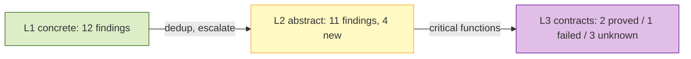

| Level | Checks | New vs previous | Functions / VCs | Note |
| --- | --- | --- | --- | --- |
| L1 concrete | 12 findings | — | 12 functions | observed facts |
| L2 abstract | 11 findings | 4 | 12 functions, 102 steps | exhaustive over the input abstraction |
| L3 contracts | 6 VCs | 1 failed, 3 unknown | 9 critical functions | specs required |

### 3.3 Escalation and specification gaps

Escalated functions (have at least one L1/L2 finding or a contract): `copy_prefix`, `lookup`, `parse_len`, `spin`, `get_checked`, `get_unsafe`, `get_negative`, `classify`, `double`

Functions escalated without any contract (spec gap at L3): `copy_prefix (lib.mbt:2)`, `lookup (lib.mbt:13)`, `parse_len (lib.mbt:26)`, `spin (lib.mbt:40)`, `classify (lib.mbt:49)`

## 4. Control-flow analysis

CFG nodes are built from the parsed statement tree; execution paths come from the concrete-execution trace engine. Dead/unreachable detection is static; path coverage and budget findings are dynamic. See `docs/design.md` §5 for the mapping rules.

### 4.1 CFG diagrams (top 8 by cyclomatic complexity)

#### `classify` (lib.mbt)

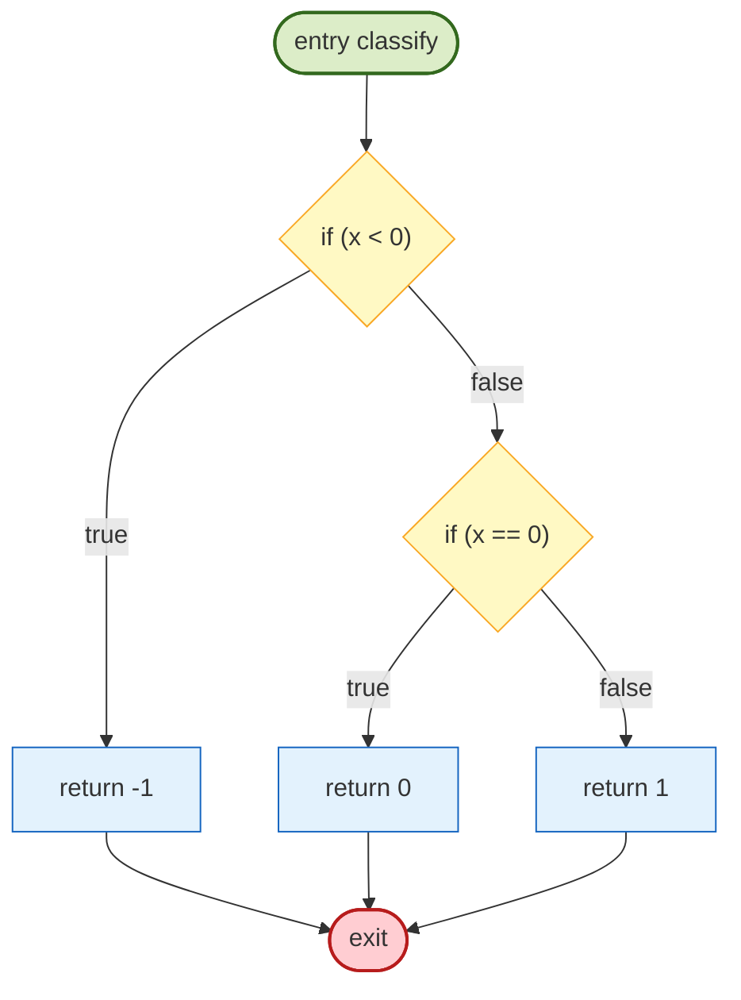

Observed path (trial 0, first 3 events): `cond@50` -> `ret@51` -> `def@49`

#### `copy_prefix` (lib.mbt)

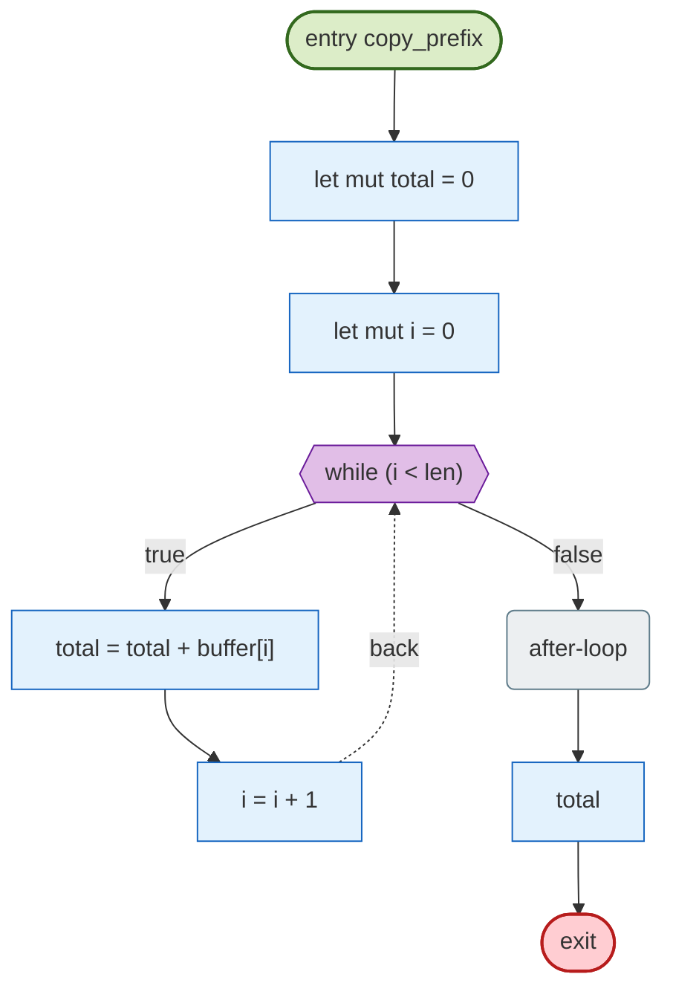

Observed path (trial 0, first 8 events): `def@3` -> `def@4` -> `cond@5` -> `def@2` -> `def@3` -> `def@4` -> `cond@5` -> `def@2`

#### `lookup` (lib.mbt)

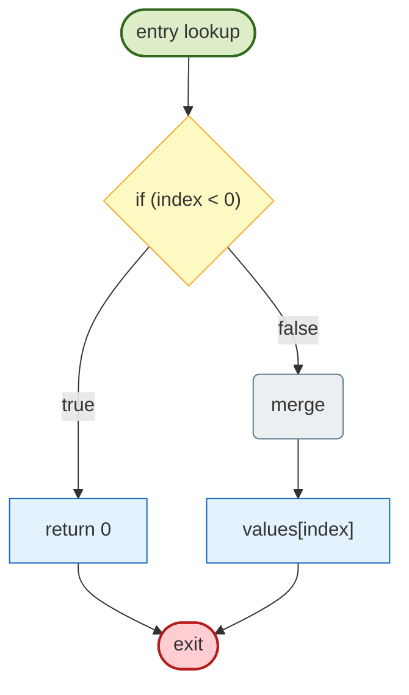

Observed path (trial 0, first 3 events): `cond@14` -> `ret@15` -> `def@13`

#### `sum_to` (lib.mbt)

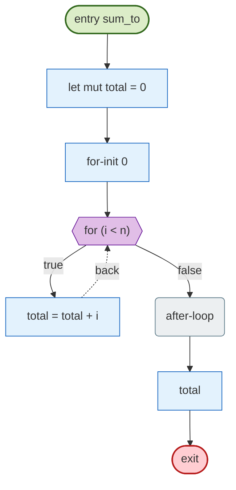

Observed path (trial 0, first 2 events): `def@61` -> `def@60`

#### `make_window` (lib.mbt)

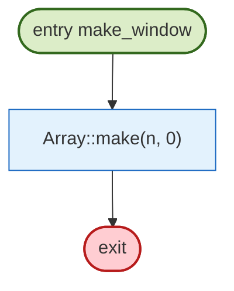

Observed path (trial 0, first 2 events): `call@22` -> `def@21`

#### `parse_len` (lib.mbt)

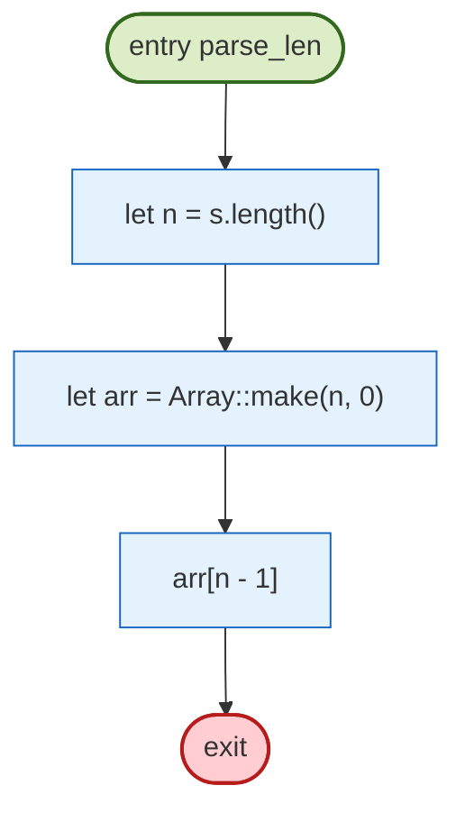

Observed path (trial 0, first 5 events): `def@27` -> `call@28` -> `def@28` -> `index@29` -> `def@26`

#### `get_checked` (lib.mbt)

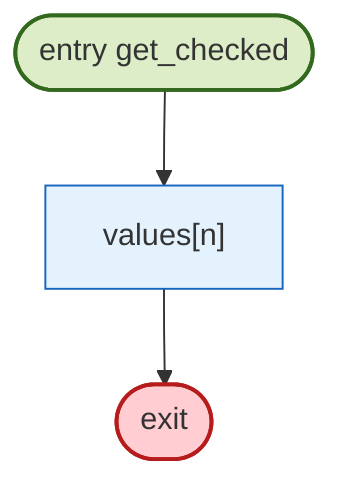

Observed path (trial 0, first 2 events): `index@73` -> `def@72`

#### `get_unsafe` (lib.mbt)

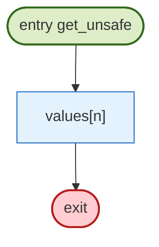

Observed path (trial 0, first 2 events): `index@81` -> `def@80`

### 4.2 CFG findings

| Rule | Severity | Function | Location | Message | Method | Confidence |
| --- | --- | --- | --- | --- | --- | --- |
| DEAD-CODE | info | unreachable_demo | lib.mbt:35 | statement is unreachable after an unconditional exit | static | 0.95 |
| DEAD-CODE | info | unreachable_demo | lib.mbt:36 | statement is unreachable after an unconditional exit | static | 0.95 |
| UNREACHABLE | info | spin | lib.mbt:42 | CFG node has no incoming edge | static | 0.9 |
| DEAD-CODE | info | spin | lib.mbt:45 | statement is unreachable after an unconditional exit | static | 0.95 |
| INFINITE-LOOP | warning | spin | lib.mbt:42 | loop has a back edge but no exit edge (condition is constant true or unparsed) | static | 0.75 |
| INFINITE-LOOP | warning | spin | lib.mbt:42 | loop did not terminate within the iteration cap (possible infinite loop) | dynamic | 0.7 |

### 4.3 Static vs dynamic attribution

| Signal | Method | What a hit means | Known limitation |
| --- | --- | --- | --- |
| Unreachable statement | static | no CFG predecessor; often after `return`/`break` | parser gaps can hide real predecessors |
| Infinite loop | static + dynamic | constant-true condition without break, or iteration cap reached | loops whose exit depends on unmodelled calls are reported as *budget*, not proven infinite |
| Uncovered code | dynamic (coverage import) | zero hits in the observed test suite | absence of execution is not proof of dead code |

## 5. Data flow and taint

Sources are entry-function parameters (and `@env.args` when the frontend sees it); propagation follows recorded definitions and the variables read by each statement; sinks are array-index expressions and allocation sizes. The graph below is the *observed* propagation, not a may-analysis over all inputs.

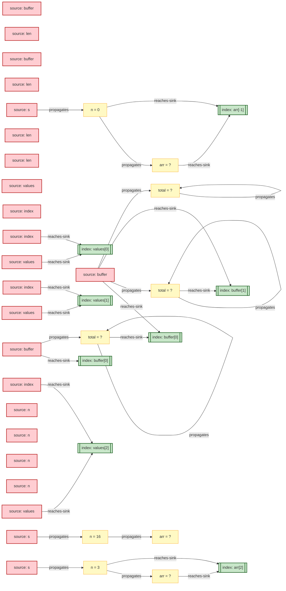

### 5.1 Taint sinks

| Rule | Severity | Function | Location | Message | Method | Confidence |
| --- | --- | --- | --- | --- | --- | --- |
| TAINT-INDEX | error | copy_prefix | lib.mbt:6 | tainted value reaches an array index / buffer offset | dynamic+symbolic | 0.8 |
| TAINT-INDEX | error | lookup | lib.mbt:17 | tainted value reaches an array index / buffer offset | dynamic+symbolic | 0.8 |
| TAINT-INDEX | error | parse_len | lib.mbt:29 | tainted value reaches an array index / buffer offset | dynamic+symbolic | 0.8 |
| TAINT-INDEX | error | get_checked | lib.mbt:73 | tainted value reaches an array index / buffer offset | dynamic+symbolic | 0.8 |
| TAINT-INDEX | error | get_unsafe | lib.mbt:81 | tainted value reaches an array index / buffer offset | dynamic+symbolic | 0.8 |
| TAINT-INDEX | error | get_negative | lib.mbt:88 | tainted value reaches an array index / buffer offset | dynamic+symbolic | 0.8 |

### 5.2 L2 abstract findings (may-analysis)

Abstract interpretation joins all paths and widens loops, so these alarms are *may* properties: a hit means the abstract state cannot exclude the defect, not that a concrete input was observed.

| Rule | Severity | Function | Location | Message | Method | Confidence |
| --- | --- | --- | --- | --- | --- | --- |
| UNREACHABLE | info | lookup | lib.mbt:14 | then-branch is unreachable for the abstract input set | L2-abstract | 0.8 |
| UNREACHABLE | info | lookup | lib.mbt:14 | else-branch is unreachable for the abstract input set | L2-abstract | 0.8 |
| TAINT-INDEX | error | parse_len | lib.mbt:29 | tainted value may reach an array index / buffer offset | L2-abstract | 0.6 |
| UNREACHABLE | info | classify | lib.mbt:50 | then-branch is unreachable for the abstract input set | L2-abstract | 0.8 |
| UNREACHABLE | info | classify | lib.mbt:50 | else-branch is unreachable for the abstract input set | L2-abstract | 0.8 |
| TAINT-INDEX | error | get_checked | lib.mbt:73 | tainted value may reach an array index / buffer offset | L2-abstract | 0.6 |
| RANGE-VIOLATION | warning | get_checked | lib.mbt:73 | index may be out of bounds on some inputs | L2-abstract | 0.6 |
| TAINT-INDEX | error | get_unsafe | lib.mbt:81 | tainted value may reach an array index / buffer offset | L2-abstract | 0.6 |
| RANGE-VIOLATION | warning | get_unsafe | lib.mbt:81 | index may be out of bounds on some inputs | L2-abstract | 0.6 |
| TAINT-INDEX | error | get_negative | lib.mbt:88 | tainted value may reach an array index / buffer offset | L2-abstract | 0.6 |
| RANGE-VIOLATION | warning | get_negative | lib.mbt:88 | index may be out of bounds on some inputs | L2-abstract | 0.6 |

## 6. Value ranges

Ranges are the union of concrete samples across synthesized input trials. They are *observed* intervals, not abstract-interpretation fixpoints: a missing input can hide a wider interval.

### 6.1 Per-program-point observations

Every definition event is keyed by function, source line and variable, so a value can be inspected at the exact program point that produced it (the full stream is in the JSONL trace).

| Function | Line | Variable | Observed values |
| --- | --- | --- | --- |
| spin | 41 | n | 0 |
| spin | 43 | n | 1, 2, 3, 4, 5, 6 |
| parse_len | 27 | n | 0, 3, 16, 64 |
| copy_prefix | 4 | i | 0 |
| copy_prefix | 7 | i | 1, 2 |
| sum_to | 61 | total | 0 |
| sum_to | 63 | total | 0 |
| parse_len | 28 | arr | ? |
| copy_prefix | 3 | total | 0 |
| copy_prefix | 6 | total | ? |

### 6.2 Function-level range union (L1)

| Function | Variable | Min | Max | Samples | Observed values | First site |
| --- | --- | --- | --- | --- | --- | --- |
| spin | n | 0 | 64 | 65 | 0, 1, 2, 3, 4, 5, 6, 7, 8, 9, 10, 11 | lib.mbt:41:3 |
| parse_len | n | 0 | 64 | 4 | 0, 3, 16, 64 | lib.mbt:27:3 |
| lookup | <ret> | 0 | 0 | 1 | 0 | lib.mbt:13:5-18:2 |
| sum_to | total | 0 | 0 | 132 | 0 | lib.mbt:61:3 |
| copy_prefix | i | 0 | 2 | 14 | 0, 1, 2 | lib.mbt:4:3 |
| classify | <ret> | -1 | 1 | 4 | -1, 0, 1 | lib.mbt:49:5-57:2 |
| copy_prefix | total | 0 | 0 | 8 | 0 | lib.mbt:3:3 |
| unreachable_demo | <ret> | -1 | 2 | 4 | -1, 0, 1, 2 | lib.mbt:33:5-37:2 |

### 6.3 Abstract may-ranges (L2)

These intervals are the abstract interpreter's fixpoint approximation at widening, not observed samples; they cover the whole input abstraction and therefore over-approximate.

| Function | Variable | May-range | Observations |
| --- | --- | --- | --- |
| spin | n | [-999999, 1000001] | 6 |
| double | n | [-1000000, 1000000] | 1 |
| sum_to | n | [-1000000, 1000000] | 1 |
| classify | x | [-1000000, 1000000] | 1 |
| parse_len | n | [0, 16] | 1 |
| get_unsafe | n | [-1000000, 1000000] | 1 |
| lookup | index | [-1000000, 1000000] | 1 |
| sum_to | total | [0, 0] | 1 |
| copy_prefix | i | [0, 0] | 1 |
| get_checked | n | [-1000000, 1000000] | 1 |
| make_window | n | [-1000000, 1000000] | 1 |
| get_negative | n | [-1000000, 1000000] | 1 |
| copy_prefix | len | [-1000000, 1000000] | 1 |
| copy_prefix | total | [0, 0] | 1 |
| unreachable_demo | x | [-1000000, 1000000] | 1 |
| unreachable_demo | y | [-999999, 1000001] | 1 |

## 7. Program slicing

### backward slice on `i@copy_prefix`

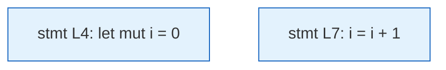

| Line | Kind | Statement | Site |
| --- | --- | --- | --- |
| 4 | def | `let mut i = 0` | lib.mbt |
| 7 | def | `i = i + 1` | lib.mbt |

## 8. Contracts and verification conditions (L3)

Deductive verification is WP-style: each contract becomes verification conditions (postconditions at every `return`, plus safety obligations for every index, allocation size, division and assertion). A condition is `proved` only when the preconditions entail it by interval reasoning; otherwise it is `failed` or `unknown`. This is not a substitute for an SMT-backed WP: `unknown` is an honest third state.

| Metric | Value |
| --- | --- |
| Functions with a contract | 4 |
| Functions checked | 4 |
| VCs proved | 2 |
| VCs failed | 1 |
| VCs unknown | 3 |

| Function | VC kind | Location | Status | Goal | Detail |
| --- | --- | --- | --- | --- | --- |
| get_checked | index-bounds | lib.mbt:72 | proved | `((n >= 0) && (n < values.length()))` | entailed by preconditions or interval arithmetic |
| get_checked | ensures | lib.mbt:72 | unknown | `(values[n] >= 0)` | insufficient facts for a decision |
| get_unsafe | index-bounds | lib.mbt:80 | unknown | `((n >= 0) && (n < values.length()))` | insufficient facts for a decision |
| get_unsafe | ensures | lib.mbt:80 | unknown | `(values[n] >= 0)` | insufficient facts for a decision |
| get_negative | index-bounds | lib.mbt:87 | failed | `((n >= 0) && (n < values.length()))` | preconditions or intervals refute the goal |
| double | ensures | lib.mbt:95 | proved | `((n + n) >= 0)` | entailed by preconditions or interval arithmetic |

Specification gaps (escalated, no `//@ requires`/`//@ ensures`): `copy_prefix (lib.mbt:2)`, `lookup (lib.mbt:13)`, `parse_len (lib.mbt:26)`, `spin (lib.mbt:40)`, `classify (lib.mbt:49)`

## 9. Method summary

| Capability | Engine | Precision statement |
| --- | --- | --- |
| CFG + dead/unreachable | static (syntax-directed) | sound relative to the parsed subset; parser gaps are reported |
| Path coverage | dynamic (trace) | exact for executed trials; no guarantee for unexecuted paths |
| Taint (L1) | dynamic + symbolic labels | flow-sensitive within a trial; container field sensitivity is coarse |
| Taint (L2) | abstract interpretation | may-analysis over the input abstraction; loop widening loses precision |
| Ranges (L1) | dynamic sampling | union of observed values; not a proof |
| Ranges (L2) | interval / value-set domain | over-approximation at widening; sound relative to the abstract semantics |
| Contracts (L3) | WP-style VC + interval decision | `proved` only from entailed preconditions; `unknown` when facts are insufficient |
| Slicing | dynamic dependence graph | exact for the recorded trace; not a static closure |

## 10. Reproduction

```text
LunaFlow analyze local/module@latest --out reports/ --funnel
```

Full method description, comparison with Frama-C/TIS, Joern, CodeQL, SVF and Soot, and the acceptance tests are in `docs/design.md`.
