# LunaFlow analysis report — local/module@0.0.0

> Trace-driven (dynamic-first) control-flow, data-flow, value-range and slicing analysis for a mooncakes.io module.

## 1. Acquisition and version pinning

| Item | Value |
| --- | --- |
| Requested coordinate | `local/module` |
| Resolved version | `0.0.0` |
| Pinning strategy | explicit local directory without moon.mod |
| Source root | `fixtures/vuln_demo` |
| Declared target | `` |
| Direct dependencies | (none) |

## 2. Ingestion statistics

| Metric | Value |
| --- | --- |
| Source files parsed | 1 |
| Functions extracted | 12 |
| Statements understood | 32 |
| Statements unsupported | 0 |
| Frontend coverage | 100.0% |
| Parse issues | 0 |
| CFG functions | 12 of 12 — every function |
| Trace events | 604 |
| Interpreted steps | 156 |
| Observed functions | 12 |
| Entry selection | every function was entered (12); the step budget (100000 steps) was not reached |
| Wall time (analyzer) | 4 ms |
| Selected level | L3 (funnel: L1 → L2 → L3) |

## 3. Proof-strength levels and funnel

The same program is analyzed at three proof strengths. Levels are cumulative: L2 adds abstract interpretation on top of L1, L3 adds contract verification on top of the escalated functions. `--funnel` runs all three and reports what each level adds.

### 3.1 Level definitions

| Level | Name | Engine | Input model | Result strength |
| --- | --- | --- | --- | --- |
| L1 | Interpreter | concrete execution on the formal interpreter | concrete boundary values (`--trials`) | observed facts; may miss unexecuted inputs and paths |
| L2 | Value | abstract interpretation over a value-set / interval domain | whole input sets (`Int` intervals, `Bool`/`String` sets, array length intervals) | exhaustive over the abstract state; may-taint and may-range alarms (false positives possible) |
| L3 | Proof-by-contract | WP-style weakest-precondition VC generation + interval decision | ACSL-style `//@ requires` / `//@ ensures` specs | `proved` / `failed` / `unknown` per verification condition; specs are mandatory |

### 3.2 Funnel

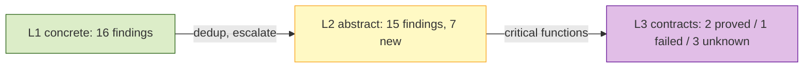

| Level | Checks | New vs previous | Functions / VCs | Note |
| --- | --- | --- | --- | --- |
| L1 concrete | 16 findings | — | 12 functions | observed facts |
| L2 abstract | 15 findings | 7 | 12 functions, 182 steps | exhaustive over the input abstraction |
| L3 contracts | 6 VCs | 1 failed, 3 unknown | 9 critical functions | specs required |

### 3.3 Escalation and specification gaps

Escalated functions (have at least one L1/L2 finding or a contract): `copy_prefix`, `lookup`, `make_window`, `parse_len`, `spin`, `get_checked`, `get_unsafe`, `get_negative`, `double`

Functions escalated without any contract (spec gap at L3): `copy_prefix (lib.mbt:2)`, `lookup (lib.mbt:13)`, `make_window (lib.mbt:21)`, `parse_len (lib.mbt:26)`, `spin (lib.mbt:40)`

## 4. Control-flow analysis

CFG nodes are built from the parsed statement tree; execution paths come from the concrete-execution trace engine. Dead/unreachable detection is static; path coverage and budget findings are dynamic. See `docs/design.md` §5 for the mapping rules.

### 4.1 CFG diagrams (top 8 by cyclomatic complexity)

#### `classify` (lib.mbt)

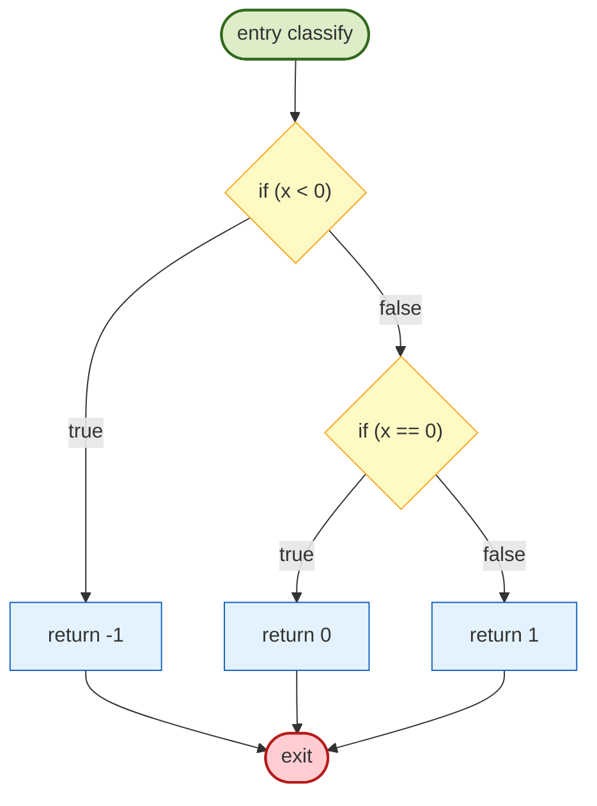

Observed path (trial 0, first 3 events): `cond@50` -> `ret@51` -> `def@49`

#### `copy_prefix` (lib.mbt)

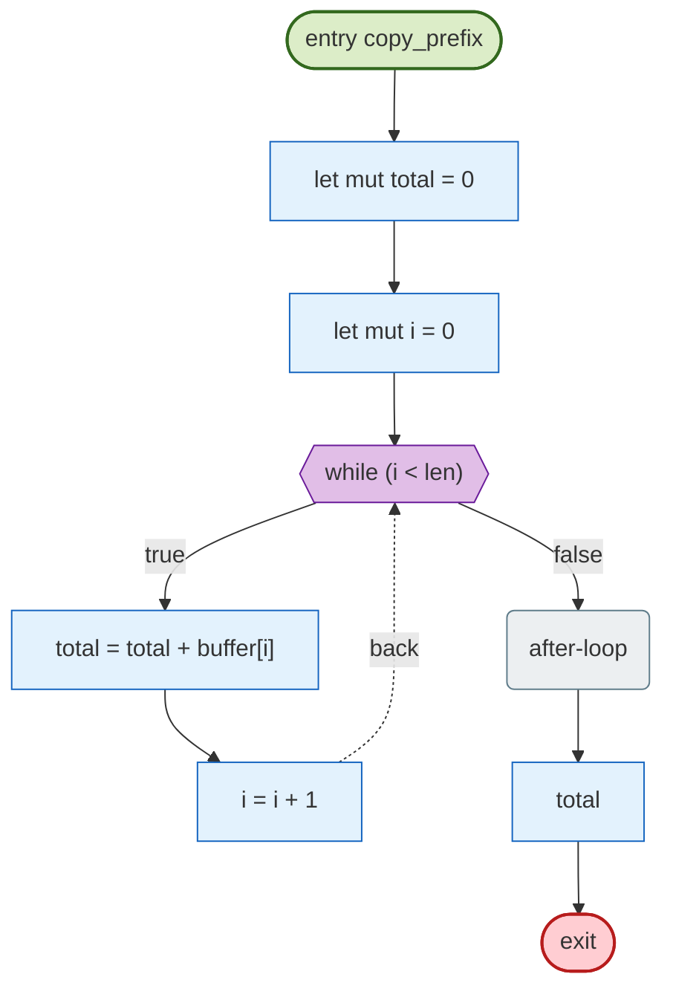

Observed path (trial 0, first 8 events): `def@3` -> `def@4` -> `cond@5` -> `def@2` -> `def@3` -> `def@4` -> `cond@5` -> `def@2`

#### `lookup` (lib.mbt)

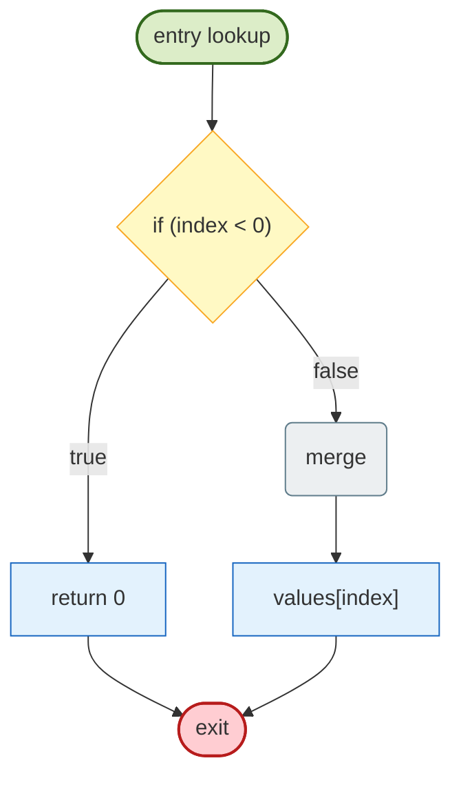

Observed path (trial 0, first 3 events): `cond@14` -> `ret@15` -> `def@13`

#### `sum_to` (lib.mbt)

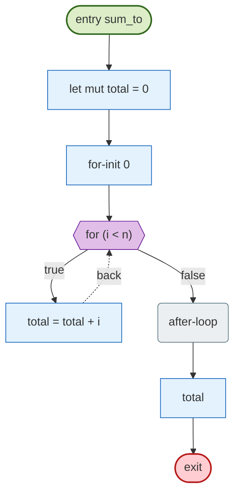

Observed path (trial 0, first 2 events): `def@61` -> `def@60`

#### `make_window` (lib.mbt)

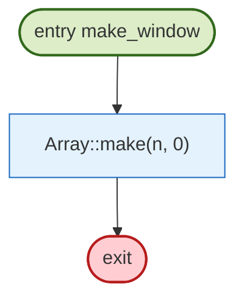

Observed path (trial 0, first 2 events): `alloc@22` -> `def@21`

#### `parse_len` (lib.mbt)

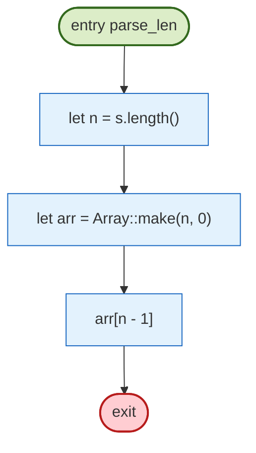

Observed path (trial 0, first 5 events): `def@27` -> `alloc@28` -> `def@28` -> `index@29` -> `def@26`

#### `get_checked` (lib.mbt)

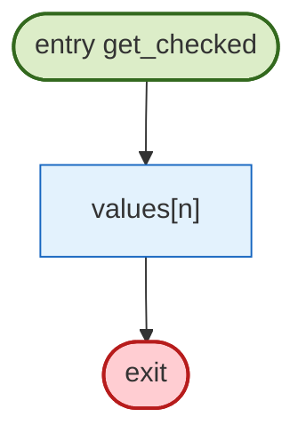

Observed path (trial 0, first 2 events): `index@73` -> `def@72`

#### `get_unsafe` (lib.mbt)

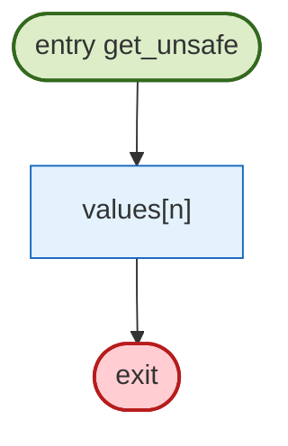

Observed path (trial 0, first 2 events): `index@81` -> `def@80`

### 4.2 CFG findings

| Rule | Severity | Verdict | Function | Location | Message | Method | Confidence |
| --- | --- | --- | --- | --- | --- | --- | --- |
| DEAD-CODE | info | certain | unreachable_demo | lib.mbt:35 | statement is unreachable after an unconditional exit | static | 0.95 |
| DEAD-CODE | info | certain | unreachable_demo | lib.mbt:36 | statement is unreachable after an unconditional exit | static | 0.95 |
| UNREACHABLE | info | certain | spin | lib.mbt:42 | CFG node has no incoming edge | static | 0.9 |
| DEAD-CODE | info | certain | spin | lib.mbt:45 | statement is unreachable after an unconditional exit | static | 0.95 |
| INFINITE-LOOP | warning | certain | spin | lib.mbt:42 | loop has a back edge but no exit edge (condition is constant true or unparsed) | static | 0.75 |
| INFINITE-LOOP | warning | certain | spin | lib.mbt:42 | loop did not terminate within the iteration cap (possible infinite loop) | dynamic | 0.7 |

### 4.3 Static vs dynamic attribution

| Signal | Method | What a hit means | Known limitation |
| --- | --- | --- | --- |
| Unreachable statement | static | no CFG predecessor; often after `return`/`break` | parser gaps can hide real predecessors |
| Infinite loop | static + dynamic | constant-true condition without break, or iteration cap reached | loops whose exit depends on unmodelled calls are reported as *budget*, not proven infinite |
| Uncovered code | dynamic (coverage import) | zero hits in the observed test suite | absence of execution is not proof of dead code |

## 5. Data flow, taint and the memory layout

Sources are entry-function parameters (and `@env.args` when the frontend sees it); propagation follows recorded definitions and the variables read by each statement; sinks are array-index expressions and allocation sizes. The graph below is the *observed* propagation, not a may-analysis over all inputs.

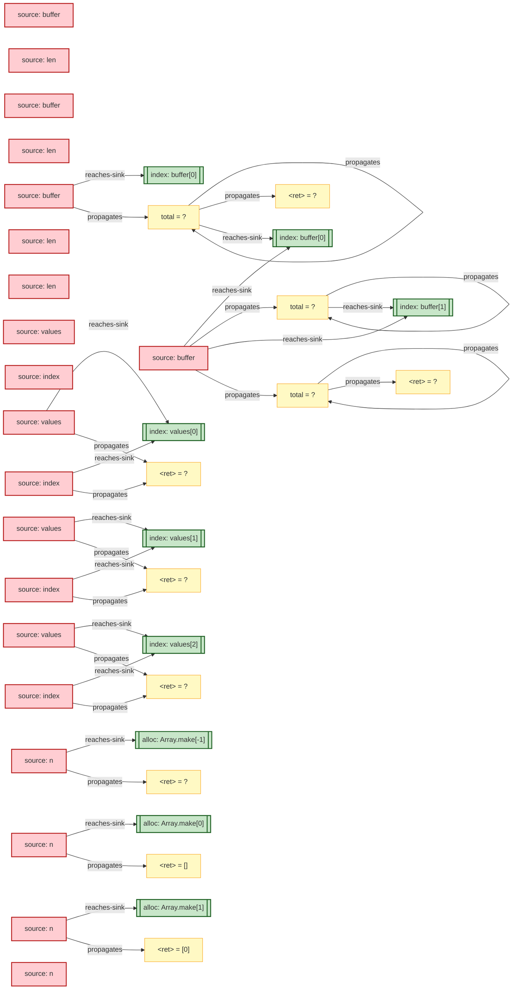

### 5.1 Taint sinks

| Rule | Severity | Verdict | Function | Location | Message | Method | Confidence |
| --- | --- | --- | --- | --- | --- | --- | --- |
| TAINT-INDEX | error | certain | copy_prefix | lib.mbt:6 | tainted value reaches an array index / buffer offset | dynamic+symbolic | 0.8 |
| TAINT-INDEX | error | certain | lookup | lib.mbt:17 | tainted value reaches an array index / buffer offset | dynamic+symbolic | 0.8 |
| TAINT-ALLOC | error | certain | make_window | lib.mbt:22 | tainted value controls an allocation size | dynamic+symbolic | 0.8 |
| TAINT-ALLOC | error | certain | parse_len | lib.mbt:28 | tainted value controls an allocation size | dynamic+symbolic | 0.8 |
| TAINT-INDEX | error | certain | parse_len | lib.mbt:29 | tainted value reaches an array index / buffer offset | dynamic+symbolic | 0.8 |
| TAINT-INDEX | error | certain | get_checked | lib.mbt:73 | tainted value reaches an array index / buffer offset | dynamic+symbolic | 0.8 |
| TAINT-INDEX | error | certain | get_unsafe | lib.mbt:81 | tainted value reaches an array index / buffer offset | dynamic+symbolic | 0.8 |
| TAINT-INDEX | error | certain | get_negative | lib.mbt:88 | tainted value reaches an array index / buffer offset | dynamic+symbolic | 0.8 |

### 5.2 L2 abstract findings (may-analysis)

Abstract interpretation joins all paths and widens loops, so these alarms are *may* properties: a hit means the abstract state cannot exclude the defect, not that a concrete input was observed. Three rules keep the may-analysis from crying wolf. A branch that is unreachable in ONE iteration of a loop is not reported, because the loop's state changes between the iterations. A tainted index is only claimed when the container is known to be an array: the analyzer cannot see the type of a struct's field, and a Map's key is not an offset that untrusted input chose. And an allocation size that is PROVABLY CONSTANT is not claimed as one that untrusted input chose: no tainted value controls a size that is the same on every input.

**Scope.** The abstract layer analysed 12 of 12 — every function the abstract layer can analyse, in 182 steps.

| Rule | Severity | Verdict | Function | Location | Message | Method | Confidence |
| --- | --- | --- | --- | --- | --- | --- | --- |
| TAINT-INDEX | error | certain | lookup | lib.mbt:17 | tainted value from parameter `index` may reach an array index / buffer offset | L2-abstract | 0.6 |
| TAINT-ALLOC | error | certain | make_window | lib.mbt:22 | tainted value from parameter `n` may control an allocation size | L2-abstract | 0.6 |
| RANGE-VIOLATION | warning | certain | make_window | lib.mbt:22 | allocation size may be negative | L2-abstract | 0.9 |
| TAINT-ALLOC | error | certain | parse_len | lib.mbt:28 | tainted value from parameter `s` may control an allocation size | L2-abstract | 0.6 |
| TAINT-INDEX | error | certain | parse_len | lib.mbt:29 | tainted value from parameter `s` may reach an array index / buffer offset | L2-abstract | 0.6 |
| INFINITE-LOOP | warning | certain | spin | lib.mbt:42 | loop condition is true for the whole abstract input set and has no break | L2-abstract | 0.7 |
| TAINT-INDEX | error | certain | get_checked | lib.mbt:73 | tainted value from parameter `n` may reach an array index / buffer offset | L2-abstract | 0.6 |
| TAINT-INDEX | error | certain | get_unsafe | lib.mbt:81 | tainted value from parameter `n` may reach an array index / buffer offset | L2-abstract | 0.6 |
| TAINT-INDEX | error | certain | get_negative | lib.mbt:88 | tainted value from parameter `n` may reach an array index / buffer offset | L2-abstract | 0.6 |

### 5.3 EVA findings (evolved value analysis)

The evolved value analysis rides on the same fixpoint and asks the second question about a value: not *what is its range* but *what happens when it is used*. These are the memory-safety and undefined-behaviour classes, mapped onto what MoonBit actually does — MoonBit's integer arithmetic WRAPS instead of trapping, so an overflow here is a silent wrong value and not a crash.

The index class is proved by the interval the abstract domain already computes — the array's length and the index's range are both known, so the comparison covers the whole input abstraction — and it is filed here because an index is a value USED to address storage.

| Rule | Severity | Verdict | Function | Location | Message | Method | Confidence |
| --- | --- | --- | --- | --- | --- | --- | --- |
| INDEX-OOB | error | certain | copy_prefix | lib.mbt:6 | index may be out of bounds on some inputs | L2-EVA | 0.6 |
| INDEX-OOB | error | certain | lookup | lib.mbt:17 | index may be out of bounds on some inputs | L2-EVA | 0.6 |
| INDEX-OOB | error | certain | parse_len | lib.mbt:29 | index may be out of bounds on some inputs | L2-EVA | 0.6 |
| INDEX-OOB | error | certain | get_checked | lib.mbt:73 | index may be out of bounds on some inputs | L2-EVA | 0.6 |
| INDEX-OOB | error | certain | get_unsafe | lib.mbt:81 | index may be out of bounds on some inputs | L2-EVA | 0.6 |
| INDEX-OOB | error | certain | get_negative | lib.mbt:88 | index may be out of bounds on some inputs | L2-EVA | 0.6 |

### 5.4 The global region

MoonBit resolves top-level bindings by DEPENDENCY, not by file order: a global may read a global declared later in the file. The analyzer evaluates the global region once, in dependency order, outside the trials -- so a global's value does not depend on the input the analyzer happened to sample.

A top-level binding is IMMUTABLE in MoonBit: `let mut` at the top level is a parse error, so a global is a constant of the module. The analyzer still leaves a global unknown when the module assigns to it, because the analyzer does not compile the target and cannot know that the assignment is an error.

_The module has no top-level bindings._


### 5.5 Where the allocations live

MoonBit has no addresses: there is no pointer type, no address arithmetic and no address space, so a hardware memory model -- frames at fixed addresses, a heap, MMIO registers -- has nothing to model here. What there IS to model is placement. A **global** binding lives in the module's global region. An allocation that does not **escape** the function that made it could live in that function's frame. An allocation that **escapes** -- returned, stored into another object, handed to a call the analyzer cannot see into -- outlives the frame, so it is heap-allocated. A value from **outside** the analysed module has a region the analyzer cannot name.

The classification is STATIC: it is computed over the AST, so it does not depend on which inputs a run sampled.

Allocation sites: 1 — FRAME 1.

| Allocation | Kind | Region | Location | Why |
| --- | --- | --- | --- | --- |
| parse_len | Array.make | **FRAME** — frame (does not escape) | lib.mbt:28 | bound to the local arr and never leaves the frame |


#### 5.5.1 A collection that only grows

MoonBit's type system makes the MEMORY-LEAK class inexpressible in safe code: there is no `free`, and every allocation is the garbage collector's business. One shape survives that, and this check reports it. A **module-level** collection -- a top-level `let`, which lives for as long as the module does -- that is only ever **added** to: nothing in the module ever removes an element from it, and nothing ever replaces it with a fresh one; and that is added to inside a **loop whose trip count the analyzer cannot bound**. The loop can run any number of times, every iteration adds an element, and nothing ever takes one away, so the collection grows without bound.

What is NOT claimed: a collection filled once at start-up, or once per call -- the analyzer cannot see how often the module is called; a collection that is trimmed somewhere; and a **local** collection, which dies with the function that made it.

_No collection grows without bound._


### 5.6 Layout stability: does the conclusion depend on the run?

_The stability self-check was not run._ Pass `--stability` to re-sample the analysis and compare the findings.


### 5.7 The foreign address space

MoonBit has no pointer type, no address arithmetic and no address space: nothing in the language IS an address. The C boundary is where an address appears, and it appears on the **other** side of it. There are two spaces here, and the analysis is about the boundary between them: the **MoonBit** space (the reference-counted heap, the global region, the frame) and the **foreign** space (what the C code owns, plus the payload of an `#external` object).

Every claim below rests on a measurement against the toolchain, not on a reading of a document. `extern "C" fn name(args) -> Ret = "c_symbol"` is the only C form and the `= "c_symbol"` part is required; the wasm backend REJECTS `extern "C"` (E4156) and native REJECTS a module import, so the two forms are not interchangeable; a `String` crosses as `uint16_t *` and a `Bytes` as `uint8_t *`, so the C side receives the ADDRESS of a MoonBit heap object while the scalars cross by value; the toolchain refuses a pointer-typed parameter without an ownership annotation (E0055) and says the current default will change; and the toolchain does NOT enforce that annotation and does NOT notice two declarations claiming the same C symbol with different signatures -- those last two are this analyzer's own checks.

_This module declares no foreign function._ There is no C boundary to model, and no address space on the other side of it.


### 5.8 Concurrency: the tasks and the shared state

MoonBit tasks do **NOT** run MoonBit code on several OS threads. That was measured, not assumed: a spin-lock whose spin loop contains no `await` HANGS -- the spinner printed its marker and the second task never printed at all, because it never got to run. The runtime's thread pool (`max_worker_count = 1024` by default) executes the BLOCKING I/O; the coroutine waits on the event-loop thread.

So a task yields ONLY at an await point, and an await point is where another task may run. That makes the defect class here **interleaving sensitivity**, not a thread-level data race: a read-modify-write with no await inside it loses nothing (measured: 8 tasks x 200 000 increments = exactly 1 600 000 counted), while a read-AWAIT-write over a shared `Ref[Int]` lost 21 000 of 24 000 updates -- the SAME interleaving every run. The space is finite and reproducible, so a conflict can be FOUND rather than waited for.

_This module spawns no task._ There is no concurrency to model: no closure is handed to a spawn API.


### 5.9 IPC and buffers: the reads that can come back short

MoonBit's own IPC -- sockets, pipes and process stdio -- goes through the core's `BinaryReader` and `BinaryWriter` traits, and those traits have a contract. The defect classes here are the ways a program can break that contract, and every one of them was MEASURED against the core rather than read off a documentation page:

- **A read can come back SHORT.** `read_into(dst)` returns the number of bytes it read, and that number can be smaller than the buffer. Measured: a 16-byte buffer pre-filled with `0xFF`, a pipe with 3 bytes in it, one `read_into` -> returned **3**, and the buffer afterwards was `61 62 63 FF FF FF ... FF`. The bytes past the count were never written: they still held what the buffer held before. The count is the only thing that says so, and a program that discards it cannot tell a short read from a full one.
- **The offset is the caller's job.** Measured: `read_into(buf, offset=8)` returned 3 and wrote at `buf[8..11]`; `buf[0..8)` was untouched. Nothing advances the offset for you.
- **EOF is zero.** Measured: at the end of the stream `read_into` returns **0** and `read()` returns **None**. So 0 is both "no progress" and "the stream ended", and a loop that discards the count cannot tell them apart.
- **A peeked view goes stale.** The core says it outright -- "the caller of `peek` MUST NOT use the returned slice after any other `BinaryReader` operation is invoked on the same reader" -- because the reader keeps ONE buffer and reuses it. Measured: peeked `61 62 63`; after two `read()` calls the SAME view read `78 79 7A`.
- **A pending write is not a snapshot.** Measured: a 4-byte buffer of 'A' handed to `write`, then overwritten with 'B' while the write was still pending -> the reader received `42 42 42 42`, the 'B's, not the 'A's that were in the buffer when the write was issued.
- **A `peek` is a view only when the value is used AS ONE.** `peek` is a common name -- a parser has one and it returns a token -- so the name alone cannot decide. The analyzer requires evidence: the value is passed to a `BytesView` parameter, handed to the core's writer, or copied with a method only a view has. A peek whose result is only matched on is not a view, and is not reported.

One thing the measurement REFUSED to support: `write` is **exhaustive**. It loops until every byte has been handed over -- measured, 5 bytes written and read 2 at a time -> 5 bytes in 3 reads -- so there is no partial-write defect at the `write` level, and this model does not claim one.

#### 5.9.1 The calls on the readers and writers

_No call on a reader or a writer._

#### 5.9.2 The views that went stale

_No stale view._

#### 5.9.3 The buffers two sides write

_No shared buffer._

#### 5.9.4 What this model does NOT cover

The model is sound about what it reports and silent about the rest, so here is exactly what it does not model:

- **A reader the analyzer does not recognise by name.** The analyzer matches the METHOD NAME, because it does not infer types: a reader of your own with a method called `read_into` is treated as the core's reader. A reader with a different method name is not seen at all.
- **A peek whose use as a view is invisible.** A `peek` is only treated as a view when the analyzer can SEE the value used as one -- passed to a `BytesView` parameter, handed to the core's writer, or copied with a method only a view has. A value that is only matched on is not a view. That is deliberate: the analyzer's own source has FOUR `peek` results that are only matched on, and matching the name alone reported them THIRTEEN times.
- **A length that comes from the stream.** A length read off the wire and used to size an allocation is a real defect, and it is not judged here: the taint families (§5.4) are where a source has to be declared for that to be checkable. This model judges the LENGTH ARGUMENT AT THE C BOUNDARY (§5.7), not a length that came in over the socket.
- **A buffer reached through a field, a container or an array.** The shared buffers are the ones a task body CAPTURES by name. A buffer stored in a struct field or in a collection is not tracked.
- **A use of a view that was copied.** `to_owned()` makes a copy, and a copy is not a view: the model only reports the view itself.
- **A count that is used but an offset that is not advanced.** `read_into(buf, offset=k)` does not move `k` for you (measured). The model reports a DISCARDED count; a count that is used but an offset that is not advanced is not judged.
- **The C side of a socket.** What arrives is whatever the peer sent. §5.7 says the same about the other side of a C boundary.

_No findings._

### 5.10 Claims that could not be decided

_Every claim the analyser made was decided; nothing was left unverified._


### 5.11 Which dimension found which rule

| Family | L2-abstract | dynamic+symbolic | L2-EVA | static | dynamic | Total |
| --- | ---: | ---: | ---: | ---: | ---: | ---: |
| TAINT-INDEX | 5 | 6 | · | · | · | 11 |
| INDEX-OOB | · | · | 6 | · | · | 6 |
| TAINT-ALLOC | 2 | 2 | · | · | · | 4 |
| DEAD-CODE | · | · | · | 3 | · | 3 |
| INFINITE-LOOP | 1 | · | · | 1 | 1 | 3 |
| UNREACHABLE | · | · | · | 1 | · | 1 |
| RANGE-VIOLATION | 1 | · | · | · | · | 1 |
| **Total** | **9** | **8** | **6** | **5** | **1** | **29** |

7 families over 5 method(s); 3 of them were found by MORE THAN ONE method and so rest on more than one kind of evidence: TAINT-INDEX, TAINT-ALLOC, INFINITE-LOOP.


### 5.12 Counterexamples: the smallest input that reproduces each finding

_The counterexample minimisation was not run._ Pass `--counterexamples` to re-run each finding an execution produced on its own input, and to shrink that input to the smallest one that still reproduces it.


## 6. Value ranges

Ranges are the union of concrete samples across synthesized input trials. They are *observed* intervals, not abstract-interpretation fixpoints: a missing input can hide a wider interval.

### 6.1 Per-program-point observations

Every definition event is keyed by function, source line and variable, so a value can be inspected at the exact program point that produced it (the full stream is in the JSONL trace).

| Function | Line | Variable | Observed values |
| --- | --- | --- | --- |
| spin | 41 | n | 0 |
| spin | 43 | n | 1, 2, 3, 4, 5, 6 |
| parse_len | 27 | n | 0, 3, 16, 64 |
| copy_prefix | 4 | i | 0 |
| copy_prefix | 7 | i | 1, 2 |
| sum_to | 61 | total | 0 |
| sum_to | 63 | total | 0 |
| parse_len | 28 | arr | [], [0, 0, 0], [0, 0, 0, 0, 0, 0, 0, 0, 0, 0, 0, 0, 0, 0,... |
| copy_prefix | 3 | total | 0 |
| copy_prefix | 6 | total | ? |

### 6.2 Function-level range union (L1)

| Function | Variable | Min | Max | Samples | Observed values | First site |
| --- | --- | --- | --- | --- | --- | --- |
| spin | n | 0 | 64 | 65 | 0, 1, 2, 3, 4, 5, 6, 7, 8, 9, 10, 11 | lib.mbt:41:3 |
| spin | <ret> | 64 | 64 | 1 | 64 | lib.mbt:40:5-46:2 |
| parse_len | n | 0 | 64 | 4 | 0, 3, 16, 64 | lib.mbt:27:3 |
| double | <ret> | -2 | 4 | 4 | -2, 0, 2, 4 | lib.mbt:95:5-97:2 |
| lookup | <ret> | 0 | 0 | 1 | 0 | lib.mbt:13:5-18:2 |
| sum_to | <ret> | 0 | 0 | 4 | 0 | lib.mbt:60:5-66:2 |
| sum_to | total | 0 | 0 | 132 | 0 | lib.mbt:61:3 |
| copy_prefix | i | 0 | 2 | 14 | 0, 1, 2 | lib.mbt:4:3 |
| classify | <ret> | -1 | 1 | 4 | -1, 0, 1 | lib.mbt:49:5-57:2 |
| parse_len | <ret> | 0 | 0 | 3 | 0 | lib.mbt:26:5-30:2 |
| copy_prefix | <ret> | 0 | 0 | 4 | 0 | lib.mbt:2:5-10:2 |
| copy_prefix | total | 0 | 0 | 8 | 0 | lib.mbt:3:3 |
| unreachable_demo | <ret> | -1 | 2 | 4 | -1, 0, 1, 2 | lib.mbt:33:5-37:2 |

### 6.3 Abstract may-ranges (L2)

These intervals are the abstract interpreter's fixpoint approximation at widening, not observed samples; they cover the whole input abstraction and therefore over-approximate.

| Function | Variable | May-range | Observations |
| --- | --- | --- | --- |
| spin | n | [0, 1000001] | 6 |
| double | n | [-1000000, 1000000] | 1 |
| sum_to | n | [-1000000, 1000000] | 1 |
| classify | x | [-1000000, 1000000] | 1 |
| parse_len | n | [0, 16] | 1 |
| get_unsafe | n | [-1000000, 1000000] | 1 |
| lookup | index | [-1000000, 1000000] | 1 |
| sum_to | total | [0, 0] | 2 |
| copy_prefix | i | [0, 1000000] | 6 |
| get_checked | n | [-1000000, 1000000] | 1 |
| make_window | n | [-1000000, 1000000] | 1 |
| get_negative | n | [-1000000, 1000000] | 1 |
| copy_prefix | len | [-1000000, 1000000] | 1 |
| copy_prefix | total | [0, 0] | 1 |
| unreachable_demo | x | [-1000000, 1000000] | 1 |
| unreachable_demo | y | [-999999, 1000001] | 1 |

## 7. Program slicing

### backward slice on `i@copy_prefix`

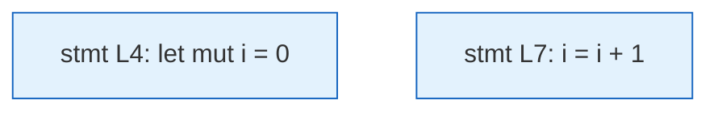

| Line | Kind | Statement | Site |
| --- | --- | --- | --- |
| 4 | def | `let mut i = 0` | lib.mbt |
| 7 | def | `i = i + 1` | lib.mbt |

## 8. Contracts and verification conditions (L3)

Deductive verification is WP-style: each contract becomes verification conditions (postconditions at every `return`, plus safety obligations for every index, allocation size, division and assertion). A condition is `proved` only when the preconditions entail it by interval reasoning; otherwise it is `failed` or `unknown`. This is not a substitute for an SMT-backed WP: `unknown` is an honest third state.

| Metric | Value |
| --- | --- |
| Functions with a contract | 4 |
| Functions checked | 4 |
| VCs proved | 2 |
| VCs failed | 1 |
| VCs unknown | 3 |

| Function | VC kind | Location | Status | Goal | Detail |
| --- | --- | --- | --- | --- | --- |
| get_checked | index-bounds | lib.mbt:72 | proved | `((n >= 0) && (n < values.length()))` | entailed by preconditions or interval arithmetic |
| get_checked | ensures | lib.mbt:72 | unknown | `(values[n] >= 0)` | insufficient facts for a decision |
| get_unsafe | index-bounds | lib.mbt:80 | unknown | `((n >= 0) && (n < values.length()))` | insufficient facts for a decision |
| get_unsafe | ensures | lib.mbt:80 | unknown | `(values[n] >= 0)` | insufficient facts for a decision |
| get_negative | index-bounds | lib.mbt:87 | failed | `((n >= 0) && (n < values.length()))` | preconditions or intervals refute the goal |
| double | ensures | lib.mbt:95 | proved | `((n + n) >= 0)` | entailed by preconditions or interval arithmetic |

Specification gaps (escalated, no `//@ requires`/`//@ ensures`): `copy_prefix (lib.mbt:2)`, `lookup (lib.mbt:13)`, `make_window (lib.mbt:21)`, `parse_len (lib.mbt:26)`, `spin (lib.mbt:40)`

## 9. Method summary

| Capability | Engine | Precision statement |
| --- | --- | --- |
| CFG + dead/unreachable | static (syntax-directed) | sound relative to the parsed subset; parser gaps are reported |
| Path coverage | dynamic (trace) | exact for executed trials; no guarantee for unexecuted paths |
| Taint (L1) | dynamic + symbolic labels | flow-sensitive within a trial; container field sensitivity is coarse |
| Taint (L2) | abstract interpretation | may-analysis over the input abstraction; loop widening loses precision |
| Ranges (L1) | dynamic sampling | union of observed values; not a proof |
| Ranges (L2) | interval / value-set domain | over-approximation at widening; sound relative to the abstract semantics |
| Contracts (L3) | WP-style VC + interval decision | `proved` only from entailed preconditions; `unknown` when facts are insufficient |
| Evolved value analysis (L2-EVA) | the same fixpoint, asking what a value is USED FOR | may-analysis; a hit means the abstract state cannot exclude the defect, and the classes MoonBit cannot express are RESERVED and never fire |
| Foreign address space (L2-FFI) | static model of the C boundary | the C side is invisible; the checks are about the MoonBit side of the contract, and the report says which ones cannot be checked at all |
| Memory layout (L2-memory) | static model of the module's globals | a collection that only grows is reported when the analyzer can PROVE the growth is unbounded: a loop it cannot bound, and no removal anywhere in the module |
| Concurrency (L2-CONC) | interleaving model over the tasks | MoonBit tasks run on one thread (measured), so the defect class is interleaving sensitivity; a hit means the read-modify-write is not atomic with its read |
| Slicing | dynamic dependence graph | exact for the recorded trace; not a static closure |

## 10. Reproduction

```text
LunaFlow analyze local/module@latest --out reports/ --funnel
```

The findings tables above are bounded, so this report may not carry every finding. The ones it does not carry are in the `_findings.jsonl` sidecar beside this file -- one JSON object per finding, with the family, the severity, the function, the file, the line, the message, the method and the confidence. The sidecar holds EVERY finding the report rendered, so nothing is lost to the bound.

Full method description, comparison with Frama-C/TIS, Joern, CodeQL, SVF and Soot, and the acceptance tests are in `docs/design.md`.
