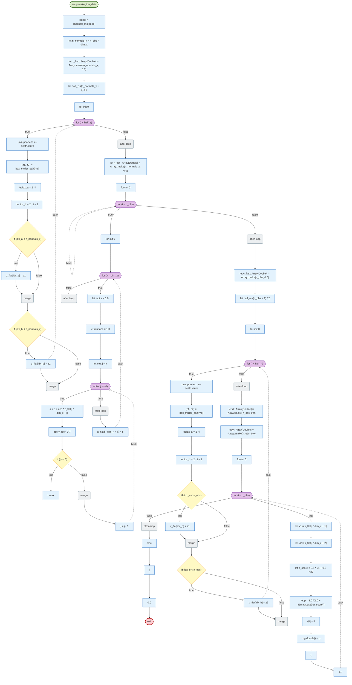
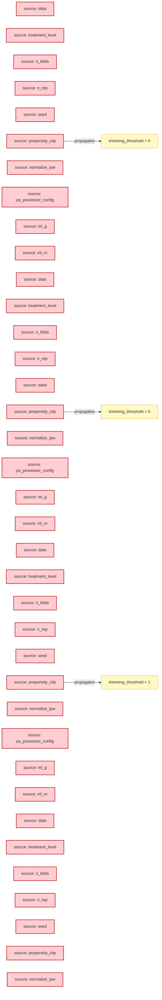
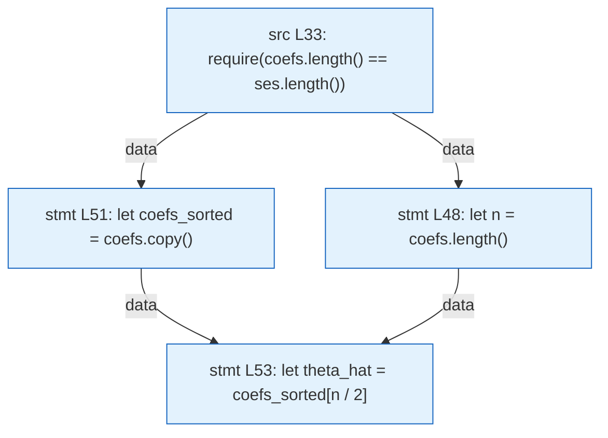

# LunaFlow analysis report — riantr/moonbit_doubleML@latest@0.164.62

> Trace-driven (dynamic-first) control-flow, data-flow, value-range and slicing analysis for a mooncakes.io module.

## 1. Acquisition and version pinning

| Item | Value |
| --- | --- |
| Requested coordinate | `riantr/moonbit_doubleML@latest` |
| Resolved version | `0.164.62` |
| Pinning strategy | `@latest` resolved through `moon fetch` (local registry index, newest non-yanked version) and pinned to `0.164.62` for ingestion, execution and reporting |
| Source root | `./.repos/riantr/moonbit_doubleML/0.164.62` |
| Declared target | `wasm-gc` |
| Direct dependencies | moonbit-community/sqlite3@0.2.3, moonbitlang/async@0.22.7 |

## 2. Ingestion statistics

| Metric | Value |
| --- | --- |
| Source files parsed | 220 |
| Functions extracted | 2520 |
| Statements understood | 43822 |
| Statements unsupported | 58 |
| Frontend coverage | 99.8% |
| Parse issues | 0 |
| CFG functions | 600 |
| Trace events | 162708 |
| Interpreted steps | 44090 |
| Observed functions | 120 |
| Wall time (analyzer) | 2702 ms |
| Selected level | L3 (funnel: L1 → L2 → L3) |

## 3. Proof-strength levels and funnel

The same program is analyzed at three proof strengths. Levels are cumulative: L2 adds abstract interpretation on top of L1, L3 adds contract verification on top of the escalated functions. `--funnel` runs all three and reports what each level adds.

### 3.1 Level definitions

| Level | Name | Engine | Input model | Result strength |
| --- | --- | --- | --- | --- |
| L1 | Interpreter | concrete execution on the formal interpreter | concrete boundary values (`--trials`) | observed facts; may miss unexecuted inputs and paths |
| L2 | Value | abstract interpretation over a value-set / interval domain | whole input sets (`Int` intervals, `Bool`/`String` sets, array length intervals) | exhaustive over the abstract state; may-taint and may-range alarms (false positives possible) |
| L3 | Proof-by-contract | WP-style weakest-precondition VC generation + interval decision | ACSL-style `//@ requires` / `//@ ensures` specs | `proved` / `failed` / `unknown` per verification condition; specs are mandatory |

### 3.2 Funnel


| Level | Checks | New vs previous | Functions / VCs | Note |
| --- | --- | --- | --- | --- |
| L1 concrete | 92 findings | — | 120 functions | observed facts |
| L2 abstract | 127 findings | 115 | 120 functions, 6005 steps | exhaustive over the input abstraction |
| L3 contracts | 0 VCs | 0 failed, 0 unknown | 78 critical functions | specs required |

### 3.3 Escalation and specification gaps

Escalated functions (have at least one L1/L2 finding or a contract): `slice_matrix_rows`, `unique_units`, `build_row_unit_map`, `DoubleMLAPO::fit_cluster`, `indicator_level`, `seed_to_bytes`, `psi_at`, `cluster_sandwich_variance`, `DoubleMLAPO::bootstrap`, `tune_score_grid`, `tune_score_outcome`, `DoubleMLAPO::sensitivity_nu2_elements`, `clip_vec`, `normalize_ipw`, `DoubleMLAPO::sensitivity_analysis`, `DoubleMLAPO::sensitivity_analysis_cluster`, `irm_style_sensitivity_cluster_from_elements`, `DoubleMLAPOS::psi_b_row_at`, `DoubleMLAPOS::sandwich_se_at`, `DoubleMLAPOS::cluster_sandwich_se_at`, `DoubleMLAPOS::bias_corrected_coef_at`, `DoubleMLAPOS::bootstrap`, `DoubleMLAPOS::confint`, `DoubleMLAPOS::causal_contrast`, `DoubleMLAPOS::sensitivity_analysis`, `DoubleMLAPOS::sensitivity_analysis_cluster`, `check_sample_splitting`, `generic_bootstrap_t_stat`, `DoubleMLDID::sensitivity_nu2_elements`, `DoubleMLDID::sensitivity_analysis`, `DoubleMLDID::sensitivity_analysis_cluster`, `GBLearner::fit_weighted`, `cross_fit_irm`, `folds_to_cv_partition`, `DoubleMLIRM::fit_cluster`, `DoubleMLIRM::bootstrap`, `DoubleMLIRM::sensitivity_nu2_elements`, `vector_subtract`, `DoubleMLIRM::sensitivity_analysis`, `DoubleMLIRM::sensitivity_analysis_cluster`, `sandwich_variance_hc0`, `aggregate_coef_se`, `DoubleMLAPO::new`, `DoubleMLAPO::coef`, `DoubleMLAPO::se`, `DoubleMLAPO::confint`, `DoubleMLAPO::predictions_g`, `DoubleMLAPO::predictions_m`, `DoubleMLAPO::sandwich_se`, `DoubleMLAPO::cluster_sandwich_se`, `DoubleMLAPO::bias_corrected_coef`, `DoubleMLAPO::tune`, `DoubleMLAPOS::tune`, `DoubleMLAPOS::new`, `DoubleMLAPOS::fit`, `DoubleMLAPOS::coefs`, `DoubleMLAPOS::ses`, `DoubleMLAPOS::psi_a_row_at`, `DoubleMLAPOS::m_inv_1x1_at`, `DoubleMLAPOS::boot_t_stats`, `DoubleMLDIDData::new`, `DoubleMLDID::coef`, `DoubleMLDID::se`, `DoubleMLDID::confint`, `cross_fit_did`, `DoubleMLDID::bootstrap`, `DoubleMLDID::sandwich_se`, `DoubleMLDID::cluster_sandwich_se`, `DoubleMLDID::bias_corrected_coef`, `DoubleMLDID::tune`, `DoubleMLIRM::new`, `DoubleMLIRM::coef`, `DoubleMLIRM::se`, `DoubleMLIRM::confint`, `filter_indices`, `DoubleMLIRM::tune`, `DoubleMLIRM::sandwich_se`, `DoubleMLIRM::cluster_sandwich_se`

Functions escalated without any contract (spec gap at L3): `DoubleMLAPO::new (apo.mbt:100)`, `DoubleMLAPO::coef (apo.mbt:195)`, `DoubleMLAPO::se (apo.mbt:206)`, `DoubleMLAPO::confint (apo.mbt:217)`, `DoubleMLAPO::predictions_g (apo.mbt:228)`, `DoubleMLAPO::predictions_m (apo.mbt:239)`, `indicator_level (apo.mbt:250)`, `DoubleMLAPO::fit_cluster (apo.mbt:548)`, `DoubleMLAPO::sandwich_se (apo.mbt:765)`, `DoubleMLAPO::cluster_sandwich_se (apo.mbt:798)`, `DoubleMLAPO::bias_corrected_coef (apo.mbt:857)`, `DoubleMLAPO::bootstrap (apo.mbt:894)`, `DoubleMLAPO::tune (apo.mbt:967)`, `DoubleMLAPOS::tune (apo.mbt:1023)`, `DoubleMLAPO::sensitivity_nu2_elements (apo.mbt:1093)`, `DoubleMLAPO::sensitivity_analysis (apo.mbt:1126)`, `DoubleMLAPO::sensitivity_analysis_cluster (apo.mbt:1156)`, `DoubleMLAPOS::new (apo.mbt:1280)`, `DoubleMLAPOS::fit (apo.mbt:1377)`, `DoubleMLAPOS::coefs (apo.mbt:1691)`, `DoubleMLAPOS::ses (apo.mbt:1702)`, `DoubleMLAPOS::psi_b_row_at (apo.mbt:1806)`, `DoubleMLAPOS::psi_a_row_at (apo.mbt:1836)`, `DoubleMLAPOS::m_inv_1x1_at (apo.mbt:1866)`, `DoubleMLAPOS::sandwich_se_at (apo.mbt:1917)`, `DoubleMLAPOS::cluster_sandwich_se_at (apo.mbt:1963)`, `DoubleMLAPOS::bias_corrected_coef_at (apo.mbt:2017)`, `DoubleMLAPOS::bootstrap (apo.mbt:2043)`, `DoubleMLAPOS::confint (apo.mbt:2092)`, `DoubleMLAPOS::boot_t_stats (apo.mbt:2146)`, `DoubleMLAPOS::causal_contrast (apo.mbt:2198)`, `DoubleMLAPOS::sensitivity_analysis (apo.mbt:2264)`, `DoubleMLAPOS::sensitivity_analysis_cluster (apo.mbt:2312)`, `DoubleMLDIDData::new (did.mbt:30)`, `DoubleMLDID::coef (did.mbt:343)`, `DoubleMLDID::se (did.mbt:354)`, `DoubleMLDID::confint (did.mbt:367)`, `cross_fit_did (did.mbt:431)`, `DoubleMLDID::bootstrap (did.mbt:791)`, `DoubleMLDID::sensitivity_nu2_elements (did.mbt:871)`, `DoubleMLDID::sensitivity_analysis (did.mbt:938)`, `DoubleMLDID::sensitivity_analysis_cluster (did.mbt:973)`, `DoubleMLDID::sandwich_se (did.mbt:1025)`, `DoubleMLDID::cluster_sandwich_se (did.mbt:1055)`, `DoubleMLDID::bias_corrected_coef (did.mbt:1112)`, `DoubleMLDID::tune (did.mbt:1194)`, `GBLearner::fit_weighted (gbl.mbt:124)`, `DoubleMLIRM::new (irm.mbt:108)`, `DoubleMLIRM::coef (irm.mbt:183)`, `DoubleMLIRM::se (irm.mbt:194)`, `DoubleMLIRM::confint (irm.mbt:208)`, `filter_indices (irm.mbt:313)`, `clip_vec (irm.mbt:326)`, `cross_fit_irm (irm.mbt:351)`, `DoubleMLIRM::fit_cluster (irm.mbt:729)`, `DoubleMLIRM::bootstrap (irm.mbt:934)`, `DoubleMLIRM::tune (irm.mbt:1013)`, `DoubleMLIRM::sensitivity_nu2_elements (irm.mbt:1088)`, `DoubleMLIRM::sensitivity_analysis (irm.mbt:1115)`, `DoubleMLIRM::sensitivity_analysis_cluster (irm.mbt:1153)`, `DoubleMLIRM::sandwich_se (irm.mbt:1196)`, `DoubleMLIRM::cluster_sandwich_se (irm.mbt:1237)`, `unique_units (plpr.mbt:170)`, `seed_to_bytes (seed.mbt:25)`, `tune_score_outcome (tune.mbt:172)`, `tune_score_grid (tune.mbt:275)`, `check_sample_splitting (kfold.mbt:287)`, `slice_matrix_rows (kfold.mbt:486)`, `build_row_unit_map (kfold.mbt:583)`, `psi_at (sandwich.mbt:214)`, `sandwich_variance_hc0 (sandwich.mbt:272)`, `cluster_sandwich_variance (sandwich.mbt:533)`, `aggregate_coef_se (aggregator.mbt:33)`, `vector_subtract (vectorized.mbt:77)`, `irm_style_sensitivity_cluster_from_elements (sensitivity.mbt:233)`, `folds_to_cv_partition (ps_processor.mbt:329)`, `normalize_ipw (ps_processor.mbt:908)`, `generic_bootstrap_t_stat (bootstrap_helper.mbt:47)`

## 4. Control-flow analysis

CFG nodes are built from the parsed statement tree; execution paths come from the concrete-execution trace engine. Dead/unreachable detection is static; path coverage and budget findings are dynamic. See `docs/design.md` §5 for the mapping rules.

### 4.1 CFG diagrams (top 8 by cyclomatic complexity)

#### `transform_panel` (plpr.mbt)

_Diagram omitted: 145 nodes exceeds the readability cap (90). Findings for this function are listed below._

#### `kfold_stratified` (kfold.mbt)

```mermaid
flowchart TD
  classDef entryNode fill:#dcedc8,stroke:#33691e,stroke-width:2px
  classDef exitNode fill:#ffcdd2,stroke:#b71c1c,stroke-width:2px
  classDef branchNode fill:#fff9c4,stroke:#f9a825
  classDef loopNode fill:#e1bee7,stroke:#6a1b9a
  classDef mergeNode fill:#eceff1,stroke:#607d8b
  classDef deadNode fill:#eeeeee,stroke:#9e9e9e
  classDef stmtNode fill:#e3f2fd,stroke:#1565c0
  n0(["entry kfold_stratified"]):::entryNode
  n1(["exit"]):::exitNode
  n2["require(n #gt; 0)"]:::stmtNode
  n3["require(strata.length() == n)"]:::stmtNode
  n4["require(n_folds #gt; 0)"]:::stmtNode
  n5["require(n_folds #lt;= n)"]:::stmtNode
  n6["let by_stratum : Array[(String, Array[Int32])] =[]"]:::stmtNode
  n7["for-init 0"]:::stmtNode
  n8{{"for (i #lt; n)"}}:::loopNode
  n9["let key = strata[i].to_string()"]:::stmtNode
  n10["let mut found = false"]:::stmtNode
  n11["for-init 0"]:::stmtNode
  n12{{"for (j #lt; by_stratum.length())"}}:::loopNode
  n13{"if (by_stratum[j].0 == key)"}:::branchNode
  n14["by_stratum[j].1."]:::stmtNode
  n15["push(i)"]:::stmtNode
  n16["found = true"]:::stmtNode
  n17["break"]:::stmtNode
  n18("merge"):::mergeNode
  n19("after-loop"):::mergeNode
  n20{"if !found"}:::branchNode
  n21["by_stratum.push((key,[i]))"]:::stmtNode
  n22("merge"):::mergeNode
  n23("after-loop"):::mergeNode
  n24["let stratum_perm : Array[(String, Array[Int32])] =[]"]:::stmtNode
  n25["for-init 0"]:::stmtNode
  n26{{"for (k_idx #lt; by_stratum.length())"}}:::loopNode
  n27["let key = by_stratum[k_idx].0"]:::stmtNode
  n28["let arr = by_stratum[k_idx].1"]:::stmtNode
  n29["let sub_seed = seed + k_idx * 31337"]:::stmtNode
  n30["let bytes = seed_to_bytes(sub_seed)"]:::stmtNode
  n31["let rng = @random.Rand"]:::stmtNode
  n32["::"]:::stmtNode
  n33["chacha8(seed = Bytes"]:::stmtNode
  n34["::"]:::stmtNode
  n35["from_array(bytes)"]:::stmtNode
  n36[""]:::stmtNode
  n37["let perm : Array[Int32] = Array::makei(arr.length(), fn(i) { i})"]:::stmtNode
  n38["for-init (perm.length() - 1)"]:::stmtNode
  n39{{"for (i #gt; 0)"}}:::loopNode
  n40["let j = rng.int(limit"]:::stmtNode
  n41["="]:::stmtNode
  n42["i + 1"]:::stmtNode
  n43[""]:::stmtNode
  n44["perm.swap(i, j)"]:::stmtNode
  n45("after-loop"):::mergeNode
  n46["let shuffled : Array[Int32] = Array::make(arr.length(), 0)"]:::stmtNode
  n47["for-init 0"]:::stmtNode
  n48{{"for (i #lt; perm.length())"}}:::loopNode
  n49["shuffled[i] = arr[perm[i]]"]:::stmtNode
  n50("after-loop"):::mergeNode
  n51["stratum_perm.push((key, shuffled))"]:::stmtNode
  n52("after-loop"):::mergeNode
  n53["let folds : Array[Fold] =[]"]:::stmtNode
  n54["for-init 0"]:::stmtNode
  n55{{"for (f #lt; n_folds)"}}:::loopNode
  n56["let test_idx : Array[Int32] =[]"]:::stmtNode
  n57["let train_idx : Array[Int32] =[]"]:::stmtNode
  n58["for-init 0"]:::stmtNode
  n59{{"for (k_idx #lt; stratum_perm.length())"}}:::loopNode
  n60["let arr = stratum_perm[k_idx].1"]:::stmtNode
  n61{"if (arr.length() #gt;= n_folds)"}:::branchNode
  n62["let base = arr.length() / n_folds"]:::stmtNode
  n63["let rem = arr.length() - base * n_folds"]:::stmtNode
  n64["let test_size = if"]:::stmtNode
  n65["f #lt; rem"]:::stmtNode
  n66["{"]:::stmtNode
  n67["base + 1"]:::stmtNode
  n68["base"]:::stmtNode
  n69("merge"):::mergeNode
  n70["let offset = f * base +(if"]:::stmtNode
  n71["f #lt; rem"]:::stmtNode
  n72["{"]:::stmtNode
  n73["f"]:::stmtNode
  n74("after-loop"):::mergeNode
  n75["else"]:::stmtNode
  n76["{"]:::stmtNode
  n77["rem"]:::stmtNode
  n78("after-loop"):::mergeNode
  n79[""]:::stmtNode
  n80["for-init 0"]:::stmtNode
  n81{{"for (k #lt; test_size)"}}:::loopNode
  n82["test_idx.push(arr[offset + k])"]:::stmtNode
  n83("after-loop"):::mergeNode
  n84["for-init 0"]:::stmtNode
  n85{{"for (k #lt; arr.length())"}}:::loopNode
  n86{"if ((k #lt; offset) &#124;&#124; (k #gt;= (offset + test_size)))"}:::branchNode
  n87["train_idx.push(arr[k])"]:::stmtNode
  n88("merge"):::mergeNode
  n89("after-loop"):::mergeNode
  n0 --> n2
  n2 --> n3
  n3 --> n4
  n4 --> n5
  n5 --> n6
  n6 --> n7
  n7 --> n8
  n9 --> n10
  n10 --> n11
  n11 --> n12
  n14 --> n15
  n15 --> n16
  n16 --> n17
  n13 -->|true| n14
  n13 -->|false| n18
  n12 -->|true| n13
  n17 -.->|back| n12
  n12 -->|false| n19
  n19 --> n20
  n20 -->|true| n21
  n21 --> n22
  n20 -->|false| n22
  n8 -->|true| n9
  n21 -.->|back| n8
  n8 -->|false| n23
  n23 --> n24
  n24 --> n25
  n25 --> n26
  n27 --> n28
  n28 --> n29
  n29 --> n30
  n30 --> n31
  n31 --> n32
  n32 --> n33
  n33 --> n34
  n34 --> n35
  n35 --> n36
  n36 --> n37
  n37 --> n38
  n38 --> n39
  n40 --> n41
  n41 --> n42
  n42 --> n43
  n43 --> n44
  n39 -->|true| n40
  n44 -.->|back| n39
  n39 -->|false| n45
  n45 --> n46
  n46 --> n47
  n47 --> n48
  n48 -->|true| n49
  n49 -.->|back| n48
  n48 -->|false| n50
  n50 --> n51
  n26 -->|true| n27
  n51 -.->|back| n26
  n26 -->|false| n52
  n52 --> n53
  n53 --> n54
  n54 --> n55
  n56 --> n57
  n57 --> n58
  n58 --> n59
  n60 --> n61
  n62 --> n63
  n63 --> n64
  n64 --> n65
  n65 --> n66
  n66 --> n67
  n61 -->|true| n62
  n61 -->|false| n68
  n67 --> n69
  n68 --> n69
  n69 --> n70
  n70 --> n71
  n71 --> n72
  n72 --> n73
  n59 -->|true| n60
  n73 -.->|back| n59
  n59 -->|false| n74
  n74 --> n75
  n75 --> n76
  n76 --> n77
  n55 -->|true| n56
  n77 -.->|back| n55
  n55 -->|false| n78
  n78 --> n79
  n79 --> n80
  n80 --> n81
  n81 -->|true| n82
  n82 -.->|back| n81
  n81 -->|false| n83
  n83 --> n84
  n84 --> n85
  n86 -->|true| n87
  n87 --> n88
  n86 -->|false| n88
  n85 -->|true| n86
  n87 -.->|back| n85
  n85 -->|false| n89
  n89 --> n1
```

#### `DoubleMLDIDCS::fit` (did_cs.mbt)

_Diagram omitted: 112 nodes exceeds the readability cap (90). Findings for this function are listed below._

#### `make_irm_data` (dgp_irm.mbt)



#### `make_ssm_data` (dgp_ssm.mbt)

```mermaid
flowchart TD
  classDef entryNode fill:#dcedc8,stroke:#33691e,stroke-width:2px
  classDef exitNode fill:#ffcdd2,stroke:#b71c1c,stroke-width:2px
  classDef branchNode fill:#fff9c4,stroke:#f9a825
  classDef loopNode fill:#e1bee7,stroke:#6a1b9a
  classDef mergeNode fill:#eceff1,stroke:#607d8b
  classDef deadNode fill:#eeeeee,stroke:#9e9e9e
  classDef stmtNode fill:#e3f2fd,stroke:#1565c0
  n0(["entry make_ssm_data"]):::entryNode
  n1(["exit"]):::exitNode
  n2["let rng = chacha8_rng(seed)"]:::stmtNode
  n3["let n_normals_x = n_obs * dim_x"]:::stmtNode
  n4["let z_flat : Array[Double] = Array::make(n_normals_x, 0.0)"]:::stmtNode
  n5["let half_z =(n_normals_x + 1) / 2"]:::stmtNode
  n6["for-init 0"]:::stmtNode
  n7{{"for (i #lt; half_z)"}}:::loopNode
  n8["unsupported: let-destructure"]:::stmtNode
  n9["(z1, z2) = box_muller_pair(rng)"]:::stmtNode
  n10["let idx_a = 2 * i"]:::stmtNode
  n11["let idx_b = 2 * i + 1"]:::stmtNode
  n12{"if (idx_a #lt; n_normals_x)"}:::branchNode
  n13["z_flat[idx_a] = z1"]:::stmtNode
  n14("merge"):::mergeNode
  n15{"if (idx_b #lt; n_normals_x)"}:::branchNode
  n16["z_flat[idx_b] = z2"]:::stmtNode
  n17("merge"):::mergeNode
  n18("after-loop"):::mergeNode
  n19["let x_flat : Array[Double] = Array::make(n_normals_x, 0.0)"]:::stmtNode
  n20["for-init 0"]:::stmtNode
  n21{{"for (i #lt; n_obs)"}}:::loopNode
  n22["for-init 0"]:::stmtNode
  n23{{"for (k #lt; dim_x)"}}:::loopNode
  n24["let mut s = 0.0"]:::stmtNode
  n25["let mut acc = 1.0"]:::stmtNode
  n26["let mut j = k"]:::stmtNode
  n27{{"while (j #gt;= 0)"}}:::loopNode
  n28["s = s + acc * z_flat[i * dim_x + j]"]:::stmtNode
  n29["acc = acc * 0.7"]:::stmtNode
  n30{"if (j == 0)"}:::branchNode
  n31["break"]:::stmtNode
  n32("merge"):::mergeNode
  n33["j = j - 1"]:::stmtNode
  n34("after-loop"):::mergeNode
  n35["x_flat[i * dim_x + k] = s"]:::stmtNode
  n36("after-loop"):::mergeNode
  n37("after-loop"):::mergeNode
  n38["let v_flat : Array[Double] = Array::make(n_obs, 0.0)"]:::stmtNode
  n39["let half_n =(n_obs + 1) / 2"]:::stmtNode
  n40["for-init 0"]:::stmtNode
  n41{{"for (i #lt; half_n)"}}:::loopNode
  n42["unsupported: let-destructure"]:::stmtNode
  n43["(z1, z2) = box_muller_pair(rng)"]:::stmtNode
  n44["let idx_a = 2 * i"]:::stmtNode
  n45["let idx_b = 2 * i + 1"]:::stmtNode
  n46{"if (idx_a #lt; n_obs)"}:::branchNode
  n47["v_flat[idx_a] = z1"]:::stmtNode
  n48("merge"):::mergeNode
  n49{"if (idx_b #lt; n_obs)"}:::branchNode
  n50["v_flat[idx_b] = z2"]:::stmtNode
  n51("merge"):::mergeNode
  n52("after-loop"):::mergeNode
  n53["let d : Array[Double] = Array::make(n_obs, 0.0)"]:::stmtNode
  n54["let s : Array[Double] = Array::make(n_obs, 0.0)"]:::stmtNode
  n55["let y : Array[Double] = Array::make(n_obs, 0.0)"]:::stmtNode
  n56["for-init 0"]:::stmtNode
  n57{{"for (i #lt; n_obs)"}}:::loopNode
  n58["let x1 = x_flat[i * dim_x + 1]"]:::stmtNode
  n59["let x2 = x_flat[i * dim_x + 2]"]:::stmtNode
  n60["let p_d_score = 0.5 * x1 + 0.5 * x2"]:::stmtNode
  n61["let p_s_score = 0.5 * x1 - 0.5 * x2"]:::stmtNode
  n62["let p_d = 1.0 /(1.0 + @math.exp(- p_d_score))"]:::stmtNode
  n63["let p_s = 1.0 /(1.0 + @math.exp(- p_s_score))"]:::stmtNode
  n64["d[i] = if"]:::stmtNode
  n65["rng.double() #lt; p_d"]:::stmtNode
  n66["{"]:::stmtNode
  n67["1.0"]:::stmtNode
  n68("after-loop"):::mergeNode
  n69["else"]:::stmtNode
  n70["{"]:::stmtNode
  n71["0.0"]:::stmtNode
  n0 --> n2
  n2 --> n3
  n3 --> n4
  n4 --> n5
  n5 --> n6
  n6 --> n7
  n8 --> n9
  n9 --> n10
  n10 --> n11
  n11 --> n12
  n12 -->|true| n13
  n13 --> n14
  n12 -->|false| n14
  n14 --> n15
  n15 -->|true| n16
  n16 --> n17
  n15 -->|false| n17
  n7 -->|true| n8
  n16 -.->|back| n7
  n7 -->|false| n18
  n18 --> n19
  n19 --> n20
  n20 --> n21
  n22 --> n23
  n24 --> n25
  n25 --> n26
  n26 --> n27
  n28 --> n29
  n29 --> n30
  n30 -->|true| n31
  n30 -->|false| n32
  n32 --> n33
  n27 -->|true| n28
  n33 -.->|back| n27
  n27 -->|false| n34
  n34 --> n35
  n23 -->|true| n24
  n35 -.->|back| n23
  n23 -->|false| n36
  n21 -->|true| n22
  n21 -.->|back| n21
  n21 -->|false| n37
  n37 --> n38
  n38 --> n39
  n39 --> n40
  n40 --> n41
  n42 --> n43
  n43 --> n44
  n44 --> n45
  n45 --> n46
  n46 -->|true| n47
  n47 --> n48
  n46 -->|false| n48
  n48 --> n49
  n49 -->|true| n50
  n50 --> n51
  n49 -->|false| n51
  n41 -->|true| n42
  n50 -.->|back| n41
  n41 -->|false| n52
  n52 --> n53
  n53 --> n54
  n54 --> n55
  n55 --> n56
  n56 --> n57
  n58 --> n59
  n59 --> n60
  n60 --> n61
  n61 --> n62
  n62 --> n63
  n63 --> n64
  n64 --> n65
  n65 --> n66
  n66 --> n67
  n57 -->|true| n58
  n67 -.->|back| n57
  n57 -->|false| n68
  n68 --> n69
  n69 --> n70
  n70 --> n71
  n71 --> n1
```



#### `make_iivm_data` (dgp_iivm.mbt)

```mermaid
flowchart TD
  classDef entryNode fill:#dcedc8,stroke:#33691e,stroke-width:2px
  classDef exitNode fill:#ffcdd2,stroke:#b71c1c,stroke-width:2px
  classDef branchNode fill:#fff9c4,stroke:#f9a825
  classDef loopNode fill:#e1bee7,stroke:#6a1b9a
  classDef mergeNode fill:#eceff1,stroke:#607d8b
  classDef deadNode fill:#eeeeee,stroke:#9e9e9e
  classDef stmtNode fill:#e3f2fd,stroke:#1565c0
  n0(["entry make_iivm_data"]):::entryNode
  n1(["exit"]):::exitNode
  n2["let rng = chacha8_rng(seed)"]:::stmtNode
  n3["let beta_x = 0.5"]:::stmtNode
  n4["let beta_z = 1.0"]:::stmtNode
  n5["let n_normals_x = n_obs * dim_x"]:::stmtNode
  n6["let z_flat : Array[Double] = Array::make(n_normals_x, 0.0)"]:::stmtNode
  n7["let half_z =(n_normals_x + 1) / 2"]:::stmtNode
  n8["for-init 0"]:::stmtNode
  n9{{"for (i #lt; half_z)"}}:::loopNode
  n10["unsupported: let-destructure"]:::stmtNode
  n11["(z1, z2) = box_muller_pair(rng)"]:::stmtNode
  n12["let idx_a = 2 * i"]:::stmtNode
  n13["let idx_b = 2 * i + 1"]:::stmtNode
  n14{"if (idx_a #lt; n_normals_x)"}:::branchNode
  n15["z_flat[idx_a] = z1"]:::stmtNode
  n16("merge"):::mergeNode
  n17{"if (idx_b #lt; n_normals_x)"}:::branchNode
  n18["z_flat[idx_b] = z2"]:::stmtNode
  n19("merge"):::mergeNode
  n20("after-loop"):::mergeNode
  n21["let x_flat : Array[Double] = Array::make(n_normals_x, 0.0)"]:::stmtNode
  n22["for-init 0"]:::stmtNode
  n23{{"for (i #lt; n_obs)"}}:::loopNode
  n24["for-init 0"]:::stmtNode
  n25{{"for (k #lt; dim_x)"}}:::loopNode
  n26["let mut s = 0.0"]:::stmtNode
  n27["let mut acc = 1.0"]:::stmtNode
  n28["let mut j = k"]:::stmtNode
  n29{{"while (j #gt;= 0)"}}:::loopNode
  n30["s = s + acc * z_flat[i * dim_x + j]"]:::stmtNode
  n31["acc = acc * 0.7"]:::stmtNode
  n32{"if (j == 0)"}:::branchNode
  n33["break"]:::stmtNode
  n34("merge"):::mergeNode
  n35["j = j - 1"]:::stmtNode
  n36("after-loop"):::mergeNode
  n37["x_flat[i * dim_x + k] = s"]:::stmtNode
  n38("after-loop"):::mergeNode
  n39("after-loop"):::mergeNode
  n40["let v_flat : Array[Double] = Array::make(n_obs, 0.0)"]:::stmtNode
  n41["let half_n =(n_obs + 1) / 2"]:::stmtNode
  n42["for-init 0"]:::stmtNode
  n43{{"for (i #lt; half_n)"}}:::loopNode
  n44["unsupported: let-destructure"]:::stmtNode
  n45["(z1, z2) = box_muller_pair(rng)"]:::stmtNode
  n46["let idx_a = 2 * i"]:::stmtNode
  n47["let idx_b = 2 * i + 1"]:::stmtNode
  n48{"if (idx_a #lt; n_obs)"}:::branchNode
  n49["v_flat[idx_a] = z1"]:::stmtNode
  n50("merge"):::mergeNode
  n51{"if (idx_b #lt; n_obs)"}:::branchNode
  n52["v_flat[idx_b] = z2"]:::stmtNode
  n53("merge"):::mergeNode
  n54("after-loop"):::mergeNode
  n55["let d : Array[Double] = Array::make(n_obs, 0.0)"]:::stmtNode
  n56["let z : Array[Double] = Array::make(n_obs, 0.0)"]:::stmtNode
  n57["let y : Array[Double] = Array::make(n_obs, 0.0)"]:::stmtNode
  n58["for-init 0"]:::stmtNode
  n59{{"for (i #lt; n_obs)"}}:::loopNode
  n60["z[i] = if"]:::stmtNode
  n61["rng.double() #lt; 0.5"]:::stmtNode
  n62["{"]:::stmtNode
  n63["1.0"]:::stmtNode
  n64("after-loop"):::mergeNode
  n65["else"]:::stmtNode
  n66["{"]:::stmtNode
  n67["0.0"]:::stmtNode
  n0 --> n2
  n2 --> n3
  n3 --> n4
  n4 --> n5
  n5 --> n6
  n6 --> n7
  n7 --> n8
  n8 --> n9
  n10 --> n11
  n11 --> n12
  n12 --> n13
  n13 --> n14
  n14 -->|true| n15
  n15 --> n16
  n14 -->|false| n16
  n16 --> n17
  n17 -->|true| n18
  n18 --> n19
  n17 -->|false| n19
  n9 -->|true| n10
  n18 -.->|back| n9
  n9 -->|false| n20
  n20 --> n21
  n21 --> n22
  n22 --> n23
  n24 --> n25
  n26 --> n27
  n27 --> n28
  n28 --> n29
  n30 --> n31
  n31 --> n32
  n32 -->|true| n33
  n32 -->|false| n34
  n34 --> n35
  n29 -->|true| n30
  n35 -.->|back| n29
  n29 -->|false| n36
  n36 --> n37
  n25 -->|true| n26
  n37 -.->|back| n25
  n25 -->|false| n38
  n23 -->|true| n24
  n23 -.->|back| n23
  n23 -->|false| n39
  n39 --> n40
  n40 --> n41
  n41 --> n42
  n42 --> n43
  n44 --> n45
  n45 --> n46
  n46 --> n47
  n47 --> n48
  n48 -->|true| n49
  n49 --> n50
  n48 -->|false| n50
  n50 --> n51
  n51 -->|true| n52
  n52 --> n53
  n51 -->|false| n53
  n43 -->|true| n44
  n52 -.->|back| n43
  n43 -->|false| n54
  n54 --> n55
  n55 --> n56
  n56 --> n57
  n57 --> n58
  n58 --> n59
  n60 --> n61
  n61 --> n62
  n62 --> n63
  n59 -->|true| n60
  n63 -.->|back| n59
  n59 -->|false| n64
  n64 --> n65
  n65 --> n66
  n66 --> n67
  n67 --> n1
```



#### `DoubleMLAPOS::causal_contrast` (apo.mbt)

```mermaid
flowchart TD
  classDef entryNode fill:#dcedc8,stroke:#33691e,stroke-width:2px
  classDef exitNode fill:#ffcdd2,stroke:#b71c1c,stroke-width:2px
  classDef branchNode fill:#fff9c4,stroke:#f9a825
  classDef loopNode fill:#e1bee7,stroke:#6a1b9a
  classDef mergeNode fill:#eceff1,stroke:#607d8b
  classDef deadNode fill:#eeeeee,stroke:#9e9e9e
  classDef stmtNode fill:#e3f2fd,stroke:#1565c0
  n0(["entry DoubleMLAPOS::causal_contrast"]):::entryNode
  n1(["exit"]):::exitNode
  n2{"if !self.fitted"}:::branchNode
  n3["abort(precondition failed at DoubleMLAPOS::causal_contrast: not fitted)"]:::stmtNode
  n4("merge"):::mergeNode
  n5{"if (reference_levels.length() #lt; 1)"}:::branchNode
  n6["abort( precondition failed at DoubleMLAPOS::causal_contrast: reference_levels is empty,)"]:::stmtNode
  n7("merge"):::mergeNode
  n8["let ref_indices : Array[Int32] =[]"]:::stmtNode
  n9["for-init 0"]:::stmtNode
  n10{{"for (r #lt; reference_levels.length())"}}:::loopNode
  n11["let ref_lvl = reference_levels[r]"]:::stmtNode
  n12["let mut found = false"]:::stmtNode
  n13["for-init 0"]:::stmtNode
  n14{{"for (i #lt; self.treatment_levels.length())"}}:::loopNode
  n15{"if (self.treatment_levels[i] == ref_lvl)"}:::branchNode
  n16["ignore(ref_indices.push(i))"]:::stmtNode
  n17["found = true"]:::stmtNode
  n18["break"]:::stmtNode
  n19("merge"):::mergeNode
  n20("after-loop"):::mergeNode
  n21{"if !found"}:::branchNode
  n22["abort( DoubleMLAPOS::causal_contrast: reference_level  +"]:::stmtNode
  n23["ref_lvl.to_string() +"]:::stmtNode
  n24[" is not in treatment_levels"]:::stmtNode
  n25[","]:::stmtNode
  n26[""]:::stmtNode
  n27("merge"):::mergeNode
  n28("after-loop"):::mergeNode
  n29["let results : Array[Array[Double]] =[]"]:::stmtNode
  n30["for-init 0"]:::stmtNode
  n31{{"for (r #lt; ref_indices.length())"}}:::loopNode
  n32["let ref_idx = ref_indices[r]"]:::stmtNode
  n33["let row : Array[Double] =[]"]:::stmtNode
  n34["for-init 0"]:::stmtNode
  n35{{"for (i #lt; self.treatment_levels.length())"}}:::loopNode
  n36{"if (i == ref_idx)"}:::branchNode
  n37["ignore(row.push(0.0))"]:::stmtNode
  n38["let delta = self.coefs[i] - self.coefs[ref_idx]"]:::stmtNode
  n39["let se =(self.ses[i] * self.ses[i] +"]:::stmtNode
  n40["self.ses[ref_idx] * self.ses[ref_idx]"]:::stmtNode
  n41[""]:::stmtNode
  n42["."]:::stmtNode
  n43["sqrt()"]:::stmtNode
  n44["ignore(row.push(delta))"]:::stmtNode
  n45["ignore(row.push(se))"]:::stmtNode
  n46("merge"):::mergeNode
  n47("after-loop"):::mergeNode
  n48["results.push(row)"]:::stmtNode
  n49("after-loop"):::mergeNode
  n50["results"]:::stmtNode
  n0 --> n2
  n2 -->|true| n3
  n3 --> n4
  n2 -->|false| n4
  n4 --> n5
  n5 -->|true| n6
  n6 --> n7
  n5 -->|false| n7
  n7 --> n8
  n8 --> n9
  n9 --> n10
  n11 --> n12
  n12 --> n13
  n13 --> n14
  n16 --> n17
  n17 --> n18
  n15 -->|true| n16
  n15 -->|false| n19
  n14 -->|true| n15
  n18 -.->|back| n14
  n14 -->|false| n20
  n20 --> n21
  n22 --> n23
  n23 --> n24
  n24 --> n25
  n25 --> n26
  n21 -->|true| n22
  n26 --> n27
  n21 -->|false| n27
  n10 -->|true| n11
  n26 -.->|back| n10
  n10 -->|false| n28
  n28 --> n29
  n29 --> n30
  n30 --> n31
  n32 --> n33
  n33 --> n34
  n34 --> n35
  n38 --> n39
  n39 --> n40
  n40 --> n41
  n41 --> n42
  n42 --> n43
  n43 --> n44
  n44 --> n45
  n36 -->|true| n37
  n36 -->|false| n38
  n37 --> n46
  n45 --> n46
  n35 -->|true| n36
  n45 -.->|back| n35
  n35 -->|false| n47
  n47 --> n48
  n31 -->|true| n32
  n48 -.->|back| n31
  n31 -->|false| n49
  n49 --> n50
  n50 --> n1
```

Observed path (trial 0, first 24 events): `cond@2205` -> `abort@2206` -> `cond@2208` -> `abort@2209` -> `def@2213` -> `def@2232` -> `index@2234` -> `def@2234` -> `def@2235` -> `cond@2237` -> `call@2238` -> `index@2241` -> `index@2241` -> `def@2241` -> `index@2242` -> `index@2242` -> `def@2242` -> `index@2243` -> `index@2243` -> `call@2243` -> `call@2244` -> `call@2245` -> `cond@2237` -> `call@2238`

#### `cross_fit_irm` (irm.mbt)

```mermaid
flowchart TD
  classDef entryNode fill:#dcedc8,stroke:#33691e,stroke-width:2px
  classDef exitNode fill:#ffcdd2,stroke:#b71c1c,stroke-width:2px
  classDef branchNode fill:#fff9c4,stroke:#f9a825
  classDef loopNode fill:#e1bee7,stroke:#6a1b9a
  classDef mergeNode fill:#eceff1,stroke:#607d8b
  classDef deadNode fill:#eeeeee,stroke:#9e9e9e
  classDef stmtNode fill:#e3f2fd,stroke:#1565c0
  n0(["entry cross_fit_irm"]):::entryNode
  n1(["exit"]):::exitNode
  n2["let n_obs = x.rows()"]:::stmtNode
  n3["let g0 = Array"]:::stmtNode
  n4["::"]:::stmtNode
  n5["make(n_obs, 0.0)"]:::stmtNode
  n6["let g1 = Array"]:::stmtNode
  n7["::"]:::stmtNode
  n8["make(n_obs, 0.0)"]:::stmtNode
  n9["let m = Array"]:::stmtNode
  n10["::"]:::stmtNode
  n11["make(n_obs, 0.0)"]:::stmtNode
  n12{{"for fold in folds"}}:::loopNode
  n13["let train_idx = fold.train_indices()"]:::stmtNode
  n14["let test_idx = fold.test_indices()"]:::stmtNode
  n15["let train_d0 : Array[Int32] =[]"]:::stmtNode
  n16{{"for i in train_idx"}}:::loopNode
  n17{"if (d[i] == 0)"}:::branchNode
  n18["train_d0.push(i)"]:::stmtNode
  n19("merge"):::mergeNode
  n20("after-loop"):::mergeNode
  n21["require(train_d0.length() #gt; 0)"]:::stmtNode
  n22["let p0 = cross_fit_predict_dispatch(ml_g, x, y,[ Fold"]:::stmtNode
  n23["::"]:::stmtNode
  n24["new(train_d0, test_idx)"]:::stmtNode
  n25[","]:::stmtNode
  n26[""]:::stmtNode
  n27[""]:::stmtNode
  n28["for-init 0"]:::stmtNode
  n29{{"for (k #lt; test_idx.length())"}}:::loopNode
  n30["let row = test_idx[k]"]:::stmtNode
  n31["g0[row] = p0[row]"]:::stmtNode
  n32("after-loop"):::mergeNode
  n33["let train_d1_only : Array[Int32] =[]"]:::stmtNode
  n34{{"for i in train_idx"}}:::loopNode
  n35{"if (d[i] == 1)"}:::branchNode
  n36["train_d1_only.push(i)"]:::stmtNode
  n37("merge"):::mergeNode
  n38("after-loop"):::mergeNode
  n39["require(train_d1_only.length() #gt; 0)"]:::stmtNode
  n40["let p1 = cross_fit_predict_dispatch(ml_g, x, y,[ Fold"]:::stmtNode
  n41["::"]:::stmtNode
  n42["new(train_d1_only, test_idx)"]:::stmtNode
  n43[","]:::stmtNode
  n44[""]:::stmtNode
  n45[""]:::stmtNode
  n46["for-init 0"]:::stmtNode
  n47{{"for (k #lt; test_idx.length())"}}:::loopNode
  n48["let row = test_idx[k]"]:::stmtNode
  n49["g1[row] = p1[row]"]:::stmtNode
  n50("after-loop"):::mergeNode
  n51["let pm = cross_fit_predict_dispatch(ml_m, x, d,[ Fold"]:::stmtNode
  n52["::"]:::stmtNode
  n53["new(train_idx, test_idx)"]:::stmtNode
  n54[","]:::stmtNode
  n55[""]:::stmtNode
  n56[""]:::stmtNode
  n57["for-init 0"]:::stmtNode
  n58{{"for (k #lt; test_idx.length())"}}:::loopNode
  n59["let row = test_idx[k]"]:::stmtNode
  n60["m[row] = pm[row]"]:::stmtNode
  n61("after-loop"):::mergeNode
  n62("after-loop"):::mergeNode
  n63["let m_clipped = PSProcessor"]:::stmtNode
  n64["::"]:::stmtNode
  n65["from_config(ps_processor_config).adjust_ps( m, d, cv = Some(folds_to_cv_partition(folds))"]:::stmtNode
  n66[","]:::stmtNode
  n67[""]:::stmtNode
  n68["(g0, g1, m_clipped, m)"]:::stmtNode
  n0 --> n2
  n2 --> n3
  n3 --> n4
  n4 --> n5
  n5 --> n6
  n6 --> n7
  n7 --> n8
  n8 --> n9
  n9 --> n10
  n10 --> n11
  n11 --> n12
  n13 --> n14
  n14 --> n15
  n15 --> n16
  n17 -->|true| n18
  n18 --> n19
  n17 -->|false| n19
  n16 -->|true| n17
  n18 -.->|back| n16
  n16 -->|false| n20
  n20 --> n21
  n21 --> n22
  n22 --> n23
  n23 --> n24
  n24 --> n25
  n25 --> n26
  n26 --> n27
  n27 --> n28
  n28 --> n29
  n30 --> n31
  n29 -->|true| n30
  n31 -.->|back| n29
  n29 -->|false| n32
  n32 --> n33
  n33 --> n34
  n35 -->|true| n36
  n36 --> n37
  n35 -->|false| n37
  n34 -->|true| n35
  n36 -.->|back| n34
  n34 -->|false| n38
  n38 --> n39
  n39 --> n40
  n40 --> n41
  n41 --> n42
  n42 --> n43
  n43 --> n44
  n44 --> n45
  n45 --> n46
  n46 --> n47
  n48 --> n49
  n47 -->|true| n48
  n49 -.->|back| n47
  n47 -->|false| n50
  n50 --> n51
  n51 --> n52
  n52 --> n53
  n53 --> n54
  n54 --> n55
  n55 --> n56
  n56 --> n57
  n57 --> n58
  n59 --> n60
  n58 -->|true| n59
  n60 -.->|back| n58
  n58 -->|false| n61
  n12 -->|true| n13
  n12 -.->|back| n12
  n12 -->|false| n62
  n62 --> n63
  n63 --> n64
  n64 --> n65
  n65 --> n66
  n66 --> n67
  n67 --> n68
  n68 --> n1
```

Observed path (trial 0, first 12 events): `call@361` -> `def@361` -> `def@362` -> `call@362` -> `def@363` -> `call@363` -> `def@364` -> `call@364` -> `def@427` -> `call@430` -> `call@430` -> `def@351`

### 4.2 CFG findings

| Rule | Severity | Function | Location | Message | Method | Confidence |
| --- | --- | --- | --- | --- | --- | --- |
| DEAD-CODE | info | DoubleMLAPO::fit | apo.mbt:345 | statement is unreachable after an unconditional exit | static | 0.95 |
| DEAD-CODE | info | DoubleMLAPO::fit | apo.mbt:345 | statement is unreachable after an unconditional exit | static | 0.95 |
| DEAD-CODE | info | DoubleMLAPO::fit | apo.mbt:345 | statement is unreachable after an unconditional exit | static | 0.95 |
| DEAD-CODE | info | DoubleMLAPO::fit | apo.mbt:345 | statement is unreachable after an unconditional exit | static | 0.95 |
| DEAD-CODE | info | DoubleMLAPO::fit | apo.mbt:345 | statement is unreachable after an unconditional exit | static | 0.95 |
| DEAD-CODE | info | DoubleMLAPO::bootstrap | apo.mbt:931 | statement is unreachable after an unconditional exit | static | 0.95 |
| DEAD-CODE | info | DoubleMLAPO::bootstrap | apo.mbt:931 | statement is unreachable after an unconditional exit | static | 0.95 |
| DEAD-CODE | info | DoubleMLAPO::bootstrap | apo.mbt:931 | statement is unreachable after an unconditional exit | static | 0.95 |
| DEAD-CODE | info | DoubleMLAPO::bootstrap | apo.mbt:932 | statement is unreachable after an unconditional exit | static | 0.95 |
| DEAD-CODE | info | DoubleMLAPO::bootstrap | apo.mbt:932 | statement is unreachable after an unconditional exit | static | 0.95 |
| DEAD-CODE | info | DoubleMLAPO::bootstrap | apo.mbt:932 | statement is unreachable after an unconditional exit | static | 0.95 |
| DEAD-CODE | info | DoubleMLAPO::bootstrap | apo.mbt:932 | statement is unreachable after an unconditional exit | static | 0.95 |
| DEAD-CODE | info | DoubleMLAPO::bootstrap | apo.mbt:933 | statement is unreachable after an unconditional exit | static | 0.95 |
| DEAD-CODE | info | DoubleMLAPO::bootstrap | apo.mbt:933 | statement is unreachable after an unconditional exit | static | 0.95 |
| DEAD-CODE | info | DoubleMLAPO::bootstrap | apo.mbt:933 | statement is unreachable after an unconditional exit | static | 0.95 |
| DEAD-CODE | info | DoubleMLAPO::bootstrap | apo.mbt:933 | statement is unreachable after an unconditional exit | static | 0.95 |
| DEAD-CODE | info | DoubleMLAPO::bootstrap | apo.mbt:934 | statement is unreachable after an unconditional exit | static | 0.95 |
| DEAD-CODE | info | DoubleMLAPO::bootstrap | apo.mbt:934 | statement is unreachable after an unconditional exit | static | 0.95 |
| DEAD-CODE | info | DoubleMLAPO::bootstrap | apo.mbt:935 | statement is unreachable after an unconditional exit | static | 0.95 |
| DEAD-CODE | info | DoubleMLAPO::bootstrap | apo.mbt:935 | statement is unreachable after an unconditional exit | static | 0.95 |
| DEAD-CODE | info | DoubleMLAPO::bootstrap | apo.mbt:935 | statement is unreachable after an unconditional exit | static | 0.95 |
| DEAD-CODE | info | DoubleMLAPO::bootstrap | apo.mbt:935 | statement is unreachable after an unconditional exit | static | 0.95 |
| DEAD-CODE | info | DoubleMLIRM::fit | irm.mbt:470 | statement is unreachable after an unconditional exit | static | 0.95 |
| DEAD-CODE | info | DoubleMLIRM::fit | irm.mbt:470 | statement is unreachable after an unconditional exit | static | 0.95 |
| DEAD-CODE | info | DoubleMLIRM::fit | irm.mbt:470 | statement is unreachable after an unconditional exit | static | 0.95 |
| DEAD-CODE | info | DoubleMLIRM::fit | irm.mbt:470 | statement is unreachable after an unconditional exit | static | 0.95 |
| DEAD-CODE | info | DoubleMLIRM::fit | irm.mbt:470 | statement is unreachable after an unconditional exit | static | 0.95 |
| DEAD-CODE | info | DoubleMLIRM::fit | irm.mbt:470 | statement is unreachable after an unconditional exit | static | 0.95 |
| DEAD-CODE | info | DoubleMLIRM::fit | irm.mbt:470 | statement is unreachable after an unconditional exit | static | 0.95 |
| DEAD-CODE | info | DoubleMLIRM::fit | irm.mbt:470 | statement is unreachable after an unconditional exit | static | 0.95 |
| DEAD-CODE | info | DoubleMLIRM::bootstrap | irm.mbt:971 | statement is unreachable after an unconditional exit | static | 0.95 |
| DEAD-CODE | info | DoubleMLIRM::bootstrap | irm.mbt:971 | statement is unreachable after an unconditional exit | static | 0.95 |
| DEAD-CODE | info | DoubleMLIRM::bootstrap | irm.mbt:971 | statement is unreachable after an unconditional exit | static | 0.95 |
| DEAD-CODE | info | DoubleMLIRM::bootstrap | irm.mbt:972 | statement is unreachable after an unconditional exit | static | 0.95 |
| DEAD-CODE | info | DoubleMLIRM::bootstrap | irm.mbt:972 | statement is unreachable after an unconditional exit | static | 0.95 |
| DEAD-CODE | info | DoubleMLIRM::bootstrap | irm.mbt:972 | statement is unreachable after an unconditional exit | static | 0.95 |
| DEAD-CODE | info | DoubleMLIRM::bootstrap | irm.mbt:972 | statement is unreachable after an unconditional exit | static | 0.95 |
| DEAD-CODE | info | DoubleMLIRM::bootstrap | irm.mbt:973 | statement is unreachable after an unconditional exit | static | 0.95 |
| DEAD-CODE | info | DoubleMLIRM::bootstrap | irm.mbt:973 | statement is unreachable after an unconditional exit | static | 0.95 |
| DEAD-CODE | info | DoubleMLIRM::bootstrap | irm.mbt:973 | statement is unreachable after an unconditional exit | static | 0.95 |
| DEAD-CODE | info | DoubleMLIRM::bootstrap | irm.mbt:973 | statement is unreachable after an unconditional exit | static | 0.95 |
| DEAD-CODE | info | DoubleMLIRM::bootstrap | irm.mbt:974 | statement is unreachable after an unconditional exit | static | 0.95 |
| DEAD-CODE | info | DoubleMLIRM::bootstrap | irm.mbt:974 | statement is unreachable after an unconditional exit | static | 0.95 |
| DEAD-CODE | info | DoubleMLIRM::bootstrap | irm.mbt:975 | statement is unreachable after an unconditional exit | static | 0.95 |
| DEAD-CODE | info | DoubleMLIRM::bootstrap | irm.mbt:975 | statement is unreachable after an unconditional exit | static | 0.95 |
| DEAD-CODE | info | DoubleMLIRM::bootstrap | irm.mbt:975 | statement is unreachable after an unconditional exit | static | 0.95 |
| DEAD-CODE | info | DoubleMLIRM::bootstrap | irm.mbt:975 | statement is unreachable after an unconditional exit | static | 0.95 |
| DEAD-CODE | info | DoubleMLPLR::fit | plr.mbt:434 | statement is unreachable after an unconditional exit | static | 0.95 |
| DEAD-CODE | info | DoubleMLPLR::fit | plr.mbt:434 | statement is unreachable after an unconditional exit | static | 0.95 |
| DEAD-CODE | info | DoubleMLPLR::fit | plr.mbt:435 | statement is unreachable after an unconditional exit | static | 0.95 |
| DEAD-CODE | info | DoubleMLPLR::fit | plr.mbt:435 | statement is unreachable after an unconditional exit | static | 0.95 |
| DEAD-CODE | info | DoubleMLPLR::fit | plr.mbt:435 | statement is unreachable after an unconditional exit | static | 0.95 |
| DEAD-CODE | info | DoubleMLPLR::fit | plr.mbt:436 | statement is unreachable after an unconditional exit | static | 0.95 |
| DEAD-CODE | info | DoubleMLPLR::fit | plr.mbt:436 | statement is unreachable after an unconditional exit | static | 0.95 |
| DEAD-CODE | info | DoubleMLPLR::fit | plr.mbt:436 | statement is unreachable after an unconditional exit | static | 0.95 |
| DEAD-CODE | info | DoubleMLPLR::fit | plr.mbt:437 | statement is unreachable after an unconditional exit | static | 0.95 |
| DEAD-CODE | info | DoubleMLPLR::fit | plr.mbt:437 | statement is unreachable after an unconditional exit | static | 0.95 |
| DEAD-CODE | info | DoubleMLPLR::fit | plr.mbt:437 | statement is unreachable after an unconditional exit | static | 0.95 |
| DEAD-CODE | info | DoubleMLPLR::fit | plr.mbt:438 | statement is unreachable after an unconditional exit | static | 0.95 |
| DEAD-CODE | info | DoubleMLPLR::fit | plr.mbt:438 | statement is unreachable after an unconditional exit | static | 0.95 |
| DEAD-CODE | info | DoubleMLPLR::fit | plr.mbt:438 | statement is unreachable after an unconditional exit | static | 0.95 |
| DEAD-CODE | info | DoubleMLPLR::fit | plr.mbt:439 | statement is unreachable after an unconditional exit | static | 0.95 |
| DEAD-CODE | info | DoubleMLPLR::bootstrap | plr.mbt:1017 | statement is unreachable after an unconditional exit | static | 0.95 |
| DEAD-CODE | info | DoubleMLPLR::bootstrap | plr.mbt:1017 | statement is unreachable after an unconditional exit | static | 0.95 |
| DEAD-CODE | info | DoubleMLPLR::bootstrap | plr.mbt:1017 | statement is unreachable after an unconditional exit | static | 0.95 |
| DEAD-CODE | info | DoubleMLPLR::bootstrap | plr.mbt:1018 | statement is unreachable after an unconditional exit | static | 0.95 |
| DEAD-CODE | info | DoubleMLPLR::bootstrap | plr.mbt:1018 | statement is unreachable after an unconditional exit | static | 0.95 |
| DEAD-CODE | info | DoubleMLPLR::bootstrap | plr.mbt:1018 | statement is unreachable after an unconditional exit | static | 0.95 |
| DEAD-CODE | info | DoubleMLPLR::bootstrap | plr.mbt:1018 | statement is unreachable after an unconditional exit | static | 0.95 |
| DEAD-CODE | info | DoubleMLPLR::bootstrap | plr.mbt:1019 | statement is unreachable after an unconditional exit | static | 0.95 |
| DEAD-CODE | info | DoubleMLPLR::bootstrap | plr.mbt:1019 | statement is unreachable after an unconditional exit | static | 0.95 |
| DEAD-CODE | info | DoubleMLPLR::bootstrap | plr.mbt:1019 | statement is unreachable after an unconditional exit | static | 0.95 |
| DEAD-CODE | info | DoubleMLPLR::bootstrap | plr.mbt:1019 | statement is unreachable after an unconditional exit | static | 0.95 |
| DEAD-CODE | info | DoubleMLPLR::bootstrap | plr.mbt:1020 | statement is unreachable after an unconditional exit | static | 0.95 |
| DEAD-CODE | info | DoubleMLPLR::bootstrap | plr.mbt:1020 | statement is unreachable after an unconditional exit | static | 0.95 |
| DEAD-CODE | info | DoubleMLPLR::bootstrap | plr.mbt:1021 | statement is unreachable after an unconditional exit | static | 0.95 |
| DEAD-CODE | info | DoubleMLPLR::bootstrap | plr.mbt:1021 | statement is unreachable after an unconditional exit | static | 0.95 |
| DEAD-CODE | info | DoubleMLPLR::bootstrap | plr.mbt:1021 | statement is unreachable after an unconditional exit | static | 0.95 |
| DEAD-CODE | info | DoubleMLPLR::bootstrap | plr.mbt:1021 | statement is unreachable after an unconditional exit | static | 0.95 |
| DEAD-CODE | info | cart_fit | rfl.mbt:221 | statement is unreachable after an unconditional exit | static | 0.95 |
| DEAD-CODE | info | cart_fit | rfl.mbt:221 | statement is unreachable after an unconditional exit | static | 0.95 |
| DEAD-CODE | info | cart_fit | rfl.mbt:244 | statement is unreachable after an unconditional exit | static | 0.95 |
| DEAD-CODE | info | cart_fit | rfl.mbt:244 | statement is unreachable after an unconditional exit | static | 0.95 |
| DEAD-CODE | info | cart_leaf_value | rfl.mbt:538 | statement is unreachable after an unconditional exit | static | 0.95 |
| DEAD-CODE | info | cart_leaf_value | rfl.mbt:539 | statement is unreachable after an unconditional exit | static | 0.95 |
| DEAD-CODE | info | cart_leaf_value | rfl.mbt:542 | statement is unreachable after an unconditional exit | static | 0.95 |
| DEAD-CODE | info | cart_leaf_value | rfl.mbt:545 | statement is unreachable after an unconditional exit | static | 0.95 |
| DEAD-CODE | info | DoubleMLIIVM::fit | iivm.mbt:558 | statement is unreachable after an unconditional exit | static | 0.95 |
| DEAD-CODE | info | DoubleMLIIVM::fit | iivm.mbt:558 | statement is unreachable after an unconditional exit | static | 0.95 |
| DEAD-CODE | info | DoubleMLIIVM::fit | iivm.mbt:558 | statement is unreachable after an unconditional exit | static | 0.95 |
| DEAD-CODE | info | DoubleMLIIVM::fit | iivm.mbt:558 | statement is unreachable after an unconditional exit | static | 0.95 |
| DEAD-CODE | info | DoubleMLIIVM::fit | iivm.mbt:558 | statement is unreachable after an unconditional exit | static | 0.95 |
| DEAD-CODE | info | DoubleMLIIVM::fit | iivm.mbt:558 | statement is unreachable after an unconditional exit | static | 0.95 |
| DEAD-CODE | info | DoubleMLIIVM::fit | iivm.mbt:558 | statement is unreachable after an unconditional exit | static | 0.95 |
| DEAD-CODE | info | DoubleMLIIVM::fit | iivm.mbt:558 | statement is unreachable after an unconditional exit | static | 0.95 |
| DEAD-CODE | info | DoubleMLIIVM::fit | iivm.mbt:558 | statement is unreachable after an unconditional exit | static | 0.95 |
| DEAD-CODE | info | DoubleMLIIVM::fit | iivm.mbt:558 | statement is unreachable after an unconditional exit | static | 0.95 |
| DEAD-CODE | info | DoubleMLIIVM::fit | iivm.mbt:558 | statement is unreachable after an unconditional exit | static | 0.95 |
| DEAD-CODE | info | DoubleMLIIVM::bootstrap | iivm.mbt:1070 | statement is unreachable after an unconditional exit | static | 0.95 |
| DEAD-CODE | info | DoubleMLIIVM::bootstrap | iivm.mbt:1070 | statement is unreachable after an unconditional exit | static | 0.95 |
| DEAD-CODE | info | DoubleMLIIVM::bootstrap | iivm.mbt:1070 | statement is unreachable after an unconditional exit | static | 0.95 |
| DEAD-CODE | info | DoubleMLIIVM::bootstrap | iivm.mbt:1071 | statement is unreachable after an unconditional exit | static | 0.95 |
| DEAD-CODE | info | DoubleMLIIVM::bootstrap | iivm.mbt:1071 | statement is unreachable after an unconditional exit | static | 0.95 |
| DEAD-CODE | info | DoubleMLIIVM::bootstrap | iivm.mbt:1071 | statement is unreachable after an unconditional exit | static | 0.95 |
| DEAD-CODE | info | DoubleMLIIVM::bootstrap | iivm.mbt:1071 | statement is unreachable after an unconditional exit | static | 0.95 |
| DEAD-CODE | info | DoubleMLIIVM::bootstrap | iivm.mbt:1072 | statement is unreachable after an unconditional exit | static | 0.95 |
| DEAD-CODE | info | DoubleMLIIVM::bootstrap | iivm.mbt:1072 | statement is unreachable after an unconditional exit | static | 0.95 |
| DEAD-CODE | info | DoubleMLIIVM::bootstrap | iivm.mbt:1072 | statement is unreachable after an unconditional exit | static | 0.95 |
| DEAD-CODE | info | DoubleMLIIVM::bootstrap | iivm.mbt:1072 | statement is unreachable after an unconditional exit | static | 0.95 |
| DEAD-CODE | info | DoubleMLIIVM::bootstrap | iivm.mbt:1073 | statement is unreachable after an unconditional exit | static | 0.95 |
| DEAD-CODE | info | DoubleMLIIVM::bootstrap | iivm.mbt:1073 | statement is unreachable after an unconditional exit | static | 0.95 |
| DEAD-CODE | info | DoubleMLIIVM::bootstrap | iivm.mbt:1074 | statement is unreachable after an unconditional exit | static | 0.95 |
| DEAD-CODE | info | DoubleMLIIVM::bootstrap | iivm.mbt:1074 | statement is unreachable after an unconditional exit | static | 0.95 |
| DEAD-CODE | info | DoubleMLIIVM::bootstrap | iivm.mbt:1074 | statement is unreachable after an unconditional exit | static | 0.95 |
| DEAD-CODE | info | DoubleMLIIVM::bootstrap | iivm.mbt:1074 | statement is unreachable after an unconditional exit | static | 0.95 |
| DEAD-CODE | info | DoubleMLPLIV::fit | pliv.mbt:316 | statement is unreachable after an unconditional exit | static | 0.95 |
| DEAD-CODE | info | DoubleMLPLIV::fit | pliv.mbt:316 | statement is unreachable after an unconditional exit | static | 0.95 |
| DEAD-CODE | info | DoubleMLPLIV::fit | pliv.mbt:316 | statement is unreachable after an unconditional exit | static | 0.95 |
| DEAD-CODE | info | DoubleMLPLIV::fit | pliv.mbt:316 | statement is unreachable after an unconditional exit | static | 0.95 |
| DEAD-CODE | info | DoubleMLPLIV::fit | pliv.mbt:316 | statement is unreachable after an unconditional exit | static | 0.95 |
| DEAD-CODE | info | DoubleMLPLIV::bootstrap | pliv.mbt:768 | statement is unreachable after an unconditional exit | static | 0.95 |
| DEAD-CODE | info | DoubleMLPLIV::bootstrap | pliv.mbt:768 | statement is unreachable after an unconditional exit | static | 0.95 |
| DEAD-CODE | info | DoubleMLPLIV::bootstrap | pliv.mbt:768 | statement is unreachable after an unconditional exit | static | 0.95 |
| DEAD-CODE | info | DoubleMLPLIV::bootstrap | pliv.mbt:769 | statement is unreachable after an unconditional exit | static | 0.95 |
| DEAD-CODE | info | DoubleMLPLIV::bootstrap | pliv.mbt:769 | statement is unreachable after an unconditional exit | static | 0.95 |
| DEAD-CODE | info | DoubleMLPLIV::bootstrap | pliv.mbt:769 | statement is unreachable after an unconditional exit | static | 0.95 |
| DEAD-CODE | info | DoubleMLPLIV::bootstrap | pliv.mbt:769 | statement is unreachable after an unconditional exit | static | 0.95 |
| DEAD-CODE | info | DoubleMLPLIV::bootstrap | pliv.mbt:770 | statement is unreachable after an unconditional exit | static | 0.95 |
| DEAD-CODE | info | DoubleMLPLIV::bootstrap | pliv.mbt:770 | statement is unreachable after an unconditional exit | static | 0.95 |
| DEAD-CODE | info | DoubleMLPLIV::bootstrap | pliv.mbt:770 | statement is unreachable after an unconditional exit | static | 0.95 |
| DEAD-CODE | info | DoubleMLPLIV::bootstrap | pliv.mbt:770 | statement is unreachable after an unconditional exit | static | 0.95 |
| DEAD-CODE | info | DoubleMLPLIV::bootstrap | pliv.mbt:771 | statement is unreachable after an unconditional exit | static | 0.95 |
| DEAD-CODE | info | DoubleMLPLIV::bootstrap | pliv.mbt:771 | statement is unreachable after an unconditional exit | static | 0.95 |
| DEAD-CODE | info | DoubleMLPLIV::bootstrap | pliv.mbt:772 | statement is unreachable after an unconditional exit | static | 0.95 |
| DEAD-CODE | info | DoubleMLPLIV::bootstrap | pliv.mbt:772 | statement is unreachable after an unconditional exit | static | 0.95 |
| DEAD-CODE | info | DoubleMLPLIV::bootstrap | pliv.mbt:772 | statement is unreachable after an unconditional exit | static | 0.95 |
| DEAD-CODE | info | DoubleMLPLIV::bootstrap | pliv.mbt:772 | statement is unreachable after an unconditional exit | static | 0.95 |
| BUDGET-EXCEEDED | warning | slice_matrix_rows | kfold.mbt:495 | execution budget exhausted; loop may be non-terminating or inputs too large | dynamic | 0.6 |
| BUDGET-EXCEEDED | warning | seed_to_bytes | seed.mbt:42 | execution budget exhausted; loop may be non-terminating or inputs too large | dynamic | 0.6 |
| BUDGET-EXCEEDED | warning | tune_score_outcome | tune.mbt:183 | execution budget exhausted; loop may be non-terminating or inputs too large | dynamic | 0.6 |
| BUDGET-EXCEEDED | warning | tune_score_outcome | tune.mbt:183 | execution budget exhausted; loop may be non-terminating or inputs too large | dynamic | 0.6 |
| BUDGET-EXCEEDED | warning | DoubleMLAPOS::bootstrap | apo.mbt:2063 | execution budget exhausted; loop may be non-terminating or inputs too large | dynamic | 0.6 |
| BUDGET-EXCEEDED | warning | DoubleMLAPOS::confint | apo.mbt:2120 | execution budget exhausted; loop may be non-terminating or inputs too large | dynamic | 0.6 |
| BUDGET-EXCEEDED | warning | DoubleMLAPOS::causal_contrast | apo.mbt:2243 | execution budget exhausted; loop may be non-terminating or inputs too large | dynamic | 0.6 |
| BUDGET-EXCEEDED | warning | DoubleMLAPOS::sensitivity_analysis_cluster | apo.mbt:2329 | execution budget exhausted; loop may be non-terminating or inputs too large | dynamic | 0.6 |
| BUDGET-EXCEEDED | warning | tune_score_grid | tune.mbt:290 | execution budget exhausted; loop may be non-terminating or inputs too large | dynamic | 0.6 |
| BUDGET-EXCEEDED | warning | GBLearner::fit_weighted | gbl.mbt:161 | execution budget exhausted; loop may be non-terminating or inputs too large | dynamic | 0.6 |
| BUDGET-EXCEEDED | warning | seed_to_bytes | seed.mbt:40 | execution budget exhausted; loop may be non-terminating or inputs too large | dynamic | 0.6 |
| BUDGET-EXCEEDED | warning | tune_score_outcome | tune.mbt:183 | execution budget exhausted; loop may be non-terminating or inputs too large | dynamic | 0.6 |

### 4.3 Static vs dynamic attribution

| Signal | Method | What a hit means | Known limitation |
| --- | --- | --- | --- |
| Unreachable statement | static | no CFG predecessor; often after `return`/`break` | parser gaps can hide real predecessors |
| Infinite loop | static + dynamic | constant-true condition without break, or iteration cap reached | loops whose exit depends on unmodelled calls are reported as *budget*, not proven infinite |
| Uncovered code | dynamic (coverage import) | zero hits in the observed test suite | absence of execution is not proof of dead code |

## 5. Data flow and taint

Sources are entry-function parameters (and `@env.args` when the frontend sees it); propagation follows recorded definitions and the variables read by each statement; sinks are array-index expressions and allocation sizes. The graph below is the *observed* propagation, not a may-analysis over all inputs.



### 5.1 Taint sinks

| Rule | Severity | Function | Location | Message | Method | Confidence |
| --- | --- | --- | --- | --- | --- | --- |
| TAINT-INDEX | error | slice_matrix_rows | kfold.mbt:492 | tainted value reaches an array index / buffer offset | dynamic+symbolic | 0.8 |
| TAINT-INDEX | error | slice_matrix_rows | kfold.mbt:490 | tainted value reaches an array index / buffer offset | dynamic+symbolic | 0.8 |
| TAINT-INDEX | error | unique_units | plpr.mbt:173 | tainted value reaches an array index / buffer offset | dynamic+symbolic | 0.8 |
| TAINT-INDEX | error | build_row_unit_map | kfold.mbt:591 | tainted value reaches an array index / buffer offset | dynamic+symbolic | 0.8 |
| TAINT-INDEX | error | DoubleMLAPO::fit_cluster | apo.mbt:575 | tainted value reaches an array index / buffer offset | dynamic+symbolic | 0.8 |
| TAINT-INDEX | error | DoubleMLAPO::fit_cluster | apo.mbt:575 | tainted value reaches an array index / buffer offset | dynamic+symbolic | 0.8 |
| TAINT-INDEX | error | indicator_level | apo.mbt:253 | tainted value reaches an array index / buffer offset | dynamic+symbolic | 0.8 |
| TAINT-INDEX | error | psi_at | sandwich.mbt:225 | tainted value reaches an array index / buffer offset | dynamic+symbolic | 0.8 |
| TAINT-INDEX | error | psi_at | sandwich.mbt:225 | tainted value reaches an array index / buffer offset | dynamic+symbolic | 0.8 |
| TAINT-INDEX | error | cluster_sandwich_variance | sandwich.mbt:549 | tainted value reaches an array index / buffer offset | dynamic+symbolic | 0.8 |
| TAINT-INDEX | error | cluster_sandwich_variance | sandwich.mbt:561 | tainted value reaches an array index / buffer offset | dynamic+symbolic | 0.8 |
| TAINT-INDEX | error | cluster_sandwich_variance | sandwich.mbt:562 | tainted value reaches an array index / buffer offset | dynamic+symbolic | 0.8 |
| TAINT-INDEX | error | cluster_sandwich_variance | sandwich.mbt:562 | tainted value reaches an array index / buffer offset | dynamic+symbolic | 0.8 |
| TAINT-INDEX | error | cluster_sandwich_variance | sandwich.mbt:563 | tainted value reaches an array index / buffer offset | dynamic+symbolic | 0.8 |
| TAINT-INDEX | error | cluster_sandwich_variance | sandwich.mbt:568 | tainted value reaches an array index / buffer offset | dynamic+symbolic | 0.8 |
| TAINT-INDEX | error | cluster_sandwich_variance | sandwich.mbt:581 | tainted value reaches an array index / buffer offset | dynamic+symbolic | 0.8 |
| TAINT-INDEX | error | cluster_sandwich_variance | sandwich.mbt:562 | tainted value reaches an array index / buffer offset | dynamic+symbolic | 0.8 |
| TAINT-INDEX | error | cluster_sandwich_variance | sandwich.mbt:563 | tainted value reaches an array index / buffer offset | dynamic+symbolic | 0.8 |
| TAINT-INDEX | error | cluster_sandwich_variance | sandwich.mbt:562 | tainted value reaches an array index / buffer offset | dynamic+symbolic | 0.8 |
| TAINT-INDEX | error | cluster_sandwich_variance | sandwich.mbt:563 | tainted value reaches an array index / buffer offset | dynamic+symbolic | 0.8 |
| TAINT-INDEX | error | DoubleMLAPO::bootstrap | apo.mbt:922 | tainted value reaches an array index / buffer offset | dynamic+symbolic | 0.8 |
| TAINT-INDEX | error | tune_score_grid | tune.mbt:287 | tainted value reaches an array index / buffer offset | dynamic+symbolic | 0.8 |
| TAINT-INDEX | error | DoubleMLAPO::sensitivity_nu2_elements | apo.mbt:1101 | tainted value reaches an array index / buffer offset | dynamic+symbolic | 0.8 |
| TAINT-INDEX | error | clip_vec | irm.mbt:330 | tainted value reaches an array index / buffer offset | dynamic+symbolic | 0.8 |
| TAINT-INDEX | error | normalize_ipw | ps_processor.mbt:927 | tainted value reaches an array index / buffer offset | dynamic+symbolic | 0.8 |
| TAINT-INDEX | error | DoubleMLAPO::sensitivity_nu2_elements | apo.mbt:1113 | tainted value reaches an array index / buffer offset | dynamic+symbolic | 0.8 |
| TAINT-INDEX | error | DoubleMLAPO::sensitivity_analysis | apo.mbt:1136 | tainted value reaches an array index / buffer offset | dynamic+symbolic | 0.8 |
| TAINT-INDEX | error | DoubleMLAPO::sensitivity_analysis | apo.mbt:1136 | tainted value reaches an array index / buffer offset | dynamic+symbolic | 0.8 |
| TAINT-INDEX | error | DoubleMLAPO::sensitivity_analysis_cluster | apo.mbt:1168 | tainted value reaches an array index / buffer offset | dynamic+symbolic | 0.8 |
| TAINT-INDEX | error | DoubleMLAPO::sensitivity_analysis_cluster | apo.mbt:1168 | tainted value reaches an array index / buffer offset | dynamic+symbolic | 0.8 |
| TAINT-INDEX | error | irm_style_sensitivity_cluster_from_elements | sensitivity.mbt:267 | tainted value reaches an array index / buffer offset | dynamic+symbolic | 0.8 |
| TAINT-INDEX | error | irm_style_sensitivity_cluster_from_elements | sensitivity.mbt:268 | tainted value reaches an array index / buffer offset | dynamic+symbolic | 0.8 |
| TAINT-INDEX | error | irm_style_sensitivity_cluster_from_elements | sensitivity.mbt:269 | tainted value reaches an array index / buffer offset | dynamic+symbolic | 0.8 |
| TAINT-INDEX | error | irm_style_sensitivity_cluster_from_elements | sensitivity.mbt:274 | tainted value reaches an array index / buffer offset | dynamic+symbolic | 0.8 |
| TAINT-INDEX | error | irm_style_sensitivity_cluster_from_elements | sensitivity.mbt:275 | tainted value reaches an array index / buffer offset | dynamic+symbolic | 0.8 |
| TAINT-INDEX | error | irm_style_sensitivity_cluster_from_elements | sensitivity.mbt:276 | tainted value reaches an array index / buffer offset | dynamic+symbolic | 0.8 |
| TAINT-INDEX | error | irm_style_sensitivity_cluster_from_elements | sensitivity.mbt:283 | tainted value reaches an array index / buffer offset | dynamic+symbolic | 0.8 |
| TAINT-INDEX | error | irm_style_sensitivity_cluster_from_elements | sensitivity.mbt:284 | tainted value reaches an array index / buffer offset | dynamic+symbolic | 0.8 |
| TAINT-INDEX | error | irm_style_sensitivity_cluster_from_elements | sensitivity.mbt:285 | tainted value reaches an array index / buffer offset | dynamic+symbolic | 0.8 |
| TAINT-INDEX | error | DoubleMLAPOS::psi_b_row_at | apo.mbt:1823 | tainted value reaches an array index / buffer offset | dynamic+symbolic | 0.8 |
| TAINT-INDEX | error | DoubleMLAPOS::sandwich_se_at | apo.mbt:1928 | tainted value reaches an array index / buffer offset | dynamic+symbolic | 0.8 |
| TAINT-INDEX | error | DoubleMLAPOS::sandwich_se_at | apo.mbt:1928 | tainted value reaches an array index / buffer offset | dynamic+symbolic | 0.8 |
| TAINT-INDEX | error | DoubleMLAPOS::sandwich_se_at | apo.mbt:1928 | tainted value reaches an array index / buffer offset | dynamic+symbolic | 0.8 |
| TAINT-INDEX | error | DoubleMLAPOS::sandwich_se_at | apo.mbt:1928 | tainted value reaches an array index / buffer offset | dynamic+symbolic | 0.8 |
| TAINT-INDEX | error | DoubleMLAPOS::cluster_sandwich_se_at | apo.mbt:1975 | tainted value reaches an array index / buffer offset | dynamic+symbolic | 0.8 |
| TAINT-INDEX | error | DoubleMLAPOS::bias_corrected_coef_at | apo.mbt:2026 | tainted value reaches an array index / buffer offset | dynamic+symbolic | 0.8 |
| TAINT-INDEX | error | DoubleMLAPOS::bias_corrected_coef_at | apo.mbt:2026 | tainted value reaches an array index / buffer offset | dynamic+symbolic | 0.8 |
| TAINT-INDEX | error | DoubleMLAPOS::bias_corrected_coef_at | apo.mbt:2026 | tainted value reaches an array index / buffer offset | dynamic+symbolic | 0.8 |
| TAINT-INDEX | error | DoubleMLAPOS::bias_corrected_coef_at | apo.mbt:2026 | tainted value reaches an array index / buffer offset | dynamic+symbolic | 0.8 |
| TAINT-INDEX | error | DoubleMLAPOS::bootstrap | apo.mbt:2060 | tainted value reaches an array index / buffer offset | dynamic+symbolic | 0.8 |
| TAINT-INDEX | error | DoubleMLAPOS::confint | apo.mbt:2130 | tainted value reaches an array index / buffer offset | dynamic+symbolic | 0.8 |
| TAINT-INDEX | error | DoubleMLAPOS::confint | apo.mbt:2133 | tainted value reaches an array index / buffer offset | dynamic+symbolic | 0.8 |
| TAINT-INDEX | error | DoubleMLAPOS::confint | apo.mbt:2133 | tainted value reaches an array index / buffer offset | dynamic+symbolic | 0.8 |
| TAINT-INDEX | error | DoubleMLAPOS::confint | apo.mbt:2134 | tainted value reaches an array index / buffer offset | dynamic+symbolic | 0.8 |
| TAINT-INDEX | error | DoubleMLAPOS::confint | apo.mbt:2134 | tainted value reaches an array index / buffer offset | dynamic+symbolic | 0.8 |
| TAINT-INDEX | error | DoubleMLAPOS::confint | apo.mbt:2118 | tainted value reaches an array index / buffer offset | dynamic+symbolic | 0.8 |
| TAINT-INDEX | error | DoubleMLAPOS::causal_contrast | apo.mbt:2241 | tainted value reaches an array index / buffer offset | dynamic+symbolic | 0.8 |
| TAINT-INDEX | error | DoubleMLAPOS::causal_contrast | apo.mbt:2242 | tainted value reaches an array index / buffer offset | dynamic+symbolic | 0.8 |
| TAINT-INDEX | error | DoubleMLAPOS::causal_contrast | apo.mbt:2215 | tainted value reaches an array index / buffer offset | dynamic+symbolic | 0.8 |
| TAINT-INDEX | error | DoubleMLAPOS::causal_contrast | apo.mbt:2218 | tainted value reaches an array index / buffer offset | dynamic+symbolic | 0.8 |
| TAINT-INDEX | error | DoubleMLAPOS::sensitivity_analysis | apo.mbt:2282 | tainted value reaches an array index / buffer offset | dynamic+symbolic | 0.8 |
| TAINT-INDEX | error | DoubleMLAPOS::sensitivity_analysis_cluster | apo.mbt:2331 | tainted value reaches an array index / buffer offset | dynamic+symbolic | 0.8 |
| TAINT-INDEX | error | check_sample_splitting | kfold.mbt:311 | tainted value reaches an array index / buffer offset | dynamic+symbolic | 0.8 |
| TAINT-INDEX | error | generic_bootstrap_t_stat | bootstrap_helper.mbt:74 | tainted value reaches an array index / buffer offset | dynamic+symbolic | 0.8 |
| TAINT-INDEX | error | DoubleMLDID::sensitivity_nu2_elements | did.mbt:883 | tainted value reaches an array index / buffer offset | dynamic+symbolic | 0.8 |
| TAINT-INDEX | error | DoubleMLDID::sensitivity_nu2_elements | did.mbt:884 | tainted value reaches an array index / buffer offset | dynamic+symbolic | 0.8 |
| TAINT-INDEX | error | DoubleMLDID::sensitivity_nu2_elements | did.mbt:885 | tainted value reaches an array index / buffer offset | dynamic+symbolic | 0.8 |
| TAINT-INDEX | error | DoubleMLDID::sensitivity_analysis | did.mbt:950 | tainted value reaches an array index / buffer offset | dynamic+symbolic | 0.8 |
| TAINT-INDEX | error | DoubleMLDID::sensitivity_analysis | did.mbt:950 | tainted value reaches an array index / buffer offset | dynamic+symbolic | 0.8 |
| TAINT-INDEX | error | DoubleMLDID::sensitivity_analysis | did.mbt:950 | tainted value reaches an array index / buffer offset | dynamic+symbolic | 0.8 |
| TAINT-INDEX | error | DoubleMLDID::sensitivity_analysis | did.mbt:950 | tainted value reaches an array index / buffer offset | dynamic+symbolic | 0.8 |
| TAINT-INDEX | error | DoubleMLDID::sensitivity_analysis_cluster | did.mbt:987 | tainted value reaches an array index / buffer offset | dynamic+symbolic | 0.8 |
| TAINT-INDEX | error | DoubleMLDID::sensitivity_analysis_cluster | did.mbt:987 | tainted value reaches an array index / buffer offset | dynamic+symbolic | 0.8 |
| TAINT-INDEX | error | DoubleMLDID::sensitivity_analysis_cluster | did.mbt:987 | tainted value reaches an array index / buffer offset | dynamic+symbolic | 0.8 |
| TAINT-INDEX | error | DoubleMLDID::sensitivity_analysis_cluster | did.mbt:987 | tainted value reaches an array index / buffer offset | dynamic+symbolic | 0.8 |
| TAINT-INDEX | error | GBLearner::fit_weighted | gbl.mbt:145 | tainted value reaches an array index / buffer offset | dynamic+symbolic | 0.8 |
| TAINT-INDEX | error | GBLearner::fit_weighted | gbl.mbt:155 | tainted value reaches an array index / buffer offset | dynamic+symbolic | 0.8 |
| TAINT-INDEX | error | GBLearner::fit_weighted | gbl.mbt:155 | tainted value reaches an array index / buffer offset | dynamic+symbolic | 0.8 |
| TAINT-INDEX | error | GBLearner::fit_weighted | gbl.mbt:139 | tainted value reaches an array index / buffer offset | dynamic+symbolic | 0.8 |
| TAINT-INDEX | error | cross_fit_irm | irm.mbt:383 | tainted value reaches an array index / buffer offset | dynamic+symbolic | 0.8 |
| TAINT-INDEX | error | cross_fit_irm | irm.mbt:384 | tainted value reaches an array index / buffer offset | dynamic+symbolic | 0.8 |
| TAINT-INDEX | error | cross_fit_irm | irm.mbt:398 | tainted value reaches an array index / buffer offset | dynamic+symbolic | 0.8 |
| TAINT-INDEX | error | cross_fit_irm | irm.mbt:399 | tainted value reaches an array index / buffer offset | dynamic+symbolic | 0.8 |
| TAINT-INDEX | error | cross_fit_irm | irm.mbt:407 | tainted value reaches an array index / buffer offset | dynamic+symbolic | 0.8 |
| TAINT-INDEX | error | cross_fit_irm | irm.mbt:408 | tainted value reaches an array index / buffer offset | dynamic+symbolic | 0.8 |
| TAINT-INDEX | error | folds_to_cv_partition | ps_processor.mbt:337 | tainted value reaches an array index / buffer offset | dynamic+symbolic | 0.8 |
| TAINT-INDEX | error | DoubleMLIRM::fit_cluster | irm.mbt:759 | tainted value reaches an array index / buffer offset | dynamic+symbolic | 0.8 |
| TAINT-INDEX | error | DoubleMLIRM::fit_cluster | irm.mbt:759 | tainted value reaches an array index / buffer offset | dynamic+symbolic | 0.8 |
| TAINT-INDEX | error | DoubleMLIRM::bootstrap | irm.mbt:962 | tainted value reaches an array index / buffer offset | dynamic+symbolic | 0.8 |
| TAINT-INDEX | error | DoubleMLIRM::sensitivity_nu2_elements | irm.mbt:1099 | tainted value reaches an array index / buffer offset | dynamic+symbolic | 0.8 |
| TAINT-INDEX | error | DoubleMLIRM::sensitivity_nu2_elements | irm.mbt:1100 | tainted value reaches an array index / buffer offset | dynamic+symbolic | 0.8 |
| TAINT-INDEX | error | vector_subtract | vectorized.mbt:83 | tainted value reaches an array index / buffer offset | dynamic+symbolic | 0.8 |
| TAINT-INDEX | error | vector_subtract | vectorized.mbt:83 | tainted value reaches an array index / buffer offset | dynamic+symbolic | 0.8 |
| TAINT-INDEX | error | DoubleMLIRM::sensitivity_analysis | irm.mbt:1133 | tainted value reaches an array index / buffer offset | dynamic+symbolic | 0.8 |
| TAINT-INDEX | error | DoubleMLIRM::sensitivity_analysis | irm.mbt:1133 | tainted value reaches an array index / buffer offset | dynamic+symbolic | 0.8 |
| TAINT-INDEX | error | DoubleMLIRM::sensitivity_analysis | irm.mbt:1133 | tainted value reaches an array index / buffer offset | dynamic+symbolic | 0.8 |
| TAINT-INDEX | error | DoubleMLIRM::sensitivity_analysis_cluster | irm.mbt:1171 | tainted value reaches an array index / buffer offset | dynamic+symbolic | 0.8 |
| TAINT-INDEX | error | DoubleMLIRM::sensitivity_analysis_cluster | irm.mbt:1171 | tainted value reaches an array index / buffer offset | dynamic+symbolic | 0.8 |
| TAINT-INDEX | error | DoubleMLIRM::sensitivity_analysis_cluster | irm.mbt:1171 | tainted value reaches an array index / buffer offset | dynamic+symbolic | 0.8 |
| TAINT-INDEX | error | sandwich_variance_hc0 | sandwich.mbt:290 | tainted value reaches an array index / buffer offset | dynamic+symbolic | 0.8 |
| TAINT-INDEX | error | aggregate_coef_se | aggregator.mbt:53 | tainted value reaches an array index / buffer offset | dynamic+symbolic | 0.8 |
| TAINT-INDEX | error | aggregate_coef_se | aggregator.mbt:60 | tainted value reaches an array index / buffer offset | dynamic+symbolic | 0.8 |

### 5.2 L2 abstract findings (may-analysis)

Abstract interpretation joins all paths and widens loops, so these alarms are *may* properties: a hit means the abstract state cannot exclude the defect, not that a concrete input was observed.

| Rule | Severity | Function | Location | Message | Method | Confidence |
| --- | --- | --- | --- | --- | --- | --- |
| RANGE-VIOLATION | warning | DoubleMLAPO::new | apo.mbt:116 | assertion may fail on some inputs | L2-abstract | 0.6 |
| RANGE-VIOLATION | warning | DoubleMLAPO::coef | apo.mbt:197 | assertion may fail on some inputs | L2-abstract | 0.6 |
| RANGE-VIOLATION | warning | DoubleMLAPO::se | apo.mbt:208 | assertion may fail on some inputs | L2-abstract | 0.6 |
| RANGE-VIOLATION | warning | DoubleMLAPO::confint | apo.mbt:219 | assertion may fail on some inputs | L2-abstract | 0.6 |
| RANGE-VIOLATION | warning | DoubleMLAPO::predictions_g | apo.mbt:230 | assertion may fail on some inputs | L2-abstract | 0.6 |
| RANGE-VIOLATION | warning | DoubleMLAPO::predictions_m | apo.mbt:241 | assertion may fail on some inputs | L2-abstract | 0.6 |
| RANGE-VIOLATION | warning | DoubleMLAPO::fit_cluster | apo.mbt:561 | assertion may fail on some inputs | L2-abstract | 0.6 |
| TAINT-INDEX | error | DoubleMLAPO::fit_cluster | apo.mbt:575 | tainted value may reach an array index / buffer offset | L2-abstract | 0.6 |
| RANGE-VIOLATION | warning | DoubleMLAPO::sandwich_se | apo.mbt:770 | assertion may fail on some inputs | L2-abstract | 0.6 |
| RANGE-VIOLATION | warning | DoubleMLAPO::sandwich_se | apo.mbt:772 | assertion may fail on some inputs | L2-abstract | 0.6 |
| RANGE-VIOLATION | warning | DoubleMLAPO::sandwich_se | apo.mbt:775 | assertion may fail on some inputs | L2-abstract | 0.6 |
| RANGE-VIOLATION | warning | DoubleMLAPO::sandwich_se | apo.mbt:778 | assertion may fail on some inputs | L2-abstract | 0.6 |
| RANGE-VIOLATION | warning | DoubleMLAPO::cluster_sandwich_se | apo.mbt:803 | assertion may fail on some inputs | L2-abstract | 0.6 |
| RANGE-VIOLATION | warning | DoubleMLAPO::cluster_sandwich_se | apo.mbt:805 | assertion may fail on some inputs | L2-abstract | 0.6 |
| RANGE-VIOLATION | warning | DoubleMLAPO::cluster_sandwich_se | apo.mbt:806 | assertion may fail on some inputs | L2-abstract | 0.6 |
| RANGE-VIOLATION | warning | DoubleMLAPO::cluster_sandwich_se | apo.mbt:809 | assertion may fail on some inputs | L2-abstract | 0.6 |
| RANGE-VIOLATION | warning | DoubleMLAPO::cluster_sandwich_se | apo.mbt:818 | assertion may fail on some inputs | L2-abstract | 0.6 |
| RANGE-VIOLATION | warning | DoubleMLAPO::bias_corrected_coef | apo.mbt:859 | assertion may fail on some inputs | L2-abstract | 0.6 |
| RANGE-VIOLATION | warning | DoubleMLAPO::bootstrap | apo.mbt:901 | assertion may fail on some inputs | L2-abstract | 0.6 |
| RANGE-VIOLATION | warning | DoubleMLAPO::bootstrap | apo.mbt:902 | assertion may fail on some inputs | L2-abstract | 0.6 |
| RANGE-VIOLATION | warning | DoubleMLAPO::tune | apo.mbt:985 | assertion may fail on some inputs | L2-abstract | 0.6 |
| TAINT-INDEX | error | DoubleMLAPO::tune | apo.mbt:1000 | tainted value may reach an array index / buffer offset | L2-abstract | 0.6 |
| RANGE-VIOLATION | warning | DoubleMLAPOS::tune | apo.mbt:1033 | assertion may fail on some inputs | L2-abstract | 0.6 |
| TAINT-INDEX | error | DoubleMLAPOS::tune | apo.mbt:1043 | tainted value may reach an array index / buffer offset | L2-abstract | 0.6 |
| RANGE-VIOLATION | warning | DoubleMLAPO::sensitivity_nu2_elements | apo.mbt:1096 | assertion may fail on some inputs | L2-abstract | 0.6 |
| RANGE-VIOLATION | warning | DoubleMLAPO::sensitivity_analysis | apo.mbt:1131 | assertion may fail on some inputs | L2-abstract | 0.6 |
| RANGE-VIOLATION | warning | DoubleMLAPO::sensitivity_analysis_cluster | apo.mbt:1162 | assertion may fail on some inputs | L2-abstract | 0.6 |
| RANGE-VIOLATION | warning | DoubleMLAPO::sensitivity_analysis_cluster | apo.mbt:1165 | assertion may fail on some inputs | L2-abstract | 0.6 |
| RANGE-VIOLATION | warning | DoubleMLAPOS::new | apo.mbt:1304 | assertion may fail on some inputs | L2-abstract | 0.6 |
| RANGE-VIOLATION | warning | DoubleMLAPOS::fit | apo.mbt:1389 | assertion may fail on some inputs | L2-abstract | 0.6 |
| RANGE-VIOLATION | warning | DoubleMLAPOS::coefs | apo.mbt:1693 | assertion may fail on some inputs | L2-abstract | 0.6 |
| RANGE-VIOLATION | warning | DoubleMLAPOS::ses | apo.mbt:1704 | assertion may fail on some inputs | L2-abstract | 0.6 |
| RANGE-VIOLATION | warning | DoubleMLAPOS::psi_b_row_at | apo.mbt:1812 | assertion may fail on some inputs | L2-abstract | 0.6 |
| RANGE-VIOLATION | warning | DoubleMLAPOS::psi_b_row_at | apo.mbt:1814 | assertion may fail on some inputs | L2-abstract | 0.6 |
| RANGE-VIOLATION | warning | DoubleMLAPOS::psi_b_row_at | apo.mbt:1815 | assertion may fail on some inputs | L2-abstract | 0.6 |
| RANGE-VIOLATION | warning | DoubleMLAPOS::psi_b_row_at | apo.mbt:1816 | assertion may fail on some inputs | L2-abstract | 0.6 |
| RANGE-VIOLATION | warning | DoubleMLAPOS::psi_b_row_at | apo.mbt:1818 | assertion may fail on some inputs | L2-abstract | 0.6 |
| RANGE-VIOLATION | warning | DoubleMLAPOS::psi_b_row_at | apo.mbt:1819 | assertion may fail on some inputs | L2-abstract | 0.6 |
| TAINT-INDEX | error | DoubleMLAPOS::psi_b_row_at | apo.mbt:1823 | tainted value may reach an array index / buffer offset | L2-abstract | 0.6 |
| RANGE-VIOLATION | warning | DoubleMLAPOS::psi_a_row_at | apo.mbt:1842 | assertion may fail on some inputs | L2-abstract | 0.6 |
| RANGE-VIOLATION | warning | DoubleMLAPOS::psi_a_row_at | apo.mbt:1844 | assertion may fail on some inputs | L2-abstract | 0.6 |
| RANGE-VIOLATION | warning | DoubleMLAPOS::psi_a_row_at | apo.mbt:1846 | assertion may fail on some inputs | L2-abstract | 0.6 |
| RANGE-VIOLATION | warning | DoubleMLAPOS::psi_a_row_at | apo.mbt:1847 | assertion may fail on some inputs | L2-abstract | 0.6 |
| RANGE-VIOLATION | warning | DoubleMLAPOS::m_inv_1x1_at | apo.mbt:1873 | assertion may fail on some inputs | L2-abstract | 0.6 |
| RANGE-VIOLATION | warning | DoubleMLAPOS::sandwich_se_at | apo.mbt:1923 | assertion may fail on some inputs | L2-abstract | 0.6 |
| TAINT-INDEX | error | DoubleMLAPOS::sandwich_se_at | apo.mbt:1928 | tainted value may reach an array index / buffer offset | L2-abstract | 0.6 |
| RANGE-VIOLATION | warning | DoubleMLAPOS::sandwich_se_at | apo.mbt:1930 | assertion may fail on some inputs | L2-abstract | 0.6 |
| RANGE-VIOLATION | warning | DoubleMLAPOS::cluster_sandwich_se_at | apo.mbt:1969 | assertion may fail on some inputs | L2-abstract | 0.6 |
| RANGE-VIOLATION | warning | DoubleMLAPOS::cluster_sandwich_se_at | apo.mbt:1972 | assertion may fail on some inputs | L2-abstract | 0.6 |
| TAINT-INDEX | error | DoubleMLAPOS::cluster_sandwich_se_at | apo.mbt:1975 | tainted value may reach an array index / buffer offset | L2-abstract | 0.6 |
| RANGE-VIOLATION | warning | DoubleMLAPOS::cluster_sandwich_se_at | apo.mbt:1979 | assertion may fail on some inputs | L2-abstract | 0.6 |
| RANGE-VIOLATION | warning | DoubleMLAPOS::bias_corrected_coef_at | apo.mbt:2022 | assertion may fail on some inputs | L2-abstract | 0.6 |
| RANGE-VIOLATION | warning | DoubleMLAPOS::bias_corrected_coef_at | apo.mbt:2023 | assertion may fail on some inputs | L2-abstract | 0.6 |
| RANGE-VIOLATION | warning | DoubleMLAPOS::bias_corrected_coef_at | apo.mbt:2025 | assertion may fail on some inputs | L2-abstract | 0.6 |
| TAINT-INDEX | error | DoubleMLAPOS::bias_corrected_coef_at | apo.mbt:2026 | tainted value may reach an array index / buffer offset | L2-abstract | 0.6 |
| RANGE-VIOLATION | warning | DoubleMLAPOS::bootstrap | apo.mbt:2050 | assertion may fail on some inputs | L2-abstract | 0.6 |
| RANGE-VIOLATION | warning | DoubleMLAPOS::bootstrap | apo.mbt:2051 | assertion may fail on some inputs | L2-abstract | 0.6 |
| RANGE-VIOLATION | warning | DoubleMLAPOS::confint | apo.mbt:2098 | assertion may fail on some inputs | L2-abstract | 0.6 |
| RANGE-VIOLATION | warning | DoubleMLAPOS::confint | apo.mbt:2101 | assertion may fail on some inputs | L2-abstract | 0.6 |
| TAINT-INDEX | error | DoubleMLAPOS::confint | apo.mbt:2130 | tainted value may reach an array index / buffer offset | L2-abstract | 0.6 |
| RANGE-VIOLATION | warning | DoubleMLAPOS::boot_t_stats | apo.mbt:2148 | assertion may fail on some inputs | L2-abstract | 0.6 |
| UNREACHABLE | info | DoubleMLAPOS::causal_contrast | apo.mbt:2208 | then-branch is unreachable for the abstract input set | L2-abstract | 0.8 |
| UNREACHABLE | info | DoubleMLAPOS::causal_contrast | apo.mbt:2208 | else-branch is unreachable for the abstract input set | L2-abstract | 0.8 |
| RANGE-VIOLATION | warning | DoubleMLAPOS::sensitivity_analysis | apo.mbt:2269 | assertion may fail on some inputs | L2-abstract | 0.6 |
| RANGE-VIOLATION | warning | DoubleMLAPOS::sensitivity_analysis_cluster | apo.mbt:2318 | assertion may fail on some inputs | L2-abstract | 0.6 |
| RANGE-VIOLATION | warning | DoubleMLDIDData::new | did.mbt:39 | assertion may fail on some inputs | L2-abstract | 0.6 |
| RANGE-VIOLATION | warning | DoubleMLDID::coef | did.mbt:345 | assertion may fail on some inputs | L2-abstract | 0.6 |
| RANGE-VIOLATION | warning | DoubleMLDID::se | did.mbt:356 | assertion may fail on some inputs | L2-abstract | 0.6 |
| RANGE-VIOLATION | warning | DoubleMLDID::confint | did.mbt:373 | assertion may fail on some inputs | L2-abstract | 0.6 |
| TAINT-INDEX | error | cross_fit_did | did.mbt:455 | tainted value may reach an array index / buffer offset | L2-abstract | 0.6 |
| TAINT-INDEX | error | cross_fit_did | did.mbt:464 | tainted value may reach an array index / buffer offset | L2-abstract | 0.6 |
| TAINT-INDEX | error | cross_fit_did | did.mbt:472 | tainted value may reach an array index / buffer offset | L2-abstract | 0.6 |
| RANGE-VIOLATION | warning | DoubleMLDID::bootstrap | did.mbt:798 | assertion may fail on some inputs | L2-abstract | 0.6 |
| RANGE-VIOLATION | warning | DoubleMLDID::bootstrap | did.mbt:799 | assertion may fail on some inputs | L2-abstract | 0.6 |
| RANGE-VIOLATION | warning | DoubleMLDID::sensitivity_nu2_elements | did.mbt:874 | assertion may fail on some inputs | L2-abstract | 0.6 |
| RANGE-VIOLATION | warning | DoubleMLDID::sensitivity_nu2_elements | did.mbt:878 | assertion may fail on some inputs | L2-abstract | 0.6 |
| RANGE-VIOLATION | warning | DoubleMLDID::sensitivity_analysis | did.mbt:943 | assertion may fail on some inputs | L2-abstract | 0.6 |
| RANGE-VIOLATION | warning | DoubleMLDID::sensitivity_analysis_cluster | did.mbt:979 | assertion may fail on some inputs | L2-abstract | 0.6 |
| RANGE-VIOLATION | warning | DoubleMLDID::sensitivity_analysis_cluster | did.mbt:984 | assertion may fail on some inputs | L2-abstract | 0.6 |
| RANGE-VIOLATION | warning | DoubleMLDID::sandwich_se | did.mbt:1030 | assertion may fail on some inputs | L2-abstract | 0.6 |
| RANGE-VIOLATION | warning | DoubleMLDID::sandwich_se | did.mbt:1034 | assertion may fail on some inputs | L2-abstract | 0.6 |
| RANGE-VIOLATION | warning | DoubleMLDID::sandwich_se | did.mbt:1037 | assertion may fail on some inputs | L2-abstract | 0.6 |
| RANGE-VIOLATION | warning | DoubleMLDID::cluster_sandwich_se | did.mbt:1060 | assertion may fail on some inputs | L2-abstract | 0.6 |
| RANGE-VIOLATION | warning | DoubleMLDID::cluster_sandwich_se | did.mbt:1062 | assertion may fail on some inputs | L2-abstract | 0.6 |
| RANGE-VIOLATION | warning | DoubleMLDID::cluster_sandwich_se | did.mbt:1065 | assertion may fail on some inputs | L2-abstract | 0.6 |
| RANGE-VIOLATION | warning | DoubleMLDID::cluster_sandwich_se | did.mbt:1074 | assertion may fail on some inputs | L2-abstract | 0.6 |
| RANGE-VIOLATION | warning | DoubleMLDID::bias_corrected_coef | did.mbt:1114 | assertion may fail on some inputs | L2-abstract | 0.6 |
| TAINT-INDEX | error | DoubleMLDID::tune | did.mbt:1213 | tainted value may reach an array index / buffer offset | L2-abstract | 0.6 |
| RANGE-VIOLATION | warning | GBLearner::fit_weighted | gbl.mbt:131 | assertion may fail on some inputs | L2-abstract | 0.6 |
| RANGE-VIOLATION | warning | GBLearner::fit_weighted | gbl.mbt:132 | assertion may fail on some inputs | L2-abstract | 0.6 |
| RANGE-VIOLATION | warning | GBLearner::fit_weighted | gbl.mbt:133 | assertion may fail on some inputs | L2-abstract | 0.6 |
| RANGE-VIOLATION | warning | GBLearner::fit_weighted | gbl.mbt:134 | assertion may fail on some inputs | L2-abstract | 0.6 |
| RANGE-VIOLATION | warning | GBLearner::fit_weighted | gbl.mbt:135 | assertion may fail on some inputs | L2-abstract | 0.6 |
| RANGE-VIOLATION | warning | GBLearner::fit_weighted | gbl.mbt:136 | assertion may fail on some inputs | L2-abstract | 0.6 |
| RANGE-VIOLATION | warning | GBLearner::fit_weighted | gbl.mbt:137 | assertion may fail on some inputs | L2-abstract | 0.6 |
| RANGE-VIOLATION | warning | GBLearner::fit_weighted | gbl.mbt:145 | index may be out of bounds on some inputs | L2-abstract | 0.6 |
| RANGE-VIOLATION | warning | GBLearner::fit_weighted | gbl.mbt:155 | index may be out of bounds on some inputs | L2-abstract | 0.6 |
| RANGE-VIOLATION | warning | DoubleMLIRM::new | irm.mbt:122 | assertion may fail on some inputs | L2-abstract | 0.6 |
| RANGE-VIOLATION | warning | DoubleMLIRM::coef | irm.mbt:185 | assertion may fail on some inputs | L2-abstract | 0.6 |
| RANGE-VIOLATION | warning | DoubleMLIRM::se | irm.mbt:196 | assertion may fail on some inputs | L2-abstract | 0.6 |
| RANGE-VIOLATION | warning | DoubleMLIRM::confint | irm.mbt:214 | assertion may fail on some inputs | L2-abstract | 0.6 |
| TAINT-INDEX | error | filter_indices | irm.mbt:316 | tainted value may reach an array index / buffer offset | L2-abstract | 0.6 |
| TAINT-INDEX | error | cross_fit_irm | irm.mbt:374 | tainted value may reach an array index / buffer offset | L2-abstract | 0.6 |
| RANGE-VIOLATION | warning | cross_fit_irm | irm.mbt:378 | assertion may fail on some inputs | L2-abstract | 0.6 |
| TAINT-INDEX | error | cross_fit_irm | irm.mbt:384 | tainted value may reach an array index / buffer offset | L2-abstract | 0.6 |
| TAINT-INDEX | error | cross_fit_irm | irm.mbt:389 | tainted value may reach an array index / buffer offset | L2-abstract | 0.6 |
| RANGE-VIOLATION | warning | cross_fit_irm | irm.mbt:393 | assertion may fail on some inputs | L2-abstract | 0.6 |
| TAINT-INDEX | error | cross_fit_irm | irm.mbt:399 | tainted value may reach an array index / buffer offset | L2-abstract | 0.6 |
| TAINT-INDEX | error | cross_fit_irm | irm.mbt:408 | tainted value may reach an array index / buffer offset | L2-abstract | 0.6 |
| RANGE-VIOLATION | warning | DoubleMLIRM::fit_cluster | irm.mbt:742 | assertion may fail on some inputs | L2-abstract | 0.6 |
| TAINT-INDEX | error | DoubleMLIRM::fit_cluster | irm.mbt:759 | tainted value may reach an array index / buffer offset | L2-abstract | 0.6 |
| RANGE-VIOLATION | warning | DoubleMLIRM::bootstrap | irm.mbt:941 | assertion may fail on some inputs | L2-abstract | 0.6 |
| RANGE-VIOLATION | warning | DoubleMLIRM::bootstrap | irm.mbt:942 | assertion may fail on some inputs | L2-abstract | 0.6 |
| RANGE-VIOLATION | warning | DoubleMLIRM::tune | irm.mbt:1023 | assertion may fail on some inputs | L2-abstract | 0.6 |
| TAINT-INDEX | error | DoubleMLIRM::tune | irm.mbt:1038 | tainted value may reach an array index / buffer offset | L2-abstract | 0.6 |
| RANGE-VIOLATION | warning | DoubleMLIRM::sensitivity_nu2_elements | irm.mbt:1091 | assertion may fail on some inputs | L2-abstract | 0.6 |
| RANGE-VIOLATION | warning | DoubleMLIRM::sensitivity_nu2_elements | irm.mbt:1095 | assertion may fail on some inputs | L2-abstract | 0.6 |
| RANGE-VIOLATION | warning | DoubleMLIRM::sensitivity_analysis | irm.mbt:1120 | assertion may fail on some inputs | L2-abstract | 0.6 |
| RANGE-VIOLATION | warning | DoubleMLIRM::sensitivity_analysis_cluster | irm.mbt:1159 | assertion may fail on some inputs | L2-abstract | 0.6 |
| RANGE-VIOLATION | warning | DoubleMLIRM::sensitivity_analysis_cluster | irm.mbt:1164 | assertion may fail on some inputs | L2-abstract | 0.6 |
| RANGE-VIOLATION | warning | DoubleMLIRM::sandwich_se | irm.mbt:1201 | assertion may fail on some inputs | L2-abstract | 0.6 |
| RANGE-VIOLATION | warning | DoubleMLIRM::sandwich_se | irm.mbt:1212 | assertion may fail on some inputs | L2-abstract | 0.6 |
| RANGE-VIOLATION | warning | DoubleMLIRM::sandwich_se | irm.mbt:1220 | assertion may fail on some inputs | L2-abstract | 0.6 |
| RANGE-VIOLATION | warning | DoubleMLIRM::cluster_sandwich_se | irm.mbt:1242 | assertion may fail on some inputs | L2-abstract | 0.6 |
| RANGE-VIOLATION | warning | DoubleMLIRM::cluster_sandwich_se | irm.mbt:1244 | assertion may fail on some inputs | L2-abstract | 0.6 |
| RANGE-VIOLATION | warning | DoubleMLIRM::cluster_sandwich_se | irm.mbt:1247 | assertion may fail on some inputs | L2-abstract | 0.6 |
| RANGE-VIOLATION | warning | DoubleMLIRM::cluster_sandwich_se | irm.mbt:1256 | assertion may fail on some inputs | L2-abstract | 0.6 |

## 6. Value ranges

Ranges are the union of concrete samples across synthesized input trials. They are *observed* intervals, not abstract-interpretation fixpoints: a missing input can hide a wider interval.

### 6.1 Per-program-point observations

Every definition event is keyed by function, source line and variable, so a value can be inspected at the exact program point that produced it (the full stream is in the JSONL trace).

| Function | Line | Variable | Observed values |
| --- | --- | --- | --- |
| kfold | 454 | j | ? |
| psi_at | 222 | n | ? |
| kfold | 450 | rng | ? |
| kfold | 458 | rem | ? |
| clip_vec | 327 | n | ?, 0 |
| clip_vec | 330 | x | ? |
| kfold | 452 | perm | ? |
| kfold | 457 | base | ? |
| psi_at | 223 | psi | ? |
| kfold | 449 | bytes | () |
| kfold | 459 | folds | ? |
| norm_cdf | 680 | b1 | 0.31938153 |
| norm_cdf | 681 | b2 | -0.356563782 |
| norm_cdf | 682 | b3 | 1.781477937 |
| norm_cdf | 683 | b4 | -1.821255978 |
| norm_cdf | 684 | b5 | 1.330274429 |
| norm_ppf | 712 | lo | -8 |
| norm_ppf | 713 | hi | 8 |
| norm_ppf | 719 | lo | 0 |
| norm_ppf | 721 | hi | 0 |
| clip_vec | 328 | out | ? |
| kfold | 460 | offset | 0 |
| norm_ppf | 714 | mid | 0 |
| norm_ppf | 716 | mid | 0 |
| kfold | 463 | test_idx | ? |
| norm_cdf | 685 | abs_x | ? |
| seed_to_bytes | 38 | b | ? |
| unique_units | 173 | g | ? |
| cross_fit_apo | 284 | n | ? |
| cross_fit_apo | 285 | g | ? |
| cross_fit_apo | 286 | m | ? |
| cross_fit_apo | 292 | p | () |
| cross_fit_did | 443 | m | ? |
| cross_fit_irm | 364 | m | ? |
| kfold | 462 | test_size | ? |
| kfold | 467 | train_idx | ? |
| norm_cdf | 679 | p_coef | 0.2316419 |
| normalize_ipw | 912 | n | ? |
| seed_to_bytes | 26 | b0 | ? |
| seed_to_bytes | 27 | b1 | ? |
| seed_to_bytes | 28 | b2 | ? |
| seed_to_bytes | 29 | b3 | ? |
| cross_fit_apo | 288 | tr | ? |
| cross_fit_apo | 289 | te | ? |
| cross_fit_apo | 290 | tg | () |
| cross_fit_did | 441 | g0 | ? |
| cross_fit_did | 442 | g1 | ? |
| cross_fit_irm | 362 | g0 | ? |
| cross_fit_irm | 363 | g1 | ? |
| cross_fit_irm | 379 | p0 | () |
| cross_fit_irm | 394 | p1 | () |
| cross_fit_irm | 403 | pm | () |
| norm_ppf | 717 | cdf_mid | () |
| normalize_ipw | 927 | om | ? |
| vector_subtract | 79 | n | ? |
| cross_fit_irm | 383 | row | ? |
| cross_fit_irm | 398 | row | ? |
| cross_fit_irm | 407 | row | ? |
| tune_score_grid | 283 | n | ? |
| unique_units | 171 | uniq | ? |
| DoubleMLDID::fit | 492 | n | ? |
| aggregate_coef_se | 48 | n | 0 |
| cross_fit_apo | 287 | fold | 0 |
| cross_fit_irm | 365 | fold | 0, 1, -1 |
| filter_indices | 314 | out | ? |
| seed_to_bytes | 30 | bytes | ? |
| unique_units | 174 | found | false |
| unique_units | 177 | found | true |
| vector_subtract | 81 | out | ? |
| aggregate_coef_se | 55 | ub | ? |
| cross_fit_did | 440 | n_obs | ? |
| cross_fit_irm | 361 | n_obs | ? |
| indicator_level | 251 | out | ? |
| slice_matrix_rows | 487 | n | ? |
| build_row_unit_map | 587 | n | ? |
| build_row_unit_map | 591 | g | ? |
| normalize_ipw | 913 | m_clip | () |
| tune_score_grid | 287 | pred | () |
| tune_score_outcome | 177 | n | ? |
| DoubleMLDID::fit | 499 | nrep | ? |
| normalize_ipw | 925 | om_clip | ? |
| slice_matrix_rows | 488 | out | ? |
| slice_matrix_rows | 490 | row | ? |
| DoubleMLAPO::tune | 992 | grid | () |
| DoubleMLDID::confint | 375 | z | () |
| DoubleMLIRM::confint | 216 | z | () |
| cross_fit_irm | 367 | test_idx | ? |
| cross_fit_irm | 372 | train_d0 | ? |
| tune_score_grid | 285 | scores | ? |
| DoubleMLDID::confint | 376 | lo | ? |
| DoubleMLDID::confint | 377 | hi | ? |
| DoubleMLDID::tune | 1205 | grid | () |
| DoubleMLIRM::confint | 217 | lo | ? |
| DoubleMLIRM::confint | 218 | hi | ? |
| DoubleMLIRM::tune | 1030 | grid | () |
| aggregate_coef_se | 60 | ub_hat | ? |
| aggregate_coef_se | 61 | se_hat | ? |
| cross_fit_apo | 320 | m_clipped | ? |
| cross_fit_did | 475 | m_clipped | () |
| cross_fit_irm | 366 | train_idx | ? |
| cross_fit_irm | 427 | m_clipped | ? |
| sandwich_variance_hc0 | 285 | m | ? |
| sandwich_variance_hc0 | 290 | v | ? |
| sandwich_variance_hc0 | 293 | y | ? |
| sandwich_variance_hc0 | 294 | t | ? |
| sandwich_variance_hc2 | 378 | m | ? |
| sandwich_variance_hc3 | 428 | m | ? |
| DoubleMLAPO::bootstrap | 906 | n | ? |
| DoubleMLAPOS::confint | 2104 | z | () |
| DoubleMLAPOS::confint | 2119 | t | ? |
| DoubleMLAPOS::confint | 2130 | z | ? |
| DoubleMLAPOS::fit | 1390 | n_obs | ? |
| DoubleMLAPOS::tune | 1035 | grid | () |
| DoubleMLDID::fit | 513 | memoize | true |
| DoubleMLIRM::bootstrap | 946 | n | ? |
| build_row_unit_map | 592 | found | false |
| build_row_unit_map | 596 | found | true |
| sandwich_variance_hc0 | 298 | m2 | ? |
| sandwich_variance_hc1 | 330 | v0 | () |
| DoubleMLAPO::tune | 986 | scoring | ? |
| DoubleMLAPOS::confint | 2116 | mx | 0 |
| DoubleMLAPOS::confint | 2122 | mx | ? |
| DoubleMLAPOS::confint | 2133 | lo | ? |
| DoubleMLAPOS::confint | 2134 | hi | ? |
| DoubleMLDID::fit | 498 | external | ? |
| folds_to_cv_partition | 332 | out | ? |
| sandwich_variance_hc0 | 286 | acc | 0 |
| sandwich_variance_hc0 | 288 | n_d | ? |
| sandwich_variance_hc0 | 296 | acc | ? |
| sandwich_variance_hc1 | 331 | n_d | ? |
| sandwich_variance_hc1 | 332 | k_d | ? |
| sandwich_variance_hc2 | 379 | eps | ? |
| sandwich_variance_hc2 | 380 | n_d | ? |
| sandwich_variance_hc3 | 429 | eps | ? |
| sandwich_variance_hc3 | 430 | n_d | ? |
| DoubleMLAPO::bootstrap | 919 | psi | () |
| DoubleMLAPO::bootstrap | 925 | n_d | ? |
| DoubleMLAPO::fit_cluster | 557 | n | ? |
| DoubleMLAPO::fit_cluster | 580 | g | ? |
| DoubleMLAPO::fit_cluster | 581 | m | ? |
| DoubleMLAPO::sandwich_se | 771 | n | ? |
| DoubleMLAPOS::confint | 2106 | out | ? |
| DoubleMLAPOS::confint | 2129 | idx | ? |
| DoubleMLAPOS::fit | 1418 | memoize | true |
| DoubleMLDID::fit | 514 | data_hash | ? |
| DoubleMLDID::tune | 1204 | scoring | ? |
| DoubleMLIRM::bootstrap | 959 | psi | () |
| DoubleMLIRM::bootstrap | 965 | n_d | ? |
| DoubleMLIRM::fit_cluster | 738 | n | ? |
| DoubleMLIRM::fit_cluster | 765 | m | ? |
| DoubleMLIRM::tune | 1024 | scoring | ? |
| aggregate_coef_se | 53 | theta_hat | ? |
| build_row_unit_map | 588 | n_units | ? |
| check_sample_splitting | 295 | rep | 0, 1, -1 |
| compute_sensitivity_bias | 573 | n | ? |
| sandwich_variance_hc2 | 384 | h_ii | ? |
| sandwich_variance_hc3 | 431 | h_ii | ? |
| tune_score_grid | 284 | folds_tune | () |
| DoubleMLAPOS::fit | 1391 | n_levels | ? |
| DoubleMLAPOS::tune | 1034 | scoring | ? |
| DoubleMLDID::sandwich_se | 1031 | n | ? |
| DoubleMLIRM::fit_cluster | 763 | g0 | ? |
| DoubleMLIRM::fit_cluster | 764 | g1 | ? |
| DoubleMLIRM::sandwich_se | 1202 | n | ? |
| build_row_unit_map | 589 | row_unit | ? |
| check_sample_splitting | 299 | seen | ? |
| cluster_sandwich_variance | 545 | n | ? |
| cluster_sandwich_variance | 549 | c | ?, 0, 1 |
| cluster_sandwich_variance | 561 | c | ?, 0, 1 |
| cluster_sandwich_variance | 583 | y | ? |
| cluster_sandwich_variance | 584 | t | ? |
| cross_fit_irm | 387 | train_d1_only | ? |
| draw_bootstrap_weights | 1131 | out | ? |
| draw_bootstrap_weights | 1132 | rng | () |
| generic_bootstrap_t_stat | 71 | psi | () |
| generic_bootstrap_t_stat | 77 | n_d | ? |
| sandwich_variance_hc0 | 287 | acc_c | 0 |
| sandwich_variance_hc0 | 295 | acc_c | ? |
| sandwich_variance_hc1 | 333 | scale | ? |
| sandwich_variance_hc2 | 385 | denom | ? |
| DoubleMLAPO::bootstrap | 922 | psi_i | ? |
| DoubleMLAPO::fit_cluster | 579 | ses | ? |
| DoubleMLAPO::sandwich_se | 773 | psi | () |
| DoubleMLAPOS::confint | 2103 | alpha | 1, 0 |
| DoubleMLAPOS::confint | 2120 | abs_t | ? |
| DoubleMLAPOS::fit | 1421 | data_hash | ? |
| DoubleMLIRM::bootstrap | 962 | psi_i | ? |
| DoubleMLIRM::fit_cluster | 762 | ses | ? |
| cluster_sandwich_variance | 568 | nc | ? |
| cluster_sandwich_variance | 581 | sc | ? |
| DoubleMLAPO::bootstrap | 920 | ss_psi | 0 |
| DoubleMLAPO::bootstrap | 923 | ss_psi | ? |
| DoubleMLAPO::bootstrap | 926 | se_psi | ? |
| DoubleMLAPO::fit_cluster | 558 | nrep | ? |
| DoubleMLAPO::fit_cluster | 559 | uniq | () |
| DoubleMLAPO::fit_cluster | 584 | se_r | 0 |
| DoubleMLAPO::fit_cluster | 627 | se_r | ? |
| DoubleMLAPOS::bootstrap | 2063 | seed | ? |
| DoubleMLAPOS::bootstrap | 2067 | ml_g | ? |
| DoubleMLAPOS::bootstrap | 2068 | ml_m | ? |
| DoubleMLAPOS::confint | 2113 | n_boot | ? |
| DoubleMLDID::fit | 519 | cluster_vars | [] |
| DoubleMLDID::sandwich_se | 1032 | psi | () |
| DoubleMLIRM::bootstrap | 960 | ss_psi | 0 |
| DoubleMLIRM::bootstrap | 963 | ss_psi | ? |
| DoubleMLIRM::bootstrap | 966 | se_psi | ? |
| DoubleMLIRM::fit_cluster | 739 | nrep | ? |
| DoubleMLIRM::fit_cluster | 740 | uniq | () |
| DoubleMLIRM::fit_cluster | 772 | se_r | 0 |
| DoubleMLIRM::fit_cluster | 827 | se_r | ? |
| DoubleMLIRM::sandwich_se | 1205 | psi | () |
| GBLearner::fit_weighted | 141 | n_obs | ? |
| GBLearner::fit_weighted | 143 | sum_y | 0 |
| GBLearner::fit_weighted | 145 | sum_y | ? |
| GBLearner::fit_weighted | 150 | trees | ? |
| aggregate_coef_se | 51 | coefs_sorted | [] |
| cluster_sandwich_variance | 565 | acc | 0 |
| cluster_sandwich_variance | 586 | acc | ? |
| generic_bootstrap_t_stat | 55 | n_obs | ? |
| generic_bootstrap_t_stat | 74 | psi_i | ? |
| DoubleMLAPO::bootstrap | 908 | weights | () |
| DoubleMLAPO::fit_cluster | 578 | coefs | ? |
| DoubleMLAPO::sandwich_se | 776 | m_inv | ? |
| DoubleMLAPOS::bootstrap | 2058 | child | ? |
| DoubleMLAPOS::bootstrap | 2062 | n_rep | ? |
| DoubleMLIRM::bootstrap | 948 | weights | () |
| DoubleMLIRM::fit_cluster | 761 | coefs | ? |
| DoubleMLIRM::fit_cluster | 766 | m_raw | ? |
| check_sample_splitting | 293 | n_folds | ? |
| cluster_sandwich_variance | 582 | term | ? |
| compute_sensitivity_bias | 579 | zeros | ? |
| generic_bootstrap_t_stat | 72 | ss_psi | 0 |
| generic_bootstrap_t_stat | 75 | ss_psi | ? |
| generic_bootstrap_t_stat | 78 | se_psi | ? |
| DoubleMLAPO::sandwich_se | 774 | mean_a | 0 |
| DoubleMLAPOS::bootstrap | 2071 | booted | ? |
| DoubleMLAPOS::confint | 2105 | n_levels | ? |
| DoubleMLAPOS::fit | 1427 | cluster_vars | ? |
| DoubleMLAPOS::psi_b_row_at | 1820 | row | ? |
| DoubleMLDID::sandwich_se | 1035 | m_inv | ? |
| DoubleMLIRM::sandwich_se | 1213 | m_inv | ? |
| GBLearner::fit_weighted | 147 | initial | ? |
| cluster_sandwich_variance | 566 | acc_c | 0 |
| cluster_sandwich_variance | 585 | acc_c | ? |
| DoubleMLAPO::fit_cluster | 556 | cluster | ? |
| DoubleMLAPO::fit_cluster | 560 | n_units | ? |
| DoubleMLAPO::fit_cluster | 577 | treated | () |
| DoubleMLAPO::fit_cluster | 583 | theta_r | 0 |
| DoubleMLAPO::fit_cluster | 585 | attempt | 0 |
| DoubleMLAPO::fit_cluster | 589 | folds_u | () |
| DoubleMLAPO::fit_cluster | 626 | theta_r | ? |
| DoubleMLAPOS::bootstrap | 2061 | n_folds | ? |
| DoubleMLAPOS::confint | 2114 | max_t_arr | ? |
| DoubleMLAPOS::confint | 2118 | per_level | ? |
| DoubleMLDID::sandwich_se | 1033 | mean_a | 0 |
| DoubleMLIRM::fit_cluster | 737 | cluster | ? |
| DoubleMLIRM::fit_cluster | 741 | n_units | ? |
| DoubleMLIRM::fit_cluster | 771 | theta_r | 0 |
| DoubleMLIRM::fit_cluster | 773 | attempt | 0 |
| DoubleMLIRM::fit_cluster | 777 | folds_u | () |
| DoubleMLIRM::fit_cluster | 826 | theta_r | ? |
| DoubleMLIRM::sandwich_se | 1211 | mean_a | 0 |
| GBLearner::fit_weighted | 153 | residual | ? |
| DoubleMLAPO::fit_cluster | 562 | row_unit | () |
| DoubleMLAPO::fit_cluster | 588 | rep_seed | ? |
| DoubleMLAPOS::bootstrap | 2055 | n_levels | ? |
| DoubleMLAPOS::causal_contrast | 2242 | se | ? |
| DoubleMLAPOS::m_inv_1x1_at | 1871 | psi_a | ? |
| DoubleMLAPOS::psi_a_row_at | 1845 | n_obs | ? |
| DoubleMLAPOS::psi_b_row_at | 1817 | n_obs | ? |
| DoubleMLAPOS::sandwich_se_at | 1928 | psi | () |
| DoubleMLIRM::fit_cluster | 746 | row_unit | () |
| DoubleMLIRM::fit_cluster | 776 | rep_seed | ? |
| cluster_sandwich_variance | 547 | max_cid | -1 |
| cluster_sandwich_variance | 552 | max_cid | ?, 0, 1 |
| sandwich_variance_hc3 | 432 | one_minus_h | ? |
| DoubleMLAPO::cluster_sandwich_se | 804 | n | ? |
| DoubleMLAPO::fit_cluster | 570 | unit_rows | ? |
| DoubleMLAPO::fit_cluster | 586 | succeeded | false |
| DoubleMLAPO::fit_cluster | 628 | succeeded | true |
| DoubleMLAPOS::bootstrap | 2056 | per_level | ? |
| DoubleMLAPOS::causal_contrast | 2235 | row | ? |
| DoubleMLAPOS::m_inv_1x1_at | 1872 | mean_a | 0 |
| DoubleMLAPOS::psi_b_row_at | 1821 | offset | ? |
| DoubleMLDID::bootstrap | 803 | boot_t_stat | ? |
| DoubleMLIRM::fit_cluster | 754 | unit_rows | ? |
| DoubleMLIRM::fit_cluster | 774 | succeeded | false |
| DoubleMLIRM::fit_cluster | 828 | succeeded | true |
| GBLearner::fit_weighted | 161 | sample_idx | ? |
| DoubleMLAPO::new | 127 | trimming_threshold | 0, 1 |
| DoubleMLAPOS::sandwich_se_at | 1924 | m_inv | ? |
| DoubleMLAPOS::sandwich_se_at | 1925 | n_obs | ? |
| DoubleMLAPOS::sandwich_se_at | 1926 | psi_b | ? |
| DoubleMLAPOS::sandwich_se_at | 1927 | psi_a | ? |
| DoubleMLDID::cluster_sandwich_se | 1061 | n | ? |
| DoubleMLDID::sensitivity_analysis | 946 | d | ? |
| DoubleMLDID::sensitivity_analysis | 947 | n | ? |
| DoubleMLIRM::cluster_sandwich_se | 1243 | n | ? |
| DoubleMLIRM::new | 131 | trimming_threshold | 0, 1, -1.5, 1024 |
| DoubleMLAPO::cluster_sandwich_se | 807 | psi | () |
| ... | ... | ... | (truncated at 300 rows) |

### 6.2 Function-level range union (L1)

| Function | Variable | Min | Max | Samples | Observed values | First site |
| --- | --- | --- | --- | --- | --- | --- |
| clip_vec | n | 0 | 0 | 4 | 0 | irm.mbt:327:3 |
| norm_cdf | b1 | 0.31938153 | 0.31938153 | 768 | 0.31938153 | did_cross_section.mbt:680:3 |
| norm_cdf | b2 | -0.356563782 | -0.356563782 | 768 | -0.356563782 | did_cross_section.mbt:681:3 |
| norm_cdf | b3 | 1.781477937 | 1.781477937 | 768 | 1.781477937 | did_cross_section.mbt:682:3 |
| norm_cdf | b4 | -1.821255978 | -1.821255978 | 768 | -1.821255978 | did_cross_section.mbt:683:3 |
| norm_cdf | b5 | 1.330274429 | 1.330274429 | 768 | 1.330274429 | did_cross_section.mbt:684:3 |
| norm_ppf | hi | 0 | 8 | 780 | 8, 0 | did_cross_section.mbt:713:5 |
| norm_ppf | lo | -8 | 0 | 780 | -8, 0 | did_cross_section.mbt:712:5 |
| kfold | offset | 0 | 0 | 16 | 0 | kfold.mbt:460:5 |
| norm_ppf | mid | 0 | 0 | 780 | 0 | did_cross_section.mbt:714:5 |
| norm_cdf | p_coef | 0.2316419 | 0.2316419 | 768 | 0.2316419 | did_cross_section.mbt:679:3 |
| cross_fit_apo | fold | 0 | 0 | 2 | 0 | apo.mbt:287:3-311:4 |
| cross_fit_irm | fold | -1 | 1 | 6 | 0, 1, -1 | irm.mbt:365:5-410:6 |
| unique_units | found | 0 | 1 | 1024 | false, true | plpr.mbt:174:5 |
| aggregate_coef_se | n | 0 | 0 | 4 | 0 | aggregator.mbt:48:5 |
| DoubleMLAPOS | confint | 0 | 0 | 10 | 0 |  |
| DoubleMLDID | fit | 1 | 1 | 4 | true |  |
| build_row_unit_map | found | 0 | 1 | 1024 | false, true | kfold.mbt:592:5 |
| DoubleMLAPOS | fit | 1 | 1 | 4 | true |  |
| sandwich_variance_hc0 | acc | 0 | 0 | 8 | 0 | sandwich.mbt:286:5 |
| check_sample_splitting | rep | -1 | 1 | 18 | 0, 1, -1 | kfold.mbt:295:3-313:4 |
| DoubleMLAPOS | confint | 0 | 1 | 4 | 1, 0 |  |
| cluster_sandwich_variance | c | 0 | 1 | 1536 | 0, 1 | sandwich.mbt:549:7 |
| sandwich_variance_hc0 | acc_c | 0 | 0 | 8 | 0 | sandwich.mbt:287:5 |
| DoubleMLAPO | bootstrap | 0 | 0 | 4 | 0 |  |
| DoubleMLAPO | fit_cluster | 0 | 0 | 130 | 0 |  |
| DoubleMLIRM | bootstrap | 0 | 0 | 4 | 0 |  |
| DoubleMLIRM | fit_cluster | 0 | 0 | 130 | 0 |  |
| GBLearner | fit_weighted | 0 | 0 | 4 | 0 |  |
| cluster_sandwich_variance | acc | 0 | 0 | 16 | 0 | sandwich.mbt:565:5 |
| DoubleMLAPO | sandwich_se | 0 | 0 | 4 | 0 |  |
| DoubleMLDID | sandwich_se | 0 | 0 | 4 | 0 |  |
| DoubleMLIRM | sandwich_se | 0 | 0 | 4 | 0 |  |
| cluster_sandwich_variance | acc_c | 0 | 0 | 16 | 0 | sandwich.mbt:566:5 |
| generic_bootstrap_t_stat | ss_psi | 0 | 0 | 4 | 0 | bootstrap_helper.mbt:72:3 |
| DoubleMLAPO | fit_cluster | 0 | 0 | 130 | 0 |  |
| DoubleMLAPO | fit_cluster | 0 | 0 | 130 | 0 |  |
| DoubleMLIRM | fit_cluster | 0 | 0 | 130 | 0 |  |
| DoubleMLIRM | fit_cluster | 0 | 0 | 130 | 0 |  |
| DoubleMLAPOS | m_inv_1x1_at | 0 | 0 | 4 | 0 |  |
| cluster_sandwich_variance | max_cid | -1 | 1 | 28 | -1, 0, 1 | sandwich.mbt:547:5 |
| DoubleMLAPO | fit_cluster | 0 | 1 | 132 | false, true |  |
| DoubleMLIRM | fit_cluster | 0 | 1 | 132 | false, true |  |
| DoubleMLAPO | new | 0 | 1 | 4 | 0, 1 |  |
| DoubleMLAPOS | causal_contrast | 0 | 1 | 384 | false, true |  |
| DoubleMLIRM | new | -1.5 | 1024 | 4 | 0, 1, -1.5, 1024 |  |
| DoubleMLAPOS | new | 0 | 1 | 4 | 0, 1 |  |
| cluster_sandwich_variance | n_clusters | 1 | 2 | 12 | 1, 2 | sandwich.mbt:556:5 |
| DoubleMLAPOS | causal_contrast | 0 | 1.5 | 192 | 0, 1.5 |  |
| DoubleMLAPO | cluster_sandwich_se | 0 | 0 | 4 | 0 |  |
| DoubleMLDID | cluster_sandwich_se | 0 | 0 | 4 | 0 |  |
| DoubleMLIRM | cluster_sandwich_se | 0 | 0 | 4 | 0 |  |
| irm_style_sensitivity_from_elements | nu2 | 0 | 0 | 12 | 0 | sensitivity.mbt:115:5 |
| irm_style_sensitivity_from_elements | ss_nu2 | 0 | 0 | 12 | 0 | sensitivity.mbt:92:3 |
| DoubleMLDID | sensitivity_nu2_elements | 0 | 0 | 4 | 0 |  |
| irm_style_sensitivity_from_elements | ss_resid | 0 | 0 | 12 | 0 | sensitivity.mbt:91:3 |
| DoubleMLDID | sensitivity_nu2_elements | 0 | 0 | 4 | 0 |  |
| irm_style_sensitivity_cluster_from_elements | rv | 1.0000000000000002e+300 | 1.0000000000000002e+300 | 12 | 1.0000000000000002e+300 | sensitivity.mbt:312:3 |
| irm_style_sensitivity_cluster_from_elements | ss_rr | 0 | 0 | 12 | 0 | sensitivity.mbt:281:3 |
| irm_style_sensitivity_cluster_from_elements | mb_sum | 0 | 0 | 12 | 0 | sensitivity.mbt:307:3 |
| irm_style_sensitivity_cluster_from_elements | ss_nu2 | 0 | 0 | 12 | 0 | sensitivity.mbt:280:3 |
| irm_style_sensitivity_cluster_from_elements | max_cid | -1 | -1 | 12 | -1 | sensitivity.mbt:251:3 |
| irm_style_sensitivity_cluster_from_elements | ss_resid | 0 | 0 | 12 | 0 | sensitivity.mbt:279:3 |

### 6.3 Abstract may-ranges (L2)

These intervals are the abstract interpreter's fixpoint approximation at widening, not observed samples; they cover the whole input abstraction and therefore over-approximate.

| Function | Variable | May-range | Observations |
| --- | --- | --- | --- |
| clip_vec | n | [0, 64] | 1 |
| clip_vec | hi | [-1000000, 1000000] | 1 |
| clip_vec | lo | [-1000000, 1000000] | 1 |
| GBLearner | new | [-1000000, 1000000] | 1 |
| DoubleMLAPO | se | [-1000000, 1000000] | 1 |
| DoubleMLDID | se | [-1000000, 1000000] | 1 |
| DoubleMLIRM | se | [-1000000, 1000000] | 1 |
| DoubleMLAPO | fit | [-1000000, 1000000] | 1 |
| DoubleMLAPO | new | [-1000000, 1000000] | 1 |
| DoubleMLAPO | new | [-1000000, 1000000] | 1 |
| DoubleMLDID | fit | [-1000000, 1000000] | 1 |
| DoubleMLDID | new | [-1000000, 1000000] | 1 |
| DoubleMLDID | new | [-1000000, 1000000] | 1 |
| DoubleMLIRM | fit | [-1000000, 1000000] | 1 |
| DoubleMLIRM | new | [-1000000, 1000000] | 1 |
| DoubleMLIRM | new | [-1000000, 1000000] | 1 |
| indicator_level | level | [-1000000, 1000000] | 1 |
| DoubleMLAPO | coef | [-1000000, 1000000] | 1 |
| DoubleMLAPO | new | [-1000000, 1000000] | 1 |
| DoubleMLAPO | tune | [-1000000, 1000000] | 1 |
| DoubleMLAPO | tune | [-1000000, 1000000] | 1 |
| DoubleMLAPOS | fit | [-1000000, 1000000] | 1 |
| DoubleMLAPOS | new | [-1000000, 1000000] | 1 |
| DoubleMLAPOS | new | [-1000000, 1000000] | 1 |
| DoubleMLAPOS | ses | [-1000000, 1000000] | 1 |
| DoubleMLDID | coef | [-1000000, 1000000] | 1 |
| DoubleMLDID | new | [-1000000, 1000000] | 1 |
| DoubleMLDID | tune | [-1000000, 1000000] | 1 |
| DoubleMLDID | tune | [-1000000, 1000000] | 1 |
| DoubleMLIRM | coef | [-1000000, 1000000] | 1 |
| DoubleMLIRM | new | [-1000000, 1000000] | 1 |
| DoubleMLIRM | tune | [-1000000, 1000000] | 1 |
| DoubleMLIRM | tune | [-1000000, 1000000] | 1 |
| GBLearner | new | [-1000000, 1000000] | 1 |
| DoubleMLAPO | n_obs | [-1000000, 1000000] | 1 |
| DoubleMLAPOS | new | [-1000000, 1000000] | 1 |
| DoubleMLAPOS | tune | [-1000000, 1000000] | 1 |
| DoubleMLAPOS | tune | [-1000000, 1000000] | 1 |
| DoubleMLDID | n_obs | [-1000000, 1000000] | 1 |
| DoubleMLIRM | n_obs | [-1000000, 1000000] | 1 |
| DoubleMLAPO | new | [-1000000, 1000000] | 1 |
| DoubleMLAPOS | coefs | [-1000000, 1000000] | 1 |
| DoubleMLAPOS | confint | [0, 0] | 2 |
| DoubleMLDID | new | [-1000000, 1000000] | 1 |
| DoubleMLIRM | new | [-1000000, 1000000] | 1 |
| GBLearner | new | [-1000000, 1000000] | 1 |
| GBLearner | new | [-1000000, 1000000] | 1 |
| DoubleMLAPO | confint | [-1000000, 1000000] | 1 |
| DoubleMLAPOS | fitted | [-1000000, 1000000] | 1 |
| DoubleMLAPOS | new | [-1000000, 1000000] | 1 |
| DoubleMLDID | confint | [-1000000, 1000000] | 1 |
| DoubleMLIRM | confint | [-1000000, 1000000] | 1 |
| DoubleMLAPOS | confint | [-1000000, 1000000] | 1 |
| DoubleMLDID | confint | [-1000000, 1000000] | 1 |
| DoubleMLIRM | confint | [-1000000, 1000000] | 1 |
| DoubleMLAPO | bootstrap | [-1000000, 1000000] | 1 |
| DoubleMLAPO | bootstrap | [-1000000, 1000000] | 1 |
| DoubleMLAPO | has_cache | [-1000000, 1000000] | 1 |
| DoubleMLAPO | learner_g | [-1000000, 1000000] | 1 |
| DoubleMLAPO | learner_m | [-1000000, 1000000] | 1 |
| DoubleMLAPOS | confint | [-999999, 1000001] | 1 |
| DoubleMLAPOS | confint | [-1000000, 1000000] | 1 |
| DoubleMLDID | bootstrap | [-1000000, 1000000] | 1 |
| DoubleMLDID | bootstrap | [-1000000, 1000000] | 1 |
| DoubleMLDID | has_cache | [-1000000, 1000000] | 1 |
| DoubleMLDID | learner_g | [-1000000, 1000000] | 1 |
| DoubleMLDID | learner_m | [-1000000, 1000000] | 1 |
| DoubleMLDIDData | n_obs | [-1000000, 1000000] | 1 |
| DoubleMLIRM | bootstrap | [-1000000, 1000000] | 1 |
| DoubleMLIRM | bootstrap | [-1000000, 1000000] | 1 |
| DoubleMLIRM | has_cache | [-1000000, 1000000] | 1 |
| DoubleMLIRM | learner_g | [-1000000, 1000000] | 1 |
| DoubleMLIRM | learner_m | [-1000000, 1000000] | 1 |
| DoubleMLAPO | n_features | [-1000000, 1000000] | 1 |
| DoubleMLAPOS | boot_seed | [-1000000, 1000000] | 1 |
| DoubleMLAPOS | bootstrap | [-1000000, 1000000] | 1 |
| DoubleMLAPOS | bootstrap | [-1000000, 1000000] | 1 |
| DoubleMLAPOS | has_cache | [-1000000, 1000000] | 1 |
| DoubleMLAPOS | learner_g | [-1000000, 1000000] | 1 |
| DoubleMLAPOS | learner_m | [-1000000, 1000000] | 1 |
| DoubleMLIRM | n_features | [-1000000, 1000000] | 1 |
| GBLearner | new | [-1000000, 1000000] | 1 |
| DoubleMLAPO | bootstrap | [0, 0] | 1 |
| DoubleMLAPO | clear_cache | [-1000000, 1000000] | 1 |
| DoubleMLAPO | fit_cluster | [0, 0] | 2 |
| DoubleMLAPO | fit_cluster | [-1000000, 1000000] | 1 |
| DoubleMLAPO | sandwich_se | [-1000000, 1000000] | 1 |
| DoubleMLAPOS | n_rep_boot | [-1000000, 1000000] | 1 |
| DoubleMLDID | clear_cache | [-1000000, 1000000] | 1 |
| DoubleMLDID | sandwich_se | [-1000000, 1000000] | 1 |
| DoubleMLIRM | bootstrap | [0, 0] | 1 |
| DoubleMLIRM | clear_cache | [-1000000, 1000000] | 1 |
| DoubleMLIRM | fit | [-1000000, 1000000] | 1 |
| DoubleMLIRM | fit_cluster | [0, 0] | 2 |
| DoubleMLIRM | fit_cluster | [-1000000, 1000000] | 1 |
| DoubleMLIRM | sandwich_se | [-1000000, 1000000] | 1 |
| GBLearner | fit_weighted | [0, 0] | 1 |
| GBLearner | new | [-1000000, 1000000] | 1 |
| cross_fit_did | propensity_clip | [-1000000, 1000000] | 1 |
| DoubleMLAPO | tune | [-1000000, 1000000] | 1 |
| DoubleMLAPOS | boot_method | [-1000000, 1000000] | 1 |
| DoubleMLAPOS | clear_cache | [-1000000, 1000000] | 1 |
| DoubleMLDID | tune | [-1000000, 1000000] | 1 |
| DoubleMLIRM | tune | [-1000000, 1000000] | 1 |
| DoubleMLAPO | predictions_g | [-1000000, 1000000] | 1 |
| DoubleMLAPO | predictions_m | [-1000000, 1000000] | 1 |
| DoubleMLAPOS | boot_t_stats | [-1000000, 1000000] | 1 |
| DoubleMLAPOS | m_inv_1x1_at | [-1000000, 1000000] | 1 |
| DoubleMLAPOS | psi_a_row_at | [-1000000, 1000000] | 1 |
| DoubleMLAPOS | psi_b_row_at | [-1000000, 1000000] | 1 |
| DoubleMLAPOS | tune | [-1000000, 1000000] | 1 |
| DoubleMLDID | predictions_m | [-1000000, 1000000] | 1 |
| DoubleMLIRM | predictions_m | [-1000000, 1000000] | 1 |
| GBLearner | new | [-1000000, 1000000] | 1 |
| DoubleMLAPO | enable_memoize | [-1000000, 1000000] | 1 |
| DoubleMLAPO | fit_cluster | [0, 0] | 2 |
| DoubleMLAPO | fit_cluster | [0, 0] | 2 |
| DoubleMLAPO | new | [-1000000, 1000000] | 1 |
| DoubleMLAPO | new | [-1000000, 1000000] | 1 |
| DoubleMLDID | enable_memoize | [-1000000, 1000000] | 1 |
| DoubleMLDID | new | [-1000000, 1000000] | 1 |
| DoubleMLDID | predictions_g0 | [-1000000, 1000000] | 1 |
| DoubleMLDID | predictions_g1 | [-1000000, 1000000] | 1 |
| DoubleMLDIDData | n_features | [-1000000, 1000000] | 1 |
| DoubleMLIRM | enable_memoize | [-1000000, 1000000] | 1 |
| DoubleMLIRM | fit_cluster | [0, 0] | 2 |
| DoubleMLIRM | fit_cluster | [0, 0] | 2 |
| DoubleMLIRM | new | [-1000000, 1000000] | 1 |
| DoubleMLIRM | predictions_g0 | [-1000000, 1000000] | 1 |
| DoubleMLIRM | predictions_g1 | [-1000000, 1000000] | 1 |
| DoubleMLAPO | bootstrap | [-1000000, 1000000] | 1 |
| DoubleMLAPO | disable_memoize | [-1000000, 1000000] | 1 |
| DoubleMLAPOS | enable_memoize | [-1000000, 1000000] | 1 |
| DoubleMLAPOS | new | [-1000000, 1000000] | 1 |
| DoubleMLAPOS | sandwich_se_at | [-1000000, 1000000] | 1 |
| DoubleMLDID | bootstrap | [-1000000, 1000000] | 1 |
| DoubleMLDID | disable_memoize | [-1000000, 1000000] | 1 |
| DoubleMLIRM | bootstrap | [-1000000, 1000000] | 1 |
| DoubleMLIRM | disable_memoize | [-1000000, 1000000] | 1 |
| DoubleMLAPO | sample_splitting | [-1000000, 1000000] | 1 |
| DoubleMLAPOS | bootstrap | [-1000000, 1000000] | 1 |
| DoubleMLAPOS | causal_contrast | [-1000000, 1000000] | 1 |
| DoubleMLAPOS | disable_memoize | [-1000000, 1000000] | 1 |
| DoubleMLDID | sample_splitting | [-1000000, 1000000] | 1 |
| DoubleMLAPO | new | [-1000000, 1000000] | 1 |
| DoubleMLAPOS | sample_splitting | [-1000000, 1000000] | 1 |
| DoubleMLAPOS | treatment_levels | [-1000000, 1000000] | 1 |
| DoubleMLIRM | new | [-1000000, 1000000] | 1 |
| DoubleMLAPOS | new | [-1000000, 1000000] | 1 |
| DoubleMLAPO | bias_corrected_coef | [-1000000, 1000000] | 1 |
| DoubleMLAPO | cluster_sandwich_se | [-1000000, 1000000] | 1 |
| DoubleMLAPO | fit_cluster | [-1000000, 1000000] | 1 |
| DoubleMLAPOS | n_treatment_levels | [-1000000, 1000000] | 1 |
| DoubleMLDID | bias_corrected_coef | [-1000000, 1000000] | 1 |
| DoubleMLDID | cluster_sandwich_se | [-1000000, 1000000] | 1 |
| DoubleMLIRM | cluster_sandwich_se | [-1000000, 1000000] | 1 |
| DoubleMLIRM | fit_cluster | [-1000000, 1000000] | 1 |
| DoubleMLAPO | sensitivity_analysis | [-1000000, 1000000] | 1 |
| DoubleMLAPO | sensitivity_analysis | [-1000000, 1000000] | 1 |
| DoubleMLAPO | sensitivity_analysis | [-1000000, 1000000] | 1 |
| DoubleMLAPO | set_sample_splitting | [-1000000, 1000000] | 1 |
| DoubleMLDID | sensitivity_analysis | [-1000000, 1000000] | 1 |
| DoubleMLDID | sensitivity_analysis | [-1000000, 1000000] | 1 |
| DoubleMLDID | sensitivity_analysis | [-1000000, 1000000] | 1 |
| DoubleMLDID | set_sample_splitting | [-1000000, 1000000] | 1 |
| DoubleMLIRM | propensity_score_raw | [-1000000, 1000000] | 1 |
| DoubleMLIRM | sensitivity_analysis | [-1000000, 1000000] | 1 |
| DoubleMLIRM | sensitivity_analysis | [-1000000, 1000000] | 1 |
| DoubleMLIRM | sensitivity_analysis | [-1000000, 1000000] | 1 |
| DoubleMLAPOS | sensitivity_analysis | [-1000000, 1000000] | 1 |
| DoubleMLAPOS | sensitivity_analysis | [-1000000, 1000000] | 1 |
| DoubleMLAPOS | sensitivity_analysis | [-1000000, 1000000] | 1 |
| DoubleMLAPOS | set_sample_splitting | [-1000000, 1000000] | 1 |
| DoubleMLAPOS | bias_corrected_coef_at | [-1000000, 1000000] | 1 |
| DoubleMLAPOS | cluster_sandwich_se_at | [-1000000, 1000000] | 1 |
| DoubleMLAPO | sensitivity_nu2_elements | [-1000000, 1000000] | 1 |
| DoubleMLAPOS | m_inv_1x1_at | [-1000000, 1000000] | 1 |
| DoubleMLAPOS | psi_a_row_at | [-1000000, 1000000] | 1 |
| DoubleMLAPOS | psi_b_row_at | [-1000000, 1000000] | 1 |
| DoubleMLDID | sensitivity_nu2_elements | [-1000000, 1000000] | 1 |
| DoubleMLIRM | sensitivity_nu2_elements | [-1000000, 1000000] | 1 |
| DoubleMLDID | sensitivity_nu2_elements | [0, 0] | 1 |
| DoubleMLAPOS | sandwich_se_at | [-1000000, 1000000] | 1 |
| DoubleMLAPO | sensitivity_analysis_cluster | [-1000000, 1000000] | 1 |
| DoubleMLAPO | sensitivity_analysis_cluster | [-1000000, 1000000] | 1 |
| DoubleMLAPO | sensitivity_analysis_cluster | [-1000000, 1000000] | 1 |
| DoubleMLDID | sensitivity_analysis_cluster | [-1000000, 1000000] | 1 |
| DoubleMLDID | sensitivity_analysis_cluster | [-1000000, 1000000] | 1 |
| DoubleMLDID | sensitivity_analysis_cluster | [-1000000, 1000000] | 1 |
| DoubleMLDID | sensitivity_nu2_elements | [0, 0] | 1 |
| DoubleMLIRM | sensitivity_analysis_cluster | [-1000000, 1000000] | 1 |
| DoubleMLIRM | sensitivity_analysis_cluster | [-1000000, 1000000] | 1 |
| DoubleMLIRM | sensitivity_analysis_cluster | [-1000000, 1000000] | 1 |
| DoubleMLAPOS | sensitivity_analysis_cluster | [-1000000, 1000000] | 1 |
| DoubleMLAPOS | sensitivity_analysis_cluster | [-1000000, 1000000] | 1 |
| DoubleMLAPOS | sensitivity_analysis_cluster | [-1000000, 1000000] | 1 |
| DoubleMLAPOS | bias_corrected_coef_at | [-1000000, 1000000] | 1 |
| DoubleMLAPOS | cluster_sandwich_se_at | [-1000000, 1000000] | 1 |

## 7. Program slicing

### backward slice on `theta_hat@aggregate_coef_se`



| Line | Kind | Statement | Site |
| --- | --- | --- | --- |
| 53 | def | `let theta_hat = coefs_sorted[n / 2]` | aggregator.mbt |
| 51 | def | `let coefs_sorted = coefs.copy()` | aggregator.mbt |
| 48 | def | `let n = coefs.length()` | aggregator.mbt |
| 33 | source | `require(coefs.length() == ses.length())` | aggregator.mbt |

## 8. Contracts and verification conditions (L3)

Deductive verification is WP-style: each contract becomes verification conditions (postconditions at every `return`, plus safety obligations for every index, allocation size, division and assertion). A condition is `proved` only when the preconditions entail it by interval reasoning; otherwise it is `failed` or `unknown`. This is not a substitute for an SMT-backed WP: `unknown` is an honest third state.

| Metric | Value |
| --- | --- |
| Functions with a contract | 0 |
| Functions checked | 0 |
| VCs proved | 0 |
| VCs failed | 0 |
| VCs unknown | 0 |

_No verification condition generated._

Specification gaps (escalated, no `//@ requires`/`//@ ensures`): `DoubleMLAPO::new (apo.mbt:100)`, `DoubleMLAPO::coef (apo.mbt:195)`, `DoubleMLAPO::se (apo.mbt:206)`, `DoubleMLAPO::confint (apo.mbt:217)`, `DoubleMLAPO::predictions_g (apo.mbt:228)`, `DoubleMLAPO::predictions_m (apo.mbt:239)`, `indicator_level (apo.mbt:250)`, `DoubleMLAPO::fit_cluster (apo.mbt:548)`, `DoubleMLAPO::sandwich_se (apo.mbt:765)`, `DoubleMLAPO::cluster_sandwich_se (apo.mbt:798)`, `DoubleMLAPO::bias_corrected_coef (apo.mbt:857)`, `DoubleMLAPO::bootstrap (apo.mbt:894)`, `DoubleMLAPO::tune (apo.mbt:967)`, `DoubleMLAPOS::tune (apo.mbt:1023)`, `DoubleMLAPO::sensitivity_nu2_elements (apo.mbt:1093)`, `DoubleMLAPO::sensitivity_analysis (apo.mbt:1126)`, `DoubleMLAPO::sensitivity_analysis_cluster (apo.mbt:1156)`, `DoubleMLAPOS::new (apo.mbt:1280)`, `DoubleMLAPOS::fit (apo.mbt:1377)`, `DoubleMLAPOS::coefs (apo.mbt:1691)`, `DoubleMLAPOS::ses (apo.mbt:1702)`, `DoubleMLAPOS::psi_b_row_at (apo.mbt:1806)`, `DoubleMLAPOS::psi_a_row_at (apo.mbt:1836)`, `DoubleMLAPOS::m_inv_1x1_at (apo.mbt:1866)`, `DoubleMLAPOS::sandwich_se_at (apo.mbt:1917)`, `DoubleMLAPOS::cluster_sandwich_se_at (apo.mbt:1963)`, `DoubleMLAPOS::bias_corrected_coef_at (apo.mbt:2017)`, `DoubleMLAPOS::bootstrap (apo.mbt:2043)`, `DoubleMLAPOS::confint (apo.mbt:2092)`, `DoubleMLAPOS::boot_t_stats (apo.mbt:2146)`, `DoubleMLAPOS::causal_contrast (apo.mbt:2198)`, `DoubleMLAPOS::sensitivity_analysis (apo.mbt:2264)`, `DoubleMLAPOS::sensitivity_analysis_cluster (apo.mbt:2312)`, `DoubleMLDIDData::new (did.mbt:30)`, `DoubleMLDID::coef (did.mbt:343)`, `DoubleMLDID::se (did.mbt:354)`, `DoubleMLDID::confint (did.mbt:367)`, `cross_fit_did (did.mbt:431)`, `DoubleMLDID::bootstrap (did.mbt:791)`, `DoubleMLDID::sensitivity_nu2_elements (did.mbt:871)`, `DoubleMLDID::sensitivity_analysis (did.mbt:938)`, `DoubleMLDID::sensitivity_analysis_cluster (did.mbt:973)`, `DoubleMLDID::sandwich_se (did.mbt:1025)`, `DoubleMLDID::cluster_sandwich_se (did.mbt:1055)`, `DoubleMLDID::bias_corrected_coef (did.mbt:1112)`, `DoubleMLDID::tune (did.mbt:1194)`, `GBLearner::fit_weighted (gbl.mbt:124)`, `DoubleMLIRM::new (irm.mbt:108)`, `DoubleMLIRM::coef (irm.mbt:183)`, `DoubleMLIRM::se (irm.mbt:194)`, `DoubleMLIRM::confint (irm.mbt:208)`, `filter_indices (irm.mbt:313)`, `clip_vec (irm.mbt:326)`, `cross_fit_irm (irm.mbt:351)`, `DoubleMLIRM::fit_cluster (irm.mbt:729)`, `DoubleMLIRM::bootstrap (irm.mbt:934)`, `DoubleMLIRM::tune (irm.mbt:1013)`, `DoubleMLIRM::sensitivity_nu2_elements (irm.mbt:1088)`, `DoubleMLIRM::sensitivity_analysis (irm.mbt:1115)`, `DoubleMLIRM::sensitivity_analysis_cluster (irm.mbt:1153)`, `DoubleMLIRM::sandwich_se (irm.mbt:1196)`, `DoubleMLIRM::cluster_sandwich_se (irm.mbt:1237)`, `unique_units (plpr.mbt:170)`, `seed_to_bytes (seed.mbt:25)`, `tune_score_outcome (tune.mbt:172)`, `tune_score_grid (tune.mbt:275)`, `check_sample_splitting (kfold.mbt:287)`, `slice_matrix_rows (kfold.mbt:486)`, `build_row_unit_map (kfold.mbt:583)`, `psi_at (sandwich.mbt:214)`, `sandwich_variance_hc0 (sandwich.mbt:272)`, `cluster_sandwich_variance (sandwich.mbt:533)`, `aggregate_coef_se (aggregator.mbt:33)`, `vector_subtract (vectorized.mbt:77)`, `irm_style_sensitivity_cluster_from_elements (sensitivity.mbt:233)`, `folds_to_cv_partition (ps_processor.mbt:329)`, `normalize_ipw (ps_processor.mbt:908)`, `generic_bootstrap_t_stat (bootstrap_helper.mbt:47)`

## 9. Method summary

| Capability | Engine | Precision statement |
| --- | --- | --- |
| CFG + dead/unreachable | static (syntax-directed) | sound relative to the parsed subset; parser gaps are reported |
| Path coverage | dynamic (trace) | exact for executed trials; no guarantee for unexecuted paths |
| Taint (L1) | dynamic + symbolic labels | flow-sensitive within a trial; container field sensitivity is coarse |
| Taint (L2) | abstract interpretation | may-analysis over the input abstraction; loop widening loses precision |
| Ranges (L1) | dynamic sampling | union of observed values; not a proof |
| Ranges (L2) | interval / value-set domain | over-approximation at widening; sound relative to the abstract semantics |
| Contracts (L3) | WP-style VC + interval decision | `proved` only from entailed preconditions; `unknown` when facts are insufficient |
| Slicing | dynamic dependence graph | exact for the recorded trace; not a static closure |

## 10. Reproduction

```text
LunaFlow analyze riantr/moonbit_doubleML@latest@latest --out reports/ --funnel
```

Full method description, comparison with Frama-C/TIS, Joern, CodeQL, SVF and Soot, and the acceptance tests are in `docs/design.md`.
