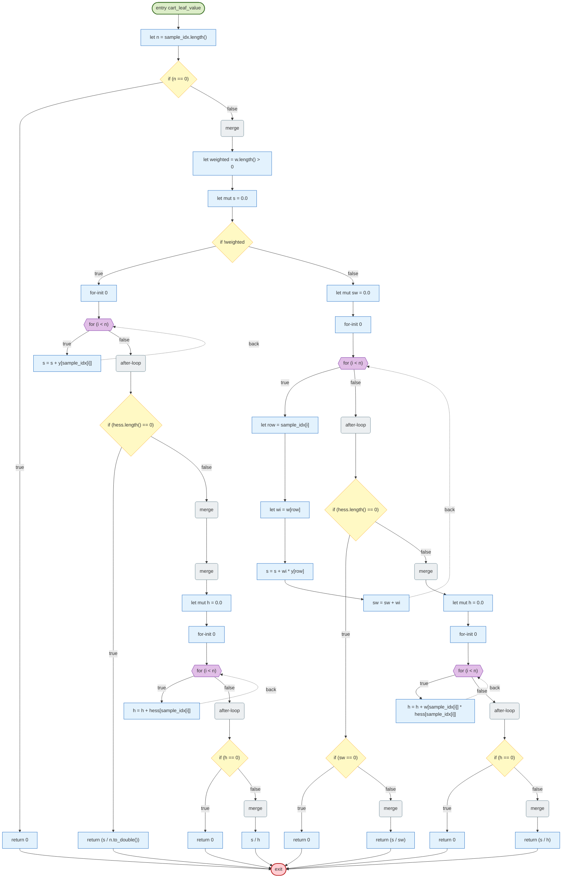
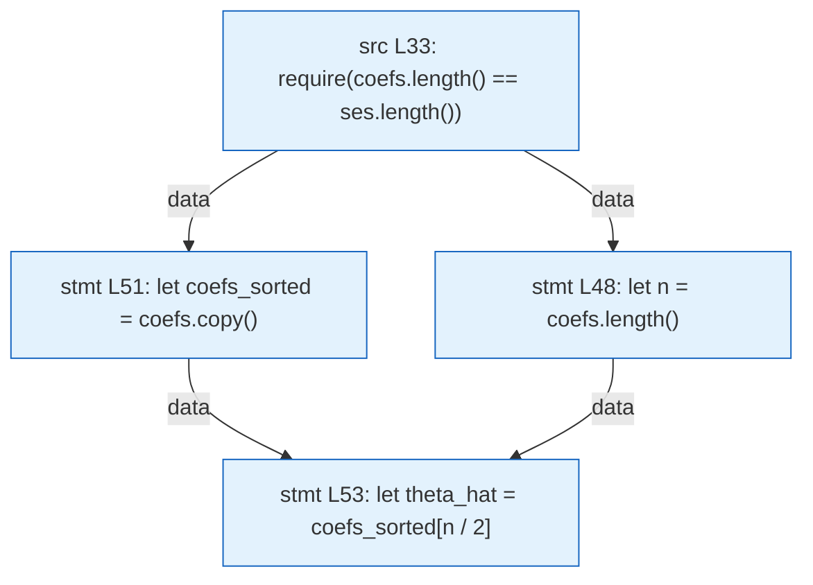

# LunaFlow analysis report — riantr/moonbit_doubleML@latest@0.164.64

> Trace-driven (dynamic-first) control-flow, data-flow, value-range and slicing analysis for a mooncakes.io module.

## 1. Acquisition and version pinning

| Item | Value |
| --- | --- |
| Requested coordinate | `riantr/moonbit_doubleML@latest` |
| Resolved version | `0.164.64` |
| Pinning strategy | `@latest` resolved through `moon fetch` (local registry index, newest non-yanked version) and pinned to `0.164.64` for ingestion, execution and reporting |
| Source root | `./.repos/riantr/moonbit_doubleML/0.164.64` |
| Declared target | `wasm-gc` |
| Direct dependencies | moonbit-community/sqlite3@0.2.4, moonbitlang/async@0.22.7 |

## 2. Ingestion statistics

| Metric | Value |
| --- | --- |
| Source files parsed | 220 |
| Functions extracted | 2520 |
| Statements understood | 29853 |
| Statements unsupported | 320 |
| Frontend coverage | 98.9% |
| Parse issues | 0 |
| CFG functions | 600 of 2520 — the first 600 in file order; 1920 functions had no CFG and can carry no CFG finding |
| Trace events | 218391 |
| Interpreted steps | 42818 |
| Observed functions | 120 |
| Wall time (analyzer) | 4095 ms |
| Selected level | L3 (funnel: L1 → L2 → L3) |

## 3. Proof-strength levels and funnel

The same program is analyzed at three proof strengths. Levels are cumulative: L2 adds abstract interpretation on top of L1, L3 adds contract verification on top of the escalated functions. `--funnel` runs all three and reports what each level adds.

### 3.1 Level definitions

| Level | Name | Engine | Input model | Result strength |
| --- | --- | --- | --- | --- |
| L1 | Interpreter | concrete execution on the formal interpreter | concrete boundary values (`--trials`) | observed facts; may miss unexecuted inputs and paths |
| L2 | Value | abstract interpretation over a value-set / interval domain | whole input sets (`Int` intervals, `Bool`/`String` sets, array length intervals) | exhaustive over the abstract state; may-taint and may-range alarms (false positives possible) |
| L3 | Proof-by-contract | WP-style weakest-precondition VC generation + interval decision | ACSL-style `//@ requires` / `//@ ensures` specs | `proved` / `failed` / `unknown` per verification condition; specs are mandatory |

### 3.2 Funnel


| Level | Checks | New vs previous | Functions / VCs | Note |
| --- | --- | --- | --- | --- |
| L1 concrete | 97 findings | — | 120 functions | observed facts |
| L2 abstract | 166 findings | 155 | 120 functions, 5461 steps | exhaustive over the input abstraction |
| L3 contracts | 0 VCs | 0 failed, 0 unknown | 77 critical functions | specs required |

### 3.3 Escalation and specification gaps

Escalated functions (have at least one L1/L2 finding or a contract): `clip_vec`, `normalize_ipw`, `slice_matrix_rows`, `unique_units`, `build_row_unit_map`, `DoubleMLAPO::fit_cluster`, `kfold`, `psi_at`, `cluster_sandwich_variance`, `draw_bootstrap_weights`, `DoubleMLAPO::sensitivity_nu2_elements`, `DoubleMLAPO::sensitivity_analysis`, `DoubleMLAPO::sensitivity_analysis_cluster`, `DoubleMLAPOS::psi_b_row_at`, `DoubleMLAPOS::sandwich_se_at`, `DoubleMLAPOS::cluster_sandwich_se_at`, `DoubleMLAPOS::bias_corrected_coef_at`, `DoubleMLAPOS::confint`, `DoubleMLAPOS::causal_contrast`, `check_sample_splitting`, `DoubleMLDIDData::new`, `DoubleMLDID::fit`, `generic_bootstrap_t_stat`, `DoubleMLDID::sensitivity_nu2_elements`, `DoubleMLDID::sensitivity_analysis`, `DoubleMLDID::sensitivity_analysis_cluster`, `irm_style_sensitivity_cluster_from_elements`, `GBLearner::fit_weighted`, `cross_fit_irm`, `DoubleMLIRM::fit_cluster`, `DoubleMLIRM::sensitivity_nu2_elements`, `vector_subtract`, `DoubleMLIRM::sensitivity_analysis`, `DoubleMLIRM::sensitivity_analysis_cluster`, `aggregate_coef_se`, `DoubleMLAPO::new`, `DoubleMLAPO::coef`, `DoubleMLAPO::se`, `DoubleMLAPO::confint`, `DoubleMLAPO::predictions_g`, `DoubleMLAPO::predictions_m`, `DoubleMLAPO::sandwich_se`, `DoubleMLAPO::cluster_sandwich_se`, `DoubleMLAPO::bias_corrected_coef`, `DoubleMLAPO::bootstrap`, `DoubleMLAPO::tune`, `DoubleMLAPOS::tune`, `DoubleMLAPOS::new`, `DoubleMLAPOS::fit`, `DoubleMLAPOS::coefs`, `DoubleMLAPOS::ses`, `DoubleMLAPOS::psi_a_row_at`, `DoubleMLAPOS::m_inv_1x1_at`, `DoubleMLAPOS::bootstrap`, `DoubleMLAPOS::boot_t_stats`, `DoubleMLAPOS::sensitivity_analysis`, `DoubleMLAPOS::sensitivity_analysis_cluster`, `DoubleMLDID::new`, `DoubleMLDID::coef`, `DoubleMLDID::se`, `DoubleMLDID::confint`, `cross_fit_did`, `DoubleMLDID::bootstrap`, `DoubleMLDID::sandwich_se`, `DoubleMLDID::cluster_sandwich_se`, `DoubleMLDID::bias_corrected_coef`, `DoubleMLDID::tune`, `DoubleMLIRM::new`, `DoubleMLIRM::coef`, `DoubleMLIRM::se`, `DoubleMLIRM::confint`, `filter_indices`, `DoubleMLIRM::fit`, `DoubleMLIRM::bootstrap`, `DoubleMLIRM::tune`, `DoubleMLIRM::sandwich_se`, `DoubleMLIRM::cluster_sandwich_se`

Functions escalated without any contract (spec gap at L3): `DoubleMLAPO::new (apo.mbt:101)`, `DoubleMLAPO::coef (apo.mbt:196)`, `DoubleMLAPO::se (apo.mbt:207)`, `DoubleMLAPO::confint (apo.mbt:218)`, `DoubleMLAPO::predictions_g (apo.mbt:229)`, `DoubleMLAPO::predictions_m (apo.mbt:240)`, `DoubleMLAPO::fit_cluster (apo.mbt:549)`, `DoubleMLAPO::sandwich_se (apo.mbt:766)`, `DoubleMLAPO::cluster_sandwich_se (apo.mbt:799)`, `DoubleMLAPO::bias_corrected_coef (apo.mbt:858)`, `DoubleMLAPO::bootstrap (apo.mbt:895)`, `DoubleMLAPO::tune (apo.mbt:968)`, `DoubleMLAPOS::tune (apo.mbt:1024)`, `DoubleMLAPO::sensitivity_nu2_elements (apo.mbt:1094)`, `DoubleMLAPO::sensitivity_analysis (apo.mbt:1127)`, `DoubleMLAPO::sensitivity_analysis_cluster (apo.mbt:1157)`, `DoubleMLAPOS::new (apo.mbt:1282)`, `DoubleMLAPOS::fit (apo.mbt:1379)`, `DoubleMLAPOS::coefs (apo.mbt:1693)`, `DoubleMLAPOS::ses (apo.mbt:1704)`, `DoubleMLAPOS::psi_b_row_at (apo.mbt:1808)`, `DoubleMLAPOS::psi_a_row_at (apo.mbt:1838)`, `DoubleMLAPOS::m_inv_1x1_at (apo.mbt:1868)`, `DoubleMLAPOS::sandwich_se_at (apo.mbt:1919)`, `DoubleMLAPOS::cluster_sandwich_se_at (apo.mbt:1965)`, `DoubleMLAPOS::bias_corrected_coef_at (apo.mbt:2019)`, `DoubleMLAPOS::bootstrap (apo.mbt:2045)`, `DoubleMLAPOS::confint (apo.mbt:2094)`, `DoubleMLAPOS::boot_t_stats (apo.mbt:2148)`, `DoubleMLAPOS::causal_contrast (apo.mbt:2200)`, `DoubleMLAPOS::sensitivity_analysis (apo.mbt:2266)`, `DoubleMLAPOS::sensitivity_analysis_cluster (apo.mbt:2314)`, `DoubleMLDIDData::new (did.mbt:31)`, `DoubleMLDID::new (did.mbt:252)`, `DoubleMLDID::coef (did.mbt:345)`, `DoubleMLDID::se (did.mbt:356)`, `DoubleMLDID::confint (did.mbt:369)`, `cross_fit_did (did.mbt:433)`, `DoubleMLDID::fit (did.mbt:483)`, `DoubleMLDID::bootstrap (did.mbt:793)`, `DoubleMLDID::sensitivity_nu2_elements (did.mbt:873)`, `DoubleMLDID::sensitivity_analysis (did.mbt:940)`, `DoubleMLDID::sensitivity_analysis_cluster (did.mbt:975)`, `DoubleMLDID::sandwich_se (did.mbt:1027)`, `DoubleMLDID::cluster_sandwich_se (did.mbt:1057)`, `DoubleMLDID::bias_corrected_coef (did.mbt:1114)`, `DoubleMLDID::tune (did.mbt:1196)`, `GBLearner::fit_weighted (gbl.mbt:125)`, `DoubleMLIRM::new (irm.mbt:109)`, `DoubleMLIRM::coef (irm.mbt:184)`, `DoubleMLIRM::se (irm.mbt:195)`, `DoubleMLIRM::confint (irm.mbt:209)`, `filter_indices (irm.mbt:314)`, `clip_vec (irm.mbt:327)`, `cross_fit_irm (irm.mbt:352)`, `DoubleMLIRM::fit (irm.mbt:462)`, `DoubleMLIRM::fit_cluster (irm.mbt:730)`, `DoubleMLIRM::bootstrap (irm.mbt:935)`, `DoubleMLIRM::tune (irm.mbt:1014)`, `DoubleMLIRM::sensitivity_nu2_elements (irm.mbt:1089)`, `DoubleMLIRM::sensitivity_analysis (irm.mbt:1116)`, `DoubleMLIRM::sensitivity_analysis_cluster (irm.mbt:1154)`, `DoubleMLIRM::sandwich_se (irm.mbt:1197)`, `DoubleMLIRM::cluster_sandwich_se (irm.mbt:1238)`, `unique_units (plpr.mbt:172)`, `check_sample_splitting (kfold.mbt:288)`, `kfold (kfold.mbt:439)`, `slice_matrix_rows (kfold.mbt:487)`, `build_row_unit_map (kfold.mbt:584)`, `psi_at (sandwich.mbt:215)`, `cluster_sandwich_variance (sandwich.mbt:534)`, `draw_bootstrap_weights (did_multi.mbt:1126)`, `aggregate_coef_se (aggregator.mbt:33)`, `vector_subtract (vectorized.mbt:77)`, `irm_style_sensitivity_cluster_from_elements (sensitivity.mbt:233)`, `normalize_ipw (ps_processor.mbt:910)`, `generic_bootstrap_t_stat (bootstrap_helper.mbt:47)`

## 4. Control-flow analysis

CFG nodes are built from the parsed statement tree; execution paths come from the concrete-execution trace engine. Dead/unreachable detection is static; path coverage and budget findings are dynamic. See `docs/design.md` §5 for the mapping rules.

### 4.1 CFG diagrams (top 8 by cyclomatic complexity)

#### `DoubleMLDIDCS::fit` (did_cs.mbt)

_Diagram omitted: 269 nodes exceeds the readability cap (90). Findings for this function are listed below._

#### `transform_panel` (plpr.mbt)

_Diagram omitted: 138 nodes exceeds the readability cap (90). Findings for this function are listed below._

#### `rdd_rb_side` (rdd.mbt)

_Diagram omitted: 122 nodes exceeds the readability cap (90). Findings for this function are listed below._

#### `DoubleMLPLPR::fit` (plpr.mbt)

_Diagram omitted: 154 nodes exceeds the readability cap (90). Findings for this function are listed below._

#### `kfold_stratified` (kfold.mbt)

```mermaid
flowchart TD
  classDef entryNode fill:#dcedc8,stroke:#33691e,stroke-width:2px
  classDef exitNode fill:#ffcdd2,stroke:#b71c1c,stroke-width:2px
  classDef branchNode fill:#fff9c4,stroke:#f9a825
  classDef loopNode fill:#e1bee7,stroke:#6a1b9a
  classDef mergeNode fill:#eceff1,stroke:#607d8b
  classDef deadNode fill:#eeeeee,stroke:#9e9e9e
  classDef stmtNode fill:#e3f2fd,stroke:#1565c0
  n0(["entry kfold_stratified"]):::entryNode
  n1(["exit"]):::exitNode
  n2["require(n #gt; 0)"]:::stmtNode
  n3["require(strata.length() == n)"]:::stmtNode
  n4["require(n_folds #gt; 0)"]:::stmtNode
  n5["require(n_folds #lt;= n)"]:::stmtNode
  n6["let by_stratum : Array[(String, Array[Int32])] =[]"]:::stmtNode
  n7["for-init 0"]:::stmtNode
  n8{{"for (i #lt; n)"}}:::loopNode
  n9["let key = strata[i].to_string()"]:::stmtNode
  n10["let mut found = false"]:::stmtNode
  n11["for-init 0"]:::stmtNode
  n12{{"for (j #lt; by_stratum.length())"}}:::loopNode
  n13{"if (by_stratum[j].0 == key)"}:::branchNode
  n14["by_stratum[j].1. push(i"]:::stmtNode
  n15[""]:::stmtNode
  n16["found = true"]:::stmtNode
  n17["break"]:::stmtNode
  n18("merge"):::mergeNode
  n19("after-loop"):::mergeNode
  n20{"if !found"}:::branchNode
  n21["by_stratum.push((key,[i]))"]:::stmtNode
  n22("merge"):::mergeNode
  n23("after-loop"):::mergeNode
  n24["let stratum_perm : Array[(String, Array[Int32])] =[]"]:::stmtNode
  n25["for-init 0"]:::stmtNode
  n26{{"for (k_idx #lt; by_stratum.length())"}}:::loopNode
  n27["let key = by_stratum[k_idx].0"]:::stmtNode
  n28["let arr = by_stratum[k_idx].1"]:::stmtNode
  n29["let sub_seed = seed + k_idx * 31337"]:::stmtNode
  n30["let bytes = seed_to_bytes(sub_seed)"]:::stmtNode
  n31["let rng = @random.Rand::chacha8(seed = Bytes::from_array(bytes))"]:::stmtNode
  n32["let perm : Array[Int32] = Array::makei(arr.length(), fn(i) { i})"]:::stmtNode
  n33["for-init (perm.length() - 1)"]:::stmtNode
  n34{{"for (i #gt; 0)"}}:::loopNode
  n35["let j = rng.int(limit = i + 1)"]:::stmtNode
  n36["perm.swap(i, j)"]:::stmtNode
  n37("after-loop"):::mergeNode
  n38["let shuffled : Array[Int32] = Array::make(arr.length(), 0)"]:::stmtNode
  n39["for-init 0"]:::stmtNode
  n40{{"for (i #lt; perm.length())"}}:::loopNode
  n41["shuffled[i] = arr[perm[i]]"]:::stmtNode
  n42("after-loop"):::mergeNode
  n43["stratum_perm.push((key, shuffled))"]:::stmtNode
  n44("after-loop"):::mergeNode
  n45["let folds : Array[Fold] =[]"]:::stmtNode
  n46["for-init 0"]:::stmtNode
  n47{{"for (f #lt; n_folds)"}}:::loopNode
  n48["let test_idx : Array[Int32] =[]"]:::stmtNode
  n49["let train_idx : Array[Int32] =[]"]:::stmtNode
  n50["for-init 0"]:::stmtNode
  n51{{"for (k_idx #lt; stratum_perm.length())"}}:::loopNode
  n52["let arr = stratum_perm[k_idx].1"]:::stmtNode
  n53{"if (arr.length() #gt;= n_folds)"}:::branchNode
  n54["let base = arr.length() / n_folds"]:::stmtNode
  n55["let rem = arr.length() - base * n_folds"]:::stmtNode
  n56["let test_size = if f #lt; rem { base + 1} else { base}"]:::stmtNode
  n57["let offset = f * base +(if f #lt; rem { f} else { rem})"]:::stmtNode
  n58["for-init 0"]:::stmtNode
  n59{{"for (k #lt; test_size)"}}:::loopNode
  n60["test_idx.push(arr[offset + k])"]:::stmtNode
  n61("after-loop"):::mergeNode
  n62["for-init 0"]:::stmtNode
  n63{{"for (k #lt; arr.length())"}}:::loopNode
  n64{"if ((k #lt; offset) &#124;&#124; (k #gt;= (offset + test_size)))"}:::branchNode
  n65["train_idx.push(arr[k])"]:::stmtNode
  n66("merge"):::mergeNode
  n67("after-loop"):::mergeNode
  n68{"if (f == 0)"}:::branchNode
  n69["for-init 0"]:::stmtNode
  n70{{"for (k #lt; arr.length())"}}:::loopNode
  n71["test_idx.push(arr[k])"]:::stmtNode
  n72("after-loop"):::mergeNode
  n73["for-init 0"]:::stmtNode
  n74{{"for (k #lt; arr.length())"}}:::loopNode
  n75["train_idx.push(arr[k])"]:::stmtNode
  n76("after-loop"):::mergeNode
  n77("merge"):::mergeNode
  n78("merge"):::mergeNode
  n79("after-loop"):::mergeNode
  n80["folds.push(Fold::new(train_idx, test_idx))"]:::stmtNode
  n81("after-loop"):::mergeNode
  n82["folds"]:::stmtNode
  n0 --> n2
  n2 --> n3
  n3 --> n4
  n4 --> n5
  n5 --> n6
  n6 --> n7
  n7 --> n8
  n9 --> n10
  n10 --> n11
  n11 --> n12
  n14 --> n15
  n15 --> n16
  n16 --> n17
  n13 -->|true| n14
  n13 -->|false| n18
  n12 -->|true| n13
  n17 -.->|back| n12
  n12 -->|false| n19
  n19 --> n20
  n20 -->|true| n21
  n21 --> n22
  n20 -->|false| n22
  n8 -->|true| n9
  n21 -.->|back| n8
  n8 -->|false| n23
  n23 --> n24
  n24 --> n25
  n25 --> n26
  n27 --> n28
  n28 --> n29
  n29 --> n30
  n30 --> n31
  n31 --> n32
  n32 --> n33
  n33 --> n34
  n35 --> n36
  n34 -->|true| n35
  n36 -.->|back| n34
  n34 -->|false| n37
  n37 --> n38
  n38 --> n39
  n39 --> n40
  n40 -->|true| n41
  n41 -.->|back| n40
  n40 -->|false| n42
  n42 --> n43
  n26 -->|true| n27
  n43 -.->|back| n26
  n26 -->|false| n44
  n44 --> n45
  n45 --> n46
  n46 --> n47
  n48 --> n49
  n49 --> n50
  n50 --> n51
  n52 --> n53
  n54 --> n55
  n55 --> n56
  n56 --> n57
  n57 --> n58
  n58 --> n59
  n59 -->|true| n60
  n60 -.->|back| n59
  n59 -->|false| n61
  n61 --> n62
  n62 --> n63
  n64 -->|true| n65
  n65 --> n66
  n64 -->|false| n66
  n63 -->|true| n64
  n65 -.->|back| n63
  n63 -->|false| n67
  n69 --> n70
  n70 -->|true| n71
  n71 -.->|back| n70
  n70 -->|false| n72
  n73 --> n74
  n74 -->|true| n75
  n75 -.->|back| n74
  n74 -->|false| n76
  n68 -->|true| n69
  n68 -->|false| n73
  n72 --> n77
  n76 --> n77
  n53 -->|true| n54
  n53 -->|false| n68
  n67 --> n78
  n77 --> n78
  n51 -->|true| n52
  n51 -.->|back| n51
  n51 -->|false| n79
  n79 --> n80
  n47 -->|true| n48
  n80 -.->|back| n47
  n47 -->|false| n81
  n81 --> n82
  n82 --> n1
```

#### `DoubleMLDID::fit` (did.mbt)

_Diagram omitted: 101 nodes exceeds the readability cap (90). Findings for this function are listed below._

#### `cart_leaf_value` (rfl.mbt)



#### `make_iivm_data` (dgp_iivm.mbt)

```mermaid
flowchart TD
  classDef entryNode fill:#dcedc8,stroke:#33691e,stroke-width:2px
  classDef exitNode fill:#ffcdd2,stroke:#b71c1c,stroke-width:2px
  classDef branchNode fill:#fff9c4,stroke:#f9a825
  classDef loopNode fill:#e1bee7,stroke:#6a1b9a
  classDef mergeNode fill:#eceff1,stroke:#607d8b
  classDef deadNode fill:#eeeeee,stroke:#9e9e9e
  classDef stmtNode fill:#e3f2fd,stroke:#1565c0
  n0(["entry make_iivm_data"]):::entryNode
  n1(["exit"]):::exitNode
  n2["let rng = chacha8_rng(seed)"]:::stmtNode
  n3["let beta_x = 0.5"]:::stmtNode
  n4["let beta_z = 1.0"]:::stmtNode
  n5["let n_normals_x = n_obs * dim_x"]:::stmtNode
  n6["let z_flat : Array[Double] = Array::make(n_normals_x, 0.0)"]:::stmtNode
  n7["let half_z =(n_normals_x + 1) / 2"]:::stmtNode
  n8["for-init 0"]:::stmtNode
  n9{{"for (i #lt; half_z)"}}:::loopNode
  n10["let(z1, z2) = box_muller_pair(rng)"]:::stmtNode
  n11["let idx_a = 2 * i"]:::stmtNode
  n12["let idx_b = 2 * i + 1"]:::stmtNode
  n13{"if (idx_a #lt; n_normals_x)"}:::branchNode
  n14["z_flat[idx_a] = z1"]:::stmtNode
  n15("merge"):::mergeNode
  n16{"if (idx_b #lt; n_normals_x)"}:::branchNode
  n17["z_flat[idx_b] = z2"]:::stmtNode
  n18("merge"):::mergeNode
  n19("after-loop"):::mergeNode
  n20["let x_flat : Array[Double] = Array::make(n_normals_x, 0.0)"]:::stmtNode
  n21["for-init 0"]:::stmtNode
  n22{{"for (i #lt; n_obs)"}}:::loopNode
  n23["for-init 0"]:::stmtNode
  n24{{"for (k #lt; dim_x)"}}:::loopNode
  n25["let mut s = 0.0"]:::stmtNode
  n26["let mut acc = 1.0"]:::stmtNode
  n27["let mut j = k"]:::stmtNode
  n28{{"while (j #gt;= 0)"}}:::loopNode
  n29["s = s + acc * z_flat[i * dim_x + j]"]:::stmtNode
  n30["acc = acc * 0.7"]:::stmtNode
  n31{"if (j == 0)"}:::branchNode
  n32["break"]:::stmtNode
  n33("merge"):::mergeNode
  n34["j = j - 1"]:::stmtNode
  n35("after-loop"):::mergeNode
  n36["x_flat[i * dim_x + k] = s"]:::stmtNode
  n37("after-loop"):::mergeNode
  n38("after-loop"):::mergeNode
  n39["let v_flat : Array[Double] = Array::make(n_obs, 0.0)"]:::stmtNode
  n40["let half_n =(n_obs + 1) / 2"]:::stmtNode
  n41["for-init 0"]:::stmtNode
  n42{{"for (i #lt; half_n)"}}:::loopNode
  n43["let(z1, z2) = box_muller_pair(rng)"]:::stmtNode
  n44["let idx_a = 2 * i"]:::stmtNode
  n45["let idx_b = 2 * i + 1"]:::stmtNode
  n46{"if (idx_a #lt; n_obs)"}:::branchNode
  n47["v_flat[idx_a] = z1"]:::stmtNode
  n48("merge"):::mergeNode
  n49{"if (idx_b #lt; n_obs)"}:::branchNode
  n50["v_flat[idx_b] = z2"]:::stmtNode
  n51("merge"):::mergeNode
  n52("after-loop"):::mergeNode
  n53["let d : Array[Double] = Array::make(n_obs, 0.0)"]:::stmtNode
  n54["let z : Array[Double] = Array::make(n_obs, 0.0)"]:::stmtNode
  n55["let y : Array[Double] = Array::make(n_obs, 0.0)"]:::stmtNode
  n56["for-init 0"]:::stmtNode
  n57{{"for (i #lt; n_obs)"}}:::loopNode
  n58["z[i] = if rng.double() #lt; 0.5 { 1.0} else { 0.0}"]:::stmtNode
  n59["let mut xb = 0.0"]:::stmtNode
  n60["for-init 0"]:::stmtNode
  n61{{"for (k #lt; dim_x)"}}:::loopNode
  n62["xb = xb + beta_x * x_flat[i * dim_x + k]"]:::stmtNode
  n63("after-loop"):::mergeNode
  n64["let propensity_score = xb + beta_z * z[i]"]:::stmtNode
  n65["let p = 1.0 /(1.0 + @math.exp(- propensity_score))"]:::stmtNode
  n66["d[i] = if rng.double() #lt; p { 1.0} else { 0.0}"]:::stmtNode
  n67["y[i] = theta * d[i] + xb + v_flat[i]"]:::stmtNode
  n68("after-loop"):::mergeNode
  n69["let x_mat = Matrix::from_array(x_flat, n_obs, dim_x)"]:::stmtNode
  n70["{ theta, x : x_mat, y, d, z,}"]:::stmtNode
  n0 --> n2
  n2 --> n3
  n3 --> n4
  n4 --> n5
  n5 --> n6
  n6 --> n7
  n7 --> n8
  n8 --> n9
  n10 --> n11
  n11 --> n12
  n12 --> n13
  n13 -->|true| n14
  n14 --> n15
  n13 -->|false| n15
  n15 --> n16
  n16 -->|true| n17
  n17 --> n18
  n16 -->|false| n18
  n9 -->|true| n10
  n17 -.->|back| n9
  n9 -->|false| n19
  n19 --> n20
  n20 --> n21
  n21 --> n22
  n23 --> n24
  n25 --> n26
  n26 --> n27
  n27 --> n28
  n29 --> n30
  n30 --> n31
  n31 -->|true| n32
  n31 -->|false| n33
  n33 --> n34
  n28 -->|true| n29
  n34 -.->|back| n28
  n28 -->|false| n35
  n35 --> n36
  n24 -->|true| n25
  n36 -.->|back| n24
  n24 -->|false| n37
  n22 -->|true| n23
  n22 -.->|back| n22
  n22 -->|false| n38
  n38 --> n39
  n39 --> n40
  n40 --> n41
  n41 --> n42
  n43 --> n44
  n44 --> n45
  n45 --> n46
  n46 -->|true| n47
  n47 --> n48
  n46 -->|false| n48
  n48 --> n49
  n49 -->|true| n50
  n50 --> n51
  n49 -->|false| n51
  n42 -->|true| n43
  n50 -.->|back| n42
  n42 -->|false| n52
  n52 --> n53
  n53 --> n54
  n54 --> n55
  n55 --> n56
  n56 --> n57
  n58 --> n59
  n59 --> n60
  n60 --> n61
  n61 -->|true| n62
  n62 -.->|back| n61
  n61 -->|false| n63
  n63 --> n64
  n64 --> n65
  n65 --> n66
  n66 --> n67
  n57 -->|true| n58
  n67 -.->|back| n57
  n57 -->|false| n68
  n68 --> n69
  n69 --> n70
  n70 --> n1
```



### 4.2 CFG findings

| Rule | Severity | Function | Location | Message | Method | Confidence |
| --- | --- | --- | --- | --- | --- | --- |
| BUDGET-EXCEEDED | warning | slice_matrix_rows | kfold.mbt:496 | execution budget exhausted; loop may be non-terminating or inputs too large | dynamic | 0.6 |
| BUDGET-EXCEEDED | warning | kfold | kfold.mbt:468 | execution budget exhausted; loop may be non-terminating or inputs too large | dynamic | 0.6 |
| BUDGET-EXCEEDED | warning | draw_bootstrap_weights | did_multi.mbt:1154 | execution budget exhausted; loop may be non-terminating or inputs too large | dynamic | 0.6 |
| BUDGET-EXCEEDED | warning | kfold | kfold.mbt:474 | execution budget exhausted; loop may be non-terminating or inputs too large | dynamic | 0.6 |
| BUDGET-EXCEEDED | warning | kfold | kfold.mbt:474 | execution budget exhausted; loop may be non-terminating or inputs too large | dynamic | 0.6 |
| BUDGET-EXCEEDED | warning | DoubleMLAPOS::confint | apo.mbt:2121 | execution budget exhausted; loop may be non-terminating or inputs too large | dynamic | 0.6 |
| BUDGET-EXCEEDED | warning | DoubleMLAPOS::causal_contrast | apo.mbt:2240 | execution budget exhausted; loop may be non-terminating or inputs too large | dynamic | 0.6 |
| BUDGET-EXCEEDED | warning | DoubleMLDID::fit | did.mbt:611 | execution budget exhausted; loop may be non-terminating or inputs too large | dynamic | 0.6 |
| BUDGET-EXCEEDED | warning | kfold | kfold.mbt:474 | execution budget exhausted; loop may be non-terminating or inputs too large | dynamic | 0.6 |
| BUDGET-EXCEEDED | warning | GBLearner::fit_weighted | gbl.mbt:162 | execution budget exhausted; loop may be non-terminating or inputs too large | dynamic | 0.6 |
| BUDGET-EXCEEDED | warning | kfold | kfold.mbt:474 | execution budget exhausted; loop may be non-terminating or inputs too large | dynamic | 0.6 |
| BUDGET-EXCEEDED | warning | draw_bootstrap_weights | did_multi.mbt:1154 | execution budget exhausted; loop may be non-terminating or inputs too large | dynamic | 0.6 |
| BUDGET-EXCEEDED | warning | kfold | kfold.mbt:474 | execution budget exhausted; loop may be non-terminating or inputs too large | dynamic | 0.6 |

### 4.3 Static vs dynamic attribution

| Signal | Method | What a hit means | Known limitation |
| --- | --- | --- | --- |
| Unreachable statement | static | no CFG predecessor; often after `return`/`break` | parser gaps can hide real predecessors |
| Infinite loop | static + dynamic | constant-true condition without break, or iteration cap reached | loops whose exit depends on unmodelled calls are reported as *budget*, not proven infinite |
| Uncovered code | dynamic (coverage import) | zero hits in the observed test suite | absence of execution is not proof of dead code |

## 5. Data flow and taint

Sources are entry-function parameters (and `@env.args` when the frontend sees it); propagation follows recorded definitions and the variables read by each statement; sinks are array-index expressions and allocation sizes. The graph below is the *observed* propagation, not a may-analysis over all inputs.

```mermaid
flowchart LR
  classDef src fill:#ffcdd2,stroke:#b71c1c,stroke-width:2px
  classDef step fill:#fff9c4,stroke:#f9a825
  classDef sink fill:#c8e6c9,stroke:#1b5e20,stroke-width:2px
  t0["source: data"]:::src
  t1["source: treatment_level~"]:::src
  t2["source: n_folds~"]:::src
  t3["source: n_rep~"]:::src
  t4["source: seed~"]:::src
  t5["source: propensity_clip~"]:::src
  t6["source: normalize_ipw~"]:::src
  t7["source: ps_processor_config~"]:::src
  t8["source: ml_g~"]:::src
  t9["source: ml_m~"]:::src
  t10["source: data"]:::src
  t11["source: treatment_level~"]:::src
  t12["source: n_folds~"]:::src
  t13["source: n_rep~"]:::src
  t14["source: seed~"]:::src
  t15["source: propensity_clip~"]:::src
  t16["source: normalize_ipw~"]:::src
  t17["source: ps_processor_config~"]:::src
  t18["source: ml_g~"]:::src
  t19["source: ml_m~"]:::src
  t20["source: data"]:::src
  t21["source: treatment_level~"]:::src
  t22["source: n_folds~"]:::src
  t23["source: n_rep~"]:::src
  t24["source: seed~"]:::src
  t25["source: propensity_clip~"]:::src
  t26["source: normalize_ipw~"]:::src
  t27["source: ps_processor_config~"]:::src
  t28["source: ml_g~"]:::src
  t29["source: ml_m~"]:::src
  t30["source: data"]:::src
  t31["source: treatment_level~"]:::src
  t32["source: n_folds~"]:::src
  t33["source: n_rep~"]:::src
  t34["source: seed~"]:::src
  t35["source: propensity_clip~"]:::src
  t36["source: normalize_ipw~"]:::src
  t37["source: ps_processor_config~"]:::src
  t38["source: ml_g~"]:::src
  t39["source: ml_m~"]:::src
```



### 5.1 Taint sinks

| Rule | Severity | Function | Location | Message | Method | Confidence |
| --- | --- | --- | --- | --- | --- | --- |
| TAINT-INDEX | error | clip_vec | irm.mbt:331 | tainted value reaches an array index / buffer offset | dynamic+symbolic | 0.8 |
| TAINT-INDEX | error | normalize_ipw | ps_processor.mbt:929 | tainted value reaches an array index / buffer offset | dynamic+symbolic | 0.8 |
| TAINT-INDEX | error | normalize_ipw | ps_processor.mbt:935 | tainted value reaches an array index / buffer offset | dynamic+symbolic | 0.8 |
| TAINT-INDEX | error | normalize_ipw | ps_processor.mbt:936 | tainted value reaches an array index / buffer offset | dynamic+symbolic | 0.8 |
| TAINT-INDEX | error | normalize_ipw | ps_processor.mbt:942 | tainted value reaches an array index / buffer offset | dynamic+symbolic | 0.8 |
| TAINT-INDEX | error | normalize_ipw | ps_processor.mbt:943 | tainted value reaches an array index / buffer offset | dynamic+symbolic | 0.8 |
| TAINT-INDEX | error | slice_matrix_rows | kfold.mbt:493 | tainted value reaches an array index / buffer offset | dynamic+symbolic | 0.8 |
| TAINT-INDEX | error | slice_matrix_rows | kfold.mbt:491 | tainted value reaches an array index / buffer offset | dynamic+symbolic | 0.8 |
| TAINT-INDEX | error | unique_units | plpr.mbt:175 | tainted value reaches an array index / buffer offset | dynamic+symbolic | 0.8 |
| TAINT-INDEX | error | build_row_unit_map | kfold.mbt:592 | tainted value reaches an array index / buffer offset | dynamic+symbolic | 0.8 |
| TAINT-INDEX | error | DoubleMLAPO::fit_cluster | apo.mbt:576 | tainted value reaches an array index / buffer offset | dynamic+symbolic | 0.8 |
| TAINT-INDEX | error | psi_at | sandwich.mbt:226 | tainted value reaches an array index / buffer offset | dynamic+symbolic | 0.8 |
| TAINT-INDEX | error | cluster_sandwich_variance | sandwich.mbt:550 | tainted value reaches an array index / buffer offset | dynamic+symbolic | 0.8 |
| TAINT-INDEX | error | cluster_sandwich_variance | sandwich.mbt:562 | tainted value reaches an array index / buffer offset | dynamic+symbolic | 0.8 |
| TAINT-INDEX | error | cluster_sandwich_variance | sandwich.mbt:563 | tainted value reaches an array index / buffer offset | dynamic+symbolic | 0.8 |
| TAINT-INDEX | error | cluster_sandwich_variance | sandwich.mbt:564 | tainted value reaches an array index / buffer offset | dynamic+symbolic | 0.8 |
| TAINT-INDEX | error | cluster_sandwich_variance | sandwich.mbt:569 | tainted value reaches an array index / buffer offset | dynamic+symbolic | 0.8 |
| TAINT-INDEX | error | kfold | kfold.mbt:466 | tainted value reaches an array index / buffer offset | dynamic+symbolic | 0.8 |
| TAINT-INDEX | error | DoubleMLAPO::sensitivity_nu2_elements | apo.mbt:1102 | tainted value reaches an array index / buffer offset | dynamic+symbolic | 0.8 |
| TAINT-INDEX | error | DoubleMLAPO::sensitivity_nu2_elements | apo.mbt:1114 | tainted value reaches an array index / buffer offset | dynamic+symbolic | 0.8 |
| TAINT-INDEX | error | DoubleMLAPO::sensitivity_nu2_elements | apo.mbt:1117 | tainted value reaches an array index / buffer offset | dynamic+symbolic | 0.8 |
| TAINT-INDEX | error | DoubleMLAPO::sensitivity_nu2_elements | apo.mbt:1121 | tainted value reaches an array index / buffer offset | dynamic+symbolic | 0.8 |
| TAINT-INDEX | error | DoubleMLAPO::sensitivity_analysis | apo.mbt:1137 | tainted value reaches an array index / buffer offset | dynamic+symbolic | 0.8 |
| TAINT-INDEX | error | DoubleMLAPO::sensitivity_analysis_cluster | apo.mbt:1169 | tainted value reaches an array index / buffer offset | dynamic+symbolic | 0.8 |
| TAINT-INDEX | error | DoubleMLAPOS::psi_b_row_at | apo.mbt:1825 | tainted value reaches an array index / buffer offset | dynamic+symbolic | 0.8 |
| TAINT-INDEX | error | DoubleMLAPOS::sandwich_se_at | apo.mbt:1930 | tainted value reaches an array index / buffer offset | dynamic+symbolic | 0.8 |
| TAINT-INDEX | error | DoubleMLAPOS::cluster_sandwich_se_at | apo.mbt:1977 | tainted value reaches an array index / buffer offset | dynamic+symbolic | 0.8 |
| TAINT-INDEX | error | DoubleMLAPOS::bias_corrected_coef_at | apo.mbt:2028 | tainted value reaches an array index / buffer offset | dynamic+symbolic | 0.8 |
| TAINT-INDEX | error | DoubleMLAPOS::confint | apo.mbt:2120 | tainted value reaches an array index / buffer offset | dynamic+symbolic | 0.8 |
| TAINT-INDEX | error | DoubleMLAPOS::causal_contrast | apo.mbt:2243 | tainted value reaches an array index / buffer offset | dynamic+symbolic | 0.8 |
| TAINT-INDEX | error | DoubleMLAPOS::causal_contrast | apo.mbt:2244 | tainted value reaches an array index / buffer offset | dynamic+symbolic | 0.8 |
| TAINT-INDEX-RANGE | warning | DoubleMLAPOS::causal_contrast | apo.mbt:2217 | untrusted input determines an array index; the observed index was inside the array, so no out-of-bounds access was witnessed | dynamic+symbolic | 0.5 |
| TAINT-INDEX | error | DoubleMLAPOS::causal_contrast | apo.mbt:2220 | tainted value reaches an array index / buffer offset | dynamic+symbolic | 0.8 |
| TAINT-INDEX | error | check_sample_splitting | kfold.mbt:312 | tainted value reaches an array index / buffer offset | dynamic+symbolic | 0.8 |
| TAINT-INDEX-RANGE | warning | DoubleMLDIDData::new | did.mbt:55 | untrusted input determines an array index; the observed index was inside the array, so no out-of-bounds access was witnessed | dynamic+symbolic | 0.5 |
| TAINT-INDEX | error | DoubleMLDID::fit | did.mbt:606 | tainted value reaches an array index / buffer offset | dynamic+symbolic | 0.8 |
| TAINT-INDEX | error | DoubleMLDID::fit | did.mbt:607 | tainted value reaches an array index / buffer offset | dynamic+symbolic | 0.8 |
| TAINT-INDEX | error | DoubleMLDID::fit | did.mbt:608 | tainted value reaches an array index / buffer offset | dynamic+symbolic | 0.8 |
| TAINT-INDEX | error | generic_bootstrap_t_stat | bootstrap_helper.mbt:74 | tainted value reaches an array index / buffer offset | dynamic+symbolic | 0.8 |
| TAINT-INDEX | error | DoubleMLDID::sensitivity_nu2_elements | did.mbt:885 | tainted value reaches an array index / buffer offset | dynamic+symbolic | 0.8 |
| TAINT-INDEX | error | DoubleMLDID::sensitivity_nu2_elements | did.mbt:886 | tainted value reaches an array index / buffer offset | dynamic+symbolic | 0.8 |
| TAINT-INDEX | error | DoubleMLDID::sensitivity_nu2_elements | did.mbt:896 | tainted value reaches an array index / buffer offset | dynamic+symbolic | 0.8 |
| TAINT-INDEX | error | DoubleMLDID::sensitivity_nu2_elements | did.mbt:897 | tainted value reaches an array index / buffer offset | dynamic+symbolic | 0.8 |
| TAINT-INDEX | error | DoubleMLDID::sensitivity_nu2_elements | did.mbt:926 | tainted value reaches an array index / buffer offset | dynamic+symbolic | 0.8 |
| TAINT-INDEX | error | DoubleMLDID::sensitivity_analysis | did.mbt:952 | tainted value reaches an array index / buffer offset | dynamic+symbolic | 0.8 |
| TAINT-INDEX | error | DoubleMLDID::sensitivity_analysis_cluster | did.mbt:989 | tainted value reaches an array index / buffer offset | dynamic+symbolic | 0.8 |
| TAINT-INDEX | error | irm_style_sensitivity_cluster_from_elements | sensitivity.mbt:267 | tainted value reaches an array index / buffer offset | dynamic+symbolic | 0.8 |
| TAINT-INDEX | error | irm_style_sensitivity_cluster_from_elements | sensitivity.mbt:268 | tainted value reaches an array index / buffer offset | dynamic+symbolic | 0.8 |
| TAINT-INDEX | error | irm_style_sensitivity_cluster_from_elements | sensitivity.mbt:269 | tainted value reaches an array index / buffer offset | dynamic+symbolic | 0.8 |
| TAINT-INDEX | error | irm_style_sensitivity_cluster_from_elements | sensitivity.mbt:274 | tainted value reaches an array index / buffer offset | dynamic+symbolic | 0.8 |
| TAINT-INDEX | error | irm_style_sensitivity_cluster_from_elements | sensitivity.mbt:275 | tainted value reaches an array index / buffer offset | dynamic+symbolic | 0.8 |
| TAINT-INDEX | error | irm_style_sensitivity_cluster_from_elements | sensitivity.mbt:276 | tainted value reaches an array index / buffer offset | dynamic+symbolic | 0.8 |
| TAINT-INDEX | error | irm_style_sensitivity_cluster_from_elements | sensitivity.mbt:283 | tainted value reaches an array index / buffer offset | dynamic+symbolic | 0.8 |
| TAINT-INDEX | error | irm_style_sensitivity_cluster_from_elements | sensitivity.mbt:284 | tainted value reaches an array index / buffer offset | dynamic+symbolic | 0.8 |
| TAINT-INDEX | error | irm_style_sensitivity_cluster_from_elements | sensitivity.mbt:285 | tainted value reaches an array index / buffer offset | dynamic+symbolic | 0.8 |
| TAINT-INDEX | error | GBLearner::fit_weighted | gbl.mbt:146 | tainted value reaches an array index / buffer offset | dynamic+symbolic | 0.8 |
| TAINT-INDEX | error | GBLearner::fit_weighted | gbl.mbt:156 | tainted value reaches an array index / buffer offset | dynamic+symbolic | 0.8 |
| TAINT-INDEX-RANGE | warning | GBLearner::fit_weighted | gbl.mbt:140 | untrusted input determines an array index; the observed index was inside the array, so no out-of-bounds access was witnessed | dynamic+symbolic | 0.5 |
| TAINT-INDEX | error | cross_fit_irm | irm.mbt:384 | tainted value reaches an array index / buffer offset | dynamic+symbolic | 0.8 |
| TAINT-INDEX | error | cross_fit_irm | irm.mbt:385 | tainted value reaches an array index / buffer offset | dynamic+symbolic | 0.8 |
| TAINT-INDEX | error | cross_fit_irm | irm.mbt:399 | tainted value reaches an array index / buffer offset | dynamic+symbolic | 0.8 |
| TAINT-INDEX | error | cross_fit_irm | irm.mbt:400 | tainted value reaches an array index / buffer offset | dynamic+symbolic | 0.8 |
| TAINT-INDEX | error | cross_fit_irm | irm.mbt:408 | tainted value reaches an array index / buffer offset | dynamic+symbolic | 0.8 |
| TAINT-INDEX | error | cross_fit_irm | irm.mbt:409 | tainted value reaches an array index / buffer offset | dynamic+symbolic | 0.8 |
| TAINT-INDEX | error | DoubleMLIRM::fit_cluster | irm.mbt:760 | tainted value reaches an array index / buffer offset | dynamic+symbolic | 0.8 |
| TAINT-INDEX | error | DoubleMLIRM::sensitivity_nu2_elements | irm.mbt:1100 | tainted value reaches an array index / buffer offset | dynamic+symbolic | 0.8 |
| TAINT-INDEX | error | DoubleMLIRM::sensitivity_nu2_elements | irm.mbt:1101 | tainted value reaches an array index / buffer offset | dynamic+symbolic | 0.8 |
| TAINT-INDEX | error | DoubleMLIRM::sensitivity_nu2_elements | irm.mbt:1110 | tainted value reaches an array index / buffer offset | dynamic+symbolic | 0.8 |
| TAINT-INDEX | error | vector_subtract | vectorized.mbt:83 | tainted value reaches an array index / buffer offset | dynamic+symbolic | 0.8 |
| TAINT-INDEX | error | DoubleMLIRM::sensitivity_analysis | irm.mbt:1134 | tainted value reaches an array index / buffer offset | dynamic+symbolic | 0.8 |
| TAINT-INDEX | error | DoubleMLIRM::sensitivity_analysis_cluster | irm.mbt:1172 | tainted value reaches an array index / buffer offset | dynamic+symbolic | 0.8 |
| TAINT-INDEX | error | aggregate_coef_se | aggregator.mbt:53 | tainted value reaches an array index / buffer offset | dynamic+symbolic | 0.8 |
| TAINT-INDEX | error | aggregate_coef_se | aggregator.mbt:60 | tainted value reaches an array index / buffer offset | dynamic+symbolic | 0.8 |

### 5.2 L2 abstract findings (may-analysis)

Abstract interpretation joins all paths and widens loops, so these alarms are *may* properties: a hit means the abstract state cannot exclude the defect, not that a concrete input was observed.

| Rule | Severity | Function | Location | Message | Method | Confidence |
| --- | --- | --- | --- | --- | --- | --- |
| RANGE-VIOLATION | warning | DoubleMLAPO::new | apo.mbt:116 | assertion may fail on some inputs | L2-abstract | 0.6 |
| RANGE-VIOLATION | warning | DoubleMLAPO::new | apo.mbt:117 | assertion may fail on some inputs | L2-abstract | 0.6 |
| RANGE-VIOLATION | warning | DoubleMLAPO::new | apo.mbt:118 | assertion may fail on some inputs | L2-abstract | 0.6 |
| RANGE-VIOLATION | warning | DoubleMLAPO::new | apo.mbt:119 | assertion may fail on some inputs | L2-abstract | 0.6 |
| RANGE-VIOLATION | warning | DoubleMLAPO::new | apo.mbt:120 | assertion may fail on some inputs | L2-abstract | 0.6 |
| RANGE-VIOLATION | warning | DoubleMLAPO::coef | apo.mbt:198 | assertion may fail on some inputs | L2-abstract | 0.6 |
| RANGE-VIOLATION | warning | DoubleMLAPO::se | apo.mbt:209 | assertion may fail on some inputs | L2-abstract | 0.6 |
| RANGE-VIOLATION | warning | DoubleMLAPO::confint | apo.mbt:220 | assertion may fail on some inputs | L2-abstract | 0.6 |
| RANGE-VIOLATION | warning | DoubleMLAPO::predictions_g | apo.mbt:231 | assertion may fail on some inputs | L2-abstract | 0.6 |
| RANGE-VIOLATION | warning | DoubleMLAPO::predictions_m | apo.mbt:242 | assertion may fail on some inputs | L2-abstract | 0.6 |
| RANGE-VIOLATION | warning | DoubleMLAPO::fit_cluster | apo.mbt:556 | assertion may fail on some inputs | L2-abstract | 0.6 |
| RANGE-VIOLATION | warning | DoubleMLAPO::fit_cluster | apo.mbt:562 | assertion may fail on some inputs | L2-abstract | 0.6 |
| TAINT-INDEX | error | DoubleMLAPO::fit_cluster | apo.mbt:576 | tainted value may reach an array index / buffer offset | L2-abstract | 0.6 |
| UNREACHABLE | info | DoubleMLAPO::fit_cluster | apo.mbt:631 | then-branch is unreachable for the abstract input set | L2-abstract | 0.8 |
| UNREACHABLE | info | DoubleMLAPO::fit_cluster | apo.mbt:631 | else-branch is unreachable for the abstract input set | L2-abstract | 0.8 |
| RANGE-VIOLATION | warning | DoubleMLAPO::sandwich_se | apo.mbt:771 | assertion may fail on some inputs | L2-abstract | 0.6 |
| RANGE-VIOLATION | warning | DoubleMLAPO::sandwich_se | apo.mbt:773 | assertion may fail on some inputs | L2-abstract | 0.6 |
| RANGE-VIOLATION | warning | DoubleMLAPO::sandwich_se | apo.mbt:776 | assertion may fail on some inputs | L2-abstract | 0.6 |
| RANGE-VIOLATION | warning | DoubleMLAPO::sandwich_se | apo.mbt:779 | assertion may fail on some inputs | L2-abstract | 0.6 |
| RANGE-VIOLATION | warning | DoubleMLAPO::cluster_sandwich_se | apo.mbt:804 | assertion may fail on some inputs | L2-abstract | 0.6 |
| RANGE-VIOLATION | warning | DoubleMLAPO::cluster_sandwich_se | apo.mbt:806 | assertion may fail on some inputs | L2-abstract | 0.6 |
| RANGE-VIOLATION | warning | DoubleMLAPO::cluster_sandwich_se | apo.mbt:807 | assertion may fail on some inputs | L2-abstract | 0.6 |
| RANGE-VIOLATION | warning | DoubleMLAPO::cluster_sandwich_se | apo.mbt:810 | assertion may fail on some inputs | L2-abstract | 0.6 |
| RANGE-VIOLATION | warning | DoubleMLAPO::cluster_sandwich_se | apo.mbt:819 | assertion may fail on some inputs | L2-abstract | 0.6 |
| RANGE-VIOLATION | warning | DoubleMLAPO::bias_corrected_coef | apo.mbt:860 | assertion may fail on some inputs | L2-abstract | 0.6 |
| RANGE-VIOLATION | warning | DoubleMLAPO::bootstrap | apo.mbt:902 | assertion may fail on some inputs | L2-abstract | 0.6 |
| RANGE-VIOLATION | warning | DoubleMLAPO::bootstrap | apo.mbt:903 | assertion may fail on some inputs | L2-abstract | 0.6 |
| RANGE-VIOLATION | warning | DoubleMLAPO::bootstrap | apo.mbt:906 | assertion may fail on some inputs | L2-abstract | 0.6 |
| RANGE-VIOLATION | warning | DoubleMLAPO::tune | apo.mbt:976 | assertion may fail on some inputs | L2-abstract | 0.6 |
| RANGE-VIOLATION | warning | DoubleMLAPO::tune | apo.mbt:977 | assertion may fail on some inputs | L2-abstract | 0.6 |
| RANGE-VIOLATION | warning | DoubleMLAPO::tune | apo.mbt:986 | assertion may fail on some inputs | L2-abstract | 0.6 |
| TAINT-INDEX | error | DoubleMLAPO::tune | apo.mbt:1001 | tainted value may reach an array index / buffer offset | L2-abstract | 0.6 |
| RANGE-VIOLATION | warning | DoubleMLAPOS::tune | apo.mbt:1032 | assertion may fail on some inputs | L2-abstract | 0.6 |
| RANGE-VIOLATION | warning | DoubleMLAPOS::tune | apo.mbt:1033 | assertion may fail on some inputs | L2-abstract | 0.6 |
| RANGE-VIOLATION | warning | DoubleMLAPOS::tune | apo.mbt:1034 | assertion may fail on some inputs | L2-abstract | 0.6 |
| TAINT-INDEX | error | DoubleMLAPOS::tune | apo.mbt:1044 | tainted value may reach an array index / buffer offset | L2-abstract | 0.6 |
| RANGE-VIOLATION | warning | DoubleMLAPO::sensitivity_nu2_elements | apo.mbt:1097 | assertion may fail on some inputs | L2-abstract | 0.6 |
| RANGE-VIOLATION | warning | DoubleMLAPO::sensitivity_analysis | apo.mbt:1132 | assertion may fail on some inputs | L2-abstract | 0.6 |
| RANGE-VIOLATION | warning | DoubleMLAPO::sensitivity_analysis_cluster | apo.mbt:1163 | assertion may fail on some inputs | L2-abstract | 0.6 |
| RANGE-VIOLATION | warning | DoubleMLAPO::sensitivity_analysis_cluster | apo.mbt:1166 | assertion may fail on some inputs | L2-abstract | 0.6 |
| RANGE-VIOLATION | warning | DoubleMLAPOS::new | apo.mbt:1305 | assertion may fail on some inputs | L2-abstract | 0.6 |
| RANGE-VIOLATION | warning | DoubleMLAPOS::new | apo.mbt:1306 | assertion may fail on some inputs | L2-abstract | 0.6 |
| RANGE-VIOLATION | warning | DoubleMLAPOS::new | apo.mbt:1307 | assertion may fail on some inputs | L2-abstract | 0.6 |
| RANGE-VIOLATION | warning | DoubleMLAPOS::new | apo.mbt:1308 | assertion may fail on some inputs | L2-abstract | 0.6 |
| RANGE-VIOLATION | warning | DoubleMLAPOS::new | apo.mbt:1309 | assertion may fail on some inputs | L2-abstract | 0.6 |
| RANGE-VIOLATION | warning | DoubleMLAPOS::fit | apo.mbt:1391 | assertion may fail on some inputs | L2-abstract | 0.6 |
| RANGE-VIOLATION | warning | DoubleMLAPOS::coefs | apo.mbt:1695 | assertion may fail on some inputs | L2-abstract | 0.6 |
| RANGE-VIOLATION | warning | DoubleMLAPOS::ses | apo.mbt:1706 | assertion may fail on some inputs | L2-abstract | 0.6 |
| RANGE-VIOLATION | warning | DoubleMLAPOS::psi_b_row_at | apo.mbt:1814 | assertion may fail on some inputs | L2-abstract | 0.6 |
| RANGE-VIOLATION | warning | DoubleMLAPOS::psi_b_row_at | apo.mbt:1816 | assertion may fail on some inputs | L2-abstract | 0.6 |
| RANGE-VIOLATION | warning | DoubleMLAPOS::psi_b_row_at | apo.mbt:1817 | assertion may fail on some inputs | L2-abstract | 0.6 |
| RANGE-VIOLATION | warning | DoubleMLAPOS::psi_b_row_at | apo.mbt:1818 | assertion may fail on some inputs | L2-abstract | 0.6 |
| RANGE-VIOLATION | warning | DoubleMLAPOS::psi_b_row_at | apo.mbt:1820 | assertion may fail on some inputs | L2-abstract | 0.6 |
| RANGE-VIOLATION | warning | DoubleMLAPOS::psi_b_row_at | apo.mbt:1821 | assertion may fail on some inputs | L2-abstract | 0.6 |
| TAINT-INDEX | error | DoubleMLAPOS::psi_b_row_at | apo.mbt:1825 | tainted value may reach an array index / buffer offset | L2-abstract | 0.6 |
| RANGE-VIOLATION | warning | DoubleMLAPOS::psi_a_row_at | apo.mbt:1844 | assertion may fail on some inputs | L2-abstract | 0.6 |
| RANGE-VIOLATION | warning | DoubleMLAPOS::psi_a_row_at | apo.mbt:1846 | assertion may fail on some inputs | L2-abstract | 0.6 |
| RANGE-VIOLATION | warning | DoubleMLAPOS::psi_a_row_at | apo.mbt:1848 | assertion may fail on some inputs | L2-abstract | 0.6 |
| RANGE-VIOLATION | warning | DoubleMLAPOS::psi_a_row_at | apo.mbt:1849 | assertion may fail on some inputs | L2-abstract | 0.6 |
| RANGE-VIOLATION | warning | DoubleMLAPOS::m_inv_1x1_at | apo.mbt:1875 | assertion may fail on some inputs | L2-abstract | 0.6 |
| RANGE-VIOLATION | warning | DoubleMLAPOS::sandwich_se_at | apo.mbt:1925 | assertion may fail on some inputs | L2-abstract | 0.6 |
| TAINT-INDEX | error | DoubleMLAPOS::sandwich_se_at | apo.mbt:1930 | tainted value may reach an array index / buffer offset | L2-abstract | 0.6 |
| RANGE-VIOLATION | warning | DoubleMLAPOS::sandwich_se_at | apo.mbt:1932 | assertion may fail on some inputs | L2-abstract | 0.6 |
| RANGE-VIOLATION | warning | DoubleMLAPOS::cluster_sandwich_se_at | apo.mbt:1971 | assertion may fail on some inputs | L2-abstract | 0.6 |
| RANGE-VIOLATION | warning | DoubleMLAPOS::cluster_sandwich_se_at | apo.mbt:1974 | assertion may fail on some inputs | L2-abstract | 0.6 |
| TAINT-INDEX | error | DoubleMLAPOS::cluster_sandwich_se_at | apo.mbt:1977 | tainted value may reach an array index / buffer offset | L2-abstract | 0.6 |
| RANGE-VIOLATION | warning | DoubleMLAPOS::cluster_sandwich_se_at | apo.mbt:1981 | assertion may fail on some inputs | L2-abstract | 0.6 |
| RANGE-VIOLATION | warning | DoubleMLAPOS::bias_corrected_coef_at | apo.mbt:2024 | assertion may fail on some inputs | L2-abstract | 0.6 |
| RANGE-VIOLATION | warning | DoubleMLAPOS::bias_corrected_coef_at | apo.mbt:2025 | assertion may fail on some inputs | L2-abstract | 0.6 |
| RANGE-VIOLATION | warning | DoubleMLAPOS::bias_corrected_coef_at | apo.mbt:2027 | assertion may fail on some inputs | L2-abstract | 0.6 |
| TAINT-INDEX | error | DoubleMLAPOS::bias_corrected_coef_at | apo.mbt:2028 | tainted value may reach an array index / buffer offset | L2-abstract | 0.6 |
| RANGE-VIOLATION | warning | DoubleMLAPOS::bootstrap | apo.mbt:2052 | assertion may fail on some inputs | L2-abstract | 0.6 |
| RANGE-VIOLATION | warning | DoubleMLAPOS::bootstrap | apo.mbt:2053 | assertion may fail on some inputs | L2-abstract | 0.6 |
| RANGE-VIOLATION | warning | DoubleMLAPOS::bootstrap | apo.mbt:2056 | assertion may fail on some inputs | L2-abstract | 0.6 |
| RANGE-VIOLATION | warning | DoubleMLAPOS::confint | apo.mbt:2100 | assertion may fail on some inputs | L2-abstract | 0.6 |
| RANGE-VIOLATION | warning | DoubleMLAPOS::confint | apo.mbt:2101 | assertion may fail on some inputs | L2-abstract | 0.6 |
| RANGE-VIOLATION | warning | DoubleMLAPOS::confint | apo.mbt:2103 | assertion may fail on some inputs | L2-abstract | 0.6 |
| TAINT-INDEX | error | DoubleMLAPOS::confint | apo.mbt:2132 | tainted value may reach an array index / buffer offset | L2-abstract | 0.6 |
| RANGE-VIOLATION | warning | DoubleMLAPOS::boot_t_stats | apo.mbt:2150 | assertion may fail on some inputs | L2-abstract | 0.6 |
| UNREACHABLE | info | DoubleMLAPOS::causal_contrast | apo.mbt:2210 | then-branch is unreachable for the abstract input set | L2-abstract | 0.8 |
| UNREACHABLE | info | DoubleMLAPOS::causal_contrast | apo.mbt:2210 | else-branch is unreachable for the abstract input set | L2-abstract | 0.8 |
| RANGE-VIOLATION | warning | DoubleMLAPOS::sensitivity_analysis | apo.mbt:2271 | assertion may fail on some inputs | L2-abstract | 0.6 |
| RANGE-VIOLATION | warning | DoubleMLAPOS::sensitivity_analysis_cluster | apo.mbt:2320 | assertion may fail on some inputs | L2-abstract | 0.6 |
| RANGE-VIOLATION | warning | DoubleMLDIDData::new | did.mbt:40 | assertion may fail on some inputs | L2-abstract | 0.6 |
| RANGE-VIOLATION | warning | DoubleMLDIDData::new | did.mbt:46 | assertion may fail on some inputs | L2-abstract | 0.6 |
| RANGE-VIOLATION | warning | DoubleMLDID::new | did.mbt:277 | assertion may fail on some inputs | L2-abstract | 0.6 |
| RANGE-VIOLATION | warning | DoubleMLDID::new | did.mbt:278 | assertion may fail on some inputs | L2-abstract | 0.6 |
| RANGE-VIOLATION | warning | DoubleMLDID::new | did.mbt:279 | assertion may fail on some inputs | L2-abstract | 0.6 |
| RANGE-VIOLATION | warning | DoubleMLDID::new | did.mbt:280 | assertion may fail on some inputs | L2-abstract | 0.6 |
| RANGE-VIOLATION | warning | DoubleMLDID::new | did.mbt:281 | assertion may fail on some inputs | L2-abstract | 0.6 |
| RANGE-VIOLATION | warning | DoubleMLDID::new | did.mbt:282 | assertion may fail on some inputs | L2-abstract | 0.6 |
| RANGE-VIOLATION | warning | DoubleMLDID::new | did.mbt:284 | assertion may fail on some inputs | L2-abstract | 0.6 |
| RANGE-VIOLATION | warning | DoubleMLDID::coef | did.mbt:347 | assertion may fail on some inputs | L2-abstract | 0.6 |
| RANGE-VIOLATION | warning | DoubleMLDID::se | did.mbt:358 | assertion may fail on some inputs | L2-abstract | 0.6 |
| RANGE-VIOLATION | warning | DoubleMLDID::confint | did.mbt:375 | assertion may fail on some inputs | L2-abstract | 0.6 |
| RANGE-VIOLATION | warning | DoubleMLDID::confint | did.mbt:376 | assertion may fail on some inputs | L2-abstract | 0.6 |
| TAINT-INDEX | error | cross_fit_did | did.mbt:457 | tainted value may reach an array index / buffer offset | L2-abstract | 0.6 |
| TAINT-INDEX | error | cross_fit_did | did.mbt:466 | tainted value may reach an array index / buffer offset | L2-abstract | 0.6 |
| TAINT-INDEX | error | cross_fit_did | did.mbt:474 | tainted value may reach an array index / buffer offset | L2-abstract | 0.6 |
| RANGE-VIOLATION | warning | DoubleMLDID::bootstrap | did.mbt:800 | assertion may fail on some inputs | L2-abstract | 0.6 |
| RANGE-VIOLATION | warning | DoubleMLDID::bootstrap | did.mbt:801 | assertion may fail on some inputs | L2-abstract | 0.6 |
| RANGE-VIOLATION | warning | DoubleMLDID::sensitivity_nu2_elements | did.mbt:876 | assertion may fail on some inputs | L2-abstract | 0.6 |
| RANGE-VIOLATION | warning | DoubleMLDID::sensitivity_nu2_elements | did.mbt:880 | assertion may fail on some inputs | L2-abstract | 0.6 |
| RANGE-VIOLATION | warning | DoubleMLDID::sensitivity_analysis | did.mbt:945 | assertion may fail on some inputs | L2-abstract | 0.6 |
| RANGE-VIOLATION | warning | DoubleMLDID::sensitivity_analysis_cluster | did.mbt:981 | assertion may fail on some inputs | L2-abstract | 0.6 |
| RANGE-VIOLATION | warning | DoubleMLDID::sandwich_se | did.mbt:1036 | assertion may fail on some inputs | L2-abstract | 0.6 |
| RANGE-VIOLATION | warning | DoubleMLDID::sandwich_se | did.mbt:1039 | assertion may fail on some inputs | L2-abstract | 0.6 |
| RANGE-VIOLATION | warning | DoubleMLDID::cluster_sandwich_se | did.mbt:1062 | assertion may fail on some inputs | L2-abstract | 0.6 |
| RANGE-VIOLATION | warning | DoubleMLDID::cluster_sandwich_se | did.mbt:1064 | assertion may fail on some inputs | L2-abstract | 0.6 |
| RANGE-VIOLATION | warning | DoubleMLDID::cluster_sandwich_se | did.mbt:1067 | assertion may fail on some inputs | L2-abstract | 0.6 |
| RANGE-VIOLATION | warning | DoubleMLDID::cluster_sandwich_se | did.mbt:1076 | assertion may fail on some inputs | L2-abstract | 0.6 |
| RANGE-VIOLATION | warning | DoubleMLDID::bias_corrected_coef | did.mbt:1116 | assertion may fail on some inputs | L2-abstract | 0.6 |
| RANGE-VIOLATION | warning | DoubleMLDID::tune | did.mbt:1204 | assertion may fail on some inputs | L2-abstract | 0.6 |
| RANGE-VIOLATION | warning | DoubleMLDID::tune | did.mbt:1205 | assertion may fail on some inputs | L2-abstract | 0.6 |
| TAINT-INDEX | error | DoubleMLDID::tune | did.mbt:1215 | tainted value may reach an array index / buffer offset | L2-abstract | 0.6 |
| RANGE-VIOLATION | warning | GBLearner::fit_weighted | gbl.mbt:132 | assertion may fail on some inputs | L2-abstract | 0.6 |
| RANGE-VIOLATION | warning | GBLearner::fit_weighted | gbl.mbt:133 | assertion may fail on some inputs | L2-abstract | 0.6 |
| RANGE-VIOLATION | warning | GBLearner::fit_weighted | gbl.mbt:134 | assertion may fail on some inputs | L2-abstract | 0.6 |
| RANGE-VIOLATION | warning | GBLearner::fit_weighted | gbl.mbt:135 | assertion may fail on some inputs | L2-abstract | 0.6 |
| RANGE-VIOLATION | warning | GBLearner::fit_weighted | gbl.mbt:136 | assertion may fail on some inputs | L2-abstract | 0.6 |
| RANGE-VIOLATION | warning | GBLearner::fit_weighted | gbl.mbt:137 | assertion may fail on some inputs | L2-abstract | 0.6 |
| RANGE-VIOLATION | warning | GBLearner::fit_weighted | gbl.mbt:138 | assertion may fail on some inputs | L2-abstract | 0.6 |
| RANGE-VIOLATION | warning | GBLearner::fit_weighted | gbl.mbt:146 | index may be out of bounds on some inputs | L2-abstract | 0.6 |
| RANGE-VIOLATION | warning | GBLearner::fit_weighted | gbl.mbt:156 | index may be out of bounds on some inputs | L2-abstract | 0.6 |
| RANGE-VIOLATION | warning | DoubleMLIRM::new | irm.mbt:122 | assertion may fail on some inputs | L2-abstract | 0.6 |
| RANGE-VIOLATION | warning | DoubleMLIRM::new | irm.mbt:123 | assertion may fail on some inputs | L2-abstract | 0.6 |
| RANGE-VIOLATION | warning | DoubleMLIRM::new | irm.mbt:124 | assertion may fail on some inputs | L2-abstract | 0.6 |
| RANGE-VIOLATION | warning | DoubleMLIRM::new | irm.mbt:125 | assertion may fail on some inputs | L2-abstract | 0.6 |
| RANGE-VIOLATION | warning | DoubleMLIRM::new | irm.mbt:126 | assertion may fail on some inputs | L2-abstract | 0.6 |
| RANGE-VIOLATION | warning | DoubleMLIRM::coef | irm.mbt:186 | assertion may fail on some inputs | L2-abstract | 0.6 |
| RANGE-VIOLATION | warning | DoubleMLIRM::se | irm.mbt:197 | assertion may fail on some inputs | L2-abstract | 0.6 |
| RANGE-VIOLATION | warning | DoubleMLIRM::confint | irm.mbt:215 | assertion may fail on some inputs | L2-abstract | 0.6 |
| RANGE-VIOLATION | warning | DoubleMLIRM::confint | irm.mbt:216 | assertion may fail on some inputs | L2-abstract | 0.6 |
| TAINT-INDEX | error | filter_indices | irm.mbt:317 | tainted value may reach an array index / buffer offset | L2-abstract | 0.6 |
| TAINT-INDEX | error | cross_fit_irm | irm.mbt:375 | tainted value may reach an array index / buffer offset | L2-abstract | 0.6 |
| RANGE-VIOLATION | warning | cross_fit_irm | irm.mbt:379 | assertion may fail on some inputs | L2-abstract | 0.6 |
| TAINT-INDEX | error | cross_fit_irm | irm.mbt:385 | tainted value may reach an array index / buffer offset | L2-abstract | 0.6 |
| TAINT-INDEX | error | cross_fit_irm | irm.mbt:390 | tainted value may reach an array index / buffer offset | L2-abstract | 0.6 |
| RANGE-VIOLATION | warning | cross_fit_irm | irm.mbt:394 | assertion may fail on some inputs | L2-abstract | 0.6 |
| TAINT-INDEX | error | cross_fit_irm | irm.mbt:400 | tainted value may reach an array index / buffer offset | L2-abstract | 0.6 |
| TAINT-INDEX | error | cross_fit_irm | irm.mbt:409 | tainted value may reach an array index / buffer offset | L2-abstract | 0.6 |
| RANGE-VIOLATION | warning | DoubleMLIRM::fit | irm.mbt:469 | assertion may fail on some inputs | L2-abstract | 0.6 |
| RANGE-VIOLATION | warning | DoubleMLIRM::fit_cluster | irm.mbt:737 | assertion may fail on some inputs | L2-abstract | 0.6 |
| RANGE-VIOLATION | warning | DoubleMLIRM::fit_cluster | irm.mbt:743 | assertion may fail on some inputs | L2-abstract | 0.6 |
| TAINT-INDEX | error | DoubleMLIRM::fit_cluster | irm.mbt:760 | tainted value may reach an array index / buffer offset | L2-abstract | 0.6 |
| UNREACHABLE | info | DoubleMLIRM::fit_cluster | irm.mbt:831 | then-branch is unreachable for the abstract input set | L2-abstract | 0.8 |
| UNREACHABLE | info | DoubleMLIRM::fit_cluster | irm.mbt:831 | else-branch is unreachable for the abstract input set | L2-abstract | 0.8 |
| RANGE-VIOLATION | warning | DoubleMLIRM::bootstrap | irm.mbt:942 | assertion may fail on some inputs | L2-abstract | 0.6 |
| RANGE-VIOLATION | warning | DoubleMLIRM::bootstrap | irm.mbt:943 | assertion may fail on some inputs | L2-abstract | 0.6 |
| RANGE-VIOLATION | warning | DoubleMLIRM::bootstrap | irm.mbt:946 | assertion may fail on some inputs | L2-abstract | 0.6 |
| RANGE-VIOLATION | warning | DoubleMLIRM::tune | irm.mbt:1022 | assertion may fail on some inputs | L2-abstract | 0.6 |
| RANGE-VIOLATION | warning | DoubleMLIRM::tune | irm.mbt:1023 | assertion may fail on some inputs | L2-abstract | 0.6 |
| RANGE-VIOLATION | warning | DoubleMLIRM::tune | irm.mbt:1024 | assertion may fail on some inputs | L2-abstract | 0.6 |
| TAINT-INDEX | error | DoubleMLIRM::tune | irm.mbt:1039 | tainted value may reach an array index / buffer offset | L2-abstract | 0.6 |
| RANGE-VIOLATION | warning | DoubleMLIRM::sensitivity_nu2_elements | irm.mbt:1092 | assertion may fail on some inputs | L2-abstract | 0.6 |
| RANGE-VIOLATION | warning | DoubleMLIRM::sensitivity_nu2_elements | irm.mbt:1096 | assertion may fail on some inputs | L2-abstract | 0.6 |
| RANGE-VIOLATION | warning | DoubleMLIRM::sensitivity_analysis | irm.mbt:1121 | assertion may fail on some inputs | L2-abstract | 0.6 |
| RANGE-VIOLATION | warning | DoubleMLIRM::sensitivity_analysis_cluster | irm.mbt:1160 | assertion may fail on some inputs | L2-abstract | 0.6 |
| RANGE-VIOLATION | warning | DoubleMLIRM::sensitivity_analysis_cluster | irm.mbt:1165 | assertion may fail on some inputs | L2-abstract | 0.6 |
| RANGE-VIOLATION | warning | DoubleMLIRM::sandwich_se | irm.mbt:1202 | assertion may fail on some inputs | L2-abstract | 0.6 |
| RANGE-VIOLATION | warning | DoubleMLIRM::sandwich_se | irm.mbt:1213 | assertion may fail on some inputs | L2-abstract | 0.6 |
| RANGE-VIOLATION | warning | DoubleMLIRM::sandwich_se | irm.mbt:1221 | assertion may fail on some inputs | L2-abstract | 0.6 |
| RANGE-VIOLATION | warning | DoubleMLIRM::cluster_sandwich_se | irm.mbt:1243 | assertion may fail on some inputs | L2-abstract | 0.6 |
| RANGE-VIOLATION | warning | DoubleMLIRM::cluster_sandwich_se | irm.mbt:1245 | assertion may fail on some inputs | L2-abstract | 0.6 |
| RANGE-VIOLATION | warning | DoubleMLIRM::cluster_sandwich_se | irm.mbt:1248 | assertion may fail on some inputs | L2-abstract | 0.6 |
| RANGE-VIOLATION | warning | DoubleMLIRM::cluster_sandwich_se | irm.mbt:1257 | assertion may fail on some inputs | L2-abstract | 0.6 |

## 6. Value ranges

Ranges are the union of concrete samples across synthesized input trials. They are *observed* intervals, not abstract-interpretation fixpoints: a missing input can hide a wider interval.

### 6.1 Per-program-point observations

Every definition event is keyed by function, source line and variable, so a value can be inspected at the exact program point that produced it (the full stream is in the JSONL trace).

| Function | Line | Variable | Observed values |
| --- | --- | --- | --- |
| kfold | 455 | j | ? |
| psi_at | 223 | n | ? |
| kfold | 451 | rng | ? |
| kfold | 459 | rem | ? |
| clip_vec | 328 | n | ?, 0 |
| clip_vec | 331 | x | ? |
| kfold | 453 | perm | ? |
| kfold | 458 | base | ? |
| norm_cdf | 688 | t | ? |
| psi_at | 224 | psi | ? |
| kfold | 450 | bytes | () |
| kfold | 460 | folds | ? |
| norm_cdf | 682 | b1 | 0.31938153 |
| norm_cdf | 683 | b2 | -0.356563782 |
| norm_cdf | 684 | b3 | 1.781477937 |
| norm_cdf | 685 | b4 | -1.821255978 |
| norm_cdf | 686 | b5 | 1.330274429 |
| norm_ppf | 714 | lo | -8 |
| norm_ppf | 715 | hi | 8 |
| norm_ppf | 721 | lo | 0 |
| norm_ppf | 723 | hi | 0 |
| clip_vec | 329 | out | ? |
| kfold | 461 | offset | 0 |
| kfold | 475 | offset | ? |
| norm_cdf | 689 | phi | ? |
| norm_ppf | 716 | mid | 0 |
| norm_ppf | 718 | mid | 0 |
| norm_cdf | 690 | poly | ? |
| kfold | 464 | test_idx | ? |
| norm_cdf | 687 | abs_x | ? |
| seed_to_bytes | 38 | b | ? |
| unique_units | 175 | g | ? |
| cross_fit_apo | 285 | n | ? |
| cross_fit_apo | 286 | g | ? |
| cross_fit_apo | 287 | m | ? |
| cross_fit_apo | 293 | p | () |
| cross_fit_did | 445 | m | ? |
| cross_fit_irm | 365 | m | ? |
| kfold | 463 | test_size | ? |
| kfold | 468 | train_idx | ? |
| norm_cdf | 681 | p_coef | 0.2316419 |
| normalize_ipw | 914 | n | ? |
| seed_to_bytes | 26 | b0 | ? |
| seed_to_bytes | 27 | b1 | ? |
| seed_to_bytes | 28 | b2 | ? |
| seed_to_bytes | 29 | b3 | ? |
| cross_fit_apo | 289 | tr | ? |
| cross_fit_apo | 290 | te | ? |
| cross_fit_apo | 291 | tg | () |
| cross_fit_did | 443 | g0 | ? |
| cross_fit_did | 444 | g1 | ? |
| cross_fit_irm | 363 | g0 | ? |
| cross_fit_irm | 364 | g1 | ? |
| cross_fit_irm | 380 | p0 | () |
| cross_fit_irm | 395 | p1 | () |
| cross_fit_irm | 404 | pm | () |
| norm_cdf | 691 | phi_pos | ? |
| norm_ppf | 719 | cdf_mid | () |
| normalize_ipw | 929 | om | ? |
| normalize_ipw | 942 | w1 | ? |
| normalize_ipw | 943 | w0 | ? |
| vector_subtract | 79 | n | ? |
| cross_fit_irm | 384 | row | ? |
| cross_fit_irm | 399 | row | ? |
| cross_fit_irm | 408 | row | ? |
| normalize_ipw | 940 | out | ? |
| tune_score_grid | 286 | n | ? |
| unique_units | 173 | uniq | ? |
| DoubleMLDID::fit | 494 | n | ? |
| aggregate_coef_se | 48 | n | 0 |
| cross_fit_apo | 288 | fold | 0 |
| cross_fit_irm | 366 | fold | 0, 1, -1 |
| filter_indices | 315 | out | ? |
| seed_to_bytes | 30 | bytes | ? |
| unique_units | 176 | found | false |
| unique_units | 179 | found | true |
| vector_subtract | 81 | out | ? |
| aggregate_coef_se | 55 | ub | ? |
| cross_fit_did | 442 | n_obs | ? |
| cross_fit_irm | 362 | n_obs | ? |
| indicator_level | 252 | out | ? |
| slice_matrix_rows | 488 | n | ? |
| build_row_unit_map | 588 | n | ? |
| build_row_unit_map | 592 | g | ? |
| normalize_ipw | 915 | m_clip | () |
| normalize_ipw | 932 | sum_t1 | 0 |
| normalize_ipw | 933 | sum_t0 | 0 |
| normalize_ipw | 935 | sum_t1 | ? |
| normalize_ipw | 936 | sum_t0 | ? |
| DoubleMLDID::fit | 501 | nrep | ? |
| normalize_ipw | 927 | om_clip | ? |
| normalize_ipw | 938 | mean_t1 | ? |
| normalize_ipw | 939 | mean_t0 | ? |
| slice_matrix_rows | 489 | out | ? |
| slice_matrix_rows | 491 | row | ? |
| DoubleMLAPO::tune | 993 | grid | () |
| DoubleMLDID::confint | 377 | z | () |
| DoubleMLDID::fit | 555 | m_acc | ? |
| DoubleMLIRM::confint | 217 | z | () |
| cross_fit_irm | 368 | test_idx | ? |
| cross_fit_irm | 373 | train_d0 | ? |
| DoubleMLDID::confint | 378 | lo | ? |
| DoubleMLDID::confint | 379 | hi | ? |
| DoubleMLDID::fit | 553 | g0_acc | ? |
| DoubleMLDID::fit | 554 | g1_acc | ? |
| DoubleMLDID::tune | 1207 | grid | () |
| DoubleMLIRM::confint | 218 | lo | ? |
| DoubleMLIRM::confint | 219 | hi | ? |
| DoubleMLIRM::tune | 1031 | grid | () |
| aggregate_coef_se | 60 | ub_hat | ? |
| aggregate_coef_se | 61 | se_hat | ? |
| cross_fit_apo | 321 | m_clipped | ? |
| cross_fit_did | 477 | m_clipped | () |
| cross_fit_irm | 367 | train_idx | ? |
| cross_fit_irm | 428 | m_clipped | ? |
| DoubleMLAPO::bootstrap | 907 | n | ? |
| DoubleMLAPOS::confint | 2106 | z | () |
| DoubleMLAPOS::confint | 2121 | t | ? |
| DoubleMLAPOS::fit | 1392 | n_obs | ? |
| DoubleMLAPOS::tune | 1036 | grid | () |
| DoubleMLDID::fit | 515 | memoize | true |
| DoubleMLIRM::bootstrap | 947 | n | ? |
| build_row_unit_map | 593 | found | false |
| build_row_unit_map | 597 | found | true |
| DoubleMLAPO::tune | 987 | scoring | ? |
| DoubleMLAPOS::confint | 2118 | mx | 0 |
| DoubleMLDID::fit | 500 | external | ? |
| DoubleMLDID::fit | 556 | fold_ids | ? |
| draw_bootstrap_weights | 1136 | w | ? |
| DoubleMLAPO::fit_cluster | 558 | n | ? |
| DoubleMLAPO::fit_cluster | 581 | g | ? |
| DoubleMLAPO::fit_cluster | 582 | m | ? |
| DoubleMLAPO::sandwich_se | 772 | n | ? |
| DoubleMLAPOS::confint | 2108 | out | ? |
| DoubleMLAPOS::fit | 1420 | memoize | true |
| DoubleMLDID::fit | 516 | data_hash | ? |
| DoubleMLDID::fit | 542 | cache_hit | true |
| DoubleMLDID::tune | 1206 | scoring | ? |
| DoubleMLIRM::fit_cluster | 739 | n | ? |
| DoubleMLIRM::fit_cluster | 766 | m | ? |
| DoubleMLIRM::tune | 1025 | scoring | ? |
| aggregate_coef_se | 53 | theta_hat | ? |
| build_row_unit_map | 589 | n_units | ? |
| check_sample_splitting | 296 | rep | 0, 1, -1 |
| compute_sensitivity_bias | 574 | n | ? |
| tune_score_grid | 287 | folds_tune | () |
| DoubleMLAPOS::fit | 1393 | n_levels | ? |
| DoubleMLAPOS::tune | 1035 | scoring | ? |
| DoubleMLDID::sandwich_se | 1033 | n | ? |
| DoubleMLIRM::fit_cluster | 764 | g0 | ? |
| DoubleMLIRM::fit_cluster | 765 | g1 | ? |
| DoubleMLIRM::sandwich_se | 1203 | n | ? |
| build_row_unit_map | 590 | row_unit | ? |
| check_sample_splitting | 300 | seen | ? |
| cluster_sandwich_variance | 546 | n | ? |
| cluster_sandwich_variance | 550 | c | ?, 0, 1 |
| cluster_sandwich_variance | 562 | c | ?, 0, 1 |
| cluster_sandwich_variance | 589 | m | ? |
| cross_fit_irm | 388 | train_d1_only | ? |
| draw_bootstrap_weights | 1132 | out | ? |
| draw_bootstrap_weights | 1133 | rng | () |
| generic_bootstrap_t_stat | 71 | psi | () |
| generic_bootstrap_t_stat | 77 | n_d | ? |
| DoubleMLAPO::fit_cluster | 580 | ses | ? |
| DoubleMLAPO::sandwich_se | 774 | psi | () |
| DoubleMLAPOS::confint | 2105 | alpha | ? |
| DoubleMLAPOS::confint | 2122 | abs_t | ? |
| DoubleMLAPOS::fit | 1423 | data_hash | ? |
| DoubleMLAPOS::fit | 1459 | cache_hit | true |
| DoubleMLIRM::fit_cluster | 763 | ses | ? |
| cluster_sandwich_variance | 569 | nc | ? |
| cluster_sandwich_variance | 590 | m2 | ? |
| DoubleMLAPO::fit_cluster | 559 | nrep | ? |
| DoubleMLAPO::fit_cluster | 560 | uniq | () |
| DoubleMLAPO::fit_cluster | 585 | se_r | 0 |
| DoubleMLAPOS::confint | 2115 | n_boot | ? |
| DoubleMLAPOS::fit | 1589 | next_cache | ? |
| DoubleMLDID::fit | 525 | hparams_hash | ? |
| DoubleMLDID::fit | 536 | cluster_hash | ? |
| DoubleMLDID::sandwich_se | 1034 | psi | () |
| DoubleMLIRM::fit_cluster | 740 | nrep | ? |
| DoubleMLIRM::fit_cluster | 741 | uniq | () |
| DoubleMLIRM::fit_cluster | 773 | se_r | 0 |
| DoubleMLIRM::sandwich_se | 1206 | psi | () |
| GBLearner::fit_weighted | 142 | n_obs | ? |
| GBLearner::fit_weighted | 144 | sum_y | 0 |
| GBLearner::fit_weighted | 146 | sum_y | ? |
| GBLearner::fit_weighted | 151 | trees | ? |
| aggregate_coef_se | 51 | coefs_sorted | [] |
| cluster_sandwich_variance | 566 | acc | 0 |
| cluster_sandwich_variance | 591 | n_d | ? |
| generic_bootstrap_t_stat | 55 | n_obs | ? |
| generic_bootstrap_t_stat | 74 | psi_i | ? |
| DoubleMLAPO::bootstrap | 909 | weights | () |
| DoubleMLAPO::fit_cluster | 579 | coefs | ? |
| DoubleMLAPO::sandwich_se | 777 | m_inv | ? |
| DoubleMLAPOS::bootstrap | 2060 | child | ? |
| DoubleMLDID::fit | 558 | _destructured | ? |
| DoubleMLIRM::bootstrap | 949 | weights | () |
| DoubleMLIRM::fit_cluster | 762 | coefs | ? |
| DoubleMLIRM::fit_cluster | 767 | m_raw | ? |
| check_sample_splitting | 294 | n_folds | ? |
| compute_sensitivity_bias | 580 | zeros | ? |
| generic_bootstrap_t_stat | 72 | ss_psi | 0 |
| generic_bootstrap_t_stat | 75 | ss_psi | ? |
| generic_bootstrap_t_stat | 78 | se_psi | ? |
| DoubleMLAPO::sandwich_se | 775 | mean_a | 0 |
| DoubleMLAPOS::bootstrap | 2073 | booted | ? |
| DoubleMLAPOS::confint | 2107 | n_levels | ? |
| DoubleMLAPOS::fit | 1434 | hparams_hash | ? |
| DoubleMLAPOS::fit | 1439 | cluster_hash | ? |
| DoubleMLAPOS::psi_b_row_at | 1822 | row | ? |
| DoubleMLDID::sandwich_se | 1037 | m_inv | ? |
| DoubleMLIRM::sandwich_se | 1214 | m_inv | ? |
| GBLearner::fit_weighted | 148 | initial | ? |
| cluster_sandwich_variance | 567 | acc_c | 0 |
| DoubleMLAPO::fit_cluster | 557 | cluster | ? |
| DoubleMLAPO::fit_cluster | 561 | n_units | ? |
| DoubleMLAPO::fit_cluster | 578 | treated | () |
| DoubleMLAPO::fit_cluster | 584 | theta_r | 0 |
| DoubleMLAPO::fit_cluster | 586 | attempt | 0 |
| DoubleMLAPO::fit_cluster | 590 | folds_u | () |
| DoubleMLAPOS::confint | 2116 | max_t_arr | ? |
| DoubleMLAPOS::confint | 2120 | per_level | ? |
| DoubleMLAPOS::fit | 1470 | _destructured | ? |
| DoubleMLDID::sandwich_se | 1035 | mean_a | 0 |
| DoubleMLIRM::fit_cluster | 738 | cluster | ? |
| DoubleMLIRM::fit_cluster | 742 | n_units | ? |
| DoubleMLIRM::fit_cluster | 772 | theta_r | 0 |
| DoubleMLIRM::fit_cluster | 774 | attempt | 0 |
| DoubleMLIRM::fit_cluster | 778 | folds_u | () |
| DoubleMLIRM::sandwich_se | 1212 | mean_a | 0 |
| GBLearner::fit_weighted | 154 | residual | ? |
| DoubleMLAPO::fit_cluster | 563 | row_unit | () |
| DoubleMLAPO::fit_cluster | 589 | rep_seed | ? |
| DoubleMLAPOS::bootstrap | 2057 | n_levels | ? |
| DoubleMLAPOS::causal_contrast | 2244 | se | ? |
| DoubleMLAPOS::m_inv_1x1_at | 1873 | psi_a | ? |
| DoubleMLAPOS::psi_a_row_at | 1847 | n_obs | ? |
| DoubleMLAPOS::psi_b_row_at | 1819 | n_obs | ? |
| DoubleMLAPOS::sandwich_se_at | 1930 | psi | () |
| DoubleMLIRM::fit_cluster | 747 | row_unit | () |
| DoubleMLIRM::fit_cluster | 777 | rep_seed | ? |
| cluster_sandwich_variance | 548 | max_cid | -1 |
| cluster_sandwich_variance | 553 | max_cid | ?, 0, 1 |
| DoubleMLAPO::cluster_sandwich_se | 805 | n | ? |
| DoubleMLAPO::fit_cluster | 571 | unit_rows | ? |
| DoubleMLAPO::fit_cluster | 587 | succeeded | false |
| DoubleMLAPOS::bootstrap | 2058 | per_level | ? |
| DoubleMLAPOS::causal_contrast | 2237 | row | ? |
| DoubleMLAPOS::m_inv_1x1_at | 1874 | mean_a | 0 |
| DoubleMLAPOS::psi_b_row_at | 1823 | offset | ? |
| DoubleMLDID::bootstrap | 805 | boot_t_stat | ? |
| DoubleMLIRM::fit_cluster | 755 | unit_rows | ? |
| DoubleMLIRM::fit_cluster | 775 | succeeded | false |
| GBLearner::fit_weighted | 162 | sample_idx | ? |
| DoubleMLAPOS::sandwich_se_at | 1926 | m_inv | ? |
| DoubleMLAPOS::sandwich_se_at | 1927 | n_obs | ? |
| DoubleMLAPOS::sandwich_se_at | 1928 | psi_b | ? |
| DoubleMLAPOS::sandwich_se_at | 1929 | psi_a | ? |
| DoubleMLDID::cluster_sandwich_se | 1063 | n | ? |
| DoubleMLDID::sensitivity_analysis | 948 | d | ? |
| DoubleMLDID::sensitivity_analysis | 949 | n | ? |
| DoubleMLIRM::cluster_sandwich_se | 1244 | n | ? |
| DoubleMLAPO::cluster_sandwich_se | 808 | psi | () |
| DoubleMLAPO::new | 126 | ps_processor_config | () |
| DoubleMLAPO::sensitivity_analysis | 1134 | n | ? |
| DoubleMLAPOS::causal_contrast | 2218 | found | false |
| DoubleMLAPOS::causal_contrast | 2222 | found | true |
| DoubleMLAPOS::causal_contrast | 2243 | delta | ? |
| DoubleMLAPOS::psi_a_row_at | 1843 | n_levels | ? |
| DoubleMLAPOS::psi_b_row_at | 1813 | n_levels | ? |
| DoubleMLDID::new | 272 | ps_processor_config | ? |
| DoubleMLDID::sensitivity_analysis | 946 | g0 | ? |
| DoubleMLDID::sensitivity_analysis | 947 | g1 | ? |
| DoubleMLIRM::new | 130 | ps_processor_config | () |
| DoubleMLIRM::sensitivity_analysis | 1124 | d | ? |
| DoubleMLIRM::sensitivity_analysis | 1125 | n | ? |
| GBLearner::fit_weighted | 150 | current_pred | ? |
| cluster_sandwich_variance | 557 | n_clusters | ?, 1, 2 |
| irm_style_sensitivity_from_elements | 86 | n | ? |
| DoubleMLAPO::sandwich_se | 778 | variance_val | () |
| DoubleMLAPOS::bootstrap | 2072 | fitted_child | ? |
| DoubleMLDID::cluster_sandwich_se | 1065 | psi | () |
| DoubleMLIRM::cluster_sandwich_se | 1246 | psi | () |
| DoubleMLIRM::sensitivity_analysis | 1122 | g0 | ? |
| DoubleMLIRM::sensitivity_analysis | 1123 | g1 | ? |
| cluster_sandwich_variance | 559 | cluster_sum | ? |
| DoubleMLAPO::cluster_sandwich_se | 811 | m_inv | ? |
| DoubleMLAPOS::causal_contrast | 2217 | ref_lvl | 0, 1.5 |
| DoubleMLAPOS::causal_contrast | 2234 | results | ? |
| DoubleMLAPOS::causal_contrast | 2236 | ref_idx | ? |
| DoubleMLAPOS::new | 1299 | ps_processor_config | () |
| DoubleMLDID::sandwich_se | 1038 | variance_val | () |
| DoubleMLIRM::sandwich_se | 1215 | variance_val | ? |
| cluster_sandwich_variance | 560 | cluster_size | ? |
| irm_style_sensitivity_from_elements | 125 | rv | 1.0000000000000002e+300 |
| irm_style_sensitivity_from_elements | 90 | n_d | ? |
| irm_style_sensitivity_from_elements | 98 | nu2 | ? |
| DoubleMLAPO::cluster_sandwich_se | 809 | mean_a | 0 |
| ... | ... | ... | (truncated at 300 rows) |

### 6.2 Function-level range union (L1)

| Function | Variable | Min | Max | Samples | Observed values | First site |
| --- | --- | --- | --- | --- | --- | --- |
| clip_vec | n | 0 | 0 | 4 | 0 | irm.mbt:328:3 |
| norm_cdf | b1 | 0.31938153 | 0.31938153 | 768 | 0.31938153 | did_cross_section.mbt:682:3 |
| norm_cdf | b2 | -0.356563782 | -0.356563782 | 768 | -0.356563782 | did_cross_section.mbt:683:3 |
| norm_cdf | b3 | 1.781477937 | 1.781477937 | 768 | 1.781477937 | did_cross_section.mbt:684:3 |
| norm_cdf | b4 | -1.821255978 | -1.821255978 | 768 | -1.821255978 | did_cross_section.mbt:685:3 |
| norm_cdf | b5 | 1.330274429 | 1.330274429 | 768 | 1.330274429 | did_cross_section.mbt:686:3 |
| norm_ppf | hi | 0 | 8 | 780 | 8, 0 | did_cross_section.mbt:715:5 |
| norm_ppf | lo | -8 | 0 | 780 | -8, 0 | did_cross_section.mbt:714:5 |
| kfold | offset | 0 | 0 | 24 | 0 | kfold.mbt:461:5 |
| norm_ppf | mid | 0 | 0 | 780 | 0 | did_cross_section.mbt:716:5 |
| norm_cdf | p_coef | 0.2316419 | 0.2316419 | 768 | 0.2316419 | did_cross_section.mbt:681:3 |
| cross_fit_apo | fold | 0 | 0 | 2 | 0 | apo.mbt:288:3-312:4 |
| cross_fit_irm | fold | -1 | 1 | 6 | 0, 1, -1 | irm.mbt:366:5-411:6 |
| unique_units | found | 0 | 1 | 1024 | false, true | plpr.mbt:176:5 |
| aggregate_coef_se | n | 0 | 0 | 4 | 0 | aggregator.mbt:48:5 |
| normalize_ipw | sum_t0 | 0 | 0 | 6 | 0 | ps_processor.mbt:933:3 |
| normalize_ipw | sum_t1 | 0 | 0 | 6 | 0 | ps_processor.mbt:932:3 |
| DoubleMLAPOS | confint | 0 | 0 | 20 | 0 |  |
| DoubleMLDID | fit | 1 | 1 | 4 | true |  |
| build_row_unit_map | found | 0 | 1 | 1024 | false, true | kfold.mbt:593:5 |
| DoubleMLAPOS | fit | 1 | 1 | 4 | true |  |
| DoubleMLDID | fit | 1 | 1 | 4 | true |  |
| check_sample_splitting | rep | -1 | 1 | 18 | 0, 1, -1 | kfold.mbt:296:3-314:4 |
| DoubleMLAPOS | fit | 1 | 1 | 4 | true |  |
| cluster_sandwich_variance | c | 0 | 1 | 1536 | 0, 1 | sandwich.mbt:550:7 |
| DoubleMLAPO | fit_cluster | 0 | 0 | 4 | 0 |  |
| DoubleMLIRM | fit_cluster | 0 | 0 | 4 | 0 |  |
| GBLearner | fit_weighted | 0 | 0 | 4 | 0 |  |
| cluster_sandwich_variance | acc | 0 | 0 | 16 | 0 | sandwich.mbt:566:5 |
| DoubleMLAPO | sandwich_se | 0 | 0 | 4 | 0 |  |
| DoubleMLDID | sandwich_se | 0 | 0 | 4 | 0 |  |
| DoubleMLIRM | sandwich_se | 0 | 0 | 4 | 0 |  |
| cluster_sandwich_variance | acc_c | 0 | 0 | 16 | 0 | sandwich.mbt:567:5 |
| generic_bootstrap_t_stat | ss_psi | 0 | 0 | 4 | 0 | bootstrap_helper.mbt:72:3 |
| DoubleMLAPO | fit_cluster | 0 | 0 | 4 | 0 |  |
| DoubleMLAPO | fit_cluster | 0 | 0 | 4 | 0 |  |
| DoubleMLIRM | fit_cluster | 0 | 0 | 4 | 0 |  |
| DoubleMLIRM | fit_cluster | 0 | 0 | 4 | 0 |  |
| DoubleMLAPOS | m_inv_1x1_at | 0 | 0 | 4 | 0 |  |
| cluster_sandwich_variance | max_cid | -1 | 1 | 28 | -1, 0, 1 | sandwich.mbt:548:5 |
| DoubleMLAPO | fit_cluster | 0 | 0 | 4 | false |  |
| DoubleMLIRM | fit_cluster | 0 | 0 | 4 | false |  |
| DoubleMLAPOS | causal_contrast | 0 | 1 | 384 | false, true |  |
| cluster_sandwich_variance | n_clusters | 1 | 2 | 12 | 1, 2 | sandwich.mbt:557:5 |
| DoubleMLAPOS | causal_contrast | 0 | 1.5 | 192 | 0, 1.5 |  |
| irm_style_sensitivity_from_elements | rv | 1.0000000000000002e+300 | 1.0000000000000002e+300 | 12 | 1.0000000000000002e+300 | sensitivity.mbt:125:3 |
| DoubleMLAPO | cluster_sandwich_se | 0 | 0 | 4 | 0 |  |
| DoubleMLDID | cluster_sandwich_se | 0 | 0 | 4 | 0 |  |
| DoubleMLIRM | cluster_sandwich_se | 0 | 0 | 4 | 0 |  |
| irm_style_sensitivity_from_elements | nu2 | 0 | 0 | 12 | 0 | sensitivity.mbt:115:5 |
| irm_style_sensitivity_from_elements | mb_sum | 0 | 0 | 12 | 0 | sensitivity.mbt:120:3 |
| irm_style_sensitivity_from_elements | ss_nu2 | 0 | 0 | 12 | 0 | sensitivity.mbt:92:3 |
| DoubleMLDID | sensitivity_nu2_elements | 0 | 0 | 4 | 0 |  |
| irm_style_sensitivity_from_elements | ss_resid | 0 | 0 | 12 | 0 | sensitivity.mbt:91:3 |
| DoubleMLDID | sensitivity_nu2_elements | 0 | 0 | 4 | 0 |  |
| irm_style_sensitivity_cluster_from_elements | rv | 1.0000000000000002e+300 | 1.0000000000000002e+300 | 12 | 1.0000000000000002e+300 | sensitivity.mbt:312:3 |
| irm_style_sensitivity_cluster_from_elements | ss_rr | 0 | 0 | 12 | 0 | sensitivity.mbt:281:3 |
| irm_style_sensitivity_cluster_from_elements | mb_sum | 0 | 0 | 12 | 0 | sensitivity.mbt:307:3 |
| irm_style_sensitivity_cluster_from_elements | ss_nu2 | 0 | 0 | 12 | 0 | sensitivity.mbt:280:3 |
| irm_style_sensitivity_cluster_from_elements | max_cid | -1 | -1 | 12 | -1 | sensitivity.mbt:251:3 |
| irm_style_sensitivity_cluster_from_elements | ss_resid | 0 | 0 | 12 | 0 | sensitivity.mbt:279:3 |

### 6.3 Abstract may-ranges (L2)

These intervals are the abstract interpreter's fixpoint approximation at widening, not observed samples; they cover the whole input abstraction and therefore over-approximate.

| Function | Variable | May-range | Observations |
| --- | --- | --- | --- |
| clip_vec | n | [0, 64] | 1 |
| clip_vec | hi | [-1000000, 1000000] | 1 |
| clip_vec | lo | [-1000000, 1000000] | 1 |
| DoubleMLAPO | se | [-1000000, 1000000] | 1 |
| DoubleMLDID | se | [-1000000, 1000000] | 1 |
| DoubleMLIRM | se | [-1000000, 1000000] | 1 |
| GBLearner | new | [-1000000, 1000000] | 1 |
| DoubleMLAPO | fit | [-1000000, 1000000] | 1 |
| DoubleMLAPO | new | [-1000000, 1000000] | 1 |
| DoubleMLDID | fit | [-1000000, 1000000] | 1 |
| DoubleMLDID | new | [-1000000, 1000000] | 1 |
| DoubleMLIRM | fit | [-1000000, 1000000] | 1 |
| DoubleMLIRM | new | [-1000000, 1000000] | 1 |
| indicator_level | level | [-1000000, 1000000] | 1 |
| DoubleMLAPO | coef | [-1000000, 1000000] | 1 |
| DoubleMLAPO | new | [-1000000, 1000000] | 1 |
| DoubleMLAPO | tune | [-1000000, 1000000] | 1 |
| DoubleMLAPOS | fit | [-1000000, 1000000] | 1 |
| DoubleMLAPOS | new | [-1000000, 1000000] | 1 |
| DoubleMLAPOS | ses | [-1000000, 1000000] | 1 |
| DoubleMLDID | coef | [-1000000, 1000000] | 1 |
| DoubleMLDID | new | [-1000000, 1000000] | 1 |
| DoubleMLDID | tune | [-1000000, 1000000] | 1 |
| DoubleMLIRM | coef | [-1000000, 1000000] | 1 |
| DoubleMLIRM | new | [-1000000, 1000000] | 1 |
| DoubleMLIRM | tune | [-1000000, 1000000] | 1 |
| DoubleMLAPO | n_obs | [-1000000, 1000000] | 1 |
| DoubleMLAPO | new | [-1000000, 1000000] | 1 |
| DoubleMLAPO | tune | [-1000000, 1000000] | 1 |
| DoubleMLAPOS | new | [-1000000, 1000000] | 1 |
| DoubleMLAPOS | tune | [-1000000, 1000000] | 1 |
| DoubleMLDID | n_obs | [-1000000, 1000000] | 1 |
| DoubleMLDID | new | [-1000000, 1000000] | 1 |
| DoubleMLDID | tune | [-1000000, 1000000] | 1 |
| DoubleMLIRM | n_obs | [-1000000, 1000000] | 1 |
| DoubleMLIRM | new | [-1000000, 1000000] | 1 |
| DoubleMLIRM | tune | [-1000000, 1000000] | 1 |
| GBLearner | new | [-1000000, 1000000] | 1 |
| DoubleMLAPOS | coefs | [-1000000, 1000000] | 1 |
| DoubleMLAPOS | confint | [0, 0] | 2 |
| DoubleMLAPOS | new | [-1000000, 1000000] | 1 |
| DoubleMLAPOS | tune | [-1000000, 1000000] | 1 |
| DoubleMLAPO | confint | [-1000000, 1000000] | 1 |
| DoubleMLAPO | new | [-1000000, 1000000] | 1 |
| DoubleMLAPOS | fitted | [-1000000, 1000000] | 1 |
| DoubleMLDID | confint | [-1000000, 1000000] | 1 |
| DoubleMLDID | new | [-1000000, 1000000] | 1 |
| DoubleMLIRM | confint | [-1000000, 1000000] | 1 |
| DoubleMLIRM | new | [-1000000, 1000000] | 1 |
| GBLearner | new | [-1000000, 1000000] | 1 |
| GBLearner | new | [-1000000, 1000000] | 1 |
| DoubleMLAPOS | confint | [-1000000, 1000000] | 1 |
| DoubleMLAPOS | new | [-1000000, 1000000] | 1 |
| DoubleMLAPO | bootstrap | [-1000000, 1000000] | 1 |
| DoubleMLAPO | has_cache | [-1000000, 1000000] | 1 |
| DoubleMLAPO | learner_g | [-1000000, 1000000] | 1 |
| DoubleMLAPO | learner_m | [-1000000, 1000000] | 1 |
| DoubleMLDID | bootstrap | [-1000000, 1000000] | 1 |
| DoubleMLDID | confint | [-1000000, 1000000] | 1 |
| DoubleMLDID | has_cache | [-1000000, 1000000] | 1 |
| DoubleMLDID | learner_g | [-1000000, 1000000] | 1 |
| DoubleMLDID | learner_m | [-1000000, 1000000] | 1 |
| DoubleMLDIDData | n_obs | [-1000000, 1000000] | 1 |
| DoubleMLIRM | bootstrap | [-1000000, 1000000] | 1 |
| DoubleMLIRM | confint | [-1000000, 1000000] | 1 |
| DoubleMLIRM | has_cache | [-1000000, 1000000] | 1 |
| DoubleMLIRM | learner_g | [-1000000, 1000000] | 1 |
| DoubleMLIRM | learner_m | [-1000000, 1000000] | 1 |
| DoubleMLAPO | bootstrap | [-1000000, 1000000] | 1 |
| DoubleMLAPO | n_features | [-1000000, 1000000] | 1 |
| DoubleMLAPOS | boot_seed | [-1000000, 1000000] | 1 |
| DoubleMLAPOS | bootstrap | [-1000000, 1000000] | 1 |
| DoubleMLAPOS | confint | [-1000000, 1000000] | 1 |
| DoubleMLAPOS | has_cache | [-1000000, 1000000] | 1 |
| DoubleMLAPOS | learner_g | [-1000000, 1000000] | 1 |
| DoubleMLAPOS | learner_m | [-1000000, 1000000] | 1 |
| DoubleMLDID | bootstrap | [-1000000, 1000000] | 1 |
| DoubleMLIRM | bootstrap | [-1000000, 1000000] | 1 |
| DoubleMLIRM | n_features | [-1000000, 1000000] | 1 |
| DoubleMLAPO | bootstrap | [0, 0] | 1 |
| DoubleMLAPO | clear_cache | [-1000000, 1000000] | 1 |
| DoubleMLAPO | fit_cluster | [0, 0] | 1 |
| DoubleMLAPO | fit_cluster | [-1000000, 1000000] | 1 |
| DoubleMLAPO | sandwich_se | [-1000000, 1000000] | 1 |
| DoubleMLAPOS | bootstrap | [-1000000, 1000000] | 1 |
| DoubleMLAPOS | n_rep_boot | [-1000000, 1000000] | 1 |
| DoubleMLDID | clear_cache | [-1000000, 1000000] | 1 |
| DoubleMLDID | sandwich_se | [-1000000, 1000000] | 1 |
| DoubleMLIRM | bootstrap | [0, 0] | 1 |
| DoubleMLIRM | clear_cache | [-1000000, 1000000] | 1 |
| DoubleMLIRM | fit_cluster | [0, 0] | 1 |
| DoubleMLIRM | fit_cluster | [-1000000, 1000000] | 1 |
| DoubleMLIRM | sandwich_se | [-1000000, 1000000] | 1 |
| GBLearner | fit_weighted | [0, 0] | 1 |
| GBLearner | new | [-1000000, 1000000] | 1 |
| cross_fit_did | propensity_clip | [-1000000, 1000000] | 1 |
| DoubleMLAPOS | boot_method | [-1000000, 1000000] | 1 |
| DoubleMLAPOS | clear_cache | [-1000000, 1000000] | 1 |
| DoubleMLIRM | fit | [-1000000, 1000000] | 1 |
| GBLearner | new | [-1000000, 1000000] | 1 |
| DoubleMLAPO | predictions_g | [-1000000, 1000000] | 1 |
| DoubleMLAPO | predictions_m | [-1000000, 1000000] | 1 |
| DoubleMLAPO | tune | [-1000000, 1000000] | 1 |
| DoubleMLAPOS | boot_t_stats | [-1000000, 1000000] | 1 |
| DoubleMLAPOS | m_inv_1x1_at | [-1000000, 1000000] | 1 |
| DoubleMLAPOS | psi_a_row_at | [-1000000, 1000000] | 1 |
| DoubleMLAPOS | psi_b_row_at | [-1000000, 1000000] | 1 |
| DoubleMLDID | predictions_m | [-1000000, 1000000] | 1 |
| DoubleMLDID | tune | [-1000000, 1000000] | 1 |
| DoubleMLIRM | predictions_m | [-1000000, 1000000] | 1 |
| DoubleMLIRM | tune | [-1000000, 1000000] | 1 |
| DoubleMLAPO | enable_memoize | [-1000000, 1000000] | 1 |
| DoubleMLAPO | fit_cluster | [0, 0] | 1 |
| DoubleMLAPO | fit_cluster | [0, 0] | 1 |
| DoubleMLAPOS | tune | [-1000000, 1000000] | 1 |
| DoubleMLDID | enable_memoize | [-1000000, 1000000] | 1 |
| DoubleMLDID | predictions_g0 | [-1000000, 1000000] | 1 |
| DoubleMLDID | predictions_g1 | [-1000000, 1000000] | 1 |
| DoubleMLDIDData | n_features | [-1000000, 1000000] | 1 |
| DoubleMLIRM | enable_memoize | [-1000000, 1000000] | 1 |
| DoubleMLIRM | fit_cluster | [0, 0] | 1 |
| DoubleMLIRM | fit_cluster | [0, 0] | 1 |
| DoubleMLIRM | predictions_g0 | [-1000000, 1000000] | 1 |
| DoubleMLIRM | predictions_g1 | [-1000000, 1000000] | 1 |
| GBLearner | new | [-1000000, 1000000] | 1 |
| DoubleMLAPO | disable_memoize | [-1000000, 1000000] | 1 |
| DoubleMLAPO | new | [-1000000, 1000000] | 1 |
| DoubleMLAPO | new | [-1000000, 1000000] | 1 |
| DoubleMLAPOS | enable_memoize | [-1000000, 1000000] | 1 |
| DoubleMLAPOS | sandwich_se_at | [-1000000, 1000000] | 1 |
| DoubleMLDID | disable_memoize | [-1000000, 1000000] | 1 |
| DoubleMLDID | fit | [0, 0] | 1 |
| DoubleMLDID | new | [-1000000, 1000000] | 1 |
| DoubleMLIRM | disable_memoize | [-1000000, 1000000] | 1 |
| DoubleMLIRM | new | [-1000000, 1000000] | 1 |
| DoubleMLAPO | bootstrap | [-1000000, 1000000] | 1 |
| DoubleMLAPO | sample_splitting | [-1000000, 1000000] | 1 |
| DoubleMLAPOS | causal_contrast | [-1000000, 1000000] | 1 |
| DoubleMLAPOS | disable_memoize | [-1000000, 1000000] | 1 |
| DoubleMLAPOS | new | [-1000000, 1000000] | 1 |
| DoubleMLDID | bootstrap | [-1000000, 1000000] | 1 |
| DoubleMLDID | sample_splitting | [-1000000, 1000000] | 1 |
| DoubleMLIRM | bootstrap | [-1000000, 1000000] | 1 |
| DoubleMLAPOS | bootstrap | [-1000000, 1000000] | 1 |
| DoubleMLAPOS | sample_splitting | [-1000000, 1000000] | 1 |
| DoubleMLAPOS | treatment_levels | [-1000000, 1000000] | 1 |
| DoubleMLAPO | bias_corrected_coef | [-1000000, 1000000] | 1 |
| DoubleMLAPO | cluster_sandwich_se | [-1000000, 1000000] | 1 |
| DoubleMLAPOS | n_treatment_levels | [-1000000, 1000000] | 1 |
| DoubleMLDID | bias_corrected_coef | [-1000000, 1000000] | 1 |
| DoubleMLDID | cluster_sandwich_se | [-1000000, 1000000] | 1 |
| DoubleMLIRM | cluster_sandwich_se | [-1000000, 1000000] | 1 |
| DoubleMLAPO | fit_cluster | [-1000000, 1000000] | 1 |
| DoubleMLAPO | sensitivity_analysis | [-1000000, 1000000] | 1 |
| DoubleMLAPO | set_sample_splitting | [-1000000, 1000000] | 1 |
| DoubleMLDID | sensitivity_analysis | [-1000000, 1000000] | 1 |
| DoubleMLDID | set_sample_splitting | [-1000000, 1000000] | 1 |
| DoubleMLIRM | fit_cluster | [-1000000, 1000000] | 1 |
| DoubleMLIRM | propensity_score_raw | [-1000000, 1000000] | 1 |
| DoubleMLIRM | sensitivity_analysis | [-1000000, 1000000] | 1 |
| DoubleMLAPO | sensitivity_analysis | [-1000000, 1000000] | 1 |
| DoubleMLAPO | sensitivity_analysis | [-1000000, 1000000] | 1 |
| DoubleMLAPOS | sensitivity_analysis | [-1000000, 1000000] | 1 |
| DoubleMLAPOS | set_sample_splitting | [-1000000, 1000000] | 1 |
| DoubleMLDID | sensitivity_analysis | [-1000000, 1000000] | 1 |
| DoubleMLDID | sensitivity_analysis | [-1000000, 1000000] | 1 |
| DoubleMLIRM | sensitivity_analysis | [-1000000, 1000000] | 1 |
| DoubleMLIRM | sensitivity_analysis | [-1000000, 1000000] | 1 |
| DoubleMLAPOS | sensitivity_analysis | [-1000000, 1000000] | 1 |
| DoubleMLAPOS | sensitivity_analysis | [-1000000, 1000000] | 1 |
| DoubleMLAPOS | bias_corrected_coef_at | [-1000000, 1000000] | 1 |
| DoubleMLAPOS | cluster_sandwich_se_at | [-1000000, 1000000] | 1 |
| DoubleMLAPO | sensitivity_nu2_elements | [-1000000, 1000000] | 1 |
| DoubleMLAPOS | m_inv_1x1_at | [-1000000, 1000000] | 1 |
| DoubleMLAPOS | psi_a_row_at | [-1000000, 1000000] | 1 |
| DoubleMLAPOS | psi_b_row_at | [-1000000, 1000000] | 1 |
| DoubleMLDID | sensitivity_nu2_elements | [-1000000, 1000000] | 1 |
| DoubleMLIRM | sensitivity_nu2_elements | [-1000000, 1000000] | 1 |
| DoubleMLDID | sensitivity_nu2_elements | [0, 0] | 1 |
| DoubleMLAPOS | sandwich_se_at | [-1000000, 1000000] | 1 |
| DoubleMLAPO | sensitivity_analysis_cluster | [-1000000, 1000000] | 1 |
| DoubleMLDID | sensitivity_analysis_cluster | [-1000000, 1000000] | 1 |
| DoubleMLDID | sensitivity_nu2_elements | [0, 0] | 1 |
| DoubleMLIRM | sensitivity_analysis_cluster | [-1000000, 1000000] | 1 |
| DoubleMLAPO | sensitivity_analysis_cluster | [-1000000, 1000000] | 1 |
| DoubleMLAPO | sensitivity_analysis_cluster | [-1000000, 1000000] | 1 |
| DoubleMLAPOS | sensitivity_analysis_cluster | [-1000000, 1000000] | 1 |
| DoubleMLDID | sensitivity_analysis_cluster | [-1000000, 1000000] | 1 |
| DoubleMLDID | sensitivity_analysis_cluster | [-1000000, 1000000] | 1 |
| DoubleMLIRM | sensitivity_analysis_cluster | [-1000000, 1000000] | 1 |
| DoubleMLIRM | sensitivity_analysis_cluster | [-1000000, 1000000] | 1 |
| DoubleMLAPOS | sensitivity_analysis_cluster | [-1000000, 1000000] | 1 |
| DoubleMLAPOS | sensitivity_analysis_cluster | [-1000000, 1000000] | 1 |
| DoubleMLAPOS | bias_corrected_coef_at | [-1000000, 1000000] | 1 |
| DoubleMLAPOS | cluster_sandwich_se_at | [-1000000, 1000000] | 1 |

## 7. Program slicing

### backward slice on `theta_hat@aggregate_coef_se`



| Line | Kind | Statement | Site |
| --- | --- | --- | --- |
| 53 | def | `let theta_hat = coefs_sorted[n / 2]` | aggregator.mbt |
| 51 | def | `let coefs_sorted = coefs.copy()` | aggregator.mbt |
| 48 | def | `let n = coefs.length()` | aggregator.mbt |
| 33 | source | `require(coefs.length() == ses.length())` | aggregator.mbt |

## 8. Contracts and verification conditions (L3)

Deductive verification is WP-style: each contract becomes verification conditions (postconditions at every `return`, plus safety obligations for every index, allocation size, division and assertion). A condition is `proved` only when the preconditions entail it by interval reasoning; otherwise it is `failed` or `unknown`. This is not a substitute for an SMT-backed WP: `unknown` is an honest third state.

| Metric | Value |
| --- | --- |
| Functions with a contract | 0 |
| Functions checked | 0 |
| VCs proved | 0 |
| VCs failed | 0 |
| VCs unknown | 0 |

_No verification condition generated._

Specification gaps (escalated, no `//@ requires`/`//@ ensures`): `DoubleMLAPO::new (apo.mbt:101)`, `DoubleMLAPO::coef (apo.mbt:196)`, `DoubleMLAPO::se (apo.mbt:207)`, `DoubleMLAPO::confint (apo.mbt:218)`, `DoubleMLAPO::predictions_g (apo.mbt:229)`, `DoubleMLAPO::predictions_m (apo.mbt:240)`, `DoubleMLAPO::fit_cluster (apo.mbt:549)`, `DoubleMLAPO::sandwich_se (apo.mbt:766)`, `DoubleMLAPO::cluster_sandwich_se (apo.mbt:799)`, `DoubleMLAPO::bias_corrected_coef (apo.mbt:858)`, `DoubleMLAPO::bootstrap (apo.mbt:895)`, `DoubleMLAPO::tune (apo.mbt:968)`, `DoubleMLAPOS::tune (apo.mbt:1024)`, `DoubleMLAPO::sensitivity_nu2_elements (apo.mbt:1094)`, `DoubleMLAPO::sensitivity_analysis (apo.mbt:1127)`, `DoubleMLAPO::sensitivity_analysis_cluster (apo.mbt:1157)`, `DoubleMLAPOS::new (apo.mbt:1282)`, `DoubleMLAPOS::fit (apo.mbt:1379)`, `DoubleMLAPOS::coefs (apo.mbt:1693)`, `DoubleMLAPOS::ses (apo.mbt:1704)`, `DoubleMLAPOS::psi_b_row_at (apo.mbt:1808)`, `DoubleMLAPOS::psi_a_row_at (apo.mbt:1838)`, `DoubleMLAPOS::m_inv_1x1_at (apo.mbt:1868)`, `DoubleMLAPOS::sandwich_se_at (apo.mbt:1919)`, `DoubleMLAPOS::cluster_sandwich_se_at (apo.mbt:1965)`, `DoubleMLAPOS::bias_corrected_coef_at (apo.mbt:2019)`, `DoubleMLAPOS::bootstrap (apo.mbt:2045)`, `DoubleMLAPOS::confint (apo.mbt:2094)`, `DoubleMLAPOS::boot_t_stats (apo.mbt:2148)`, `DoubleMLAPOS::causal_contrast (apo.mbt:2200)`, `DoubleMLAPOS::sensitivity_analysis (apo.mbt:2266)`, `DoubleMLAPOS::sensitivity_analysis_cluster (apo.mbt:2314)`, `DoubleMLDIDData::new (did.mbt:31)`, `DoubleMLDID::new (did.mbt:252)`, `DoubleMLDID::coef (did.mbt:345)`, `DoubleMLDID::se (did.mbt:356)`, `DoubleMLDID::confint (did.mbt:369)`, `cross_fit_did (did.mbt:433)`, `DoubleMLDID::fit (did.mbt:483)`, `DoubleMLDID::bootstrap (did.mbt:793)`, `DoubleMLDID::sensitivity_nu2_elements (did.mbt:873)`, `DoubleMLDID::sensitivity_analysis (did.mbt:940)`, `DoubleMLDID::sensitivity_analysis_cluster (did.mbt:975)`, `DoubleMLDID::sandwich_se (did.mbt:1027)`, `DoubleMLDID::cluster_sandwich_se (did.mbt:1057)`, `DoubleMLDID::bias_corrected_coef (did.mbt:1114)`, `DoubleMLDID::tune (did.mbt:1196)`, `GBLearner::fit_weighted (gbl.mbt:125)`, `DoubleMLIRM::new (irm.mbt:109)`, `DoubleMLIRM::coef (irm.mbt:184)`, `DoubleMLIRM::se (irm.mbt:195)`, `DoubleMLIRM::confint (irm.mbt:209)`, `filter_indices (irm.mbt:314)`, `clip_vec (irm.mbt:327)`, `cross_fit_irm (irm.mbt:352)`, `DoubleMLIRM::fit (irm.mbt:462)`, `DoubleMLIRM::fit_cluster (irm.mbt:730)`, `DoubleMLIRM::bootstrap (irm.mbt:935)`, `DoubleMLIRM::tune (irm.mbt:1014)`, `DoubleMLIRM::sensitivity_nu2_elements (irm.mbt:1089)`, `DoubleMLIRM::sensitivity_analysis (irm.mbt:1116)`, `DoubleMLIRM::sensitivity_analysis_cluster (irm.mbt:1154)`, `DoubleMLIRM::sandwich_se (irm.mbt:1197)`, `DoubleMLIRM::cluster_sandwich_se (irm.mbt:1238)`, `unique_units (plpr.mbt:172)`, `check_sample_splitting (kfold.mbt:288)`, `kfold (kfold.mbt:439)`, `slice_matrix_rows (kfold.mbt:487)`, `build_row_unit_map (kfold.mbt:584)`, `psi_at (sandwich.mbt:215)`, `cluster_sandwich_variance (sandwich.mbt:534)`, `draw_bootstrap_weights (did_multi.mbt:1126)`, `aggregate_coef_se (aggregator.mbt:33)`, `vector_subtract (vectorized.mbt:77)`, `irm_style_sensitivity_cluster_from_elements (sensitivity.mbt:233)`, `normalize_ipw (ps_processor.mbt:910)`, `generic_bootstrap_t_stat (bootstrap_helper.mbt:47)`

## 9. Method summary

| Capability | Engine | Precision statement |
| --- | --- | --- |
| CFG + dead/unreachable | static (syntax-directed) | sound relative to the parsed subset; parser gaps are reported |
| Path coverage | dynamic (trace) | exact for executed trials; no guarantee for unexecuted paths |
| Taint (L1) | dynamic + symbolic labels | flow-sensitive within a trial; container field sensitivity is coarse |
| Taint (L2) | abstract interpretation | may-analysis over the input abstraction; loop widening loses precision |
| Ranges (L1) | dynamic sampling | union of observed values; not a proof |
| Ranges (L2) | interval / value-set domain | over-approximation at widening; sound relative to the abstract semantics |
| Contracts (L3) | WP-style VC + interval decision | `proved` only from entailed preconditions; `unknown` when facts are insufficient |
| Slicing | dynamic dependence graph | exact for the recorded trace; not a static closure |

## 10. Reproduction

```text
LunaFlow analyze riantr/moonbit_doubleML@latest@latest --out reports/ --funnel
```

Full method description, comparison with Frama-C/TIS, Joern, CodeQL, SVF and Soot, and the acceptance tests are in `docs/design.md`.
