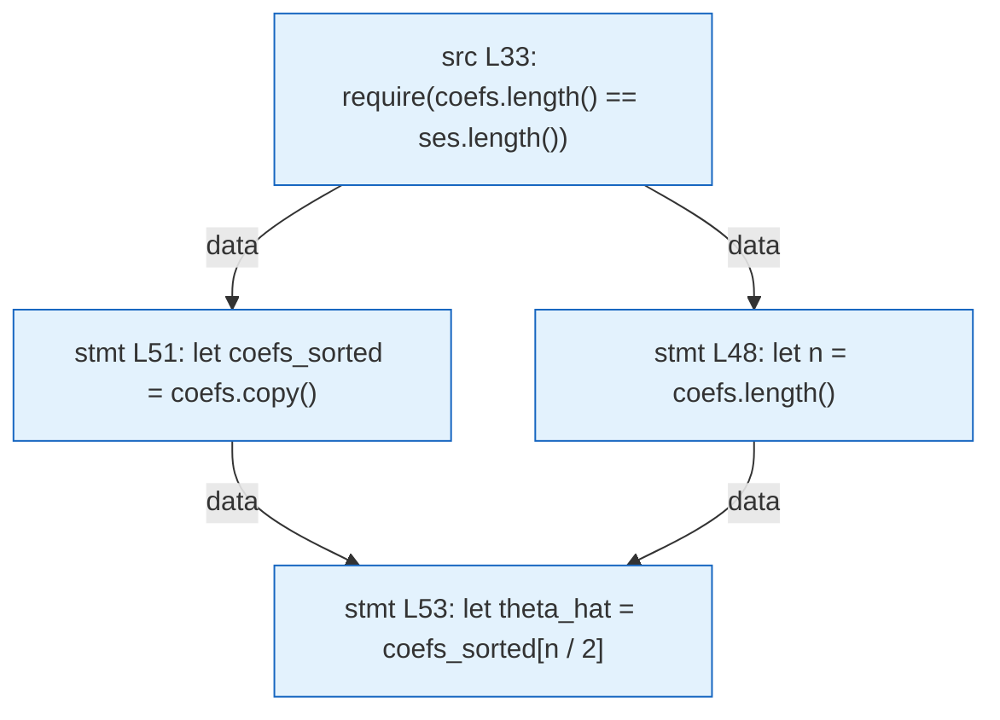

# LunaFlow analysis report — riantr/moonbit_doubleML@0.164.64

> Trace-driven (dynamic-first) control-flow, data-flow, value-range and slicing analysis for a mooncakes.io module.

## 1. Acquisition and version pinning

| Item | Value |
| --- | --- |
| Requested coordinate | `riantr/moonbit_doubleML@latest` |
| Resolved version | `0.164.64` |
| Pinning strategy | `@latest` resolved through `moon fetch` (local registry index, newest non-yanked version) and pinned to `0.164.64` for ingestion, execution and reporting |
| Source root | `./.repos/riantr/moonbit_doubleML/0.164.64` |
| Declared target | `wasm-gc` |
| Direct dependencies | moonbit-community/sqlite3@0.2.4, moonbitlang/async@0.22.7 |

## 2. Ingestion statistics

| Metric | Value |
| --- | --- |
| Source files parsed | 220 |
| Functions extracted | 2529 |
| Statements understood | 30258 |
| Statements unsupported | 281 |
| Frontend coverage | 99.0% |
| Parse issues | 0 |
| CFG functions | 600 of 2529 — the first 600 in file order; 1929 functions had no CFG and can carry no CFG finding |
| Trace events | 237904 |
| Interpreted steps | 47835 |
| Observed functions | 150 |
| Entry selection | the first 150 functions in file order (the `--max-functions` cap applies) |
| Wall time (analyzer) | 7955 ms |
| Selected level | L3 (funnel: L1 → L2 → L3) |

## 3. Proof-strength levels and funnel

The same program is analyzed at three proof strengths. Levels are cumulative: L2 adds abstract interpretation on top of L1, L3 adds contract verification on top of the escalated functions. `--funnel` runs all three and reports what each level adds.

### 3.1 Level definitions

| Level | Name | Engine | Input model | Result strength |
| --- | --- | --- | --- | --- |
| L1 | Interpreter | concrete execution on the formal interpreter | concrete boundary values (`--trials`) | observed facts; may miss unexecuted inputs and paths |
| L2 | Value | abstract interpretation over a value-set / interval domain | whole input sets (`Int` intervals, `Bool`/`String` sets, array length intervals) | exhaustive over the abstract state; may-taint and may-range alarms (false positives possible) |
| L3 | Proof-by-contract | WP-style weakest-precondition VC generation + interval decision | ACSL-style `//@ requires` / `//@ ensures` specs | `proved` / `failed` / `unknown` per verification condition; specs are mandatory |

### 3.2 Funnel


| Level | Checks | New vs previous | Functions / VCs | Note |
| --- | --- | --- | --- | --- |
| L1 concrete | 152 findings | — | 150 functions | observed facts |
| L2 abstract | 187 findings | 186 | 150 functions, 11189 steps | exhaustive over the input abstraction |
| L3 contracts | 0 VCs | 0 failed, 0 unknown | 101 critical functions | specs required |

### 3.3 Escalation and specification gaps

Escalated functions (have at least one L1/L2 finding or a contract): `clip_vec`, `normalize_ipw`, `slice_matrix_rows`, `unique_units`, `build_row_unit_map`, `DoubleMLAPO::fit_cluster`, `kfold`, `psi_at`, `cluster_sandwich_variance`, `draw_bootstrap_weights`, `DoubleMLAPO::sensitivity_nu2_elements`, `DoubleMLAPO::sensitivity_analysis`, `irm_style_sensitivity_from_elements`, `DoubleMLAPO::sensitivity_analysis_cluster`, `irm_style_sensitivity_cluster_from_elements`, `DoubleMLAPOS::psi_b_row_at`, `DoubleMLAPOS::sandwich_se_at`, `DoubleMLAPOS::cluster_sandwich_se_at`, `DoubleMLAPOS::bias_corrected_coef_at`, `DoubleMLAPOS::confint`, `DoubleMLAPOS::causal_contrast`, `check_sample_splitting`, `DoubleMLDIDData::new`, `DoubleMLDID::fit`, `generic_bootstrap_t_stat`, `DoubleMLDID::sensitivity_nu2_elements`, `DoubleMLDID::sensitivity_analysis`, `DoubleMLDID::sensitivity_analysis_cluster`, `GBLearner::fit_weighted`, `cross_fit_irm`, `DoubleMLIRM::fit_cluster`, `DoubleMLIRM::sensitivity_nu2_elements`, `vector_subtract`, `DoubleMLIRM::sensitivity_analysis`, `DoubleMLIRM::sensitivity_analysis_cluster`, `mean`, `sample_sd`, `percentile_sorted`, `lpq_score`, `lpq_score_ipw`, `generic_bootstrap_single_psi`, `single_psi_sensitivity`, `DoubleMLLPQ::sensitivity_analysis_cluster`, `irm_style_sensitivity_cluster`, `aggregate_coef_se`, `DoubleMLAPO::new`, `DoubleMLAPO::coef`, `DoubleMLAPO::se`, `DoubleMLAPO::confint`, `DoubleMLAPO::predictions_g`, `DoubleMLAPO::predictions_m`, `DoubleMLAPO::sandwich_se`, `DoubleMLAPO::cluster_sandwich_se`, `DoubleMLAPO::bias_corrected_coef`, `DoubleMLAPO::bootstrap`, `DoubleMLAPO::tune`, `DoubleMLAPOS::tune`, `DoubleMLAPOS::new`, `DoubleMLAPOS::fit`, `DoubleMLAPOS::coefs`, `DoubleMLAPOS::ses`, `DoubleMLAPOS::psi_a_row_at`, `DoubleMLAPOS::m_inv_1x1_at`, `DoubleMLAPOS::bootstrap`, `DoubleMLAPOS::boot_t_stats`, `DoubleMLAPOS::sensitivity_analysis`, `DoubleMLAPOS::sensitivity_analysis_cluster`, `DoubleMLDID::new`, `DoubleMLDID::coef`, `DoubleMLDID::se`, `DoubleMLDID::confint`, `DoubleMLDID::bootstrap`, `DoubleMLDID::sandwich_se`, `DoubleMLDID::cluster_sandwich_se`, `DoubleMLDID::bias_corrected_coef`, `DoubleMLDID::tune`, `DoubleMLIRM::new`, `DoubleMLIRM::coef`, `DoubleMLIRM::se`, `DoubleMLIRM::confint`, `filter_indices`, `DoubleMLIRM::fit`, `DoubleMLIRM::bootstrap`, `DoubleMLIRM::tune`, `DoubleMLIRM::sandwich_se`, `DoubleMLIRM::cluster_sandwich_se`, `DoubleMLIRM::bias_corrected_coef`, `silverman_bandwidth`, `gaussian_kde`, `gaussian_kde_weighted`, `DoubleMLLPQData::new`, `DoubleMLLPQ::new`, `DoubleMLLPQ::fit`, `DoubleMLLPQ::bootstrap`, `DoubleMLLPQ::sensitivity_analysis`, `DoubleMLLPQ::confint`, `DoubleMLLPQ::coef`, `DoubleMLLPQ::se`, `DoubleMLLPQ::predictions_g0`, `DoubleMLLPQ::predictions_g1`, `DoubleMLLPQ::predictions_m`

Functions escalated without any contract (spec gap at L3): `DoubleMLAPO::new (apo.mbt:101)`, `DoubleMLAPO::coef (apo.mbt:196)`, `DoubleMLAPO::se (apo.mbt:207)`, `DoubleMLAPO::confint (apo.mbt:218)`, `DoubleMLAPO::predictions_g (apo.mbt:229)`, `DoubleMLAPO::predictions_m (apo.mbt:240)`, `DoubleMLAPO::fit_cluster (apo.mbt:549)`, `DoubleMLAPO::sandwich_se (apo.mbt:766)`, `DoubleMLAPO::cluster_sandwich_se (apo.mbt:799)`, `DoubleMLAPO::bias_corrected_coef (apo.mbt:858)`, `DoubleMLAPO::bootstrap (apo.mbt:895)`, `DoubleMLAPO::tune (apo.mbt:968)`, `DoubleMLAPOS::tune (apo.mbt:1024)`, `DoubleMLAPO::sensitivity_nu2_elements (apo.mbt:1094)`, `DoubleMLAPO::sensitivity_analysis (apo.mbt:1127)`, `DoubleMLAPO::sensitivity_analysis_cluster (apo.mbt:1157)`, `DoubleMLAPOS::new (apo.mbt:1282)`, `DoubleMLAPOS::fit (apo.mbt:1379)`, `DoubleMLAPOS::coefs (apo.mbt:1693)`, `DoubleMLAPOS::ses (apo.mbt:1704)`, `DoubleMLAPOS::psi_b_row_at (apo.mbt:1808)`, `DoubleMLAPOS::psi_a_row_at (apo.mbt:1838)`, `DoubleMLAPOS::m_inv_1x1_at (apo.mbt:1868)`, `DoubleMLAPOS::sandwich_se_at (apo.mbt:1919)`, `DoubleMLAPOS::cluster_sandwich_se_at (apo.mbt:1965)`, `DoubleMLAPOS::bias_corrected_coef_at (apo.mbt:2019)`, `DoubleMLAPOS::bootstrap (apo.mbt:2045)`, `DoubleMLAPOS::confint (apo.mbt:2094)`, `DoubleMLAPOS::boot_t_stats (apo.mbt:2148)`, `DoubleMLAPOS::causal_contrast (apo.mbt:2200)`, `DoubleMLAPOS::sensitivity_analysis (apo.mbt:2266)`, `DoubleMLAPOS::sensitivity_analysis_cluster (apo.mbt:2314)`, `DoubleMLDIDData::new (did.mbt:31)`, `DoubleMLDID::new (did.mbt:252)`, `DoubleMLDID::coef (did.mbt:345)`, `DoubleMLDID::se (did.mbt:356)`, `DoubleMLDID::confint (did.mbt:369)`, `DoubleMLDID::fit (did.mbt:483)`, `DoubleMLDID::bootstrap (did.mbt:793)`, `DoubleMLDID::sensitivity_nu2_elements (did.mbt:873)`, `DoubleMLDID::sensitivity_analysis (did.mbt:940)`, `DoubleMLDID::sensitivity_analysis_cluster (did.mbt:975)`, `DoubleMLDID::sandwich_se (did.mbt:1027)`, `DoubleMLDID::cluster_sandwich_se (did.mbt:1057)`, `DoubleMLDID::bias_corrected_coef (did.mbt:1114)`, `DoubleMLDID::tune (did.mbt:1196)`, `GBLearner::fit_weighted (gbl.mbt:125)`, `DoubleMLIRM::new (irm.mbt:109)`, `DoubleMLIRM::coef (irm.mbt:184)`, `DoubleMLIRM::se (irm.mbt:195)`, `DoubleMLIRM::confint (irm.mbt:209)`, `filter_indices (irm.mbt:314)`, `clip_vec (irm.mbt:327)`, `cross_fit_irm (irm.mbt:352)`, `DoubleMLIRM::fit (irm.mbt:462)`, `DoubleMLIRM::fit_cluster (irm.mbt:730)`, `DoubleMLIRM::bootstrap (irm.mbt:935)`, `DoubleMLIRM::tune (irm.mbt:1014)`, `DoubleMLIRM::sensitivity_nu2_elements (irm.mbt:1089)`, `DoubleMLIRM::sensitivity_analysis (irm.mbt:1116)`, `DoubleMLIRM::sensitivity_analysis_cluster (irm.mbt:1154)`, `DoubleMLIRM::sandwich_se (irm.mbt:1197)`, `DoubleMLIRM::cluster_sandwich_se (irm.mbt:1238)`, `DoubleMLIRM::bias_corrected_coef (irm.mbt:1296)`, `silverman_bandwidth (kde.mbt:14)`, `sample_sd (kde.mbt:32)`, `percentile_sorted (kde.mbt:65)`, `gaussian_kde (kde.mbt:88)`, `gaussian_kde_weighted (kde.mbt:125)`, `DoubleMLLPQData::new (lpq.mbt:14)`, `lpq_score (lpq.mbt:37)`, `lpq_score_ipw (lpq.mbt:68)`, `DoubleMLLPQ::new (lpq.mbt:178)`, `DoubleMLLPQ::fit (lpq.mbt:236)`, `DoubleMLLPQ::bootstrap (lpq.mbt:536)`, `DoubleMLLPQ::sensitivity_analysis (lpq.mbt:580)`, `DoubleMLLPQ::sensitivity_analysis_cluster (lpq.mbt:608)`, `DoubleMLLPQ::confint (lpq.mbt:655)`, `DoubleMLLPQ::coef (lpq.mbt:677)`, `DoubleMLLPQ::se (lpq.mbt:688)`, `DoubleMLLPQ::predictions_g0 (lpq.mbt:701)`, `DoubleMLLPQ::predictions_g1 (lpq.mbt:714)`, `DoubleMLLPQ::predictions_m (lpq.mbt:727)`, `unique_units (plpr.mbt:172)`, `check_sample_splitting (kfold.mbt:288)`, `kfold (kfold.mbt:439)`, `slice_matrix_rows (kfold.mbt:487)`, `build_row_unit_map (kfold.mbt:584)`, `mean (matrix.mbt:245)`, `psi_at (sandwich.mbt:215)`, `cluster_sandwich_variance (sandwich.mbt:534)`, `draw_bootstrap_weights (did_multi.mbt:1126)`, `aggregate_coef_se (aggregator.mbt:33)`, `vector_subtract (vectorized.mbt:77)`, `irm_style_sensitivity_from_elements (sensitivity.mbt:78)`, `irm_style_sensitivity_cluster_from_elements (sensitivity.mbt:233)`, `irm_style_sensitivity_cluster (sensitivity.mbt:317)`, `single_psi_sensitivity (sensitivity.mbt:489)`, `normalize_ipw (ps_processor.mbt:910)`, `generic_bootstrap_t_stat (bootstrap_helper.mbt:47)`, `generic_bootstrap_single_psi (bootstrap_helper.mbt:104)`

## 4. Control-flow analysis

CFG nodes are built from the parsed statement tree; execution paths come from the concrete-execution trace engine. Dead/unreachable detection is static; path coverage and budget findings are dynamic. See `docs/design.md` §5 for the mapping rules.

### 4.1 CFG diagrams (top 8 by cyclomatic complexity)

#### `DoubleMLDIDCS::fit` (did_cs.mbt)

_Diagram omitted: 269 nodes exceeds the readability cap (90). Findings for this function are listed below._

#### `transform_panel` (plpr.mbt)

_Diagram omitted: 138 nodes exceeds the readability cap (90). Findings for this function are listed below._

#### `rdd_rb_side` (rdd.mbt)

_Diagram omitted: 122 nodes exceeds the readability cap (90). Findings for this function are listed below._

#### `DoubleMLPLPR::fit` (plpr.mbt)

_Diagram omitted: 151 nodes exceeds the readability cap (90). Findings for this function are listed below._

#### `kfold_stratified` (kfold.mbt)

```mermaid
flowchart TD
  classDef entryNode fill:#dcedc8,stroke:#33691e,stroke-width:2px
  classDef exitNode fill:#ffcdd2,stroke:#b71c1c,stroke-width:2px
  classDef branchNode fill:#fff9c4,stroke:#f9a825
  classDef loopNode fill:#e1bee7,stroke:#6a1b9a
  classDef mergeNode fill:#eceff1,stroke:#607d8b
  classDef deadNode fill:#eeeeee,stroke:#9e9e9e
  classDef stmtNode fill:#e3f2fd,stroke:#1565c0
  n0(["entry kfold_stratified"]):::entryNode
  n1(["exit"]):::exitNode
  n2["require(n #gt; 0)"]:::stmtNode
  n3["require(strata.length() == n)"]:::stmtNode
  n4["require(n_folds #gt; 0)"]:::stmtNode
  n5["require(n_folds #lt;= n)"]:::stmtNode
  n6["let by_stratum : Array[(String, Array[Int32])] =[]"]:::stmtNode
  n7["for-init 0"]:::stmtNode
  n8{{"for (i #lt; n)"}}:::loopNode
  n9["let key = strata[i].to_string()"]:::stmtNode
  n10["let mut found = false"]:::stmtNode
  n11["for-init 0"]:::stmtNode
  n12{{"for (j #lt; by_stratum.length())"}}:::loopNode
  n13{"if (by_stratum[j].0 == key)"}:::branchNode
  n14["by_stratum[j].1. push(i"]:::stmtNode
  n15[""]:::stmtNode
  n16["found = true"]:::stmtNode
  n17["break"]:::stmtNode
  n18("merge"):::mergeNode
  n19("after-loop"):::mergeNode
  n20{"if !found"}:::branchNode
  n21["by_stratum.push((key,[i]))"]:::stmtNode
  n22("merge"):::mergeNode
  n23("after-loop"):::mergeNode
  n24["let stratum_perm : Array[(String, Array[Int32])] =[]"]:::stmtNode
  n25["for-init 0"]:::stmtNode
  n26{{"for (k_idx #lt; by_stratum.length())"}}:::loopNode
  n27["let key = by_stratum[k_idx].0"]:::stmtNode
  n28["let arr = by_stratum[k_idx].1"]:::stmtNode
  n29["let sub_seed = seed + k_idx * 31337"]:::stmtNode
  n30["let bytes = seed_to_bytes(sub_seed)"]:::stmtNode
  n31["let rng = @random.Rand::chacha8(seed = Bytes::from_array(bytes))"]:::stmtNode
  n32["let perm : Array[Int32] = Array::makei(arr.length(), fn(i) { i})"]:::stmtNode
  n33["for-init (perm.length() - 1)"]:::stmtNode
  n34{{"for (i #gt; 0)"}}:::loopNode
  n35["let j = rng.int(limit = i + 1)"]:::stmtNode
  n36["perm.swap(i, j)"]:::stmtNode
  n37("after-loop"):::mergeNode
  n38["let shuffled : Array[Int32] = Array::make(arr.length(), 0)"]:::stmtNode
  n39["for-init 0"]:::stmtNode
  n40{{"for (i #lt; perm.length())"}}:::loopNode
  n41["shuffled[i] = arr[perm[i]]"]:::stmtNode
  n42("after-loop"):::mergeNode
  n43["stratum_perm.push((key, shuffled))"]:::stmtNode
  n44("after-loop"):::mergeNode
  n45["let folds : Array[Fold] =[]"]:::stmtNode
  n46["for-init 0"]:::stmtNode
  n47{{"for (f #lt; n_folds)"}}:::loopNode
  n48["let test_idx : Array[Int32] =[]"]:::stmtNode
  n49["let train_idx : Array[Int32] =[]"]:::stmtNode
  n50["for-init 0"]:::stmtNode
  n51{{"for (k_idx #lt; stratum_perm.length())"}}:::loopNode
  n52["let arr = stratum_perm[k_idx].1"]:::stmtNode
  n53{"if (arr.length() #gt;= n_folds)"}:::branchNode
  n54["let base = arr.length() / n_folds"]:::stmtNode
  n55["let rem = arr.length() - base * n_folds"]:::stmtNode
  n56["let test_size = if f #lt; rem { base + 1} else { base}"]:::stmtNode
  n57["let offset = f * base +(if f #lt; rem { f} else { rem})"]:::stmtNode
  n58["for-init 0"]:::stmtNode
  n59{{"for (k #lt; test_size)"}}:::loopNode
  n60["test_idx.push(arr[offset + k])"]:::stmtNode
  n61("after-loop"):::mergeNode
  n62["for-init 0"]:::stmtNode
  n63{{"for (k #lt; arr.length())"}}:::loopNode
  n64{"if ((k #lt; offset) &#124;&#124; (k #gt;= (offset + test_size)))"}:::branchNode
  n65["train_idx.push(arr[k])"]:::stmtNode
  n66("merge"):::mergeNode
  n67("after-loop"):::mergeNode
  n68{"if (f == 0)"}:::branchNode
  n69["for-init 0"]:::stmtNode
  n70{{"for (k #lt; arr.length())"}}:::loopNode
  n71["test_idx.push(arr[k])"]:::stmtNode
  n72("after-loop"):::mergeNode
  n73["for-init 0"]:::stmtNode
  n74{{"for (k #lt; arr.length())"}}:::loopNode
  n75["train_idx.push(arr[k])"]:::stmtNode
  n76("after-loop"):::mergeNode
  n77("merge"):::mergeNode
  n78("merge"):::mergeNode
  n79("after-loop"):::mergeNode
  n80["folds.push(Fold::new(train_idx, test_idx))"]:::stmtNode
  n81("after-loop"):::mergeNode
  n82["folds"]:::stmtNode
  n0 --> n2
  n2 --> n3
  n3 --> n4
  n4 --> n5
  n5 --> n6
  n6 --> n7
  n7 --> n8
  n9 --> n10
  n10 --> n11
  n11 --> n12
  n14 --> n15
  n15 --> n16
  n16 --> n17
  n13 -->|true| n14
  n13 -->|false| n18
  n12 -->|true| n13
  n17 -.->|back| n12
  n12 -->|false| n19
  n19 --> n20
  n20 -->|true| n21
  n21 --> n22
  n20 -->|false| n22
  n8 -->|true| n9
  n21 -.->|back| n8
  n8 -->|false| n23
  n23 --> n24
  n24 --> n25
  n25 --> n26
  n27 --> n28
  n28 --> n29
  n29 --> n30
  n30 --> n31
  n31 --> n32
  n32 --> n33
  n33 --> n34
  n35 --> n36
  n34 -->|true| n35
  n36 -.->|back| n34
  n34 -->|false| n37
  n37 --> n38
  n38 --> n39
  n39 --> n40
  n40 -->|true| n41
  n41 -.->|back| n40
  n40 -->|false| n42
  n42 --> n43
  n26 -->|true| n27
  n43 -.->|back| n26
  n26 -->|false| n44
  n44 --> n45
  n45 --> n46
  n46 --> n47
  n48 --> n49
  n49 --> n50
  n50 --> n51
  n52 --> n53
  n54 --> n55
  n55 --> n56
  n56 --> n57
  n57 --> n58
  n58 --> n59
  n59 -->|true| n60
  n60 -.->|back| n59
  n59 -->|false| n61
  n61 --> n62
  n62 --> n63
  n64 -->|true| n65
  n65 --> n66
  n64 -->|false| n66
  n63 -->|true| n64
  n65 -.->|back| n63
  n63 -->|false| n67
  n69 --> n70
  n70 -->|true| n71
  n71 -.->|back| n70
  n70 -->|false| n72
  n73 --> n74
  n74 -->|true| n75
  n75 -.->|back| n74
  n74 -->|false| n76
  n68 -->|true| n69
  n68 -->|false| n73
  n72 --> n77
  n76 --> n77
  n53 -->|true| n54
  n53 -->|false| n68
  n67 --> n78
  n77 --> n78
  n51 -->|true| n52
  n51 -.->|back| n51
  n51 -->|false| n79
  n79 --> n80
  n47 -->|true| n48
  n80 -.->|back| n47
  n47 -->|false| n81
  n81 --> n82
  n82 --> n1
```

#### `DoubleMLDID::fit` (did.mbt)

_Diagram omitted: 98 nodes exceeds the readability cap (90). Findings for this function are listed below._

#### `cart_leaf_value` (rfl.mbt)


#### `GBClassifier::fit_weighted` (gbclf.mbt)

```mermaid
flowchart TD
  classDef entryNode fill:#dcedc8,stroke:#33691e,stroke-width:2px
  classDef exitNode fill:#ffcdd2,stroke:#b71c1c,stroke-width:2px
  classDef branchNode fill:#fff9c4,stroke:#f9a825
  classDef loopNode fill:#e1bee7,stroke:#6a1b9a
  classDef mergeNode fill:#eceff1,stroke:#607d8b
  classDef deadNode fill:#eeeeee,stroke:#9e9e9e
  classDef stmtNode fill:#e3f2fd,stroke:#1565c0
  n0(["entry GBClassifier::fit_weighted"]):::entryNode
  n1(["exit"]):::exitNode
  n2["require(x.nrows == y.length())"]:::stmtNode
  n3["require(self.n_trees #gt;= 1)"]:::stmtNode
  n4["require(self.max_depth #gt;= 0)"]:::stmtNode
  n5["require(self.min_samples_leaf #gt;= 1)"]:::stmtNode
  n6["require(self.learning_rate #gt; 0.0 && self.learning_rate #lt;= 1.0)"]:::stmtNode
  n7["require(self.subsample #gt; 0.0 && self.subsample #lt;= 1.0)"]:::stmtNode
  n8["require(w_is_unweighted(w) &#124;&#124; w.length() == x.nrows)"]:::stmtNode
  n9["for-init 0"]:::stmtNode
  n10{{"for (i #lt; y.length())"}}:::loopNode
  n11["require(y[i] == 0.0 &#124;&#124; y[i] == 1.0)"]:::stmtNode
  n12("after-loop"):::mergeNode
  n13["for-init 0"]:::stmtNode
  n14{{"for (i #lt; w.length())"}}:::loopNode
  n15["require(w[i] #gt;= 0.0)"]:::stmtNode
  n16("after-loop"):::mergeNode
  n17["let n_obs = x.nrows"]:::stmtNode
  n18["let eps = 1.0e-9"]:::stmtNode
  n19["let mut sum_y = 0.0"]:::stmtNode
  n20["for-init 0"]:::stmtNode
  n21{{"for (i #lt; n_obs)"}}:::loopNode
  n22["sum_y = sum_y + y[i]"]:::stmtNode
  n23("after-loop"):::mergeNode
  n24["let raw_p = sum_y / n_obs.to_double()"]:::stmtNode
  n25["let base_rate = if raw_p #lt; eps { eps} else if raw_p #gt; 1.0 - eps { 1.0 - eps} else..."]:::stmtNode
  n26["let initial = @math.ln(base_rate /(1.0 - base_rate))"]:::stmtNode
  n27["let current_pred : Array[Double] = Array::make(n_obs, initial)"]:::stmtNode
  n28["let trees : Array[CART] =[]"]:::stmtNode
  n29["for-init 0"]:::stmtNode
  n30{{"for (r #lt; self.n_trees)"}}:::loopNode
  n31["let neg_grad : Array[Double] = Array::make(n_obs, 0.0)"]:::stmtNode
  n32["let hess : Array[Double] = Array::make(n_obs, 0.0)"]:::stmtNode
  n33["for-init 0"]:::stmtNode
  n34{{"for (i #lt; n_obs)"}}:::loopNode
  n35["let p = sigmoid(current_pred[i])"]:::stmtNode
  n36["neg_grad[i] = y[i] - p"]:::stmtNode
  n37["hess[i] = p *(1.0 - p)"]:::stmtNode
  n38("after-loop"):::mergeNode
  n39["let sample_idx : Array[Int32] = if self.subsample #lt; 1.0 { let n_sub =(n_obs.to_doubl..."]:::stmtNode
  n40["let x_sub : Matrix = { nrows : sample_idx.length(), ncols : x.ncols, data : Array::make..."]:::stmtNode
  n41["for-init 0"]:::stmtNode
  n42{{"for (j #lt; sample_idx.length())"}}:::loopNode
  n43["for-init 0"]:::stmtNode
  n44{{"for (k #lt; x.ncols)"}}:::loopNode
  n45["x_sub.data[j * x.ncols + k] = x.data[sample_idx[j] * x.ncols + k]"]:::stmtNode
  n46("after-loop"):::mergeNode
  n47("after-loop"):::mergeNode
  n48["let y_sub : Array[Double] = Array::make(sample_idx.length(), 0.0)"]:::stmtNode
  n49["for-init 0"]:::stmtNode
  n50{{"for (j #lt; sample_idx.length())"}}:::loopNode
  n51["y_sub[j] = neg_grad[sample_idx[j]]"]:::stmtNode
  n52("after-loop"):::mergeNode
  n53["let hess_sub : Array[Double] = Array::make(sample_idx.length(), 0.0)"]:::stmtNode
  n54["for-init 0"]:::stmtNode
  n55{{"for (j #lt; sample_idx.length())"}}:::loopNode
  n56["hess_sub[j] = hess[sample_idx[j]]"]:::stmtNode
  n57("after-loop"):::mergeNode
  n58["let w_sub : Array[Double] = Array::make(sample_idx.length(), 0.0)"]:::stmtNode
  n59["for-init 0"]:::stmtNode
  n60{{"for (j #lt; sample_idx.length())"}}:::loopNode
  n61["w_sub[j] = if w_is_unweighted(w) { 0.0} else { w[sample_idx[j]]}"]:::stmtNode
  n62("after-loop"):::mergeNode
  n63["let w_eff = if w_is_unweighted(w) {[]} else { w_sub}"]:::stmtNode
  n64["let feature_rng = chacha8_rng(self.bootstrap_seed + self.n_trees + r)"]:::stmtNode
  n65["let tree = cart_fit( x_sub, y_sub, Array::makei(sample_idx.length(), fn(j) { j}), 0, se..."]:::stmtNode
  n66["trees.push(tree)"]:::stmtNode
  n67["for-init 0"]:::stmtNode
  n68{{"for (i #lt; n_obs)"}}:::loopNode
  n69["current_pred[i] = current_pred[i] + self.learning_rate * cart_predict(tree, x, i)"]:::stmtNode
  n70("after-loop"):::mergeNode
  n71("after-loop"):::mergeNode
  n72["{ .. self, initial, base_rate, trees,}"]:::stmtNode
  n0 --> n2
  n2 --> n3
  n3 --> n4
  n4 --> n5
  n5 --> n6
  n6 --> n7
  n7 --> n8
  n8 --> n9
  n9 --> n10
  n10 -->|true| n11
  n11 -.->|back| n10
  n10 -->|false| n12
  n12 --> n13
  n13 --> n14
  n14 -->|true| n15
  n15 -.->|back| n14
  n14 -->|false| n16
  n16 --> n17
  n17 --> n18
  n18 --> n19
  n19 --> n20
  n20 --> n21
  n21 -->|true| n22
  n22 -.->|back| n21
  n21 -->|false| n23
  n23 --> n24
  n24 --> n25
  n25 --> n26
  n26 --> n27
  n27 --> n28
  n28 --> n29
  n29 --> n30
  n31 --> n32
  n32 --> n33
  n33 --> n34
  n35 --> n36
  n36 --> n37
  n34 -->|true| n35
  n37 -.->|back| n34
  n34 -->|false| n38
  n38 --> n39
  n39 --> n40
  n40 --> n41
  n41 --> n42
  n43 --> n44
  n44 -->|true| n45
  n45 -.->|back| n44
  n44 -->|false| n46
  n42 -->|true| n43
  n42 -.->|back| n42
  n42 -->|false| n47
  n47 --> n48
  n48 --> n49
  n49 --> n50
  n50 -->|true| n51
  n51 -.->|back| n50
  n50 -->|false| n52
  n52 --> n53
  n53 --> n54
  n54 --> n55
  n55 -->|true| n56
  n56 -.->|back| n55
  n55 -->|false| n57
  n57 --> n58
  n58 --> n59
  n59 --> n60
  n60 -->|true| n61
  n61 -.->|back| n60
  n60 -->|false| n62
  n62 --> n63
  n63 --> n64
  n64 --> n65
  n65 --> n66
  n66 --> n67
  n67 --> n68
  n68 -->|true| n69
  n69 -.->|back| n68
  n68 -->|false| n70
  n30 -->|true| n31
  n30 -.->|back| n30
  n30 -->|false| n71
  n71 --> n72
  n72 --> n1
```



### 4.2 CFG findings

| Rule | Severity | Function | Location | Message | Method | Confidence |
| --- | --- | --- | --- | --- | --- | --- |
| BUDGET-EXCEEDED | warning | slice_matrix_rows | kfold.mbt:496 | execution budget exhausted; loop may be non-terminating or inputs too large | dynamic | 0.6 |
| BUDGET-EXCEEDED | warning | kfold | kfold.mbt:468 | execution budget exhausted; loop may be non-terminating or inputs too large | dynamic | 0.6 |
| BUDGET-EXCEEDED | warning | draw_bootstrap_weights | did_multi.mbt:1154 | execution budget exhausted; loop may be non-terminating or inputs too large | dynamic | 0.6 |
| BUDGET-EXCEEDED | warning | kfold | kfold.mbt:474 | execution budget exhausted; loop may be non-terminating or inputs too large | dynamic | 0.6 |
| BUDGET-EXCEEDED | warning | kfold | kfold.mbt:474 | execution budget exhausted; loop may be non-terminating or inputs too large | dynamic | 0.6 |
| BUDGET-EXCEEDED | warning | DoubleMLAPOS::confint | apo.mbt:2127 | execution budget exhausted; loop may be non-terminating or inputs too large | dynamic | 0.6 |
| BUDGET-EXCEEDED | warning | DoubleMLAPOS::causal_contrast | apo.mbt:2250 | execution budget exhausted; loop may be non-terminating or inputs too large | dynamic | 0.6 |
| BUDGET-EXCEEDED | warning | DoubleMLDID::fit | did.mbt:611 | execution budget exhausted; loop may be non-terminating or inputs too large | dynamic | 0.6 |
| BUDGET-EXCEEDED | warning | kfold | kfold.mbt:474 | execution budget exhausted; loop may be non-terminating or inputs too large | dynamic | 0.6 |
| BUDGET-EXCEEDED | warning | GBLearner::fit_weighted | gbl.mbt:188 | execution budget exhausted; loop may be non-terminating or inputs too large | dynamic | 0.6 |
| BUDGET-EXCEEDED | warning | kfold | kfold.mbt:474 | execution budget exhausted; loop may be non-terminating or inputs too large | dynamic | 0.6 |
| BUDGET-EXCEEDED | warning | draw_bootstrap_weights | did_multi.mbt:1154 | execution budget exhausted; loop may be non-terminating or inputs too large | dynamic | 0.6 |
| BUDGET-EXCEEDED | warning | kfold | kfold.mbt:474 | execution budget exhausted; loop may be non-terminating or inputs too large | dynamic | 0.6 |
| BUDGET-EXCEEDED | warning | kfold | kfold.mbt:468 | execution budget exhausted; loop may be non-terminating or inputs too large | dynamic | 0.6 |

### 4.3 Static vs dynamic attribution

| Signal | Method | What a hit means | Known limitation |
| --- | --- | --- | --- |
| Unreachable statement | static | no CFG predecessor; often after `return`/`break` | parser gaps can hide real predecessors |
| Infinite loop | static + dynamic | constant-true condition without break, or iteration cap reached | loops whose exit depends on unmodelled calls are reported as *budget*, not proven infinite |
| Uncovered code | dynamic (coverage import) | zero hits in the observed test suite | absence of execution is not proof of dead code |

## 5. Data flow, taint and the memory layout

Sources are entry-function parameters (and `@env.args` when the frontend sees it); propagation follows recorded definitions and the variables read by each statement; sinks are array-index expressions and allocation sizes. The graph below is the *observed* propagation, not a may-analysis over all inputs.

```mermaid
flowchart LR
  classDef src fill:#ffcdd2,stroke:#b71c1c,stroke-width:2px
  classDef step fill:#fff9c4,stroke:#f9a825
  classDef sink fill:#c8e6c9,stroke:#1b5e20,stroke-width:2px
  t0["source: data"]:::src
  t1["source: treatment_level~"]:::src
  t2["source: n_folds~"]:::src
  t3["source: n_rep~"]:::src
  t4["source: seed~"]:::src
  t5["source: propensity_clip~"]:::src
  t6["source: normalize_ipw~"]:::src
  t7["source: ps_processor_config~"]:::src
  t8["source: ml_g~"]:::src
  t9["source: ml_m~"]:::src
  t10["source: data"]:::src
  t11["source: treatment_level~"]:::src
  t12["source: n_folds~"]:::src
  t13["source: n_rep~"]:::src
  t14["source: seed~"]:::src
  t15["source: propensity_clip~"]:::src
  t16["source: normalize_ipw~"]:::src
  t17["source: ps_processor_config~"]:::src
  t18["source: ml_g~"]:::src
  t19["source: ml_m~"]:::src
  t20["source: data"]:::src
  t21["source: treatment_level~"]:::src
  t22["source: n_folds~"]:::src
  t23["source: n_rep~"]:::src
  t24["source: seed~"]:::src
  t25["source: propensity_clip~"]:::src
  t26["source: normalize_ipw~"]:::src
  t27["source: ps_processor_config~"]:::src
  t28["source: ml_g~"]:::src
  t29["source: ml_m~"]:::src
  t30["source: data"]:::src
  t31["source: treatment_level~"]:::src
  t32["source: n_folds~"]:::src
  t33["source: n_rep~"]:::src
  t34["source: seed~"]:::src
  t35["source: propensity_clip~"]:::src
  t36["source: normalize_ipw~"]:::src
  t37["source: ps_processor_config~"]:::src
  t38["source: ml_g~"]:::src
  t39["source: ml_m~"]:::src
```



### 5.1 Taint sinks

| Rule | Severity | Function | Location | Message | Method | Confidence |
| --- | --- | --- | --- | --- | --- | --- |
| TAINT-INDEX | error | clip_vec | irm.mbt:331 | tainted value reaches an array index / buffer offset | dynamic+symbolic | 0.8 |
| TAINT-INDEX | error | normalize_ipw | ps_processor.mbt:929 | tainted value reaches an array index / buffer offset | dynamic+symbolic | 0.8 |
| TAINT-INDEX | error | normalize_ipw | ps_processor.mbt:935 | tainted value reaches an array index / buffer offset | dynamic+symbolic | 0.8 |
| TAINT-INDEX | error | normalize_ipw | ps_processor.mbt:936 | tainted value reaches an array index / buffer offset | dynamic+symbolic | 0.8 |
| TAINT-INDEX | error | normalize_ipw | ps_processor.mbt:942 | tainted value reaches an array index / buffer offset | dynamic+symbolic | 0.8 |
| TAINT-INDEX | error | normalize_ipw | ps_processor.mbt:943 | tainted value reaches an array index / buffer offset | dynamic+symbolic | 0.8 |
| TAINT-INDEX | error | slice_matrix_rows | kfold.mbt:493 | tainted value reaches an array index / buffer offset | dynamic+symbolic | 0.8 |
| TAINT-INDEX | error | slice_matrix_rows | kfold.mbt:491 | tainted value reaches an array index / buffer offset | dynamic+symbolic | 0.8 |
| TAINT-INDEX | error | unique_units | plpr.mbt:175 | tainted value reaches an array index / buffer offset | dynamic+symbolic | 0.8 |
| TAINT-INDEX | error | build_row_unit_map | kfold.mbt:592 | tainted value reaches an array index / buffer offset | dynamic+symbolic | 0.8 |
| TAINT-INDEX | error | DoubleMLAPO::fit_cluster | apo.mbt:576 | tainted value reaches an array index / buffer offset | dynamic+symbolic | 0.8 |
| TAINT-INDEX | error | psi_at | sandwich.mbt:226 | tainted value reaches an array index / buffer offset | dynamic+symbolic | 0.8 |
| TAINT-INDEX | error | cluster_sandwich_variance | sandwich.mbt:550 | tainted value reaches an array index / buffer offset | dynamic+symbolic | 0.8 |
| TAINT-INDEX | error | cluster_sandwich_variance | sandwich.mbt:562 | tainted value reaches an array index / buffer offset | dynamic+symbolic | 0.8 |
| TAINT-INDEX | error | cluster_sandwich_variance | sandwich.mbt:563 | tainted value reaches an array index / buffer offset | dynamic+symbolic | 0.8 |
| TAINT-INDEX | error | cluster_sandwich_variance | sandwich.mbt:564 | tainted value reaches an array index / buffer offset | dynamic+symbolic | 0.8 |
| TAINT-INDEX | error | cluster_sandwich_variance | sandwich.mbt:569 | tainted value reaches an array index / buffer offset | dynamic+symbolic | 0.8 |
| TAINT-INDEX | error | kfold | kfold.mbt:466 | tainted value reaches an array index / buffer offset | dynamic+symbolic | 0.8 |
| TAINT-INDEX | error | DoubleMLAPO::sensitivity_nu2_elements | apo.mbt:1102 | tainted value reaches an array index / buffer offset | dynamic+symbolic | 0.8 |
| TAINT-INDEX | error | DoubleMLAPO::sensitivity_nu2_elements | apo.mbt:1114 | tainted value reaches an array index / buffer offset | dynamic+symbolic | 0.8 |
| TAINT-INDEX | error | DoubleMLAPO::sensitivity_nu2_elements | apo.mbt:1117 | tainted value reaches an array index / buffer offset | dynamic+symbolic | 0.8 |
| TAINT-INDEX | error | DoubleMLAPO::sensitivity_nu2_elements | apo.mbt:1121 | tainted value reaches an array index / buffer offset | dynamic+symbolic | 0.8 |
| TAINT-INDEX | error | DoubleMLAPO::sensitivity_analysis | apo.mbt:1137 | tainted value reaches an array index / buffer offset | dynamic+symbolic | 0.8 |
| TAINT-INDEX | error | irm_style_sensitivity_from_elements | sensitivity.mbt:94 | tainted value reaches an array index / buffer offset | dynamic+symbolic | 0.8 |
| TAINT-INDEX | error | irm_style_sensitivity_from_elements | sensitivity.mbt:95 | tainted value reaches an array index / buffer offset | dynamic+symbolic | 0.8 |
| TAINT-INDEX | error | irm_style_sensitivity_from_elements | sensitivity.mbt:103 | tainted value reaches an array index / buffer offset | dynamic+symbolic | 0.8 |
| TAINT-INDEX | error | irm_style_sensitivity_from_elements | sensitivity.mbt:104 | tainted value reaches an array index / buffer offset | dynamic+symbolic | 0.8 |
| TAINT-INDEX | error | irm_style_sensitivity_from_elements | sensitivity.mbt:112 | tainted value reaches an array index / buffer offset | dynamic+symbolic | 0.8 |
| TAINT-INDEX | error | irm_style_sensitivity_from_elements | sensitivity.mbt:113 | tainted value reaches an array index / buffer offset | dynamic+symbolic | 0.8 |
| TAINT-INDEX | error | DoubleMLAPO::sensitivity_analysis_cluster | apo.mbt:1169 | tainted value reaches an array index / buffer offset | dynamic+symbolic | 0.8 |
| TAINT-INDEX | error | irm_style_sensitivity_cluster_from_elements | sensitivity.mbt:253 | tainted value reaches an array index / buffer offset | dynamic+symbolic | 0.8 |
| TAINT-INDEX | error | irm_style_sensitivity_cluster_from_elements | sensitivity.mbt:254 | tainted value reaches an array index / buffer offset | dynamic+symbolic | 0.8 |
| TAINT-INDEX | error | irm_style_sensitivity_cluster_from_elements | sensitivity.mbt:265 | tainted value reaches an array index / buffer offset | dynamic+symbolic | 0.8 |
| TAINT-INDEX | error | irm_style_sensitivity_cluster_from_elements | sensitivity.mbt:266 | tainted value reaches an array index / buffer offset | dynamic+symbolic | 0.8 |
| TAINT-INDEX | error | irm_style_sensitivity_cluster_from_elements | sensitivity.mbt:267 | tainted value reaches an array index / buffer offset | dynamic+symbolic | 0.8 |
| TAINT-INDEX | error | irm_style_sensitivity_cluster_from_elements | sensitivity.mbt:268 | tainted value reaches an array index / buffer offset | dynamic+symbolic | 0.8 |
| TAINT-INDEX | error | irm_style_sensitivity_cluster_from_elements | sensitivity.mbt:269 | tainted value reaches an array index / buffer offset | dynamic+symbolic | 0.8 |
| TAINT-INDEX | error | irm_style_sensitivity_cluster_from_elements | sensitivity.mbt:273 | tainted value reaches an array index / buffer offset | dynamic+symbolic | 0.8 |
| TAINT-INDEX | error | irm_style_sensitivity_cluster_from_elements | sensitivity.mbt:274 | tainted value reaches an array index / buffer offset | dynamic+symbolic | 0.8 |
| TAINT-INDEX | error | irm_style_sensitivity_cluster_from_elements | sensitivity.mbt:275 | tainted value reaches an array index / buffer offset | dynamic+symbolic | 0.8 |
| TAINT-INDEX | error | irm_style_sensitivity_cluster_from_elements | sensitivity.mbt:276 | tainted value reaches an array index / buffer offset | dynamic+symbolic | 0.8 |
| TAINT-INDEX | error | irm_style_sensitivity_cluster_from_elements | sensitivity.mbt:283 | tainted value reaches an array index / buffer offset | dynamic+symbolic | 0.8 |
| TAINT-INDEX | error | irm_style_sensitivity_cluster_from_elements | sensitivity.mbt:284 | tainted value reaches an array index / buffer offset | dynamic+symbolic | 0.8 |
| TAINT-INDEX | error | irm_style_sensitivity_cluster_from_elements | sensitivity.mbt:285 | tainted value reaches an array index / buffer offset | dynamic+symbolic | 0.8 |
| TAINT-INDEX | error | irm_style_sensitivity_cluster_from_elements | sensitivity.mbt:294 | tainted value reaches an array index / buffer offset | dynamic+symbolic | 0.8 |
| TAINT-INDEX | error | irm_style_sensitivity_cluster_from_elements | sensitivity.mbt:295 | tainted value reaches an array index / buffer offset | dynamic+symbolic | 0.8 |
| TAINT-INDEX | error | irm_style_sensitivity_cluster_from_elements | sensitivity.mbt:299 | tainted value reaches an array index / buffer offset | dynamic+symbolic | 0.8 |
| TAINT-INDEX | error | irm_style_sensitivity_cluster_from_elements | sensitivity.mbt:300 | tainted value reaches an array index / buffer offset | dynamic+symbolic | 0.8 |
| TAINT-INDEX | error | DoubleMLAPOS::psi_b_row_at | apo.mbt:1825 | tainted value reaches an array index / buffer offset | dynamic+symbolic | 0.8 |
| TAINT-INDEX | error | DoubleMLAPOS::sandwich_se_at | apo.mbt:1930 | tainted value reaches an array index / buffer offset | dynamic+symbolic | 0.8 |
| TAINT-INDEX | error | DoubleMLAPOS::cluster_sandwich_se_at | apo.mbt:1977 | tainted value reaches an array index / buffer offset | dynamic+symbolic | 0.8 |
| TAINT-INDEX | error | DoubleMLAPOS::bias_corrected_coef_at | apo.mbt:2028 | tainted value reaches an array index / buffer offset | dynamic+symbolic | 0.8 |
| TAINT-INDEX | error | DoubleMLAPOS::confint | apo.mbt:2120 | tainted value reaches an array index / buffer offset | dynamic+symbolic | 0.8 |
| TAINT-INDEX | error | DoubleMLAPOS::confint | apo.mbt:2121 | tainted value reaches an array index / buffer offset | dynamic+symbolic | 0.8 |
| TAINT-INDEX-RANGE | warning | DoubleMLAPOS::causal_contrast | apo.mbt:2217 | untrusted input determines an array index; the observed index was inside the array, so no out-of-bounds access was witnessed | dynamic+symbolic | 0.5 |
| TAINT-INDEX | error | DoubleMLAPOS::causal_contrast | apo.mbt:2220 | tainted value reaches an array index / buffer offset | dynamic+symbolic | 0.8 |
| TAINT-INDEX | error | check_sample_splitting | kfold.mbt:312 | tainted value reaches an array index / buffer offset | dynamic+symbolic | 0.8 |
| TAINT-INDEX-RANGE | warning | DoubleMLDIDData::new | did.mbt:55 | untrusted input determines an array index; the observed index was inside the array, so no out-of-bounds access was witnessed | dynamic+symbolic | 0.5 |
| TAINT-INDEX | error | DoubleMLDID::fit | did.mbt:606 | tainted value reaches an array index / buffer offset | dynamic+symbolic | 0.8 |
| TAINT-INDEX | error | DoubleMLDID::fit | did.mbt:607 | tainted value reaches an array index / buffer offset | dynamic+symbolic | 0.8 |
| TAINT-INDEX | error | DoubleMLDID::fit | did.mbt:608 | tainted value reaches an array index / buffer offset | dynamic+symbolic | 0.8 |
| TAINT-INDEX | error | generic_bootstrap_t_stat | bootstrap_helper.mbt:74 | tainted value reaches an array index / buffer offset | dynamic+symbolic | 0.8 |
| TAINT-INDEX | error | DoubleMLDID::sensitivity_nu2_elements | did.mbt:885 | tainted value reaches an array index / buffer offset | dynamic+symbolic | 0.8 |
| TAINT-INDEX | error | DoubleMLDID::sensitivity_nu2_elements | did.mbt:886 | tainted value reaches an array index / buffer offset | dynamic+symbolic | 0.8 |
| TAINT-INDEX | error | DoubleMLDID::sensitivity_nu2_elements | did.mbt:896 | tainted value reaches an array index / buffer offset | dynamic+symbolic | 0.8 |
| TAINT-INDEX | error | DoubleMLDID::sensitivity_nu2_elements | did.mbt:897 | tainted value reaches an array index / buffer offset | dynamic+symbolic | 0.8 |
| TAINT-INDEX | error | DoubleMLDID::sensitivity_nu2_elements | did.mbt:926 | tainted value reaches an array index / buffer offset | dynamic+symbolic | 0.8 |
| TAINT-INDEX | error | DoubleMLDID::sensitivity_analysis | did.mbt:952 | tainted value reaches an array index / buffer offset | dynamic+symbolic | 0.8 |
| TAINT-INDEX | error | DoubleMLDID::sensitivity_analysis_cluster | did.mbt:989 | tainted value reaches an array index / buffer offset | dynamic+symbolic | 0.8 |
| TAINT-INDEX | error | GBLearner::fit_weighted | gbl.mbt:146 | tainted value reaches an array index / buffer offset | dynamic+symbolic | 0.8 |
| TAINT-INDEX | error | GBLearner::fit_weighted | gbl.mbt:156 | tainted value reaches an array index / buffer offset | dynamic+symbolic | 0.8 |
| TAINT-INDEX | error | GBLearner::fit_weighted | gbl.mbt:185 | tainted value reaches an array index / buffer offset | dynamic+symbolic | 0.8 |
| TAINT-INDEX-RANGE | warning | GBLearner::fit_weighted | gbl.mbt:140 | untrusted input determines an array index; the observed index was inside the array, so no out-of-bounds access was witnessed | dynamic+symbolic | 0.5 |
| TAINT-INDEX | error | cross_fit_irm | irm.mbt:384 | tainted value reaches an array index / buffer offset | dynamic+symbolic | 0.8 |
| TAINT-INDEX | error | cross_fit_irm | irm.mbt:385 | tainted value reaches an array index / buffer offset | dynamic+symbolic | 0.8 |
| TAINT-INDEX | error | cross_fit_irm | irm.mbt:399 | tainted value reaches an array index / buffer offset | dynamic+symbolic | 0.8 |
| TAINT-INDEX | error | cross_fit_irm | irm.mbt:400 | tainted value reaches an array index / buffer offset | dynamic+symbolic | 0.8 |
| TAINT-INDEX | error | cross_fit_irm | irm.mbt:408 | tainted value reaches an array index / buffer offset | dynamic+symbolic | 0.8 |
| TAINT-INDEX | error | cross_fit_irm | irm.mbt:409 | tainted value reaches an array index / buffer offset | dynamic+symbolic | 0.8 |
| TAINT-INDEX | error | DoubleMLIRM::fit_cluster | irm.mbt:760 | tainted value reaches an array index / buffer offset | dynamic+symbolic | 0.8 |
| TAINT-INDEX | error | DoubleMLIRM::sensitivity_nu2_elements | irm.mbt:1100 | tainted value reaches an array index / buffer offset | dynamic+symbolic | 0.8 |
| TAINT-INDEX | error | DoubleMLIRM::sensitivity_nu2_elements | irm.mbt:1101 | tainted value reaches an array index / buffer offset | dynamic+symbolic | 0.8 |
| TAINT-INDEX | error | DoubleMLIRM::sensitivity_nu2_elements | irm.mbt:1110 | tainted value reaches an array index / buffer offset | dynamic+symbolic | 0.8 |
| TAINT-INDEX | error | vector_subtract | vectorized.mbt:83 | tainted value reaches an array index / buffer offset | dynamic+symbolic | 0.8 |
| TAINT-INDEX | error | DoubleMLIRM::sensitivity_analysis | irm.mbt:1134 | tainted value reaches an array index / buffer offset | dynamic+symbolic | 0.8 |
| TAINT-INDEX | error | DoubleMLIRM::sensitivity_analysis_cluster | irm.mbt:1172 | tainted value reaches an array index / buffer offset | dynamic+symbolic | 0.8 |
| TAINT-INDEX-RANGE | warning | mean | matrix.mbt:252 | untrusted input determines an array index; the observed index was inside the array, so no out-of-bounds access was witnessed | dynamic+symbolic | 0.5 |
| TAINT-INDEX-RANGE | warning | sample_sd | kde.mbt:40 | untrusted input determines an array index; the observed index was inside the array, so no out-of-bounds access was witnessed | dynamic+symbolic | 0.5 |
| TAINT-INDEX | error | percentile_sorted | kde.mbt:77 | tainted value reaches an array index / buffer offset | dynamic+symbolic | 0.8 |
| TAINT-INDEX | error | lpq_score | lpq.mbt:51 | tainted value reaches an array index / buffer offset | dynamic+symbolic | 0.8 |
| TAINT-INDEX | error | lpq_score | lpq.mbt:52 | tainted value reaches an array index / buffer offset | dynamic+symbolic | 0.8 |
| TAINT-INDEX | error | lpq_score | lpq.mbt:53 | tainted value reaches an array index / buffer offset | dynamic+symbolic | 0.8 |
| TAINT-INDEX | error | lpq_score | lpq.mbt:54 | tainted value reaches an array index / buffer offset | dynamic+symbolic | 0.8 |
| TAINT-INDEX | error | lpq_score_ipw | lpq.mbt:81 | tainted value reaches an array index / buffer offset | dynamic+symbolic | 0.8 |
| TAINT-INDEX | error | lpq_score_ipw | lpq.mbt:82 | tainted value reaches an array index / buffer offset | dynamic+symbolic | 0.8 |
| TAINT-INDEX | error | generic_bootstrap_single_psi | bootstrap_helper.mbt:113 | tainted value reaches an array index / buffer offset | dynamic+symbolic | 0.8 |
| TAINT-INDEX | error | single_psi_sensitivity | sensitivity.mbt:503 | tainted value reaches an array index / buffer offset | dynamic+symbolic | 0.8 |
| TAINT-INDEX | error | single_psi_sensitivity | sensitivity.mbt:504 | tainted value reaches an array index / buffer offset | dynamic+symbolic | 0.8 |
| TAINT-INDEX | error | single_psi_sensitivity | sensitivity.mbt:510 | tainted value reaches an array index / buffer offset | dynamic+symbolic | 0.8 |
| TAINT-INDEX | error | single_psi_sensitivity | sensitivity.mbt:517 | tainted value reaches an array index / buffer offset | dynamic+symbolic | 0.8 |
| TAINT-INDEX | error | single_psi_sensitivity | sensitivity.mbt:518 | tainted value reaches an array index / buffer offset | dynamic+symbolic | 0.8 |
| TAINT-INDEX | error | DoubleMLLPQ::sensitivity_analysis_cluster | lpq.mbt:622 | tainted value reaches an array index / buffer offset | dynamic+symbolic | 0.8 |
| TAINT-INDEX | error | DoubleMLLPQ::sensitivity_analysis_cluster | lpq.mbt:627 | tainted value reaches an array index / buffer offset | dynamic+symbolic | 0.8 |
| TAINT-INDEX | error | irm_style_sensitivity_cluster | sensitivity.mbt:339 | tainted value reaches an array index / buffer offset | dynamic+symbolic | 0.8 |
| TAINT-INDEX | error | irm_style_sensitivity_cluster | sensitivity.mbt:340 | tainted value reaches an array index / buffer offset | dynamic+symbolic | 0.8 |
| TAINT-INDEX | error | irm_style_sensitivity_cluster | sensitivity.mbt:350 | tainted value reaches an array index / buffer offset | dynamic+symbolic | 0.8 |
| TAINT-INDEX | error | irm_style_sensitivity_cluster | sensitivity.mbt:351 | tainted value reaches an array index / buffer offset | dynamic+symbolic | 0.8 |
| TAINT-INDEX | error | irm_style_sensitivity_cluster | sensitivity.mbt:352 | tainted value reaches an array index / buffer offset | dynamic+symbolic | 0.8 |
| TAINT-INDEX | error | irm_style_sensitivity_cluster | sensitivity.mbt:353 | tainted value reaches an array index / buffer offset | dynamic+symbolic | 0.8 |
| TAINT-INDEX | error | irm_style_sensitivity_cluster | sensitivity.mbt:357 | tainted value reaches an array index / buffer offset | dynamic+symbolic | 0.8 |
| TAINT-INDEX | error | irm_style_sensitivity_cluster | sensitivity.mbt:358 | tainted value reaches an array index / buffer offset | dynamic+symbolic | 0.8 |
| TAINT-INDEX | error | irm_style_sensitivity_cluster | sensitivity.mbt:359 | tainted value reaches an array index / buffer offset | dynamic+symbolic | 0.8 |
| TAINT-INDEX | error | irm_style_sensitivity_cluster | sensitivity.mbt:366 | tainted value reaches an array index / buffer offset | dynamic+symbolic | 0.8 |
| TAINT-INDEX | error | irm_style_sensitivity_cluster | sensitivity.mbt:367 | tainted value reaches an array index / buffer offset | dynamic+symbolic | 0.8 |
| TAINT-INDEX | error | irm_style_sensitivity_cluster | sensitivity.mbt:378 | tainted value reaches an array index / buffer offset | dynamic+symbolic | 0.8 |
| TAINT-INDEX | error | irm_style_sensitivity_cluster | sensitivity.mbt:379 | tainted value reaches an array index / buffer offset | dynamic+symbolic | 0.8 |
| TAINT-INDEX | error | aggregate_coef_se | aggregator.mbt:53 | tainted value reaches an array index / buffer offset | dynamic+symbolic | 0.8 |
| TAINT-INDEX | error | aggregate_coef_se | aggregator.mbt:60 | tainted value reaches an array index / buffer offset | dynamic+symbolic | 0.8 |

### 5.2 L2 abstract findings (may-analysis)

Abstract interpretation joins all paths and widens loops, so these alarms are *may* properties: a hit means the abstract state cannot exclude the defect, not that a concrete input was observed. Two rules keep the may-analysis from crying wolf. A branch that is unreachable in ONE iteration of a loop is not reported, because the loop's state changes between the iterations. And a tainted index is only claimed when the container is known to be an array: the analyzer cannot see the type of a struct's field, and a Map's key is not an offset that untrusted input chose.

| Rule | Severity | Function | Location | Message | Method | Confidence |
| --- | --- | --- | --- | --- | --- | --- |
| RANGE-VIOLATION | warning | DoubleMLAPO::new | apo.mbt:116 | assertion may fail on some inputs | L2-abstract | 0.6 |
| RANGE-VIOLATION | warning | DoubleMLAPO::new | apo.mbt:117 | assertion may fail on some inputs | L2-abstract | 0.6 |
| RANGE-VIOLATION | warning | DoubleMLAPO::new | apo.mbt:118 | assertion may fail on some inputs | L2-abstract | 0.6 |
| RANGE-VIOLATION | warning | DoubleMLAPO::new | apo.mbt:119 | assertion may fail on some inputs | L2-abstract | 0.6 |
| RANGE-VIOLATION | warning | DoubleMLAPO::new | apo.mbt:120 | assertion may fail on some inputs | L2-abstract | 0.6 |
| RANGE-VIOLATION | warning | DoubleMLAPO::coef | apo.mbt:198 | assertion may fail on some inputs | L2-abstract | 0.6 |
| RANGE-VIOLATION | warning | DoubleMLAPO::se | apo.mbt:209 | assertion may fail on some inputs | L2-abstract | 0.6 |
| RANGE-VIOLATION | warning | DoubleMLAPO::confint | apo.mbt:220 | assertion may fail on some inputs | L2-abstract | 0.6 |
| RANGE-VIOLATION | warning | DoubleMLAPO::predictions_g | apo.mbt:231 | assertion may fail on some inputs | L2-abstract | 0.6 |
| RANGE-VIOLATION | warning | DoubleMLAPO::predictions_m | apo.mbt:242 | assertion may fail on some inputs | L2-abstract | 0.6 |
| RANGE-VIOLATION | warning | DoubleMLAPO::fit_cluster | apo.mbt:556 | assertion may fail on some inputs | L2-abstract | 0.6 |
| RANGE-VIOLATION | warning | DoubleMLAPO::fit_cluster | apo.mbt:562 | assertion may fail on some inputs | L2-abstract | 0.6 |
| RANGE-VIOLATION | warning | DoubleMLAPO::sandwich_se | apo.mbt:771 | assertion may fail on some inputs | L2-abstract | 0.6 |
| RANGE-VIOLATION | warning | DoubleMLAPO::sandwich_se | apo.mbt:773 | assertion may fail on some inputs | L2-abstract | 0.6 |
| RANGE-VIOLATION | warning | DoubleMLAPO::sandwich_se | apo.mbt:776 | assertion may fail on some inputs | L2-abstract | 0.6 |
| RANGE-VIOLATION | warning | DoubleMLAPO::sandwich_se | apo.mbt:779 | assertion may fail on some inputs | L2-abstract | 0.6 |
| RANGE-VIOLATION | warning | DoubleMLAPO::cluster_sandwich_se | apo.mbt:804 | assertion may fail on some inputs | L2-abstract | 0.6 |
| RANGE-VIOLATION | warning | DoubleMLAPO::cluster_sandwich_se | apo.mbt:806 | assertion may fail on some inputs | L2-abstract | 0.6 |
| RANGE-VIOLATION | warning | DoubleMLAPO::cluster_sandwich_se | apo.mbt:807 | assertion may fail on some inputs | L2-abstract | 0.6 |
| RANGE-VIOLATION | warning | DoubleMLAPO::cluster_sandwich_se | apo.mbt:810 | assertion may fail on some inputs | L2-abstract | 0.6 |
| RANGE-VIOLATION | warning | DoubleMLAPO::cluster_sandwich_se | apo.mbt:819 | assertion may fail on some inputs | L2-abstract | 0.6 |
| RANGE-VIOLATION | warning | DoubleMLAPO::bias_corrected_coef | apo.mbt:860 | assertion may fail on some inputs | L2-abstract | 0.6 |
| RANGE-VIOLATION | warning | DoubleMLAPO::bootstrap | apo.mbt:902 | assertion may fail on some inputs | L2-abstract | 0.6 |
| RANGE-VIOLATION | warning | DoubleMLAPO::bootstrap | apo.mbt:903 | assertion may fail on some inputs | L2-abstract | 0.6 |
| RANGE-VIOLATION | warning | DoubleMLAPO::bootstrap | apo.mbt:906 | assertion may fail on some inputs | L2-abstract | 0.6 |
| RANGE-VIOLATION | warning | DoubleMLAPO::tune | apo.mbt:976 | assertion may fail on some inputs | L2-abstract | 0.6 |
| RANGE-VIOLATION | warning | DoubleMLAPO::tune | apo.mbt:977 | assertion may fail on some inputs | L2-abstract | 0.6 |
| RANGE-VIOLATION | warning | DoubleMLAPO::tune | apo.mbt:986 | assertion may fail on some inputs | L2-abstract | 0.6 |
| RANGE-VIOLATION | warning | DoubleMLAPOS::tune | apo.mbt:1032 | assertion may fail on some inputs | L2-abstract | 0.6 |
| RANGE-VIOLATION | warning | DoubleMLAPOS::tune | apo.mbt:1033 | assertion may fail on some inputs | L2-abstract | 0.6 |
| RANGE-VIOLATION | warning | DoubleMLAPOS::tune | apo.mbt:1034 | assertion may fail on some inputs | L2-abstract | 0.6 |
| RANGE-VIOLATION | warning | DoubleMLAPO::sensitivity_nu2_elements | apo.mbt:1097 | assertion may fail on some inputs | L2-abstract | 0.6 |
| RANGE-VIOLATION | warning | DoubleMLAPO::sensitivity_analysis | apo.mbt:1132 | assertion may fail on some inputs | L2-abstract | 0.6 |
| RANGE-VIOLATION | warning | DoubleMLAPO::sensitivity_analysis_cluster | apo.mbt:1163 | assertion may fail on some inputs | L2-abstract | 0.6 |
| RANGE-VIOLATION | warning | DoubleMLAPO::sensitivity_analysis_cluster | apo.mbt:1166 | assertion may fail on some inputs | L2-abstract | 0.6 |
| RANGE-VIOLATION | warning | DoubleMLAPOS::new | apo.mbt:1304 | assertion may fail on some inputs | L2-abstract | 0.6 |
| RANGE-VIOLATION | warning | DoubleMLAPOS::new | apo.mbt:1305 | assertion may fail on some inputs | L2-abstract | 0.6 |
| RANGE-VIOLATION | warning | DoubleMLAPOS::new | apo.mbt:1306 | assertion may fail on some inputs | L2-abstract | 0.6 |
| RANGE-VIOLATION | warning | DoubleMLAPOS::new | apo.mbt:1307 | assertion may fail on some inputs | L2-abstract | 0.6 |
| RANGE-VIOLATION | warning | DoubleMLAPOS::new | apo.mbt:1308 | assertion may fail on some inputs | L2-abstract | 0.6 |
| RANGE-VIOLATION | warning | DoubleMLAPOS::new | apo.mbt:1309 | assertion may fail on some inputs | L2-abstract | 0.6 |
| RANGE-VIOLATION | warning | DoubleMLAPOS::fit | apo.mbt:1391 | assertion may fail on some inputs | L2-abstract | 0.6 |
| RANGE-VIOLATION | warning | DoubleMLAPOS::coefs | apo.mbt:1695 | assertion may fail on some inputs | L2-abstract | 0.6 |
| RANGE-VIOLATION | warning | DoubleMLAPOS::ses | apo.mbt:1706 | assertion may fail on some inputs | L2-abstract | 0.6 |
| RANGE-VIOLATION | warning | DoubleMLAPOS::psi_b_row_at | apo.mbt:1814 | assertion may fail on some inputs | L2-abstract | 0.6 |
| RANGE-VIOLATION | warning | DoubleMLAPOS::psi_b_row_at | apo.mbt:1815 | assertion may fail on some inputs | L2-abstract | 0.6 |
| RANGE-VIOLATION | warning | DoubleMLAPOS::psi_b_row_at | apo.mbt:1816 | assertion may fail on some inputs | L2-abstract | 0.6 |
| RANGE-VIOLATION | warning | DoubleMLAPOS::psi_b_row_at | apo.mbt:1817 | assertion may fail on some inputs | L2-abstract | 0.6 |
| RANGE-VIOLATION | warning | DoubleMLAPOS::psi_b_row_at | apo.mbt:1818 | assertion may fail on some inputs | L2-abstract | 0.6 |
| RANGE-VIOLATION | warning | DoubleMLAPOS::psi_b_row_at | apo.mbt:1820 | assertion may fail on some inputs | L2-abstract | 0.6 |
| RANGE-VIOLATION | warning | DoubleMLAPOS::psi_b_row_at | apo.mbt:1821 | assertion may fail on some inputs | L2-abstract | 0.6 |
| RANGE-VIOLATION | warning | DoubleMLAPOS::psi_a_row_at | apo.mbt:1844 | assertion may fail on some inputs | L2-abstract | 0.6 |
| RANGE-VIOLATION | warning | DoubleMLAPOS::psi_a_row_at | apo.mbt:1845 | assertion may fail on some inputs | L2-abstract | 0.6 |
| RANGE-VIOLATION | warning | DoubleMLAPOS::psi_a_row_at | apo.mbt:1846 | assertion may fail on some inputs | L2-abstract | 0.6 |
| RANGE-VIOLATION | warning | DoubleMLAPOS::psi_a_row_at | apo.mbt:1848 | assertion may fail on some inputs | L2-abstract | 0.6 |
| RANGE-VIOLATION | warning | DoubleMLAPOS::psi_a_row_at | apo.mbt:1849 | assertion may fail on some inputs | L2-abstract | 0.6 |
| RANGE-VIOLATION | warning | DoubleMLAPOS::m_inv_1x1_at | apo.mbt:1875 | assertion may fail on some inputs | L2-abstract | 0.6 |
| RANGE-VIOLATION | warning | DoubleMLAPOS::sandwich_se_at | apo.mbt:1925 | assertion may fail on some inputs | L2-abstract | 0.6 |
| RANGE-VIOLATION | warning | DoubleMLAPOS::sandwich_se_at | apo.mbt:1932 | assertion may fail on some inputs | L2-abstract | 0.6 |
| RANGE-VIOLATION | warning | DoubleMLAPOS::cluster_sandwich_se_at | apo.mbt:1971 | assertion may fail on some inputs | L2-abstract | 0.6 |
| RANGE-VIOLATION | warning | DoubleMLAPOS::cluster_sandwich_se_at | apo.mbt:1974 | assertion may fail on some inputs | L2-abstract | 0.6 |
| RANGE-VIOLATION | warning | DoubleMLAPOS::cluster_sandwich_se_at | apo.mbt:1981 | assertion may fail on some inputs | L2-abstract | 0.6 |
| RANGE-VIOLATION | warning | DoubleMLAPOS::bias_corrected_coef_at | apo.mbt:2024 | assertion may fail on some inputs | L2-abstract | 0.6 |
| RANGE-VIOLATION | warning | DoubleMLAPOS::bias_corrected_coef_at | apo.mbt:2025 | assertion may fail on some inputs | L2-abstract | 0.6 |
| RANGE-VIOLATION | warning | DoubleMLAPOS::bias_corrected_coef_at | apo.mbt:2026 | assertion may fail on some inputs | L2-abstract | 0.6 |
| RANGE-VIOLATION | warning | DoubleMLAPOS::bias_corrected_coef_at | apo.mbt:2027 | assertion may fail on some inputs | L2-abstract | 0.6 |
| RANGE-VIOLATION | warning | DoubleMLAPOS::bootstrap | apo.mbt:2052 | assertion may fail on some inputs | L2-abstract | 0.6 |
| RANGE-VIOLATION | warning | DoubleMLAPOS::bootstrap | apo.mbt:2053 | assertion may fail on some inputs | L2-abstract | 0.6 |
| RANGE-VIOLATION | warning | DoubleMLAPOS::bootstrap | apo.mbt:2056 | assertion may fail on some inputs | L2-abstract | 0.6 |
| RANGE-VIOLATION | warning | DoubleMLAPOS::confint | apo.mbt:2100 | assertion may fail on some inputs | L2-abstract | 0.6 |
| RANGE-VIOLATION | warning | DoubleMLAPOS::confint | apo.mbt:2101 | assertion may fail on some inputs | L2-abstract | 0.6 |
| RANGE-VIOLATION | warning | DoubleMLAPOS::confint | apo.mbt:2103 | assertion may fail on some inputs | L2-abstract | 0.6 |
| RANGE-VIOLATION | warning | DoubleMLAPOS::boot_t_stats | apo.mbt:2150 | assertion may fail on some inputs | L2-abstract | 0.6 |
| UNSUPPORTED | info | DoubleMLAPOS::causal_contrast | apo.mbt:2227 | tainted value may reach abort/panic | L2-abstract | 0.5 |
| RANGE-VIOLATION | warning | DoubleMLAPOS::sensitivity_analysis | apo.mbt:2271 | assertion may fail on some inputs | L2-abstract | 0.6 |
| RANGE-VIOLATION | warning | DoubleMLAPOS::sensitivity_analysis_cluster | apo.mbt:2320 | assertion may fail on some inputs | L2-abstract | 0.6 |
| RANGE-VIOLATION | warning | DoubleMLDIDData::new | did.mbt:40 | assertion may fail on some inputs | L2-abstract | 0.6 |
| RANGE-VIOLATION | warning | DoubleMLDIDData::new | did.mbt:46 | assertion may fail on some inputs | L2-abstract | 0.6 |
| RANGE-VIOLATION | warning | DoubleMLDID::new | did.mbt:277 | assertion may fail on some inputs | L2-abstract | 0.6 |
| RANGE-VIOLATION | warning | DoubleMLDID::new | did.mbt:278 | assertion may fail on some inputs | L2-abstract | 0.6 |
| RANGE-VIOLATION | warning | DoubleMLDID::new | did.mbt:279 | assertion may fail on some inputs | L2-abstract | 0.6 |
| RANGE-VIOLATION | warning | DoubleMLDID::new | did.mbt:280 | assertion may fail on some inputs | L2-abstract | 0.6 |
| RANGE-VIOLATION | warning | DoubleMLDID::new | did.mbt:281 | assertion may fail on some inputs | L2-abstract | 0.6 |
| RANGE-VIOLATION | warning | DoubleMLDID::new | did.mbt:282 | assertion may fail on some inputs | L2-abstract | 0.6 |
| RANGE-VIOLATION | warning | DoubleMLDID::new | did.mbt:284 | assertion may fail on some inputs | L2-abstract | 0.6 |
| RANGE-VIOLATION | warning | DoubleMLDID::coef | did.mbt:347 | assertion may fail on some inputs | L2-abstract | 0.6 |
| RANGE-VIOLATION | warning | DoubleMLDID::se | did.mbt:358 | assertion may fail on some inputs | L2-abstract | 0.6 |
| RANGE-VIOLATION | warning | DoubleMLDID::confint | did.mbt:375 | assertion may fail on some inputs | L2-abstract | 0.6 |
| RANGE-VIOLATION | warning | DoubleMLDID::confint | did.mbt:376 | assertion may fail on some inputs | L2-abstract | 0.6 |
| RANGE-VIOLATION | warning | DoubleMLDID::bootstrap | did.mbt:800 | assertion may fail on some inputs | L2-abstract | 0.6 |
| RANGE-VIOLATION | warning | DoubleMLDID::bootstrap | did.mbt:801 | assertion may fail on some inputs | L2-abstract | 0.6 |
| RANGE-VIOLATION | warning | DoubleMLDID::sensitivity_nu2_elements | did.mbt:876 | assertion may fail on some inputs | L2-abstract | 0.6 |
| RANGE-VIOLATION | warning | DoubleMLDID::sensitivity_nu2_elements | did.mbt:880 | assertion may fail on some inputs | L2-abstract | 0.6 |
| RANGE-VIOLATION | warning | DoubleMLDID::sensitivity_analysis | did.mbt:945 | assertion may fail on some inputs | L2-abstract | 0.6 |
| RANGE-VIOLATION | warning | DoubleMLDID::sensitivity_analysis_cluster | did.mbt:981 | assertion may fail on some inputs | L2-abstract | 0.6 |
| RANGE-VIOLATION | warning | DoubleMLDID::sandwich_se | did.mbt:1036 | assertion may fail on some inputs | L2-abstract | 0.6 |
| RANGE-VIOLATION | warning | DoubleMLDID::sandwich_se | did.mbt:1039 | assertion may fail on some inputs | L2-abstract | 0.6 |
| RANGE-VIOLATION | warning | DoubleMLDID::cluster_sandwich_se | did.mbt:1062 | assertion may fail on some inputs | L2-abstract | 0.6 |
| RANGE-VIOLATION | warning | DoubleMLDID::cluster_sandwich_se | did.mbt:1064 | assertion may fail on some inputs | L2-abstract | 0.6 |
| RANGE-VIOLATION | warning | DoubleMLDID::cluster_sandwich_se | did.mbt:1067 | assertion may fail on some inputs | L2-abstract | 0.6 |
| RANGE-VIOLATION | warning | DoubleMLDID::cluster_sandwich_se | did.mbt:1076 | assertion may fail on some inputs | L2-abstract | 0.6 |
| RANGE-VIOLATION | warning | DoubleMLDID::bias_corrected_coef | did.mbt:1116 | assertion may fail on some inputs | L2-abstract | 0.6 |
| RANGE-VIOLATION | warning | DoubleMLDID::tune | did.mbt:1204 | assertion may fail on some inputs | L2-abstract | 0.6 |
| RANGE-VIOLATION | warning | DoubleMLDID::tune | did.mbt:1205 | assertion may fail on some inputs | L2-abstract | 0.6 |
| RANGE-VIOLATION | warning | GBLearner::fit_weighted | gbl.mbt:132 | assertion may fail on some inputs | L2-abstract | 0.6 |
| RANGE-VIOLATION | warning | GBLearner::fit_weighted | gbl.mbt:133 | assertion may fail on some inputs | L2-abstract | 0.6 |
| RANGE-VIOLATION | warning | GBLearner::fit_weighted | gbl.mbt:134 | assertion may fail on some inputs | L2-abstract | 0.6 |
| RANGE-VIOLATION | warning | GBLearner::fit_weighted | gbl.mbt:135 | assertion may fail on some inputs | L2-abstract | 0.6 |
| RANGE-VIOLATION | warning | GBLearner::fit_weighted | gbl.mbt:136 | assertion may fail on some inputs | L2-abstract | 0.6 |
| RANGE-VIOLATION | warning | GBLearner::fit_weighted | gbl.mbt:137 | assertion may fail on some inputs | L2-abstract | 0.6 |
| RANGE-VIOLATION | warning | GBLearner::fit_weighted | gbl.mbt:138 | assertion may fail on some inputs | L2-abstract | 0.6 |
| RANGE-VIOLATION | warning | GBLearner::fit_weighted | gbl.mbt:140 | assertion may fail on some inputs | L2-abstract | 0.6 |
| RANGE-VIOLATION | warning | DoubleMLIRM::new | irm.mbt:122 | assertion may fail on some inputs | L2-abstract | 0.6 |
| RANGE-VIOLATION | warning | DoubleMLIRM::new | irm.mbt:123 | assertion may fail on some inputs | L2-abstract | 0.6 |
| RANGE-VIOLATION | warning | DoubleMLIRM::new | irm.mbt:124 | assertion may fail on some inputs | L2-abstract | 0.6 |
| RANGE-VIOLATION | warning | DoubleMLIRM::new | irm.mbt:125 | assertion may fail on some inputs | L2-abstract | 0.6 |
| RANGE-VIOLATION | warning | DoubleMLIRM::new | irm.mbt:126 | assertion may fail on some inputs | L2-abstract | 0.6 |
| RANGE-VIOLATION | warning | DoubleMLIRM::coef | irm.mbt:186 | assertion may fail on some inputs | L2-abstract | 0.6 |
| RANGE-VIOLATION | warning | DoubleMLIRM::se | irm.mbt:197 | assertion may fail on some inputs | L2-abstract | 0.6 |
| RANGE-VIOLATION | warning | DoubleMLIRM::confint | irm.mbt:215 | assertion may fail on some inputs | L2-abstract | 0.6 |
| RANGE-VIOLATION | warning | DoubleMLIRM::confint | irm.mbt:216 | assertion may fail on some inputs | L2-abstract | 0.6 |
| TAINT-INDEX | error | filter_indices | irm.mbt:317 | tainted value may reach an array index / buffer offset | L2-abstract | 0.6 |
| TAINT-INDEX | error | cross_fit_irm | irm.mbt:375 | tainted value may reach an array index / buffer offset | L2-abstract | 0.6 |
| RANGE-VIOLATION | warning | cross_fit_irm | irm.mbt:379 | assertion may fail on some inputs | L2-abstract | 0.6 |
| TAINT-INDEX | error | cross_fit_irm | irm.mbt:390 | tainted value may reach an array index / buffer offset | L2-abstract | 0.6 |
| RANGE-VIOLATION | warning | cross_fit_irm | irm.mbt:394 | assertion may fail on some inputs | L2-abstract | 0.6 |
| RANGE-VIOLATION | warning | DoubleMLIRM::fit | irm.mbt:469 | assertion may fail on some inputs | L2-abstract | 0.6 |
| RANGE-VIOLATION | warning | DoubleMLIRM::fit_cluster | irm.mbt:737 | assertion may fail on some inputs | L2-abstract | 0.6 |
| RANGE-VIOLATION | warning | DoubleMLIRM::fit_cluster | irm.mbt:743 | assertion may fail on some inputs | L2-abstract | 0.6 |
| RANGE-VIOLATION | warning | DoubleMLIRM::bootstrap | irm.mbt:942 | assertion may fail on some inputs | L2-abstract | 0.6 |
| RANGE-VIOLATION | warning | DoubleMLIRM::bootstrap | irm.mbt:943 | assertion may fail on some inputs | L2-abstract | 0.6 |
| RANGE-VIOLATION | warning | DoubleMLIRM::bootstrap | irm.mbt:946 | assertion may fail on some inputs | L2-abstract | 0.6 |
| RANGE-VIOLATION | warning | DoubleMLIRM::tune | irm.mbt:1022 | assertion may fail on some inputs | L2-abstract | 0.6 |
| RANGE-VIOLATION | warning | DoubleMLIRM::tune | irm.mbt:1023 | assertion may fail on some inputs | L2-abstract | 0.6 |
| RANGE-VIOLATION | warning | DoubleMLIRM::tune | irm.mbt:1024 | assertion may fail on some inputs | L2-abstract | 0.6 |
| RANGE-VIOLATION | warning | DoubleMLIRM::sensitivity_nu2_elements | irm.mbt:1092 | assertion may fail on some inputs | L2-abstract | 0.6 |
| RANGE-VIOLATION | warning | DoubleMLIRM::sensitivity_nu2_elements | irm.mbt:1096 | assertion may fail on some inputs | L2-abstract | 0.6 |
| RANGE-VIOLATION | warning | DoubleMLIRM::sensitivity_analysis | irm.mbt:1121 | assertion may fail on some inputs | L2-abstract | 0.6 |
| RANGE-VIOLATION | warning | DoubleMLIRM::sensitivity_analysis_cluster | irm.mbt:1160 | assertion may fail on some inputs | L2-abstract | 0.6 |
| RANGE-VIOLATION | warning | DoubleMLIRM::sensitivity_analysis_cluster | irm.mbt:1165 | assertion may fail on some inputs | L2-abstract | 0.6 |
| RANGE-VIOLATION | warning | DoubleMLIRM::sandwich_se | irm.mbt:1202 | assertion may fail on some inputs | L2-abstract | 0.6 |
| RANGE-VIOLATION | warning | DoubleMLIRM::sandwich_se | irm.mbt:1213 | assertion may fail on some inputs | L2-abstract | 0.6 |
| RANGE-VIOLATION | warning | DoubleMLIRM::sandwich_se | irm.mbt:1221 | assertion may fail on some inputs | L2-abstract | 0.6 |
| RANGE-VIOLATION | warning | DoubleMLIRM::cluster_sandwich_se | irm.mbt:1243 | assertion may fail on some inputs | L2-abstract | 0.6 |
| RANGE-VIOLATION | warning | DoubleMLIRM::cluster_sandwich_se | irm.mbt:1245 | assertion may fail on some inputs | L2-abstract | 0.6 |
| RANGE-VIOLATION | warning | DoubleMLIRM::cluster_sandwich_se | irm.mbt:1248 | assertion may fail on some inputs | L2-abstract | 0.6 |
| RANGE-VIOLATION | warning | DoubleMLIRM::cluster_sandwich_se | irm.mbt:1257 | assertion may fail on some inputs | L2-abstract | 0.6 |
| RANGE-VIOLATION | warning | DoubleMLIRM::bias_corrected_coef | irm.mbt:1298 | assertion may fail on some inputs | L2-abstract | 0.6 |
| RANGE-VIOLATION | warning | silverman_bandwidth | kde.mbt:17 | assertion may fail on some inputs | L2-abstract | 0.6 |
| TAINT-INDEX | error | percentile_sorted | kde.mbt:77 | tainted value may reach an array index / buffer offset | L2-abstract | 0.6 |
| RANGE-VIOLATION | warning | gaussian_kde | kde.mbt:91 | assertion may fail on some inputs | L2-abstract | 0.6 |
| RANGE-VIOLATION | warning | gaussian_kde | kde.mbt:92 | assertion may fail on some inputs | L2-abstract | 0.6 |
| RANGE-VIOLATION | warning | DoubleMLLPQData::new | lpq.mbt:21 | assertion may fail on some inputs | L2-abstract | 0.6 |
| RANGE-VIOLATION | warning | DoubleMLLPQData::new | lpq.mbt:22 | assertion may fail on some inputs | L2-abstract | 0.6 |
| RANGE-VIOLATION | warning | DoubleMLLPQData::new | lpq.mbt:23 | assertion may fail on some inputs | L2-abstract | 0.6 |
| RANGE-VIOLATION | warning | DoubleMLLPQ::new | lpq.mbt:188 | assertion may fail on some inputs | L2-abstract | 0.6 |
| RANGE-VIOLATION | warning | DoubleMLLPQ::new | lpq.mbt:189 | assertion may fail on some inputs | L2-abstract | 0.6 |
| RANGE-VIOLATION | warning | DoubleMLLPQ::new | lpq.mbt:190 | assertion may fail on some inputs | L2-abstract | 0.6 |
| RANGE-VIOLATION | warning | DoubleMLLPQ::new | lpq.mbt:191 | assertion may fail on some inputs | L2-abstract | 0.6 |
| RANGE-VIOLATION | warning | DoubleMLLPQ::fit | lpq.mbt:239 | assertion may fail on some inputs | L2-abstract | 0.6 |
| RANGE-VIOLATION | warning | DoubleMLLPQ::bootstrap | lpq.mbt:543 | assertion may fail on some inputs | L2-abstract | 0.6 |
| RANGE-VIOLATION | warning | DoubleMLLPQ::bootstrap | lpq.mbt:544 | assertion may fail on some inputs | L2-abstract | 0.6 |
| RANGE-VIOLATION | warning | DoubleMLLPQ::bootstrap | lpq.mbt:547 | assertion may fail on some inputs | L2-abstract | 0.6 |
| RANGE-VIOLATION | warning | DoubleMLLPQ::sensitivity_analysis | lpq.mbt:585 | assertion may fail on some inputs | L2-abstract | 0.6 |
| RANGE-VIOLATION | warning | DoubleMLLPQ::sensitivity_analysis_cluster | lpq.mbt:614 | assertion may fail on some inputs | L2-abstract | 0.6 |
| RANGE-VIOLATION | warning | DoubleMLLPQ::sensitivity_analysis_cluster | lpq.mbt:616 | assertion may fail on some inputs | L2-abstract | 0.6 |
| RANGE-VIOLATION | warning | DoubleMLLPQ::confint | lpq.mbt:661 | assertion may fail on some inputs | L2-abstract | 0.6 |
| RANGE-VIOLATION | warning | DoubleMLLPQ::confint | lpq.mbt:662 | assertion may fail on some inputs | L2-abstract | 0.6 |
| RANGE-VIOLATION | warning | DoubleMLLPQ::coef | lpq.mbt:679 | assertion may fail on some inputs | L2-abstract | 0.6 |
| RANGE-VIOLATION | warning | DoubleMLLPQ::se | lpq.mbt:690 | assertion may fail on some inputs | L2-abstract | 0.6 |
| RANGE-VIOLATION | warning | DoubleMLLPQ::predictions_g0 | lpq.mbt:703 | assertion may fail on some inputs | L2-abstract | 0.6 |
| RANGE-VIOLATION | warning | DoubleMLLPQ::predictions_g1 | lpq.mbt:716 | assertion may fail on some inputs | L2-abstract | 0.6 |
| RANGE-VIOLATION | warning | DoubleMLLPQ::predictions_m | lpq.mbt:729 | assertion may fail on some inputs | L2-abstract | 0.6 |

### 5.3 EVA findings (evolved value analysis)

The evolved value analysis rides on the same fixpoint and asks the second question about a value: not *what is its range* but *what happens when it is used*. These are the memory-safety and undefined-behaviour classes, mapped onto what MoonBit actually does — MoonBit's integer arithmetic WRAPS instead of trapping, so an overflow here is a silent wrong value and not a crash.

The index class is proved by the interval the abstract domain already computes — the array's length and the index's range are both known, so the comparison covers the whole input abstraction — and it is filed here because an index is a value USED to address storage.

| Rule | Severity | Function | Location | Message | Method | Confidence |
| --- | --- | --- | --- | --- | --- | --- |
| INDEX-OOB | error | GBLearner::fit_weighted | gbl.mbt:146 | index may be out of bounds on some inputs | L2-EVA | 0.6 |
| INDEX-OOB | error | GBLearner::fit_weighted | gbl.mbt:156 | index may be out of bounds on some inputs | L2-EVA | 0.6 |
| INDEX-OOB | error | clip_vec | irm.mbt:331 | index may be out of bounds on some inputs | L2-EVA | 0.6 |
| INDEX-OOB | error | sample_sd | kde.mbt:40 | index may be out of bounds on some inputs | L2-EVA | 0.6 |
| INDEX-OOB | error | percentile_sorted | kde.mbt:71 | index may be out of bounds on some inputs | L2-EVA | 0.6 |
| INDEX-OOB | error | gaussian_kde | kde.mbt:97 | index may be out of bounds on some inputs | L2-EVA | 0.6 |
| INDEX-OOB | error | gaussian_kde_weighted | kde.mbt:140 | index may be out of bounds on some inputs | L2-EVA | 0.6 |
| INDEX-OOB | error | gaussian_kde_weighted | kde.mbt:141 | index may be out of bounds on some inputs | L2-EVA | 0.6 |
| INDEX-OOB | error | lpq_score | lpq.mbt:51 | index may be out of bounds on some inputs | L2-EVA | 0.6 |
| INDEX-OOB | error | lpq_score | lpq.mbt:52 | index may be out of bounds on some inputs | L2-EVA | 0.6 |
| INDEX-OOB | error | lpq_score | lpq.mbt:53 | index may be out of bounds on some inputs | L2-EVA | 0.6 |
| INDEX-OOB | error | lpq_score | lpq.mbt:54 | index may be out of bounds on some inputs | L2-EVA | 0.6 |
| INDEX-OOB | error | lpq_score_ipw | lpq.mbt:81 | index may be out of bounds on some inputs | L2-EVA | 0.6 |
| INDEX-OOB | error | lpq_score_ipw | lpq.mbt:82 | index may be out of bounds on some inputs | L2-EVA | 0.6 |

### 5.4 The global region

MoonBit resolves top-level bindings by DEPENDENCY, not by file order: a global may read a global declared later in the file. The analyzer evaluates the global region once, in dependency order, outside the trials -- so a global's value does not depend on the input the analyzer happened to sample.

A top-level binding is IMMUTABLE in MoonBit: `let mut` at the top level is a parse error, so a global is a constant of the module. The analyzer still leaves a global unknown when the module assigns to it, because the analyzer does not compile the target and cannot know that the assignment is an error.

| Global | Type | Value | Location | State |
| --- | --- | --- | --- | --- |
| `V120_TOL` | Double | 1 | expand_v120_test.mbt:6683 | resolved in dependency order |
| `N_ENET_CASES` | Int32 | 5 | expand_v120_test.mbt:6676 | resolved in dependency order |
| `N_RIDGE_CASES` | Int32 | 3 | expand_v120_test.mbt:6672 | resolved in dependency order |
| `V120_MAX_ITER` | Int32 | 1000000 | expand_v120_test.mbt:6686 | resolved in dependency order |
| `g_cross_fit_count` | Ref[Int32] | ? | quantile.mbt:61 | resolved in dependency order |
| `TUNE_SCORE_FAIL_SENTINEL` | Double | 1.0000000000000002e+300 | tune.mbt:432 | resolved in dependency order |


### 5.5 Where the allocations live

MoonBit has no addresses: there is no pointer type, no address arithmetic and no address space, so a hardware memory model -- frames at fixed addresses, a heap, MMIO registers -- has nothing to model here. What there IS to model is placement. A **global** binding lives in the module's global region. An allocation that does not **escape** the function that made it could live in that function's frame. An allocation that **escapes** -- returned, stored into another object, handed to a call the analyzer cannot see into -- outlives the frame, so it is heap-allocated. A value from **outside** the analysed module has a region the analyzer cannot name.

The classification is STATIC: it is computed over the AST, so it does not depend on which inputs a run sampled.

Allocation sites: 1219 — HEAP 655, FRAME 564.

| Allocation | Kind | Region | Location | Why |
| --- | --- | --- | --- | --- |
| indicator_level | Array.make | **HEAP** — heap (escapes the frame) | apo.mbt:252 | returned as the last expression of the function, so it outlives the frame |
| cross_fit_apo | Array.make | **FRAME** — frame (does not escape) | apo.mbt:286 | bound to the local g and never leaves the frame |
| cross_fit_apo | Array.make | **HEAP** — heap (escapes the frame) | apo.mbt:287 | passed to a call the analyzer cannot see into, so it may outlive the frame |
| DoubleMLAPO::fit | Array.make | **HEAP** — heap (escapes the frame) | apo.mbt:409 | stored into another object, so it outlives the frame |
| DoubleMLAPO::fit | Array.make | **HEAP** — heap (escapes the frame) | apo.mbt:410 | stored into another object, so it outlives the frame |
| DoubleMLAPO::fit | Array.make | **FRAME** — frame (does not escape) | apo.mbt:413 | bound to the local fold_ids and never leaves the frame |
| DoubleMLAPO::fit | Array.make | **FRAME** — frame (does not escape) | apo.mbt:475 | bound to the local pa and never leaves the frame |
| DoubleMLAPO::fit_cluster | Array.make | **FRAME** — frame (does not escape) | apo.mbt:579 | bound to the local coefs and never leaves the frame |
| DoubleMLAPO::fit_cluster | Array.make | **FRAME** — frame (does not escape) | apo.mbt:580 | bound to the local ses and never leaves the frame |
| DoubleMLAPO::fit_cluster | Array.make | **HEAP** — heap (escapes the frame) | apo.mbt:581 | stored into another object, so it outlives the frame |
| DoubleMLAPO::fit_cluster | Array.make | **HEAP** — heap (escapes the frame) | apo.mbt:582 | stored into another object, so it outlives the frame |
| DoubleMLAPO::fit_cluster | Array.make | **FRAME** — frame (does not escape) | apo.mbt:606 | bound to the local pa and never leaves the frame |
| DoubleMLAPO::fit_cluster | Array.make | **FRAME** — frame (does not escape) | apo.mbt:607 | bound to the local pb and never leaves the frame |
| DoubleMLAPO::fit_cluster | Array.make | **FRAME** — frame (does not escape) | apo.mbt:648 | bound to the local pa and never leaves the frame |
| DoubleMLAPO::fit_cluster | Array.make | **FRAME** — frame (does not escape) | apo.mbt:649 | bound to the local pb and never leaves the frame |
| DoubleMLAPO::bootstrap | Array.make | **FRAME** — frame (does not escape) | apo.mbt:930 | bound to the local boot_t_stat_zero and never leaves the frame |
| DoubleMLAPO::bootstrap | array literal | **FRAME** — frame (does not escape) | apo.mbt:940 | bound to the local se_flat and never leaves the frame |
| DoubleMLAPO::sensitivity_nu2_elements | Array.make | **HEAP** — heap (escapes the frame) | apo.mbt:1100 | stored into another object, so it outlives the frame |
| DoubleMLAPO::sensitivity_nu2_elements | Array.make | **HEAP** — heap (escapes the frame) | apo.mbt:1111 | stored into another object, so it outlives the frame |
| DoubleMLAPO::sensitivity_nu2_elements | Array.make | **HEAP** — heap (escapes the frame) | apo.mbt:1112 | stored into another object, so it outlives the frame |
| DoubleMLAPO::sensitivity_nu2_elements | Array.make | **FRAME** — frame (does not escape) | apo.mbt:1119 | bound to the local nu2_score_element and never leaves the frame |
| DoubleMLAPO::sensitivity_analysis | Array.make | **HEAP** — heap (escapes the frame) | apo.mbt:1135 | passed to a call the analyzer cannot see into, so it may outlive the frame |
| DoubleMLAPO::sensitivity_analysis_cluster | Array.make | **HEAP** — heap (escapes the frame) | apo.mbt:1167 | passed to a call the analyzer cannot see into, so it may outlive the frame |
| DoubleMLAPOS::psi_b_row_at | Array.make | **FRAME** — frame (does not escape) | apo.mbt:1822 | bound to the local row and never leaves the frame |
| DoubleMLAPOS::bootstrap | Array.make | **FRAME** — frame (does not escape) | apo.mbt:2058 | bound to the local per_level and never leaves the frame |
| DoubleMLAPOS::confint | Array.make | **FRAME** — frame (does not escape) | apo.mbt:2108 | bound to the local out and never leaves the frame |
| DoubleMLAPOS::confint | Array.make | **FRAME** — frame (does not escape) | apo.mbt:2116 | bound to the local max_t_arr and never leaves the frame |
| DoubleMLAPOS::causal_contrast | array literal | **HEAP** — heap (escapes the frame) | apo.mbt:2215 | passed to a call the analyzer cannot see into, so it may outlive the frame |
| DoubleMLAPOS::causal_contrast | array literal | **HEAP** — heap (escapes the frame) | apo.mbt:2234 | returned as the last expression of the function, so it outlives the frame |
| DoubleMLAPOS::causal_contrast | array literal | **HEAP** — heap (escapes the frame) | apo.mbt:2237 | passed to a call the analyzer cannot see into, so it may outlive the frame |
| DoubleMLAPOS::sensitivity_analysis | Array.make | **HEAP** — heap (escapes the frame) | apo.mbt:2273 | returned as the last expression of the function, so it outlives the frame |
| DoubleMLAPOS::sensitivity_analysis_cluster | Array.make | **HEAP** — heap (escapes the frame) | apo.mbt:2322 | returned as the last expression of the function, so it outlives the frame |
| cross_fit_did | Array.make | **FRAME** — frame (does not escape) | did.mbt:443 | bound to the local g0 and never leaves the frame |
| cross_fit_did | Array.make | **FRAME** — frame (does not escape) | did.mbt:444 | bound to the local g1 and never leaves the frame |
| cross_fit_did | Array.make | **FRAME** — frame (does not escape) | did.mbt:445 | bound to the local m and never leaves the frame |
| DoubleMLDID::fit | Array.make | **HEAP** — heap (escapes the frame) | did.mbt:553 | stored into another object, so it outlives the frame |
| DoubleMLDID::fit | Array.make | **HEAP** — heap (escapes the frame) | did.mbt:554 | stored into another object, so it outlives the frame |
| DoubleMLDID::fit | Array.make | **HEAP** — heap (escapes the frame) | did.mbt:555 | stored into another object, so it outlives the frame |
| DoubleMLDID::fit | array literal | **FRAME** — frame (does not escape) | did.mbt:556 | bound to the local fold_ids and never leaves the frame |
| DoubleMLDID::fit | Array.make | **HEAP** — heap (escapes the frame) | did.mbt:612 | stored into another object, so it outlives the frame |

_Showing the first 40 of 1219 allocation sites._


#### 5.5.1 A collection that only grows

MoonBit's type system makes the MEMORY-LEAK class inexpressible in safe code: there is no `free`, and every allocation is the garbage collector's business. One shape survives that, and this check reports it. A **module-level** collection -- a top-level `let`, which lives for as long as the module does -- that is only ever **added** to: nothing in the module ever removes an element from it, and nothing ever replaces it with a fresh one; and that is added to inside a **loop whose trip count the analyzer cannot bound**. The loop can run any number of times, every iteration adds an element, and nothing ever takes one away, so the collection grows without bound.

What is NOT claimed: a collection filled once at start-up, or once per call -- the analyzer cannot see how often the module is called; a collection that is trimmed somewhere; and a **local** collection, which dies with the function that made it.

_No collection grows without bound._


### 5.6 Layout stability: does the conclusion depend on the run?

_The stability self-check was not run._ Pass `--stability` to re-sample the analysis and compare the findings.


### 5.7 The foreign address space

MoonBit has no pointer type, no address arithmetic and no address space: nothing in the language IS an address. The C boundary is where an address appears, and it appears on the **other** side of it. There are two spaces here, and the analysis is about the boundary between them: the **MoonBit** space (the reference-counted heap, the global region, the frame) and the **foreign** space (what the C code owns, plus the payload of an `#external` object).

Every claim below rests on a measurement against the toolchain, not on a reading of a document. `extern "C" fn name(args) -> Ret = "c_symbol"` is the only C form and the `= "c_symbol"` part is required; the wasm backend REJECTS `extern "C"` (E4156) and native REJECTS a module import, so the two forms are not interchangeable; a `String` crosses as `uint16_t *` and a `Bytes` as `uint8_t *`, so the C side receives the ADDRESS of a MoonBit heap object while the scalars cross by value; the toolchain refuses a pointer-typed parameter without an ownership annotation (E0055) and says the current default will change; and the toolchain does NOT enforce that annotation and does NOT notice two declarations claiming the same C symbol with different signatures -- those last two are this analyzer's own checks.

_This module declares no foreign function._ There is no C boundary to model, and no address space on the other side of it.


### 5.8 Concurrency: the tasks and the shared state

MoonBit tasks do **NOT** run MoonBit code on several OS threads. That was measured, not assumed: a spin-lock whose spin loop contains no `await` HANGS -- the spinner printed its marker and the second task never printed at all, because it never got to run. The runtime's thread pool (`max_worker_count = 1024` by default) executes the BLOCKING I/O; the coroutine waits on the event-loop thread.

So a task yields ONLY at an await point, and an await point is where another task may run. That makes the defect class here **interleaving sensitivity**, not a thread-level data race: a read-modify-write with no await inside it loses nothing (measured: 8 tasks x 200 000 increments = exactly 1 600 000 counted), while a read-AWAIT-write over a shared `Ref[Int]` lost 21 000 of 24 000 updates -- the SAME interleaving every run. The space is finite and reproducible, so a conflict can be FOUND rather than waited for.

_This module spawns no task._ There is no concurrency to model: no closure is handed to a spawn API.


### 5.9 IPC and buffers: the reads that can come back short

MoonBit's own IPC -- sockets, pipes and process stdio -- goes through the core's `BinaryReader` and `BinaryWriter` traits, and those traits have a contract. The defect classes here are the ways a program can break that contract, and every one of them was MEASURED against the core rather than read off a documentation page:

- **A read can come back SHORT.** `read_into(dst)` returns the number of bytes it read, and that number can be smaller than the buffer. Measured: a 16-byte buffer pre-filled with `0xFF`, a pipe with 3 bytes in it, one `read_into` -> returned **3**, and the buffer afterwards was `61 62 63 FF FF FF ... FF`. The bytes past the count were never written: they still held what the buffer held before. The count is the only thing that says so, and a program that discards it cannot tell a short read from a full one.
- **The offset is the caller's job.** Measured: `read_into(buf, offset=8)` returned 3 and wrote at `buf[8..11]`; `buf[0..8)` was untouched. Nothing advances the offset for you.
- **EOF is zero.** Measured: at the end of the stream `read_into` returns **0** and `read()` returns **None**. So 0 is both "no progress" and "the stream ended", and a loop that discards the count cannot tell them apart.
- **A peeked view goes stale.** The core says it outright -- "the caller of `peek` MUST NOT use the returned slice after any other `BinaryReader` operation is invoked on the same reader" -- because the reader keeps ONE buffer and reuses it. Measured: peeked `61 62 63`; after two `read()` calls the SAME view read `78 79 7A`.
- **A pending write is not a snapshot.** Measured: a 4-byte buffer of 'A' handed to `write`, then overwritten with 'B' while the write was still pending -> the reader received `42 42 42 42`, the 'B's, not the 'A's that were in the buffer when the write was issued.
- **A `peek` is a view only when the value is used AS ONE.** `peek` is a common name -- a parser has one and it returns a token -- so the name alone cannot decide. The analyzer requires evidence: the value is passed to a `BytesView` parameter, handed to the core's writer, or copied with a method only a view has. A peek whose result is only matched on is not a view, and is not reported.

One thing the measurement REFUSED to support: `write` is **exhaustive**. It loops until every byte has been handed over -- measured, 5 bytes written and read 2 at a time -> 5 bytes in 3 reads -- so there is no partial-write defect at the `write` level, and this model does not claim one.

#### 5.9.1 The calls on the readers and writers

_No call on a reader or a writer._

#### 5.9.2 The views that went stale

_No stale view._

#### 5.9.3 The buffers two sides write

_No shared buffer._

#### 5.9.4 What this model does NOT cover

The model is sound about what it reports and silent about the rest, so here is exactly what it does not model:

- **A reader the analyzer does not recognise by name.** The analyzer matches the METHOD NAME, because it does not infer types: a reader of your own with a method called `read_into` is treated as the core's reader. A reader with a different method name is not seen at all.
- **A peek whose use as a view is invisible.** A `peek` is only treated as a view when the analyzer can SEE the value used as one -- passed to a `BytesView` parameter, handed to the core's writer, or copied with a method only a view has. A value that is only matched on is not a view. That is deliberate: the analyzer's own source has FOUR `peek` results that are only matched on, and matching the name alone reported them THIRTEEN times.
- **A length that comes from the stream.** A length read off the wire and used to size an allocation is a real defect, and it is not judged here: the taint families (§5.4) are where a source has to be declared for that to be checkable. This model judges the LENGTH ARGUMENT AT THE C BOUNDARY (§5.7), not a length that came in over the socket.
- **A buffer reached through a field, a container or an array.** The shared buffers are the ones a task body CAPTURES by name. A buffer stored in a struct field or in a collection is not tracked.
- **A use of a view that was copied.** `to_owned()` makes a copy, and a copy is not a view: the model only reports the view itself.
- **A count that is used but an offset that is not advanced.** `read_into(buf, offset=k)` does not move `k` for you (measured). The model reports a DISCARDED count; a count that is used but an offset that is not advanced is not judged.
- **The C side of a socket.** What arrives is whatever the peer sent. §5.7 says the same about the other side of a C boundary.

_No findings._

## 6. Value ranges

Ranges are the union of concrete samples across synthesized input trials. They are *observed* intervals, not abstract-interpretation fixpoints: a missing input can hide a wider interval.

### 6.1 Per-program-point observations

Every definition event is keyed by function, source line and variable, so a value can be inspected at the exact program point that produced it (the full stream is in the JSONL trace).

| Function | Line | Variable | Observed values |
| --- | --- | --- | --- |
| iqr | 51 | n | 0, 1, 3, 2 |
| iqr | 57 | q1 | 0, () |
| iqr | 58 | q3 | 0, () |
| mean | 249 | s | 0 |
| mean | 250 | c | 0 |
| mean | 252 | y | 0, 1.5 |
| mean | 253 | t | 0, 1.5, 3, 4.5, 6, 7.5 |
| mean | 254 | c | 0 |
| mean | 255 | s | 0, 1.5, 3, 4.5, 6, 7.5 |
| kfold | 455 | j | ? |
| psi_at | 223 | n | ? |
| iqr | 55 | sorted | [0], [0, 1.5, -2], [1.5, 0] |
| kfold | 451 | rng | ? |
| kfold | 459 | rem | ? |
| predict | 250 | n | ? |
| clip_vec | 328 | n | ?, 0 |
| clip_vec | 331 | x | ? |
| kfold | 453 | perm | ? |
| kfold | 458 | base | ? |
| lpq_score | 51 | a | ? |
| norm_cdf | 688 | t | ? |
| psi_at | 224 | psi | ? |
| sample_sd | 33 | n | 0, 1, 3, 2 |
| sample_sd | 37 | m | () |
| sample_sd | 40 | d | ? |
| kfold | 450 | bytes | () |
| kfold | 460 | folds | [] |
| lpq_score | 50 | iy | ? |
| norm_cdf | 682 | b1 | 0.31938153 |
| norm_cdf | 683 | b2 | -0.356563782 |
| norm_cdf | 684 | b3 | 1.781477937 |
| norm_cdf | 685 | b4 | -1.821255978 |
| norm_cdf | 686 | b5 | 1.330274429 |
| norm_ppf | 714 | lo | -8 |
| norm_ppf | 715 | hi | 8 |
| norm_ppf | 721 | lo | 0 |
| norm_ppf | 723 | hi | 0 |
| predict | 251 | out | ? |
| clip_vec | 329 | out | ? |
| kfold | 461 | offset | 0 |
| kfold | 475 | offset | ? |
| lpq_score | 48 | out | ? |
| norm_cdf | 689 | phi | ? |
| norm_ppf | 716 | mid | 0 |
| norm_ppf | 718 | mid | 0 |
| sample_sd | 38 | acc | 0 |
| sample_sd | 41 | acc | ? |
| gaussian_kde | 90 | n | 0 |
| norm_cdf | 690 | poly | ? |
| kfold | 464 | test_idx | [] |
| lpq_score_ipw | 80 | w | ? |
| norm_cdf | 687 | abs_x | ? |
| seed_to_bytes | 38 | b | ? |
| unique_units | 175 | g | ? |
| cross_fit_apo | 285 | n | ? |
| cross_fit_apo | 286 | g | ? |
| cross_fit_apo | 287 | m | ? |
| cross_fit_apo | 293 | p | () |
| cross_fit_did | 445 | m | ? |
| cross_fit_irm | 365 | m | ? |
| gaussian_kde | 95 | acc | 0 |
| kfold | 463 | test_size | ? |
| kfold | 468 | train_idx | [] |
| lpq_score_ipw | 79 | iy | ? |
| norm_cdf | 681 | p_coef | 0.2316419 |
| normalize_ipw | 914 | n | ? |
| predict | 252 | n_trees | ? |
| seed_to_bytes | 26 | b0 | ? |
| seed_to_bytes | 27 | b1 | ? |
| seed_to_bytes | 28 | b2 | ? |
| seed_to_bytes | 29 | b3 | ? |
| cross_fit_apo | 289 | tr | ? |
| cross_fit_apo | 290 | te | ? |
| cross_fit_apo | 291 | tg | () |
| cross_fit_did | 443 | g0 | ? |
| cross_fit_did | 444 | g1 | ? |
| cross_fit_irm | 363 | g0 | ? |
| cross_fit_irm | 364 | g1 | ? |
| cross_fit_irm | 380 | p0 | () |
| cross_fit_irm | 395 | p1 | () |
| cross_fit_irm | 404 | pm | () |
| lpq_score_ipw | 77 | out | ? |
| norm_cdf | 691 | phi_pos | ? |
| norm_ppf | 719 | cdf_mid | () |
| normalize_ipw | 929 | om | ? |
| normalize_ipw | 942 | w1 | ? |
| normalize_ipw | 943 | w0 | ? |
| vector_subtract | 79 | n | ? |
| cross_fit_irm | 384 | row | ? |
| cross_fit_irm | 399 | row | ? |
| cross_fit_irm | 408 | row | ? |
| gaussian_kde | 93 | inv_h | ?, 1, -0.6666666666666666, 0.0009765625 |
| normalize_ipw | 940 | out | ? |
| tune_score_grid | 286 | n | ? |
| unique_units | 173 | uniq | [] |
| <global> | 6683 | V120_TOL | 1 |
| DoubleMLDID::fit | 494 | n | ? |
| DoubleMLLPQ::fit | 238 | n | ? |
| aggregate_coef_se | 48 | n | 0 |
| cross_fit_apo | 288 | fold | 0 |
| cross_fit_irm | 366 | fold | 0, 1, -1 |
| filter_indices | 315 | out | [] |
| percentile_sorted | 66 | n | 1, 3, 2, 0 |
| seed_to_bytes | 30 | bytes | [] |
| unique_units | 176 | found | false |
| unique_units | 179 | found | true |
| vector_subtract | 81 | out | ? |
| DoubleMLLPQ::fit | 240 | nf | ? |
| DoubleMLLPQ::fit | 275 | tr | () |
| aggregate_coef_se | 55 | ub | ? |
| cross_fit_did | 442 | n_obs | ? |
| cross_fit_irm | 362 | n_obs | ? |
| indicator_level | 252 | out | ? |
| percentile_sorted | 74 | lo | ? |
| percentile_sorted | 75 | hi | ? |
| slice_matrix_rows | 488 | n | ? |
| build_row_unit_map | 588 | n | ? |
| build_row_unit_map | 592 | g | ? |
| gaussian_kde | 94 | inv_norm | ?, 0.3989422804014327, -0.2659615202676218, 0.00038959207... |
| normalize_ipw | 915 | m_clip | () |
| normalize_ipw | 932 | sum_t1 | 0 |
| normalize_ipw | 933 | sum_t0 | 0 |
| normalize_ipw | 935 | sum_t1 | ? |
| normalize_ipw | 936 | sum_t0 | ? |
| silverman_bandwidth | 16 | n | 0, 1, 3, 2 |
| DoubleMLDID::fit | 501 | nrep | ? |
| normalize_ipw | 927 | om_clip | ? |
| normalize_ipw | 938 | mean_t1 | ? |
| normalize_ipw | 939 | mean_t0 | ? |
| percentile_sorted | 73 | rank | ? |
| percentile_sorted | 76 | frac | ? |
| silverman_bandwidth | 18 | sd | 0, () |
| slice_matrix_rows | 489 | out | ? |
| slice_matrix_rows | 491 | row | ? |
| <global> | 6676 | N_ENET_CASES | 5 |
| DoubleMLAPO::tune | 993 | grid | () |
| DoubleMLDID::confint | 377 | z | () |
| DoubleMLDID::fit | 555 | m_acc | ? |
| DoubleMLIRM::confint | 217 | z | () |
| DoubleMLLPQ::confint | 664 | z | ? |
| DoubleMLLPQ::fit | 276 | folds | () |
| cross_fit_irm | 368 | test_idx | ? |
| cross_fit_irm | 373 | train_d0 | [] |
| silverman_bandwidth | 21 | n_d | ? |
| <global> | 6672 | N_RIDGE_CASES | 3 |
| <global> | 6686 | V120_MAX_ITER | 1000000 |
| DoubleMLDID::confint | 378 | lo | ? |
| DoubleMLDID::confint | 379 | hi | ? |
| DoubleMLDID::fit | 553 | g0_acc | ? |
| DoubleMLDID::fit | 554 | g1_acc | ? |
| DoubleMLDID::tune | 1207 | grid | () |
| DoubleMLIRM::confint | 218 | lo | ? |
| DoubleMLIRM::confint | 219 | hi | ? |
| DoubleMLIRM::tune | 1031 | grid | () |
| aggregate_coef_se | 60 | ub_hat | ? |
| aggregate_coef_se | 61 | se_hat | ? |
| cross_fit_apo | 321 | m_clipped | ? |
| cross_fit_did | 477 | m_clipped | () |
| cross_fit_irm | 367 | train_idx | ? |
| cross_fit_irm | 428 | m_clipped | ? |
| gaussian_kde_weighted | 132 | n | 0 |
| DoubleMLAPO::bootstrap | 907 | n | ? |
| DoubleMLAPOS::confint | 2106 | z | () |
| DoubleMLAPOS::confint | 2121 | t | ? |
| DoubleMLAPOS::fit | 1392 | n_obs | ? |
| DoubleMLAPOS::tune | 1036 | grid | () |
| DoubleMLDID::fit | 515 | memoize | true |
| DoubleMLIRM::bootstrap | 947 | n | ? |
| DoubleMLLPQ::fit | 244 | memoize | ? |
| build_row_unit_map | 593 | found | false |
| build_row_unit_map | 597 | found | true |
| single_psi_sensitivity | 496 | n | ? |
| <global> | 61 | g_cross_fit_count | ? |
| DoubleMLAPO::tune | 987 | scoring | ? |
| DoubleMLAPOS::confint | 2118 | mx | 0 |
| DoubleMLAPOS::confint | 2124 | mx | ? |
| DoubleMLDID::fit | 500 | external | ? |
| DoubleMLDID::fit | 556 | fold_ids | [] |
| draw_bootstrap_weights | 1136 | w | ? |
| gaussian_kde_weighted | 138 | acc | 0 |
| silverman_bandwidth | 20 | spread | ? |
| single_psi_sensitivity | 510 | dy | ? |
| single_psi_sensitivity | 528 | rv | 1.0000000000000002e+300 |
| DoubleMLAPO::fit_cluster | 558 | n | ? |
| DoubleMLAPO::fit_cluster | 581 | g | ? |
| DoubleMLAPO::fit_cluster | 582 | m | ? |
| DoubleMLAPO::sandwich_se | 772 | n | ? |
| DoubleMLAPOS::confint | 2108 | out | ? |
| DoubleMLAPOS::fit | 1420 | memoize | true |
| DoubleMLDID::fit | 516 | data_hash | ? |
| DoubleMLDID::fit | 542 | cache_hit | true |
| DoubleMLDID::tune | 1206 | scoring | ? |
| DoubleMLIRM::fit_cluster | 739 | n | ? |
| DoubleMLIRM::fit_cluster | 766 | m | ? |
| DoubleMLIRM::tune | 1025 | scoring | ? |
| DoubleMLLPQ::fit | 245 | data_hash | ? |
| DoubleMLLPQ::fit | 264 | cache_hit | true |
| aggregate_coef_se | 53 | theta_hat | ? |
| build_row_unit_map | 589 | n_units | ? |
| check_sample_splitting | 296 | rep | 0, 1, -1 |
| compute_sensitivity_bias | 574 | n | ? |
| single_psi_sensitivity | 499 | n_d | ? |
| single_psi_sensitivity | 506 | nu2 | ? |
| tune_score_grid | 287 | folds_tune | () |
| DoubleMLAPOS::fit | 1393 | n_levels | ? |
| DoubleMLAPOS::tune | 1035 | scoring | ? |
| DoubleMLDID::sandwich_se | 1033 | n | ? |
| DoubleMLIRM::fit_cluster | 764 | g0 | ? |
| DoubleMLIRM::fit_cluster | 765 | g1 | ? |
| DoubleMLIRM::sandwich_se | 1203 | n | ? |
| build_row_unit_map | 590 | row_unit | ? |
| check_sample_splitting | 300 | seen | ? |
| cluster_sandwich_variance | 546 | n | ? |
| cluster_sandwich_variance | 550 | c | ?, 0, 1 |
| cluster_sandwich_variance | 562 | c | ?, 0, 1 |
| cluster_sandwich_variance | 589 | m | ? |
| cross_fit_irm | 388 | train_d1_only | [] |
| draw_bootstrap_weights | 1132 | out | ? |
| draw_bootstrap_weights | 1133 | rng | () |
| gaussian_kde_weighted | 136 | inv_h | ?, 1, -0.6666666666666666, 0.0009765625 |
| generic_bootstrap_t_stat | 71 | psi | () |
| generic_bootstrap_t_stat | 77 | n_d | ? |
| DoubleMLAPO::fit_cluster | 580 | ses | ? |
| DoubleMLAPO::sandwich_se | 774 | psi | () |
| DoubleMLAPOS::confint | 2105 | alpha | ? |
| DoubleMLAPOS::confint | 2122 | abs_t | ? |
| DoubleMLAPOS::fit | 1423 | data_hash | ? |
| DoubleMLAPOS::fit | 1459 | cache_hit | true |
| DoubleMLIRM::fit_cluster | 763 | ses | ? |
| cluster_sandwich_variance | 569 | nc | ? |
| cluster_sandwich_variance | 590 | m2 | ? |
| single_psi_sensitivity | 501 | y_sum | 0 |
| single_psi_sensitivity | 504 | y_sum | ? |
| single_psi_sensitivity | 507 | y_bar | ? |
| DoubleMLAPO::fit_cluster | 559 | nrep | ? |
| DoubleMLAPO::fit_cluster | 560 | uniq | () |
| DoubleMLAPO::fit_cluster | 585 | se_r | 0 |
| DoubleMLAPOS::confint | 2115 | n_boot | ? |
| DoubleMLAPOS::fit | 1589 | next_cache | ? |
| DoubleMLDID::fit | 525 | hparams_hash | ? |
| DoubleMLDID::fit | 536 | cluster_hash | ? |
| DoubleMLDID::sandwich_se | 1034 | psi | () |
| DoubleMLIRM::fit_cluster | 740 | nrep | ? |
| DoubleMLIRM::fit_cluster | 741 | uniq | () |
| DoubleMLIRM::fit_cluster | 773 | se_r | 0 |
| DoubleMLIRM::sandwich_se | 1206 | psi | () |
| DoubleMLLPQ::fit | 252 | hparams_hash | ? |
| DoubleMLLPQ::fit | 263 | cluster_hash | ? |
| GBLearner::fit_weighted | 142 | n_obs | ? |
| GBLearner::fit_weighted | 144 | sum_y | 0 |
| GBLearner::fit_weighted | 146 | sum_y | ? |
| GBLearner::fit_weighted | 151 | trees | [] |
| GBLearner::fit_weighted | 178 | x_sub | ? |
| aggregate_coef_se | 51 | coefs_sorted | [] |
| cluster_sandwich_variance | 566 | acc | 0 |
| cluster_sandwich_variance | 591 | n_d | ? |
| generic_bootstrap_t_stat | 55 | n_obs | ? |
| generic_bootstrap_t_stat | 74 | psi_i | ? |
| single_psi_sensitivity | 513 | sigma2 | ? |
| single_psi_sensitivity | 523 | mb_sum | 0 |
| DoubleMLAPO::bootstrap | 909 | weights | () |
| DoubleMLAPO::fit_cluster | 579 | coefs | ? |
| DoubleMLAPO::sandwich_se | 777 | m_inv | ? |
| DoubleMLAPOS::bootstrap | 2060 | child | ? |
| DoubleMLDID::fit | 558 | _destructured | ? |
| DoubleMLIRM::bootstrap | 949 | weights | () |
| DoubleMLIRM::fit_cluster | 762 | coefs | ? |
| DoubleMLIRM::fit_cluster | 767 | m_raw | ? |
| check_sample_splitting | 294 | n_folds | ? |
| compute_sensitivity_bias | 580 | zeros | ? |
| gaussian_kde_weighted | 137 | inv_norm | ?, 0.3989422804014327, -0.2659615202676218, 0.00038959207... |
| generic_bootstrap_single_psi | 113 | v | ? |
| generic_bootstrap_t_stat | 72 | ss_psi | 0 |
| generic_bootstrap_t_stat | 75 | ss_psi | ? |
| generic_bootstrap_t_stat | 78 | se_psi | ? |
| single_psi_sensitivity | 500 | nu2_sum | 0 |
| single_psi_sensitivity | 503 | nu2_sum | ? |
| single_psi_sensitivity | 515 | psi_nu2 | ? |
| DoubleMLAPO::sandwich_se | 775 | mean_a | 0 |
| DoubleMLAPOS::bootstrap | 2073 | booted | ? |
| DoubleMLAPOS::confint | 2107 | n_levels | ? |
| DoubleMLAPOS::fit | 1434 | hparams_hash | ? |
| DoubleMLAPOS::fit | 1439 | cluster_hash | ? |
| DoubleMLAPOS::psi_b_row_at | 1822 | row | ? |
| DoubleMLDID::sandwich_se | 1037 | m_inv | ? |
| DoubleMLIRM::sandwich_se | 1214 | m_inv | ? |
| GBLearner::fit_weighted | 148 | initial | ? |
| cluster_sandwich_variance | 567 | acc_c | 0 |
| irm_style_sensitivity_cluster | 326 | n | ? |
| irm_style_sensitivity_cluster | 351 | w | ? |
| silverman_bandwidth | 19 | iqr_over_134 | 0, ? |
| single_psi_sensitivity | 527 | max_bias | ? |
| DoubleMLAPO::fit_cluster | 557 | cluster | ? |
| DoubleMLAPO::fit_cluster | 561 | n_units | ? |
| DoubleMLAPO::fit_cluster | 578 | treated | () |
| DoubleMLAPO::fit_cluster | 584 | theta_r | 0 |
| DoubleMLAPO::fit_cluster | 586 | attempt | 0 |
| DoubleMLAPO::fit_cluster | 590 | folds_u | () |
| DoubleMLAPOS::confint | 2116 | max_t_arr | ? |
| DoubleMLAPOS::confint | 2120 | per_level | ? |
| ... | ... | ... | (truncated at 300 rows) |

### 6.2 Function-level range union (L1)

| Function | Variable | Min | Max | Samples | Observed values | First site |
| --- | --- | --- | --- | --- | --- | --- |
| iqr | n | 0 | 3 | 8 | 0, 1, 3, 2 | kde.mbt:51:3 |
| iqr | q1 | 0 | 0 | 2 | 0 | kde.mbt:57:3 |
| iqr | q3 | 0 | 0 | 2 | 0 | kde.mbt:58:3 |
| mean | c | 0 | 0 | 260 | 0 | matrix.mbt:250:3 |
| mean | s | 0 | 96 | 260 | 0, 1.5, 3, 4.5, 6, 7.5, 9, 10.5, 12, 13.5, 15... | matrix.mbt:249:3 |
| mean | t | 0 | 96 | 256 | 0, 1.5, 3, 4.5, 6, 7.5, 9, 10.5, 12, 13.5, 15... | matrix.mbt:253:5 |
| mean | y | 0 | 1.5 | 256 | 0, 1.5 | matrix.mbt:252:5 |
| iqr | <ret> | 0 | 0 | 2 | 0 | kde.mbt:50:1-60:2 |
| clip_vec | n | 0 | 0 | 4 | 0 | irm.mbt:328:3 |
| norm_cdf | b1 | 0.31938153 | 0.31938153 | 768 | 0.31938153 | did_cross_section.mbt:682:3 |
| norm_cdf | b2 | -0.356563782 | -0.356563782 | 768 | -0.356563782 | did_cross_section.mbt:683:3 |
| norm_cdf | b3 | 1.781477937 | 1.781477937 | 768 | 1.781477937 | did_cross_section.mbt:684:3 |
| norm_cdf | b4 | -1.821255978 | -1.821255978 | 768 | -1.821255978 | did_cross_section.mbt:685:3 |
| norm_cdf | b5 | 1.330274429 | 1.330274429 | 768 | 1.330274429 | did_cross_section.mbt:686:3 |
| norm_ppf | hi | 0 | 8 | 780 | 8, 0 | did_cross_section.mbt:715:5 |
| norm_ppf | lo | -8 | 0 | 780 | -8, 0 | did_cross_section.mbt:714:5 |
| sample_sd | n | 0 | 3 | 8 | 0, 1, 3, 2 | kde.mbt:33:3 |
| kfold | offset | 0 | 0 | 28 | 0 | kfold.mbt:461:5 |
| norm_ppf | mid | 0 | 0 | 780 | 0 | did_cross_section.mbt:716:5 |
| sample_sd | acc | 0 | 0 | 4 | 0 | kde.mbt:38:3 |
| gaussian_kde | n | 0 | 0 | 4 | 0 | kde.mbt:90:5 |
| norm_cdf | p_coef | 0.2316419 | 0.2316419 | 768 | 0.2316419 | did_cross_section.mbt:681:3 |
| sample_sd | <ret> | 0 | 0 | 2 | 0 | kde.mbt:32:1-44:2 |
| gaussian_kde | acc | 0 | 0 | 4 | 0 | kde.mbt:95:5 |
| cross_fit_apo | fold | 0 | 0 | 2 | 0 | apo.mbt:288:3-312:4 |
| cross_fit_irm | fold | -1 | 1 | 6 | 0, 1, -1 | irm.mbt:366:5-411:6 |
| gaussian_kde | inv_h | -0.6666666666666666 | 1 | 3 | 1, -0.6666666666666666, 0.0009765625 | kde.mbt:93:5 |
| unique_units | found | 0 | 1 | 1016 | false, true | plpr.mbt:176:5 |
| aggregate_coef_se | n | 0 | 0 | 4 | 0 | aggregator.mbt:48:5 |
| percentile_sorted | n | 0 | 3 | 16 | 1, 3, 2, 0 | kde.mbt:66:3 |
| normalize_ipw | sum_t0 | 0 | 0 | 6 | 0 | ps_processor.mbt:933:3 |
| normalize_ipw | sum_t1 | 0 | 0 | 6 | 0 | ps_processor.mbt:932:3 |
| gaussian_kde | inv_norm | -0.2659615202676218 | 0.3989422804014327 | 3 | 0.3989422804014327, -0.2659615202676218, 0.00... | kde.mbt:94:5 |
| silverman_bandwidth | n | 0 | 3 | 4 | 0, 1, 3, 2 | kde.mbt:16:5 |
| silverman_bandwidth | sd | 0 | 0 | 2 | 0 | kde.mbt:18:5 |
| gaussian_kde_weighted | n | 0 | 0 | 4 | 0 | kde.mbt:132:5 |
| percentile_sorted | <ret> | 0 | 0 | 4 | 0 | kde.mbt:65:1-78:2 |
| DoubleMLAPOS | confint | 0 | 0 | 12 | 0 |  |
| DoubleMLDID | fit | 1 | 1 | 4 | true |  |
| build_row_unit_map | found | 0 | 1 | 1024 | false, true | kfold.mbt:593:5 |
| DoubleMLAPOS | fit | 1 | 1 | 4 | true |  |
| gaussian_kde_weighted | acc | 0 | 0 | 4 | 0 | kde.mbt:138:5 |
| single_psi_sensitivity | rv | 1.0000000000000002e+300 | 1.0000000000000002e+300 | 4 | 1.0000000000000002e+300 | sensitivity.mbt:528:3 |
| DoubleMLDID | fit | 1 | 1 | 4 | true |  |
| DoubleMLLPQ | fit | 1 | 1 | 4 | true |  |
| check_sample_splitting | rep | -1 | 1 | 24 | 0, 1, -1 | kfold.mbt:296:3-314:4 |
| DoubleMLAPOS | fit | 1 | 1 | 4 | true |  |
| cluster_sandwich_variance | c | 0 | 1 | 1536 | 0, 1 | sandwich.mbt:550:7 |
| gaussian_kde_weighted | inv_h | -0.6666666666666666 | 1 | 3 | 1, -0.6666666666666666, 0.0009765625 | kde.mbt:136:5 |
| single_psi_sensitivity | y_sum | 0 | 0 | 4 | 0 | sensitivity.mbt:501:3 |
| DoubleMLAPO | fit_cluster | 0 | 0 | 4 | 0 |  |
| DoubleMLIRM | fit_cluster | 0 | 0 | 4 | 0 |  |
| GBLearner | fit_weighted | 0 | 0 | 4 | 0 |  |
| cluster_sandwich_variance | acc | 0 | 0 | 16 | 0 | sandwich.mbt:566:5 |
| single_psi_sensitivity | mb_sum | 0 | 0 | 4 | 0 | sensitivity.mbt:523:3 |
| gaussian_kde_weighted | inv_norm | -0.2659615202676218 | 0.3989422804014327 | 3 | 0.3989422804014327, -0.2659615202676218, 0.00... | kde.mbt:137:5 |
| single_psi_sensitivity | nu2_sum | 0 | 0 | 4 | 0 | sensitivity.mbt:500:3 |
| DoubleMLAPO | sandwich_se | 0 | 0 | 4 | 0 |  |
| DoubleMLDID | sandwich_se | 0 | 0 | 4 | 0 |  |
| DoubleMLIRM | sandwich_se | 0 | 0 | 4 | 0 |  |
| cluster_sandwich_variance | acc_c | 0 | 0 | 16 | 0 | sandwich.mbt:567:5 |
| generic_bootstrap_t_stat | ss_psi | 0 | 0 | 4 | 0 | bootstrap_helper.mbt:72:3 |
| DoubleMLAPO | fit_cluster | 0 | 0 | 4 | 0 |  |
| DoubleMLAPO | fit_cluster | 0 | 0 | 4 | 0 |  |
| DoubleMLIRM | fit_cluster | 0 | 0 | 4 | 0 |  |
| DoubleMLIRM | fit_cluster | 0 | 0 | 4 | 0 |  |
| irm_style_sensitivity_cluster | rv | 1.0000000000000002e+300 | 1.0000000000000002e+300 | 4 | 1.0000000000000002e+300 | sensitivity.mbt:389:3 |
| silverman_bandwidth | iqr_over_134 | 0 | 0 | 1 | 0 | kde.mbt:19:5 |
| DoubleMLAPOS | m_inv_1x1_at | 0 | 0 | 4 | 0 |  |
| cluster_sandwich_variance | max_cid | -1 | 1 | 28 | -1, 0, 1 | sandwich.mbt:548:5 |
| single_psi_sensitivity | sigma2_sum | 0 | 0 | 4 | 0 | sensitivity.mbt:508:3 |
| DoubleMLAPO | fit_cluster | 0 | 0 | 4 | false |  |
| DoubleMLIRM | fit_cluster | 0 | 0 | 4 | false |  |
| DoubleMLAPOS | causal_contrast | 0 | 1 | 384 | false, true |  |
| generic_bootstrap_single_psi | ss_psi | 0 | 0 | 4 | 0 | bootstrap_helper.mbt:111:3 |
| cluster_sandwich_variance | n_clusters | 1 | 2 | 12 | 1, 2 | sandwich.mbt:557:5 |
| irm_style_sensitivity_cluster | mb_sum | 0 | 0 | 4 | 0 | sensitivity.mbt:384:3 |
| DoubleMLAPOS | causal_contrast | 0 | 0 | 36 | 0 |  |
| DoubleMLAPOS | causal_contrast | 0 | 1.5 | 192 | 0, 1.5 |  |
| irm_style_sensitivity_cluster | max_cid | -1 | -1 | 4 | -1 | sensitivity.mbt:337:3 |
| irm_style_sensitivity_cluster | ss_psi_a | 0 | 0 | 4 | 0 | sensitivity.mbt:364:3 |
| irm_style_sensitivity_cluster | ss_resid | 0 | 0 | 4 | 0 | sensitivity.mbt:363:3 |
| irm_style_sensitivity_from_elements | rv | 1.0000000000000002e+300 | 1.0000000000000002e+300 | 12 | 1.0000000000000002e+300 | sensitivity.mbt:125:3 |
| DoubleMLAPO | cluster_sandwich_se | 0 | 0 | 4 | 0 |  |
| DoubleMLDID | cluster_sandwich_se | 0 | 0 | 4 | 0 |  |
| DoubleMLIRM | cluster_sandwich_se | 0 | 0 | 4 | 0 |  |
| irm_style_sensitivity_from_elements | nu2 | 0 | 0 | 12 | 0 | sensitivity.mbt:115:5 |
| irm_style_sensitivity_from_elements | mb_sum | 0 | 0 | 12 | 0 | sensitivity.mbt:120:3 |
| irm_style_sensitivity_from_elements | ss_nu2 | 0 | 0 | 12 | 0 | sensitivity.mbt:92:3 |
| DoubleMLDID | sensitivity_nu2_elements | 0 | 0 | 4 | 0 |  |
| irm_style_sensitivity_from_elements | ss_resid | 0 | 0 | 12 | 0 | sensitivity.mbt:91:3 |
| DoubleMLDID | sensitivity_nu2_elements | 0 | 0 | 4 | 0 |  |
| irm_style_sensitivity_cluster_from_elements | rv | 1.0000000000000002e+300 | 1.0000000000000002e+300 | 12 | 1.0000000000000002e+300 | sensitivity.mbt:312:3 |
| DoubleMLLPQ | sensitivity_analysis_cluster | 0 | 0 | 4 | 0 |  |
| irm_style_sensitivity_cluster_from_elements | ss_rr | 0 | 0 | 12 | 0 | sensitivity.mbt:281:3 |
| irm_style_sensitivity_cluster_from_elements | mb_sum | 0 | 0 | 12 | 0 | sensitivity.mbt:307:3 |
| irm_style_sensitivity_cluster_from_elements | ss_nu2 | 0 | 0 | 12 | 0 | sensitivity.mbt:280:3 |
| irm_style_sensitivity_cluster_from_elements | max_cid | -1 | -1 | 12 | -1 | sensitivity.mbt:251:3 |
| irm_style_sensitivity_cluster_from_elements | ss_resid | 0 | 0 | 12 | 0 | sensitivity.mbt:279:3 |

### 6.3 Abstract may-ranges (L2)

These intervals are the abstract interpreter's fixpoint approximation at widening, not observed samples; they cover the whole input abstraction and therefore over-approximate.

| Function | Variable | May-range | Observations |
| --- | --- | --- | --- |
| iqr | n | [0, 64] | 1 |
| clip_vec | n | [0, 64] | 1 |
| clip_vec | hi | [-1000000, 1000000] | 1 |
| clip_vec | lo | [-1000000, 1000000] | 1 |
| lpq_score | q | [-1000000, 1000000] | 1 |
| sample_sd | n | [0, 64] | 1 |
| sample_sd | acc | [0, 0] | 1 |
| gaussian_kde | h | [-1000000, 1000000] | 1 |
| gaussian_kde | n | [0, 64] | 1 |
| gaussian_kde | x | [-1000000, 1000000] | 1 |
| lpq_score | comp | [-1000000, 1000000] | 1 |
| lpq_score | data | [-1000000, 1000000] | 1 |
| lpq_score | sign | [-1000000, 1000000] | 1 |
| lpq_score | theta | [-1000000, 1000000] | 1 |
| lpq_score_ipw | q | [-1000000, 1000000] | 1 |
| gaussian_kde | acc | [0, 0] | 1 |
| lpq_score_ipw | comp | [-1000000, 1000000] | 1 |
| lpq_score_ipw | data | [-1000000, 1000000] | 1 |
| lpq_score_ipw | sign | [-1000000, 1000000] | 1 |
| lpq_score_ipw | theta | [-1000000, 1000000] | 1 |
| percentile_sorted | n | [0, 64] | 1 |
| percentile_sorted | p | [-1000000, 1000000] | 1 |
| DoubleMLAPO | se | [-1000000, 1000000] | 1 |
| DoubleMLDID | se | [-1000000, 1000000] | 1 |
| DoubleMLIRM | se | [-1000000, 1000000] | 1 |
| DoubleMLLPQ | se | [-1000000, 1000000] | 1 |
| GBLearner | new | [-1000000, 1000000] | 1 |
| DoubleMLAPO | fit | [-1000000, 1000000] | 1 |
| DoubleMLAPO | new | [-1000000, 1000000] | 1 |
| DoubleMLDID | fit | [-1000000, 1000000] | 1 |
| DoubleMLDID | new | [-1000000, 1000000] | 1 |
| DoubleMLIRM | fit | [-1000000, 1000000] | 1 |
| DoubleMLIRM | new | [-1000000, 1000000] | 1 |
| DoubleMLLPQ | fit | [0, 0] | 1 |
| DoubleMLLPQ | fit | [-1000000, 1000000] | 1 |
| DoubleMLLPQ | new | [-1000000, 1000000] | 1 |
| indicator_level | level | [-1000000, 1000000] | 1 |
| silverman_bandwidth | n | [0, 64] | 1 |
| DoubleMLAPO | coef | [-1000000, 1000000] | 1 |
| DoubleMLAPO | new | [-1000000, 1000000] | 1 |
| DoubleMLAPO | tune | [-1000000, 1000000] | 1 |
| DoubleMLAPOS | fit | [-1000000, 1000000] | 1 |
| DoubleMLAPOS | new | [-1000000, 1000000] | 1 |
| DoubleMLAPOS | ses | [-1000000, 1000000] | 1 |
| DoubleMLDID | coef | [-1000000, 1000000] | 1 |
| DoubleMLDID | new | [-1000000, 1000000] | 1 |
| DoubleMLDID | tune | [-1000000, 1000000] | 1 |
| DoubleMLIRM | coef | [-1000000, 1000000] | 1 |
| DoubleMLIRM | new | [-1000000, 1000000] | 1 |
| DoubleMLIRM | tune | [-1000000, 1000000] | 1 |
| DoubleMLLPQ | coef | [-1000000, 1000000] | 1 |
| DoubleMLLPQ | new | [-1000000, 1000000] | 1 |
| DoubleMLAPO | n_obs | [-1000000, 1000000] | 1 |
| DoubleMLAPO | new | [-1000000, 1000000] | 1 |
| DoubleMLAPO | tune | [-1000000, 1000000] | 1 |
| DoubleMLAPOS | new | [-1000000, 1000000] | 1 |
| DoubleMLAPOS | tune | [-1000000, 1000000] | 1 |
| DoubleMLDID | n_obs | [-1000000, 1000000] | 1 |
| DoubleMLDID | new | [-1000000, 1000000] | 1 |
| DoubleMLDID | tune | [-1000000, 1000000] | 1 |
| DoubleMLIRM | n_obs | [-1000000, 1000000] | 1 |
| DoubleMLIRM | new | [-1000000, 1000000] | 1 |
| DoubleMLIRM | tune | [-1000000, 1000000] | 1 |
| DoubleMLLPQ | n_obs | [-1000000, 1000000] | 1 |
| GBLearner | new | [-1000000, 1000000] | 1 |
| gaussian_kde_weighted | h | [-1000000, 1000000] | 1 |
| gaussian_kde_weighted | n | [0, 64] | 1 |
| gaussian_kde_weighted | x | [-1000000, 1000000] | 1 |
| DoubleMLAPOS | coefs | [-1000000, 1000000] | 1 |
| DoubleMLAPOS | confint | [0, 0] | 2 |
| DoubleMLAPOS | new | [-1000000, 1000000] | 1 |
| DoubleMLAPOS | tune | [-1000000, 1000000] | 1 |
| DoubleMLAPO | confint | [-1000000, 1000000] | 1 |
| DoubleMLAPO | new | [-1000000, 1000000] | 1 |
| DoubleMLAPOS | fitted | [-1000000, 1000000] | 1 |
| DoubleMLDID | confint | [-1000000, 1000000] | 1 |
| DoubleMLDID | new | [-1000000, 1000000] | 1 |
| DoubleMLIRM | confint | [-1000000, 1000000] | 1 |
| DoubleMLIRM | new | [-1000000, 1000000] | 1 |
| DoubleMLLPQ | confint | [-1000000, 1000000] | 1 |
| DoubleMLLPQ | new | [-1000000, 1000000] | 1 |
| GBLearner | new | [-1000000, 1000000] | 1 |
| GBLearner | new | [-1000000, 1000000] | 1 |
| gaussian_kde_weighted | acc | [0, 0] | 1 |
| DoubleMLAPOS | confint | [-1000000, 1000000] | 1 |
| DoubleMLAPOS | new | [-1000000, 1000000] | 1 |
| DoubleMLLPQ | new | [-1000000, 1000000] | 1 |
| DoubleMLAPO | bootstrap | [-1000000, 1000000] | 1 |
| DoubleMLAPO | has_cache | [-1000000, 1000000] | 1 |
| DoubleMLAPO | learner_g | [-1000000, 1000000] | 1 |
| DoubleMLAPO | learner_m | [-1000000, 1000000] | 1 |
| DoubleMLDID | bootstrap | [-1000000, 1000000] | 1 |
| DoubleMLDID | confint | [-1000000, 1000000] | 1 |
| DoubleMLDID | has_cache | [-1000000, 1000000] | 1 |
| DoubleMLDID | learner_g | [-1000000, 1000000] | 1 |
| DoubleMLDID | learner_m | [-1000000, 1000000] | 1 |
| DoubleMLDIDData | n_obs | [-1000000, 1000000] | 1 |
| DoubleMLIRM | bootstrap | [-1000000, 1000000] | 1 |
| DoubleMLIRM | confint | [-1000000, 1000000] | 1 |
| DoubleMLIRM | has_cache | [-1000000, 1000000] | 1 |
| DoubleMLIRM | learner_g | [-1000000, 1000000] | 1 |
| DoubleMLIRM | learner_m | [-1000000, 1000000] | 1 |
| DoubleMLLPQ | bootstrap | [-1000000, 1000000] | 1 |
| DoubleMLLPQ | confint | [-1000000, 1000000] | 1 |
| DoubleMLLPQ | new | [-1000000, 1000000] | 1 |
| DoubleMLAPO | bootstrap | [-1000000, 1000000] | 1 |
| DoubleMLAPO | n_features | [-1000000, 1000000] | 1 |
| DoubleMLAPOS | boot_seed | [-1000000, 1000000] | 1 |
| DoubleMLAPOS | bootstrap | [-1000000, 1000000] | 1 |
| DoubleMLAPOS | confint | [-1000000, 1000000] | 1 |
| DoubleMLAPOS | has_cache | [-1000000, 1000000] | 1 |
| DoubleMLAPOS | learner_g | [-1000000, 1000000] | 1 |
| DoubleMLAPOS | learner_m | [-1000000, 1000000] | 1 |
| DoubleMLDID | bootstrap | [-1000000, 1000000] | 1 |
| DoubleMLIRM | bootstrap | [-1000000, 1000000] | 1 |
| DoubleMLIRM | n_features | [-1000000, 1000000] | 1 |
| DoubleMLLPQ | bootstrap | [-1000000, 1000000] | 1 |
| DoubleMLLPQ | n_features | [-1000000, 1000000] | 1 |
| DoubleMLAPO | bootstrap | [0, 0] | 1 |
| DoubleMLAPO | clear_cache | [-1000000, 1000000] | 1 |
| DoubleMLAPO | fit_cluster | [0, 0] | 1 |
| DoubleMLAPO | fit_cluster | [-1000000, 1000000] | 1 |
| DoubleMLAPO | sandwich_se | [-1000000, 1000000] | 1 |
| DoubleMLAPOS | bootstrap | [-1000000, 1000000] | 1 |
| DoubleMLAPOS | n_rep_boot | [-1000000, 1000000] | 1 |
| DoubleMLDID | clear_cache | [-1000000, 1000000] | 1 |
| DoubleMLDID | sandwich_se | [-1000000, 1000000] | 1 |
| DoubleMLIRM | bootstrap | [0, 0] | 1 |
| DoubleMLIRM | clear_cache | [-1000000, 1000000] | 1 |
| DoubleMLIRM | fit_cluster | [0, 0] | 1 |
| DoubleMLIRM | fit_cluster | [-1000000, 1000000] | 1 |
| DoubleMLIRM | sandwich_se | [-1000000, 1000000] | 1 |
| GBLearner | fit_weighted | [0, 0] | 1 |
| GBLearner | new | [-1000000, 1000000] | 1 |
| cross_fit_did | propensity_clip | [-1000000, 1000000] | 1 |
| DoubleMLAPOS | boot_method | [-1000000, 1000000] | 1 |
| DoubleMLAPOS | clear_cache | [-1000000, 1000000] | 1 |
| DoubleMLIRM | fit | [-1000000, 1000000] | 1 |
| GBLearner | new | [-1000000, 1000000] | 1 |
| DoubleMLAPO | predictions_g | [-1000000, 1000000] | 1 |
| DoubleMLAPO | predictions_m | [-1000000, 1000000] | 1 |
| DoubleMLAPO | tune | [-1000000, 1000000] | 1 |
| DoubleMLAPOS | boot_t_stats | [-1000000, 1000000] | 1 |
| DoubleMLAPOS | m_inv_1x1_at | [-1000000, 1000000] | 1 |
| DoubleMLAPOS | psi_a_row_at | [-1000000, 1000000] | 1 |
| DoubleMLAPOS | psi_b_row_at | [-1000000, 1000000] | 1 |
| DoubleMLDID | predictions_m | [-1000000, 1000000] | 1 |
| DoubleMLDID | tune | [-1000000, 1000000] | 1 |
| DoubleMLIRM | predictions_m | [-1000000, 1000000] | 1 |
| DoubleMLIRM | tune | [-1000000, 1000000] | 1 |
| DoubleMLLPQ | predictions_m | [-1000000, 1000000] | 1 |
| DoubleMLAPO | enable_memoize | [-1000000, 1000000] | 1 |
| DoubleMLAPO | fit_cluster | [0, 0] | 1 |
| DoubleMLAPO | fit_cluster | [0, 0] | 1 |
| DoubleMLAPOS | tune | [-1000000, 1000000] | 1 |
| DoubleMLDID | enable_memoize | [-1000000, 1000000] | 1 |
| DoubleMLDID | predictions_g0 | [-1000000, 1000000] | 1 |
| DoubleMLDID | predictions_g1 | [-1000000, 1000000] | 1 |
| DoubleMLDIDData | n_features | [-1000000, 1000000] | 1 |
| DoubleMLIRM | enable_memoize | [-1000000, 1000000] | 1 |
| DoubleMLIRM | fit_cluster | [0, 0] | 1 |
| DoubleMLIRM | fit_cluster | [0, 0] | 1 |
| DoubleMLIRM | predictions_g0 | [-1000000, 1000000] | 1 |
| DoubleMLIRM | predictions_g1 | [-1000000, 1000000] | 1 |
| DoubleMLLPQ | enable_memoize | [-1000000, 1000000] | 1 |
| DoubleMLLPQ | predictions_g0 | [-1000000, 1000000] | 1 |
| DoubleMLLPQ | predictions_g1 | [-1000000, 1000000] | 1 |
| GBLearner | new | [-1000000, 1000000] | 1 |
| DoubleMLAPO | disable_memoize | [-1000000, 1000000] | 1 |
| DoubleMLAPO | new | [-1000000, 1000000] | 1 |
| DoubleMLAPO | new | [-1000000, 1000000] | 1 |
| DoubleMLAPOS | enable_memoize | [-1000000, 1000000] | 1 |
| DoubleMLAPOS | sandwich_se_at | [-1000000, 1000000] | 1 |
| DoubleMLDID | disable_memoize | [-1000000, 1000000] | 1 |
| DoubleMLDID | fit | [0, 0] | 1 |
| DoubleMLDID | new | [-1000000, 1000000] | 1 |
| DoubleMLIRM | disable_memoize | [-1000000, 1000000] | 1 |
| DoubleMLIRM | new | [-1000000, 1000000] | 1 |
| DoubleMLLPQ | disable_memoize | [-1000000, 1000000] | 1 |
| DoubleMLLPQ | new | [-1000000, 1000000] | 1 |
| DoubleMLAPO | bootstrap | [-1000000, 1000000] | 1 |
| DoubleMLAPO | sample_splitting | [-1000000, 1000000] | 1 |
| DoubleMLAPOS | causal_contrast | [-1000000, 1000000] | 1 |
| DoubleMLAPOS | disable_memoize | [-1000000, 1000000] | 1 |
| DoubleMLAPOS | new | [-1000000, 1000000] | 1 |
| DoubleMLDID | bootstrap | [-1000000, 1000000] | 1 |
| DoubleMLDID | sample_splitting | [-1000000, 1000000] | 1 |
| DoubleMLIRM | bootstrap | [-1000000, 1000000] | 1 |
| DoubleMLIRM | sample_splitting | [-1000000, 1000000] | 1 |
| DoubleMLLPQ | bootstrap | [-1000000, 1000000] | 1 |
| DoubleMLAPOS | bootstrap | [-1000000, 1000000] | 1 |
| DoubleMLAPOS | sample_splitting | [-1000000, 1000000] | 1 |
| DoubleMLAPOS | treatment_levels | [-1000000, 1000000] | 1 |
| DoubleMLAPO | bias_corrected_coef | [-1000000, 1000000] | 1 |
| DoubleMLAPO | cluster_sandwich_se | [-1000000, 1000000] | 1 |
| DoubleMLAPOS | n_treatment_levels | [-1000000, 1000000] | 1 |
| DoubleMLDID | bias_corrected_coef | [-1000000, 1000000] | 1 |
| DoubleMLDID | cluster_sandwich_se | [-1000000, 1000000] | 1 |
| DoubleMLIRM | bias_corrected_coef | [-1000000, 1000000] | 1 |
| DoubleMLIRM | cluster_sandwich_se | [-1000000, 1000000] | 1 |
| DoubleMLAPO | fit_cluster | [-1000000, 1000000] | 1 |
| DoubleMLAPO | sensitivity_analysis | [-1000000, 1000000] | 1 |
| DoubleMLAPO | set_sample_splitting | [-1000000, 1000000] | 1 |
| DoubleMLDID | sensitivity_analysis | [-1000000, 1000000] | 1 |
| DoubleMLDID | set_sample_splitting | [-1000000, 1000000] | 1 |
| DoubleMLIRM | fit_cluster | [-1000000, 1000000] | 1 |
| DoubleMLIRM | propensity_score_raw | [-1000000, 1000000] | 1 |
| DoubleMLIRM | sensitivity_analysis | [-1000000, 1000000] | 1 |
| DoubleMLIRM | set_sample_splitting | [-1000000, 1000000] | 1 |
| DoubleMLLPQ | sensitivity_analysis | [-1000000, 1000000] | 1 |
| DoubleMLAPO | sensitivity_analysis | [-1000000, 1000000] | 1 |
| DoubleMLAPO | sensitivity_analysis | [-1000000, 1000000] | 1 |
| DoubleMLAPOS | sensitivity_analysis | [-1000000, 1000000] | 1 |
| DoubleMLAPOS | set_sample_splitting | [-1000000, 1000000] | 1 |
| DoubleMLDID | sensitivity_analysis | [-1000000, 1000000] | 1 |
| DoubleMLDID | sensitivity_analysis | [-1000000, 1000000] | 1 |
| DoubleMLIRM | sensitivity_analysis | [-1000000, 1000000] | 1 |
| DoubleMLIRM | sensitivity_analysis | [-1000000, 1000000] | 1 |
| DoubleMLLPQ | sensitivity_analysis | [-1000000, 1000000] | 1 |
| DoubleMLLPQ | sensitivity_analysis | [-1000000, 1000000] | 1 |
| DoubleMLAPOS | sensitivity_analysis | [-1000000, 1000000] | 1 |
| DoubleMLAPOS | sensitivity_analysis | [-1000000, 1000000] | 1 |
| DoubleMLAPOS | bias_corrected_coef_at | [-1000000, 1000000] | 1 |
| DoubleMLAPOS | cluster_sandwich_se_at | [-1000000, 1000000] | 1 |
| DoubleMLAPO | sensitivity_nu2_elements | [-1000000, 1000000] | 1 |
| DoubleMLAPOS | m_inv_1x1_at | [-1000000, 1000000] | 1 |
| DoubleMLAPOS | psi_a_row_at | [-1000000, 1000000] | 1 |
| DoubleMLAPOS | psi_b_row_at | [-1000000, 1000000] | 1 |
| DoubleMLDID | sensitivity_nu2_elements | [-1000000, 1000000] | 1 |
| DoubleMLIRM | sensitivity_nu2_elements | [-1000000, 1000000] | 1 |
| DoubleMLDID | sensitivity_nu2_elements | [0, 0] | 1 |
| DoubleMLAPOS | sandwich_se_at | [-1000000, 1000000] | 1 |
| DoubleMLAPO | sensitivity_analysis_cluster | [-1000000, 1000000] | 1 |
| DoubleMLDID | sensitivity_analysis_cluster | [-1000000, 1000000] | 1 |
| DoubleMLDID | sensitivity_nu2_elements | [0, 0] | 1 |
| DoubleMLIRM | sensitivity_analysis_cluster | [-1000000, 1000000] | 1 |
| DoubleMLLPQ | sensitivity_analysis_cluster | [-1000000, 1000000] | 1 |
| DoubleMLAPO | sensitivity_analysis_cluster | [-1000000, 1000000] | 1 |
| DoubleMLAPO | sensitivity_analysis_cluster | [-1000000, 1000000] | 1 |
| DoubleMLAPOS | sensitivity_analysis_cluster | [-1000000, 1000000] | 1 |
| DoubleMLDID | sensitivity_analysis_cluster | [-1000000, 1000000] | 1 |
| DoubleMLDID | sensitivity_analysis_cluster | [-1000000, 1000000] | 1 |
| DoubleMLIRM | sensitivity_analysis_cluster | [-1000000, 1000000] | 1 |
| DoubleMLIRM | sensitivity_analysis_cluster | [-1000000, 1000000] | 1 |
| DoubleMLLPQ | sensitivity_analysis_cluster | [-1000000, 1000000] | 1 |
| DoubleMLLPQ | sensitivity_analysis_cluster | [-1000000, 1000000] | 1 |
| DoubleMLLPQ | sensitivity_analysis_cluster | [0, 0] | 1 |
| DoubleMLAPOS | sensitivity_analysis_cluster | [-1000000, 1000000] | 1 |
| DoubleMLAPOS | sensitivity_analysis_cluster | [-1000000, 1000000] | 1 |
| DoubleMLAPOS | bias_corrected_coef_at | [-1000000, 1000000] | 1 |
| DoubleMLAPOS | cluster_sandwich_se_at | [-1000000, 1000000] | 1 |

## 7. Program slicing

### backward slice on `theta_hat@aggregate_coef_se`



| Line | Kind | Statement | Site |
| --- | --- | --- | --- |
| 53 | def | `let theta_hat = coefs_sorted[n / 2]` | aggregator.mbt |
| 51 | def | `let coefs_sorted = coefs.copy()` | aggregator.mbt |
| 48 | def | `let n = coefs.length()` | aggregator.mbt |
| 33 | source | `require(coefs.length() == ses.length())` | aggregator.mbt |

## 8. Contracts and verification conditions (L3)

Deductive verification is WP-style: each contract becomes verification conditions (postconditions at every `return`, plus safety obligations for every index, allocation size, division and assertion). A condition is `proved` only when the preconditions entail it by interval reasoning; otherwise it is `failed` or `unknown`. This is not a substitute for an SMT-backed WP: `unknown` is an honest third state.

| Metric | Value |
| --- | --- |
| Functions with a contract | 0 |
| Functions checked | 0 |
| VCs proved | 0 |
| VCs failed | 0 |
| VCs unknown | 0 |

_No verification condition generated._

Specification gaps (escalated, no `//@ requires`/`//@ ensures`): `DoubleMLAPO::new (apo.mbt:101)`, `DoubleMLAPO::coef (apo.mbt:196)`, `DoubleMLAPO::se (apo.mbt:207)`, `DoubleMLAPO::confint (apo.mbt:218)`, `DoubleMLAPO::predictions_g (apo.mbt:229)`, `DoubleMLAPO::predictions_m (apo.mbt:240)`, `DoubleMLAPO::fit_cluster (apo.mbt:549)`, `DoubleMLAPO::sandwich_se (apo.mbt:766)`, `DoubleMLAPO::cluster_sandwich_se (apo.mbt:799)`, `DoubleMLAPO::bias_corrected_coef (apo.mbt:858)`, `DoubleMLAPO::bootstrap (apo.mbt:895)`, `DoubleMLAPO::tune (apo.mbt:968)`, `DoubleMLAPOS::tune (apo.mbt:1024)`, `DoubleMLAPO::sensitivity_nu2_elements (apo.mbt:1094)`, `DoubleMLAPO::sensitivity_analysis (apo.mbt:1127)`, `DoubleMLAPO::sensitivity_analysis_cluster (apo.mbt:1157)`, `DoubleMLAPOS::new (apo.mbt:1282)`, `DoubleMLAPOS::fit (apo.mbt:1379)`, `DoubleMLAPOS::coefs (apo.mbt:1693)`, `DoubleMLAPOS::ses (apo.mbt:1704)`, `DoubleMLAPOS::psi_b_row_at (apo.mbt:1808)`, `DoubleMLAPOS::psi_a_row_at (apo.mbt:1838)`, `DoubleMLAPOS::m_inv_1x1_at (apo.mbt:1868)`, `DoubleMLAPOS::sandwich_se_at (apo.mbt:1919)`, `DoubleMLAPOS::cluster_sandwich_se_at (apo.mbt:1965)`, `DoubleMLAPOS::bias_corrected_coef_at (apo.mbt:2019)`, `DoubleMLAPOS::bootstrap (apo.mbt:2045)`, `DoubleMLAPOS::confint (apo.mbt:2094)`, `DoubleMLAPOS::boot_t_stats (apo.mbt:2148)`, `DoubleMLAPOS::causal_contrast (apo.mbt:2200)`, `DoubleMLAPOS::sensitivity_analysis (apo.mbt:2266)`, `DoubleMLAPOS::sensitivity_analysis_cluster (apo.mbt:2314)`, `DoubleMLDIDData::new (did.mbt:31)`, `DoubleMLDID::new (did.mbt:252)`, `DoubleMLDID::coef (did.mbt:345)`, `DoubleMLDID::se (did.mbt:356)`, `DoubleMLDID::confint (did.mbt:369)`, `DoubleMLDID::fit (did.mbt:483)`, `DoubleMLDID::bootstrap (did.mbt:793)`, `DoubleMLDID::sensitivity_nu2_elements (did.mbt:873)`, `DoubleMLDID::sensitivity_analysis (did.mbt:940)`, `DoubleMLDID::sensitivity_analysis_cluster (did.mbt:975)`, `DoubleMLDID::sandwich_se (did.mbt:1027)`, `DoubleMLDID::cluster_sandwich_se (did.mbt:1057)`, `DoubleMLDID::bias_corrected_coef (did.mbt:1114)`, `DoubleMLDID::tune (did.mbt:1196)`, `GBLearner::fit_weighted (gbl.mbt:125)`, `DoubleMLIRM::new (irm.mbt:109)`, `DoubleMLIRM::coef (irm.mbt:184)`, `DoubleMLIRM::se (irm.mbt:195)`, `DoubleMLIRM::confint (irm.mbt:209)`, `filter_indices (irm.mbt:314)`, `clip_vec (irm.mbt:327)`, `cross_fit_irm (irm.mbt:352)`, `DoubleMLIRM::fit (irm.mbt:462)`, `DoubleMLIRM::fit_cluster (irm.mbt:730)`, `DoubleMLIRM::bootstrap (irm.mbt:935)`, `DoubleMLIRM::tune (irm.mbt:1014)`, `DoubleMLIRM::sensitivity_nu2_elements (irm.mbt:1089)`, `DoubleMLIRM::sensitivity_analysis (irm.mbt:1116)`, `DoubleMLIRM::sensitivity_analysis_cluster (irm.mbt:1154)`, `DoubleMLIRM::sandwich_se (irm.mbt:1197)`, `DoubleMLIRM::cluster_sandwich_se (irm.mbt:1238)`, `DoubleMLIRM::bias_corrected_coef (irm.mbt:1296)`, `silverman_bandwidth (kde.mbt:14)`, `sample_sd (kde.mbt:32)`, `percentile_sorted (kde.mbt:65)`, `gaussian_kde (kde.mbt:88)`, `gaussian_kde_weighted (kde.mbt:125)`, `DoubleMLLPQData::new (lpq.mbt:14)`, `lpq_score (lpq.mbt:37)`, `lpq_score_ipw (lpq.mbt:68)`, `DoubleMLLPQ::new (lpq.mbt:178)`, `DoubleMLLPQ::fit (lpq.mbt:236)`, `DoubleMLLPQ::bootstrap (lpq.mbt:536)`, `DoubleMLLPQ::sensitivity_analysis (lpq.mbt:580)`, `DoubleMLLPQ::sensitivity_analysis_cluster (lpq.mbt:608)`, `DoubleMLLPQ::confint (lpq.mbt:655)`, `DoubleMLLPQ::coef (lpq.mbt:677)`, `DoubleMLLPQ::se (lpq.mbt:688)`, `DoubleMLLPQ::predictions_g0 (lpq.mbt:701)`, `DoubleMLLPQ::predictions_g1 (lpq.mbt:714)`, `DoubleMLLPQ::predictions_m (lpq.mbt:727)`, `unique_units (plpr.mbt:172)`, `check_sample_splitting (kfold.mbt:288)`, `kfold (kfold.mbt:439)`, `slice_matrix_rows (kfold.mbt:487)`, `build_row_unit_map (kfold.mbt:584)`, `mean (matrix.mbt:245)`, `psi_at (sandwich.mbt:215)`, `cluster_sandwich_variance (sandwich.mbt:534)`, `draw_bootstrap_weights (did_multi.mbt:1126)`, `aggregate_coef_se (aggregator.mbt:33)`, `vector_subtract (vectorized.mbt:77)`, `irm_style_sensitivity_from_elements (sensitivity.mbt:78)`, `irm_style_sensitivity_cluster_from_elements (sensitivity.mbt:233)`, `irm_style_sensitivity_cluster (sensitivity.mbt:317)`, `single_psi_sensitivity (sensitivity.mbt:489)`, `normalize_ipw (ps_processor.mbt:910)`, `generic_bootstrap_t_stat (bootstrap_helper.mbt:47)`, `generic_bootstrap_single_psi (bootstrap_helper.mbt:104)`

## 9. Method summary

| Capability | Engine | Precision statement |
| --- | --- | --- |
| CFG + dead/unreachable | static (syntax-directed) | sound relative to the parsed subset; parser gaps are reported |
| Path coverage | dynamic (trace) | exact for executed trials; no guarantee for unexecuted paths |
| Taint (L1) | dynamic + symbolic labels | flow-sensitive within a trial; container field sensitivity is coarse |
| Taint (L2) | abstract interpretation | may-analysis over the input abstraction; loop widening loses precision |
| Ranges (L1) | dynamic sampling | union of observed values; not a proof |
| Ranges (L2) | interval / value-set domain | over-approximation at widening; sound relative to the abstract semantics |
| Contracts (L3) | WP-style VC + interval decision | `proved` only from entailed preconditions; `unknown` when facts are insufficient |
| Evolved value analysis (L2-EVA) | the same fixpoint, asking what a value is USED FOR | may-analysis; a hit means the abstract state cannot exclude the defect, and the classes MoonBit cannot express are RESERVED and never fire |
| Foreign address space (L2-FFI) | static model of the C boundary | the C side is invisible; the checks are about the MoonBit side of the contract, and the report says which ones cannot be checked at all |
| Memory layout (L2-memory) | static model of the module's globals | a collection that only grows is reported when the analyzer can PROVE the growth is unbounded: a loop it cannot bound, and no removal anywhere in the module |
| Concurrency (L2-CONC) | interleaving model over the tasks | MoonBit tasks run on one thread (measured), so the defect class is interleaving sensitivity; a hit means the read-modify-write is not atomic with its read |
| Slicing | dynamic dependence graph | exact for the recorded trace; not a static closure |

## 10. Reproduction

```text
LunaFlow analyze riantr/moonbit_doubleML@latest --out reports/ --funnel
```

Full method description, comparison with Frama-C/TIS, Joern, CodeQL, SVF and Soot, and the acceptance tests are in `docs/design.md`.
