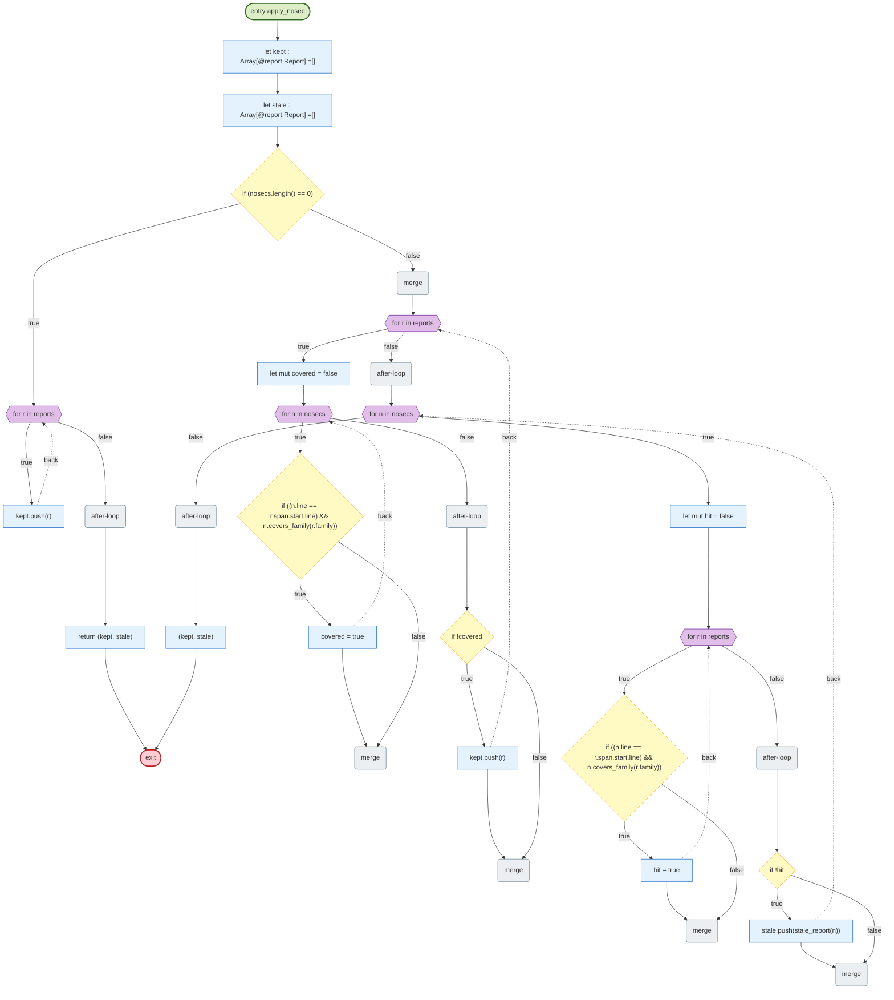
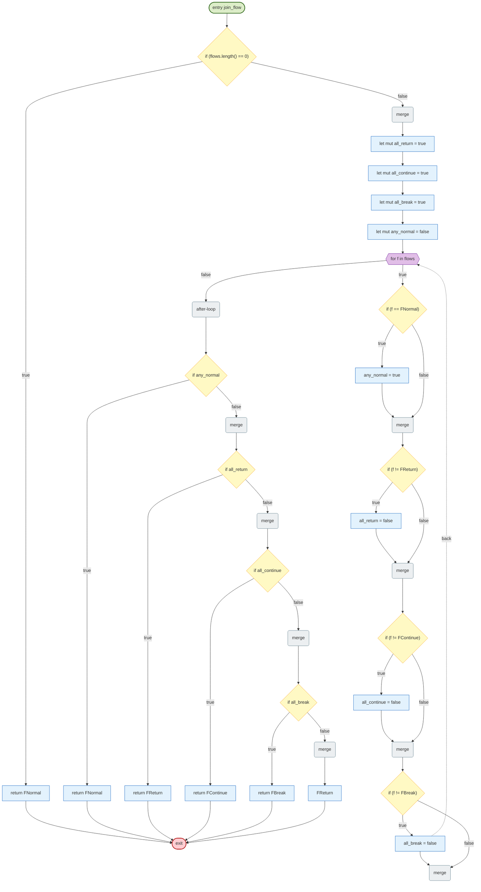

# LunaFlow analysis report — riantr/moonbit_static_analysis@latest@0.4.43

> Trace-driven (dynamic-first) control-flow, data-flow, value-range and slicing analysis for a mooncakes.io module.

## 1. Acquisition and version pinning

| Item | Value |
| --- | --- |
| Requested coordinate | `riantr/moonbit_static_analysis@latest` |
| Resolved version | `0.4.43` |
| Pinning strategy | `@latest` resolved through `moon fetch` (local registry index, newest non-yanked version) and pinned to `0.4.43` for ingestion, execution and reporting |
| Source root | `./.repos/riantr/moonbit_static_analysis/0.4.43` |
| Declared target | `wasm` |
| Direct dependencies | moonbitlang/async@0.22.5 |

## 2. Ingestion statistics

| Metric | Value |
| --- | --- |
| Source files parsed | 164 |
| Functions extracted | 1953 |
| Statements understood | 14505 |
| Statements unsupported | 399 |
| Frontend coverage | 97.3% |
| Parse issues | 0 |
| CFG functions | 586 |
| Trace events | 27785 |
| Interpreted steps | 5004 |
| Observed functions | 200 |
| Wall time (analyzer) | 998 ms |
| Selected level | L3 (funnel: L1 → L2 → L3) |

## 3. Proof-strength levels and funnel

The same program is analyzed at three proof strengths. Levels are cumulative: L2 adds abstract interpretation on top of L1, L3 adds contract verification on top of the escalated functions. `--funnel` runs all three and reports what each level adds.

### 3.1 Level definitions

| Level | Name | Engine | Input model | Result strength |
| --- | --- | --- | --- | --- |
| L1 | Interpreter | concrete execution on the formal interpreter | concrete boundary values (`--trials`) | observed facts; may miss unexecuted inputs and paths |
| L2 | Value | abstract interpretation over a value-set / interval domain | whole input sets (`Int` intervals, `Bool`/`String` sets, array length intervals) | exhaustive over the abstract state; may-taint and may-range alarms (false positives possible) |
| L3 | Proof-by-contract | WP-style weakest-precondition VC generation + interval decision | ACSL-style `//@ requires` / `//@ ensures` specs | `proved` / `failed` / `unknown` per verification condition; specs are mandatory |

### 3.2 Funnel


| Level | Checks | New vs previous | Functions / VCs | Note |
| --- | --- | --- | --- | --- |
| L1 concrete | 15 findings | — | 200 functions | observed facts |
| L2 abstract | 47 findings | 39 | 200 functions, 7712 steps | exhaustive over the input abstraction |
| L3 contracts | 0 VCs | 0 failed, 0 unknown | 28 critical functions | specs required |

### 3.3 Escalation and specification gaps

Escalated functions (have at least one L1/L2 finding or a contract): `dir_of`, `ok_segment`, `path_tail`, `Walker::bind`, `Walker::unshadow_param`, `Walker::bind_pattern`, `Walker::audit_frame`, `as_array`, `notice_lines`, `scan`, `suffix_of`, `parse_moon_mod_imports`, `mermaid_states`, `cap`, `pad3`, `parse_nosec`, `apply_nosec`, `stamp_utc`, `pad2`, `pad4`, `slug`, `first_line`, `mm_valid_id`, `mm_state_id`, `mm_check`, `unqualified`, `Walker::resolve`, `truncated_fn`

Functions escalated without any contract (spec gap at L3): `notice_lines (src/sa/main.mbt:230)`, `scan (src/sa/main.mbt:665)`, `suffix_of (src/sa/main.mbt:1447)`, `dir_of (src/sa/main.mbt:1492)`, `parse_moon_mod_imports (src/sa/main.mbt:1601)`, `ok_segment (src/sa/main.mbt:1712)`, `mermaid_states (src/sa/mermaid.mbt:43)`, `cap (src/sa/mermaid.mbt:387)`, `pad3 (src/sa/profile.mbt:131)`, `parse_nosec (src/sa/profile.mbt:224)`, `apply_nosec (src/sa/profile.mbt:296)`, `stamp_utc (src/sa/provenance.mbt:130)`, `pad2 (src/sa/provenance.mbt:172)`, `pad4 (src/sa/provenance.mbt:181)`, `slug (src/sa/provenance.mbt:323)`, `first_line (src/sa/provenance.mbt:476)`, `mm_valid_id (src/sa/mermaid_test.mbt:195)`, `mm_state_id (src/sa/mermaid_test.mbt:274)`, `mm_check (src/sa/mermaid_test.mbt:297)`, `path_tail (src/core/core.mbt:59)`, `unqualified (src/core/core.mbt:347)`, `Walker::bind (src/walk/walk.mbt:235)`, `Walker::unshadow_param (src/walk/walk.mbt:309)`, `Walker::resolve (src/walk/walk.mbt:362)`, `Walker::bind_pattern (src/walk/walk.mbt:612)`, `Walker::audit_frame (src/walk/walk.mbt:646)`, `as_array (src/walk/walk.mbt:1251)`, `truncated_fn (src/walk/walk.mbt:1916)`, `pad3 (src/report/report_0507_test.mbt:65)`

## 4. Control-flow analysis

CFG nodes are built from the parsed statement tree; execution paths come from the concrete-execution trace engine. Dead/unreachable detection is static; path coverage and budget findings are dynamic. See `docs/design.md` §5 for the mapping rules.

### 4.1 CFG diagrams (top 8 by cyclomatic complexity)

#### `main` (main.mbt)

_Diagram omitted: 141 nodes exceeds the readability cap (90). Findings for this function are listed below._

#### `Lexer::copy_interp` (src/lexer/lexer.mbt)

```mermaid
flowchart TD
  classDef entryNode fill:#dcedc8,stroke:#33691e,stroke-width:2px
  classDef exitNode fill:#ffcdd2,stroke:#b71c1c,stroke-width:2px
  classDef branchNode fill:#fff9c4,stroke:#f9a825
  classDef loopNode fill:#e1bee7,stroke:#6a1b9a
  classDef mergeNode fill:#eceff1,stroke:#607d8b
  classDef deadNode fill:#eeeeee,stroke:#9e9e9e
  classDef stmtNode fill:#e3f2fd,stroke:#1565c0
  n0(["entry Lexer::copy_interp"]):::entryNode
  n1(["exit"]):::exitNode
  n2["let mut depth = 0"]:::stmtNode
  n3["self.interp_bound =[]"]:::stmtNode
  n4["let mut cur = "]:::stmtNode
  n5["let mut cur_is_member = false"]:::stmtNode
  n6["let mut after_dot = false"]:::stmtNode
  n7["let mut after_at = false"]:::stmtNode
  n8{{"while (self.pos #lt; self.chars.length())"}}:::loopNode
  n9["let c = self.chars[self.pos]"]:::stmtNode
  n10["buf.write_char(c)"]:::stmtNode
  n11["self.pos += 1"]:::stmtNode
  n12["self.col += 1"]:::stmtNode
  n13{"if (c == #quot;{#quot;)"}:::branchNode
  n14["depth += 1"]:::stmtNode
  n15{"if (c == #quot;}#quot;)"}:::branchNode
  n16["depth -= 1"]:::stmtNode
  n17{"if (depth == 0)"}:::branchNode
  n18["self.flush_interp_name(cur, cur_is_member, after_at)"]:::stmtNode
  n19["return"]:::stmtNode
  n20("merge"):::mergeNode
  n21{"if (c == #quot;#quot;#quot;)"}:::branchNode
  n22["self.flush_interp_name(cur, cur_is_member, after_at)"]:::stmtNode
  n23["cur = "]:::stmtNode
  n24["self.copy_nested_string(buf)"]:::stmtNode
  n25{"if (c == #quot;'#quot;)"}:::branchNode
  n26["self.flush_interp_name(cur, cur_is_member, after_at)"]:::stmtNode
  n27["cur = "]:::stmtNode
  n28["self.copy_nested_char(buf)"]:::stmtNode
  n29{"if (c == #quot;@#quot;)"}:::branchNode
  n30["self.flush_interp_name(cur, cur_is_member, after_at)"]:::stmtNode
  n31["cur = "]:::stmtNode
  n32["after_at = true"]:::stmtNode
  n33{"if (is_ident_char(c) && !(is_digit(c) && (cur == #quot;#quot;)))"}:::branchNode
  n34{"if (cur == #quot;#quot;)"}:::branchNode
  n35["cur_is_member = after_dot"]:::stmtNode
  n36["after_dot = false"]:::stmtNode
  n37("merge"):::mergeNode
  n38["cur = cur + Char"]:::stmtNode
  n39["::"]:::stmtNode
  n40["to_string(c)"]:::stmtNode
  n41{"if (c == #quot;.#quot;)"}:::branchNode
  n42["self.flush_interp_name(cur, cur_is_member, after_at)"]:::stmtNode
  n43["cur = "]:::stmtNode
  n44["cur_is_member = false"]:::stmtNode
  n45["after_dot = true"]:::stmtNode
  n46{"if ((c == #quot;=#quot;) &&  )"}:::branchNode
  n47("merge"):::mergeNode
  n48("merge"):::mergeNode
  n49("merge"):::mergeNode
  n50("merge"):::mergeNode
  n51("merge"):::mergeNode
  n52("merge"):::mergeNode
  n53("merge"):::mergeNode
  n54("merge"):::mergeNode
  n55["self.pos #lt; self.chars.length() &&"]:::stmtNode
  n56["self.chars[self.pos] == #gt;"]:::stmtNode
  n57["{"]:::stmtNode
  n58{"if (((cur != #quot;#quot;) && !cur_is_member) && !after_at)"}:::branchNode
  n59{"if !self.interp_bound.contains(cur)"}:::branchNode
  n60["self.interp_bound.push(cur)"]:::stmtNode
  n61("merge"):::mergeNode
  n62("merge"):::mergeNode
  n63["cur = "]:::stmtNode
  n64("after-loop"):::mergeNode
  n65["else"]:::stmtNode
  n66{"if ((c == #quot;=#quot;) &&  )"}:::branchNode
  n67("merge"):::mergeNode
  n68["self.pos #lt; self.chars.length() &&"]:::stmtNode
  n69["self.chars[self.pos] != ="]:::stmtNode
  n70["{"]:::stmtNode
  n71["cur = "]:::stmtNode
  n0 --> n2
  n2 --> n3
  n3 --> n4
  n4 --> n5
  n5 --> n6
  n6 --> n7
  n7 --> n8
  n9 --> n10
  n10 --> n11
  n11 --> n12
  n12 --> n13
  n16 --> n17
  n18 --> n19
  n19 --> n1
  n17 -->|true| n18
  n17 -->|false| n20
  n22 --> n23
  n23 --> n24
  n26 --> n27
  n27 --> n28
  n30 --> n31
  n31 --> n32
  n35 --> n36
  n34 -->|true| n35
  n36 --> n37
  n34 -->|false| n37
  n37 --> n38
  n38 --> n39
  n39 --> n40
  n42 --> n43
  n43 --> n44
  n44 --> n45
  n46 -->|true| n47
  n46 -->|false| n47
  n41 -->|true| n42
  n41 -->|false| n46
  n45 --> n48
  n47 --> n48
  n33 -->|true| n34
  n33 -->|false| n41
  n40 --> n49
  n48 --> n49
  n29 -->|true| n30
  n29 -->|false| n33
  n32 --> n50
  n49 --> n50
  n25 -->|true| n26
  n25 -->|false| n29
  n28 --> n51
  n50 --> n51
  n21 -->|true| n22
  n21 -->|false| n25
  n24 --> n52
  n51 --> n52
  n15 -->|true| n16
  n15 -->|false| n21
  n52 --> n53
  n13 -->|true| n14
  n13 -->|false| n15
  n14 --> n54
  n53 --> n54
  n54 --> n55
  n55 --> n56
  n56 --> n57
  n57 --> n58
  n59 -->|true| n60
  n60 --> n61
  n59 -->|false| n61
  n58 -->|true| n59
  n61 --> n62
  n58 -->|false| n62
  n62 --> n63
  n8 -->|true| n9
  n63 -.->|back| n8
  n8 -->|false| n64
  n64 --> n65
  n65 --> n66
  n66 -->|true| n67
  n66 -->|false| n67
  n67 --> n68
  n68 --> n69
  n69 --> n70
  n70 --> n71
  n71 --> n1
```



#### `mm_check` (src/sa/mermaid_test.mbt)

```mermaid
flowchart TD
  classDef entryNode fill:#dcedc8,stroke:#33691e,stroke-width:2px
  classDef exitNode fill:#ffcdd2,stroke:#b71c1c,stroke-width:2px
  classDef branchNode fill:#fff9c4,stroke:#f9a825
  classDef loopNode fill:#e1bee7,stroke:#6a1b9a
  classDef mergeNode fill:#eceff1,stroke:#607d8b
  classDef deadNode fill:#eeeeee,stroke:#9e9e9e
  classDef stmtNode fill:#e3f2fd,stroke:#1565c0
  n0(["entry mm_check"]):::entryNode
  n1(["exit"]):::exitNode
  n2["let errs =[]"]:::stmtNode
  n3["let declared =[]"]:::stmtNode
  n4["let edges =[]"]:::stmtNode
  n5["let mut in_note = false"]:::stmtNode
  n6["let lines = mm_lines(src)"]:::stmtNode
  n7{{"for raw in lines"}}:::loopNode
  n8["let t = raw.trim().to_owned()"]:::stmtNode
  n9{"if in_note"}:::branchNode
  n10{"if (t == #quot;end note#quot;)"}:::branchNode
  n11["in_note = false"]:::stmtNode
  n12{"if (t == #quot;#quot;)"}:::branchNode
  n13["errs.push(blank line inside a note: the block end is lost)"]:::stmtNode
  n14("merge"):::mergeNode
  n15("merge"):::mergeNode
  n16["continue"]:::stmtNode
  n17("merge"):::mergeNode
  n18{"if (((t == #quot;#quot;) &#124;&#124; t.has_prefix(#quot;%%#quot;)) &#124;&#124; (t == ..."}:::branchNode
  n19["continue"]:::stmtNode
  n20("merge"):::mergeNode
  n21{"if ((t.has_prefix(#quot;direction #quot;) &#124;&#124; (t == #quot;{#quot;)) &#124;&#12..."}:::branchNode
  n22["continue"]:::stmtNode
  n23("merge"):::mergeNode
  n24{"if t.has_prefix(#quot;note right of #quot;)"}:::branchNode
  n25["let anchor = mm_after_last(t, note right of )"]:::stmtNode
  n26{"if !mm_valid_id(anchor)"}:::branchNode
  n27["errs.push(note anchor is not an identifier:  + anchor)"]:::stmtNode
  n28("merge"):::mergeNode
  n29["in_note = true"]:::stmtNode
  n30["continue"]:::stmtNode
  n31("merge"):::mergeNode
  n32{"if t.has_prefix(#quot;state #quot;#quot;)"}:::branchNode
  n33{"if (mm_count_quotes(t) != 2)"}:::branchNode
  n34["errs.push(state label is not one quoted string:  + t)"]:::stmtNode
  n35("merge"):::mergeNode
  n36["let bare = mm_state_id(t)"]:::stmtNode
  n37{"if !mm_valid_id(bare)"}:::branchNode
  n38["errs.push(state id is not an identifier:  + bare)"]:::stmtNode
  n39{"if !declared.contains(bare)"}:::branchNode
  n40["declared.push(bare)"]:::stmtNode
  n41("merge"):::mergeNode
  n42("merge"):::mergeNode
  n43["continue"]:::stmtNode
  n44("merge"):::mergeNode
  n45{"if t.contains(#quot; --#gt; #quot;)"}:::branchNode
  n46["let head = mm_before_first(t,  : )"]:::stmtNode
  n47["let toks = mm_spaces(head.replace(old"]:::stmtNode
  n48["="]:::stmtNode
  n49[" --#gt; "]:::stmtNode
  n50[","]:::stmtNode
  n51["new =  "]:::stmtNode
  n52[""]:::stmtNode
  n53[""]:::stmtNode
  n54{"if (toks.length() != 2)"}:::branchNode
  n55["errs.push(transition is not `A --#gt; B` or `A --#gt; B : label`:  + t)"]:::stmtNode
  n56["continue"]:::stmtNode
  n57("merge"):::mergeNode
  n58["edges.push([toks[0], toks[1]])"]:::stmtNode
  n59["continue"]:::stmtNode
  n60("merge"):::mergeNode
  n61["errs.push(line is not a form this renderer may emit:  + t)"]:::stmtNode
  n62("after-loop"):::mergeNode
  n63{"if in_note"}:::branchNode
  n64["errs.push(a note was opened and never closed)"]:::stmtNode
  n65("merge"):::mergeNode
  n66{{"for e in edges"}}:::loopNode
  n67{{"for ep in e"}}:::loopNode
  n68{"if ((ep != #quot;[*]#quot;) && !declared.contains(ep))"}:::branchNode
  n69["errs.push(transition names an undeclared state:  + ep)"]:::stmtNode
  n70("merge"):::mergeNode
  n71("after-loop"):::mergeNode
  n72("after-loop"):::mergeNode
  n73["errs"]:::stmtNode
  n0 --> n2
  n2 --> n3
  n3 --> n4
  n4 --> n5
  n5 --> n6
  n6 --> n7
  n8 --> n9
  n12 -->|true| n13
  n13 --> n14
  n12 -->|false| n14
  n10 -->|true| n11
  n10 -->|false| n12
  n11 --> n15
  n14 --> n15
  n15 --> n16
  n9 -->|true| n10
  n9 -->|false| n17
  n17 --> n18
  n18 -->|true| n19
  n18 -->|false| n20
  n20 --> n21
  n21 -->|true| n22
  n21 -->|false| n23
  n23 --> n24
  n25 --> n26
  n26 -->|true| n27
  n27 --> n28
  n26 -->|false| n28
  n28 --> n29
  n29 --> n30
  n24 -->|true| n25
  n24 -->|false| n31
  n31 --> n32
  n33 -->|true| n34
  n34 --> n35
  n33 -->|false| n35
  n35 --> n36
  n36 --> n37
  n39 -->|true| n40
  n40 --> n41
  n39 -->|false| n41
  n37 -->|true| n38
  n37 -->|false| n39
  n38 --> n42
  n41 --> n42
  n42 --> n43
  n32 -->|true| n33
  n32 -->|false| n44
  n44 --> n45
  n46 --> n47
  n47 --> n48
  n48 --> n49
  n49 --> n50
  n50 --> n51
  n51 --> n52
  n52 --> n53
  n53 --> n54
  n55 --> n56
  n54 -->|true| n55
  n54 -->|false| n57
  n57 --> n58
  n58 --> n59
  n45 -->|true| n46
  n45 -->|false| n60
  n60 --> n61
  n7 -->|true| n8
  n61 -.->|back| n7
  n7 -->|false| n62
  n62 --> n63
  n63 -->|true| n64
  n64 --> n65
  n63 -->|false| n65
  n65 --> n66
  n68 -->|true| n69
  n69 --> n70
  n68 -->|false| n70
  n67 -->|true| n68
  n69 -.->|back| n67
  n67 -->|false| n71
  n66 -->|true| n67
  n66 -.->|back| n66
  n66 -->|false| n72
  n72 --> n73
  n73 --> n1
```

Observed path (trial 0, first 8 events): `def@298` -> `def@299` -> `def@300` -> `def@301` -> `call@302` -> `def@302` -> `cond@353` -> `def@297`

#### `Lexer::lex_char` (src/lexer/lexer.mbt)

_Diagram omitted: 98 nodes exceeds the readability cap (90). Findings for this function are listed below._

#### `parse_double` (src/lexer/lexer.mbt)

```mermaid
flowchart TD
  classDef entryNode fill:#dcedc8,stroke:#33691e,stroke-width:2px
  classDef exitNode fill:#ffcdd2,stroke:#b71c1c,stroke-width:2px
  classDef branchNode fill:#fff9c4,stroke:#f9a825
  classDef loopNode fill:#e1bee7,stroke:#6a1b9a
  classDef mergeNode fill:#eceff1,stroke:#607d8b
  classDef deadNode fill:#eeeeee,stroke:#9e9e9e
  classDef stmtNode fill:#e3f2fd,stroke:#1565c0
  n0(["entry parse_double"]):::entryNode
  n1(["exit"]):::exitNode
  n2["let chars = s.to_array()"]:::stmtNode
  n3["let n = chars.length()"]:::stmtNode
  n4["let mut whole = 0.0"]:::stmtNode
  n5["let mut frac = 0.0"]:::stmtNode
  n6["let mut div = 1.0"]:::stmtNode
  n7["let mut seen_dot = false"]:::stmtNode
  n8["let mut i = 0"]:::stmtNode
  n9{{"while (i #lt; n)"}}:::loopNode
  n10["let c = chars[i]"]:::stmtNode
  n11{"if (c == #quot;.#quot;)"}:::branchNode
  n12["seen_dot = true"]:::stmtNode
  n13["i += 1"]:::stmtNode
  n14["continue"]:::stmtNode
  n15("merge"):::mergeNode
  n16{"if ((c == #quot;e#quot;) &#124;&#124; (c == #quot;E#quot;))"}:::branchNode
  n17["break"]:::stmtNode
  n18("merge"):::mergeNode
  n19{"if is_digit(c)"}:::branchNode
  n20["let d =(c.to_int() - 0.to_int()).to_double()"]:::stmtNode
  n21{"if seen_dot"}:::branchNode
  n22["frac = frac * 10.0 + d"]:::stmtNode
  n23["div = div * 10.0"]:::stmtNode
  n24["whole = whole * 10.0 + d"]:::stmtNode
  n25("merge"):::mergeNode
  n26["i += 1"]:::stmtNode
  n27["continue"]:::stmtNode
  n28("merge"):::mergeNode
  n29["i += 1"]:::stmtNode
  n30("after-loop"):::mergeNode
  n31["let base = whole + frac / div"]:::stmtNode
  n32{"if (i #gt;= n)"}:::branchNode
  n33["return base"]:::stmtNode
  n34("merge"):::mergeNode
  n35["let c = chars[i]"]:::stmtNode
  n36{"if ((c != #quot;e#quot;) && (c != #quot;E#quot;))"}:::branchNode
  n37["return base"]:::stmtNode
  n38("merge"):::mergeNode
  n39["i += 1"]:::stmtNode
  n40["let mut neg = false"]:::stmtNode
  n41{"if ((i #lt; n) && ((chars[i] == #quot;+#quot;) &#124;&#124; (chars[i] == -)))"}:::branchNode
  n42["neg = chars[i] == -"]:::stmtNode
  n43["i += 1"]:::stmtNode
  n44("merge"):::mergeNode
  n45["let mut exp = 0"]:::stmtNode
  n46["let mut any = false"]:::stmtNode
  n47{{"while ((i #lt; n) && is_digit(chars[i]))"}}:::loopNode
  n48{"if (exp #lt; 1000000)"}:::branchNode
  n49["exp = exp * 10 +(chars[i].to_int() - 0.to_int())"]:::stmtNode
  n50("merge"):::mergeNode
  n51["any = true"]:::stmtNode
  n52["i += 1"]:::stmtNode
  n53("after-loop"):::mergeNode
  n54{"if !any"}:::branchNode
  n55["return base"]:::stmtNode
  n56("merge"):::mergeNode
  n57{"if neg"}:::branchNode
  n58["exp = - exp"]:::stmtNode
  n59("merge"):::mergeNode
  n60{"if (exp #gt; 0)"}:::branchNode
  n61["base * pow10(exp)"]:::stmtNode
  n62{"if (exp #lt; 0)"}:::branchNode
  n63["base / pow10(- exp)"]:::stmtNode
  n64["base"]:::stmtNode
  n65("merge"):::mergeNode
  n66("merge"):::mergeNode
  n0 --> n2
  n2 --> n3
  n3 --> n4
  n4 --> n5
  n5 --> n6
  n6 --> n7
  n7 --> n8
  n8 --> n9
  n10 --> n11
  n12 --> n13
  n13 --> n14
  n11 -->|true| n12
  n11 -->|false| n15
  n15 --> n16
  n16 -->|true| n17
  n16 -->|false| n18
  n18 --> n19
  n20 --> n21
  n22 --> n23
  n21 -->|true| n22
  n21 -->|false| n24
  n23 --> n25
  n24 --> n25
  n25 --> n26
  n26 --> n27
  n19 -->|true| n20
  n19 -->|false| n28
  n28 --> n29
  n9 -->|true| n10
  n29 -.->|back| n9
  n9 -->|false| n30
  n30 --> n31
  n31 --> n32
  n33 --> n1
  n32 -->|true| n33
  n32 -->|false| n34
  n34 --> n35
  n35 --> n36
  n37 --> n1
  n36 -->|true| n37
  n36 -->|false| n38
  n38 --> n39
  n39 --> n40
  n40 --> n41
  n42 --> n43
  n41 -->|true| n42
  n43 --> n44
  n41 -->|false| n44
  n44 --> n45
  n45 --> n46
  n46 --> n47
  n48 -->|true| n49
  n49 --> n50
  n48 -->|false| n50
  n50 --> n51
  n51 --> n52
  n47 -->|true| n48
  n52 -.->|back| n47
  n47 -->|false| n53
  n53 --> n54
  n55 --> n1
  n54 -->|true| n55
  n54 -->|false| n56
  n56 --> n57
  n57 -->|true| n58
  n58 --> n59
  n57 -->|false| n59
  n59 --> n60
  n62 -->|true| n63
  n62 -->|false| n64
  n63 --> n65
  n64 --> n65
  n60 -->|true| n61
  n60 -->|false| n62
  n61 --> n66
  n65 --> n66
  n66 --> n1
```



#### `apply_nosec` (src/sa/profile.mbt)



Observed path (trial 0, first 9 events): `def@300` -> `def@301` -> `cond@302` -> `ret@306` -> `def@300` -> `def@301` -> `cond@302` -> `ret@306` -> `def@296`

#### `join_flow` (src/interp/interp.mbt)



#### `Parser::at_lambda_head` (src/parser/parser.mbt)

```mermaid
flowchart TD
  classDef entryNode fill:#dcedc8,stroke:#33691e,stroke-width:2px
  classDef exitNode fill:#ffcdd2,stroke:#b71c1c,stroke-width:2px
  classDef branchNode fill:#fff9c4,stroke:#f9a825
  classDef loopNode fill:#e1bee7,stroke:#6a1b9a
  classDef mergeNode fill:#eceff1,stroke:#607d8b
  classDef deadNode fill:#eeeeee,stroke:#9e9e9e
  classDef stmtNode fill:#e3f2fd,stroke:#1565c0
  n0(["entry Parser::at_lambda_head"]):::entryNode
  n1(["exit"]):::exitNode
  n2{"if self.at(TLParen)"}:::branchNode
  n3["let mut depth = 0"]:::stmtNode
  n4["let mut j = self.p"]:::stmtNode
  n5{{"while (j #lt; self.toks.length())"}}:::loopNode
  n6["unsupported: match"]:::stmtNode
  n7["j += 1"]:::stmtNode
  n8("after-loop"):::mergeNode
  n9["return false"]:::stmtNode
  n10("merge"):::mergeNode
  n11{"if (self.peek_name() == #quot;#quot;)"}:::branchNode
  n12["return false"]:::stmtNode
  n13("merge"):::mergeNode
  n14["let mut j = self.p + 1"]:::stmtNode
  n15{{"while ((j #lt; self.toks.length()) &&  (((self.toks[j] == TQuestion) &#124;&#124; (self..."}}:::loopNode
  n16["j += 1"]:::stmtNode
  n17("after-loop"):::mergeNode
  n18["let annotated = j #lt; self.toks.length() &&"]:::stmtNode
  n19["self.toks[j] == TColon &&"]:::stmtNode
  n20["!(j + 1 #lt; self.toks.length() && self.toks[j + 1] == TColon)"]:::stmtNode
  n21{"if annotated"}:::branchNode
  n22["let mut d = 0"]:::stmtNode
  n23{{"while ((j #lt; self.toks.length()) && (self.toks[j] != TAssign))"}}:::loopNode
  n24{"if ((d == 0) &&  (((self.toks[j] == TComma) &#124;&#124;  )))"}:::branchNode
  n25("merge"):::mergeNode
  n26["self.toks[j] == TRParen &#124;&#124;"]:::stmtNode
  n27["self.toks[j] == TNewline &#124;&#124;"]:::stmtNode
  n28["self.toks[j] == TRBrace &#124;&#124;"]:::stmtNode
  n29["self.toks[j] == TEOF"]:::stmtNode
  n30[""]:::stmtNode
  n31["{"]:::stmtNode
  n32["return false"]:::stmtNode
  n33("after-loop"):::mergeNode
  n34{"if ((self.toks[j] == TLParen) &#124;&#124; (self.toks[j] == TLBracket))"}:::branchNode
  n35["d += 1"]:::stmtNode
  n36{"if ((self.toks[j] == TRParen) &#124;&#124; (self.toks[j] == TRBracket))"}:::branchNode
  n37["d -= 1"]:::stmtNode
  n38("merge"):::mergeNode
  n39("merge"):::mergeNode
  n40["j += 1"]:::stmtNode
  n41("merge"):::mergeNode
  n0 --> n2
  n3 --> n4
  n4 --> n5
  n6 --> n7
  n5 -->|true| n6
  n7 -.->|back| n5
  n5 -->|false| n8
  n8 --> n9
  n9 --> n1
  n2 -->|true| n3
  n2 -->|false| n10
  n10 --> n11
  n12 --> n1
  n11 -->|true| n12
  n11 -->|false| n13
  n13 --> n14
  n14 --> n15
  n15 -->|true| n16
  n16 -.->|back| n15
  n15 -->|false| n17
  n17 --> n18
  n18 --> n19
  n19 --> n20
  n20 --> n21
  n22 --> n23
  n24 -->|true| n25
  n24 -->|false| n25
  n25 --> n26
  n26 --> n27
  n27 --> n28
  n28 --> n29
  n29 --> n30
  n30 --> n31
  n31 --> n32
  n32 --> n1
  n23 -->|true| n24
  n32 -.->|back| n23
  n23 -->|false| n33
  n33 --> n34
  n36 -->|true| n37
  n37 --> n38
  n36 -->|false| n38
  n34 -->|true| n35
  n34 -->|false| n36
  n35 --> n39
  n38 --> n39
  n39 --> n40
  n21 -->|true| n22
  n40 --> n41
  n21 -->|false| n41
  n41 --> n1
```

### 4.2 CFG findings

| Rule | Severity | Function | Location | Message | Method | Confidence |
| --- | --- | --- | --- | --- | --- | --- |
| DEAD-CODE | info | Parser::parse_fn | src/parser/parser.mbt:2381 | statement is unreachable after an unconditional exit | static | 0.95 |
| DEAD-CODE | info | Parser::parse_fn | src/parser/parser.mbt:2381 | statement is unreachable after an unconditional exit | static | 0.95 |
| DEAD-CODE | info | Parser::parse_fn | src/parser/parser.mbt:2381 | statement is unreachable after an unconditional exit | static | 0.95 |
| DEAD-CODE | info | Parser::parse_fn | src/parser/parser.mbt:2381 | statement is unreachable after an unconditional exit | static | 0.95 |
| DEAD-CODE | info | Parser::parse_fn | src/parser/parser.mbt:2381 | statement is unreachable after an unconditional exit | static | 0.95 |
| DEAD-CODE | info | Parser::parse_fn | src/parser/parser.mbt:2381 | statement is unreachable after an unconditional exit | static | 0.95 |
| DEAD-CODE | info | Parser::parse_fn | src/parser/parser.mbt:2381 | statement is unreachable after an unconditional exit | static | 0.95 |
| DEAD-CODE | info | Parser::parse_fn | src/parser/parser.mbt:2381 | statement is unreachable after an unconditional exit | static | 0.95 |
| DEAD-CODE | info | Parser::parse_stmt | src/parser/parser.mbt:3122 | statement is unreachable after an unconditional exit | static | 0.95 |
| DEAD-CODE | info | Parser::parse_stmt | src/parser/parser.mbt:3122 | statement is unreachable after an unconditional exit | static | 0.95 |
| DEAD-CODE | info | Parser::parse_stmt | src/parser/parser.mbt:3122 | statement is unreachable after an unconditional exit | static | 0.95 |
| DEAD-CODE | info | Parser::parse_stmt | src/parser/parser.mbt:3122 | statement is unreachable after an unconditional exit | static | 0.95 |
| DEAD-CODE | info | Parser::parse_stmt | src/parser/parser.mbt:3122 | statement is unreachable after an unconditional exit | static | 0.95 |
| DEAD-CODE | info | Parser::parse_stmt | src/parser/parser.mbt:3122 | statement is unreachable after an unconditional exit | static | 0.95 |
| DEAD-CODE | info | Parser::parse_stmt | src/parser/parser.mbt:3122 | statement is unreachable after an unconditional exit | static | 0.95 |
| DEAD-CODE | info | Parser::parse_stmt | src/parser/parser.mbt:3122 | statement is unreachable after an unconditional exit | static | 0.95 |
| DEAD-CODE | info | Parser::parse_raise_stmt | src/parser/parser.mbt:4286 | statement is unreachable after an unconditional exit | static | 0.95 |
| DEAD-CODE | info | Parser::parse_raise_stmt | src/parser/parser.mbt:4286 | statement is unreachable after an unconditional exit | static | 0.95 |
| DEAD-CODE | info | Parser::parse_raise_stmt | src/parser/parser.mbt:4286 | statement is unreachable after an unconditional exit | static | 0.95 |
| DEAD-CODE | info | Parser::parse_raise_stmt | src/parser/parser.mbt:4286 | statement is unreachable after an unconditional exit | static | 0.95 |
| DEAD-CODE | info | Parser::parse_raise_stmt | src/parser/parser.mbt:4286 | statement is unreachable after an unconditional exit | static | 0.95 |
| DEAD-CODE | info | Parser::parse_raise_stmt | src/parser/parser.mbt:4286 | statement is unreachable after an unconditional exit | static | 0.95 |
| DEAD-CODE | info | Parser::parse_raise_stmt | src/parser/parser.mbt:4286 | statement is unreachable after an unconditional exit | static | 0.95 |
| DEAD-CODE | info | Parser::parse_raise_stmt | src/parser/parser.mbt:4286 | statement is unreachable after an unconditional exit | static | 0.95 |
| DEAD-CODE | info | Parser::parse_expr | src/parser/parser.mbt:4399 | statement is unreachable after an unconditional exit | static | 0.95 |
| DEAD-CODE | info | Parser::parse_expr | src/parser/parser.mbt:4399 | statement is unreachable after an unconditional exit | static | 0.95 |
| DEAD-CODE | info | Parser::parse_expr | src/parser/parser.mbt:4399 | statement is unreachable after an unconditional exit | static | 0.95 |
| DEAD-CODE | info | Parser::parse_expr | src/parser/parser.mbt:4399 | statement is unreachable after an unconditional exit | static | 0.95 |
| DEAD-CODE | info | Parser::parse_expr | src/parser/parser.mbt:4399 | statement is unreachable after an unconditional exit | static | 0.95 |
| DEAD-CODE | info | Parser::parse_expr | src/parser/parser.mbt:4399 | statement is unreachable after an unconditional exit | static | 0.95 |
| DEAD-CODE | info | Parser::parse_expr | src/parser/parser.mbt:4399 | statement is unreachable after an unconditional exit | static | 0.95 |
| DEAD-CODE | info | Parser::parse_expr | src/parser/parser.mbt:4399 | statement is unreachable after an unconditional exit | static | 0.95 |
| DEAD-CODE | info | Parser::parse_unary | src/parser/parser.mbt:5318 | statement is unreachable after an unconditional exit | static | 0.95 |
| DEAD-CODE | info | Parser::parse_unary | src/parser/parser.mbt:5318 | statement is unreachable after an unconditional exit | static | 0.95 |
| DEAD-CODE | info | Parser::parse_unary | src/parser/parser.mbt:5318 | statement is unreachable after an unconditional exit | static | 0.95 |
| DEAD-CODE | info | Parser::parse_unary | src/parser/parser.mbt:5318 | statement is unreachable after an unconditional exit | static | 0.95 |
| DEAD-CODE | info | Parser::parse_unary | src/parser/parser.mbt:5318 | statement is unreachable after an unconditional exit | static | 0.95 |
| DEAD-CODE | info | Parser::parse_unary | src/parser/parser.mbt:5318 | statement is unreachable after an unconditional exit | static | 0.95 |
| DEAD-CODE | info | Parser::parse_unary | src/parser/parser.mbt:5318 | statement is unreachable after an unconditional exit | static | 0.95 |
| DEAD-CODE | info | Parser::parse_unary | src/parser/parser.mbt:5318 | statement is unreachable after an unconditional exit | static | 0.95 |
| DEAD-CODE | info | Parser::parse_atom | src/parser/parser.mbt:6804 | statement is unreachable after an unconditional exit | static | 0.95 |
| DEAD-CODE | info | Parser::parse_atom | src/parser/parser.mbt:6804 | statement is unreachable after an unconditional exit | static | 0.95 |
| DEAD-CODE | info | Parser::parse_atom | src/parser/parser.mbt:6804 | statement is unreachable after an unconditional exit | static | 0.95 |
| DEAD-CODE | info | Parser::parse_atom | src/parser/parser.mbt:6804 | statement is unreachable after an unconditional exit | static | 0.95 |
| DEAD-CODE | info | Parser::parse_atom | src/parser/parser.mbt:6804 | statement is unreachable after an unconditional exit | static | 0.95 |
| DEAD-CODE | info | Parser::parse_atom | src/parser/parser.mbt:6804 | statement is unreachable after an unconditional exit | static | 0.95 |
| DEAD-CODE | info | Parser::parse_atom | src/parser/parser.mbt:6804 | statement is unreachable after an unconditional exit | static | 0.95 |
| DEAD-CODE | info | Parser::parse_atom | src/parser/parser.mbt:6804 | statement is unreachable after an unconditional exit | static | 0.95 |
| BUDGET-EXCEEDED | warning | path_tail | src/core/core.mbt:73 | execution budget exhausted; loop may be non-terminating or inputs too large | dynamic | 0.6 |

### 4.3 Static vs dynamic attribution

| Signal | Method | What a hit means | Known limitation |
| --- | --- | --- | --- |
| Unreachable statement | static | no CFG predecessor; often after `return`/`break` | parser gaps can hide real predecessors |
| Infinite loop | static + dynamic | constant-true condition without break, or iteration cap reached | loops whose exit depends on unmodelled calls are reported as *budget*, not proven infinite |
| Uncovered code | dynamic (coverage import) | zero hits in the observed test suite | absence of execution is not proof of dead code |

## 5. Data flow and taint

Sources are entry-function parameters (and `@env.args` when the frontend sees it); propagation follows recorded definitions and the variables read by each statement; sinks are array-index expressions and allocation sizes. The graph below is the *observed* propagation, not a may-analysis over all inputs.

```mermaid
flowchart LR
  classDef src fill:#ffcdd2,stroke:#b71c1c,stroke-width:2px
  classDef step fill:#fff9c4,stroke:#f9a825
  classDef sink fill:#c8e6c9,stroke:#1b5e20,stroke-width:2px
  t0["source: n"]:::src
  t1["source: cap"]:::src
  t2["source: n"]:::src
  t3["source: cap"]:::src
  t4["source: n"]:::src
  t5["source: cap"]:::src
  t6["source: n"]:::src
  t7["source: cap"]:::src
  t8["source: sp"]:::src
  t9["source: hiding"]:::src
  t10["source: sp"]:::src
  t11["source: hiding"]:::src
  t12["h = 0"]:::step
  t13["source: sp"]:::src
  t14["source: hiding"]:::src
  t15["h = 0"]:::step
  t16["source: sp"]:::src
  t17["source: hiding"]:::src
  t18["h = 1"]:::step
  t19["source: findings"]:::src
  t20["source: hiding"]:::src
  t21["source: findings"]:::src
  t22["source: hiding"]:::src
  t23["source: findings"]:::src
  t24["source: hiding"]:::src
  t25["source: findings"]:::src
  t26["source: hiding"]:::src
  t27["source: findings"]:::src
  t28["source: hiding"]:::src
  t29["source: show_notices"]:::src
  t30["source: findings"]:::src
  t31["source: hiding"]:::src
  t32["source: show_notices"]:::src
  t33["source: findings"]:::src
  t34["source: hiding"]:::src
  t35["source: show_notices"]:::src
  t36["source: findings"]:::src
  t37["source: hiding"]:::src
  t38["source: show_notices"]:::src
  t39["source: reports"]:::src
  t11 -->|propagates| t12
  t14 -->|propagates| t15
  t17 -->|propagates| t18
```



### 5.1 Taint sinks

| Rule | Severity | Function | Location | Message | Method | Confidence |
| --- | --- | --- | --- | --- | --- | --- |
| TAINT-INDEX | error | dir_of | src/sa/main.mbt:1497 | tainted value reaches an array index / buffer offset | dynamic+symbolic | 0.8 |
| TAINT-INDEX | error | ok_segment | src/sa/main.mbt:1716 | tainted value reaches an array index / buffer offset | dynamic+symbolic | 0.8 |
| TAINT-INDEX | error | ok_segment | src/sa/main.mbt:1719 | tainted value reaches an array index / buffer offset | dynamic+symbolic | 0.8 |
| TAINT-INDEX | error | ok_segment | src/sa/main.mbt:1719 | tainted value reaches an array index / buffer offset | dynamic+symbolic | 0.8 |
| TAINT-INDEX | error | path_tail | src/core/core.mbt:65 | tainted value reaches an array index / buffer offset | dynamic+symbolic | 0.8 |
| TAINT-INDEX | error | path_tail | src/core/core.mbt:65 | tainted value reaches an array index / buffer offset | dynamic+symbolic | 0.8 |
| TAINT-INDEX | error | path_tail | src/core/core.mbt:70 | tainted value reaches an array index / buffer offset | dynamic+symbolic | 0.8 |
| TAINT-INDEX | error | path_tail | src/core/core.mbt:70 | tainted value reaches an array index / buffer offset | dynamic+symbolic | 0.8 |
| TAINT-INDEX | error | path_tail | src/core/core.mbt:70 | tainted value reaches an array index / buffer offset | dynamic+symbolic | 0.8 |
| TAINT-INDEX | error | path_tail | src/core/core.mbt:70 | tainted value reaches an array index / buffer offset | dynamic+symbolic | 0.8 |
| TAINT-INDEX | error | path_tail | src/core/core.mbt:70 | tainted value reaches an array index / buffer offset | dynamic+symbolic | 0.8 |
| TAINT-INDEX | error | path_tail | src/core/core.mbt:70 | tainted value reaches an array index / buffer offset | dynamic+symbolic | 0.8 |
| TAINT-INDEX | error | path_tail | src/core/core.mbt:70 | tainted value reaches an array index / buffer offset | dynamic+symbolic | 0.8 |
| TAINT-INDEX | error | path_tail | src/core/core.mbt:70 | tainted value reaches an array index / buffer offset | dynamic+symbolic | 0.8 |
| TAINT-INDEX | error | path_tail | src/core/core.mbt:70 | tainted value reaches an array index / buffer offset | dynamic+symbolic | 0.8 |
| TAINT-INDEX | error | path_tail | src/core/core.mbt:70 | tainted value reaches an array index / buffer offset | dynamic+symbolic | 0.8 |
| TAINT-INDEX | error | path_tail | src/core/core.mbt:70 | tainted value reaches an array index / buffer offset | dynamic+symbolic | 0.8 |
| TAINT-INDEX | error | path_tail | src/core/core.mbt:70 | tainted value reaches an array index / buffer offset | dynamic+symbolic | 0.8 |
| TAINT-INDEX | error | path_tail | src/core/core.mbt:70 | tainted value reaches an array index / buffer offset | dynamic+symbolic | 0.8 |
| TAINT-INDEX | error | path_tail | src/core/core.mbt:70 | tainted value reaches an array index / buffer offset | dynamic+symbolic | 0.8 |
| TAINT-INDEX | error | path_tail | src/core/core.mbt:70 | tainted value reaches an array index / buffer offset | dynamic+symbolic | 0.8 |
| TAINT-INDEX | error | path_tail | src/core/core.mbt:70 | tainted value reaches an array index / buffer offset | dynamic+symbolic | 0.8 |
| TAINT-INDEX | error | path_tail | src/core/core.mbt:70 | tainted value reaches an array index / buffer offset | dynamic+symbolic | 0.8 |
| TAINT-INDEX | error | path_tail | src/core/core.mbt:70 | tainted value reaches an array index / buffer offset | dynamic+symbolic | 0.8 |
| TAINT-INDEX | error | path_tail | src/core/core.mbt:70 | tainted value reaches an array index / buffer offset | dynamic+symbolic | 0.8 |
| TAINT-INDEX | error | path_tail | src/core/core.mbt:70 | tainted value reaches an array index / buffer offset | dynamic+symbolic | 0.8 |
| TAINT-INDEX | error | path_tail | src/core/core.mbt:70 | tainted value reaches an array index / buffer offset | dynamic+symbolic | 0.8 |
| TAINT-INDEX | error | path_tail | src/core/core.mbt:70 | tainted value reaches an array index / buffer offset | dynamic+symbolic | 0.8 |
| TAINT-INDEX | error | path_tail | src/core/core.mbt:70 | tainted value reaches an array index / buffer offset | dynamic+symbolic | 0.8 |
| TAINT-INDEX | error | path_tail | src/core/core.mbt:70 | tainted value reaches an array index / buffer offset | dynamic+symbolic | 0.8 |
| TAINT-INDEX | error | path_tail | src/core/core.mbt:70 | tainted value reaches an array index / buffer offset | dynamic+symbolic | 0.8 |
| TAINT-INDEX | error | path_tail | src/core/core.mbt:70 | tainted value reaches an array index / buffer offset | dynamic+symbolic | 0.8 |
| TAINT-INDEX | error | path_tail | src/core/core.mbt:70 | tainted value reaches an array index / buffer offset | dynamic+symbolic | 0.8 |
| TAINT-INDEX | error | path_tail | src/core/core.mbt:70 | tainted value reaches an array index / buffer offset | dynamic+symbolic | 0.8 |
| TAINT-INDEX | error | path_tail | src/core/core.mbt:70 | tainted value reaches an array index / buffer offset | dynamic+symbolic | 0.8 |
| TAINT-INDEX | error | path_tail | src/core/core.mbt:70 | tainted value reaches an array index / buffer offset | dynamic+symbolic | 0.8 |
| TAINT-INDEX | error | path_tail | src/core/core.mbt:70 | tainted value reaches an array index / buffer offset | dynamic+symbolic | 0.8 |
| TAINT-INDEX | error | path_tail | src/core/core.mbt:70 | tainted value reaches an array index / buffer offset | dynamic+symbolic | 0.8 |
| TAINT-INDEX | error | path_tail | src/core/core.mbt:70 | tainted value reaches an array index / buffer offset | dynamic+symbolic | 0.8 |
| TAINT-INDEX | error | path_tail | src/core/core.mbt:70 | tainted value reaches an array index / buffer offset | dynamic+symbolic | 0.8 |
| TAINT-INDEX | error | path_tail | src/core/core.mbt:70 | tainted value reaches an array index / buffer offset | dynamic+symbolic | 0.8 |
| TAINT-INDEX | error | path_tail | src/core/core.mbt:70 | tainted value reaches an array index / buffer offset | dynamic+symbolic | 0.8 |
| TAINT-INDEX | error | path_tail | src/core/core.mbt:70 | tainted value reaches an array index / buffer offset | dynamic+symbolic | 0.8 |
| TAINT-INDEX | error | path_tail | src/core/core.mbt:70 | tainted value reaches an array index / buffer offset | dynamic+symbolic | 0.8 |
| TAINT-INDEX | error | path_tail | src/core/core.mbt:70 | tainted value reaches an array index / buffer offset | dynamic+symbolic | 0.8 |
| TAINT-INDEX | error | path_tail | src/core/core.mbt:70 | tainted value reaches an array index / buffer offset | dynamic+symbolic | 0.8 |
| TAINT-INDEX | error | path_tail | src/core/core.mbt:70 | tainted value reaches an array index / buffer offset | dynamic+symbolic | 0.8 |
| TAINT-INDEX | error | path_tail | src/core/core.mbt:70 | tainted value reaches an array index / buffer offset | dynamic+symbolic | 0.8 |
| TAINT-INDEX | error | path_tail | src/core/core.mbt:70 | tainted value reaches an array index / buffer offset | dynamic+symbolic | 0.8 |
| TAINT-INDEX | error | path_tail | src/core/core.mbt:70 | tainted value reaches an array index / buffer offset | dynamic+symbolic | 0.8 |
| TAINT-INDEX | error | path_tail | src/core/core.mbt:70 | tainted value reaches an array index / buffer offset | dynamic+symbolic | 0.8 |
| TAINT-INDEX | error | path_tail | src/core/core.mbt:70 | tainted value reaches an array index / buffer offset | dynamic+symbolic | 0.8 |
| TAINT-INDEX | error | path_tail | src/core/core.mbt:70 | tainted value reaches an array index / buffer offset | dynamic+symbolic | 0.8 |
| TAINT-INDEX | error | path_tail | src/core/core.mbt:70 | tainted value reaches an array index / buffer offset | dynamic+symbolic | 0.8 |
| TAINT-INDEX | error | path_tail | src/core/core.mbt:70 | tainted value reaches an array index / buffer offset | dynamic+symbolic | 0.8 |
| TAINT-INDEX | error | path_tail | src/core/core.mbt:70 | tainted value reaches an array index / buffer offset | dynamic+symbolic | 0.8 |
| TAINT-INDEX | error | path_tail | src/core/core.mbt:70 | tainted value reaches an array index / buffer offset | dynamic+symbolic | 0.8 |
| TAINT-INDEX | error | path_tail | src/core/core.mbt:70 | tainted value reaches an array index / buffer offset | dynamic+symbolic | 0.8 |
| TAINT-INDEX | error | path_tail | src/core/core.mbt:70 | tainted value reaches an array index / buffer offset | dynamic+symbolic | 0.8 |
| TAINT-INDEX | error | path_tail | src/core/core.mbt:70 | tainted value reaches an array index / buffer offset | dynamic+symbolic | 0.8 |
| TAINT-INDEX | error | path_tail | src/core/core.mbt:70 | tainted value reaches an array index / buffer offset | dynamic+symbolic | 0.8 |
| TAINT-INDEX | error | path_tail | src/core/core.mbt:70 | tainted value reaches an array index / buffer offset | dynamic+symbolic | 0.8 |
| TAINT-INDEX | error | path_tail | src/core/core.mbt:70 | tainted value reaches an array index / buffer offset | dynamic+symbolic | 0.8 |
| TAINT-INDEX | error | path_tail | src/core/core.mbt:70 | tainted value reaches an array index / buffer offset | dynamic+symbolic | 0.8 |
| TAINT-INDEX | error | path_tail | src/core/core.mbt:70 | tainted value reaches an array index / buffer offset | dynamic+symbolic | 0.8 |
| TAINT-INDEX | error | path_tail | src/core/core.mbt:70 | tainted value reaches an array index / buffer offset | dynamic+symbolic | 0.8 |
| TAINT-INDEX | error | path_tail | src/core/core.mbt:70 | tainted value reaches an array index / buffer offset | dynamic+symbolic | 0.8 |
| TAINT-INDEX | error | path_tail | src/core/core.mbt:70 | tainted value reaches an array index / buffer offset | dynamic+symbolic | 0.8 |
| TAINT-INDEX | error | path_tail | src/core/core.mbt:70 | tainted value reaches an array index / buffer offset | dynamic+symbolic | 0.8 |
| TAINT-INDEX | error | path_tail | src/core/core.mbt:70 | tainted value reaches an array index / buffer offset | dynamic+symbolic | 0.8 |
| TAINT-INDEX | error | path_tail | src/core/core.mbt:65 | tainted value reaches an array index / buffer offset | dynamic+symbolic | 0.8 |
| TAINT-INDEX | error | path_tail | src/core/core.mbt:70 | tainted value reaches an array index / buffer offset | dynamic+symbolic | 0.8 |
| TAINT-INDEX | error | path_tail | src/core/core.mbt:65 | tainted value reaches an array index / buffer offset | dynamic+symbolic | 0.8 |
| TAINT-INDEX | error | path_tail | src/core/core.mbt:70 | tainted value reaches an array index / buffer offset | dynamic+symbolic | 0.8 |
| TAINT-INDEX | error | path_tail | src/core/core.mbt:65 | tainted value reaches an array index / buffer offset | dynamic+symbolic | 0.8 |
| TAINT-INDEX | error | path_tail | src/core/core.mbt:70 | tainted value reaches an array index / buffer offset | dynamic+symbolic | 0.8 |
| TAINT-INDEX | error | path_tail | src/core/core.mbt:65 | tainted value reaches an array index / buffer offset | dynamic+symbolic | 0.8 |
| TAINT-INDEX | error | path_tail | src/core/core.mbt:70 | tainted value reaches an array index / buffer offset | dynamic+symbolic | 0.8 |
| TAINT-INDEX | error | path_tail | src/core/core.mbt:65 | tainted value reaches an array index / buffer offset | dynamic+symbolic | 0.8 |
| TAINT-INDEX | error | path_tail | src/core/core.mbt:70 | tainted value reaches an array index / buffer offset | dynamic+symbolic | 0.8 |
| TAINT-INDEX | error | path_tail | src/core/core.mbt:65 | tainted value reaches an array index / buffer offset | dynamic+symbolic | 0.8 |
| TAINT-INDEX | error | path_tail | src/core/core.mbt:70 | tainted value reaches an array index / buffer offset | dynamic+symbolic | 0.8 |
| TAINT-INDEX | error | path_tail | src/core/core.mbt:65 | tainted value reaches an array index / buffer offset | dynamic+symbolic | 0.8 |
| TAINT-INDEX | error | path_tail | src/core/core.mbt:70 | tainted value reaches an array index / buffer offset | dynamic+symbolic | 0.8 |
| TAINT-INDEX | error | path_tail | src/core/core.mbt:65 | tainted value reaches an array index / buffer offset | dynamic+symbolic | 0.8 |
| TAINT-INDEX | error | path_tail | src/core/core.mbt:70 | tainted value reaches an array index / buffer offset | dynamic+symbolic | 0.8 |
| TAINT-INDEX | error | path_tail | src/core/core.mbt:65 | tainted value reaches an array index / buffer offset | dynamic+symbolic | 0.8 |
| TAINT-INDEX | error | path_tail | src/core/core.mbt:70 | tainted value reaches an array index / buffer offset | dynamic+symbolic | 0.8 |
| TAINT-INDEX | error | path_tail | src/core/core.mbt:65 | tainted value reaches an array index / buffer offset | dynamic+symbolic | 0.8 |
| TAINT-INDEX | error | path_tail | src/core/core.mbt:70 | tainted value reaches an array index / buffer offset | dynamic+symbolic | 0.8 |
| TAINT-INDEX | error | path_tail | src/core/core.mbt:65 | tainted value reaches an array index / buffer offset | dynamic+symbolic | 0.8 |
| TAINT-INDEX | error | path_tail | src/core/core.mbt:70 | tainted value reaches an array index / buffer offset | dynamic+symbolic | 0.8 |
| TAINT-INDEX | error | path_tail | src/core/core.mbt:65 | tainted value reaches an array index / buffer offset | dynamic+symbolic | 0.8 |
| TAINT-INDEX | error | path_tail | src/core/core.mbt:70 | tainted value reaches an array index / buffer offset | dynamic+symbolic | 0.8 |
| TAINT-INDEX | error | path_tail | src/core/core.mbt:65 | tainted value reaches an array index / buffer offset | dynamic+symbolic | 0.8 |
| TAINT-INDEX | error | path_tail | src/core/core.mbt:70 | tainted value reaches an array index / buffer offset | dynamic+symbolic | 0.8 |
| TAINT-INDEX | error | path_tail | src/core/core.mbt:65 | tainted value reaches an array index / buffer offset | dynamic+symbolic | 0.8 |
| TAINT-INDEX | error | Walker::bind | src/walk/walk.mbt:237 | tainted value reaches an array index / buffer offset | dynamic+symbolic | 0.8 |
| TAINT-INDEX | error | Walker::bind | src/walk/walk.mbt:245 | tainted value reaches an array index / buffer offset | dynamic+symbolic | 0.8 |
| TAINT-INDEX | error | Walker::unshadow_param | src/walk/walk.mbt:311 | tainted value reaches an array index / buffer offset | dynamic+symbolic | 0.8 |
| TAINT-INDEX | error | Walker::bind_pattern | src/walk/walk.mbt:614 | tainted value reaches an array index / buffer offset | dynamic+symbolic | 0.8 |
| TAINT-INDEX | error | Walker::audit_frame | src/walk/walk.mbt:649 | tainted value reaches an array index / buffer offset | dynamic+symbolic | 0.8 |
| TAINT-INDEX | error | as_array | src/walk/walk.mbt:1255 | tainted value reaches an array index / buffer offset | dynamic+symbolic | 0.8 |

### 5.2 L2 abstract findings (may-analysis)

Abstract interpretation joins all paths and widens loops, so these alarms are *may* properties: a hit means the abstract state cannot exclude the defect, not that a concrete input was observed.

| Rule | Severity | Function | Location | Message | Method | Confidence |
| --- | --- | --- | --- | --- | --- | --- |
| UNREACHABLE | info | notice_lines | src/sa/main.mbt:237 | else-branch is unreachable for the abstract input set | L2-abstract | 0.8 |
| UNREACHABLE | info | scan | src/sa/main.mbt:682 | then-branch is unreachable for the abstract input set | L2-abstract | 0.8 |
| UNREACHABLE | info | scan | src/sa/main.mbt:682 | else-branch is unreachable for the abstract input set | L2-abstract | 0.8 |
| UNREACHABLE | info | suffix_of | src/sa/main.mbt:1460 | then-branch is unreachable for the abstract input set | L2-abstract | 0.8 |
| UNREACHABLE | info | suffix_of | src/sa/main.mbt:1460 | else-branch is unreachable for the abstract input set | L2-abstract | 0.8 |
| TAINT-INDEX | error | dir_of | src/sa/main.mbt:1497 | tainted value may reach an array index / buffer offset | L2-abstract | 0.6 |
| TAINT-INDEX | error | dir_of | src/sa/main.mbt:1511 | tainted value may reach an array index / buffer offset | L2-abstract | 0.6 |
| UNREACHABLE | info | parse_moon_mod_imports | src/sa/main.mbt:1621 | then-branch is unreachable for the abstract input set | L2-abstract | 0.8 |
| UNREACHABLE | info | parse_moon_mod_imports | src/sa/main.mbt:1621 | else-branch is unreachable for the abstract input set | L2-abstract | 0.8 |
| UNREACHABLE | info | ok_segment | src/sa/main.mbt:1713 | then-branch is unreachable for the abstract input set | L2-abstract | 0.8 |
| UNREACHABLE | info | ok_segment | src/sa/main.mbt:1713 | else-branch is unreachable for the abstract input set | L2-abstract | 0.8 |
| TAINT-INDEX | error | mermaid_states | src/sa/mermaid.mbt:89 | tainted value may reach an array index / buffer offset | L2-abstract | 0.6 |
| UNREACHABLE | info | cap | src/sa/mermaid.mbt:388 | then-branch is unreachable for the abstract input set | L2-abstract | 0.8 |
| UNREACHABLE | info | cap | src/sa/mermaid.mbt:388 | else-branch is unreachable for the abstract input set | L2-abstract | 0.8 |
| UNREACHABLE | info | pad3 | src/sa/profile.mbt:132 | then-branch is unreachable for the abstract input set | L2-abstract | 0.8 |
| UNREACHABLE | info | pad3 | src/sa/profile.mbt:132 | else-branch is unreachable for the abstract input set | L2-abstract | 0.8 |
| TAINT-INDEX | error | parse_nosec | src/sa/profile.mbt:234 | tainted value may reach an array index / buffer offset | L2-abstract | 0.6 |
| UNREACHABLE | info | apply_nosec | src/sa/profile.mbt:302 | then-branch is unreachable for the abstract input set | L2-abstract | 0.8 |
| UNREACHABLE | info | apply_nosec | src/sa/profile.mbt:302 | else-branch is unreachable for the abstract input set | L2-abstract | 0.8 |
| UNREACHABLE | info | stamp_utc | src/sa/provenance.mbt:131 | then-branch is unreachable for the abstract input set | L2-abstract | 0.8 |
| UNREACHABLE | info | stamp_utc | src/sa/provenance.mbt:131 | else-branch is unreachable for the abstract input set | L2-abstract | 0.8 |
| UNREACHABLE | info | pad2 | src/sa/provenance.mbt:173 | then-branch is unreachable for the abstract input set | L2-abstract | 0.8 |
| UNREACHABLE | info | pad2 | src/sa/provenance.mbt:173 | else-branch is unreachable for the abstract input set | L2-abstract | 0.8 |
| UNREACHABLE | info | pad4 | src/sa/provenance.mbt:182 | then-branch is unreachable for the abstract input set | L2-abstract | 0.8 |
| UNREACHABLE | info | pad4 | src/sa/provenance.mbt:182 | else-branch is unreachable for the abstract input set | L2-abstract | 0.8 |
| UNREACHABLE | info | slug | src/sa/provenance.mbt:342 | then-branch is unreachable for the abstract input set | L2-abstract | 0.8 |
| UNREACHABLE | info | slug | src/sa/provenance.mbt:342 | else-branch is unreachable for the abstract input set | L2-abstract | 0.8 |
| UNREACHABLE | info | first_line | src/sa/provenance.mbt:480 | then-branch is unreachable for the abstract input set | L2-abstract | 0.8 |
| UNREACHABLE | info | first_line | src/sa/provenance.mbt:480 | else-branch is unreachable for the abstract input set | L2-abstract | 0.8 |
| UNREACHABLE | info | mm_valid_id | src/sa/mermaid_test.mbt:196 | then-branch is unreachable for the abstract input set | L2-abstract | 0.8 |
| UNREACHABLE | info | mm_valid_id | src/sa/mermaid_test.mbt:196 | else-branch is unreachable for the abstract input set | L2-abstract | 0.8 |
| UNREACHABLE | info | mm_state_id | src/sa/mermaid_test.mbt:279 | then-branch is unreachable for the abstract input set | L2-abstract | 0.8 |
| UNREACHABLE | info | mm_state_id | src/sa/mermaid_test.mbt:279 | else-branch is unreachable for the abstract input set | L2-abstract | 0.8 |
| UNREACHABLE | info | mm_check | src/sa/mermaid_test.mbt:305 | then-branch is unreachable for the abstract input set | L2-abstract | 0.8 |
| UNREACHABLE | info | mm_check | src/sa/mermaid_test.mbt:305 | else-branch is unreachable for the abstract input set | L2-abstract | 0.8 |
| TAINT-INDEX | error | path_tail | src/core/core.mbt:65 | tainted value may reach an array index / buffer offset | L2-abstract | 0.6 |
| TAINT-INDEX | error | path_tail | src/core/core.mbt:70 | tainted value may reach an array index / buffer offset | L2-abstract | 0.6 |
| TAINT-INDEX | error | unqualified | src/core/core.mbt:353 | tainted value may reach an array index / buffer offset | L2-abstract | 0.6 |
| TAINT-INDEX | error | unqualified | src/core/core.mbt:362 | tainted value may reach an array index / buffer offset | L2-abstract | 0.6 |
| TAINT-INDEX | error | Walker::bind | src/walk/walk.mbt:237 | tainted value may reach an array index / buffer offset | L2-abstract | 0.6 |
| TAINT-INDEX | error | Walker::bind | src/walk/walk.mbt:245 | tainted value may reach an array index / buffer offset | L2-abstract | 0.6 |
| TAINT-INDEX | error | Walker::unshadow_param | src/walk/walk.mbt:311 | tainted value may reach an array index / buffer offset | L2-abstract | 0.6 |
| UNREACHABLE | info | Walker::resolve | src/walk/walk.mbt:375 | then-branch is unreachable for the abstract input set | L2-abstract | 0.8 |
| TAINT-INDEX | error | Walker::bind_pattern | src/walk/walk.mbt:614 | tainted value may reach an array index / buffer offset | L2-abstract | 0.6 |
| TAINT-INDEX | error | Walker::audit_frame | src/walk/walk.mbt:649 | tainted value may reach an array index / buffer offset | L2-abstract | 0.6 |
| UNREACHABLE | info | truncated_fn | src/walk/walk.mbt:1917 | then-branch is unreachable for the abstract input set | L2-abstract | 0.8 |
| UNREACHABLE | info | truncated_fn | src/walk/walk.mbt:1917 | else-branch is unreachable for the abstract input set | L2-abstract | 0.8 |

## 6. Value ranges

Ranges are the union of concrete samples across synthesized input trials. They are *observed* intervals, not abstract-interpretation fixpoints: a missing input can hide a wider interval.

### 6.1 Per-program-point observations

Every definition event is keyed by function, source line and variable, so a value can be inspected at the exact program point that produced it (the full stream is in the JSONL trace).

| Function | Line | Variable | Observed values |
| --- | --- | --- | --- |
| bump | 1426 | n | ? |
| slug | 324 | buf | ? |
| slug | 343 | out | "?" |
| dir_of | 1495 | i | ? |
| dir_of | 1501 | i | ? |
| is_dir | 1111 | d | ? |
| note | 370 | line | "", "x" |
| scan | 677 | root | "" |
| wanted | 1187 | n | () |
| wanted | 1188 | s | () |
| analyze | 1260 | n | () |
| analyze | 1261 | k | () |
| is_hiding | 80 | h | 0, 1 |
| kind_of | 1198 | s | () |
| kind_of | 1199 | n | () |
| path_tail | 61 | i | 0 |
| path_tail | 63 | n | ? |
| path_tail | 67 | j | 2, 3, 4, 5, 6, 7 |
| path_tail | 71 | j | 3, 4, 5, 6, 7, 8 |
| path_tail | 75 | i | 1, 2, 3, 4, 5, 6 |
| reify | 1651 | buf | ? |
| show_plan | 63 | c | ? |
| aggregate | 413 | v | 0, 1, -1 |
| aggregate | 414 | n | ? |
| as_array | 1253 | i | -1, 0, 1, 2 |
| as_array | 1256 | i | 0 |
| dir_of | 1494 | cut | -1 |
| analyze | 1259 | src | "" |
| base_of | 1466 | out | "" |
| collect | 1143 | dir | ? |
| family_ids | 118 | n | 1 |
| family_ids | 125 | n | 2 |
| path_tail | 60 | out | "" |
| path_tail | 66 | out | "" |
| path_tail | 68 | buf | ? |
| path_tail | 73 | out | "?" |
| sanitize | 461 | buf | ? |
| apply_nosec | 319 | n | 0, 1, -1 |
| as_array | 1252 | out | ? |
| dir_of | 1493 | chars | ? |
| family_ids | 120 | id | ""MSA-"()" |
| mm_check | 298 | errs | [] |
| read_or | 1435 | data | ? |
| by_rank | 437 | sorted | [], [0], [0, 1, -1], [1, 0] |
| collect | 1138 | stack | ? |
| emit_mmd | 1000 | prov | () |
| emit_mmd | 1001 | text | () |
| emit_mmd | 1004 | path | ? |
| family_ids | 117 | out | ? |
| first_line | 477 | out | ? |
| hiding_spans | 480 | t | 0, 1, -1 |
| mm_check | 300 | edges | [] |
| mm_check | 302 | lines | () |
| mm_label | 251 | parts | ? |
| path_tail | 62 | chars | ? |
| pick_files | 110 | idx | ? |
| slug | 325 | last_dash | false |
| walk_module | 1711 | w | () |
| Walker::bind | 236 | fi | ? |
| aggregate | 409 | total | 0 |
| aggregate | 415 | total | ? |
| apply_nosec | 320 | hit | false |
| apply_profile | 172 | r | 0, 1, -1 |
| builtin_table | 215 | m | ? |
| count_notices | 200 | n | 0 |
| count_notices | 201 | r | 0, 1, -1 |
| count_notices | 203 | n | 1, 2, 3 |
| count_rows0521 | 66 | n | 0 |
| explain_family | 29 | s | "\{f.id()}  \{f.name()} " |
| explain_family | 30 | s | ""\{f.id()}  \{f.name()} ""   property..." |
| explain_family | 31 | s | """\{f.id()}  \{f.name()} ""   propert..." |
| explain_family | 32 | s | """"\{f.id()}  \{f.name()} ""   proper..." |
| explain_roster | 43 | s | "families: id, name, and the property ..." |
| explain_roster | 47 | s | ""families: id, name, and the property..." |
| first_line | 478 | done | false |
| lens_list | 426 | names | [] |
| parse_nosec | 225 | out | ? |
| parse_nosec | 252 | ids | ? |
| snapshot_vst | 843 | fr | 0, 1, -1 |
| suffix_of | 1448 | tail | "" |
| apply_nosec | 300 | kept | ? |
| collect | 1147 | entries | ? |
| count_by_shape | 264 | r | 0, 1, -1 |
| count_by_shape | 265 | c | ? |
| hiding_spans | 479 | out | ? |
| hole_can_reach | 553 | h | 0, 1 |
| line_with0521 | 53 | out | "" |
| mm_check | 301 | in_note | false |
| mm_state_id | 275 | seen | 0 |
| mm_state_id | 277 | tail | ? |
| mm_state_id | 288 | rest | () |
| notice_lines | 236 | out | ? |
| profile_keeps | 149 | id | ? |
| render_reports | 258 | r | 0, 1, -1 |
| snapshot_vst | 842 | out | ? |
| split_coord | 1089 | mod | "" |
| split_coord | 1090 | ver | "" |
| split_coord | 1104 | ver | "" |
| split_tokens | 264 | out | ? |
| walk_module | 1712 | fns | ? |
| Walker::resolve | 364 | i | ? |
| aggregate | 406 | notices | 0 |
| aggregate | 411 | n_calls | 0 |
| aggregate | 418 | n_calls | ? |
| aggregate | 423 | notices | ? |
| ambient_names | 77 | bare | ["Array", "ArrayView", "ArgsLoc", "Bool", "Byte", "Bytes"... |
| apply_nosec | 301 | stale | ? |
| civil_from_days | 158 | z | 719467, 719468, 719469, 719470 |
| civil_from_days | 162 | y | 1969 |
| civil_from_days | 165 | d | 31, 1, 2, 3 |
| emit_file | 184 | defects | ? |
| mermaid_states | 51 | out | ? |
| metrics_lines | 516 | out | ? |
| metrics_lines | 517 | pct | ? |
| mm_check | 299 | declared | [] |
| mm_count_quotes | 215 | n | 0 |
| mm_valid_id | 199 | first | true |
| read_quietly | 514 | data | ? |
| Walker::bind | 237 | frame | ? |
| aggregate | 408 | withheld | 0 |
| aggregate | 433 | withheld | ? |
| apply_profile | 171 | kept | ? |
| civil_from_days | 164 | mp | 9, 10 |
| civil_from_days | 166 | mo | ? |
| collect | 1139 | seen_dirs | 0 |
| collect | 1141 | last_dirs | 0 |
| mermaid_states | 97 | head | ""\{v.findings.length() - v.notices} a..." |
| mm_parsed_with | 77 | fams | [(?, "local variable 'x' assigned but may n..."), (?, "ar... |
| mm_parsed_with | 82 | reps | [] |
| path_segments | 308 | segs | [] |
| render_reports | 257 | buf | ? |
| Walker::pop_frame | 230 | _ | ? |
| Walker::pop_frame | 231 | _ | ? |
| Walker::resolve | 365 | hit | false |
| aggregate | 412 | n_checked | 0 |
| aggregate | 419 | n_checked | ? |
| civil_from_days | 159 | era | 4 |
| civil_from_days | 160 | doe | 135079, 135080, 135081, 135082 |
| civil_from_days | 161 | yoe | 369 |
| civil_from_days | 163 | doy | 305, 306, 307, 308 |
| collect | 1140 | last_files | 0 |
| mm_after_last | 237 | parts | ? |
| parse_nosec | 226 | line_no | 0 |
| primary_lens | 411 | sorted | () |
| Walker::assign_to | 428 | fi | ? |
| Walker::holes_in | 516 | out | ? |
| aggregate | 405 | actionable | 0 |
| aggregate | 407 | unreliable | 0 |
| aggregate | 416 | unreliable | ? |
| aggregate | 424 | actionable | ? |
| mermaid_states | 50 | target | ? |
| mermaid_states | 74 | picked | () |
| method_segments | 1871 | seg | ? |
| moonbit_version | 444 | args | ? |
| split_coord | 1091 | seen_at | false |
| suffix_of | 1449 | after_dot | false |
| aggregate | 410 | n_unchecked | 0 |
| aggregate | 417 | n_unchecked | ? |
| count_by_shape | 263 | counts | ? |
| emit_file | 192 | parsed_note | ? |
| filtered_reports | 1242 | all | ? |
| is_module_coord | 1668 | base | ? |
| method_segments | 1868 | segs | ? |
| truncated_fn | 1920 | suspect | -1 |
| truncated_fn | 1923 | suspect | ? |
| IfaceSymTab::union | 279 | out | ? |
| Walker::audit_frame | 647 | fi | ? |
| aggregate | 403 | parsed_files | 0 |
| aggregate | 426 | parsed_files | 1, 2, 3 |
| split_findings | 118 | printed | ? |
| validate_profile | 69 | roster | () |
| Walker::bind_pattern | 613 | fi | ? |
| Walker::tail_bound | 407 | tail | ? |
| aggregate | 404 | partial_files | 0 |
| aggregate | 428 | partial_files | 1, 2, 3 |
| mm_state_id | 276 | after_close | false |
| scan_artifact_name | 226 | stem | ? |
| tally_partial_reasons | 609 | v | 0, 1, -1 |
| tally_partial_reasons | 611 | r | ? |
| tally_partial_reasons | 612 | c | ? |
| collect_fn_bindings | 1424 | out | ? |
| collect_stmt_bindings | 1441 | s | 0, 1, -1 |
| filtered_reports | 1237 | nosecs | ? |
| filtered_reports | 1239 | nosecs | () |
| first_quoted_after | 110 | parts | ? |
| parse_moon_version | 464 | parts | ? |
| provenance_for | 381 | from_tree | () |
| tally_partial_reasons | 617 | ex | ? |
| validate_profile | 68 | warnings | ? |
| walk_module | 1714 | fn_bindings | ? |
| Walker::audit_frame | 648 | holes | ? |
| Walker::unshadow_param | 310 | fi | ? |
| parse_moon_mod_imports | 1611 | t | ? |
| split_findings | 119 | aggregated | ? |
| Walker::bind_pattern | 614 | frame | ? |
| collect_iface_symtabs | 1746 | tab | ? |
| collect_iface_symtabs | 1753 | dir | ? |
| collect_private_symtabs | 1807 | f | "", "x" |
| filtered_reports | 1236 | filtered | () |
| parse_moon_mod_imports | 1602 | out | ? |
| provenance_for | 382 | tree_version | ? |
| IfaceSymTab::alias_forms | 415 | out | ? |
| Walker::unshadow_param | 311 | frame | ? |
| collect_iface_symtabs | 1751 | stack | ? |
| collect_private_symtabs | 1806 | out | ? |
| fetch_moon_mod_imports | 1548 | text | "" |
| walk_module | 1713 | module_bindings | ? |
| collect_private_symtabs | 1812 | text | ? |
| tally_partial_reasons | 607 | reasons | ? |
| collect_iface_symtabs | 1757 | entries | ? |
| tally_partial_reasons | 608 | examples | ? |
| fetch_moon_mod_imports | 1547 | mod_path | """"/moon.mod"", ""abc""/moon.mod"", ""../../etc/passwd""... |
| collect_iface_symtabs | 1750 | user_named | ? |
| parse_moon_mod_imports | 1603 | in_import | false |
| collect_iface_symtabs | 1747 | skipped_dot | 0 |

### 6.2 Function-level range union (L1)

| Function | Variable | Min | Max | Samples | Observed values | First site |
| --- | --- | --- | --- | --- | --- | --- |
| as_array | i | -1 | 2 | 5 | -1, 0, 1, 2 | src/walk/walk.mbt:1253:3 |
| dir_of | cut | -1 | -1 | 4 | -1 | src/sa/main.mbt:1494:3 |
| aggregate | v | -1 | 1 | 6 | 0, 1, -1 | src/sa/main.mbt:413:3-436:4 |
| is_hiding | h | 0 | 1 | 3 | 0, 1 | src/sa/main.mbt:80:3-84:4 |
| path_tail | i | 0 | 14 | 60 | 0, 1, 2, 3, 4, 5, 6, 7, 8, 9, 10, 11 | src/core/core.mbt:61:3 |
| path_tail | j | 2 | 79 | 3844 | 2, 3, 4, 5, 6, 7, 8, 9, 10, 11, 12, 13 | src/core/core.mbt:67:7 |
| family_ids | n | 1 | 2 | 10 | 1, 2 | src/sa/profile.mbt:118:3 |
| is_dir | <ret> | 0 | 0 | 4 | false | src/sa/main.mbt:1110:7-1111:53 |
| apply_nosec | n | -1 | 1 | 6 | 0, 1, -1 | src/sa/profile.mbt:319:3-329:4 |
| hiding_spans | t | -1 | 1 | 6 | 0, 1, -1 | src/walk/walk.mbt:480:3-487:4 |
| slug | last_dash | 0 | 0 | 4 | false | src/sa/provenance.mbt:325:3 |
| aggregate | total | 0 | 0 | 4 | 0 | src/sa/main.mbt:409:3 |
| apply_nosec | hit | 0 | 0 | 6 | false | src/sa/profile.mbt:320:5 |
| apply_profile | r | -1 | 1 | 6 | 0, 1, -1 | src/sa/profile.mbt:172:3-176:4 |
| count_notices | n | 0 | 3 | 10 | 0, 1, 2, 3 | src/sa/main.mbt:200:3 |
| count_notices | r | -1 | 1 | 6 | 0, 1, -1 | src/sa/main.mbt:201:3-205:4 |
| first_line | done | 0 | 0 | 4 | false | src/sa/provenance.mbt:478:3 |
| is_hiding | <ret> | 1 | 1 | 3 | true | src/sa/main.mbt:79:5-86:2 |
| snapshot_vst | fr | -1 | 1 | 6 | 0, 1, -1 | src/core/core.mbt:843:3-845:4 |
| count_by_shape | r | -1 | 1 | 6 | 0, 1, -1 | src/sa/main.mbt:264:3-268:6 |
| count_rows0521 | n | 0 | 0 | 4 | 0 | src/sa/sa_0521_test.mbt:66:3 |
| hole_can_reach | h | 0 | 1 | 3 | 0, 1 | src/walk/walk.mbt:553:3-557:4 |
| mm_check | in_note | 0 | 0 | 4 | false | src/sa/mermaid_test.mbt:301:3 |
| mm_state_id | seen | 0 | 0 | 4 | 0 | src/sa/mermaid_test.mbt:275:3 |
| ok_segment | <ret> | 0 | 0 | 3 | false | src/sa/main.mbt:1712:1-1723:2 |
| render_reports | r | -1 | 1 | 6 | 0, 1, -1 | src/report/report.mbt:258:3-260:4 |
| aggregate | n_calls | 0 | 0 | 4 | 0 | src/sa/main.mbt:411:3 |
| aggregate | notices | 0 | 0 | 4 | 0 | src/sa/main.mbt:406:3 |
| civil_from_days | d | 1 | 31 | 4 | 31, 1, 2, 3 | src/sa/provenance.mbt:165:3 |
| civil_from_days | y | 1969 | 1969 | 4 | 1969 | src/sa/provenance.mbt:162:3 |
| civil_from_days | z | 719467 | 719470 | 4 | 719467, 719468, 719469, 719470 | src/sa/provenance.mbt:158:3 |
| collect | last_dirs | 0 | 0 | 4 | 0 | src/sa/main.mbt:1141:3 |
| collect | seen_dirs | 0 | 0 | 4 | 0 | src/sa/main.mbt:1139:3 |
| mm_count_quotes | n | 0 | 0 | 4 | 0 | src/sa/mermaid_test.mbt:215:3 |
| mm_valid_id | <ret> | 0 | 0 | 1 | false | src/sa/mermaid_test.mbt:195:1-211:2 |
| mm_valid_id | first | 1 | 1 | 3 | true | src/sa/mermaid_test.mbt:199:3 |
| aggregate | withheld | 0 | 0 | 4 | 0 | src/sa/main.mbt:408:3 |
| civil_from_days | mp | 9 | 10 | 4 | 9, 10 | src/sa/provenance.mbt:164:3 |
| collect | last_files | 0 | 0 | 4 | 0 | src/sa/main.mbt:1140:3 |
| truncated_fn | <ret> | -1 | -1 | 2 | -1 | src/walk/walk.mbt:1916:1-1925:4 |
| Walker | resolve | 0 | 0 | 4 | false |  |
| aggregate | n_checked | 0 | 0 | 4 | 0 | src/sa/main.mbt:412:3 |
| civil_from_days | doe | 135079 | 135082 | 4 | 135079, 135080, 135081, 135082 | src/sa/provenance.mbt:160:3 |
| civil_from_days | doy | 305 | 308 | 4 | 305, 306, 307, 308 | src/sa/provenance.mbt:163:3 |
| civil_from_days | era | 4 | 4 | 4 | 4 | src/sa/provenance.mbt:159:3 |
| civil_from_days | yoe | 369 | 369 | 4 | 369 | src/sa/provenance.mbt:161:3 |
| parse_nosec | line_no | 0 | 0 | 8 | 0 | src/sa/profile.mbt:226:3 |
| profile_keeps | <ret> | 0 | 0 | 1 | false | src/sa/profile.mbt:148:5-157:2 |
| split_coord | seen_at | 0 | 0 | 24 | false | src/sa/main.mbt:1091:3 |
| suffix_of | after_dot | 0 | 0 | 16 | false | src/sa/main.mbt:1449:3 |
| aggregate | actionable | 0 | 0 | 4 | 0 | src/sa/main.mbt:405:3 |
| aggregate | unreliable | 0 | 0 | 4 | 0 | src/sa/main.mbt:407:3 |
| hole_can_reach | <ret> | 1 | 1 | 3 | true | src/walk/walk.mbt:552:1-559:2 |
| truncated_fn | suspect | -1 | -1 | 2 | -1 | src/walk/walk.mbt:1920:3 |
| aggregate | n_unchecked | 0 | 0 | 4 | 0 | src/sa/main.mbt:410:3 |
| Walker | is_bound | 1 | 1 | 4 | true |  |
| aggregate | parsed_files | 0 | 3 | 10 | 0, 1, 2, 3 | src/sa/main.mbt:403:3 |
| aggregate | partial_files | 0 | 3 | 10 | 0, 1, 2, 3 | src/sa/main.mbt:404:3 |
| collect_stmt_bindings | s | -1 | 1 | 6 | 0, 1, -1 | src/walk/walk.mbt:1441:3-1670:4 |
| mm_state_id | after_close | 0 | 0 | 4 | false | src/sa/mermaid_test.mbt:276:3 |
| tally_partial_reasons | v | -1 | 1 | 6 | 0, 1, -1 | src/sa/main.mbt:609:3-615:8 |
| Walker | tail_bound | 1 | 1 | 4 | true |  |
| Nosec | covers_family | 1 | 1 | 1 | true |  |
| parse_moon_mod_imports | in_import | 0 | 0 | 4 | false | src/sa/main.mbt:1603:3 |
| collect_iface_symtabs | skipped_dot | 0 | 0 | 4 | 0 | src/sa/main.mbt:1747:3 |

### 6.3 Abstract may-ranges (L2)

These intervals are the abstract interpreter's fixpoint approximation at widening, not observed samples; they cover the whole input abstraction and therefore over-approximate.

| Function | Variable | May-range | Observations |
| --- | --- | --- | --- |
| cap | n | [-1000000, 1000000] | 1 |
| pad2 | n | [-1000000, 1000000] | 1 |
| pad3 | n | [-1000000, 1000000] | 1 |
| pad4 | n | [-1000000, 1000000] | 1 |
| pos | col | [-1000000, 1000000] | 1 |
| dir_of | j | [-999999, 1000001] | 7 |
| pos | line | [-1000000, 1000000] | 1 |
| rep | line | [-1000000, 1000000] | 1 |
| cap | limit | [-1000000, 1000000] | 1 |
| file_id | i | [-1000000, 1000000] | 1 |
| as_array | i | [-1000000, 1000000] | 1 |
| dir_of | cut | [-1, -1] | 1 |
| mk_low | line | [-1000000, 1000000] | 1 |
| mm_rep | line | [-1000000, 1000000] | 1 |
| mm_span | col | [-1000000, 1000000] | 1 |
| path_tail | i | [-999999, 1000001] | 6 |
| path_tail | j | [-999999, 1000006] | 30 |
| show_plan | n | [-1000000, 1000000] | 1 |
| span_at | col | [-1000000, 1000000] | 1 |
| span_at | len | [-1000000, 1000000] | 1 |
| family_ids | n | [1, 1] | 1 |
| mm_span | line | [-1000000, 1000000] | 1 |
| span_at | line | [-1000000, 1000000] | 1 |
| stamp_utc | ms | [-1000000, 1000000] | 1 |
| as_array | from | [-1000000, 1000000] | 1 |
| mk_limit | line | [-1000000, 1000000] | 1 |
| mk_solid | line | [-1000000, 1000000] | 1 |
| ok_segment | to | [-1000000, 1000000] | 1 |
| show_plan | cap | [-1000000, 1000000] | 1 |
| unqualified | i | [-999999, 1000005] | 12 |
| mk_defect | line | [-1000000, 1000000] | 1 |
| mk_notice | line | [-1000000, 1000000] | 1 |
| mk_v0521 | calls | [-1000000, 1000000] | 1 |
| aggregate | total | [0, 0] | 1 |
| count_notices | n | [0, 1] | 2 |
| ok_segment | from | [-1000000, 1000000] | 1 |
| scan | priv_names | [0, 0] | 1 |
| count_rows0521 | n | [0, 1] | 2 |
| mk_v0521 | checked | [-1000000, 1000000] | 1 |
| mm_parsed_with | n | [-1000000, 1000000] | 1 |
| mm_state_id | seen | [0, 0] | 1 |
| aggregate | n_calls | [0, 0] | 1 |
| aggregate | notices | [0, 0] | 1 |
| civil_from_days | d | [-7511320, 7511292] | 1 |
| civil_from_days | y | [-5575, 9514] | 1 |
| civil_from_days | z | [-280532, 1719468] | 1 |
| collect | last_dirs | [0, 0] | 1 |
| collect | seen_dirs | [0, 0] | 1 |
| mm_count_quotes | n | [0, 1] | 2 |
| resolve_label | ups | [0, 1] | 2 |
| aggregate | withheld | [0, 0] | 1 |
| civil_from_days | mp | [-122729, 122738] | 1 |
| collect | last_files | [0, 0] | 1 |
| emit_file | per_file | [-1000000, 1000000] | 1 |
| mm_render | per_file | [-1000000, 1000000] | 1 |
| mm_verdict | notices | [-1000000, 1000000] | 1 |
| notice_lines | total | [-1000000, 1000000] | 1 |
| aggregate | n_checked | [0, 0] | 1 |
| civil_from_days | doe | [-1887599, 1865565] | 1 |
| civil_from_days | doy | [-3755538, 3755784] | 1 |
| civil_from_days | era | [-1, 11] | 1 |
| civil_from_days | yoe | [-5175, 5114] | 1 |
| mm_render | max_files | [-1000000, 1000000] | 1 |
| parse_nosec | line_no | [0, 1] | 2 |
| aggregate | actionable | [0, 0] | 1 |
| aggregate | unreliable | [0, 0] | 1 |
| civil_from_days | days | [-1000000, 1000000] | 1 |
| notice_lines | printed | [-1000000, 1000000] | 1 |
| pick_files | max_files | [-1000000, 1000000] | 1 |
| truncated_fn | suspect | [-1, -1] | 1 |
| aggregate | n_unchecked | [0, 0] | 1 |
| metrics_lines | n_files | [-1000000, 1000000] | 1 |
| mm_verdict | unreliable | [-1000000, 1000000] | 1 |
| aggregate | parsed_files | [0, 1] | 2 |
| mm_verdict | region_line | [-1000000, 1000000] | 1 |
| aggregate | partial_files | [0, 1] | 2 |
| mermaid_states | per_file | [-1000000, 1000000] | 1 |
| mermaid_states | max_files | [-1000000, 1000000] | 1 |
| walk_module | trusted_line | [-1000000, 1000000] | 1 |
| truncated_fn | trusted_line | [-1000000, 1000000] | 1 |
| scan | findings_shown_per_file | [-1000000, 1000000] | 1 |
| fetch_moon_mod_imports | failed | [0, 1] | 2 |
| emit_mmd | findings_shown_per_file | [-1000000, 1000000] | 1 |
| collect_iface_symtabs | skipped_dot | [0, 0] | 1 |

## 7. Program slicing

### backward slice on `buf@render_reports`


| Line | Kind | Statement | Site |
| --- | --- | --- | --- |
| 257 | def | `let buf = StringBuilder()` | src/report/report.mbt |

## 8. Contracts and verification conditions (L3)

Deductive verification is WP-style: each contract becomes verification conditions (postconditions at every `return`, plus safety obligations for every index, allocation size, division and assertion). A condition is `proved` only when the preconditions entail it by interval reasoning; otherwise it is `failed` or `unknown`. This is not a substitute for an SMT-backed WP: `unknown` is an honest third state.

| Metric | Value |
| --- | --- |
| Functions with a contract | 0 |
| Functions checked | 0 |
| VCs proved | 0 |
| VCs failed | 0 |
| VCs unknown | 0 |

_No verification condition generated._

Specification gaps (escalated, no `//@ requires`/`//@ ensures`): `notice_lines (src/sa/main.mbt:230)`, `scan (src/sa/main.mbt:665)`, `suffix_of (src/sa/main.mbt:1447)`, `dir_of (src/sa/main.mbt:1492)`, `parse_moon_mod_imports (src/sa/main.mbt:1601)`, `ok_segment (src/sa/main.mbt:1712)`, `mermaid_states (src/sa/mermaid.mbt:43)`, `cap (src/sa/mermaid.mbt:387)`, `pad3 (src/sa/profile.mbt:131)`, `parse_nosec (src/sa/profile.mbt:224)`, `apply_nosec (src/sa/profile.mbt:296)`, `stamp_utc (src/sa/provenance.mbt:130)`, `pad2 (src/sa/provenance.mbt:172)`, `pad4 (src/sa/provenance.mbt:181)`, `slug (src/sa/provenance.mbt:323)`, `first_line (src/sa/provenance.mbt:476)`, `mm_valid_id (src/sa/mermaid_test.mbt:195)`, `mm_state_id (src/sa/mermaid_test.mbt:274)`, `mm_check (src/sa/mermaid_test.mbt:297)`, `path_tail (src/core/core.mbt:59)`, `unqualified (src/core/core.mbt:347)`, `Walker::bind (src/walk/walk.mbt:235)`, `Walker::unshadow_param (src/walk/walk.mbt:309)`, `Walker::resolve (src/walk/walk.mbt:362)`, `Walker::bind_pattern (src/walk/walk.mbt:612)`, `Walker::audit_frame (src/walk/walk.mbt:646)`, `as_array (src/walk/walk.mbt:1251)`, `truncated_fn (src/walk/walk.mbt:1916)`, `pad3 (src/report/report_0507_test.mbt:65)`

## 9. Method summary

| Capability | Engine | Precision statement |
| --- | --- | --- |
| CFG + dead/unreachable | static (syntax-directed) | sound relative to the parsed subset; parser gaps are reported |
| Path coverage | dynamic (trace) | exact for executed trials; no guarantee for unexecuted paths |
| Taint (L1) | dynamic + symbolic labels | flow-sensitive within a trial; container field sensitivity is coarse |
| Taint (L2) | abstract interpretation | may-analysis over the input abstraction; loop widening loses precision |
| Ranges (L1) | dynamic sampling | union of observed values; not a proof |
| Ranges (L2) | interval / value-set domain | over-approximation at widening; sound relative to the abstract semantics |
| Contracts (L3) | WP-style VC + interval decision | `proved` only from entailed preconditions; `unknown` when facts are insufficient |
| Slicing | dynamic dependence graph | exact for the recorded trace; not a static closure |

## 10. Reproduction

```text
LunaFlow analyze riantr/moonbit_static_analysis@latest@latest --out reports/ --funnel
```

Full method description, comparison with Frama-C/TIS, Joern, CodeQL, SVF and Soot, and the acceptance tests are in `docs/design.md`.
