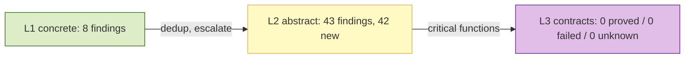
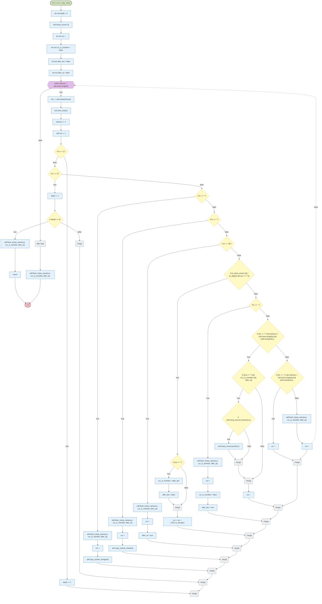
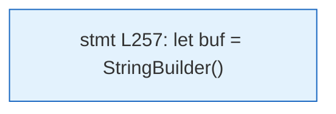

# LunaFlow analysis report — riantr/moonbit_static_analysis@latest@0.4.46

> Trace-driven (dynamic-first) control-flow, data-flow, value-range and slicing analysis for a mooncakes.io module.

## 1. Acquisition and version pinning

| Item | Value |
| --- | --- |
| Requested coordinate | `riantr/moonbit_static_analysis@latest` |
| Resolved version | `0.4.46` |
| Pinning strategy | `@latest` resolved through `moon fetch` (local registry index, newest non-yanked version) and pinned to `0.4.46` for ingestion, execution and reporting |
| Source root | `./.repos/riantr/moonbit_static_analysis/0.4.46` |
| Declared target | `wasm` |
| Direct dependencies | (none) |

## 2. Ingestion statistics

| Metric | Value |
| --- | --- |
| Source files parsed | 199 |
| Functions extracted | 2417 |
| Statements understood | 12997 |
| Statements unsupported | 611 |
| Frontend coverage | 95.5% |
| Parse issues | 0 |
| CFG functions | 600 of 2417 — the first 600 in file order; 1817 functions had no CFG and can carry no CFG finding |
| Trace events | 14296 |
| Interpreted steps | 2780 |
| Observed functions | 120 |
| Wall time (analyzer) | 1434 ms |
| Selected level | L3 (funnel: L1 → L2 → L3) |

## 3. Proof-strength levels and funnel

The same program is analyzed at three proof strengths. Levels are cumulative: L2 adds abstract interpretation on top of L1, L3 adds contract verification on top of the escalated functions. `--funnel` runs all three and reports what each level adds.

### 3.1 Level definitions

| Level | Name | Engine | Input model | Result strength |
| --- | --- | --- | --- | --- |
| L1 | Interpreter | concrete execution on the formal interpreter | concrete boundary values (`--trials`) | observed facts; may miss unexecuted inputs and paths |
| L2 | Value | abstract interpretation over a value-set / interval domain | whole input sets (`Int` intervals, `Bool`/`String` sets, array length intervals) | exhaustive over the abstract state; may-taint and may-range alarms (false positives possible) |
| L3 | Proof-by-contract | WP-style weakest-precondition VC generation + interval decision | ACSL-style `//@ requires` / `//@ ensures` specs | `proved` / `failed` / `unknown` per verification condition; specs are mandatory |

### 3.2 Funnel



| Level | Checks | New vs previous | Functions / VCs | Note |
| --- | --- | --- | --- | --- |
| L1 concrete | 8 findings | — | 120 functions | observed facts |
| L2 abstract | 43 findings | 42 | 120 functions, 4979 steps | exhaustive over the input abstraction |
| L3 contracts | 0 VCs | 0 failed, 0 unknown | 25 critical functions | specs required |

### 3.3 Escalation and specification gaps

Escalated functions (have at least one L1/L2 finding or a contract): `dir_of`, `ok_segment`, `ssa_cost_over_files`, `mm_after_last`, `notice_lines`, `scan`, `suffix_of`, `fetch_moon_mod_imports`, `parse_moon_mod_imports`, `mermaid_states`, `pick_files`, `emit_file`, `cap`, `pad3`, `parse_nosec`, `apply_nosec`, `version_gt`, `stamp_utc`, `pad2`, `pad4`, `slug`, `first_line`, `mm_valid_id`, `mm_state_id`, `mm_check`

Functions escalated without any contract (spec gap at L3): `notice_lines (src/sa/main.mbt:231)`, `scan (src/sa/main.mbt:698)`, `suffix_of (src/sa/main.mbt:1530)`, `dir_of (src/sa/main.mbt:1575)`, `fetch_moon_mod_imports (src/sa/main.mbt:1645)`, `parse_moon_mod_imports (src/sa/main.mbt:1700)`, `ok_segment (src/sa/main.mbt:1811)`, `mermaid_states (src/sa/mermaid.mbt:43)`, `pick_files (src/sa/mermaid.mbt:109)`, `emit_file (src/sa/mermaid.mbt:178)`, `cap (src/sa/mermaid.mbt:387)`, `pad3 (src/sa/profile.mbt:131)`, `parse_nosec (src/sa/profile.mbt:224)`, `apply_nosec (src/sa/profile.mbt:296)`, `version_gt (src/sa/version.mbt:50)`, `ssa_cost_over_files (src/sa/ssa_cost.mbt:89)`, `stamp_utc (src/sa/provenance.mbt:130)`, `pad2 (src/sa/provenance.mbt:172)`, `pad4 (src/sa/provenance.mbt:181)`, `slug (src/sa/provenance.mbt:323)`, `first_line (src/sa/provenance.mbt:480)`, `mm_valid_id (src/sa/mermaid_test.mbt:195)`, `mm_after_last (src/sa/mermaid_test.mbt:236)`, `mm_state_id (src/sa/mermaid_test.mbt:274)`, `mm_check (src/sa/mermaid_test.mbt:297)`, `pad3 (src/report/report_0507_test.mbt:65)`

## 4. Control-flow analysis

CFG nodes are built from the parsed statement tree; execution paths come from the concrete-execution trace engine. Dead/unreachable detection is static; path coverage and budget findings are dynamic. See `docs/design.md` §5 for the mapping rules.

### 4.1 CFG diagrams (top 8 by cyclomatic complexity)

#### `scan` (src/sa/main.mbt)

_Diagram omitted: 137 nodes exceeds the readability cap (90). Findings for this function are listed below._

#### `Lexer::lex_op` (src/lexer/lexer.mbt)

_Diagram omitted: 131 nodes exceeds the readability cap (90). Findings for this function are listed below._

#### `Lexer::lex_number` (src/lexer/lexer.mbt)

_Diagram omitted: 109 nodes exceeds the readability cap (90). Findings for this function are listed below._

#### `Lexer::copy_interp` (src/lexer/lexer.mbt)



#### `Lexer::lex_char` (src/lexer/lexer.mbt)

```mermaid
flowchart TD
  classDef entryNode fill:#dcedc8,stroke:#33691e,stroke-width:2px
  classDef exitNode fill:#ffcdd2,stroke:#b71c1c,stroke-width:2px
  classDef branchNode fill:#fff9c4,stroke:#f9a825
  classDef loopNode fill:#e1bee7,stroke:#6a1b9a
  classDef mergeNode fill:#eceff1,stroke:#607d8b
  classDef deadNode fill:#eeeeee,stroke:#9e9e9e
  classDef stmtNode fill:#e3f2fd,stroke:#1565c0
  n0(["entry Lexer::lex_char"]):::entryNode
  n1(["exit"]):::exitNode
  n2["let l = self.line"]:::stmtNode
  n3["let c0 = self.col"]:::stmtNode
  n4["self.pos += 1"]:::stmtNode
  n5["self.col += 1"]:::stmtNode
  n6["let buf = StringBuilder()"]:::stmtNode
  n7["let mut terminated = false"]:::stmtNode
  n8["let mut chars = 0"]:::stmtNode
  n9["let mut malformed = false"]:::stmtNode
  n10["let mut bad_point = false"]:::stmtNode
  n11{{"while (self.pos #lt; self.chars.length())"}}:::loopNode
  n12["let c = self.chars[self.pos]"]:::stmtNode
  n13{"if (c == #quot; #quot;)"}:::branchNode
  n14["break"]:::stmtNode
  n15("merge"):::mergeNode
  n16{"if (c == #quot;'#quot;)"}:::branchNode
  n17["self.pos += 1"]:::stmtNode
  n18["self.col += 1"]:::stmtNode
  n19["terminated = true"]:::stmtNode
  n20["break"]:::stmtNode
  n21("merge"):::mergeNode
  n22{"if ((c == #quot;/#quot;) && ((self.pos + 1) #lt; self.chars.length()))"}:::branchNode
  n23["self.pos += 1"]:::stmtNode
  n24["self.col += 1"]:::stmtNode
  n25["let e = self.chars[self.pos]"]:::stmtNode
  n26["let braced_u = ! byte_form && e == u && self.pos + 1 #lt; self.chars.length() && self.c..."]:::stmtNode
  n27{"if ((e == #quot;x#quot;) &#124;&#124; (e == #quot;u#quot;))"}:::branchNode
  n28["let braced = braced_u"]:::stmtNode
  n29{"if braced"}:::branchNode
  n30["self.pos += 1"]:::stmtNode
  n31["self.col += 1"]:::stmtNode
  n32("merge"):::mergeNode
  n33["let(lo, hi) = if e == x {(2, 2)} else if braced {(1, 6)} else {(4, 4)}"]:::stmtNode
  n34["let mut v = 0"]:::stmtNode
  n35["let mut digits = 0"]:::stmtNode
  n36{{"while ((self.pos + 1) #lt; self.chars.length())"}}:::loopNode
  n37["let h = hex_value(self.chars[self.pos + 1])"]:::stmtNode
  n38{"if (h #lt; 0)"}:::branchNode
  n39["break"]:::stmtNode
  n40("merge"):::mergeNode
  n41["self.pos += 1"]:::stmtNode
  n42["self.col += 1"]:::stmtNode
  n43{"if (digits #lt; hi)"}:::branchNode
  n44["v = v * 16 + h"]:::stmtNode
  n45("merge"):::mergeNode
  n46["digits += 1"]:::stmtNode
  n47("after-loop"):::mergeNode
  n48["let closed = braced && self.pos + 1 #lt; self.chars.length() && self.chars[self.pos + 1..."]:::stmtNode
  n49{"if closed"}:::branchNode
  n50["self.pos += 1"]:::stmtNode
  n51["self.col += 1"]:::stmtNode
  n52("merge"):::mergeNode
  n53{"if (byte_form && (e == #quot;u#quot;))"}:::branchNode
  n54["malformed = true"]:::stmtNode
  n55{"if (((digits #lt; lo) &#124;&#124; (digits #gt; hi)) &#124;&#124; (braced && !closed))"}:::branchNode
  n56["malformed = true"]:::stmtNode
  n57{"if ((v #gt; 1114111) &#124;&#124; ((v #gt;= 55296) && (v #lt;= 57343)))"}:::branchNode
  n58["bad_point = true"]:::stmtNode
  n59["buf.write_char(v.unsafe_to_char())"]:::stmtNode
  n60["chars += 1"]:::stmtNode
  n61("merge"):::mergeNode
  n62("merge"):::mergeNode
  n63("merge"):::mergeNode
  n64["buf.write_char( match e { n =#gt;   t =#gt;   r =#gt; r other =#gt; other},)"]:::stmtNode
  n65["chars += 1"]:::stmtNode
  n66("merge"):::mergeNode
  n67["buf.write_char(c)"]:::stmtNode
  n68["chars += 1"]:::stmtNode
  n69("merge"):::mergeNode
  n70["self.pos += 1"]:::stmtNode
  n71["self.col += 1"]:::stmtNode
  n72("after-loop"):::mergeNode
  n73["let s = buf.to_string()"]:::stmtNode
  n74{"if !terminated"}:::branchNode
  n75["self.reports.push(@report.Report::{ family : @core.FParse, lenses :[@core.LStructural],..."]:::stmtNode
  n76{"if malformed"}:::branchNode
  n77["self.reports.push(@report.Report::{ family : @core.FParse, lenses :[@core.LStructural],..."]:::stmtNode
  n78{"if bad_point"}:::branchNode
  n79["self.reports.push(@report.Report::{ family : @core.FParse, lenses :[@core.LStructural],..."]:::stmtNode
  n80{"if (chars != 1)"}:::branchNode
  n81["self.reports.push(@report.Report::{ family : @core.FParse, lenses :[@core.LStructural],..."]:::stmtNode
  n82("merge"):::mergeNode
  n83("merge"):::mergeNode
  n84("merge"):::mergeNode
  n85("merge"):::mergeNode
  n86["self.emit(TStr(s,[]), l, c0, self.col - c0)"]:::stmtNode
  n87["TStr(s,[])"]:::stmtNode
  n0 --> n2
  n2 --> n3
  n3 --> n4
  n4 --> n5
  n5 --> n6
  n6 --> n7
  n7 --> n8
  n8 --> n9
  n9 --> n10
  n10 --> n11
  n12 --> n13
  n13 -->|true| n14
  n13 -->|false| n15
  n15 --> n16
  n17 --> n18
  n18 --> n19
  n19 --> n20
  n16 -->|true| n17
  n16 -->|false| n21
  n21 --> n22
  n23 --> n24
  n24 --> n25
  n25 --> n26
  n26 --> n27
  n28 --> n29
  n30 --> n31
  n29 -->|true| n30
  n31 --> n32
  n29 -->|false| n32
  n32 --> n33
  n33 --> n34
  n34 --> n35
  n35 --> n36
  n37 --> n38
  n38 -->|true| n39
  n38 -->|false| n40
  n40 --> n41
  n41 --> n42
  n42 --> n43
  n43 -->|true| n44
  n44 --> n45
  n43 -->|false| n45
  n45 --> n46
  n36 -->|true| n37
  n46 -.->|back| n36
  n36 -->|false| n47
  n47 --> n48
  n48 --> n49
  n50 --> n51
  n49 -->|true| n50
  n51 --> n52
  n49 -->|false| n52
  n52 --> n53
  n59 --> n60
  n57 -->|true| n58
  n57 -->|false| n59
  n58 --> n61
  n60 --> n61
  n55 -->|true| n56
  n55 -->|false| n57
  n56 --> n62
  n61 --> n62
  n53 -->|true| n54
  n53 -->|false| n55
  n54 --> n63
  n62 --> n63
  n64 --> n65
  n27 -->|true| n28
  n27 -->|false| n64
  n63 --> n66
  n65 --> n66
  n67 --> n68
  n22 -->|true| n23
  n22 -->|false| n67
  n66 --> n69
  n68 --> n69
  n69 --> n70
  n70 --> n71
  n11 -->|true| n12
  n71 -.->|back| n11
  n11 -->|false| n72
  n72 --> n73
  n73 --> n74
  n80 -->|true| n81
  n81 --> n82
  n80 -->|false| n82
  n78 -->|true| n79
  n78 -->|false| n80
  n79 --> n83
  n82 --> n83
  n76 -->|true| n77
  n76 -->|false| n78
  n77 --> n84
  n83 --> n84
  n74 -->|true| n75
  n74 -->|false| n76
  n75 --> n85
  n84 --> n85
  n85 --> n86
  n86 --> n87
  n87 --> n1
```



#### `emit_file` (src/sa/mermaid.mbt)

```mermaid
flowchart TD
  classDef entryNode fill:#dcedc8,stroke:#33691e,stroke-width:2px
  classDef exitNode fill:#ffcdd2,stroke:#b71c1c,stroke-width:2px
  classDef branchNode fill:#fff9c4,stroke:#f9a825
  classDef loopNode fill:#e1bee7,stroke:#6a1b9a
  classDef mergeNode fill:#eceff1,stroke:#607d8b
  classDef deadNode fill:#eeeeee,stroke:#9e9e9e
  classDef stmtNode fill:#e3f2fd,stroke:#1565c0
  n0(["entry emit_file"]):::entryNode
  n1(["exit"]):::exitNode
  n2["let defects = v.findings.length()"]:::stmtNode
  n3["out.write_string(    state #quot;/{fid} — /{sanitize(v.path)}#quot; as /{fid} { )"]:::stmtNode
  n4["out.write_string(        direction TB )"]:::stmtNode
  n5["out.write_string(        [*] --#gt; /{fid}_lex )"]:::stmtNode
  n6["out.write_string(        state #quot;lexed#quot; as /{fid}_lex )"]:::stmtNode
  n7["let parsed_note = if v.parsed { whole file read} else { sanitize(v.reason)}"]:::stmtNode
  n8["out.write_string(        /{fid}_lex --#gt; /{fid}_struct : /{parsed_note} )"]:::stmtNode
  n9["out.write_string(         state #quot;inspection 1/3 — structural#quot; as /{fid}_struc..."]:::stmtNode
  n10["out.write_string(        /{fid}_struct --#gt; /{fid}_type : inspection 2/3 )"]:::stmtNode
  n11["out.write_string(        state #quot;inspection 2/3 — type#quot; as /{fid}_type )"]:::stmtNode
  n12["out.write_string(        /{fid}_type --#gt; /{fid}_behav : inspection 3/3 )"]:::stmtNode
  n13["out.write_string(         state #quot;inspection 3/3 — behavioral#quot; as /{fid}_behav ,)"]:::stmtNode
  n14{"if ((v.region_line #gt; 0) && !v.parsed)"}:::branchNode
  n15["out.write_string(         /{fid}_behav --#gt; [*] : /{v.unreliable} withheld past the b..."]:::stmtNode
  n16["out.write_string(        /{fid}_behav --#gt; [*] )"]:::stmtNode
  n17("merge"):::mergeNode
  n18{"if (v.notices #gt; 0)"}:::branchNode
  n19["let head = if v.notices == 1 { 1 finding on this file is a NOTICE, not a defect: the an..."]:::stmtNode
  n20["note(out, /{fid}_struct,[ head, stand behind them -- a form it does not model, or a nam..."]:::stmtNode
  n21("merge"):::mergeNode
  n22{"if (v.unreliable #gt; 0)"}:::branchNode
  n23["let head = if v.unreliable == 1 { 1 further finding on this file sits at or after line ..."]:::stmtNode
  n24["note(out, /{fid}_behav,[ head, where the tree is already wrong. They are counted as unr..."]:::stmtNode
  n25("merge"):::mergeNode
  n26["let limit = cap(per_file, defects)"]:::stmtNode
  n27["let counts = Map([])"]:::stmtNode
  n28["let mut notices_dropped = 0"]:::stmtNode
  n29{{"for k, rep in v.findings"}}:::loopNode
  n30{"if (k #lt; limit)"}:::branchNode
  n31["let notice = is_notice(rep)"]:::stmtNode
  n32["let eid = if notice { /{fid}_n/{k}} else { /{fid}_e/{k}}"]:::stmtNode
  n33["let lens = primary_lens(rep.lenses)"]:::stmtNode
  n34["let tag = if notice { notice} else { defect}"]:::stmtNode
  n35["out.write_string(         /{fid}_/{lens} --#gt; /{eid} : /{tag} /{rep.family.name()} ,)"]:::stmtNode
  n36["let where_ = @/{rep.span.start.line}:/{rep.span.start.col}"]:::stmtNode
  n37["let lead = if notice { NOTICE — } else { }"]:::stmtNode
  n38["out.write_string(         state #quot;/{lead}/{rep.family.name()} /{where_} — /{sanitiz..."]:::stmtNode
  n39{"if notice"}:::branchNode
  n40["let body = if rep.is_declared_scope_limit() {[ NOTICE — counted in `notices`, excluded ..."]:::stmtNode
  n41["note(out, eid, body)"]:::stmtNode
  n42["let a = rep.family.advice()"]:::stmtNode
  n43["let body =[WHY:  + a.why, HOW:  + a.how]"]:::stmtNode
  n44{"if (rep.lenses.length() #gt; 1)"}:::branchNode
  n45["body.push( SEEN BY:  + lens_list(rep.lenses) +  — the lenses agree, so this is not one ..."]:::stmtNode
  n46("merge"):::mergeNode
  n47["note(out, eid, body)"]:::stmtNode
  n48("merge"):::mergeNode
  n49{"if is_notice(rep)"}:::branchNode
  n50["notices_dropped += 1"]:::stmtNode
  n51["let key = primary_lens(rep.lenses)"]:::stmtNode
  n52["let n = match counts.get(key) { Some(x) =#gt; x None =#gt; 0}"]:::stmtNode
  n53["counts.set(key, n + 1)"]:::stmtNode
  n54("merge"):::mergeNode
  n55("merge"):::mergeNode
  n56("after-loop"):::mergeNode
  n57["let dropped = defects - limit"]:::stmtNode
  n58{"if (dropped #gt; 0)"}:::branchNode
  n59["let mut parts = "]:::stmtNode
  n60{{"for _, key in counts.keys()"}}:::loopNode
  n61{"if (parts != #quot;#quot;)"}:::branchNode
  n62["parts = parts + , "]:::stmtNode
  n63("merge"):::mergeNode
  n64["unsupported: match"]:::stmtNode
  n65("after-loop"):::mergeNode
  n66["let head = if dropped == 1 { 1 further finding on this file was NOT drawn, because this..."]:::stmtNode
  n67["let body =[ head, diagram caps a file at /{limit}. Per inspection:  + parts +., Re-run ..."]:::stmtNode
  n68{"if (notices_dropped #gt; 0)"}:::branchNode
  n69["let nt = if notices_dropped == 1 { 1 of them is a NOTICE, excluded from `actionable`.} ..."]:::stmtNode
  n70["body.push(nt)"]:::stmtNode
  n71("merge"):::mergeNode
  n72["note(out, /{fid}_struct, body)"]:::stmtNode
  n73("merge"):::mergeNode
  n74["out.write_string(    } )"]:::stmtNode
  n0 --> n2
  n2 --> n3
  n3 --> n4
  n4 --> n5
  n5 --> n6
  n6 --> n7
  n7 --> n8
  n8 --> n9
  n9 --> n10
  n10 --> n11
  n11 --> n12
  n12 --> n13
  n13 --> n14
  n14 -->|true| n15
  n14 -->|false| n16
  n15 --> n17
  n16 --> n17
  n17 --> n18
  n19 --> n20
  n18 -->|true| n19
  n20 --> n21
  n18 -->|false| n21
  n21 --> n22
  n23 --> n24
  n22 -->|true| n23
  n24 --> n25
  n22 -->|false| n25
  n25 --> n26
  n26 --> n27
  n27 --> n28
  n28 --> n29
  n31 --> n32
  n32 --> n33
  n33 --> n34
  n34 --> n35
  n35 --> n36
  n36 --> n37
  n37 --> n38
  n38 --> n39
  n40 --> n41
  n42 --> n43
  n43 --> n44
  n44 -->|true| n45
  n45 --> n46
  n44 -->|false| n46
  n46 --> n47
  n39 -->|true| n40
  n39 -->|false| n42
  n41 --> n48
  n47 --> n48
  n51 --> n52
  n52 --> n53
  n49 -->|true| n50
  n49 -->|false| n51
  n50 --> n54
  n53 --> n54
  n30 -->|true| n31
  n30 -->|false| n49
  n48 --> n55
  n54 --> n55
  n29 -->|true| n30
  n53 -.->|back| n29
  n29 -->|false| n56
  n56 --> n57
  n57 --> n58
  n59 --> n60
  n61 -->|true| n62
  n62 --> n63
  n61 -->|false| n63
  n63 --> n64
  n60 -->|true| n61
  n64 -.->|back| n60
  n60 -->|false| n65
  n65 --> n66
  n66 --> n67
  n67 --> n68
  n69 --> n70
  n68 -->|true| n69
  n70 --> n71
  n68 -->|false| n71
  n71 --> n72
  n58 -->|true| n59
  n72 --> n73
  n58 -->|false| n73
  n73 --> n74
  n74 --> n1
```



Observed path (trial 0, first 24 events): `def@184` -> `call@185` -> `call@186` -> `call@190` -> `call@191` -> `def@192` -> `call@197` -> `call@198` -> `call@201` -> `call@202` -> `call@203` -> `call@204` -> `cond@207` -> `call@209` -> `cond@215` -> `def@216` -> `call@221` -> `cond@226` -> `def@227` -> `call@232` -> `call@238` -> `def@238` -> `call@239` -> `def@239`

#### `mm_check` (src/sa/mermaid_test.mbt)

```mermaid
flowchart TD
  classDef entryNode fill:#dcedc8,stroke:#33691e,stroke-width:2px
  classDef exitNode fill:#ffcdd2,stroke:#b71c1c,stroke-width:2px
  classDef branchNode fill:#fff9c4,stroke:#f9a825
  classDef loopNode fill:#e1bee7,stroke:#6a1b9a
  classDef mergeNode fill:#eceff1,stroke:#607d8b
  classDef deadNode fill:#eeeeee,stroke:#9e9e9e
  classDef stmtNode fill:#e3f2fd,stroke:#1565c0
  n0(["entry mm_check"]):::entryNode
  n1(["exit"]):::exitNode
  n2["let errs =[]"]:::stmtNode
  n3["let declared =[]"]:::stmtNode
  n4["let edges =[]"]:::stmtNode
  n5["let mut in_note = false"]:::stmtNode
  n6["let lines = mm_lines(src)"]:::stmtNode
  n7{{"for raw in lines"}}:::loopNode
  n8["let t = raw.trim().to_owned()"]:::stmtNode
  n9{"if in_note"}:::branchNode
  n10{"if (t == #quot;end note#quot;)"}:::branchNode
  n11["in_note = false"]:::stmtNode
  n12{"if (t == #quot;#quot;)"}:::branchNode
  n13["errs.push(blank line inside a note: the block end is lost)"]:::stmtNode
  n14("merge"):::mergeNode
  n15("merge"):::mergeNode
  n16["continue"]:::stmtNode
  n17("merge"):::mergeNode
  n18{"if (((t == #quot;#quot;) &#124;&#124; t.has_prefix(#quot;%%#quot;)) &#124;&#124; (t == ..."}:::branchNode
  n19["continue"]:::stmtNode
  n20("merge"):::mergeNode
  n21{"if ((t.has_prefix(#quot;direction #quot;) &#124;&#124; (t == #quot;{#quot;)) &#124;&#12..."}:::branchNode
  n22["continue"]:::stmtNode
  n23("merge"):::mergeNode
  n24{"if t.has_prefix(#quot;note right of #quot;)"}:::branchNode
  n25["let anchor = mm_after_last(t, note right of )"]:::stmtNode
  n26{"if !mm_valid_id(anchor)"}:::branchNode
  n27["errs.push(note anchor is not an identifier:  + anchor)"]:::stmtNode
  n28("merge"):::mergeNode
  n29["in_note = true"]:::stmtNode
  n30["continue"]:::stmtNode
  n31("merge"):::mergeNode
  n32{"if t.has_prefix(#quot;state #quot;#quot;)"}:::branchNode
  n33{"if (mm_count_quotes(t) != 2)"}:::branchNode
  n34["errs.push(state label is not one quoted string:  + t)"]:::stmtNode
  n35("merge"):::mergeNode
  n36["let bare = mm_state_id(t)"]:::stmtNode
  n37{"if !mm_valid_id(bare)"}:::branchNode
  n38["errs.push(state id is not an identifier:  + bare)"]:::stmtNode
  n39{"if !declared.contains(bare)"}:::branchNode
  n40["declared.push(bare)"]:::stmtNode
  n41("merge"):::mergeNode
  n42("merge"):::mergeNode
  n43["continue"]:::stmtNode
  n44("merge"):::mergeNode
  n45{"if t.contains(#quot; --#gt; #quot;)"}:::branchNode
  n46["let head = mm_before_first(t,  : )"]:::stmtNode
  n47["let toks = mm_spaces(head.replace(old =  --#gt; , new =  ))"]:::stmtNode
  n48{"if (toks.length() != 2)"}:::branchNode
  n49["errs.push(transition is not `A --#gt; B` or `A --#gt; B : label`:  + t)"]:::stmtNode
  n50["continue"]:::stmtNode
  n51("merge"):::mergeNode
  n52["edges.push([toks[0], toks[1]])"]:::stmtNode
  n53["continue"]:::stmtNode
  n54("merge"):::mergeNode
  n55["errs.push(line is not a form this renderer may emit:  + t)"]:::stmtNode
  n56("after-loop"):::mergeNode
  n57{"if in_note"}:::branchNode
  n58["errs.push(a note was opened and never closed)"]:::stmtNode
  n59("merge"):::mergeNode
  n60{{"for e in edges"}}:::loopNode
  n61{{"for ep in e"}}:::loopNode
  n62{"if ((ep != #quot;[*]#quot;) && !declared.contains(ep))"}:::branchNode
  n63["errs.push(transition names an undeclared state:  + ep)"]:::stmtNode
  n64("merge"):::mergeNode
  n65("after-loop"):::mergeNode
  n66("after-loop"):::mergeNode
  n67["errs"]:::stmtNode
  n0 --> n2
  n2 --> n3
  n3 --> n4
  n4 --> n5
  n5 --> n6
  n6 --> n7
  n8 --> n9
  n12 -->|true| n13
  n13 --> n14
  n12 -->|false| n14
  n10 -->|true| n11
  n10 -->|false| n12
  n11 --> n15
  n14 --> n15
  n15 --> n16
  n9 -->|true| n10
  n9 -->|false| n17
  n17 --> n18
  n18 -->|true| n19
  n18 -->|false| n20
  n20 --> n21
  n21 -->|true| n22
  n21 -->|false| n23
  n23 --> n24
  n25 --> n26
  n26 -->|true| n27
  n27 --> n28
  n26 -->|false| n28
  n28 --> n29
  n29 --> n30
  n24 -->|true| n25
  n24 -->|false| n31
  n31 --> n32
  n33 -->|true| n34
  n34 --> n35
  n33 -->|false| n35
  n35 --> n36
  n36 --> n37
  n39 -->|true| n40
  n40 --> n41
  n39 -->|false| n41
  n37 -->|true| n38
  n37 -->|false| n39
  n38 --> n42
  n41 --> n42
  n42 --> n43
  n32 -->|true| n33
  n32 -->|false| n44
  n44 --> n45
  n46 --> n47
  n47 --> n48
  n49 --> n50
  n48 -->|true| n49
  n48 -->|false| n51
  n51 --> n52
  n52 --> n53
  n45 -->|true| n46
  n45 -->|false| n54
  n54 --> n55
  n7 -->|true| n8
  n55 -.->|back| n7
  n7 -->|false| n56
  n56 --> n57
  n57 -->|true| n58
  n58 --> n59
  n57 -->|false| n59
  n59 --> n60
  n62 -->|true| n63
  n63 --> n64
  n62 -->|false| n64
  n61 -->|true| n62
  n63 -.->|back| n61
  n61 -->|false| n65
  n60 -->|true| n61
  n60 -.->|back| n60
  n60 -->|false| n66
  n66 --> n67
  n67 --> n1
```



Observed path (trial 0, first 8 events): `def@298` -> `def@299` -> `def@300` -> `def@301` -> `call@302` -> `def@302` -> `cond@353` -> `def@297`

#### `laws_violation` (src/flow/laws_test.mbt)

```mermaid
flowchart TD
  classDef entryNode fill:#dcedc8,stroke:#33691e,stroke-width:2px
  classDef exitNode fill:#ffcdd2,stroke:#b71c1c,stroke-width:2px
  classDef branchNode fill:#fff9c4,stroke:#f9a825
  classDef loopNode fill:#e1bee7,stroke:#6a1b9a
  classDef mergeNode fill:#eceff1,stroke:#607d8b
  classDef deadNode fill:#eeeeee,stroke:#9e9e9e
  classDef stmtNode fill:#e3f2fd,stroke:#1565c0
  n0(["entry laws_violation"]):::entryNode
  n1(["exit"]):::exitNode
  n2{{"for a in elems"}}:::loopNode
  n3{"if (lat.eq(lat.join(a, a), a) == false)"}:::branchNode
  n4["return (#quot;not idempotent at #quot; + show(a))"]:::stmtNode
  n5("merge"):::mergeNode
  n6{"if (lat.eq(lat.join(lat.bot(), a), a) == false)"}:::branchNode
  n7["return (#quot;the bottom is not the identity of the join at #quot; + show(a))"]:::stmtNode
  n8("merge"):::mergeNode
  n9{{"for b in elems"}}:::loopNode
  n10["let jab =(lat.join)(a, b)"]:::stmtNode
  n11{"if (lat.eq(jab, lat.join(b, a)) == false)"}:::branchNode
  n12["return (((#quot;not commutative at #quot; + show(a)) + #quot; and #quot;) + show(b))"]:::stmtNode
  n13("merge"):::mergeNode
  n14{"if (order(a, jab) == false)"}:::branchNode
  n15["return (((#quot;the join is not an upper bound of its LEFT operand at #quot; + show(a))..."]:::stmtNode
  n16("merge"):::mergeNode
  n17{"if (order(b, jab) == false)"}:::branchNode
  n18["return (((#quot;the join is not an upper bound of its RIGHT operand at #quot; + show(a)..."]:::stmtNode
  n19("merge"):::mergeNode
  n20["let both = order(a, b) && order(b, a)"]:::stmtNode
  n21{"if ((both == lat.eq(a, b)) == false)"}:::branchNode
  n22["return (((#quot;eq and order disagree at #quot; + show(a)) + #quot; and #quot;) + show(b))"]:::stmtNode
  n23("merge"):::mergeNode
  n24{{"for c in elems"}}:::loopNode
  n25{"if (lat.eq(lat.join(jab, c), lat.join(a, lat.join(b, c))) == false)"}:::branchNode
  n26["return (((((#quot;not associative at #quot; + show(a)) + #quot;, #quot;) + show(b)) + #..."]:::stmtNode
  n27("merge"):::mergeNode
  n28{"if ((order(a, c) && order(b, c)) && (order(jab, c) == false))"}:::branchNode
  n29["return ((((((#quot;the join is not the LEAST upper bound at #quot; + show(a)) + #quot; ..."]:::stmtNode
  n30("merge"):::mergeNode
  n31("after-loop"):::mergeNode
  n32("after-loop"):::mergeNode
  n33("after-loop"):::mergeNode
  n34[""]:::stmtNode
  n0 --> n2
  n4 --> n1
  n3 -->|true| n4
  n3 -->|false| n5
  n5 --> n6
  n7 --> n1
  n6 -->|true| n7
  n6 -->|false| n8
  n8 --> n9
  n10 --> n11
  n12 --> n1
  n11 -->|true| n12
  n11 -->|false| n13
  n13 --> n14
  n15 --> n1
  n14 -->|true| n15
  n14 -->|false| n16
  n16 --> n17
  n18 --> n1
  n17 -->|true| n18
  n17 -->|false| n19
  n19 --> n20
  n20 --> n21
  n22 --> n1
  n21 -->|true| n22
  n21 -->|false| n23
  n23 --> n24
  n26 --> n1
  n25 -->|true| n26
  n25 -->|false| n27
  n27 --> n28
  n29 --> n1
  n28 -->|true| n29
  n28 -->|false| n30
  n24 -->|true| n25
  n29 -.->|back| n24
  n24 -->|false| n31
  n9 -->|true| n10
  n9 -.->|back| n9
  n9 -->|false| n32
  n2 -->|true| n3
  n2 -.->|back| n2
  n2 -->|false| n33
  n33 --> n34
  n34 --> n1
```

### 4.2 CFG findings

_No findings._

### 4.3 Static vs dynamic attribution

| Signal | Method | What a hit means | Known limitation |
| --- | --- | --- | --- |
| Unreachable statement | static | no CFG predecessor; often after `return`/`break` | parser gaps can hide real predecessors |
| Infinite loop | static + dynamic | constant-true condition without break, or iteration cap reached | loops whose exit depends on unmodelled calls are reported as *budget*, not proven infinite |
| Uncovered code | dynamic (coverage import) | zero hits in the observed test suite | absence of execution is not proof of dead code |

## 5. Data flow and taint

Sources are entry-function parameters (and `@env.args` when the frontend sees it); propagation follows recorded definitions and the variables read by each statement; sinks are array-index expressions and allocation sizes. The graph below is the *observed* propagation, not a may-analysis over all inputs.

```mermaid
flowchart LR
  classDef src fill:#ffcdd2,stroke:#b71c1c,stroke-width:2px
  classDef step fill:#fff9c4,stroke:#f9a825
  classDef sink fill:#c8e6c9,stroke:#1b5e20,stroke-width:2px
  t0["source: n"]:::src
  t1["source: cap"]:::src
  t2["source: n"]:::src
  t3["source: cap"]:::src
  t4["source: n"]:::src
  t5["source: cap"]:::src
  t6["source: n"]:::src
  t7["source: cap"]:::src
  t8["source: sp"]:::src
  t9["source: hiding"]:::src
  t10["source: sp"]:::src
  t11["source: hiding"]:::src
  t12["h = 0"]:::step
  t13["source: sp"]:::src
  t14["source: hiding"]:::src
  t15["h = 0"]:::step
  t16["source: sp"]:::src
  t17["source: hiding"]:::src
  t18["h = 1"]:::step
  t19["source: findings"]:::src
  t20["source: hiding"]:::src
  t21["source: findings"]:::src
  t22["source: hiding"]:::src
  t23["source: findings"]:::src
  t24["source: hiding"]:::src
  t25["source: findings"]:::src
  t26["source: hiding"]:::src
  t27["source: findings"]:::src
  t28["source: hiding"]:::src
  t29["source: show_notices"]:::src
  t30["source: findings"]:::src
  t31["source: hiding"]:::src
  t32["source: show_notices"]:::src
  t33["source: findings"]:::src
  t34["source: hiding"]:::src
  t35["source: show_notices"]:::src
  t36["source: findings"]:::src
  t37["source: hiding"]:::src
  t38["source: show_notices"]:::src
  t39["source: reports"]:::src
  t11 -->|propagates| t12
  t14 -->|propagates| t15
  t17 -->|propagates| t18
```



### 5.1 Taint sinks

| Rule | Severity | Function | Location | Message | Method | Confidence |
| --- | --- | --- | --- | --- | --- | --- |
| TAINT-INDEX-RANGE | warning | dir_of | src/sa/main.mbt:1580 | untrusted input determines an array index; the observed index was inside the array, so no out-of-bounds access was witnessed | dynamic+symbolic | 0.5 |
| TAINT-INDEX | error | ok_segment | src/sa/main.mbt:1815 | tainted value reaches an array index / buffer offset | dynamic+symbolic | 0.8 |
| TAINT-INDEX | error | ok_segment | src/sa/main.mbt:1818 | tainted value reaches an array index / buffer offset | dynamic+symbolic | 0.8 |
| TAINT-INDEX-RANGE | warning | ssa_cost_over_files | src/sa/ssa_cost.mbt:111 | untrusted input determines an array index; the observed index was inside the array, so no out-of-bounds access was witnessed | dynamic+symbolic | 0.5 |
| TAINT-INDEX-RANGE | warning | ssa_cost_over_files | src/sa/ssa_cost.mbt:112 | untrusted input determines an array index; the observed index was inside the array, so no out-of-bounds access was witnessed | dynamic+symbolic | 0.5 |
| TAINT-INDEX | error | mm_after_last | src/sa/mermaid_test.mbt:238 | tainted value reaches an array index / buffer offset | dynamic+symbolic | 0.8 |

### 5.2 L2 abstract findings (may-analysis)

Abstract interpretation joins all paths and widens loops, so these alarms are *may* properties: a hit means the abstract state cannot exclude the defect, not that a concrete input was observed.

| Rule | Severity | Function | Location | Message | Method | Confidence |
| --- | --- | --- | --- | --- | --- | --- |
| UNREACHABLE | info | notice_lines | src/sa/main.mbt:238 | else-branch is unreachable for the abstract input set | L2-abstract | 0.8 |
| UNREACHABLE | info | scan | src/sa/main.mbt:716 | then-branch is unreachable for the abstract input set | L2-abstract | 0.8 |
| UNREACHABLE | info | scan | src/sa/main.mbt:716 | else-branch is unreachable for the abstract input set | L2-abstract | 0.8 |
| UNREACHABLE | info | suffix_of | src/sa/main.mbt:1543 | then-branch is unreachable for the abstract input set | L2-abstract | 0.8 |
| UNREACHABLE | info | suffix_of | src/sa/main.mbt:1543 | else-branch is unreachable for the abstract input set | L2-abstract | 0.8 |
| TAINT-INDEX | error | dir_of | src/sa/main.mbt:1580 | tainted value may reach an array index / buffer offset | L2-abstract | 0.6 |
| TAINT-INDEX | error | dir_of | src/sa/main.mbt:1594 | tainted value may reach an array index / buffer offset | L2-abstract | 0.6 |
| UNREACHABLE | info | fetch_moon_mod_imports | src/sa/main.mbt:1671 | then-branch is unreachable for the abstract input set | L2-abstract | 0.8 |
| UNREACHABLE | info | fetch_moon_mod_imports | src/sa/main.mbt:1671 | else-branch is unreachable for the abstract input set | L2-abstract | 0.8 |
| UNREACHABLE | info | parse_moon_mod_imports | src/sa/main.mbt:1720 | then-branch is unreachable for the abstract input set | L2-abstract | 0.8 |
| UNREACHABLE | info | parse_moon_mod_imports | src/sa/main.mbt:1720 | else-branch is unreachable for the abstract input set | L2-abstract | 0.8 |
| UNREACHABLE | info | ok_segment | src/sa/main.mbt:1812 | then-branch is unreachable for the abstract input set | L2-abstract | 0.8 |
| UNREACHABLE | info | ok_segment | src/sa/main.mbt:1812 | else-branch is unreachable for the abstract input set | L2-abstract | 0.8 |
| TAINT-INDEX | error | mermaid_states | src/sa/mermaid.mbt:89 | tainted value may reach an array index / buffer offset | L2-abstract | 0.6 |
| UNREACHABLE | info | pick_files | src/sa/mermaid.mbt:114 | else-branch is unreachable for the abstract input set | L2-abstract | 0.8 |
| UNREACHABLE | info | emit_file | src/sa/mermaid.mbt:351 | then-branch is unreachable for the abstract input set | L2-abstract | 0.8 |
| UNREACHABLE | info | emit_file | src/sa/mermaid.mbt:351 | else-branch is unreachable for the abstract input set | L2-abstract | 0.8 |
| UNREACHABLE | info | cap | src/sa/mermaid.mbt:388 | then-branch is unreachable for the abstract input set | L2-abstract | 0.8 |
| UNREACHABLE | info | cap | src/sa/mermaid.mbt:388 | else-branch is unreachable for the abstract input set | L2-abstract | 0.8 |
| UNREACHABLE | info | pad3 | src/sa/profile.mbt:132 | then-branch is unreachable for the abstract input set | L2-abstract | 0.8 |
| UNREACHABLE | info | pad3 | src/sa/profile.mbt:132 | else-branch is unreachable for the abstract input set | L2-abstract | 0.8 |
| TAINT-INDEX | error | parse_nosec | src/sa/profile.mbt:234 | tainted value may reach an array index / buffer offset | L2-abstract | 0.6 |
| UNREACHABLE | info | apply_nosec | src/sa/profile.mbt:302 | then-branch is unreachable for the abstract input set | L2-abstract | 0.8 |
| UNREACHABLE | info | apply_nosec | src/sa/profile.mbt:302 | else-branch is unreachable for the abstract input set | L2-abstract | 0.8 |
| TAINT-INDEX | error | version_gt | src/sa/version.mbt:55 | tainted value may reach an array index / buffer offset | L2-abstract | 0.6 |
| TAINT-INDEX | error | version_gt | src/sa/version.mbt:56 | tainted value may reach an array index / buffer offset | L2-abstract | 0.6 |
| UNREACHABLE | info | stamp_utc | src/sa/provenance.mbt:131 | then-branch is unreachable for the abstract input set | L2-abstract | 0.8 |
| UNREACHABLE | info | stamp_utc | src/sa/provenance.mbt:131 | else-branch is unreachable for the abstract input set | L2-abstract | 0.8 |
| UNREACHABLE | info | pad2 | src/sa/provenance.mbt:173 | then-branch is unreachable for the abstract input set | L2-abstract | 0.8 |
| UNREACHABLE | info | pad2 | src/sa/provenance.mbt:173 | else-branch is unreachable for the abstract input set | L2-abstract | 0.8 |
| UNREACHABLE | info | pad4 | src/sa/provenance.mbt:182 | then-branch is unreachable for the abstract input set | L2-abstract | 0.8 |
| UNREACHABLE | info | pad4 | src/sa/provenance.mbt:182 | else-branch is unreachable for the abstract input set | L2-abstract | 0.8 |
| UNREACHABLE | info | slug | src/sa/provenance.mbt:342 | then-branch is unreachable for the abstract input set | L2-abstract | 0.8 |
| UNREACHABLE | info | slug | src/sa/provenance.mbt:342 | else-branch is unreachable for the abstract input set | L2-abstract | 0.8 |
| UNREACHABLE | info | first_line | src/sa/provenance.mbt:484 | then-branch is unreachable for the abstract input set | L2-abstract | 0.8 |
| UNREACHABLE | info | first_line | src/sa/provenance.mbt:484 | else-branch is unreachable for the abstract input set | L2-abstract | 0.8 |
| UNREACHABLE | info | mm_valid_id | src/sa/mermaid_test.mbt:196 | then-branch is unreachable for the abstract input set | L2-abstract | 0.8 |
| UNREACHABLE | info | mm_valid_id | src/sa/mermaid_test.mbt:196 | else-branch is unreachable for the abstract input set | L2-abstract | 0.8 |
| TAINT-INDEX | error | mm_after_last | src/sa/mermaid_test.mbt:238 | tainted value may reach an array index / buffer offset | L2-abstract | 0.6 |
| UNREACHABLE | info | mm_state_id | src/sa/mermaid_test.mbt:279 | then-branch is unreachable for the abstract input set | L2-abstract | 0.8 |
| UNREACHABLE | info | mm_state_id | src/sa/mermaid_test.mbt:279 | else-branch is unreachable for the abstract input set | L2-abstract | 0.8 |
| UNREACHABLE | info | mm_check | src/sa/mermaid_test.mbt:305 | then-branch is unreachable for the abstract input set | L2-abstract | 0.8 |
| UNREACHABLE | info | mm_check | src/sa/mermaid_test.mbt:305 | else-branch is unreachable for the abstract input set | L2-abstract | 0.8 |

## 6. Value ranges

Ranges are the union of concrete samples across synthesized input trials. They are *observed* intervals, not abstract-interpretation fixpoints: a missing input can hide a wider interval.

### 6.1 Per-program-point observations

Every definition event is keyed by function, source line and variable, so a value can be inspected at the exact program point that produced it (the full stream is in the JSONL trace).

| Function | Line | Variable | Observed values |
| --- | --- | --- | --- |
| bump | 1512 | n | ? |
| slug | 324 | buf | ? |
| slug | 343 | out | "?" |
| dir_of | 1578 | i | -1, 2, 15, 63 |
| dir_of | 1584 | i | 1, 0, -1, 14, 13, 12 |
| is_dir | 1172 | d | ? |
| note | 370 | line | ?, "stand behind them -- a form it does n...", "resolve. ... |
| scan | 711 | root | "" |
| wanted | 1248 | n | () |
| wanted | 1249 | s | () |
| analyze | 1329 | n | () |
| analyze | 1330 | k | () |
| ctx_line | 622 | t | ? |
| is_hiding | 81 | h | 0, 1 |
| kind_of | 1259 | s | () |
| kind_of | 1260 | n | () |
| reify | 1750 | buf | ? |
| show_plan | 64 | c | ? |
| aggregate | 414 | v | 0, 1, -1 |
| aggregate | 415 | n | ? |
| dir_of | 1577 | cut | -1 |
| version_gt | 53 | i | 0 |
| version_gt | 55 | x | ? |
| version_gt | 56 | y | ? |
| analyze | 1328 | src | () |
| base_of | 1549 | out | "" |
| collect | 1204 | dir | ? |
| family_ids | 118 | n | 1 |
| sanitize | 461 | buf | ? |
| version_gt | 51 | pa | () |
| version_gt | 52 | pb | () |
| apply_nosec | 319 | n | 0, 1, -1 |
| dir_of | 1576 | chars | [], ["a", "b", "c"], [".", ".", "/", ".", ".", "/", "e", ... |
| family_ids | 120 | id | ""MSA-"()" |
| mm_check | 298 | errs | [] |
| stamp_utc | 138 | sec | ? |
| by_rank | 437 | sorted | [], [0], [0, 1, -1], [1, 0] |
| collect | 1199 | stack | ? |
| emit_file | 216 | head | ? |
| emit_file | 227 | head | ? |
| emit_file | 338 | head | ? |
| emit_file | 343 | body | [?, """diagram caps a file at \{limit}. Pe...", "Re-run w... |
| emit_mmd | 1057 | prov | () |
| emit_mmd | 1058 | text | () |
| emit_mmd | 1061 | path | ? |
| family_ids | 117 | out | ? |
| first_line | 481 | out | ? |
| mm_check | 300 | edges | [] |
| mm_check | 302 | lines | () |
| mm_label | 251 | parts | ? |
| pick_files | 110 | idx | ? |
| show_plan | 65 | shown | ? |
| slug | 325 | last_dash | false |
| stamp_utc | 137 | days | ? |
| aggregate | 410 | total | 0 |
| aggregate | 416 | total | ? |
| apply_nosec | 320 | hit | false |
| apply_profile | 172 | r | 0, 1, -1 |
| count_notices | 201 | n | 0 |
| count_notices | 202 | r | 0, 1, -1 |
| count_notices | 204 | n | 1, 2, 3 |
| emit_file | 238 | limit | () |
| emit_file | 325 | parts | "" |
| explain_family | 29 | s | "\{f.id()}  \{f.name()} " |
| explain_family | 30 | s | ""\{f.id()}  \{f.name()} ""   property..." |
| explain_family | 31 | s | """\{f.id()}  \{f.name()} ""   propert..." |
| explain_family | 32 | s | """"\{f.id()}  \{f.name()} ""   proper..." |
| explain_roster | 43 | s | "families: id, name, and the property ..." |
| explain_roster | 47 | s | ""families: id, name, and the property..." |
| first_line | 482 | done | false |
| lens_list | 426 | names | [] |
| parse_nosec | 225 | out | ? |
| pick_files | 152 | head | [] |
| print_ssa_cost | 80 | _ | () |
| suffix_of | 1531 | tail | "" |
| apply_nosec | 300 | kept | ? |
| collect | 1208 | entries | ? |
| count_by_shape | 265 | r | 0, 1, -1 |
| count_by_shape | 266 | c | ? |
| ctx_line | 620 | per_sig | "n/a (no signature was executed)" |
| ctx_line | 623 | per_sig | "\{t / 100}.\{t % 100 / 10}\{t % 10} e..." |
| emit_file | 239 | counts | ? |
| metrics_lines | 550 | hi | ? |
| metrics_lines | 551 | lo | ? |
| metrics_lines | 552 | un | ? |
| mm_check | 301 | in_note | false |
| mm_state_id | 275 | seen | 0 |
| mm_state_id | 277 | tail | ? |
| mm_state_id | 288 | rest | () |
| notice_lines | 237 | out | ? |
| profile_keeps | 149 | id | ? |
| render_reports | 258 | r | 0, 1, -1 |
| split_coord | 1150 | mod | "" |
| split_coord | 1151 | ver | "" |
| split_coord | 1165 | ver | "" |
| split_tokens | 264 | out | ? |
| stamp_utc | 136 | day_ms | ? |
| version_parts | 77 | cur | 0 |
| aggregate | 407 | notices | 0 |
| aggregate | 412 | n_calls | 0 |
| aggregate | 419 | n_calls | ? |
| aggregate | 424 | notices | ? |
| apply_nosec | 301 | stale | ? |
| civil_from_days | 158 | z | ?, 719467, 719468, 719469, 719470 |
| civil_from_days | 162 | y | ?, 1969 |
| civil_from_days | 165 | d | ?, 31, 1, 2, 3 |
| emit_file | 184 | defects | ? |
| emit_file | 321 | dropped | ? |
| measure_file | 122 | text | ? |
| mermaid_states | 51 | out | ? |
| metrics_lines | 517 | out | ? |
| metrics_lines | 518 | pct | ? |
| mm_check | 299 | declared | [] |
| mm_count_quotes | 215 | n | 0 |
| mm_valid_id | 199 | first | true |
| aggregate | 409 | withheld | 0 |
| aggregate | 434 | withheld | ? |
| apply_profile | 171 | kept | ? |
| civil_from_days | 164 | mp | ?, 9, 10 |
| civil_from_days | 166 | mo | ? |
| civil_from_days | 167 | yy | ? |
| collect | 1200 | seen_dirs | 0 |
| collect | 1202 | last_dirs | 0 |
| collect | 1233 | seen_dirs | 1, 2, 3, 4, 5, 6 |
| count_by_shape | 272 | out | ? |
| measure_function | 148 | c | ? |
| metrics_lines | 553 | n_hi | 0 |
| metrics_lines | 554 | n_lo | 0 |
| metrics_lines | 555 | n_un | 0 |
| mm_parsed_with | 77 | fams | [(?, "local variable 'x' assigned but may n..."), (?, "ar... |
| mm_parsed_with | 82 | reps | [] |
| newest_version | 31 | best | "" |
| newest_version | 32 | name | "", "x" |
| newest_version | 34 | best | "", "x" |
| path_segments | 308 | segs | [] |
| print_ssa_cost | 81 | cost | () |
| render_reports | 257 | buf | ? |
| run_exit_code | 1640 | res | ? |
| validate_profile | 81 | id | "", "x" |
| version_parts | 76 | parts | ? |
| version_parts | 78 | named | false |
| aggregate | 413 | n_checked | 0 |
| aggregate | 420 | n_checked | ? |
| civil_from_days | 159 | era | ?, 4 |
| civil_from_days | 160 | doe | ?, 135079, 135080, 135081, 135082 |
| civil_from_days | 161 | yoe | ?, 369 |
| civil_from_days | 163 | doy | ?, 305, 306, 307, 308 |
| collect | 1201 | last_files | 0 |
| measure_function | 147 | ir | ? |
| metrics_lines | 536 | other | ? |
| metrics_lines | 541 | share | ? |
| mm_after_last | 237 | parts | ? |
| moonbit_version | 449 | res | ? |
| parse_nosec | 226 | line_no | 0 |
| primary_lens | 411 | sorted | () |
| print_ssa_cost | 79 | files | ? |
| aggregate | 406 | actionable | 0 |
| aggregate | 408 | unreliable | 0 |
| aggregate | 417 | unreliable | ? |
| aggregate | 425 | actionable | ? |
| mermaid_states | 50 | target | ? |
| mermaid_states | 74 | picked | (), ? |
| moonbit_version | 444 | args | ? |
| moonbit_version | 452 | text | ? |
| split_coord | 1152 | seen_at | false |
| suffix_of | 1532 | after_dot | false |
| aggregate | 411 | n_unchecked | 0 |
| aggregate | 418 | n_unchecked | ? |
| count_by_shape | 264 | counts | ? |
| emit_file | 192 | parsed_note | ? |
| filtered_reports | 1303 | all | ? |
| is_module_coord | 1767 | base | ? |
| locate | 1076 | _destructured | () |
| method_segments | 1965 | segs | ? |
| ssa_cost_over_files | 106 | i | 0 |
| ssa_cost_over_files | 114 | i | 1, 2, 3, 4, 5, 6 |
| aggregate | 404 | parsed_files | 0 |
| aggregate | 427 | parsed_files | 1, 2, 3 |
| split_findings | 119 | printed | ? |
| validate_profile | 69 | roster | () |
| aggregate | 405 | partial_files | 0 |
| aggregate | 429 | partial_files | 1, 2, 3 |
| mm_state_id | 276 | after_close | false |
| scan_artifact_name | 226 | stem | ? |
| ssa_cost_over_files | 90 | cost | ? |
| stamp_utc | 139 | _destructured | () |
| tally_partial_reasons | 642 | v | 0, 1, -1 |
| tally_partial_reasons | 644 | r | ? |
| tally_partial_reasons | 645 | c | ? |
| validate_profile | 92 | overlap | ? |
| filtered_reports | 1298 | nosecs | ? |
| filtered_reports | 1300 | nosecs | () |
| first_quoted_after | 110 | parts | ? |
| parse_moon_version | 468 | parts | ? |
| provenance_for | 381 | from_tree | () |
| tally_partial_reasons | 650 | ex | ? |
| validate_profile | 68 | warnings | ? |
| collect_iface_symtabs | 1847 | ri | ? |
| emit_file | 240 | notices_dropped | 0 |
| split_findings | 120 | aggregated | ? |
| collect_iface_symtabs | 1845 | tab | ? |
| collect_iface_symtabs | 1852 | dir | ? |
| collect_private_symtabs | 1905 | f | "", "x" |
| filtered_reports | 1297 | filtered | () |
| collect_iface_symtabs | 1847 | root | ? |
| parse_moon_mod_imports | 1701 | out | ? |
| provenance_for | 382 | tree_version | ? |
| collect_iface_symtabs | 1850 | stack | ? |
| collect_private_symtabs | 1904 | out | ? |
| fetch_moon_mod_imports | 1647 | text | () |
| target_version | 412 | _destructured | () |
| tally_partial_reasons | 640 | reasons | ? |
| collect_iface_symtabs | 1856 | entries | ? |
| tally_partial_reasons | 641 | examples | ? |
| filtered_reports | 1302 | _destructured | (?, ?) |
| fetch_moon_mod_imports | 1646 | mod_path | """"/moon.mod"", ""abc""/moon.mod"", ""../../etc/passwd""... |
| collect_iface_symtabs | 1849 | user_named | ? |
| parse_moon_mod_imports | 1702 | in_import | false |
| collect_iface_symtabs | 1846 | skipped_dot | 0 |

### 6.2 Function-level range union (L1)

| Function | Variable | Min | Max | Samples | Observed values | First site |
| --- | --- | --- | --- | --- | --- | --- |
| dir_of | i | -1 | 63 | 87 | -1, 2, 1, 0, 15, 14, 13, 12, 11, 10, 9, 8 | src/sa/main.mbt:1578:3 |
| dir_of | cut | -1 | -1 | 4 | -1 | src/sa/main.mbt:1577:3 |
| aggregate | v | -1 | 1 | 6 | 0, 1, -1 | src/sa/main.mbt:414:3-437:4 |
| is_hiding | h | 0 | 1 | 3 | 0, 1 | src/sa/main.mbt:81:3-85:4 |
| family_ids | n | 1 | 1 | 5 | 1 | src/sa/profile.mbt:118:3 |
| version_gt | i | 0 | 0 | 4 | 0 | src/sa/version.mbt:53:3 |
| apply_nosec | n | -1 | 1 | 6 | 0, 1, -1 | src/sa/profile.mbt:319:3-329:4 |
| slug | last_dash | 0 | 0 | 20 | false | src/sa/provenance.mbt:325:3 |
| aggregate | total | 0 | 0 | 4 | 0 | src/sa/main.mbt:410:3 |
| apply_nosec | hit | 0 | 0 | 6 | false | src/sa/profile.mbt:320:5 |
| apply_profile | r | -1 | 1 | 6 | 0, 1, -1 | src/sa/profile.mbt:172:3-176:4 |
| count_notices | n | 0 | 3 | 10 | 0, 1, 2, 3 | src/sa/main.mbt:201:3 |
| count_notices | r | -1 | 1 | 6 | 0, 1, -1 | src/sa/main.mbt:202:3-206:4 |
| first_line | done | 0 | 0 | 5 | false | src/sa/provenance.mbt:482:3 |
| is_hiding | <ret> | 1 | 1 | 3 | true | src/sa/main.mbt:80:5-87:2 |
| count_by_shape | r | -1 | 1 | 6 | 0, 1, -1 | src/sa/main.mbt:265:3-271:4 |
| mm_check | in_note | 0 | 0 | 4 | false | src/sa/mermaid_test.mbt:301:3 |
| mm_state_id | seen | 0 | 0 | 4 | 0 | src/sa/mermaid_test.mbt:275:3 |
| ok_segment | <ret> | 0 | 0 | 3 | false | src/sa/main.mbt:1811:1-1822:2 |
| render_reports | r | -1 | 1 | 6 | 0, 1, -1 | src/report/report.mbt:258:3-260:4 |
| aggregate | n_calls | 0 | 0 | 4 | 0 | src/sa/main.mbt:412:3 |
| aggregate | notices | 0 | 0 | 4 | 0 | src/sa/main.mbt:407:3 |
| civil_from_days | d | 1 | 31 | 4 | 31, 1, 2, 3 | src/sa/provenance.mbt:165:3 |
| civil_from_days | y | 1969 | 1969 | 4 | 1969 | src/sa/provenance.mbt:162:3 |
| civil_from_days | z | 719467 | 719470 | 4 | 719467, 719468, 719469, 719470 | src/sa/provenance.mbt:158:3 |
| collect | last_dirs | 0 | 0 | 8 | 0 | src/sa/main.mbt:1202:3 |
| collect | seen_dirs | 0 | 64 | 520 | 0, 1, 2, 3, 4, 5, 6, 7, 8, 9, 10, 11 | src/sa/main.mbt:1200:3 |
| mm_count_quotes | n | 0 | 0 | 4 | 0 | src/sa/mermaid_test.mbt:215:3 |
| mm_valid_id | <ret> | 0 | 0 | 1 | false | src/sa/mermaid_test.mbt:195:1-211:2 |
| mm_valid_id | first | 1 | 1 | 3 | true | src/sa/mermaid_test.mbt:199:3 |
| version_parts | cur | 0 | 0 | 12 | 0 | src/sa/version.mbt:77:3 |
| aggregate | withheld | 0 | 0 | 4 | 0 | src/sa/main.mbt:409:3 |
| civil_from_days | mp | 9 | 10 | 4 | 9, 10 | src/sa/provenance.mbt:164:3 |
| collect | last_files | 0 | 0 | 8 | 0 | src/sa/main.mbt:1201:3 |
| metrics_lines | n_hi | 0 | 0 | 4 | 0 | src/sa/main.mbt:553:3 |
| metrics_lines | n_lo | 0 | 0 | 4 | 0 | src/sa/main.mbt:554:3 |
| metrics_lines | n_un | 0 | 0 | 4 | 0 | src/sa/main.mbt:555:3 |
| aggregate | n_checked | 0 | 0 | 4 | 0 | src/sa/main.mbt:413:3 |
| civil_from_days | doe | 135079 | 135082 | 4 | 135079, 135080, 135081, 135082 | src/sa/provenance.mbt:160:3 |
| civil_from_days | doy | 305 | 308 | 4 | 305, 306, 307, 308 | src/sa/provenance.mbt:163:3 |
| civil_from_days | era | 4 | 4 | 4 | 4 | src/sa/provenance.mbt:159:3 |
| civil_from_days | yoe | 369 | 369 | 4 | 369 | src/sa/provenance.mbt:161:3 |
| parse_nosec | line_no | 0 | 0 | 8 | 0 | src/sa/profile.mbt:226:3 |
| profile_keeps | <ret> | 0 | 0 | 1 | false | src/sa/profile.mbt:148:5-157:2 |
| split_coord | seen_at | 0 | 0 | 16 | false | src/sa/main.mbt:1152:3 |
| suffix_of | after_dot | 0 | 0 | 16 | false | src/sa/main.mbt:1532:3 |
| version_parts | named | 0 | 0 | 12 | false | src/sa/version.mbt:78:3 |
| aggregate | actionable | 0 | 0 | 4 | 0 | src/sa/main.mbt:406:3 |
| aggregate | unreliable | 0 | 0 | 4 | 0 | src/sa/main.mbt:408:3 |
| aggregate | n_unchecked | 0 | 0 | 4 | 0 | src/sa/main.mbt:411:3 |
| is_module_coord | <ret> | 0 | 0 | 4 | false | src/sa/main.mbt:1762:5-1807:2 |
| ssa_cost_over_files | i | 0 | 64 | 270 | 0, 1, 2, 3, 4, 5, 6, 7, 8, 9, 10, 11 | src/sa/ssa_cost.mbt:106:3 |
| aggregate | parsed_files | 0 | 3 | 10 | 0, 1, 2, 3 | src/sa/main.mbt:404:3 |
| aggregate | partial_files | 0 | 3 | 10 | 0, 1, 2, 3 | src/sa/main.mbt:405:3 |
| mm_state_id | after_close | 0 | 0 | 4 | false | src/sa/mermaid_test.mbt:276:3 |
| tally_partial_reasons | v | -1 | 1 | 6 | 0, 1, -1 | src/sa/main.mbt:642:3-659:4 |
| emit_file | notices_dropped | 0 | 0 | 4 | 0 | src/sa/mermaid.mbt:240:3 |
| Nosec | covers_family | 1 | 1 | 1 | true |  |
| parse_moon_mod_imports | in_import | 0 | 0 | 4 | false | src/sa/main.mbt:1702:3 |
| collect_iface_symtabs | skipped_dot | 0 | 0 | 4 | 0 | src/sa/main.mbt:1846:3 |

### 6.3 Abstract may-ranges (L2)

These intervals are the abstract interpreter's fixpoint approximation at widening, not observed samples; they cover the whole input abstraction and therefore over-approximate.

| Function | Variable | May-range | Observations |
| --- | --- | --- | --- |
| cap | n | [-1000000, 1000000] | 1 |
| pad2 | n | [-1000000, 1000000] | 1 |
| pad3 | n | [-1000000, 1000000] | 1 |
| pad4 | n | [-1000000, 1000000] | 1 |
| dir_of | j | [-999999, 1000001] | 7 |
| cap | limit | [-1000000, 1000000] | 1 |
| file_id | i | [-1000000, 1000000] | 1 |
| dir_of | cut | [-1, -1] | 1 |
| mm_rep | line | [-1000000, 1000000] | 1 |
| mm_span | col | [-1000000, 1000000] | 1 |
| show_plan | n | [-1000000, 1000000] | 1 |
| family_ids | n | [1, 5] | 5 |
| mm_span | line | [-1000000, 1000000] | 1 |
| stamp_utc | ms | [-1000000, 1000000] | 1 |
| version_gt | i | [-999999, 1000001] | 6 |
| ok_segment | to | [-1000000, 1000000] | 1 |
| show_plan | cap | [-1000000, 1000000] | 1 |
| measure_file | i | [-999999, 1000001] | 6 |
| aggregate | total | [0, 0] | 1 |
| count_notices | n | [0, 1] | 2 |
| ok_segment | from | [-1000000, 1000000] | 1 |
| scan | priv_names | [0, 0] | 1 |
| mm_parsed_with | n | [-1000000, 1000000] | 1 |
| mm_state_id | seen | [0, 0] | 1 |
| aggregate | n_calls | [0, 0] | 1 |
| aggregate | notices | [0, 0] | 1 |
| civil_from_days | d | [-7511320, 7511292] | 1 |
| civil_from_days | y | [-5575, 9514] | 1 |
| civil_from_days | z | [-280532, 1719468] | 1 |
| collect | last_dirs | [-999999, 1000001] | 7 |
| collect | seen_dirs | [-999999, 1000001] | 7 |
| is_module_coord | i | [-999999, 1000001] | 6 |
| mm_count_quotes | n | [0, 1] | 2 |
| resolve_label | ups | [0, 1] | 2 |
| version_parts | cur | [-1, 0] | 3 |
| aggregate | withheld | [0, 0] | 1 |
| civil_from_days | mp | [-122729, 122738] | 1 |
| collect | last_files | [0, 70] | 7 |
| emit_file | per_file | [-1000000, 1000000] | 1 |
| metrics_lines | n_hi | [0, 0] | 1 |
| metrics_lines | n_lo | [0, 0] | 1 |
| metrics_lines | n_un | [0, 0] | 1 |
| mm_render | per_file | [-1000000, 1000000] | 1 |
| mm_verdict | notices | [-1000000, 1000000] | 1 |
| notice_lines | total | [-1000000, 1000000] | 1 |
| aggregate | n_checked | [0, 0] | 1 |
| civil_from_days | doe | [-1887599, 1865565] | 1 |
| civil_from_days | doy | [-3755538, 3755784] | 1 |
| civil_from_days | era | [-1, 11] | 1 |
| civil_from_days | yoe | [-5175, 5114] | 1 |
| mm_render | max_files | [-1000000, 1000000] | 1 |
| parse_nosec | line_no | [0, 1] | 2 |
| aggregate | actionable | [0, 0] | 1 |
| aggregate | unreliable | [0, 0] | 1 |
| civil_from_days | days | [-1000000, 1000000] | 1 |
| is_module_coord | segs | [-999999, 1000001] | 7 |
| notice_lines | printed | [-1000000, 1000000] | 1 |
| pick_files | max_files | [-1000000, 1000000] | 1 |
| aggregate | n_unchecked | [0, 0] | 1 |
| is_module_coord | start | [-999999, 1000001] | 6 |
| metrics_lines | n_files | [-1000000, 1000000] | 1 |
| mm_verdict | unreliable | [-1000000, 1000000] | 1 |
| ssa_cost_over_files | i | [0, 0] | 1 |
| aggregate | parsed_files | [0, 1] | 2 |
| mm_verdict | region_line | [-1000000, 1000000] | 1 |
| aggregate | partial_files | [0, 1] | 2 |
| mermaid_states | per_file | [-1000000, 1000000] | 1 |
| mermaid_states | max_files | [-1000000, 1000000] | 1 |
| emit_file | notices_dropped | [0, 1] | 2 |
| scan | printed_notice_count | [0, 0] | 1 |
| scan | findings_shown_per_file | [-1000000, 1000000] | 1 |
| fetch_moon_mod_imports | failed | [0, 1] | 2 |
| emit_mmd | findings_shown_per_file | [-1000000, 1000000] | 1 |
| collect_iface_symtabs | skipped_dot | [-999999, 1000001] | 6 |

## 7. Program slicing

### backward slice on `buf@render_reports`



| Line | Kind | Statement | Site |
| --- | --- | --- | --- |
| 257 | def | `let buf = StringBuilder()` | src/report/report.mbt |

## 8. Contracts and verification conditions (L3)

Deductive verification is WP-style: each contract becomes verification conditions (postconditions at every `return`, plus safety obligations for every index, allocation size, division and assertion). A condition is `proved` only when the preconditions entail it by interval reasoning; otherwise it is `failed` or `unknown`. This is not a substitute for an SMT-backed WP: `unknown` is an honest third state.

| Metric | Value |
| --- | --- |
| Functions with a contract | 0 |
| Functions checked | 0 |
| VCs proved | 0 |
| VCs failed | 0 |
| VCs unknown | 0 |

_No verification condition generated._

Specification gaps (escalated, no `//@ requires`/`//@ ensures`): `notice_lines (src/sa/main.mbt:231)`, `scan (src/sa/main.mbt:698)`, `suffix_of (src/sa/main.mbt:1530)`, `dir_of (src/sa/main.mbt:1575)`, `fetch_moon_mod_imports (src/sa/main.mbt:1645)`, `parse_moon_mod_imports (src/sa/main.mbt:1700)`, `ok_segment (src/sa/main.mbt:1811)`, `mermaid_states (src/sa/mermaid.mbt:43)`, `pick_files (src/sa/mermaid.mbt:109)`, `emit_file (src/sa/mermaid.mbt:178)`, `cap (src/sa/mermaid.mbt:387)`, `pad3 (src/sa/profile.mbt:131)`, `parse_nosec (src/sa/profile.mbt:224)`, `apply_nosec (src/sa/profile.mbt:296)`, `version_gt (src/sa/version.mbt:50)`, `ssa_cost_over_files (src/sa/ssa_cost.mbt:89)`, `stamp_utc (src/sa/provenance.mbt:130)`, `pad2 (src/sa/provenance.mbt:172)`, `pad4 (src/sa/provenance.mbt:181)`, `slug (src/sa/provenance.mbt:323)`, `first_line (src/sa/provenance.mbt:480)`, `mm_valid_id (src/sa/mermaid_test.mbt:195)`, `mm_after_last (src/sa/mermaid_test.mbt:236)`, `mm_state_id (src/sa/mermaid_test.mbt:274)`, `mm_check (src/sa/mermaid_test.mbt:297)`, `pad3 (src/report/report_0507_test.mbt:65)`

## 9. Method summary

| Capability | Engine | Precision statement |
| --- | --- | --- |
| CFG + dead/unreachable | static (syntax-directed) | sound relative to the parsed subset; parser gaps are reported |
| Path coverage | dynamic (trace) | exact for executed trials; no guarantee for unexecuted paths |
| Taint (L1) | dynamic + symbolic labels | flow-sensitive within a trial; container field sensitivity is coarse |
| Taint (L2) | abstract interpretation | may-analysis over the input abstraction; loop widening loses precision |
| Ranges (L1) | dynamic sampling | union of observed values; not a proof |
| Ranges (L2) | interval / value-set domain | over-approximation at widening; sound relative to the abstract semantics |
| Contracts (L3) | WP-style VC + interval decision | `proved` only from entailed preconditions; `unknown` when facts are insufficient |
| Slicing | dynamic dependence graph | exact for the recorded trace; not a static closure |

## 10. Reproduction

```text
LunaFlow analyze riantr/moonbit_static_analysis@latest@latest --out reports/ --funnel
```

Full method description, comparison with Frama-C/TIS, Joern, CodeQL, SVF and Soot, and the acceptance tests are in `docs/design.md`.
