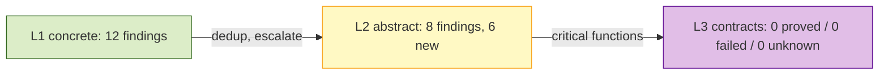
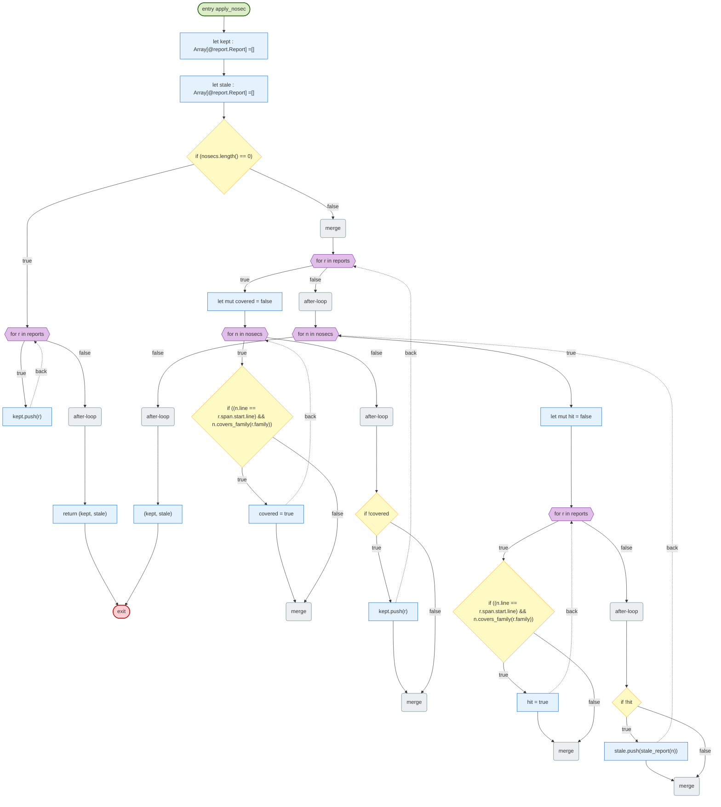
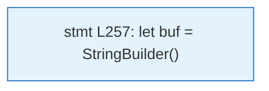

# LunaFlow analysis report — riantr/moonbit_static_analysis@0.4.50

> Trace-driven (dynamic-first) control-flow, data-flow, value-range and slicing analysis for a mooncakes.io module.

## 1. Acquisition and version pinning

| Item | Value |
| --- | --- |
| Requested coordinate | `riantr/moonbit_static_analysis@latest` |
| Resolved version | `0.4.50` |
| Pinning strategy | `@latest` resolved through `moon fetch` (local registry index, newest non-yanked version) and pinned to `0.4.50` for ingestion, execution and reporting |
| Source root | `./.repos/riantr/moonbit_static_analysis/0.4.50` |
| Declared target | `wasm` |
| Direct dependencies | (none) |

## 2. Ingestion statistics

| Metric | Value |
| --- | --- |
| Source files parsed | 239 |
| Functions extracted | 3032 |
| Statements understood | 16592 |
| Statements unsupported | 738 |
| Frontend coverage | 95.7% |
| Parse issues | 0 |
| CFG functions | 600 of 3032 — the first 600 in file order; 2432 functions had no CFG and can carry no CFG finding |
| Trace events | 16993 |
| Interpreted steps | 4399 |
| Observed functions | 150 |
| Entry selection | the first 150 functions in file order (the `--max-functions` cap applies) |
| Wall time (analyzer) | 1325 ms |
| Selected level | L3 (funnel: L1 → L2 → L3) |

## 3. Proof-strength levels and funnel

The same program is analyzed at three proof strengths. Levels are cumulative: L2 adds abstract interpretation on top of L1, L3 adds contract verification on top of the escalated functions. `--funnel` runs all three and reports what each level adds.

### 3.1 Level definitions

| Level | Name | Engine | Input model | Result strength |
| --- | --- | --- | --- | --- |
| L1 | Interpreter | concrete execution on the formal interpreter | concrete boundary values (`--trials`) | observed facts; may miss unexecuted inputs and paths |
| L2 | Value | abstract interpretation over a value-set / interval domain | whole input sets (`Int` intervals, `Bool`/`String` sets, array length intervals) | exhaustive over the abstract state; may-taint and may-range alarms (false positives possible) |
| L3 | Proof-by-contract | WP-style weakest-precondition VC generation + interval decision | ACSL-style `//@ requires` / `//@ ensures` specs | `proved` / `failed` / `unknown` per verification condition; specs are mandatory |

### 3.2 Funnel



| Level | Checks | New vs previous | Functions / VCs | Note |
| --- | --- | --- | --- | --- |
| L1 concrete | 12 findings | — | 150 functions | observed facts |
| L2 abstract | 8 findings | 6 | 150 functions, 20268 steps | exhaustive over the input abstraction |
| L3 contracts | 0 VCs | 0 failed, 0 unknown | 8 critical functions | specs required |

### 3.3 Escalation and specification gaps

Escalated functions (have at least one L1/L2 finding or a contract): `dir_of`, `ok_segment`, `ssa_cost_over_files`, `mm_parsed_with`, `mm_after_last`, `path_tail`, `mermaid_states`, `resolve_label`

Functions escalated without any contract (spec gap at L3): `dir_of (src/sa/main.mbt:1622)`, `ok_segment (src/sa/main.mbt:1858)`, `mermaid_states (src/sa/mermaid.mbt:43)`, `ssa_cost_over_files (src/sa/ssa_cost.mbt:89)`, `resolve_label (src/sa/provenance.mbt:260)`, `mm_parsed_with (src/sa/mermaid_test.mbt:76)`, `mm_after_last (src/sa/mermaid_test.mbt:236)`, `path_tail (src/core/core.mbt:59)`

## 4. Control-flow analysis

CFG nodes are built from the parsed statement tree; execution paths come from the concrete-execution trace engine. Dead/unreachable detection is static; path coverage and budget findings are dynamic. See `docs/design.md` §5 for the mapping rules.

### 4.1 CFG diagrams (top 8 by cyclomatic complexity)

#### `scan` (src/sa/main.mbt)

_Diagram omitted: 147 nodes exceeds the readability cap (90). Findings for this function are listed below._

#### `d_strata` (src/flow/datalog.mbt)

```mermaid
flowchart TD
  classDef entryNode fill:#dcedc8,stroke:#33691e,stroke-width:2px
  classDef exitNode fill:#ffcdd2,stroke:#b71c1c,stroke-width:2px
  classDef branchNode fill:#fff9c4,stroke:#f9a825
  classDef loopNode fill:#e1bee7,stroke:#6a1b9a
  classDef mergeNode fill:#eceff1,stroke:#607d8b
  classDef deadNode fill:#eeeeee,stroke:#9e9e9e
  classDef stmtNode fill:#e3f2fd,stroke:#1565c0
  n0(["entry d_strata"]):::entryNode
  n1(["exit"]):::exitNode
  n2["let deps = d_deps(prog, idb)"]:::stmtNode
  n3["let reach = d_reach(deps)"]:::stmtNode
  n4["let preds = dkeys(idb)"]:::stmtNode
  n5["let groups : Array[Array[String]] =[]"]:::stmtNode
  n6["let placed : Map[String, Bool] = Map([])"]:::stmtNode
  n7{{"for p in preds"}}:::loopNode
  n8{"if placed.contains(p)"}:::branchNode
  n9["continue"]:::stmtNode
  n10("merge"):::mergeNode
  n11["let group : Array[String] =[]"]:::stmtNode
  n12{{"for q in preds"}}:::loopNode
  n13{"if placed.contains(q)"}:::branchNode
  n14["continue"]:::stmtNode
  n15("merge"):::mergeNode
  n16["let pq = match reach.get(p) { Some(s) =#gt; s None =#gt; Map([])}"]:::stmtNode
  n17["let qp = match reach.get(q) { Some(s) =#gt; s None =#gt; Map([])}"]:::stmtNode
  n18["let same = match p == q { true =#gt; true false =#gt; pq.contains(q) && qp.contains(p)}"]:::stmtNode
  n19{"if same"}:::branchNode
  n20["group.push(q)"]:::stmtNode
  n21["placed.set(q, true)"]:::stmtNode
  n22("merge"):::mergeNode
  n23("after-loop"):::mergeNode
  n24["groups.push(group)"]:::stmtNode
  n25("after-loop"):::mergeNode
  n26["let levels : Map[String, Int32] = Map([])"]:::stmtNode
  n27{{"for g in groups"}}:::loopNode
  n28{{"for p in g"}}:::loopNode
  n29["levels.set(p, 0)"]:::stmtNode
  n30("after-loop"):::mergeNode
  n31("after-loop"):::mergeNode
  n32["let mut changed = true"]:::stmtNode
  n33["let mut passes = 0"]:::stmtNode
  n34{{"while (changed && (passes #lt; 64))"}}:::loopNode
  n35["changed = false"]:::stmtNode
  n36["passes = passes + 1"]:::stmtNode
  n37{{"for g in groups"}}:::loopNode
  n38["let mut lvl = 0"]:::stmtNode
  n39{{"for p in g"}}:::loopNode
  n40["unsupported: match"]:::stmtNode
  n41("after-loop"):::mergeNode
  n42{{"for p in g"}}:::loopNode
  n43["let cur = match levels.get(p) { Some(l) =#gt; l None =#gt; 0}"]:::stmtNode
  n44{"if (lvl #gt; cur)"}:::branchNode
  n45["levels.set(p, lvl)"]:::stmtNode
  n46["changed = true"]:::stmtNode
  n47("merge"):::mergeNode
  n48("after-loop"):::mergeNode
  n49("after-loop"):::mergeNode
  n50("after-loop"):::mergeNode
  n51["let ordered : Array[Array[String]] =[]"]:::stmtNode
  n52["let used : Map[String, Bool] = Map([])"]:::stmtNode
  n53["let mut placed = 0"]:::stmtNode
  n54["let mut lvl = 0"]:::stmtNode
  n55["let mut guard2 = 0"]:::stmtNode
  n56{{"while ((placed #lt; groups.length()) && (guard2 #lt; 64))"}}:::loopNode
  n57["guard2 = guard2 + 1"]:::stmtNode
  n58{{"for g in groups"}}:::loopNode
  n59["let mut gl = 0"]:::stmtNode
  n60{{"for p in g"}}:::loopNode
  n61["let l = match levels.get(p) { Some(x) =#gt; x None =#gt; 0}"]:::stmtNode
  n62{"if (l #gt; gl)"}:::branchNode
  n63["gl = l"]:::stmtNode
  n64("merge"):::mergeNode
  n65("after-loop"):::mergeNode
  n66{"if (gl == lvl)"}:::branchNode
  n67["let fresh : Array[String] =[]"]:::stmtNode
  n68{{"for p in g"}}:::loopNode
  n69{"if (used.contains(p) == false)"}:::branchNode
  n70["fresh.push(p)"]:::stmtNode
  n71["used.set(p, true)"]:::stmtNode
  n72("merge"):::mergeNode
  n73("after-loop"):::mergeNode
  n74{"if (fresh.length() #gt; 0)"}:::branchNode
  n75["ordered.push(fresh)"]:::stmtNode
  n76["placed = placed + 1"]:::stmtNode
  n77("merge"):::mergeNode
  n78("merge"):::mergeNode
  n79("after-loop"):::mergeNode
  n80["lvl = lvl + 1"]:::stmtNode
  n81("after-loop"):::mergeNode
  n82["ordered"]:::stmtNode
  n0 --> n2
  n2 --> n3
  n3 --> n4
  n4 --> n5
  n5 --> n6
  n6 --> n7
  n8 -->|true| n9
  n8 -->|false| n10
  n10 --> n11
  n11 --> n12
  n13 -->|true| n14
  n13 -->|false| n15
  n15 --> n16
  n16 --> n17
  n17 --> n18
  n18 --> n19
  n20 --> n21
  n19 -->|true| n20
  n21 --> n22
  n19 -->|false| n22
  n12 -->|true| n13
  n21 -.->|back| n12
  n12 -->|false| n23
  n23 --> n24
  n7 -->|true| n8
  n24 -.->|back| n7
  n7 -->|false| n25
  n25 --> n26
  n26 --> n27
  n28 -->|true| n29
  n29 -.->|back| n28
  n28 -->|false| n30
  n27 -->|true| n28
  n27 -.->|back| n27
  n27 -->|false| n31
  n31 --> n32
  n32 --> n33
  n33 --> n34
  n35 --> n36
  n36 --> n37
  n38 --> n39
  n39 -->|true| n40
  n40 -.->|back| n39
  n39 -->|false| n41
  n41 --> n42
  n43 --> n44
  n45 --> n46
  n44 -->|true| n45
  n46 --> n47
  n44 -->|false| n47
  n42 -->|true| n43
  n46 -.->|back| n42
  n42 -->|false| n48
  n37 -->|true| n38
  n37 -.->|back| n37
  n37 -->|false| n49
  n34 -->|true| n35
  n34 -.->|back| n34
  n34 -->|false| n50
  n50 --> n51
  n51 --> n52
  n52 --> n53
  n53 --> n54
  n54 --> n55
  n55 --> n56
  n57 --> n58
  n59 --> n60
  n61 --> n62
  n62 -->|true| n63
  n63 --> n64
  n62 -->|false| n64
  n60 -->|true| n61
  n63 -.->|back| n60
  n60 -->|false| n65
  n65 --> n66
  n67 --> n68
  n70 --> n71
  n69 -->|true| n70
  n71 --> n72
  n69 -->|false| n72
  n68 -->|true| n69
  n71 -.->|back| n68
  n68 -->|false| n73
  n73 --> n74
  n75 --> n76
  n74 -->|true| n75
  n76 --> n77
  n74 -->|false| n77
  n66 -->|true| n67
  n77 --> n78
  n66 -->|false| n78
  n58 -->|true| n59
  n76 -.->|back| n58
  n58 -->|false| n79
  n79 --> n80
  n56 -->|true| n57
  n80 -.->|back| n56
  n56 -->|false| n81
  n81 --> n82
  n82 --> n1
```



#### `pta_ctx_run_heap` (src/flow/pta_ctx.mbt)

_Diagram omitted: 99 nodes exceeds the readability cap (90). Findings for this function are listed below._

#### `pfg_solve` (src/flow/pfg.mbt)

```mermaid
flowchart TD
  classDef entryNode fill:#dcedc8,stroke:#33691e,stroke-width:2px
  classDef exitNode fill:#ffcdd2,stroke:#b71c1c,stroke-width:2px
  classDef branchNode fill:#fff9c4,stroke:#f9a825
  classDef loopNode fill:#e1bee7,stroke:#6a1b9a
  classDef mergeNode fill:#eceff1,stroke:#607d8b
  classDef deadNode fill:#eeeeee,stroke:#9e9e9e
  classDef stmtNode fill:#e3f2fd,stroke:#1565c0
  n0(["entry pfg_solve"]):::entryNode
  n1(["exit"]):::exitNode
  n2["let graph = pfg_new()"]:::stmtNode
  n3["let pt : Map[String, Map[String, Bool]] = Map([])"]:::stmtNode
  n4["let wl : Array[(String, Map[String, Bool])] =[]"]:::stmtNode
  n5["let trace : Array[String] =[]"]:::stmtNode
  n6["let mut head = 0"]:::stmtNode
  n7["let mut propagated = 0"]:::stmtNode
  n8["let mut skipped = 0"]:::stmtNode
  n9{{"for v in g.source_order()"}}:::loopNode
  n10{"if pta_alloc_of(g.kinds[v])"}:::branchNode
  n11("merge"):::mergeNode
  n12[""]:::stmtNode
  n13["{ let obj = pta_site_of(sites, 0, v) wl.push((pta_bound_name(g.kinds[v]), pfg_set_one(o..."]:::stmtNode
  n14("after-loop"):::mergeNode
  n15{{"for pair in pfg_assign_edges(g)"}}:::loopNode
  n16["let _ = pfg_add_edge(graph, pair.0, pair.1)"]:::stmtNode
  n17("after-loop"):::mergeNode
  n18["let stores = pfg_stores(g)"]:::stmtNode
  n19["let loads = pfg_loads(g)"]:::stmtNode
  n20["let expr_stores = pfg_expr_stores(g)"]:::stmtNode
  n21{{"while (head #lt; wl.length())"}}:::loopNode
  n22["let node = wl[head].0"]:::stmtNode
  n23["let pts = wl[head].1"]:::stmtNode
  n24["head = head + 1"]:::stmtNode
  n25["propagated = propagated + 1"]:::stmtNode
  n26["trace.push(pfg_entry_text(node, pts))"]:::stmtNode
  n27["let cur = match pt.get(node) { Some(v) =#gt; v None =#gt; name_set_empty()}"]:::stmtNode
  n28["let delta = name_set_subtract(pts, cur)"]:::stmtNode
  n29{"if (delta.length() == 0)"}:::branchNode
  n30["skipped = skipped + 1"]:::stmtNode
  n31["continue"]:::stmtNode
  n32("merge"):::mergeNode
  n33["pt.set(node, name_set_union(cur, delta))"]:::stmtNode
  n34{{"for _, s in pfg_succ(graph, node)"}}:::loopNode
  n35["wl.push((s, delta))"]:::stmtNode
  n36("after-loop"):::mergeNode
  n37{{"for o, _ in delta"}}:::loopNode
  n38{{"for triple in stores"}}:::loopNode
  n39{"if (triple.0 == node)"}:::branchNode
  n40["let fld = o +.+ triple.1"]:::stmtNode
  n41{"if pfg_add_edge(graph, triple.2, fld)"}:::branchNode
  n42["let src = match pt.get(triple.2) { Some(v) =#gt; v None =#gt; name_set_empty()}"]:::stmtNode
  n43{"if (src.length() #gt; 0)"}:::branchNode
  n44["wl.push((fld, src))"]:::stmtNode
  n45("merge"):::mergeNode
  n46("merge"):::mergeNode
  n47("merge"):::mergeNode
  n48("after-loop"):::mergeNode
  n49{{"for triple in loads"}}:::loopNode
  n50{"if (triple.0 == node)"}:::branchNode
  n51["let fld = o +.+ triple.1"]:::stmtNode
  n52{"if pfg_add_edge(graph, fld, triple.2)"}:::branchNode
  n53["let src = match pt.get(fld) { Some(v) =#gt; v None =#gt; name_set_empty()}"]:::stmtNode
  n54{"if (src.length() #gt; 0)"}:::branchNode
  n55["wl.push((triple.2, src))"]:::stmtNode
  n56("merge"):::mergeNode
  n57("merge"):::mergeNode
  n58("merge"):::mergeNode
  n59("after-loop"):::mergeNode
  n60("after-loop"):::mergeNode
  n61("after-loop"):::mergeNode
  n62["PfgResult::{ graph, pts : pt, propagated, skipped, expr_stores, trace,}"]:::stmtNode
  n0 --> n2
  n2 --> n3
  n3 --> n4
  n4 --> n5
  n5 --> n6
  n6 --> n7
  n7 --> n8
  n8 --> n9
  n10 -->|true| n11
  n10 -->|false| n11
  n11 --> n12
  n12 --> n13
  n9 -->|true| n10
  n13 -.->|back| n9
  n9 -->|false| n14
  n14 --> n15
  n15 -->|true| n16
  n16 -.->|back| n15
  n15 -->|false| n17
  n17 --> n18
  n18 --> n19
  n19 --> n20
  n20 --> n21
  n22 --> n23
  n23 --> n24
  n24 --> n25
  n25 --> n26
  n26 --> n27
  n27 --> n28
  n28 --> n29
  n30 --> n31
  n29 -->|true| n30
  n29 -->|false| n32
  n32 --> n33
  n33 --> n34
  n34 -->|true| n35
  n35 -.->|back| n34
  n34 -->|false| n36
  n36 --> n37
  n40 --> n41
  n42 --> n43
  n43 -->|true| n44
  n44 --> n45
  n43 -->|false| n45
  n41 -->|true| n42
  n45 --> n46
  n41 -->|false| n46
  n39 -->|true| n40
  n46 --> n47
  n39 -->|false| n47
  n38 -->|true| n39
  n44 -.->|back| n38
  n38 -->|false| n48
  n48 --> n49
  n51 --> n52
  n53 --> n54
  n54 -->|true| n55
  n55 --> n56
  n54 -->|false| n56
  n52 -->|true| n53
  n56 --> n57
  n52 -->|false| n57
  n50 -->|true| n51
  n57 --> n58
  n50 -->|false| n58
  n49 -->|true| n50
  n55 -.->|back| n49
  n49 -->|false| n59
  n37 -->|true| n38
  n37 -.->|back| n37
  n37 -->|false| n60
  n21 -->|true| n22
  n21 -.->|back| n21
  n21 -->|false| n61
  n61 --> n62
  n62 --> n1
```

#### `emit_file` (src/sa/mermaid.mbt)

```mermaid
flowchart TD
  classDef entryNode fill:#dcedc8,stroke:#33691e,stroke-width:2px
  classDef exitNode fill:#ffcdd2,stroke:#b71c1c,stroke-width:2px
  classDef branchNode fill:#fff9c4,stroke:#f9a825
  classDef loopNode fill:#e1bee7,stroke:#6a1b9a
  classDef mergeNode fill:#eceff1,stroke:#607d8b
  classDef deadNode fill:#eeeeee,stroke:#9e9e9e
  classDef stmtNode fill:#e3f2fd,stroke:#1565c0
  n0(["entry emit_file"]):::entryNode
  n1(["exit"]):::exitNode
  n2["let defects = v.findings.length()"]:::stmtNode
  n3["out.write_string(    state #quot;/{fid} — /{sanitize(v.path)}#quot; as /{fid} { )"]:::stmtNode
  n4["out.write_string(        direction TB )"]:::stmtNode
  n5["out.write_string(        [*] --#gt; /{fid}_lex )"]:::stmtNode
  n6["out.write_string(        state #quot;lexed#quot; as /{fid}_lex )"]:::stmtNode
  n7["let parsed_note = if v.parsed { whole file read} else { sanitize(v.reason)}"]:::stmtNode
  n8["out.write_string(        /{fid}_lex --#gt; /{fid}_struct : /{parsed_note} )"]:::stmtNode
  n9["out.write_string(         state #quot;inspection 1/3 — structural#quot; as /{fid}_struc..."]:::stmtNode
  n10["out.write_string(        /{fid}_struct --#gt; /{fid}_type : inspection 2/3 )"]:::stmtNode
  n11["out.write_string(        state #quot;inspection 2/3 — type#quot; as /{fid}_type )"]:::stmtNode
  n12["out.write_string(        /{fid}_type --#gt; /{fid}_behav : inspection 3/3 )"]:::stmtNode
  n13["out.write_string(         state #quot;inspection 3/3 — behavioral#quot; as /{fid}_behav ,)"]:::stmtNode
  n14{"if ((v.region_line #gt; 0) && !v.parsed)"}:::branchNode
  n15["out.write_string(         /{fid}_behav --#gt; [*] : /{v.unreliable} withheld past the b..."]:::stmtNode
  n16["out.write_string(        /{fid}_behav --#gt; [*] )"]:::stmtNode
  n17("merge"):::mergeNode
  n18{"if (v.notices #gt; 0)"}:::branchNode
  n19["let head = if v.notices == 1 { 1 finding on this file is a NOTICE, not a defect: the an..."]:::stmtNode
  n20["note(out, /{fid}_struct,[ head, stand behind them -- a form it does not model, or a nam..."]:::stmtNode
  n21("merge"):::mergeNode
  n22{"if (v.unreliable #gt; 0)"}:::branchNode
  n23["let head = if v.unreliable == 1 { 1 further finding on this file sits at or after line ..."]:::stmtNode
  n24["note(out, /{fid}_behav,[ head, where the tree is already wrong. They are counted as unr..."]:::stmtNode
  n25("merge"):::mergeNode
  n26["let limit = cap(per_file, defects)"]:::stmtNode
  n27["let counts = Map([])"]:::stmtNode
  n28["let mut notices_dropped = 0"]:::stmtNode
  n29{{"for k, rep in v.findings"}}:::loopNode
  n30{"if (k #lt; limit)"}:::branchNode
  n31["let notice = is_notice(rep)"]:::stmtNode
  n32["let eid = if notice { /{fid}_n/{k}} else { /{fid}_e/{k}}"]:::stmtNode
  n33["let lens = primary_lens(rep.lenses)"]:::stmtNode
  n34["let tag = if notice { notice} else { defect}"]:::stmtNode
  n35["out.write_string(         /{fid}_/{lens} --#gt; /{eid} : /{tag} /{rep.family.name()} ,)"]:::stmtNode
  n36["let where_ = @/{rep.span.start.line}:/{rep.span.start.col}"]:::stmtNode
  n37["let lead = if notice { NOTICE — } else { }"]:::stmtNode
  n38["out.write_string(         state #quot;/{lead}/{rep.family.name()} /{where_} — /{sanitiz..."]:::stmtNode
  n39{"if notice"}:::branchNode
  n40["let body = if rep.is_declared_scope_limit() {[ NOTICE — counted in `notices`, excluded ..."]:::stmtNode
  n41["note(out, eid, body)"]:::stmtNode
  n42["let a = rep.family.advice()"]:::stmtNode
  n43["let body =[WHY:  + a.why, HOW:  + a.how]"]:::stmtNode
  n44{"if (rep.lenses.length() #gt; 1)"}:::branchNode
  n45["body.push( SEEN BY:  + lens_list(rep.lenses) +  — the lenses agree, so this is not one ..."]:::stmtNode
  n46("merge"):::mergeNode
  n47["note(out, eid, body)"]:::stmtNode
  n48("merge"):::mergeNode
  n49{"if is_notice(rep)"}:::branchNode
  n50["notices_dropped += 1"]:::stmtNode
  n51["let key = primary_lens(rep.lenses)"]:::stmtNode
  n52["let n = match counts.get(key) { Some(x) =#gt; x None =#gt; 0}"]:::stmtNode
  n53["counts.set(key, n + 1)"]:::stmtNode
  n54("merge"):::mergeNode
  n55("merge"):::mergeNode
  n56("after-loop"):::mergeNode
  n57["let dropped = defects - limit"]:::stmtNode
  n58{"if (dropped #gt; 0)"}:::branchNode
  n59["let mut parts = "]:::stmtNode
  n60{{"for _, key in counts.keys()"}}:::loopNode
  n61{"if (parts != #quot;#quot;)"}:::branchNode
  n62["parts = parts + , "]:::stmtNode
  n63("merge"):::mergeNode
  n64["unsupported: match"]:::stmtNode
  n65("after-loop"):::mergeNode
  n66["let head = if dropped == 1 { 1 further finding on this file was NOT drawn, because this..."]:::stmtNode
  n67["let body =[ head, diagram caps a file at /{limit}. Per inspection:  + parts +., Re-run ..."]:::stmtNode
  n68{"if (notices_dropped #gt; 0)"}:::branchNode
  n69["let nt = if notices_dropped == 1 { 1 of them is a NOTICE, excluded from `actionable`.} ..."]:::stmtNode
  n70["body.push(nt)"]:::stmtNode
  n71("merge"):::mergeNode
  n72["note(out, /{fid}_struct, body)"]:::stmtNode
  n73("merge"):::mergeNode
  n74["out.write_string(    } )"]:::stmtNode
  n0 --> n2
  n2 --> n3
  n3 --> n4
  n4 --> n5
  n5 --> n6
  n6 --> n7
  n7 --> n8
  n8 --> n9
  n9 --> n10
  n10 --> n11
  n11 --> n12
  n12 --> n13
  n13 --> n14
  n14 -->|true| n15
  n14 -->|false| n16
  n15 --> n17
  n16 --> n17
  n17 --> n18
  n19 --> n20
  n18 -->|true| n19
  n20 --> n21
  n18 -->|false| n21
  n21 --> n22
  n23 --> n24
  n22 -->|true| n23
  n24 --> n25
  n22 -->|false| n25
  n25 --> n26
  n26 --> n27
  n27 --> n28
  n28 --> n29
  n31 --> n32
  n32 --> n33
  n33 --> n34
  n34 --> n35
  n35 --> n36
  n36 --> n37
  n37 --> n38
  n38 --> n39
  n40 --> n41
  n42 --> n43
  n43 --> n44
  n44 -->|true| n45
  n45 --> n46
  n44 -->|false| n46
  n46 --> n47
  n39 -->|true| n40
  n39 -->|false| n42
  n41 --> n48
  n47 --> n48
  n51 --> n52
  n52 --> n53
  n49 -->|true| n50
  n49 -->|false| n51
  n50 --> n54
  n53 --> n54
  n30 -->|true| n31
  n30 -->|false| n49
  n48 --> n55
  n54 --> n55
  n29 -->|true| n30
  n53 -.->|back| n29
  n29 -->|false| n56
  n56 --> n57
  n57 --> n58
  n59 --> n60
  n61 -->|true| n62
  n62 --> n63
  n61 -->|false| n63
  n63 --> n64
  n60 -->|true| n61
  n64 -.->|back| n60
  n60 -->|false| n65
  n65 --> n66
  n66 --> n67
  n67 --> n68
  n69 --> n70
  n68 -->|true| n69
  n70 --> n71
  n68 -->|false| n71
  n71 --> n72
  n58 -->|true| n59
  n72 --> n73
  n58 -->|false| n73
  n73 --> n74
  n74 --> n1
```



Observed path (trial 0, first 24 events): `def@184` -> `call@185` -> `call@186` -> `call@190` -> `call@191` -> `def@192` -> `call@197` -> `call@198` -> `call@201` -> `call@202` -> `call@203` -> `call@204` -> `cond@207` -> `call@209` -> `cond@215` -> `def@216` -> `call@221` -> `cond@226` -> `def@227` -> `call@232` -> `call@238` -> `def@238` -> `call@239` -> `def@239`

#### `mm_check` (src/sa/mermaid_test.mbt)

```mermaid
flowchart TD
  classDef entryNode fill:#dcedc8,stroke:#33691e,stroke-width:2px
  classDef exitNode fill:#ffcdd2,stroke:#b71c1c,stroke-width:2px
  classDef branchNode fill:#fff9c4,stroke:#f9a825
  classDef loopNode fill:#e1bee7,stroke:#6a1b9a
  classDef mergeNode fill:#eceff1,stroke:#607d8b
  classDef deadNode fill:#eeeeee,stroke:#9e9e9e
  classDef stmtNode fill:#e3f2fd,stroke:#1565c0
  n0(["entry mm_check"]):::entryNode
  n1(["exit"]):::exitNode
  n2["let errs =[]"]:::stmtNode
  n3["let declared =[]"]:::stmtNode
  n4["let edges =[]"]:::stmtNode
  n5["let mut in_note = false"]:::stmtNode
  n6["let lines = mm_lines(src)"]:::stmtNode
  n7{{"for raw in lines"}}:::loopNode
  n8["let t = raw.trim().to_owned()"]:::stmtNode
  n9{"if in_note"}:::branchNode
  n10{"if (t == #quot;end note#quot;)"}:::branchNode
  n11["in_note = false"]:::stmtNode
  n12{"if (t == #quot;#quot;)"}:::branchNode
  n13["errs.push(blank line inside a note: the block end is lost)"]:::stmtNode
  n14("merge"):::mergeNode
  n15("merge"):::mergeNode
  n16["continue"]:::stmtNode
  n17("merge"):::mergeNode
  n18{"if (((t == #quot;#quot;) &#124;&#124; t.has_prefix(#quot;%%#quot;)) &#124;&#124; (t == ..."}:::branchNode
  n19["continue"]:::stmtNode
  n20("merge"):::mergeNode
  n21{"if ((t.has_prefix(#quot;direction #quot;) &#124;&#124; (t == #quot;{#quot;)) &#124;&#12..."}:::branchNode
  n22["continue"]:::stmtNode
  n23("merge"):::mergeNode
  n24{"if t.has_prefix(#quot;note right of #quot;)"}:::branchNode
  n25["let anchor = mm_after_last(t, note right of )"]:::stmtNode
  n26{"if !mm_valid_id(anchor)"}:::branchNode
  n27["errs.push(note anchor is not an identifier:  + anchor)"]:::stmtNode
  n28("merge"):::mergeNode
  n29["in_note = true"]:::stmtNode
  n30["continue"]:::stmtNode
  n31("merge"):::mergeNode
  n32{"if t.has_prefix(#quot;state #quot;#quot;)"}:::branchNode
  n33{"if (mm_count_quotes(t) != 2)"}:::branchNode
  n34["errs.push(state label is not one quoted string:  + t)"]:::stmtNode
  n35("merge"):::mergeNode
  n36["let bare = mm_state_id(t)"]:::stmtNode
  n37{"if !mm_valid_id(bare)"}:::branchNode
  n38["errs.push(state id is not an identifier:  + bare)"]:::stmtNode
  n39{"if !declared.contains(bare)"}:::branchNode
  n40["declared.push(bare)"]:::stmtNode
  n41("merge"):::mergeNode
  n42("merge"):::mergeNode
  n43["continue"]:::stmtNode
  n44("merge"):::mergeNode
  n45{"if t.contains(#quot; --#gt; #quot;)"}:::branchNode
  n46["let head = mm_before_first(t,  : )"]:::stmtNode
  n47["let toks = mm_spaces(head.replace(old =  --#gt; , new =  ))"]:::stmtNode
  n48{"if (toks.length() != 2)"}:::branchNode
  n49["errs.push(transition is not `A --#gt; B` or `A --#gt; B : label`:  + t)"]:::stmtNode
  n50["continue"]:::stmtNode
  n51("merge"):::mergeNode
  n52["edges.push([toks[0], toks[1]])"]:::stmtNode
  n53["continue"]:::stmtNode
  n54("merge"):::mergeNode
  n55["errs.push(line is not a form this renderer may emit:  + t)"]:::stmtNode
  n56("after-loop"):::mergeNode
  n57{"if in_note"}:::branchNode
  n58["errs.push(a note was opened and never closed)"]:::stmtNode
  n59("merge"):::mergeNode
  n60{{"for e in edges"}}:::loopNode
  n61{{"for ep in e"}}:::loopNode
  n62{"if ((ep != #quot;[*]#quot;) && !declared.contains(ep))"}:::branchNode
  n63["errs.push(transition names an undeclared state:  + ep)"]:::stmtNode
  n64("merge"):::mergeNode
  n65("after-loop"):::mergeNode
  n66("after-loop"):::mergeNode
  n67["errs"]:::stmtNode
  n0 --> n2
  n2 --> n3
  n3 --> n4
  n4 --> n5
  n5 --> n6
  n6 --> n7
  n8 --> n9
  n12 -->|true| n13
  n13 --> n14
  n12 -->|false| n14
  n10 -->|true| n11
  n10 -->|false| n12
  n11 --> n15
  n14 --> n15
  n15 --> n16
  n9 -->|true| n10
  n9 -->|false| n17
  n17 --> n18
  n18 -->|true| n19
  n18 -->|false| n20
  n20 --> n21
  n21 -->|true| n22
  n21 -->|false| n23
  n23 --> n24
  n25 --> n26
  n26 -->|true| n27
  n27 --> n28
  n26 -->|false| n28
  n28 --> n29
  n29 --> n30
  n24 -->|true| n25
  n24 -->|false| n31
  n31 --> n32
  n33 -->|true| n34
  n34 --> n35
  n33 -->|false| n35
  n35 --> n36
  n36 --> n37
  n39 -->|true| n40
  n40 --> n41
  n39 -->|false| n41
  n37 -->|true| n38
  n37 -->|false| n39
  n38 --> n42
  n41 --> n42
  n42 --> n43
  n32 -->|true| n33
  n32 -->|false| n44
  n44 --> n45
  n46 --> n47
  n47 --> n48
  n49 --> n50
  n48 -->|true| n49
  n48 -->|false| n51
  n51 --> n52
  n52 --> n53
  n45 -->|true| n46
  n45 -->|false| n54
  n54 --> n55
  n7 -->|true| n8
  n55 -.->|back| n7
  n7 -->|false| n56
  n56 --> n57
  n57 -->|true| n58
  n58 --> n59
  n57 -->|false| n59
  n59 --> n60
  n62 -->|true| n63
  n63 --> n64
  n62 -->|false| n64
  n61 -->|true| n62
  n63 -.->|back| n61
  n61 -->|false| n65
  n60 -->|true| n61
  n60 -.->|back| n60
  n60 -->|false| n66
  n66 --> n67
  n67 --> n1
```



Observed path (trial 0, first 8 events): `def@298` -> `def@299` -> `def@300` -> `def@301` -> `call@302` -> `def@302` -> `cond@353` -> `def@297`

#### `laws_violation` (src/flow/laws_test.mbt)

```mermaid
flowchart TD
  classDef entryNode fill:#dcedc8,stroke:#33691e,stroke-width:2px
  classDef exitNode fill:#ffcdd2,stroke:#b71c1c,stroke-width:2px
  classDef branchNode fill:#fff9c4,stroke:#f9a825
  classDef loopNode fill:#e1bee7,stroke:#6a1b9a
  classDef mergeNode fill:#eceff1,stroke:#607d8b
  classDef deadNode fill:#eeeeee,stroke:#9e9e9e
  classDef stmtNode fill:#e3f2fd,stroke:#1565c0
  n0(["entry laws_violation"]):::entryNode
  n1(["exit"]):::exitNode
  n2{{"for a in elems"}}:::loopNode
  n3{"if (lat.eq(lat.join(a, a), a) == false)"}:::branchNode
  n4["return (#quot;not idempotent at #quot; + show(a))"]:::stmtNode
  n5("merge"):::mergeNode
  n6{"if (lat.eq(lat.join(lat.bot(), a), a) == false)"}:::branchNode
  n7["return (#quot;the bottom is not the identity of the join at #quot; + show(a))"]:::stmtNode
  n8("merge"):::mergeNode
  n9{{"for b in elems"}}:::loopNode
  n10["let jab =(lat.join)(a, b)"]:::stmtNode
  n11{"if (lat.eq(jab, lat.join(b, a)) == false)"}:::branchNode
  n12["return (((#quot;not commutative at #quot; + show(a)) + #quot; and #quot;) + show(b))"]:::stmtNode
  n13("merge"):::mergeNode
  n14{"if (order(a, jab) == false)"}:::branchNode
  n15["return (((#quot;the join is not an upper bound of its LEFT operand at #quot; + show(a))..."]:::stmtNode
  n16("merge"):::mergeNode
  n17{"if (order(b, jab) == false)"}:::branchNode
  n18["return (((#quot;the join is not an upper bound of its RIGHT operand at #quot; + show(a)..."]:::stmtNode
  n19("merge"):::mergeNode
  n20["let both = order(a, b) && order(b, a)"]:::stmtNode
  n21{"if ((both == lat.eq(a, b)) == false)"}:::branchNode
  n22["return (((#quot;eq and order disagree at #quot; + show(a)) + #quot; and #quot;) + show(b))"]:::stmtNode
  n23("merge"):::mergeNode
  n24{{"for c in elems"}}:::loopNode
  n25{"if (lat.eq(lat.join(jab, c), lat.join(a, lat.join(b, c))) == false)"}:::branchNode
  n26["return (((((#quot;not associative at #quot; + show(a)) + #quot;, #quot;) + show(b)) + #..."]:::stmtNode
  n27("merge"):::mergeNode
  n28{"if ((order(a, c) && order(b, c)) && (order(jab, c) == false))"}:::branchNode
  n29["return ((((((#quot;the join is not the LEAST upper bound at #quot; + show(a)) + #quot; ..."]:::stmtNode
  n30("merge"):::mergeNode
  n31("after-loop"):::mergeNode
  n32("after-loop"):::mergeNode
  n33("after-loop"):::mergeNode
  n34[""]:::stmtNode
  n0 --> n2
  n4 --> n1
  n3 -->|true| n4
  n3 -->|false| n5
  n5 --> n6
  n7 --> n1
  n6 -->|true| n7
  n6 -->|false| n8
  n8 --> n9
  n10 --> n11
  n12 --> n1
  n11 -->|true| n12
  n11 -->|false| n13
  n13 --> n14
  n15 --> n1
  n14 -->|true| n15
  n14 -->|false| n16
  n16 --> n17
  n18 --> n1
  n17 -->|true| n18
  n17 -->|false| n19
  n19 --> n20
  n20 --> n21
  n22 --> n1
  n21 -->|true| n22
  n21 -->|false| n23
  n23 --> n24
  n26 --> n1
  n25 -->|true| n26
  n25 -->|false| n27
  n27 --> n28
  n29 --> n1
  n28 -->|true| n29
  n28 -->|false| n30
  n24 -->|true| n25
  n29 -.->|back| n24
  n24 -->|false| n31
  n9 -->|true| n10
  n9 -.->|back| n9
  n9 -->|false| n32
  n2 -->|true| n3
  n2 -.->|back| n2
  n2 -->|false| n33
  n33 --> n34
  n34 --> n1
```

#### `apply_nosec` (src/sa/profile.mbt)



Observed path (trial 0, first 9 events): `def@300` -> `def@301` -> `cond@302` -> `ret@306` -> `def@300` -> `def@301` -> `cond@302` -> `ret@306` -> `def@296`

### 4.2 CFG findings

| Rule | Severity | Function | Location | Message | Method | Confidence |
| --- | --- | --- | --- | --- | --- | --- |
| BUDGET-EXCEEDED | warning | path_tail | src/core/core.mbt:70 | execution budget exhausted; loop may be non-terminating or inputs too large | dynamic | 0.6 |

### 4.3 Static vs dynamic attribution

| Signal | Method | What a hit means | Known limitation |
| --- | --- | --- | --- |
| Unreachable statement | static | no CFG predecessor; often after `return`/`break` | parser gaps can hide real predecessors |
| Infinite loop | static + dynamic | constant-true condition without break, or iteration cap reached | loops whose exit depends on unmodelled calls are reported as *budget*, not proven infinite |
| Uncovered code | dynamic (coverage import) | zero hits in the observed test suite | absence of execution is not proof of dead code |

## 5. Data flow, taint and the memory layout

Sources are entry-function parameters (and `@env.args` when the frontend sees it); propagation follows recorded definitions and the variables read by each statement; sinks are array-index expressions and allocation sizes. The graph below is the *observed* propagation, not a may-analysis over all inputs.

```mermaid
flowchart LR
  classDef src fill:#ffcdd2,stroke:#b71c1c,stroke-width:2px
  classDef step fill:#fff9c4,stroke:#f9a825
  classDef sink fill:#c8e6c9,stroke:#1b5e20,stroke-width:2px
  t0["source: n"]:::src
  t1["source: cap"]:::src
  t2["#lt;ret#gt; = (?, ?)"]:::step
  t3["source: n"]:::src
  t4["source: cap"]:::src
  t5["#lt;ret#gt; = (?, ?)"]:::step
  t6["source: n"]:::src
  t7["source: cap"]:::src
  t8["#lt;ret#gt; = (?, ?)"]:::step
  t9["source: n"]:::src
  t10["source: cap"]:::src
  t11["#lt;ret#gt; = (?, ?)"]:::step
  t12["source: sp"]:::src
  t13["source: hiding"]:::src
  t14["source: sp"]:::src
  t15["source: hiding"]:::src
  t16["h = 0"]:::step
  t17["source: sp"]:::src
  t18["source: hiding"]:::src
  t19["h = 0"]:::step
  t20["source: sp"]:::src
  t21["source: hiding"]:::src
  t22["h = 1"]:::step
  t23["source: findings"]:::src
  t24["source: hiding"]:::src
  t25["source: findings"]:::src
  t26["source: hiding"]:::src
  t27["source: findings"]:::src
  t28["source: hiding"]:::src
  t29["source: findings"]:::src
  t30["source: hiding"]:::src
  t31["source: findings"]:::src
  t32["source: hiding"]:::src
  t33["source: show_notices"]:::src
  t34["source: findings"]:::src
  t35["source: hiding"]:::src
  t36["source: show_notices"]:::src
  t37["source: findings"]:::src
  t38["source: hiding"]:::src
  t39["source: show_notices"]:::src
  t0 -->|propagates| t2
  t3 -->|propagates| t5
  t6 -->|propagates| t8
  t9 -->|propagates| t11
  t15 -->|propagates| t16
  t18 -->|propagates| t19
  t21 -->|propagates| t22
```



### 5.1 Taint sinks

| Rule | Severity | Function | Location | Message | Method | Confidence |
| --- | --- | --- | --- | --- | --- | --- |
| TAINT-INDEX-RANGE | warning | dir_of | src/sa/main.mbt:1627 | untrusted input determines an array index; the observed index was inside the array, so no out-of-bounds access was witnessed | dynamic+symbolic | 0.5 |
| TAINT-INDEX | error | ok_segment | src/sa/main.mbt:1862 | tainted value reaches an array index / buffer offset | dynamic+symbolic | 0.8 |
| TAINT-INDEX | error | ok_segment | src/sa/main.mbt:1865 | tainted value reaches an array index / buffer offset | dynamic+symbolic | 0.8 |
| TAINT-INDEX-RANGE | warning | ssa_cost_over_files | src/sa/ssa_cost.mbt:111 | untrusted input determines an array index; the observed index was inside the array, so no out-of-bounds access was witnessed | dynamic+symbolic | 0.5 |
| TAINT-INDEX-RANGE | warning | ssa_cost_over_files | src/sa/ssa_cost.mbt:112 | untrusted input determines an array index; the observed index was inside the array, so no out-of-bounds access was witnessed | dynamic+symbolic | 0.5 |
| TAINT-INDEX-RANGE | warning | mm_parsed_with | src/sa/mermaid_test.mbt:84 | untrusted input determines an array index; the observed index was inside the array, so no out-of-bounds access was witnessed | dynamic+symbolic | 0.5 |
| TAINT-INDEX | error | mm_after_last | src/sa/mermaid_test.mbt:238 | tainted value reaches an array index / buffer offset | dynamic+symbolic | 0.8 |
| TAINT-INDEX-RANGE | warning | path_tail | src/core/core.mbt:65 | untrusted input determines an array index; the observed index was inside the array, so no out-of-bounds access was witnessed | dynamic+symbolic | 0.5 |
| TAINT-INDEX-RANGE | warning | path_tail | src/core/core.mbt:69 | untrusted input determines an array index; the observed index was inside the array, so no out-of-bounds access was witnessed | dynamic+symbolic | 0.5 |

### 5.2 L2 abstract findings (may-analysis)

Abstract interpretation joins all paths and widens loops, so these alarms are *may* properties: a hit means the abstract state cannot exclude the defect, not that a concrete input was observed. Two rules keep the may-analysis from crying wolf. A branch that is unreachable in ONE iteration of a loop is not reported, because the loop's state changes between the iterations. And a tainted index is only claimed when the container is known to be an array: the analyzer cannot see the type of a struct's field, and a Map's key is not an offset that untrusted input chose.

| Rule | Severity | Function | Location | Message | Method | Confidence |
| --- | --- | --- | --- | --- | --- | --- |
| TAINT-INDEX | error | ok_segment | src/sa/main.mbt:1862 | tainted value may reach an array index / buffer offset | L2-abstract | 0.6 |
| TAINT-INDEX | error | ok_segment | src/sa/main.mbt:1865 | tainted value may reach an array index / buffer offset | L2-abstract | 0.6 |
| TAINT-INDEX | error | mermaid_states | src/sa/mermaid.mbt:89 | tainted value may reach an array index / buffer offset | L2-abstract | 0.6 |
| TAINT-INDEX | error | mm_parsed_with | src/sa/mermaid_test.mbt:84 | tainted value may reach an array index / buffer offset | L2-abstract | 0.6 |

### 5.3 EVA findings (evolved value analysis)

The evolved value analysis rides on the same fixpoint and asks the second question about a value: not *what is its range* but *what happens when it is used*. These are the memory-safety and undefined-behaviour classes, mapped onto what MoonBit actually does — MoonBit's integer arithmetic WRAPS instead of trapping, so an overflow here is a silent wrong value and not a crash.

The index class is proved by the interval the abstract domain already computes — the array's length and the index's range are both known, so the comparison covers the whole input abstraction — and it is filed here because an index is a value USED to address storage.

| Rule | Severity | Function | Location | Message | Method | Confidence |
| --- | --- | --- | --- | --- | --- | --- |
| INDEX-OOB | error | ok_segment | src/sa/main.mbt:1862 | index may be out of bounds on some inputs | L2-EVA | 0.6 |
| INDEX-OOB | error | ok_segment | src/sa/main.mbt:1865 | index may be out of bounds on some inputs | L2-EVA | 0.6 |
| INDEX-OOB | error | resolve_label | src/sa/provenance.mbt:276 | index may be out of bounds on some inputs | L2-EVA | 0.6 |
| INDEX-OOB | error | mm_parsed_with | src/sa/mermaid_test.mbt:84 | index may be out of bounds on some inputs | L2-EVA | 0.6 |

### 5.4 The global region

MoonBit resolves top-level bindings by DEPENDENCY, not by file order: a global may read a global declared later in the file. The analyzer evaluates the global region once, in dependency order, outside the trials -- so a global's value does not depend on the input the analyzer happened to sample.

A top-level binding is IMMUTABLE in MoonBit: `let mut` at the top level is a parse error, so a global is a constant of the module. The analyzer still leaves a global unknown when the module assigns to it, because the analyzer does not compile the target and cannot know that the assignment is an error.

| Global | Type | Value | Location | State |
| --- | --- | --- | --- | --- |
| `flow` | String | "let k = 3
if k {
  print("yes")
}
fn ..." | src/samples/samples.mbt:155 | resolved in dependency order |
| `clean` | String | "fn fact(n: int) -> int {
  if n <= 1 ..." | src/samples/samples.mbt:94 | resolved in dependency order |
| `typing` | String | "fn shout(s: str) -> int {
  return le..." | src/samples/samples.mbt:142 | resolved in dependency order |
| `lit_max` | Int32 | 2147483647 | src/lexer/lexer.mbt:573 | resolved in dependency order |
| `iface_bad` | String | "// Generated using `moon info`, DON'T..." | src/samples/samples.mbt:67 | resolved in dependency order |
| `max_files` | Int32 | 20000 | src/sa/main.mbt:32 | resolved in dependency order |
| `proof_bad` | String | "///|
predicate is_hot(s : Severity) {..." | src/samples/samples.mbt:80 | resolved in dependency order |
| `structure` | String | "fn f(x: int, y: int) -> int {
  z = x..." | src/samples/samples.mbt:116 | resolved in dependency order |
| `undefined` | String | "fn g() -> int {
  return missing + 1
..." | src/samples/samples.mbt:106 | resolved in dependency order |
| `FOLD_LIMIT` | Int32 | 46340 | src/flow/cprop.mbt:194 | resolved in dependency order |
| `deadbranch` | String | "fn h(x: int) -> int {
  if 1 > 2 {
  ..." | src/samples/samples.mbt:128 | resolved in dependency order |
| `SAMPLE_FLOW` | String | "let k = 3
if k {
  print("yes")
}
fn ..." | src/pipeline/pipeline_test.mbt:37 | resolved in dependency order |
| `literate_md` | String | "# Demo document

A display-only block..." | src/samples/samples.mbt:13 | resolved in dependency order |
| `script_mbtx` | String | "import {
  "moonbitlang/core/list" @l..." | src/samples/samples.mbt:54 | resolved in dependency order |
| `SAMPLE_CLEAN` | String | "fn fact(n: int) -> int {
  if n <= 1 ..." | src/pipeline/pipeline_test.mbt:22 | resolved in dependency order |
| `SAMPLE_TYPING` | String | "fn shout(s: str) -> int {
  return le..." | src/pipeline/pipeline_test.mbt:28 | resolved in dependency order |
| `progress_every` | Int32 | 500 | src/sa/main.mbt:35 | resolved in dependency order |
| `SAMPLE_STRUCTURE` | String | "fn f(x: int, y: int) -> int {
  z = x..." | src/pipeline/pipeline_test.mbt:34 | resolved in dependency order |
| `SAMPLE_UNDEFINED` | String | "fn g() -> int {
  return missing + 1
..." | src/pipeline/pipeline_test.mbt:25 | resolved in dependency order |
| `SAMPLE_DEADBRANCH` | String | "fn h(x: int) -> int {
  if 1 > 2 {
  ..." | src/pipeline/pipeline_test.mbt:31 | resolved in dependency order |
| `default_findings_shown_per_file` | Int32 | 40 | src/sa/main.mbt:53 | resolved in dependency order |


### 5.5 Where the allocations live

MoonBit has no addresses: there is no pointer type, no address arithmetic and no address space, so a hardware memory model -- frames at fixed addresses, a heap, MMIO registers -- has nothing to model here. What there IS to model is placement. A **global** binding lives in the module's global region. An allocation that does not **escape** the function that made it could live in that function's frame. An allocation that **escapes** -- returned, stored into another object, handed to a call the analyzer cannot see into -- outlives the frame, so it is heap-allocated. A value from **outside** the analysed module has a region the analyzer cannot name.

The classification is STATIC: it is computed over the AST, so it does not depend on which inputs a run sampled.

Allocation sites: 367 — HEAP 194, FRAME 173.

| Allocation | Kind | Region | Location | Why |
| --- | --- | --- | --- | --- |
| split_findings | array literal | **FRAME** — frame (does not escape) | src/sa/main.mbt:119 | bound to the local printed and never leaves the frame |
| split_findings | array literal | **FRAME** — frame (does not escape) | src/sa/main.mbt:120 | bound to the local aggregated and never leaves the frame |
| notice_lines | array literal | **HEAP** — heap (escapes the frame) | src/sa/main.mbt:237 | returned, so it outlives the frame |
| count_by_shape | array literal | **HEAP** — heap (escapes the frame) | src/sa/main.mbt:272 | returned as the last expression of the function, so it outlives the frame |
| metrics_lines | array literal | **HEAP** — heap (escapes the frame) | src/sa/main.mbt:517 | returned as the last expression of the function, so it outlives the frame |
| scan | array literal | **FRAME** — frame (does not escape) | src/sa/main.mbt:736 | bound to the local files and never leaves the frame |
| scan | array literal | **FRAME** — frame (does not escape) | src/sa/main.mbt:747 | bound to the local iface_dirs and never leaves the frame |
| scan | array literal | **HEAP** — heap (escapes the frame) | src/sa/main.mbt:786 | passed to a call the analyzer cannot see into, so it may outlive the frame |
| scan | array literal | **FRAME** — frame (does not escape) | src/sa/main.mbt:796 | bound to the local kinds and never leaves the frame |
| scan | array literal | **FRAME** — frame (does not escape) | src/sa/main.mbt:802 | bound to the local aggregated_notices and never leaves the frame |
| collect | array literal | **FRAME** — frame (does not escape) | src/sa/main.mbt:1215 | bound to the local stack and never leaves the frame |
| filtered_reports | array literal | **FRAME** — frame (does not escape) | src/sa/main.mbt:1314 | bound to the local nosecs and never leaves the frame |
| filtered_reports | array literal | **HEAP** — heap (escapes the frame) | src/sa/main.mbt:1319 | returned as the last expression of the function, so it outlives the frame |
| parse_moon_mod_imports | array literal | **HEAP** — heap (escapes the frame) | src/sa/main.mbt:1748 | returned as the last expression of the function, so it outlives the frame |
| collect_iface_symtabs | array literal | **FRAME** — frame (does not escape) | src/sa/main.mbt:1897 | bound to the local stack and never leaves the frame |
| method_segments | array literal | **HEAP** — heap (escapes the frame) | src/sa/main.mbt:2012 | returned as the last expression of the function, so it outlives the frame |
| pick_files | array literal | **HEAP** — heap (escapes the frame) | src/sa/mermaid.mbt:110 | returned, so it outlives the frame |
| pick_files | array literal | **HEAP** — heap (escapes the frame) | src/sa/mermaid.mbt:152 | returned as the last expression of the function, so it outlives the frame |
| emit_file | array literal | **HEAP** — heap (escapes the frame) | src/sa/mermaid.mbt:300 | passed to a call the analyzer cannot see into, so it may outlive the frame |
| emit_file | array literal | **HEAP** — heap (escapes the frame) | src/sa/mermaid.mbt:343 | passed to a call the analyzer cannot see into, so it may outlive the frame |
| lens_list | array literal | **FRAME** — frame (does not escape) | src/sa/mermaid.mbt:426 | bound to the local names and never leaves the frame |
| by_rank | copy | **HEAP** — heap (escapes the frame) | src/sa/mermaid.mbt:437 | returned as the last expression of the function, so it outlives the frame |
| validate_profile | array literal | **HEAP** — heap (escapes the frame) | src/sa/profile.mbt:68 | returned, so it outlives the frame |
| validate_profile | array literal | **HEAP** — heap (escapes the frame) | src/sa/profile.mbt:92 | returned, so it outlives the frame |
| family_ids | array literal | **HEAP** — heap (escapes the frame) | src/sa/profile.mbt:117 | returned as the last expression of the function, so it outlives the frame |
| apply_profile | array literal | **HEAP** — heap (escapes the frame) | src/sa/profile.mbt:171 | returned as the last expression of the function, so it outlives the frame |
| parse_nosec | array literal | **HEAP** — heap (escapes the frame) | src/sa/profile.mbt:225 | returned as the last expression of the function, so it outlives the frame |
| parse_nosec | array literal | **FRAME** — frame (does not escape) | src/sa/profile.mbt:252 | bound to the local ids and never leaves the frame |
| split_tokens | array literal | **HEAP** — heap (escapes the frame) | src/sa/profile.mbt:264 | returned as the last expression of the function, so it outlives the frame |
| apply_nosec | array literal | **HEAP** — heap (escapes the frame) | src/sa/profile.mbt:300 | returned, so it outlives the frame |
| apply_nosec | array literal | **HEAP** — heap (escapes the frame) | src/sa/profile.mbt:301 | returned, so it outlives the frame |
| Nosec::stale_message | array literal | **HEAP** — heap (escapes the frame) | src/sa/profile.mbt:361 | returned, so it outlives the frame |
| version_parts | array literal | **HEAP** — heap (escapes the frame) | src/sa/version.mbt:76 | returned as the last expression of the function, so it outlives the frame |
| print_ssa_cost | array literal | **FRAME** — frame (does not escape) | src/sa/ssa_cost.mbt:79 | bound to the local files and never leaves the frame |
| resolve_label | array literal | **HEAP** — heap (escapes the frame) | src/sa/provenance.mbt:266 | passed to a call the analyzer cannot see into, so it may outlive the frame |
| resolve_label | array literal | **FRAME** — frame (does not escape) | src/sa/provenance.mbt:274 | bound to the local shorter and never leaves the frame |
| path_segments | array literal | **HEAP** — heap (escapes the frame) | src/sa/provenance.mbt:308 | returned as the last expression of the function, so it outlives the frame |
| moonbit_version | array literal | **HEAP** — heap (escapes the frame) | src/sa/provenance.mbt:444 | passed to a call the analyzer cannot see into, so it may outlive the frame |
| mm_parsed_with | array literal | **FRAME** — frame (does not escape) | src/sa/mermaid_test.mbt:77 | bound to the local fams and never leaves the frame |
| mm_parsed_with | array literal | **HEAP** — heap (escapes the frame) | src/sa/mermaid_test.mbt:82 | passed to a call the analyzer cannot see into, so it may outlive the frame |

_Showing the first 40 of 367 allocation sites._


#### 5.5.1 A collection that only grows

MoonBit's type system makes the MEMORY-LEAK class inexpressible in safe code: there is no `free`, and every allocation is the garbage collector's business. One shape survives that, and this check reports it. A **module-level** collection -- a top-level `let`, which lives for as long as the module does -- that is only ever **added** to: nothing in the module ever removes an element from it, and nothing ever replaces it with a fresh one; and that is added to inside a **loop whose trip count the analyzer cannot bound**. The loop can run any number of times, every iteration adds an element, and nothing ever takes one away, so the collection grows without bound.

What is NOT claimed: a collection filled once at start-up, or once per call -- the analyzer cannot see how often the module is called; a collection that is trimmed somewhere; and a **local** collection, which dies with the function that made it.

_No collection grows without bound._


### 5.6 Layout stability: does the conclusion depend on the run?

_The stability self-check was not run._ Pass `--stability` to re-sample the analysis and compare the findings.


### 5.7 The foreign address space

MoonBit has no pointer type, no address arithmetic and no address space: nothing in the language IS an address. The C boundary is where an address appears, and it appears on the **other** side of it. There are two spaces here, and the analysis is about the boundary between them: the **MoonBit** space (the reference-counted heap, the global region, the frame) and the **foreign** space (what the C code owns, plus the payload of an `#external` object).

Every claim below rests on a measurement against the toolchain, not on a reading of a document. `extern "C" fn name(args) -> Ret = "c_symbol"` is the only C form and the `= "c_symbol"` part is required; the wasm backend REJECTS `extern "C"` (E4156) and native REJECTS a module import, so the two forms are not interchangeable; a `String` crosses as `uint16_t *` and a `Bytes` as `uint8_t *`, so the C side receives the ADDRESS of a MoonBit heap object while the scalars cross by value; the toolchain refuses a pointer-typed parameter without an ownership annotation (E0055) and says the current default will change; and the toolchain does NOT enforce that annotation and does NOT notice two declarations claiming the same C symbol with different signatures -- those last two are this analyzer's own checks.

_This module declares no foreign function._ There is no C boundary to model, and no address space on the other side of it.


### 5.8 Concurrency: the tasks and the shared state

MoonBit tasks do **NOT** run MoonBit code on several OS threads. That was measured, not assumed: a spin-lock whose spin loop contains no `await` HANGS -- the spinner printed its marker and the second task never printed at all, because it never got to run. The runtime's thread pool (`max_worker_count = 1024` by default) executes the BLOCKING I/O; the coroutine waits on the event-loop thread.

So a task yields ONLY at an await point, and an await point is where another task may run. That makes the defect class here **interleaving sensitivity**, not a thread-level data race: a read-modify-write with no await inside it loses nothing (measured: 8 tasks x 200 000 increments = exactly 1 600 000 counted), while a read-AWAIT-write over a shared `Ref[Int]` lost 21 000 of 24 000 updates -- the SAME interleaving every run. The space is finite and reproducible, so a conflict can be FOUND rather than waited for.

_This module spawns no task._ There is no concurrency to model: no closure is handed to a spawn API.


### 5.9 IPC and buffers: the reads that can come back short

MoonBit's own IPC -- sockets, pipes and process stdio -- goes through the core's `BinaryReader` and `BinaryWriter` traits, and those traits have a contract. The defect classes here are the ways a program can break that contract, and every one of them was MEASURED against the core rather than read off a documentation page:

- **A read can come back SHORT.** `read_into(dst)` returns the number of bytes it read, and that number can be smaller than the buffer. Measured: a 16-byte buffer pre-filled with `0xFF`, a pipe with 3 bytes in it, one `read_into` -> returned **3**, and the buffer afterwards was `61 62 63 FF FF FF ... FF`. The bytes past the count were never written: they still held what the buffer held before. The count is the only thing that says so, and a program that discards it cannot tell a short read from a full one.
- **The offset is the caller's job.** Measured: `read_into(buf, offset=8)` returned 3 and wrote at `buf[8..11]`; `buf[0..8)` was untouched. Nothing advances the offset for you.
- **EOF is zero.** Measured: at the end of the stream `read_into` returns **0** and `read()` returns **None**. So 0 is both "no progress" and "the stream ended", and a loop that discards the count cannot tell them apart.
- **A peeked view goes stale.** The core says it outright -- "the caller of `peek` MUST NOT use the returned slice after any other `BinaryReader` operation is invoked on the same reader" -- because the reader keeps ONE buffer and reuses it. Measured: peeked `61 62 63`; after two `read()` calls the SAME view read `78 79 7A`.
- **A pending write is not a snapshot.** Measured: a 4-byte buffer of 'A' handed to `write`, then overwritten with 'B' while the write was still pending -> the reader received `42 42 42 42`, the 'B's, not the 'A's that were in the buffer when the write was issued.
- **A `peek` is a view only when the value is used AS ONE.** `peek` is a common name -- a parser has one and it returns a token -- so the name alone cannot decide. The analyzer requires evidence: the value is passed to a `BytesView` parameter, handed to the core's writer, or copied with a method only a view has. A peek whose result is only matched on is not a view, and is not reported.

One thing the measurement REFUSED to support: `write` is **exhaustive**. It loops until every byte has been handed over -- measured, 5 bytes written and read 2 at a time -> 5 bytes in 3 reads -- so there is no partial-write defect at the `write` level, and this model does not claim one.

#### 5.9.1 The calls on the readers and writers

| Call | Receiver | Count discarded | Bound to | Location |
| --- | --- | --- | --- | --- |
| `peek` | `self` | no | - | `src/parser/parser.mbt:324` |
| `peek` | `self` | no | `t` | `src/parser/parser.mbt:2193` |

#### 5.9.2 The views that went stale

_No stale view._

#### 5.9.3 The buffers two sides write

_No shared buffer._

#### 5.9.4 What this model does NOT cover

The model is sound about what it reports and silent about the rest, so here is exactly what it does not model:

- **A reader the analyzer does not recognise by name.** The analyzer matches the METHOD NAME, because it does not infer types: a reader of your own with a method called `read_into` is treated as the core's reader. A reader with a different method name is not seen at all.
- **A peek whose use as a view is invisible.** A `peek` is only treated as a view when the analyzer can SEE the value used as one -- passed to a `BytesView` parameter, handed to the core's writer, or copied with a method only a view has. A value that is only matched on is not a view. That is deliberate: the analyzer's own source has FOUR `peek` results that are only matched on, and matching the name alone reported them THIRTEEN times.
- **A length that comes from the stream.** A length read off the wire and used to size an allocation is a real defect, and it is not judged here: the taint families (§5.4) are where a source has to be declared for that to be checkable. This model judges the LENGTH ARGUMENT AT THE C BOUNDARY (§5.7), not a length that came in over the socket.
- **A buffer reached through a field, a container or an array.** The shared buffers are the ones a task body CAPTURES by name. A buffer stored in a struct field or in a collection is not tracked.
- **A use of a view that was copied.** `to_owned()` makes a copy, and a copy is not a view: the model only reports the view itself.
- **A count that is used but an offset that is not advanced.** `read_into(buf, offset=k)` does not move `k` for you (measured). The model reports a DISCARDED count; a count that is used but an offset that is not advanced is not judged.
- **The C side of a socket.** What arrives is whatever the peer sent. §5.7 says the same about the other side of a C boundary.

_No findings._

## 6. Value ranges

Ranges are the union of concrete samples across synthesized input trials. They are *observed* intervals, not abstract-interpretation fixpoints: a missing input can hide a wider interval.

### 6.1 Per-program-point observations

Every definition event is keyed by function, source line and variable, so a value can be inspected at the exact program point that produced it (the full stream is in the JSONL trace).

| Function | Line | Variable | Observed values |
| --- | --- | --- | --- |
| scan | 721 | s | "", "x" |
| bump | 1559 | n | ? |
| slug | 324 | buf | ? |
| slug | 343 | out | "?" |
| dir_of | 1625 | i | -1, 2, 15, 63 |
| dir_of | 1631 | i | 1, 0, -1, 14, 13, 12 |
| is_dir | 1188 | d | ? |
| note | 370 | line | ?, "stand behind them -- a form it does n...", "resolve. ... |
| scan | 727 | root | "" |
| wanted | 1264 | n | () |
| wanted | 1265 | s | () |
| analyze | 1382 | n | () |
| analyze | 1383 | k | () |
| ctx_line | 622 | t | ? |
| is_hiding | 81 | h | 0, 1 |
| kind_of | 1275 | s | () |
| kind_of | 1276 | n | () |
| path_tail | 61 | i | 0 |
| path_tail | 63 | n | 0, 3, 16, 64 |
| path_tail | 66 | j | 2, 3, 4, 5, 6, 7 |
| path_tail | 70 | j | 3, 4, 5, 6, 7, 8 |
| path_tail | 74 | i | 1, 2, 3, 4, 5, 6 |
| reify | 1797 | buf | ? |
| scan | 717 | taint | ? |
| show_plan | 64 | c | ? |
| aggregate | 414 | v | 0, 1, -1 |
| aggregate | 415 | n | ? |
| dir_of | 1624 | cut | -1 |
| version_gt | 53 | i | 0 |
| version_gt | 55 | x | ? |
| version_gt | 56 | y | ? |
| analyze | 1381 | src | () |
| base_of | 1596 | out | "" |
| collect | 1220 | dir | ? |
| family_ids | 118 | n | 1 |
| path_tail | 60 | out | "" |
| path_tail | 67 | buf | ? |
| path_tail | 72 | out | "?" |
| sanitize | 461 | buf | ? |
| version_gt | 51 | pa | () |
| version_gt | 52 | pb | () |
| <global> | 155 | flow | "let k = 3 if k {   print("yes") } fn ..." |
| <global> | 94 | clean | "fn fact(n: int) -> int {   if n <= 1 ..." |
| apply_nosec | 319 | n | 0, 1, -1 |
| dir_of | 1623 | chars | [], ["a", "b", "c"], [".", ".", "/", ".", ".", "/", "e", ... |
| family_ids | 120 | id | ""MSA-"()" |
| mm_check | 298 | errs | [] |
| stamp_utc | 138 | sec | ? |
| by_rank | 437 | sorted | [], [0], [0, 1, -1], [1, 0] |
| collect | 1215 | stack | [""] |
| emit_file | 216 | head | ? |
| emit_file | 227 | head | ? |
| emit_file | 338 | head | ? |
| emit_file | 343 | body | [?, """diagram caps a file at \{limit}. Pe...", "Re-run w... |
| emit_mmd | 1073 | prov | () |
| emit_mmd | 1074 | text | () |
| emit_mmd | 1077 | path | ? |
| family_ids | 117 | out | [] |
| first_line | 481 | out | ? |
| mm_check | 300 | edges | [] |
| mm_check | 302 | lines | () |
| mm_label | 251 | parts | ? |
| path_tail | 62 | chars | [], ["a", "b", "c"], [".", ".", "/", ".", ".", "/", "e", ... |
| pick_files | 110 | idx | [] |
| show_plan | 65 | shown | ? |
| slug | 325 | last_dash | false |
| stamp_utc | 137 | days | ? |
| <global> | 142 | typing | "fn shout(s: str) -> int {   return le..." |
| aggregate | 410 | total | 0 |
| aggregate | 416 | total | ? |
| apply_nosec | 320 | hit | false |
| apply_profile | 172 | r | 0, 1, -1 |
| count_notices | 201 | n | 0 |
| count_notices | 202 | r | 0, 1, -1 |
| count_notices | 204 | n | 1, 2, 3 |
| count_rows0521 | 66 | n | 0 |
| emit_file | 238 | limit | () |
| emit_file | 325 | parts | "" |
| explain_family | 29 | s | "\{f.id()}  \{f.name()} " |
| explain_family | 30 | s | ""\{f.id()}  \{f.name()} ""   property..." |
| explain_family | 31 | s | """\{f.id()}  \{f.name()} ""   propert..." |
| explain_family | 32 | s | """"\{f.id()}  \{f.name()} ""   proper..." |
| explain_roster | 43 | s | "families: id, name, and the property ..." |
| explain_roster | 47 | s | ""families: id, name, and the property..." |
| first_line | 482 | done | false |
| lens_list | 426 | names | [] |
| mm_parsed_with | 83 | i | 0, 1, 2 |
| parse_nosec | 225 | out | [] |
| print_ssa_cost | 80 | _ | () |
| suffix_of | 1578 | tail | "" |
| <global> | 573 | lit_max | 2147483647 |
| apply_nosec | 300 | kept | [] |
| collect | 1224 | entries | ? |
| count_by_shape | 265 | r | 0, 1, -1 |
| count_by_shape | 266 | c | ? |
| ctx_line | 620 | per_sig | "n/a (no signature was executed)" |
| ctx_line | 623 | per_sig | "\{t / 100}.\{t % 100 / 10}\{t % 10} e..." |
| emit_file | 239 | counts | ? |
| line_with0521 | 53 | out | "" |
| metrics_lines | 550 | hi | ? |
| metrics_lines | 551 | lo | ? |
| metrics_lines | 552 | un | ? |
| mm_check | 301 | in_note | false |
| mm_state_id | 275 | seen | 0 |
| mm_state_id | 277 | tail | ? |
| mm_state_id | 288 | rest | () |
| notice_lines | 237 | out | [] |
| profile_keeps | 149 | id | ? |
| render_reports | 258 | r | 0, 1, -1 |
| split_coord | 1166 | mod | "" |
| split_coord | 1167 | ver | "" |
| split_coord | 1181 | ver | "" |
| split_tokens | 264 | out | [] |
| stamp_utc | 136 | day_ms | ? |
| version_parts | 77 | cur | 0 |
| <global> | 32 | max_files | 20000 |
| <global> | 67 | iface_bad | "// Generated using `moon info`, DON'T..." |
| <global> | 80 | proof_bad | "///\| predicate is_hot(s : Severity) {..." |
| aggregate | 407 | notices | 0 |
| aggregate | 412 | n_calls | 0 |
| aggregate | 419 | n_calls | ? |
| aggregate | 424 | notices | ? |
| apply_nosec | 301 | stale | [] |
| civil_from_days | 158 | z | ?, 719467, 719468, 719469, 719470 |
| civil_from_days | 162 | y | ?, 1969 |
| civil_from_days | 165 | d | ?, 31, 1, 2, 3 |
| emit_file | 184 | defects | ? |
| emit_file | 321 | dropped | ? |
| measure_file | 122 | text | ? |
| mermaid_states | 51 | out | ? |
| metrics_lines | 517 | out | [] |
| metrics_lines | 518 | pct | ? |
| mm_check | 299 | declared | [] |
| mm_count_quotes | 215 | n | 0 |
| mm_valid_id | 199 | first | true |
| <global> | 106 | undefined | "fn g() -> int {   return missing + 1 ..." |
| <global> | 116 | structure | "fn f(x: int, y: int) -> int {   z = x..." |
| aggregate | 409 | withheld | 0 |
| aggregate | 434 | withheld | ? |
| apply_profile | 171 | kept | [] |
| civil_from_days | 164 | mp | ?, 9, 10 |
| civil_from_days | 166 | mo | ? |
| civil_from_days | 167 | yy | ? |
| collect | 1216 | seen_dirs | 0 |
| collect | 1218 | last_dirs | 0 |
| collect | 1249 | seen_dirs | 1, 2, 3, 4, 5, 6 |
| count_by_shape | 272 | out | [] |
| measure_function | 148 | c | ? |
| metrics_lines | 553 | n_hi | 0 |
| metrics_lines | 554 | n_lo | 0 |
| metrics_lines | 555 | n_un | 0 |
| mm_parsed_with | 77 | fams | [(?, "local variable 'x' assigned but may n..."), (?, "ar... |
| mm_parsed_with | 82 | reps | [] |
| newest_version | 31 | best | "" |
| newest_version | 32 | name | "", "x" |
| newest_version | 34 | best | "", "x" |
| path_segments | 308 | segs | [] |
| print_ssa_cost | 81 | cost | () |
| render_reports | 257 | buf | ? |
| run_exit_code | 1687 | res | ? |
| validate_profile | 81 | id | "", "x" |
| version_parts | 76 | parts | [] |
| version_parts | 78 | named | false |
| <global> | 128 | deadbranch | "fn h(x: int) -> int {   if 1 > 2 {   ..." |
| <global> | 13 | literate_md | "# Demo document  A display-only block..." |
| <global> | 194 | FOLD_LIMIT | 46340 |
| <global> | 37 | SAMPLE_FLOW | "let k = 3 if k {   print("yes") } fn ..." |
| <global> | 54 | script_mbtx | "import {   "moonbitlang/core/list" @l..." |
| aggregate | 413 | n_checked | 0 |
| aggregate | 420 | n_checked | ? |
| civil_from_days | 159 | era | ?, 4 |
| civil_from_days | 160 | doe | ?, 135079, 135080, 135081, 135082 |
| civil_from_days | 161 | yoe | ?, 369 |
| civil_from_days | 163 | doy | ?, 305, 306, 307, 308 |
| collect | 1217 | last_files | 0 |
| measure_function | 147 | ir | ? |
| metrics_lines | 536 | other | ? |
| metrics_lines | 541 | share | ? |
| mm_after_last | 237 | parts | ? |
| moonbit_version | 449 | res | ? |
| parse_nosec | 226 | line_no | 0 |
| primary_lens | 411 | sorted | () |
| print_ssa_cost | 79 | files | [] |
| <global> | 22 | SAMPLE_CLEAN | "fn fact(n: int) -> int {   if n <= 1 ..." |
| aggregate | 406 | actionable | 0 |
| aggregate | 408 | unreliable | 0 |
| aggregate | 417 | unreliable | ? |
| aggregate | 425 | actionable | ? |
| mermaid_states | 50 | target | ? |
| mermaid_states | 74 | picked | [] |
| moonbit_version | 444 | args | ["version"] |
| moonbit_version | 452 | text | ? |
| split_coord | 1168 | seen_at | false |
| suffix_of | 1579 | after_dot | false |
| <global> | 28 | SAMPLE_TYPING | "fn shout(s: str) -> int {   return le..." |
| aggregate | 411 | n_unchecked | 0 |
| aggregate | 418 | n_unchecked | ? |
| count_by_shape | 264 | counts | ? |
| emit_file | 192 | parsed_note | ? |
| filtered_reports | 1319 | all | [] |
| is_module_coord | 1814 | base | ? |
| locate | 1092 | _destructured | () |
| method_segments | 2012 | segs | [] |
| ssa_cost_over_files | 106 | i | 0 |
| ssa_cost_over_files | 114 | i | 1, 2, 3 |
| <global> | 35 | progress_every | 500 |
| aggregate | 404 | parsed_files | 0 |
| aggregate | 427 | parsed_files | 1, 2, 3 |
| split_findings | 119 | printed | [] |
| validate_profile | 69 | roster | () |
| aggregate | 405 | partial_files | 0 |
| aggregate | 429 | partial_files | 1, 2, 3 |
| mm_state_id | 276 | after_close | false |
| scan_artifact_name | 226 | stem | ? |
| ssa_cost_over_files | 90 | cost | ? |
| stamp_utc | 139 | _destructured | () |
| tally_partial_reasons | 642 | v | 0, 1, -1 |
| tally_partial_reasons | 644 | r | ? |
| tally_partial_reasons | 645 | c | ? |
| validate_profile | 92 | overlap | [] |
| <global> | 25 | SAMPLE_UNDEFINED | "fn g() -> int {   return missing + 1 ..." |
| <global> | 34 | SAMPLE_STRUCTURE | "fn f(x: int, y: int) -> int {   z = x..." |
| filtered_reports | 1314 | nosecs | [] |
| filtered_reports | 1316 | nosecs | () |
| first_quoted_after | 110 | parts | ? |
| parse_moon_version | 468 | parts | ? |
| provenance_for | 381 | from_tree | () |
| tally_partial_reasons | 650 | ex | ? |
| validate_profile | 68 | warnings | [] |
| <global> | 31 | SAMPLE_DEADBRANCH | "fn h(x: int) -> int {   if 1 > 2 {   ..." |
| collect_iface_symtabs | 1894 | ri | ? |
| emit_file | 240 | notices_dropped | 0 |
| split_findings | 120 | aggregated | [] |
| collect_iface_symtabs | 1892 | tab | ? |
| collect_iface_symtabs | 1899 | dir | ? |
| collect_private_symtabs | 1952 | f | "", "x" |
| filtered_reports | 1313 | filtered | () |
| collect_iface_symtabs | 1894 | root | ? |
| mm_parsed_with | 84 | _destructured | (?, "local variable 'x' assigned but may n..."), (?, "arg... |
| parse_moon_mod_imports | 1748 | out | [] |
| provenance_for | 382 | tree_version | ? |
| collect_iface_symtabs | 1897 | stack | [?] |
| collect_private_symtabs | 1951 | out | ? |
| fetch_moon_mod_imports | 1694 | text | () |
| target_version | 412 | _destructured | () |
| tally_partial_reasons | 640 | reasons | ? |
| collect_iface_symtabs | 1903 | entries | ? |
| tally_partial_reasons | 641 | examples | ? |
| filtered_reports | 1318 | _destructured | ([], []) |
| fetch_moon_mod_imports | 1693 | mod_path | """"/moon.mod"", ""abc""/moon.mod"", ""../../etc/passwd""... |
| collect_iface_symtabs | 1896 | user_named | ? |
| parse_moon_mod_imports | 1749 | in_import | false |
| collect_iface_symtabs | 1893 | skipped_dot | 0 |
| <global> | 53 | default_findings_shown_per_file | 40 |

### 6.2 Function-level range union (L1)

| Function | Variable | Min | Max | Samples | Observed values | First site |
| --- | --- | --- | --- | --- | --- | --- |
| dir_of | i | -1 | 63 | 87 | -1, 2, 1, 0, 15, 14, 13, 12, 11, 10, 9, 8 | src/sa/main.mbt:1625:3 |
| dir_of | cut | -1 | -1 | 4 | -1 | src/sa/main.mbt:1624:3 |
| aggregate | v | -1 | 1 | 6 | 0, 1, -1 | src/sa/main.mbt:414:3-437:4 |
| is_hiding | h | 0 | 1 | 3 | 0, 1 | src/sa/main.mbt:81:3-85:4 |
| path_tail | i | 0 | 17 | 38 | 0, 1, 2, 3, 4, 5, 6, 7, 8, 9, 10, 11 | src/core/core.mbt:61:3 |
| path_tail | j | 2 | 64 | 1085 | 2, 3, 4, 5, 6, 7, 8, 9, 10, 11, 12, 13 | src/core/core.mbt:66:7 |
| path_tail | n | 0 | 64 | 4 | 0, 3, 16, 64 | src/core/core.mbt:63:3 |
| family_ids | n | 1 | 1 | 5 | 1 | src/sa/profile.mbt:118:3 |
| is_dir | <ret> | 1 | 1 | 4 | true | src/sa/main.mbt:1187:7-1191:2 |
| version_gt | i | 0 | 0 | 4 | 0 | src/sa/version.mbt:53:3 |
| wanted | <ret> | 0 | 0 | 4 | false | src/sa/main.mbt:1263:1-1271:2 |
| apply_nosec | n | -1 | 1 | 6 | 0, 1, -1 | src/sa/profile.mbt:319:3-329:4 |
| collect | <ret> | 1 | 1 | 4 | true | src/sa/main.mbt:1210:11-1260:2 |
| slug | last_dash | 0 | 0 | 20 | false | src/sa/provenance.mbt:325:3 |
| aggregate | total | 0 | 0 | 4 | 0 | src/sa/main.mbt:410:3 |
| apply_nosec | hit | 0 | 0 | 6 | false | src/sa/profile.mbt:320:5 |
| apply_profile | r | -1 | 1 | 6 | 0, 1, -1 | src/sa/profile.mbt:172:3-176:4 |
| count_notices | n | 0 | 3 | 10 | 0, 1, 2, 3 | src/sa/main.mbt:201:3 |
| count_notices | r | -1 | 1 | 6 | 0, 1, -1 | src/sa/main.mbt:202:3-206:4 |
| first_line | done | 0 | 0 | 5 | false | src/sa/provenance.mbt:482:3 |
| is_hiding | <ret> | 0 | 1 | 4 | false, true | src/sa/main.mbt:80:5-87:2 |
| count_by_shape | r | -1 | 1 | 6 | 0, 1, -1 | src/sa/main.mbt:265:3-271:4 |
| count_rows0521 | n | 0 | 0 | 4 | 0 | src/sa/sa_0521_test.mbt:66:3 |
| mm_check | in_note | 0 | 0 | 4 | false | src/sa/mermaid_test.mbt:301:3 |
| mm_id_char | <ret> | 1 | 1 | 4 | true | src/sa/mermaid_test.mbt:188:1-190:2 |
| mm_parsed_with | i | 0 | 2 | 6 | 0, 1, 2 | src/sa/mermaid_test.mbt:83:3-86:4 |
| mm_state_id | seen | 0 | 0 | 4 | 0 | src/sa/mermaid_test.mbt:275:3 |
| ok_segment | <ret> | 0 | 1 | 4 | false, true | src/sa/main.mbt:1858:1-1869:2 |
| render_reports | r | -1 | 1 | 6 | 0, 1, -1 | src/report/report.mbt:258:3-260:4 |
| aggregate | n_calls | 0 | 0 | 4 | 0 | src/sa/main.mbt:412:3 |
| aggregate | notices | 0 | 0 | 4 | 0 | src/sa/main.mbt:407:3 |
| civil_from_days | d | 1 | 31 | 4 | 31, 1, 2, 3 | src/sa/provenance.mbt:165:3 |
| civil_from_days | y | 1969 | 1969 | 4 | 1969 | src/sa/provenance.mbt:162:3 |
| civil_from_days | z | 719467 | 719470 | 4 | 719467, 719468, 719469, 719470 | src/sa/provenance.mbt:158:3 |
| collect | last_dirs | 0 | 0 | 8 | 0 | src/sa/main.mbt:1218:3 |
| collect | seen_dirs | 0 | 64 | 520 | 0, 1, 2, 3, 4, 5, 6, 7, 8, 9, 10, 11 | src/sa/main.mbt:1216:3 |
| mm_count_quotes | n | 0 | 0 | 4 | 0 | src/sa/mermaid_test.mbt:215:3 |
| mm_id_start | <ret> | 1 | 1 | 4 | true | src/sa/mermaid_test.mbt:183:1-185:2 |
| mm_valid_id | <ret> | 0 | 1 | 4 | false, true | src/sa/mermaid_test.mbt:195:1-211:2 |
| mm_valid_id | first | 1 | 1 | 3 | true | src/sa/mermaid_test.mbt:199:3 |
| version_parts | cur | 0 | 0 | 12 | 0 | src/sa/version.mbt:77:3 |
| aggregate | withheld | 0 | 0 | 4 | 0 | src/sa/main.mbt:409:3 |
| civil_from_days | mp | 9 | 10 | 4 | 9, 10 | src/sa/provenance.mbt:164:3 |
| collect | last_files | 0 | 0 | 8 | 0 | src/sa/main.mbt:1217:3 |
| metrics_lines | n_hi | 0 | 0 | 4 | 0 | src/sa/main.mbt:553:3 |
| metrics_lines | n_lo | 0 | 0 | 4 | 0 | src/sa/main.mbt:554:3 |
| metrics_lines | n_un | 0 | 0 | 4 | 0 | src/sa/main.mbt:555:3 |
| aggregate | n_checked | 0 | 0 | 4 | 0 | src/sa/main.mbt:413:3 |
| civil_from_days | doe | 135079 | 135082 | 4 | 135079, 135080, 135081, 135082 | src/sa/provenance.mbt:160:3 |
| civil_from_days | doy | 305 | 308 | 4 | 305, 306, 307, 308 | src/sa/provenance.mbt:163:3 |
| civil_from_days | era | 4 | 4 | 4 | 4 | src/sa/provenance.mbt:159:3 |
| civil_from_days | yoe | 369 | 369 | 4 | 369 | src/sa/provenance.mbt:161:3 |
| count_notices | <ret> | 0 | 3 | 4 | 0, 1, 3, 2 | src/sa/main.mbt:200:5-208:2 |
| parse_nosec | line_no | 0 | 0 | 8 | 0 | src/sa/profile.mbt:226:3 |
| profile_keeps | <ret> | 0 | 0 | 1 | false | src/sa/profile.mbt:148:5-157:2 |
| split_coord | seen_at | 0 | 0 | 13 | false | src/sa/main.mbt:1168:3 |
| suffix_of | after_dot | 0 | 0 | 16 | false | src/sa/main.mbt:1579:3 |
| version_parts | named | 0 | 0 | 12 | false | src/sa/version.mbt:78:3 |
| aggregate | actionable | 0 | 0 | 4 | 0 | src/sa/main.mbt:406:3 |
| aggregate | unreliable | 0 | 0 | 4 | 0 | src/sa/main.mbt:408:3 |
| count_rows0521 | <ret> | 0 | 0 | 4 | 0 | src/sa/sa_0521_test.mbt:65:1-73:2 |
| aggregate | n_unchecked | 0 | 0 | 4 | 0 | src/sa/main.mbt:411:3 |
| is_module_coord | <ret> | 0 | 0 | 4 | false | src/sa/main.mbt:1809:5-1854:2 |
| mm_count_quotes | <ret> | 0 | 0 | 4 | 0 | src/sa/mermaid_test.mbt:214:1-222:2 |
| ssa_cost_over_files | i | 0 | 3 | 14 | 0, 1, 2, 3 | src/sa/ssa_cost.mbt:106:3 |
| aggregate | parsed_files | 0 | 3 | 10 | 0, 1, 2, 3 | src/sa/main.mbt:404:3 |
| aggregate | partial_files | 0 | 3 | 10 | 0, 1, 2, 3 | src/sa/main.mbt:405:3 |
| mm_state_id | after_close | 0 | 0 | 4 | false | src/sa/mermaid_test.mbt:276:3 |
| tally_partial_reasons | v | -1 | 1 | 6 | 0, 1, -1 | src/sa/main.mbt:642:3-659:4 |
| emit_file | notices_dropped | 0 | 0 | 4 | 0 | src/sa/mermaid.mbt:240:3 |
| Nosec | covers_family | 1 | 1 | 1 | true |  |
| parse_moon_mod_imports | in_import | 0 | 0 | 4 | false | src/sa/main.mbt:1749:3 |
| collect_iface_symtabs | skipped_dot | 0 | 0 | 4 | 0 | src/sa/main.mbt:1893:3 |

### 6.3 Abstract may-ranges (L2)

These intervals are the abstract interpreter's fixpoint approximation at widening, not observed samples; they cover the whole input abstraction and therefore over-approximate.

| Function | Variable | May-range | Observations |
| --- | --- | --- | --- |
| cap | n | [-1000000, 1000000] | 1 |
| pad2 | n | [-1000000, 1000000] | 1 |
| pad3 | n | [-1000000, 1000000] | 1 |
| pad4 | n | [-1000000, 1000000] | 1 |
| pos | col | [-1000000, 1000000] | 1 |
| dir_of | j | [0, 1000001] | 7 |
| pos | line | [-1000000, 1000000] | 1 |
| rep | line | [-1000000, 1000000] | 1 |
| cap | limit | [-1000000, 1000000] | 1 |
| file_id | i | [-1000000, 1000000] | 1 |
| dir_of | cut | [-1, -1] | 1 |
| mk_low | line | [-1000000, 1000000] | 1 |
| mm_rep | line | [-1000000, 1000000] | 1 |
| mm_span | col | [-1000000, 1000000] | 1 |
| path_tail | i | [0, 1000001] | 6 |
| path_tail | j | [2, 1000006] | 30 |
| show_plan | n | [-1000000, 1000000] | 1 |
| span_at | col | [-1000000, 1000000] | 1 |
| span_at | len | [-1000000, 1000000] | 1 |
| family_ids | n | [1, 1000] | 7 |
| mm_span | line | [-1000000, 1000000] | 1 |
| span_at | line | [-1000000, 1000000] | 1 |
| stamp_utc | ms | [-1000000, 1000000] | 1 |
| version_gt | i | [0, 1000001] | 6 |
| mk_limit | line | [-1000000, 1000000] | 1 |
| mk_solid | line | [-1000000, 1000000] | 1 |
| ok_segment | to | [-1000000, 1000000] | 1 |
| show_plan | cap | [-1000000, 1000000] | 1 |
| measure_file | i | [0, 1000001] | 6 |
| mk_defect | line | [-1000000, 1000000] | 1 |
| mk_notice | line | [-1000000, 1000000] | 1 |
| mk_v0521 | calls | [-1000000, 1000000] | 1 |
| aggregate | total | [0, 0] | 1 |
| count_notices | n | [0, 1000001] | 6 |
| ok_segment | from | [-1000000, 1000000] | 1 |
| scan | priv_names | [0, 0] | 1 |
| count_rows0521 | n | [0, 1000001] | 6 |
| mk_v0521 | checked | [-1000000, 1000000] | 1 |
| mm_parsed_with | n | [-1000000, 1000000] | 1 |
| mm_state_id | seen | [0, 0] | 1 |
| aggregate | n_calls | [0, 0] | 1 |
| aggregate | notices | [0, 0] | 1 |
| civil_from_days | d | [-7511320, 7511292] | 1 |
| civil_from_days | y | [-5575, 9514] | 1 |
| civil_from_days | z | [-280532, 1719468] | 1 |
| collect | last_dirs | [0, 1000001] | 3 |
| collect | seen_dirs | [0, 1000001] | 7 |
| is_module_coord | i | [0, 1000001] | 6 |
| mm_count_quotes | n | [0, 1000001] | 6 |
| resolve_label | ups | [0, 1000001] | 7 |
| version_parts | cur | [-1, 0] | 13 |
| aggregate | withheld | [0, 0] | 1 |
| civil_from_days | mp | [-122729, 122738] | 1 |
| collect | last_files | [0, 100] | 3 |
| emit_file | per_file | [-1000000, 1000000] | 1 |
| metrics_lines | n_hi | [0, 0] | 1 |
| metrics_lines | n_lo | [0, 0] | 1 |
| metrics_lines | n_un | [0, 0] | 1 |
| mm_render | per_file | [-1000000, 1000000] | 1 |
| mm_verdict | notices | [-1000000, 1000000] | 1 |
| notice_lines | total | [-1000000, 1000000] | 1 |
| aggregate | n_checked | [0, 0] | 1 |
| civil_from_days | doe | [-1887599, 1865565] | 1 |
| civil_from_days | doy | [-3755538, 3755784] | 1 |
| civil_from_days | era | [-1, 11] | 1 |
| civil_from_days | yoe | [-5175, 5114] | 1 |
| mm_render | max_files | [-1000000, 1000000] | 1 |
| parse_nosec | line_no | [0, 1000001] | 7 |
| aggregate | actionable | [0, 0] | 1 |
| aggregate | unreliable | [0, 0] | 1 |
| civil_from_days | days | [-1000000, 1000000] | 1 |
| is_module_coord | segs | [0, 1000001] | 7 |
| notice_lines | printed | [-1000000, 1000000] | 1 |
| pick_files | max_files | [-1000000, 1000000] | 1 |
| aggregate | n_unchecked | [0, 0] | 1 |
| is_module_coord | start | [0, 1000001] | 6 |
| metrics_lines | n_files | [-1000000, 1000000] | 1 |
| mm_verdict | unreliable | [-1000000, 1000000] | 1 |
| ssa_cost_over_files | i | [0, 1000001] | 6 |
| aggregate | parsed_files | [0, 1000001] | 6 |
| mm_verdict | region_line | [-1000000, 1000000] | 1 |
| aggregate | partial_files | [0, 1000001] | 6 |
| mermaid_states | per_file | [-1000000, 1000000] | 1 |
| mermaid_states | max_files | [-1000000, 1000000] | 1 |
| emit_file | notices_dropped | [0, 1000001] | 6 |
| scan | printed_notice_count | [0, 0] | 1 |
| scan | findings_shown_per_file | [-1000000, 1000000] | 1 |
| fetch_moon_mod_imports | failed | [0, 1000001] | 6 |
| emit_mmd | findings_shown_per_file | [-1000000, 1000000] | 1 |
| collect_iface_symtabs | skipped_dot | [0, 1000004] | 73 |

## 7. Program slicing

### backward slice on `buf@render_reports`



| Line | Kind | Statement | Site |
| --- | --- | --- | --- |
| 257 | def | `let buf = StringBuilder()` | src/report/report.mbt |

## 8. Contracts and verification conditions (L3)

Deductive verification is WP-style: each contract becomes verification conditions (postconditions at every `return`, plus safety obligations for every index, allocation size, division and assertion). A condition is `proved` only when the preconditions entail it by interval reasoning; otherwise it is `failed` or `unknown`. This is not a substitute for an SMT-backed WP: `unknown` is an honest third state.

| Metric | Value |
| --- | --- |
| Functions with a contract | 0 |
| Functions checked | 0 |
| VCs proved | 0 |
| VCs failed | 0 |
| VCs unknown | 0 |

_No verification condition generated._

Specification gaps (escalated, no `//@ requires`/`//@ ensures`): `dir_of (src/sa/main.mbt:1622)`, `ok_segment (src/sa/main.mbt:1858)`, `mermaid_states (src/sa/mermaid.mbt:43)`, `ssa_cost_over_files (src/sa/ssa_cost.mbt:89)`, `resolve_label (src/sa/provenance.mbt:260)`, `mm_parsed_with (src/sa/mermaid_test.mbt:76)`, `mm_after_last (src/sa/mermaid_test.mbt:236)`, `path_tail (src/core/core.mbt:59)`

## 9. Method summary

| Capability | Engine | Precision statement |
| --- | --- | --- |
| CFG + dead/unreachable | static (syntax-directed) | sound relative to the parsed subset; parser gaps are reported |
| Path coverage | dynamic (trace) | exact for executed trials; no guarantee for unexecuted paths |
| Taint (L1) | dynamic + symbolic labels | flow-sensitive within a trial; container field sensitivity is coarse |
| Taint (L2) | abstract interpretation | may-analysis over the input abstraction; loop widening loses precision |
| Ranges (L1) | dynamic sampling | union of observed values; not a proof |
| Ranges (L2) | interval / value-set domain | over-approximation at widening; sound relative to the abstract semantics |
| Contracts (L3) | WP-style VC + interval decision | `proved` only from entailed preconditions; `unknown` when facts are insufficient |
| Evolved value analysis (L2-EVA) | the same fixpoint, asking what a value is USED FOR | may-analysis; a hit means the abstract state cannot exclude the defect, and the classes MoonBit cannot express are RESERVED and never fire |
| Foreign address space (L2-FFI) | static model of the C boundary | the C side is invisible; the checks are about the MoonBit side of the contract, and the report says which ones cannot be checked at all |
| Memory layout (L2-memory) | static model of the module's globals | a collection that only grows is reported when the analyzer can PROVE the growth is unbounded: a loop it cannot bound, and no removal anywhere in the module |
| Concurrency (L2-CONC) | interleaving model over the tasks | MoonBit tasks run on one thread (measured), so the defect class is interleaving sensitivity; a hit means the read-modify-write is not atomic with its read |
| Slicing | dynamic dependence graph | exact for the recorded trace; not a static closure |

## 10. Reproduction

```text
LunaFlow analyze riantr/moonbit_static_analysis@latest --out reports/ --funnel
```

Full method description, comparison with Frama-C/TIS, Joern, CodeQL, SVF and Soot, and the acceptance tests are in `docs/design.md`.
