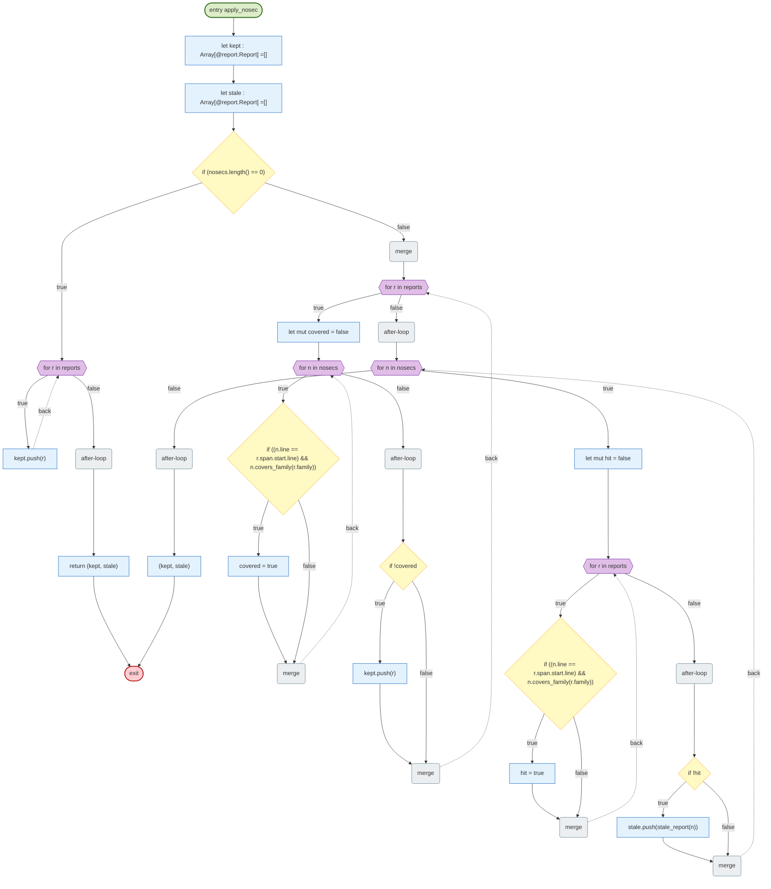
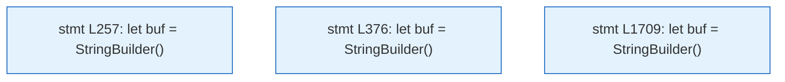

# LunaFlow analysis report — riantr/moonbit_static_analysis@0.5.4

> Trace-driven (dynamic-first) control-flow, data-flow, value-range and slicing analysis for a mooncakes.io module.

## 1. Acquisition and version pinning

| Item | Value |
| --- | --- |
| Requested coordinate | `riantr/moonbit_static_analysis@latest` |
| Resolved version | `0.5.4` |
| Pinning strategy | `@latest` resolved through `moon fetch` (local registry index, newest non-yanked version) and pinned to `0.5.4` for ingestion, execution and reporting |
| Source root | `./.repos/riantr/moonbit_static_analysis/0.5.4` |
| Declared target | `wasm` |
| Direct dependencies | (none) |

## 2. Ingestion statistics

| Metric | Value |
| --- | --- |
| Source files parsed | 263 |
| Functions extracted | 3244 |
| Statements understood | 17843 |
| Statements unsupported | 766 |
| Frontend coverage | 95.8% |
| Parse issues | 0 |
| CFG functions | 600 of 1437 — the first 600 in file order; 837 functions had no CFG and can carry no CFG finding |
| Trace events | 673492 |
| Interpreted steps | 136821 |
| Observed functions | 1212 |
| Entry selection | every function, PACKAGE BY PACKAGE, each package with its own step budget (100000 steps): 1 of the 17 packages spent their budget, and 1212 functions were entered |

### 2.1 The packages

The scan ran package by package, and each package was a run of its own with its own step budget. The table says what each one cost.

| Package | Functions entered | Functions skipped | Steps | Trace events | Findings | Its own budget |
| --- | --- | --- | --- | --- | --- | --- |
| `src/sa` | 147 | 0 | 2409 | 11490 | 191 | not reached |
| `src/ast` | 8 | 0 | 8 | 32 | 0 | not reached |
| `src/cli` | 1 | 0 | 24 | 15 | 0 | not reached |
| `src/core` | 57 | 0 | 2165 | 6336 | 1122 | not reached |
| `src/flow` | 519 | 225 | 100424 | 478594 | 107214 | spent |
| `src/walk` | 60 | 0 | 325 | 2733 | 13 | not reached |
| `src/lexer` | 50 | 0 | 5669 | 12507 | 2549 | not reached |
| `src/types` | 24 | 0 | 163 | 1359 | 7 | not reached |
| `src/interp` | 53 | 0 | 339 | 2058 | 9 | not reached |
| `src/parser` | 138 | 0 | 12293 | 42514 | 230 | not reached |
| `src/report` | 22 | 0 | 71 | 378 | 0 | not reached |
| `src/jsoncli` | 16 | 0 | 74 | 376 | 4 | not reached |
| `src/samples` | 1 | 0 | 1 | 12 | 0 | not reached |
| `src/pipeline` | 67 | 0 | 493 | 2346 | 14 | not reached |
| `src/moonfiles` | 42 | 0 | 10976 | 110609 | 1854 | not reached |
| `src/statecheck` | 4 | 0 | 1356 | 2018 | 384 | not reached |
| `` | 3 | 0 | 31 | 71 | 0 | not reached |

| Wall time (analyzer) | 14243 ms |
| Selected level | L3 (funnel: L1 → L2 → L3) |

## 3. Proof-strength levels and funnel

The same program is analyzed at three proof strengths. Levels are cumulative: L2 adds abstract interpretation on top of L1, L3 adds contract verification on top of the escalated functions. `--funnel` runs all three and reports what each level adds.

### 3.1 Level definitions

| Level | Name | Engine | Input model | Result strength |
| --- | --- | --- | --- | --- |
| L1 | Interpreter | concrete execution on the formal interpreter | concrete boundary values (`--trials`) | observed facts; may miss unexecuted inputs and paths |
| L2 | Value | abstract interpretation over a value-set / interval domain | whole input sets (`Int` intervals, `Bool`/`String` sets, array length intervals) | exhaustive over the abstract state; may-taint and may-range alarms (false positives possible) |
| L3 | Proof-by-contract | WP-style weakest-precondition VC generation + interval decision | ACSL-style `//@ requires` / `//@ ensures` specs | `proved` / `failed` / `unknown` per verification condition; specs are mandatory |

### 3.2 Funnel


| Level | Checks | New vs previous | Functions / VCs | Note |
| --- | --- | --- | --- | --- |
| L1 concrete | 371 findings | — | 1212 functions | observed facts |
| L2 abstract | 188 findings | 138 | 1437 functions, 200263 steps | exhaustive over the input abstraction |
| L3 contracts | 0 VCs | 0 failed, 0 unknown | 178 critical functions | specs required |

### 3.3 Escalation and specification gaps

Escalated functions (have at least one L1/L2 finding or a contract): `dir_of`, `ok_segment`, `ssa_cost_over_files`, `mm_parsed_with`, `mm_after_last`, `path_tail`, `pred_of`, `bb_is_leader`, `bb_entry`, `bb_exits`, `Bb::dump`, `lower_stmts`, `lower_if`, `Cfg::node_after`, `build_seq`, `build_else`, `Cfg::dump`, `cfl_call_site_at`, `cfl_return_site_at`, `cfl_program_entry`, `cfl_ordinary_from`, `cfl_node_of_key`, `reverse_postorder`, `dominators`, `compute_idom`, `dominance_frontiers`, `pta_site_names`, `pta_step`, `pta_sweep_heap`, `ir_blocks`, `ssa_check`, `new_ssa`, `collect_defs`, `place_phis`, `prepare`, `assign_versions`, `index_of_name`, `rename`, `rename_block`, `phi_version`, `index_of`, `unwind`, `finish`, `subscript`, `raises_with_payload`, `reaches`, `icfg_of`, `ifds_reach_rel`, `ifds_explode`, `ifds_supergraph_text`, `ifds_supergraph_returns`, `live_in`, `solve_round_robin`, `join_of_nodes`, `live_out`, `solve_propagation`, `avail_transfer`, `avail_in`, `solve_edges`, `cprop_after`, `taint_analyze`, `ir_block_of`, `ir_exits`, `bb_node_line`, `bb_block_lines`, `bb_edges`, `dnum_digits`, `join_all`, `cs_result_of_list`, `cfl_labels_text`, `ifds_tabulate`, `ifds_tabulate_text`, `interval_state_join`, `pta_fs_step`, `first_node_at`, `reaching_kill`, `reaching_in`, `reaching_use_defs`, `ssa_lines`, `solve_worklist`, `declared_types`, `cg_collect_lets`, `build_call_graph`, `cp_store_node`, `cp_call_node`, `cp_return_site`, `cp_count_label`, `powerset_of`, `defs_and_uses`, `pta_inter_run`, `dm_param_source`, `dm_recompute`, `pta_demand_run`, `cprop_intra_in`, `Walker::bind`, `Walker::unshadow_param`, `Walker::bind_pattern`, `Walker::audit_frame`, `as_array`, `closer_ahead`, `Lexer::run`, `Lexer::lex_attribute`, `Lexer::lex_number`, `Lexer::slice`, `Lexer::lex_string`, `Lexer::lex_regex`, `Lexer::lex_template_string`, `Lexer::copy_interp`, `Lexer::at_lambda_head_after`, `Lexer::copy_nested_string`, `Lexer::copy_nested_char`, `Lexer::lex_char`, `Lexer::lex_block_string`, `Lexer::lex_name`, `Lexer::lex_op`, `parse_double`, `parse_hex_double`, `Infer::declare_sym`, `ann_to_list_ty`, `sig_at`, `omittable_at`, `alias_of`, `Parser::peek`, `Parser::span`, `Parser::bump`, `starts_variant`, `Parser::skip_indexed`, `Parser::parse_is`, `Parser::rest_binding_at`, `Parser::shorthand_field_at`, `Parser::at_log_payload_brace`, `Parser::skip_log_payload`, `Parser::at_arrow_lambda`, `Parser::at_next`, `Parser::at_struct_literal`, `Parser::peek2`, `file_request`, `merge_group`, `taint_message`, `arg_list`, `name_list`, `trim_sp`, `moonbit_fences`, `fence_census`, `take_n`, `ident_from`, `label_type`, `type_annotation_of`, `paren_parts`, `strip_fn_modifiers`, `type_names`, `top_level_paren`, `audit`, `mermaid_states`, `resolve_label`, `Cfg::source_order`, `cfl_chain`, `intersect`, `ir_block_succ`, `interval_state_same`, `solve_widening`, `narrow_round`, `states_after`, `cprop_whole_and_apart`, `cprop_distributes`, `cprop_distribution_report`, `dl_taint_facts_of`, `dl_same_triple`, `ss_step`, `ss_sweep`, `union_of`, `dl_facts_of`, `dl_has_tuple`, `enter_guard`, `lit_step`, `collect_using`, `declared_name_after_kw`, `taint_findings`

Functions escalated without any contract (spec gap at L3): `dir_of (src/sa/main.mbt:1778)`, `ok_segment (src/sa/main.mbt:2043)`, `mermaid_states (src/sa/mermaid.mbt:43)`, `ssa_cost_over_files (src/sa/ssa_cost.mbt:89)`, `resolve_label (src/sa/provenance.mbt:260)`, `mm_parsed_with (src/sa/mermaid_test.mbt:85)`, `mm_after_last (src/sa/mermaid_test.mbt:245)`, `path_tail (src/core/core.mbt:59)`, `bb_is_leader (src/flow/bb.mbt:280)`, `bb_entry (src/flow/bb.mbt:378)`, `bb_exits (src/flow/bb.mbt:415)`, `Bb::dump (src/flow/bb.mbt:455)`, `lower_stmts (src/flow/ir.mbt:175)`, `lower_if (src/flow/ir.mbt:279)`, `Cfg::source_order (src/flow/cfg.mbt:163)`, `Cfg::node_after (src/flow/cfg.mbt:203)`, `pred_of (src/flow/cfg.mbt:268)`, `build_seq (src/flow/cfg.mbt:299)`, `build_else (src/flow/cfg.mbt:481)`, `Cfg::dump (src/flow/cfg.mbt:508)`, `cfl_call_site_at (src/flow/cfl.mbt:145)`, `cfl_return_site_at (src/flow/cfl.mbt:164)`, `cfl_program_entry (src/flow/cfl.mbt:254)`, `cfl_ordinary_from (src/flow/cfl.mbt:278)`, `cfl_node_of_key (src/flow/cfl.mbt:490)`, `cfl_chain (src/flow/cfl.mbt:515)`, `dominators (src/flow/dom.mbt:94)`, `dominance_frontiers (src/flow/dom.mbt:137)`, `reverse_postorder (src/flow/dom.mbt:184)`, `compute_idom (src/flow/dom.mbt:229)`, `intersect (src/flow/dom.mbt:280)`, `pta_site_names (src/flow/pta.mbt:362)`, `pta_step (src/flow/pta.mbt:506)`, `pta_sweep_heap (src/flow/pta.mbt:605)`, `ssa_check (src/flow/ssa.mbt:250)`, `new_ssa (src/flow/ssa.mbt:362)`, `collect_defs (src/flow/ssa.mbt:409)`, `place_phis (src/flow/ssa.mbt:446)`, `prepare (src/flow/ssa.mbt:502)`, `assign_versions (src/flow/ssa.mbt:586)`, `rename (src/flow/ssa.mbt:678)`, `rename_block (src/flow/ssa.mbt:704)`, `phi_version (src/flow/ssa.mbt:873)`, `unwind (src/flow/ssa.mbt:911)`, `index_of_name (src/flow/ssa.mbt:924)`, `index_of (src/flow/ssa.mbt:937)`, `finish (src/flow/ssa.mbt:950)`, `subscript (src/flow/ssa.mbt:1184)`, `raises_with_payload (src/flow/icfg.mbt:204)`, `reaches (src/flow/icfg.mbt:250)`, `icfg_of (src/flow/icfg.mbt:284)`, `ifds_reach_rel (src/flow/ifds.mbt:246)`, `ifds_explode (src/flow/ifds.mbt:286)`, `ifds_supergraph_text (src/flow/ifds.mbt:357)`, `ifds_supergraph_returns (src/flow/ifds.mbt:443)`, `live_in (src/flow/live.mbt:373)`, `live_out (src/flow/live.mbt:403)`, `avail_transfer (src/flow/avail.mbt:369)`, `avail_in (src/flow/avail.mbt:453)`, `cprop_after (src/flow/cprop.mbt:399)`, `taint_analyze (src/flow/taint.mbt:237)`, `ir_blocks (src/flow/ir_cfg.mbt:169)`, `ir_block_of (src/flow/ir_cfg.mbt:192)`, `ir_block_succ (src/flow/ir_cfg.mbt:224)`, `ir_exits (src/flow/ir_cfg.mbt:307)`, `bb_node_line (src/flow/bb_test.mbt:127)`, `bb_block_lines (src/flow/bb_test.mbt:133)`, `bb_edges (src/flow/bb_test.mbt:164)`, `dnum_digits (src/flow/datalog.mbt:592)`, `join_all (src/flow/lattice.mbt:89)`, `join_of_nodes (src/flow/lattice.mbt:104)`, `cs_result_of_list (src/flow/pta_ctx.mbt:429)`, `cfl_labels_text (src/flow/cfl_test.mbt:77)`, `ifds_tabulate (src/flow/ifds_tab.mbt:70)`, `ifds_tabulate_text (src/flow/ifds_tab.mbt:124)`, `interval_state_join (src/flow/interval.mbt:538)`, `interval_state_same (src/flow/interval.mbt:554)`, `solve_widening (src/flow/interval.mbt:611)`, `narrow_round (src/flow/interval.mbt:675)`, `pta_fs_step (src/flow/pta_flow.mbt:202)`, `first_node_at (src/flow/pta_test.mbt:205)`, `reaching_kill (src/flow/reaching.mbt:134)`, `reaching_in (src/flow/reaching.mbt:229)`, `reaching_use_defs (src/flow/reaching.mbt:254)`, `ssa_lines (src/flow/ssa_test.mbt:63)`, `solve_round_robin (src/flow/worklist.mbt:36)`, `solve_propagation (src/flow/worklist.mbt:78)`, `states_after (src/flow/worklist.mbt:132)`, `solve_edges (src/flow/worklist.mbt:176)`, `solve_worklist (src/flow/worklist.mbt:261)`, `declared_types (src/flow/callgraph.mbt:502)`, `cg_collect_lets (src/flow/callgraph.mbt:515)`, `build_call_graph (src/flow/callgraph.mbt:725)`, `cp_store_node (src/flow/icfg_test.mbt:95)`, `cp_call_node (src/flow/icfg_test.mbt:122)`, `cp_return_site (src/flow/icfg_test.mbt:136)`, `cp_count_label (src/flow/icfg_test.mbt:153)`, `powerset_of (src/flow/laws_test.mbt:76)`, `defs_and_uses (src/flow/laws_test.mbt:298)`, `pta_inter_run (src/flow/pta_inter.mbt:478)`, `dm_param_source (src/flow/pta_demand.mbt:269)`, `dm_recompute (src/flow/pta_demand.mbt:303)`, `pta_demand_run (src/flow/pta_demand.mbt:394)`, `cprop_intra_in (src/flow/cprop_intra.mbt:101)`, `cprop_whole_and_apart (src/flow/ifds_distrib.mbt:90)`, `cprop_distributes (src/flow/ifds_distrib.mbt:135)`, `cprop_distribution_report (src/flow/ifds_distrib.mbt:157)`, `dl_taint_facts_of (src/flow/datalog_taint.mbt:195)`, `dl_same_triple (src/flow/datalog_taint.mbt:361)`, `ss_step (src/flow/pta_storeless.mbt:326)`, `ss_sweep (src/flow/pta_storeless.mbt:401)`, `union_of (src/flow/reaching_test.mbt:59)`, `dl_facts_of (src/flow/datalog_pointer.mbt:85)`, `dl_has_tuple (src/flow/datalog_pointer.mbt:296)`, `Walker::bind (src/walk/walk.mbt:256)`, `Walker::unshadow_param (src/walk/walk.mbt:330)`, `Walker::bind_pattern (src/walk/walk.mbt:633)`, `Walker::audit_frame (src/walk/walk.mbt:667)`, `as_array (src/walk/walk.mbt:1287)`, `enter_guard (src/walk/guardfacts.mbt:481)`, `closer_ahead (src/lexer/lexer.mbt:330)`, `Lexer::run (src/lexer/lexer.mbt:368)`, `Lexer::lex_attribute (src/lexer/lexer.mbt:523)`, `lit_step (src/lexer/lexer.mbt:582)`, `Lexer::lex_number (src/lexer/lexer.mbt:624)`, `Lexer::slice (src/lexer/lexer.mbt:853)`, `Lexer::lex_string (src/lexer/lexer.mbt:864)`, `Lexer::lex_regex (src/lexer/lexer.mbt:944)`, `Lexer::lex_template_string (src/lexer/lexer.mbt:1005)`, `Lexer::copy_interp (src/lexer/lexer.mbt:1067)`, `Lexer::at_lambda_head_after (src/lexer/lexer.mbt:1254)`, `Lexer::copy_nested_string (src/lexer/lexer.mbt:1407)`, `Lexer::copy_nested_char (src/lexer/lexer.mbt:1430)`, `Lexer::lex_char (src/lexer/lexer.mbt:1483)`, `Lexer::lex_block_string (src/lexer/lexer.mbt:1777)`, `Lexer::lex_name (src/lexer/lexer.mbt:1915)`, `Lexer::lex_op (src/lexer/lexer.mbt:1972)`, `parse_double (src/lexer/lexer.mbt:2245)`, `parse_hex_double (src/lexer/lexer.mbt:2335)`, `Infer::declare_sym (src/types/infer.mbt:191)`, `ann_to_list_ty (src/types/types.mbt:174)`, `sig_at (src/interp/interp.mbt:1112)`, `omittable_at (src/interp/interp.mbt:3374)`, `alias_of (src/parser/parser.mbt:84)`, `Parser::peek (src/parser/parser.mbt:304)`, `Parser::span (src/parser/parser.mbt:309)`, `Parser::bump (src/parser/parser.mbt:314)`, `collect_using (src/parser/parser.mbt:1531)`, `starts_variant (src/parser/parser.mbt:1594)`, `Parser::skip_indexed (src/parser/parser.mbt:2221)`, `declared_name_after_kw (src/parser/parser.mbt:3065)`, `Parser::parse_is (src/parser/parser.mbt:4595)`, `Parser::rest_binding_at (src/parser/parser.mbt:4730)`, `Parser::shorthand_field_at (src/parser/parser.mbt:4765)`, `Parser::at_log_payload_brace (src/parser/parser.mbt:5411)`, `Parser::skip_log_payload (src/parser/parser.mbt:5420)`, `Parser::at_arrow_lambda (src/parser/parser.mbt:6255)`, `Parser::at_next (src/parser/parser.mbt:6414)`, `Parser::at_struct_literal (src/parser/parser.mbt:6460)`, `Parser::peek2 (src/parser/parser.mbt:6679)`, `file_request (src/jsoncli/main.mbt:441)`, `merge_group (src/pipeline/pipeline.mbt:468)`, `taint_findings (src/pipeline/taintcheck.mbt:60)`, `taint_message (src/pipeline/taintcheck.mbt:144)`, `arg_list (src/pipeline/taintcheck.mbt:177)`, `name_list (src/pipeline/taintcheck.mbt:196)`, `trim_sp (src/moonfiles/moonfiles.mbt:43)`, `moonbit_fences (src/moonfiles/moonfiles.mbt:211)`, `fence_census (src/moonfiles/moonfiles.mbt:257)`, `take_n (src/moonfiles/moonfiles.mbt:460)`, `ident_from (src/moonfiles/moonfiles.mbt:509)`, `label_type (src/moonfiles/moonfiles.mbt:575)`, `type_annotation_of (src/moonfiles/moonfiles.mbt:608)`, `paren_parts (src/moonfiles/moonfiles.mbt:659)`, `strip_fn_modifiers (src/moonfiles/moonfiles.mbt:757)`, `type_names (src/moonfiles/moonfiles.mbt:818)`, `top_level_paren (src/moonfiles/moonfiles.mbt:1087)`, `audit (src/statecheck/statecheck.mbt:53)`

## 4. Control-flow analysis

CFG nodes are built from the parsed statement tree; execution paths come from the concrete-execution trace engine. Dead/unreachable detection is static; path coverage and budget findings are dynamic. See `docs/design.md` §5 for the mapping rules.

### 4.1 CFG diagrams (top 8 by cyclomatic complexity)

#### `scan` (src/sa/main.mbt)

_Diagram omitted: 153 nodes exceeds the readability cap (90). Findings for this function are listed below._

#### `d_strata` (src/flow/datalog.mbt)

```mermaid
flowchart TD
  classDef entryNode fill:#dcedc8,stroke:#33691e,stroke-width:2px
  classDef exitNode fill:#ffcdd2,stroke:#b71c1c,stroke-width:2px
  classDef branchNode fill:#fff9c4,stroke:#f9a825
  classDef loopNode fill:#e1bee7,stroke:#6a1b9a
  classDef mergeNode fill:#eceff1,stroke:#607d8b
  classDef deadNode fill:#eeeeee,stroke:#9e9e9e
  classDef stmtNode fill:#e3f2fd,stroke:#1565c0
  n0(["entry d_strata"]):::entryNode
  n1(["exit"]):::exitNode
  n2["let deps = d_deps(prog, idb)"]:::stmtNode
  n3["let reach = d_reach(deps)"]:::stmtNode
  n4["let preds = dkeys(idb)"]:::stmtNode
  n5["let groups : Array[Array[String]] =[]"]:::stmtNode
  n6["let placed : Map[String, Bool] = Map([])"]:::stmtNode
  n7{{"for p in preds"}}:::loopNode
  n8{"if placed.contains(p)"}:::branchNode
  n9["continue"]:::stmtNode
  n10("merge"):::mergeNode
  n11["let group : Array[String] =[]"]:::stmtNode
  n12{{"for q in preds"}}:::loopNode
  n13{"if placed.contains(q)"}:::branchNode
  n14["continue"]:::stmtNode
  n15("merge"):::mergeNode
  n16["let pq = match reach.get(p) { Some(s) =#gt; s None =#gt; Map([])}"]:::stmtNode
  n17["let qp = match reach.get(q) { Some(s) =#gt; s None =#gt; Map([])}"]:::stmtNode
  n18["let same = match p == q { true =#gt; true false =#gt; pq.contains(q) && qp.contains(p)}"]:::stmtNode
  n19{"if same"}:::branchNode
  n20["group.push(q)"]:::stmtNode
  n21["placed.set(q, true)"]:::stmtNode
  n22("merge"):::mergeNode
  n23("after-loop"):::mergeNode
  n24["groups.push(group)"]:::stmtNode
  n25("after-loop"):::mergeNode
  n26["let levels : Map[String, Int32] = Map([])"]:::stmtNode
  n27{{"for g in groups"}}:::loopNode
  n28{{"for p in g"}}:::loopNode
  n29["levels.set(p, 0)"]:::stmtNode
  n30("after-loop"):::mergeNode
  n31("after-loop"):::mergeNode
  n32["let mut changed = true"]:::stmtNode
  n33["let mut passes = 0"]:::stmtNode
  n34{{"while (changed && (passes #lt; 64))"}}:::loopNode
  n35["changed = false"]:::stmtNode
  n36["passes = passes + 1"]:::stmtNode
  n37{{"for g in groups"}}:::loopNode
  n38["let mut lvl = 0"]:::stmtNode
  n39{{"for p in g"}}:::loopNode
  n40["unsupported: match"]:::stmtNode
  n41("after-loop"):::mergeNode
  n42{{"for p in g"}}:::loopNode
  n43["let cur = match levels.get(p) { Some(l) =#gt; l None =#gt; 0}"]:::stmtNode
  n44{"if (lvl #gt; cur)"}:::branchNode
  n45["levels.set(p, lvl)"]:::stmtNode
  n46["changed = true"]:::stmtNode
  n47("merge"):::mergeNode
  n48("after-loop"):::mergeNode
  n49("after-loop"):::mergeNode
  n50("after-loop"):::mergeNode
  n51["let ordered : Array[Array[String]] =[]"]:::stmtNode
  n52["let used : Map[String, Bool] = Map([])"]:::stmtNode
  n53["let mut placed = 0"]:::stmtNode
  n54["let mut lvl = 0"]:::stmtNode
  n55["let mut guard2 = 0"]:::stmtNode
  n56{{"while ((placed #lt; groups.length()) && (guard2 #lt; 64))"}}:::loopNode
  n57["guard2 = guard2 + 1"]:::stmtNode
  n58{{"for g in groups"}}:::loopNode
  n59["let mut gl = 0"]:::stmtNode
  n60{{"for p in g"}}:::loopNode
  n61["let l = match levels.get(p) { Some(x) =#gt; x None =#gt; 0}"]:::stmtNode
  n62{"if (l #gt; gl)"}:::branchNode
  n63["gl = l"]:::stmtNode
  n64("merge"):::mergeNode
  n65("after-loop"):::mergeNode
  n66{"if (gl == lvl)"}:::branchNode
  n67["let fresh : Array[String] =[]"]:::stmtNode
  n68{{"for p in g"}}:::loopNode
  n69{"if (used.contains(p) == false)"}:::branchNode
  n70["fresh.push(p)"]:::stmtNode
  n71["used.set(p, true)"]:::stmtNode
  n72("merge"):::mergeNode
  n73("after-loop"):::mergeNode
  n74{"if (fresh.length() #gt; 0)"}:::branchNode
  n75["ordered.push(fresh)"]:::stmtNode
  n76["placed = placed + 1"]:::stmtNode
  n77("merge"):::mergeNode
  n78("merge"):::mergeNode
  n79("after-loop"):::mergeNode
  n80["lvl = lvl + 1"]:::stmtNode
  n81("after-loop"):::mergeNode
  n82["ordered"]:::stmtNode
  n0 --> n2
  n2 --> n3
  n3 --> n4
  n4 --> n5
  n5 --> n6
  n6 --> n7
  n8 -->|true| n9
  n8 -->|false| n10
  n10 --> n11
  n11 --> n12
  n13 -->|true| n14
  n13 -->|false| n15
  n15 --> n16
  n16 --> n17
  n17 --> n18
  n18 --> n19
  n20 --> n21
  n19 -->|true| n20
  n21 --> n22
  n19 -->|false| n22
  n12 -->|true| n13
  n22 -.->|back| n12
  n12 -->|false| n23
  n23 --> n24
  n7 -->|true| n8
  n24 -.->|back| n7
  n7 -->|false| n25
  n25 --> n26
  n26 --> n27
  n28 -->|true| n29
  n29 -.->|back| n28
  n28 -->|false| n30
  n27 -->|true| n28
  n27 -.->|back| n27
  n27 -->|false| n31
  n31 --> n32
  n32 --> n33
  n33 --> n34
  n35 --> n36
  n36 --> n37
  n38 --> n39
  n39 -->|true| n40
  n40 -.->|back| n39
  n39 -->|false| n41
  n41 --> n42
  n43 --> n44
  n45 --> n46
  n44 -->|true| n45
  n46 --> n47
  n44 -->|false| n47
  n42 -->|true| n43
  n47 -.->|back| n42
  n42 -->|false| n48
  n37 -->|true| n38
  n37 -.->|back| n37
  n37 -->|false| n49
  n34 -->|true| n35
  n34 -.->|back| n34
  n34 -->|false| n50
  n50 --> n51
  n51 --> n52
  n52 --> n53
  n53 --> n54
  n54 --> n55
  n55 --> n56
  n57 --> n58
  n59 --> n60
  n61 --> n62
  n62 -->|true| n63
  n63 --> n64
  n62 -->|false| n64
  n60 -->|true| n61
  n64 -.->|back| n60
  n60 -->|false| n65
  n65 --> n66
  n67 --> n68
  n70 --> n71
  n69 -->|true| n70
  n71 --> n72
  n69 -->|false| n72
  n68 -->|true| n69
  n72 -.->|back| n68
  n68 -->|false| n73
  n73 --> n74
  n75 --> n76
  n74 -->|true| n75
  n76 --> n77
  n74 -->|false| n77
  n66 -->|true| n67
  n77 --> n78
  n66 -->|false| n78
  n58 -->|true| n59
  n78 -.->|back| n58
  n58 -->|false| n79
  n79 --> n80
  n56 -->|true| n57
  n80 -.->|back| n56
  n56 -->|false| n81
  n81 --> n82
  n82 --> n1
```



Observed path (trial 0, first 24 events): `call@820` -> `def@820` -> `call@821` -> `def@821` -> `call@822` -> `def@822` -> `def@824` -> `call@825` -> `def@825` -> `call@865` -> `def@865` -> `def@871` -> `def@872` -> `cond@873` -> `def@874` -> `def@875` -> `loop@873` -> `cond@873` -> `def@927` -> `call@928` -> `def@928` -> `def@929` -> `def@930` -> `def@931`

#### `pta_ctx_run_heap` (src/flow/pta_ctx.mbt)

_Diagram omitted: 99 nodes exceeds the readability cap (90). Findings for this function are listed below._

#### `pfg_solve` (src/flow/pfg.mbt)

```mermaid
flowchart TD
  classDef entryNode fill:#dcedc8,stroke:#33691e,stroke-width:2px
  classDef exitNode fill:#ffcdd2,stroke:#b71c1c,stroke-width:2px
  classDef branchNode fill:#fff9c4,stroke:#f9a825
  classDef loopNode fill:#e1bee7,stroke:#6a1b9a
  classDef mergeNode fill:#eceff1,stroke:#607d8b
  classDef deadNode fill:#eeeeee,stroke:#9e9e9e
  classDef stmtNode fill:#e3f2fd,stroke:#1565c0
  n0(["entry pfg_solve"]):::entryNode
  n1(["exit"]):::exitNode
  n2["let graph = pfg_new()"]:::stmtNode
  n3["let pt : Map[String, Map[String, Bool]] = Map([])"]:::stmtNode
  n4["let wl : Array[(String, Map[String, Bool])] =[]"]:::stmtNode
  n5["let trace : Array[String] =[]"]:::stmtNode
  n6["let mut head = 0"]:::stmtNode
  n7["let mut propagated = 0"]:::stmtNode
  n8["let mut skipped = 0"]:::stmtNode
  n9{{"for v in g.source_order()"}}:::loopNode
  n10{"if pta_alloc_of(g.kinds[v])"}:::branchNode
  n11("merge"):::mergeNode
  n12[""]:::stmtNode
  n13["{ let obj = pta_site_of(sites, 0, v) wl.push((pta_bound_name(g.kinds[v]), pfg_set_one(o..."]:::stmtNode
  n14("after-loop"):::mergeNode
  n15{{"for pair in pfg_assign_edges(g)"}}:::loopNode
  n16["let _ = pfg_add_edge(graph, pair.0, pair.1)"]:::stmtNode
  n17("after-loop"):::mergeNode
  n18["let stores = pfg_stores(g)"]:::stmtNode
  n19["let loads = pfg_loads(g)"]:::stmtNode
  n20["let expr_stores = pfg_expr_stores(g)"]:::stmtNode
  n21{{"while (head #lt; wl.length())"}}:::loopNode
  n22["let node = wl[head].0"]:::stmtNode
  n23["let pts = wl[head].1"]:::stmtNode
  n24["head = head + 1"]:::stmtNode
  n25["propagated = propagated + 1"]:::stmtNode
  n26["trace.push(pfg_entry_text(node, pts))"]:::stmtNode
  n27["let cur = match pt.get(node) { Some(v) =#gt; v None =#gt; name_set_empty()}"]:::stmtNode
  n28["let delta = name_set_subtract(pts, cur)"]:::stmtNode
  n29{"if (delta.length() == 0)"}:::branchNode
  n30["skipped = skipped + 1"]:::stmtNode
  n31["continue"]:::stmtNode
  n32("merge"):::mergeNode
  n33["pt.set(node, name_set_union(cur, delta))"]:::stmtNode
  n34{{"for _, s in pfg_succ(graph, node)"}}:::loopNode
  n35["wl.push((s, delta))"]:::stmtNode
  n36("after-loop"):::mergeNode
  n37{{"for o, _ in delta"}}:::loopNode
  n38{{"for triple in stores"}}:::loopNode
  n39{"if (triple.0 == node)"}:::branchNode
  n40["let fld = o +.+ triple.1"]:::stmtNode
  n41{"if pfg_add_edge(graph, triple.2, fld)"}:::branchNode
  n42["let src = match pt.get(triple.2) { Some(v) =#gt; v None =#gt; name_set_empty()}"]:::stmtNode
  n43{"if (src.length() #gt; 0)"}:::branchNode
  n44["wl.push((fld, src))"]:::stmtNode
  n45("merge"):::mergeNode
  n46("merge"):::mergeNode
  n47("merge"):::mergeNode
  n48("after-loop"):::mergeNode
  n49{{"for triple in loads"}}:::loopNode
  n50{"if (triple.0 == node)"}:::branchNode
  n51["let fld = o +.+ triple.1"]:::stmtNode
  n52{"if pfg_add_edge(graph, fld, triple.2)"}:::branchNode
  n53["let src = match pt.get(fld) { Some(v) =#gt; v None =#gt; name_set_empty()}"]:::stmtNode
  n54{"if (src.length() #gt; 0)"}:::branchNode
  n55["wl.push((triple.2, src))"]:::stmtNode
  n56("merge"):::mergeNode
  n57("merge"):::mergeNode
  n58("merge"):::mergeNode
  n59("after-loop"):::mergeNode
  n60("after-loop"):::mergeNode
  n61("after-loop"):::mergeNode
  n62["PfgResult::{ graph, pts : pt, propagated, skipped, expr_stores, trace,}"]:::stmtNode
  n0 --> n2
  n2 --> n3
  n3 --> n4
  n4 --> n5
  n5 --> n6
  n6 --> n7
  n7 --> n8
  n8 --> n9
  n10 -->|true| n11
  n10 -->|false| n11
  n11 --> n12
  n12 --> n13
  n9 -->|true| n10
  n13 -.->|back| n9
  n9 -->|false| n14
  n14 --> n15
  n15 -->|true| n16
  n16 -.->|back| n15
  n15 -->|false| n17
  n17 --> n18
  n18 --> n19
  n19 --> n20
  n20 --> n21
  n22 --> n23
  n23 --> n24
  n24 --> n25
  n25 --> n26
  n26 --> n27
  n27 --> n28
  n28 --> n29
  n30 --> n31
  n29 -->|true| n30
  n29 -->|false| n32
  n32 --> n33
  n33 --> n34
  n34 -->|true| n35
  n35 -.->|back| n34
  n34 -->|false| n36
  n36 --> n37
  n40 --> n41
  n42 --> n43
  n43 -->|true| n44
  n44 --> n45
  n43 -->|false| n45
  n41 -->|true| n42
  n45 --> n46
  n41 -->|false| n46
  n39 -->|true| n40
  n46 --> n47
  n39 -->|false| n47
  n38 -->|true| n39
  n47 -.->|back| n38
  n38 -->|false| n48
  n48 --> n49
  n51 --> n52
  n53 --> n54
  n54 -->|true| n55
  n55 --> n56
  n54 -->|false| n56
  n52 -->|true| n53
  n56 --> n57
  n52 -->|false| n57
  n50 -->|true| n51
  n57 --> n58
  n50 -->|false| n58
  n49 -->|true| n50
  n58 -.->|back| n49
  n49 -->|false| n59
  n37 -->|true| n38
  n37 -.->|back| n37
  n37 -->|false| n60
  n21 -->|true| n22
  n21 -.->|back| n21
  n21 -->|false| n61
  n61 --> n62
  n62 --> n1
```

Observed path (trial 0, first 19 events): `call@365` -> `def@365` -> `call@366` -> `def@366` -> `def@367` -> `def@368` -> `def@369` -> `def@370` -> `def@371` -> `call@383` -> `call@390` -> `call@393` -> `def@393` -> `call@394` -> `def@394` -> `call@395` -> `def@395` -> `cond@398` -> `def@364`

#### `emit_file` (src/sa/mermaid.mbt)

```mermaid
flowchart TD
  classDef entryNode fill:#dcedc8,stroke:#33691e,stroke-width:2px
  classDef exitNode fill:#ffcdd2,stroke:#b71c1c,stroke-width:2px
  classDef branchNode fill:#fff9c4,stroke:#f9a825
  classDef loopNode fill:#e1bee7,stroke:#6a1b9a
  classDef mergeNode fill:#eceff1,stroke:#607d8b
  classDef deadNode fill:#eeeeee,stroke:#9e9e9e
  classDef stmtNode fill:#e3f2fd,stroke:#1565c0
  n0(["entry emit_file"]):::entryNode
  n1(["exit"]):::exitNode
  n2["let defects = v.findings.length()"]:::stmtNode
  n3["out.write_string(    state #quot;/{fid} — /{sanitize(v.path)}#quot; as /{fid} { )"]:::stmtNode
  n4["out.write_string(        direction TB )"]:::stmtNode
  n5["out.write_string(        [*] --#gt; /{fid}_lex )"]:::stmtNode
  n6["out.write_string(        state #quot;lexed#quot; as /{fid}_lex )"]:::stmtNode
  n7["let parsed_note = if v.parsed { whole file read} else { sanitize(v.reason)}"]:::stmtNode
  n8["out.write_string(        /{fid}_lex --#gt; /{fid}_struct : /{parsed_note} )"]:::stmtNode
  n9["out.write_string(         state #quot;inspection 1/3 — structural#quot; as /{fid}_struc..."]:::stmtNode
  n10["out.write_string(        /{fid}_struct --#gt; /{fid}_type : inspection 2/3 )"]:::stmtNode
  n11["out.write_string(        state #quot;inspection 2/3 — type#quot; as /{fid}_type )"]:::stmtNode
  n12["out.write_string(        /{fid}_type --#gt; /{fid}_behav : inspection 3/3 )"]:::stmtNode
  n13["out.write_string(         state #quot;inspection 3/3 — behavioral#quot; as /{fid}_behav ,)"]:::stmtNode
  n14{"if ((v.region_line #gt; 0) && !v.parsed)"}:::branchNode
  n15["out.write_string(         /{fid}_behav --#gt; [*] : /{v.unreliable} withheld past the b..."]:::stmtNode
  n16["out.write_string(        /{fid}_behav --#gt; [*] )"]:::stmtNode
  n17("merge"):::mergeNode
  n18{"if (v.notices #gt; 0)"}:::branchNode
  n19["let head = if v.notices == 1 { 1 finding on this file is a NOTICE, not a defect: the an..."]:::stmtNode
  n20["note(out, /{fid}_struct,[ head, stand behind them -- a form it does not model, or a nam..."]:::stmtNode
  n21("merge"):::mergeNode
  n22{"if (v.unreliable #gt; 0)"}:::branchNode
  n23["let head = if v.unreliable == 1 { 1 further finding on this file sits at or after line ..."]:::stmtNode
  n24["note(out, /{fid}_behav,[ head, where the tree is already wrong. They are counted as unr..."]:::stmtNode
  n25("merge"):::mergeNode
  n26["let limit = cap(per_file, defects)"]:::stmtNode
  n27["let counts = Map([])"]:::stmtNode
  n28["let mut notices_dropped = 0"]:::stmtNode
  n29{{"for k, rep in v.findings"}}:::loopNode
  n30{"if (k #lt; limit)"}:::branchNode
  n31["let notice = is_notice(rep)"]:::stmtNode
  n32["let eid = if notice { /{fid}_n/{k}} else { /{fid}_e/{k}}"]:::stmtNode
  n33["let lens = primary_lens(rep.lenses)"]:::stmtNode
  n34["let tag = if notice { notice} else { defect}"]:::stmtNode
  n35["out.write_string(         /{fid}_/{lens} --#gt; /{eid} : /{tag} /{rep.family.name()} ,)"]:::stmtNode
  n36["let where_ = @/{rep.span.start.line}:/{rep.span.start.col}"]:::stmtNode
  n37["let lead = if notice { NOTICE — } else { }"]:::stmtNode
  n38["out.write_string(         state #quot;/{lead}/{rep.family.name()} /{where_} — /{sanitiz..."]:::stmtNode
  n39{"if notice"}:::branchNode
  n40["let body = if rep.is_declared_scope_limit() {[ NOTICE — counted in `notices`, excluded ..."]:::stmtNode
  n41["note(out, eid, body)"]:::stmtNode
  n42["let a = rep.family.advice()"]:::stmtNode
  n43["let body =[WHY:  + a.why, HOW:  + a.how]"]:::stmtNode
  n44{"if (rep.lenses.length() #gt; 1)"}:::branchNode
  n45["body.push( SEEN BY:  + lens_list(rep.lenses) +  — the lenses agree, so this is not one ..."]:::stmtNode
  n46("merge"):::mergeNode
  n47["note(out, eid, body)"]:::stmtNode
  n48("merge"):::mergeNode
  n49{"if is_notice(rep)"}:::branchNode
  n50["notices_dropped += 1"]:::stmtNode
  n51["let key = primary_lens(rep.lenses)"]:::stmtNode
  n52["let n = match counts.get(key) { Some(x) =#gt; x None =#gt; 0}"]:::stmtNode
  n53["counts.set(key, n + 1)"]:::stmtNode
  n54("merge"):::mergeNode
  n55("merge"):::mergeNode
  n56("after-loop"):::mergeNode
  n57["let dropped = defects - limit"]:::stmtNode
  n58{"if (dropped #gt; 0)"}:::branchNode
  n59["let mut parts = "]:::stmtNode
  n60{{"for _, key in counts.keys()"}}:::loopNode
  n61{"if (parts != #quot;#quot;)"}:::branchNode
  n62["parts = parts + , "]:::stmtNode
  n63("merge"):::mergeNode
  n64["unsupported: match"]:::stmtNode
  n65("after-loop"):::mergeNode
  n66["let head = if dropped == 1 { 1 further finding on this file was NOT drawn, because this..."]:::stmtNode
  n67["let body =[ head, diagram caps a file at /{limit}. Per inspection:  + parts +., Re-run ..."]:::stmtNode
  n68{"if (notices_dropped #gt; 0)"}:::branchNode
  n69["let nt = if notices_dropped == 1 { 1 of them is a NOTICE, excluded from `actionable`.} ..."]:::stmtNode
  n70["body.push(nt)"]:::stmtNode
  n71("merge"):::mergeNode
  n72["note(out, /{fid}_struct, body)"]:::stmtNode
  n73("merge"):::mergeNode
  n74["out.write_string(    } )"]:::stmtNode
  n0 --> n2
  n2 --> n3
  n3 --> n4
  n4 --> n5
  n5 --> n6
  n6 --> n7
  n7 --> n8
  n8 --> n9
  n9 --> n10
  n10 --> n11
  n11 --> n12
  n12 --> n13
  n13 --> n14
  n14 -->|true| n15
  n14 -->|false| n16
  n15 --> n17
  n16 --> n17
  n17 --> n18
  n19 --> n20
  n18 -->|true| n19
  n20 --> n21
  n18 -->|false| n21
  n21 --> n22
  n23 --> n24
  n22 -->|true| n23
  n24 --> n25
  n22 -->|false| n25
  n25 --> n26
  n26 --> n27
  n27 --> n28
  n28 --> n29
  n31 --> n32
  n32 --> n33
  n33 --> n34
  n34 --> n35
  n35 --> n36
  n36 --> n37
  n37 --> n38
  n38 --> n39
  n40 --> n41
  n42 --> n43
  n43 --> n44
  n44 -->|true| n45
  n45 --> n46
  n44 -->|false| n46
  n46 --> n47
  n39 -->|true| n40
  n39 -->|false| n42
  n41 --> n48
  n47 --> n48
  n51 --> n52
  n52 --> n53
  n49 -->|true| n50
  n49 -->|false| n51
  n50 --> n54
  n53 --> n54
  n30 -->|true| n31
  n30 -->|false| n49
  n48 --> n55
  n54 --> n55
  n29 -->|true| n30
  n55 -.->|back| n29
  n29 -->|false| n56
  n56 --> n57
  n57 --> n58
  n59 --> n60
  n61 -->|true| n62
  n62 --> n63
  n61 -->|false| n63
  n63 --> n64
  n60 -->|true| n61
  n64 -.->|back| n60
  n60 -->|false| n65
  n65 --> n66
  n66 --> n67
  n67 --> n68
  n69 --> n70
  n68 -->|true| n69
  n70 --> n71
  n68 -->|false| n71
  n71 --> n72
  n58 -->|true| n59
  n72 --> n73
  n58 -->|false| n73
  n73 --> n74
  n74 --> n1
```



Observed path (trial 0, first 24 events): `def@184` -> `call@185` -> `call@186` -> `call@190` -> `call@191` -> `def@192` -> `call@197` -> `call@198` -> `call@201` -> `call@202` -> `call@203` -> `call@204` -> `cond@207` -> `call@209` -> `cond@215` -> `def@216` -> `call@221` -> `cond@226` -> `def@227` -> `call@232` -> `call@238` -> `def@238` -> `call@239` -> `def@239`

#### `mm_check` (src/sa/mermaid_test.mbt)

```mermaid
flowchart TD
  classDef entryNode fill:#dcedc8,stroke:#33691e,stroke-width:2px
  classDef exitNode fill:#ffcdd2,stroke:#b71c1c,stroke-width:2px
  classDef branchNode fill:#fff9c4,stroke:#f9a825
  classDef loopNode fill:#e1bee7,stroke:#6a1b9a
  classDef mergeNode fill:#eceff1,stroke:#607d8b
  classDef deadNode fill:#eeeeee,stroke:#9e9e9e
  classDef stmtNode fill:#e3f2fd,stroke:#1565c0
  n0(["entry mm_check"]):::entryNode
  n1(["exit"]):::exitNode
  n2["let errs =[]"]:::stmtNode
  n3["let declared =[]"]:::stmtNode
  n4["let edges =[]"]:::stmtNode
  n5["let mut in_note = false"]:::stmtNode
  n6["let lines = mm_lines(src)"]:::stmtNode
  n7{{"for raw in lines"}}:::loopNode
  n8["let t = raw.trim().to_owned()"]:::stmtNode
  n9{"if in_note"}:::branchNode
  n10{"if (t == #quot;end note#quot;)"}:::branchNode
  n11["in_note = false"]:::stmtNode
  n12{"if (t == #quot;#quot;)"}:::branchNode
  n13["errs.push(blank line inside a note: the block end is lost)"]:::stmtNode
  n14("merge"):::mergeNode
  n15("merge"):::mergeNode
  n16["continue"]:::stmtNode
  n17("merge"):::mergeNode
  n18{"if (((t == #quot;#quot;) &#124;&#124; t.has_prefix(#quot;%%#quot;)) &#124;&#124; (t == ..."}:::branchNode
  n19["continue"]:::stmtNode
  n20("merge"):::mergeNode
  n21{"if ((t.has_prefix(#quot;direction #quot;) &#124;&#124; (t == #quot;{#quot;)) &#124;&#12..."}:::branchNode
  n22["continue"]:::stmtNode
  n23("merge"):::mergeNode
  n24{"if t.has_prefix(#quot;note right of #quot;)"}:::branchNode
  n25["let anchor = mm_after_last(t, note right of )"]:::stmtNode
  n26{"if !mm_valid_id(anchor)"}:::branchNode
  n27["errs.push(note anchor is not an identifier:  + anchor)"]:::stmtNode
  n28("merge"):::mergeNode
  n29["in_note = true"]:::stmtNode
  n30["continue"]:::stmtNode
  n31("merge"):::mergeNode
  n32{"if t.has_prefix(#quot;state #quot;#quot;)"}:::branchNode
  n33{"if (mm_count_quotes(t) != 2)"}:::branchNode
  n34["errs.push(state label is not one quoted string:  + t)"]:::stmtNode
  n35("merge"):::mergeNode
  n36["let bare = mm_state_id(t)"]:::stmtNode
  n37{"if !mm_valid_id(bare)"}:::branchNode
  n38["errs.push(state id is not an identifier:  + bare)"]:::stmtNode
  n39{"if !declared.contains(bare)"}:::branchNode
  n40["declared.push(bare)"]:::stmtNode
  n41("merge"):::mergeNode
  n42("merge"):::mergeNode
  n43["continue"]:::stmtNode
  n44("merge"):::mergeNode
  n45{"if t.contains(#quot; --#gt; #quot;)"}:::branchNode
  n46["let head = mm_before_first(t,  : )"]:::stmtNode
  n47["let toks = mm_spaces(head.replace(old =  --#gt; , new =  ))"]:::stmtNode
  n48{"if (toks.length() != 2)"}:::branchNode
  n49["errs.push(transition is not `A --#gt; B` or `A --#gt; B : label`:  + t)"]:::stmtNode
  n50["continue"]:::stmtNode
  n51("merge"):::mergeNode
  n52["edges.push([toks[0], toks[1]])"]:::stmtNode
  n53["continue"]:::stmtNode
  n54("merge"):::mergeNode
  n55["errs.push(line is not a form this renderer may emit:  + t)"]:::stmtNode
  n56("after-loop"):::mergeNode
  n57{"if in_note"}:::branchNode
  n58["errs.push(a note was opened and never closed)"]:::stmtNode
  n59("merge"):::mergeNode
  n60{{"for e in edges"}}:::loopNode
  n61{{"for ep in e"}}:::loopNode
  n62{"if ((ep != #quot;[*]#quot;) && !declared.contains(ep))"}:::branchNode
  n63["errs.push(transition names an undeclared state:  + ep)"]:::stmtNode
  n64("merge"):::mergeNode
  n65("after-loop"):::mergeNode
  n66("after-loop"):::mergeNode
  n67["errs"]:::stmtNode
  n0 --> n2
  n2 --> n3
  n3 --> n4
  n4 --> n5
  n5 --> n6
  n6 --> n7
  n8 --> n9
  n12 -->|true| n13
  n13 --> n14
  n12 -->|false| n14
  n10 -->|true| n11
  n10 -->|false| n12
  n11 --> n15
  n14 --> n15
  n15 --> n16
  n9 -->|true| n10
  n9 -->|false| n17
  n17 --> n18
  n18 -->|true| n19
  n18 -->|false| n20
  n20 --> n21
  n21 -->|true| n22
  n21 -->|false| n23
  n23 --> n24
  n25 --> n26
  n26 -->|true| n27
  n27 --> n28
  n26 -->|false| n28
  n28 --> n29
  n29 --> n30
  n24 -->|true| n25
  n24 -->|false| n31
  n31 --> n32
  n33 -->|true| n34
  n34 --> n35
  n33 -->|false| n35
  n35 --> n36
  n36 --> n37
  n39 -->|true| n40
  n40 --> n41
  n39 -->|false| n41
  n37 -->|true| n38
  n37 -->|false| n39
  n38 --> n42
  n41 --> n42
  n42 --> n43
  n32 -->|true| n33
  n32 -->|false| n44
  n44 --> n45
  n46 --> n47
  n47 --> n48
  n49 --> n50
  n48 -->|true| n49
  n48 -->|false| n51
  n51 --> n52
  n52 --> n53
  n45 -->|true| n46
  n45 -->|false| n54
  n54 --> n55
  n7 -->|true| n8
  n55 -.->|back| n7
  n7 -->|false| n56
  n56 --> n57
  n57 -->|true| n58
  n58 --> n59
  n57 -->|false| n59
  n59 --> n60
  n62 -->|true| n63
  n63 --> n64
  n62 -->|false| n64
  n61 -->|true| n62
  n64 -.->|back| n61
  n61 -->|false| n65
  n60 -->|true| n61
  n60 -.->|back| n60
  n60 -->|false| n66
  n66 --> n67
  n67 --> n1
```



Observed path (trial 0, first 8 events): `def@307` -> `def@308` -> `def@309` -> `def@310` -> `call@311` -> `def@311` -> `cond@362` -> `def@306`

#### `apply_nosec` (src/sa/profile.mbt)



Observed path (trial 0, first 9 events): `def@384` -> `def@385` -> `cond@386` -> `ret@390` -> `def@384` -> `def@385` -> `cond@386` -> `ret@390` -> `def@380`

#### `pta_site_names` (src/flow/pta.mbt)

```mermaid
flowchart TD
  classDef entryNode fill:#dcedc8,stroke:#33691e,stroke-width:2px
  classDef exitNode fill:#ffcdd2,stroke:#b71c1c,stroke-width:2px
  classDef branchNode fill:#fff9c4,stroke:#f9a825
  classDef loopNode fill:#e1bee7,stroke:#6a1b9a
  classDef mergeNode fill:#eceff1,stroke:#607d8b
  classDef deadNode fill:#eeeeee,stroke:#9e9e9e
  classDef stmtNode fill:#e3f2fd,stroke:#1565c0
  n0(["entry pta_site_names"]):::entryNode
  n1(["exit"]):::exitNode
  n2["let fi_of : Array[Int32] =[]"]:::stmtNode
  n3["let node_of : Array[Int32] =[]"]:::stmtNode
  n4["let line_of : Array[Int32] =[]"]:::stmtNode
  n5["let col_of : Array[Int32] =[]"]:::stmtNode
  n6["let mut fi = 0"]:::stmtNode
  n7{{"while (fi #lt; cfgs.length())"}}:::loopNode
  n8["let g = cfgs[fi]"]:::stmtNode
  n9["let mut v = 0"]:::stmtNode
  n10{{"while (v #lt; g.kinds.length())"}}:::loopNode
  n11{"if pta_alloc_of(g.kinds[v])"}:::branchNode
  n12("merge"):::mergeNode
  n13[""]:::stmtNode
  n14["{ fi_of.push(fi) node_of.push(v) line_of.push(g.spans[v].start.line) col_of.push(g.span..."]:::stmtNode
  n15["v = v + 1"]:::stmtNode
  n16("after-loop"):::mergeNode
  n17["fi = fi + 1"]:::stmtNode
  n18("after-loop"):::mergeNode
  n19["let order : Array[Int32] =[]"]:::stmtNode
  n20["let mut i = 0"]:::stmtNode
  n21{{"while (i #lt; fi_of.length())"}}:::loopNode
  n22["order.push(i)"]:::stmtNode
  n23["i = i + 1"]:::stmtNode
  n24("after-loop"):::mergeNode
  n25["let mut a = 1"]:::stmtNode
  n26{{"while (a #lt; order.length())"}}:::loopNode
  n27["let cur = order[a]"]:::stmtNode
  n28["let mut b = a - 1"]:::stmtNode
  n29["let mut placed = false"]:::stmtNode
  n30{{"while ((b #gt;= 0) && !placed)"}}:::loopNode
  n31["let prev = order[b]"]:::stmtNode
  n32{"if pta_after(line_of[prev], col_of[prev], fi_of[prev], node_of[prev], line_of[cur], col..."}:::branchNode
  n33["order[b + 1] = prev"]:::stmtNode
  n34["b = b - 1"]:::stmtNode
  n35["placed = true"]:::stmtNode
  n36("merge"):::mergeNode
  n37("after-loop"):::mergeNode
  n38["order[b + 1] = cur"]:::stmtNode
  n39["a = a + 1"]:::stmtNode
  n40("after-loop"):::mergeNode
  n41["let sites : Map[String, String] = Map([])"]:::stmtNode
  n42["let mut prev_line = - 1"]:::stmtNode
  n43["let mut k = 0"]:::stmtNode
  n44["let mut r = 0"]:::stmtNode
  n45{{"while (r #lt; order.length())"}}:::loopNode
  n46["let idx = order[r]"]:::stmtNode
  n47["let line = line_of[idx]"]:::stmtNode
  n48{"if (line == prev_line)"}:::branchNode
  n49["k = k + 1"]:::stmtNode
  n50["prev_line = line"]:::stmtNode
  n51["k = 1"]:::stmtNode
  n52("merge"):::mergeNode
  n53["let key = fi_of[idx].to_string() + : + node_of[idx].to_string()"]:::stmtNode
  n54{"if (k == 1)"}:::branchNode
  n55["sites.set(key, o + line.to_string())"]:::stmtNode
  n56["sites.set(key, o + line.to_string() + _ + k.to_string())"]:::stmtNode
  n57("merge"):::mergeNode
  n58["r = r + 1"]:::stmtNode
  n59("after-loop"):::mergeNode
  n60["sites"]:::stmtNode
  n0 --> n2
  n2 --> n3
  n3 --> n4
  n4 --> n5
  n5 --> n6
  n6 --> n7
  n8 --> n9
  n9 --> n10
  n11 -->|true| n12
  n11 -->|false| n12
  n12 --> n13
  n13 --> n14
  n14 --> n15
  n10 -->|true| n11
  n15 -.->|back| n10
  n10 -->|false| n16
  n16 --> n17
  n7 -->|true| n8
  n17 -.->|back| n7
  n7 -->|false| n18
  n18 --> n19
  n19 --> n20
  n20 --> n21
  n22 --> n23
  n21 -->|true| n22
  n23 -.->|back| n21
  n21 -->|false| n24
  n24 --> n25
  n25 --> n26
  n27 --> n28
  n28 --> n29
  n29 --> n30
  n31 --> n32
  n33 --> n34
  n32 -->|true| n33
  n32 -->|false| n35
  n34 --> n36
  n35 --> n36
  n30 -->|true| n31
  n36 -.->|back| n30
  n30 -->|false| n37
  n37 --> n38
  n38 --> n39
  n26 -->|true| n27
  n39 -.->|back| n26
  n26 -->|false| n40
  n40 --> n41
  n41 --> n42
  n42 --> n43
  n43 --> n44
  n44 --> n45
  n46 --> n47
  n47 --> n48
  n50 --> n51
  n48 -->|true| n49
  n48 -->|false| n50
  n49 --> n52
  n51 --> n52
  n52 --> n53
  n53 --> n54
  n54 -->|true| n55
  n54 -->|false| n56
  n55 --> n57
  n56 --> n57
  n57 --> n58
  n45 -->|true| n46
  n58 -.->|back| n45
  n45 -->|false| n59
  n59 --> n60
  n60 --> n1
```

Observed path (trial 0, first 24 events): `def@363` -> `def@364` -> `def@365` -> `def@366` -> `def@367` -> `cond@368` -> `def@382` -> `def@383` -> `cond@384` -> `def@390` -> `cond@391` -> `call@416` -> `def@416` -> `def@417` -> `def@418` -> `def@419` -> `cond@420` -> `def@362` -> `def@363` -> `def@364` -> `def@365` -> `def@366` -> `def@367` -> `cond@368`

### 4.2 CFG findings

| Rule | Severity | Verdict | Function | Location | Message | Method | Confidence |
| --- | --- | --- | --- | --- | --- | --- | --- |
| BUDGET-EXCEEDED | warning | unknown | path_tail | src/core/core.mbt:70 | the execution budget was exhausted: the rest of this function was not executed, so no claim about it was decided | dynamic | 0.6 |
| BUDGET-EXCEEDED | warning | unknown | pred_of | src/flow/cfg.mbt:286 | the execution budget was exhausted: the rest of this function was not executed, so no claim about it was decided | dynamic | 0.6 |
| BUDGET-EXCEEDED | warning | unknown | bb_exits | src/flow/bb.mbt:435 | the execution budget was exhausted: the rest of this function was not executed, so no claim about it was decided | dynamic | 0.6 |
| BUDGET-EXCEEDED | warning | unknown | Bb::dump | src/flow/bb.mbt:483 | the execution budget was exhausted: the rest of this function was not executed, so no claim about it was decided | dynamic | 0.6 |
| BUDGET-EXCEEDED | warning | unknown | pred_of | src/flow/cfg.mbt:286 | the execution budget was exhausted: the rest of this function was not executed, so no claim about it was decided | dynamic | 0.6 |
| BUDGET-EXCEEDED | warning | unknown | Cfg::dump | src/flow/cfg.mbt:528 | the execution budget was exhausted: the rest of this function was not executed, so no claim about it was decided | dynamic | 0.6 |
| BUDGET-EXCEEDED | warning | unknown | cfl_ordinary_from | src/flow/cfl.mbt:300 | the execution budget was exhausted: the rest of this function was not executed, so no claim about it was decided | dynamic | 0.6 |
| BUDGET-EXCEEDED | warning | unknown | cfl_ordinary_from | src/flow/cfl.mbt:300 | the execution budget was exhausted: the rest of this function was not executed, so no claim about it was decided | dynamic | 0.6 |
| BUDGET-EXCEEDED | warning | unknown | dominance_frontiers | src/flow/dom.mbt:165 | the execution budget was exhausted: the rest of this function was not executed, so no claim about it was decided | dynamic | 0.6 |
| BUDGET-EXCEEDED | warning | unknown | pta_step | src/flow/pta.mbt:517 | the execution budget was exhausted: the rest of this function was not executed, so no claim about it was decided | dynamic | 0.6 |
| BUDGET-EXCEEDED | warning | unknown | ir_blocks | src/flow/ir_cfg.mbt:184 | the execution budget was exhausted: the rest of this function was not executed, so no claim about it was decided | dynamic | 0.6 |
| BUDGET-EXCEEDED | warning | unknown | ir_blocks | src/flow/ir_cfg.mbt:182 | the execution budget was exhausted: the rest of this function was not executed, so no claim about it was decided | dynamic | 0.6 |
| BUDGET-EXCEEDED | warning | unknown | ssa_check | src/flow/ssa.mbt:314 | the execution budget was exhausted: the rest of this function was not executed, so no claim about it was decided | dynamic | 0.6 |
| BUDGET-EXCEEDED | warning | unknown | collect_defs | src/flow/ssa.mbt:415 | the execution budget was exhausted: the rest of this function was not executed, so no claim about it was decided | dynamic | 0.6 |
| BUDGET-EXCEEDED | warning | unknown | place_phis | src/flow/ssa.mbt:464 | the execution budget was exhausted: the rest of this function was not executed, so no claim about it was decided | dynamic | 0.6 |
| BUDGET-EXCEEDED | warning | unknown | prepare | src/flow/ssa.mbt:516 | the execution budget was exhausted: the rest of this function was not executed, so no claim about it was decided | dynamic | 0.6 |
| BUDGET-EXCEEDED | warning | unknown | assign_versions | src/flow/ssa.mbt:634 | the execution budget was exhausted: the rest of this function was not executed, so no claim about it was decided | dynamic | 0.6 |
| BUDGET-EXCEEDED | warning | unknown | rename | src/flow/ssa.mbt:687 | the execution budget was exhausted: the rest of this function was not executed, so no claim about it was decided | dynamic | 0.6 |
| BUDGET-EXCEEDED | warning | unknown | index_of | src/flow/ssa.mbt:945 | the execution budget was exhausted: the rest of this function was not executed, so no claim about it was decided | dynamic | 0.6 |
| BUDGET-EXCEEDED | warning | unknown | finish | src/flow/ssa.mbt:959 | the execution budget was exhausted: the rest of this function was not executed, so no claim about it was decided | dynamic | 0.6 |
| BUDGET-EXCEEDED | warning | unknown | pred_of | src/flow/cfg.mbt:286 | the execution budget was exhausted: the rest of this function was not executed, so no claim about it was decided | dynamic | 0.6 |
| BUDGET-EXCEEDED | warning | unknown | ifds_supergraph_returns | src/flow/ifds.mbt:456 | the execution budget was exhausted: the rest of this function was not executed, so no claim about it was decided | dynamic | 0.6 |
| BUDGET-EXCEEDED | warning | unknown | join_of_nodes | src/flow/lattice.mbt:113 | the execution budget was exhausted: the rest of this function was not executed, so no claim about it was decided | dynamic | 0.6 |
| BUDGET-EXCEEDED | warning | unknown | join_of_nodes | src/flow/lattice.mbt:113 | the execution budget was exhausted: the rest of this function was not executed, so no claim about it was decided | dynamic | 0.6 |
| BUDGET-EXCEEDED | warning | unknown | solve_propagation | src/flow/worklist.mbt:110 | the execution budget was exhausted: the rest of this function was not executed, so no claim about it was decided | dynamic | 0.6 |
| BUDGET-EXCEEDED | warning | unknown | solve_round_robin | src/flow/worklist.mbt:47 | the execution budget was exhausted: the rest of this function was not executed, so no claim about it was decided | dynamic | 0.6 |
| BUDGET-EXCEEDED | warning | unknown | join_of_nodes | src/flow/lattice.mbt:113 | the execution budget was exhausted: the rest of this function was not executed, so no claim about it was decided | dynamic | 0.6 |
| BUDGET-EXCEEDED | warning | unknown | solve_round_robin | src/flow/worklist.mbt:47 | the execution budget was exhausted: the rest of this function was not executed, so no claim about it was decided | dynamic | 0.6 |
| BUDGET-EXCEEDED | warning | unknown | solve_edges | src/flow/worklist.mbt:210 | the execution budget was exhausted: the rest of this function was not executed, so no claim about it was decided | dynamic | 0.6 |
| BUDGET-EXCEEDED | warning | unknown | ir_blocks | src/flow/ir_cfg.mbt:182 | the execution budget was exhausted: the rest of this function was not executed, so no claim about it was decided | dynamic | 0.6 |
| BUDGET-EXCEEDED | warning | unknown | bb_edges | src/flow/bb_test.mbt:173 | the execution budget was exhausted: the rest of this function was not executed, so no claim about it was decided | dynamic | 0.6 |
| BUDGET-EXCEEDED | warning | unknown | cfl_labels_text | src/flow/cfl_test.mbt:83 | the execution budget was exhausted: the rest of this function was not executed, so no claim about it was decided | dynamic | 0.6 |
| BUDGET-EXCEEDED | warning | unknown | solve_propagation | src/flow/worklist.mbt:109 | the execution budget was exhausted: the rest of this function was not executed, so no claim about it was decided | dynamic | 0.6 |
| BUDGET-EXCEEDED | warning | unknown | join_of_nodes | src/flow/lattice.mbt:115 | the execution budget was exhausted: the rest of this function was not executed, so no claim about it was decided | dynamic | 0.6 |
| BUDGET-EXCEEDED | warning | unknown | join_of_nodes | src/flow/lattice.mbt:113 | the execution budget was exhausted: the rest of this function was not executed, so no claim about it was decided | dynamic | 0.6 |
| BUDGET-EXCEEDED | warning | unknown | pred_of | src/flow/cfg.mbt:285 | the execution budget was exhausted: the rest of this function was not executed, so no claim about it was decided | dynamic | 0.6 |
| BUDGET-EXCEEDED | warning | unknown | pred_of | src/flow/cfg.mbt:285 | the execution budget was exhausted: the rest of this function was not executed, so no claim about it was decided | dynamic | 0.6 |
| BUDGET-EXCEEDED | warning | unknown | pred_of | src/flow/cfg.mbt:285 | the execution budget was exhausted: the rest of this function was not executed, so no claim about it was decided | dynamic | 0.6 |
| BUDGET-EXCEEDED | warning | unknown | join_of_nodes | src/flow/lattice.mbt:115 | the execution budget was exhausted: the rest of this function was not executed, so no claim about it was decided | dynamic | 0.6 |
| BUDGET-EXCEEDED | warning | unknown | join_of_nodes | src/flow/lattice.mbt:113 | the execution budget was exhausted: the rest of this function was not executed, so no claim about it was decided | dynamic | 0.6 |
| BUDGET-EXCEEDED | warning | unknown | Lexer::run | src/lexer/lexer.mbt:399 | the execution budget was exhausted: the rest of this function was not executed, so no claim about it was decided | dynamic | 0.6 |
| BUDGET-EXCEEDED | warning | unknown | Parser::skip_indexed | src/parser/parser.mbt:2229 | the execution budget was exhausted: the rest of this function was not executed, so no claim about it was decided | dynamic | 0.6 |
| BUDGET-EXCEEDED | warning | unknown | Parser::parse_is | src/parser/parser.mbt:4626 | the execution budget was exhausted: the rest of this function was not executed, so no claim about it was decided | dynamic | 0.6 |
| BUDGET-EXCEEDED | warning | unknown | moonbit_fences | src/moonfiles/moonfiles.mbt:242 | the execution budget was exhausted: the rest of this function was not executed, so no claim about it was decided | dynamic | 0.6 |
| BUDGET-EXCEEDED | warning | unknown | fence_census | src/moonfiles/moonfiles.mbt:277 | the execution budget was exhausted: the rest of this function was not executed, so no claim about it was decided | dynamic | 0.6 |
| BUDGET-EXCEEDED | warning | unknown | moonbit_fences | src/moonfiles/moonfiles.mbt:242 | the execution budget was exhausted: the rest of this function was not executed, so no claim about it was decided | dynamic | 0.6 |
| BUDGET-EXCEEDED | warning | unknown | strip_fn_modifiers | src/moonfiles/moonfiles.mbt:799 | the execution budget was exhausted: the rest of this function was not executed, so no claim about it was decided | dynamic | 0.6 |

### 4.3 Static vs dynamic attribution

| Signal | Method | What a hit means | Known limitation |
| --- | --- | --- | --- |
| Unreachable statement | static | no CFG predecessor; often after `return`/`break` | parser gaps can hide real predecessors |
| Infinite loop | static + dynamic | constant-true condition without break, or iteration cap reached | loops whose exit depends on unmodelled calls are reported as *budget*, not proven infinite |
| Uncovered code | dynamic (coverage import) | zero hits in the observed test suite | absence of execution is not proof of dead code |

## 5. Data flow, taint and the memory layout

Sources are entry-function parameters (and `@env.args` when the frontend sees it); propagation follows recorded definitions and the variables read by each statement; sinks are array-index expressions and allocation sizes. The graph below is the *observed* propagation, not a may-analysis over all inputs.

```mermaid
flowchart LR
  classDef src fill:#ffcdd2,stroke:#b71c1c,stroke-width:2px
  classDef step fill:#fff9c4,stroke:#f9a825
  classDef sink fill:#c8e6c9,stroke:#1b5e20,stroke-width:2px
  t0["source: n"]:::src
  t1["source: cap"]:::src
  t2["#lt;ret#gt; = (?, ?)"]:::step
  t3["source: n"]:::src
  t4["source: cap"]:::src
  t5["#lt;ret#gt; = (?, ?)"]:::step
  t6["source: n"]:::src
  t7["source: cap"]:::src
  t8["#lt;ret#gt; = (?, ?)"]:::step
  t9["source: n"]:::src
  t10["source: cap"]:::src
  t11["#lt;ret#gt; = (?, ?)"]:::step
  t12["source: sp"]:::src
  t13["source: hiding"]:::src
  t14["source: sp"]:::src
  t15["source: hiding"]:::src
  t16["h = 0"]:::step
  t17["source: sp"]:::src
  t18["source: hiding"]:::src
  t19["h = 0"]:::step
  t20["source: sp"]:::src
  t21["source: hiding"]:::src
  t22["h = 1"]:::step
  t23["source: findings"]:::src
  t24["source: hiding"]:::src
  t25["source: findings"]:::src
  t26["source: hiding"]:::src
  t27["source: findings"]:::src
  t28["source: hiding"]:::src
  t29["source: findings"]:::src
  t30["source: hiding"]:::src
  t31["source: findings"]:::src
  t32["source: hiding"]:::src
  t33["source: show_notices"]:::src
  t34["source: findings"]:::src
  t35["source: hiding"]:::src
  t36["source: show_notices"]:::src
  t37["source: findings"]:::src
  t38["source: hiding"]:::src
  t39["source: show_notices"]:::src
  t0 -->|propagates| t2
  t3 -->|propagates| t5
  t6 -->|propagates| t8
  t9 -->|propagates| t11
  t15 -->|propagates| t16
  t18 -->|propagates| t19
  t21 -->|propagates| t22
```



### 5.1 Taint sinks

| Rule | Severity | Verdict | Function | Location | Message | Method | Confidence |
| --- | --- | --- | --- | --- | --- | --- | --- |
| TAINT-INDEX-RANGE | warning | certain | dir_of | src/sa/main.mbt:1783 | untrusted input determines an array index; the observed index was inside the array, so no out-of-bounds access was witnessed | dynamic+symbolic | 0.5 |
| TAINT-INDEX | error | certain | ok_segment | src/sa/main.mbt:2047 | tainted value reaches an array index / buffer offset | dynamic+symbolic | 0.8 |
| TAINT-INDEX | error | certain | ok_segment | src/sa/main.mbt:2050 | tainted value reaches an array index / buffer offset | dynamic+symbolic | 0.8 |
| TAINT-INDEX-RANGE | warning | certain | ssa_cost_over_files | src/sa/ssa_cost.mbt:111 | untrusted input determines an array index; the observed index was inside the array, so no out-of-bounds access was witnessed | dynamic+symbolic | 0.5 |
| TAINT-INDEX-RANGE | warning | certain | ssa_cost_over_files | src/sa/ssa_cost.mbt:112 | untrusted input determines an array index; the observed index was inside the array, so no out-of-bounds access was witnessed | dynamic+symbolic | 0.5 |
| TAINT-INDEX-RANGE | warning | certain | mm_parsed_with | src/sa/mermaid_test.mbt:93 | untrusted input determines an array index; the observed index was inside the array, so no out-of-bounds access was witnessed | dynamic+symbolic | 0.5 |
| TAINT-INDEX | error | certain | mm_after_last | src/sa/mermaid_test.mbt:247 | tainted value reaches an array index / buffer offset | dynamic+symbolic | 0.8 |
| TAINT-INDEX-RANGE | warning | certain | path_tail | src/core/core.mbt:65 | untrusted input determines an array index; the observed index was inside the array, so no out-of-bounds access was witnessed | dynamic+symbolic | 0.5 |
| TAINT-INDEX-RANGE | warning | certain | path_tail | src/core/core.mbt:69 | untrusted input determines an array index; the observed index was inside the array, so no out-of-bounds access was witnessed | dynamic+symbolic | 0.5 |
| TAINT-INDEX | error | certain | bb_is_leader | src/flow/bb.mbt:281 | tainted value reaches an array index / buffer offset | dynamic+symbolic | 0.8 |
| TAINT-INDEX | error | certain | bb_entry | src/flow/bb.mbt:380 | tainted value reaches an array index / buffer offset | dynamic+symbolic | 0.8 |
| TAINT-INDEX | error | certain | bb_entry | src/flow/bb.mbt:381 | tainted value reaches an array index / buffer offset | dynamic+symbolic | 0.8 |
| TAINT-INDEX-RANGE | warning | certain | bb_exits | src/flow/bb.mbt:421 | untrusted input determines an array index; the observed index was inside the array, so no out-of-bounds access was witnessed | dynamic+symbolic | 0.5 |
| TAINT-INDEX | error | certain | bb_exits | src/flow/bb.mbt:422 | tainted value reaches an array index / buffer offset | dynamic+symbolic | 0.8 |
| TAINT-INDEX | error | certain | bb_exits | src/flow/bb.mbt:424 | tainted value reaches an array index / buffer offset | dynamic+symbolic | 0.8 |
| TAINT-INDEX | error | certain | bb_exits | src/flow/bb.mbt:425 | tainted value reaches an array index / buffer offset | dynamic+symbolic | 0.8 |
| TAINT-INDEX | error | certain | Bb::dump | src/flow/bb.mbt:465 | tainted value reaches an array index / buffer offset | dynamic+symbolic | 0.8 |
| TAINT-INDEX | error | certain | Bb::dump | src/flow/bb.mbt:472 | tainted value reaches an array index / buffer offset | dynamic+symbolic | 0.8 |
| TAINT-INDEX | error | certain | Bb::dump | src/flow/bb.mbt:475 | tainted value reaches an array index / buffer offset | dynamic+symbolic | 0.8 |
| TAINT-INDEX | error | certain | lower_stmts | src/flow/ir.mbt:182 | tainted value reaches an array index / buffer offset | dynamic+symbolic | 0.8 |
| TAINT-INDEX | error | certain | lower_if | src/flow/ir.mbt:304 | tainted value reaches an array index / buffer offset | dynamic+symbolic | 0.8 |
| TAINT-INDEX | error | certain | lower_if | src/flow/ir.mbt:305 | tainted value reaches an array index / buffer offset | dynamic+symbolic | 0.8 |
| TAINT-INDEX | error | certain | Cfg::node_after | src/flow/cfg.mbt:204 | tainted value reaches an array index / buffer offset | dynamic+symbolic | 0.8 |
| TAINT-INDEX | error | certain | Cfg::node_after | src/flow/cfg.mbt:205 | tainted value reaches an array index / buffer offset | dynamic+symbolic | 0.8 |
| TAINT-INDEX | error | certain | Cfg::node_after | src/flow/cfg.mbt:206 | tainted value reaches an array index / buffer offset | dynamic+symbolic | 0.8 |
| TAINT-INDEX | error | certain | Cfg::node_after | src/flow/cfg.mbt:207 | tainted value reaches an array index / buffer offset | dynamic+symbolic | 0.8 |
| TAINT-INDEX | error | certain | build_seq | src/flow/cfg.mbt:303 | tainted value reaches an array index / buffer offset | dynamic+symbolic | 0.8 |
| TAINT-INDEX-RANGE | warning | certain | pred_of | src/flow/cfg.mbt:283 | untrusted input determines an array index; the observed index was inside the array, so no out-of-bounds access was witnessed | dynamic+symbolic | 0.5 |
| TAINT-INDEX | error | certain | pred_of | src/flow/cfg.mbt:284 | tainted value reaches an array index / buffer offset | dynamic+symbolic | 0.8 |
| TAINT-INDEX | error | certain | pred_of | src/flow/cfg.mbt:285 | tainted value reaches an array index / buffer offset | dynamic+symbolic | 0.8 |
| TAINT-INDEX | error | certain | build_else | src/flow/cfg.mbt:494 | tainted value reaches an array index / buffer offset | dynamic+symbolic | 0.8 |
| TAINT-INDEX | error | certain | Cfg::dump | src/flow/cfg.mbt:517 | tainted value reaches an array index / buffer offset | dynamic+symbolic | 0.8 |
| TAINT-INDEX | error | certain | Cfg::dump | src/flow/cfg.mbt:520 | tainted value reaches an array index / buffer offset | dynamic+symbolic | 0.8 |
| TAINT-INDEX | error | certain | cfl_call_site_at | src/flow/cfl.mbt:148 | tainted value reaches an array index / buffer offset | dynamic+symbolic | 0.8 |
| TAINT-INDEX | error | certain | cfl_return_site_at | src/flow/cfl.mbt:167 | tainted value reaches an array index / buffer offset | dynamic+symbolic | 0.8 |
| TAINT-INDEX | error | certain | cfl_return_site_at | src/flow/cfl.mbt:168 | tainted value reaches an array index / buffer offset | dynamic+symbolic | 0.8 |
| TAINT-INDEX | error | certain | cfl_return_site_at | src/flow/cfl.mbt:169 | tainted value reaches an array index / buffer offset | dynamic+symbolic | 0.8 |
| TAINT-INDEX | error | certain | cfl_return_site_at | src/flow/cfl.mbt:170 | tainted value reaches an array index / buffer offset | dynamic+symbolic | 0.8 |
| TAINT-INDEX | error | certain | cfl_program_entry | src/flow/cfl.mbt:258 | tainted value reaches an array index / buffer offset | dynamic+symbolic | 0.8 |
| TAINT-INDEX | error | certain | cfl_program_entry | src/flow/cfl.mbt:264 | tainted value reaches an array index / buffer offset | dynamic+symbolic | 0.8 |
| TAINT-INDEX-RANGE | warning | certain | cfl_ordinary_from | src/flow/cfl.mbt:288 | untrusted input determines an array index; the observed index was inside the array, so no out-of-bounds access was witnessed | dynamic+symbolic | 0.5 |
| TAINT-INDEX | error | certain | cfl_ordinary_from | src/flow/cfl.mbt:290 | tainted value reaches an array index / buffer offset | dynamic+symbolic | 0.8 |
| TAINT-INDEX | error | certain | cfl_ordinary_from | src/flow/cfl.mbt:295 | tainted value reaches an array index / buffer offset | dynamic+symbolic | 0.8 |
| TAINT-INDEX | error | certain | cfl_ordinary_from | src/flow/cfl.mbt:296 | tainted value reaches an array index / buffer offset | dynamic+symbolic | 0.8 |
| TAINT-INDEX-RANGE | warning | certain | cfl_node_of_key | src/flow/cfl.mbt:494 | untrusted input determines an array index; the observed index was inside the array, so no out-of-bounds access was witnessed | dynamic+symbolic | 0.5 |
| TAINT-ALLOC | error | certain | reverse_postorder | src/flow/dom.mbt:190 | tainted value controls an allocation size | dynamic+symbolic | 0.8 |
| TAINT-ALLOC | error | certain | reverse_postorder | src/flow/dom.mbt:192 | tainted value controls an allocation size | dynamic+symbolic | 0.8 |
| TAINT-INDEX-RANGE | warning | certain | reverse_postorder | src/flow/dom.mbt:196 | untrusted input determines an array index; the observed index was inside the array, so no out-of-bounds access was witnessed | dynamic+symbolic | 0.5 |
| TAINT-INDEX | error | certain | reverse_postorder | src/flow/dom.mbt:197 | tainted value reaches an array index / buffer offset | dynamic+symbolic | 0.8 |
| TAINT-INDEX | error | certain | reverse_postorder | src/flow/dom.mbt:198 | tainted value reaches an array index / buffer offset | dynamic+symbolic | 0.8 |
| TAINT-INDEX | error | certain | reverse_postorder | src/flow/dom.mbt:200 | tainted value reaches an array index / buffer offset | dynamic+symbolic | 0.8 |
| TAINT-INDEX | error | certain | reverse_postorder | src/flow/dom.mbt:201 | tainted value reaches an array index / buffer offset | dynamic+symbolic | 0.8 |
| TAINT-ALLOC | error | certain | dominators | src/flow/dom.mbt:97 | tainted value controls an allocation size | dynamic+symbolic | 0.8 |
| TAINT-ALLOC | error | certain | compute_idom | src/flow/dom.mbt:235 | tainted value controls an allocation size | dynamic+symbolic | 0.8 |
| TAINT-INDEX | error | certain | dominators | src/flow/dom.mbt:116 | tainted value reaches an array index / buffer offset | dynamic+symbolic | 0.8 |
| TAINT-INDEX | error | certain | dominators | src/flow/dom.mbt:117 | tainted value reaches an array index / buffer offset | dynamic+symbolic | 0.8 |
| TAINT-INDEX | error | certain | dominance_frontiers | src/flow/dom.mbt:149 | tainted value reaches an array index / buffer offset | dynamic+symbolic | 0.8 |
| TAINT-INDEX | error | certain | dominance_frontiers | src/flow/dom.mbt:151 | tainted value reaches an array index / buffer offset | dynamic+symbolic | 0.8 |
| TAINT-INDEX | error | certain | dominance_frontiers | src/flow/dom.mbt:152 | tainted value reaches an array index / buffer offset | dynamic+symbolic | 0.8 |
| TAINT-INDEX | error | certain | dominance_frontiers | src/flow/dom.mbt:154 | tainted value reaches an array index / buffer offset | dynamic+symbolic | 0.8 |
| TAINT-INDEX | error | certain | dominance_frontiers | src/flow/dom.mbt:155 | tainted value reaches an array index / buffer offset | dynamic+symbolic | 0.8 |
| TAINT-INDEX | error | certain | dominance_frontiers | src/flow/dom.mbt:156 | tainted value reaches an array index / buffer offset | dynamic+symbolic | 0.8 |
| TAINT-INDEX | error | certain | dominance_frontiers | src/flow/dom.mbt:161 | tainted value reaches an array index / buffer offset | dynamic+symbolic | 0.8 |
| TAINT-INDEX | error | certain | dominance_frontiers | src/flow/dom.mbt:162 | tainted value reaches an array index / buffer offset | dynamic+symbolic | 0.8 |
| TAINT-INDEX | error | certain | dominance_frontiers | src/flow/dom.mbt:163 | tainted value reaches an array index / buffer offset | dynamic+symbolic | 0.8 |
| TAINT-INDEX | error | certain | dominance_frontiers | src/flow/dom.mbt:165 | tainted value reaches an array index / buffer offset | dynamic+symbolic | 0.8 |
| TAINT-INDEX-RANGE | warning | certain | pta_site_names | src/flow/pta.mbt:369 | untrusted input determines an array index; the observed index was inside the array, so no out-of-bounds access was witnessed | dynamic+symbolic | 0.5 |
| TAINT-INDEX | error | certain | pta_site_names | src/flow/pta.mbt:372 | tainted value reaches an array index / buffer offset | dynamic+symbolic | 0.8 |
| TAINT-INDEX | error | certain | pta_step | src/flow/pta.mbt:515 | tainted value reaches an array index / buffer offset | dynamic+symbolic | 0.8 |
| TAINT-INDEX | error | certain | pta_sweep_heap | src/flow/pta.mbt:615 | tainted value reaches an array index / buffer offset | dynamic+symbolic | 0.8 |
| TAINT-INDEX | error | certain | ssa_check | src/flow/ssa.mbt:296 | tainted value reaches an array index / buffer offset | dynamic+symbolic | 0.8 |
| TAINT-ALLOC | error | certain | new_ssa | src/flow/ssa.mbt:369 | tainted value controls an allocation size | dynamic+symbolic | 0.8 |
| TAINT-INDEX | error | certain | collect_defs | src/flow/ssa.mbt:413 | tainted value reaches an array index / buffer offset | dynamic+symbolic | 0.8 |
| TAINT-INDEX | error | certain | collect_defs | src/flow/ssa.mbt:414 | tainted value reaches an array index / buffer offset | dynamic+symbolic | 0.8 |
| TAINT-INDEX | error | certain | place_phis | src/flow/ssa.mbt:449 | tainted value reaches an array index / buffer offset | dynamic+symbolic | 0.8 |
| TAINT-INDEX | error | certain | place_phis | src/flow/ssa.mbt:458 | tainted value reaches an array index / buffer offset | dynamic+symbolic | 0.8 |
| TAINT-INDEX | error | certain | prepare | src/flow/ssa.mbt:507 | tainted value reaches an array index / buffer offset | dynamic+symbolic | 0.8 |
| TAINT-INDEX | error | certain | prepare | src/flow/ssa.mbt:508 | tainted value reaches an array index / buffer offset | dynamic+symbolic | 0.8 |
| TAINT-INDEX | error | certain | prepare | src/flow/ssa.mbt:511 | tainted value reaches an array index / buffer offset | dynamic+symbolic | 0.8 |
| TAINT-INDEX | error | certain | assign_versions | src/flow/ssa.mbt:589 | tainted value reaches an array index / buffer offset | dynamic+symbolic | 0.8 |
| TAINT-INDEX | error | certain | index_of_name | src/flow/ssa.mbt:927 | tainted value reaches an array index / buffer offset | dynamic+symbolic | 0.8 |
| TAINT-INDEX | error | certain | rename | src/flow/ssa.mbt:683 | tainted value reaches an array index / buffer offset | dynamic+symbolic | 0.8 |
| TAINT-INDEX | error | certain | rename | src/flow/ssa.mbt:685 | tainted value reaches an array index / buffer offset | dynamic+symbolic | 0.8 |
| TAINT-INDEX | error | certain | rename | src/flow/ssa.mbt:686 | tainted value reaches an array index / buffer offset | dynamic+symbolic | 0.8 |
| TAINT-INDEX | error | certain | rename_block | src/flow/ssa.mbt:710 | tainted value reaches an array index / buffer offset | dynamic+symbolic | 0.8 |
| TAINT-INDEX | error | certain | rename_block | src/flow/ssa.mbt:711 | tainted value reaches an array index / buffer offset | dynamic+symbolic | 0.8 |
| TAINT-INDEX | error | certain | phi_version | src/flow/ssa.mbt:874 | tainted value reaches an array index / buffer offset | dynamic+symbolic | 0.8 |
| TAINT-INDEX | error | certain | phi_version | src/flow/ssa.mbt:878 | tainted value reaches an array index / buffer offset | dynamic+symbolic | 0.8 |
| TAINT-INDEX | error | certain | rename_block | src/flow/ssa.mbt:714 | tainted value reaches an array index / buffer offset | dynamic+symbolic | 0.8 |
| TAINT-INDEX | error | certain | rename_block | src/flow/ssa.mbt:719 | tainted value reaches an array index / buffer offset | dynamic+symbolic | 0.8 |
| TAINT-INDEX | error | certain | rename_block | src/flow/ssa.mbt:720 | tainted value reaches an array index / buffer offset | dynamic+symbolic | 0.8 |
| TAINT-INDEX | error | certain | rename_block | src/flow/ssa.mbt:721 | tainted value reaches an array index / buffer offset | dynamic+symbolic | 0.8 |
| TAINT-INDEX | error | certain | rename_block | src/flow/ssa.mbt:727 | tainted value reaches an array index / buffer offset | dynamic+symbolic | 0.8 |
| TAINT-INDEX | error | certain | rename_block | src/flow/ssa.mbt:728 | tainted value reaches an array index / buffer offset | dynamic+symbolic | 0.8 |
| TAINT-INDEX | error | certain | rename_block | src/flow/ssa.mbt:730 | tainted value reaches an array index / buffer offset | dynamic+symbolic | 0.8 |
| TAINT-INDEX | error | certain | rename_block | src/flow/ssa.mbt:731 | tainted value reaches an array index / buffer offset | dynamic+symbolic | 0.8 |
| TAINT-INDEX | error | certain | rename_block | src/flow/ssa.mbt:732 | tainted value reaches an array index / buffer offset | dynamic+symbolic | 0.8 |
| TAINT-INDEX | error | certain | index_of | src/flow/ssa.mbt:940 | tainted value reaches an array index / buffer offset | dynamic+symbolic | 0.8 |
| TAINT-INDEX | error | certain | unwind | src/flow/ssa.mbt:913 | tainted value reaches an array index / buffer offset | dynamic+symbolic | 0.8 |
| TAINT-INDEX | error | certain | finish | src/flow/ssa.mbt:955 | tainted value reaches an array index / buffer offset | dynamic+symbolic | 0.8 |
| TAINT-INDEX | error | certain | finish | src/flow/ssa.mbt:956 | tainted value reaches an array index / buffer offset | dynamic+symbolic | 0.8 |
| TAINT-INDEX-RANGE | warning | certain | subscript | src/flow/ssa.mbt:1197 | untrusted input determines an array index; the observed index was inside the array, so no out-of-bounds access was witnessed | dynamic+symbolic | 0.5 |
| TAINT-INDEX-RANGE | warning | certain | raises_with_payload | src/flow/icfg.mbt:207 | untrusted input determines an array index; the observed index was inside the array, so no out-of-bounds access was witnessed | dynamic+symbolic | 0.5 |
| TAINT-ALLOC | error | certain | reaches | src/flow/icfg.mbt:251 | tainted value controls an allocation size | dynamic+symbolic | 0.8 |
| TAINT-INDEX-RANGE | warning | certain | reaches | src/flow/icfg.mbt:256 | untrusted input determines an array index; the observed index was inside the array, so no out-of-bounds access was witnessed | dynamic+symbolic | 0.5 |
| TAINT-INDEX | error | certain | reaches | src/flow/icfg.mbt:262 | tainted value reaches an array index / buffer offset | dynamic+symbolic | 0.8 |
| TAINT-INDEX | error | certain | reaches | src/flow/icfg.mbt:263 | tainted value reaches an array index / buffer offset | dynamic+symbolic | 0.8 |
| TAINT-INDEX | error | certain | reaches | src/flow/icfg.mbt:264 | tainted value reaches an array index / buffer offset | dynamic+symbolic | 0.8 |
| TAINT-INDEX-RANGE | warning | certain | icfg_of | src/flow/icfg.mbt:300 | untrusted input determines an array index; the observed index was inside the array, so no out-of-bounds access was witnessed | dynamic+symbolic | 0.5 |
| TAINT-INDEX | error | certain | ifds_reach_rel | src/flow/ifds.mbt:261 | tainted value reaches an array index / buffer offset | dynamic+symbolic | 0.8 |
| TAINT-INDEX | error | certain | ifds_reach_rel | src/flow/ifds.mbt:268 | tainted value reaches an array index / buffer offset | dynamic+symbolic | 0.8 |
| TAINT-INDEX | error | certain | ifds_explode | src/flow/ifds.mbt:297 | tainted value reaches an array index / buffer offset | dynamic+symbolic | 0.8 |
| TAINT-INDEX | error | certain | ifds_supergraph_text | src/flow/ifds.mbt:363 | tainted value reaches an array index / buffer offset | dynamic+symbolic | 0.8 |
| TAINT-INDEX | error | certain | ifds_supergraph_returns | src/flow/ifds.mbt:448 | tainted value reaches an array index / buffer offset | dynamic+symbolic | 0.8 |
| TAINT-INDEX | error | certain | live_in | src/flow/live.mbt:379 | tainted value reaches an array index / buffer offset | dynamic+symbolic | 0.8 |
| TAINT-INDEX | error | certain | live_in | src/flow/live.mbt:380 | tainted value reaches an array index / buffer offset | dynamic+symbolic | 0.8 |
| TAINT-INDEX | error | certain | solve_round_robin | src/flow/worklist.mbt:54 | tainted value reaches an array index / buffer offset | dynamic+symbolic | 0.8 |
| TAINT-INDEX | error | certain | join_of_nodes | src/flow/lattice.mbt:112 | tainted value reaches an array index / buffer offset | dynamic+symbolic | 0.8 |
| TAINT-INDEX-RANGE | warning | certain | solve_round_robin | src/flow/worklist.mbt:55 | untrusted input determines an array index; the observed index was inside the array, so no out-of-bounds access was witnessed | dynamic+symbolic | 0.5 |
| TAINT-INDEX | error | certain | live_out | src/flow/live.mbt:411 | tainted value reaches an array index / buffer offset | dynamic+symbolic | 0.8 |
| TAINT-ALLOC | error | certain | solve_propagation | src/flow/worklist.mbt:91 | tainted value controls an allocation size | dynamic+symbolic | 0.8 |
| TAINT-INDEX | error | certain | solve_propagation | src/flow/worklist.mbt:102 | tainted value reaches an array index / buffer offset | dynamic+symbolic | 0.8 |
| TAINT-INDEX-RANGE | warning | certain | solve_propagation | src/flow/worklist.mbt:104 | untrusted input determines an array index; the observed index was inside the array, so no out-of-bounds access was witnessed | dynamic+symbolic | 0.5 |
| TAINT-INDEX | error | certain | solve_propagation | src/flow/worklist.mbt:106 | tainted value reaches an array index / buffer offset | dynamic+symbolic | 0.8 |
| TAINT-INDEX | error | certain | solve_propagation | src/flow/worklist.mbt:107 | tainted value reaches an array index / buffer offset | dynamic+symbolic | 0.8 |
| TAINT-INDEX | error | certain | solve_propagation | src/flow/worklist.mbt:108 | tainted value reaches an array index / buffer offset | dynamic+symbolic | 0.8 |
| TAINT-INDEX | error | certain | solve_propagation | src/flow/worklist.mbt:109 | tainted value reaches an array index / buffer offset | dynamic+symbolic | 0.8 |
| TAINT-INDEX | error | certain | solve_propagation | src/flow/worklist.mbt:111 | tainted value reaches an array index / buffer offset | dynamic+symbolic | 0.8 |
| TAINT-INDEX | error | certain | avail_transfer | src/flow/avail.mbt:403 | tainted value reaches an array index / buffer offset | dynamic+symbolic | 0.8 |
| TAINT-INDEX | error | certain | avail_in | src/flow/avail.mbt:468 | tainted value reaches an array index / buffer offset | dynamic+symbolic | 0.8 |
| TAINT-ALLOC | error | certain | solve_edges | src/flow/worklist.mbt:191 | tainted value controls an allocation size | dynamic+symbolic | 0.8 |
| TAINT-INDEX | error | certain | solve_edges | src/flow/worklist.mbt:202 | tainted value reaches an array index / buffer offset | dynamic+symbolic | 0.8 |
| TAINT-INDEX-RANGE | warning | certain | solve_edges | src/flow/worklist.mbt:204 | untrusted input determines an array index; the observed index was inside the array, so no out-of-bounds access was witnessed | dynamic+symbolic | 0.5 |
| TAINT-INDEX | error | certain | solve_edges | src/flow/worklist.mbt:206 | tainted value reaches an array index / buffer offset | dynamic+symbolic | 0.8 |
| TAINT-INDEX | error | certain | solve_edges | src/flow/worklist.mbt:207 | tainted value reaches an array index / buffer offset | dynamic+symbolic | 0.8 |
| TAINT-INDEX | error | certain | solve_edges | src/flow/worklist.mbt:208 | tainted value reaches an array index / buffer offset | dynamic+symbolic | 0.8 |
| TAINT-INDEX | error | certain | solve_edges | src/flow/worklist.mbt:209 | tainted value reaches an array index / buffer offset | dynamic+symbolic | 0.8 |
| TAINT-INDEX | error | certain | solve_edges | src/flow/worklist.mbt:211 | tainted value reaches an array index / buffer offset | dynamic+symbolic | 0.8 |
| TAINT-INDEX | error | certain | cprop_after | src/flow/cprop.mbt:401 | tainted value reaches an array index / buffer offset | dynamic+symbolic | 0.8 |
| TAINT-INDEX-RANGE | warning | certain | taint_analyze | src/flow/taint.mbt:243 | untrusted input determines an array index; the observed index was inside the array, so no out-of-bounds access was witnessed | dynamic+symbolic | 0.5 |
| TAINT-INDEX-RANGE | warning | certain | ir_blocks | src/flow/ir_cfg.mbt:173 | untrusted input determines an array index; the observed index was inside the array, so no out-of-bounds access was witnessed | dynamic+symbolic | 0.5 |
| TAINT-INDEX-RANGE | warning | certain | ir_blocks | src/flow/ir_cfg.mbt:176 | untrusted input determines an array index; the observed index was inside the array, so no out-of-bounds access was witnessed | dynamic+symbolic | 0.5 |
| TAINT-INDEX-RANGE | warning | certain | ir_block_of | src/flow/ir_cfg.mbt:197 | untrusted input determines an array index; the observed index was inside the array, so no out-of-bounds access was witnessed | dynamic+symbolic | 0.5 |
| TAINT-INDEX | error | certain | ir_block_of | src/flow/ir_cfg.mbt:198 | tainted value reaches an array index / buffer offset | dynamic+symbolic | 0.8 |
| TAINT-INDEX-RANGE | warning | certain | ir_exits | src/flow/ir_cfg.mbt:313 | untrusted input determines an array index; the observed index was inside the array, so no out-of-bounds access was witnessed | dynamic+symbolic | 0.5 |
| TAINT-INDEX | error | certain | ir_exits | src/flow/ir_cfg.mbt:314 | tainted value reaches an array index / buffer offset | dynamic+symbolic | 0.8 |
| TAINT-INDEX | error | certain | ir_exits | src/flow/ir_cfg.mbt:323 | tainted value reaches an array index / buffer offset | dynamic+symbolic | 0.8 |
| TAINT-INDEX | error | certain | bb_node_line | src/flow/bb_test.mbt:128 | tainted value reaches an array index / buffer offset | dynamic+symbolic | 0.8 |
| TAINT-INDEX | error | certain | bb_block_lines | src/flow/bb_test.mbt:136 | tainted value reaches an array index / buffer offset | dynamic+symbolic | 0.8 |
| TAINT-INDEX | error | certain | bb_edges | src/flow/bb_test.mbt:169 | tainted value reaches an array index / buffer offset | dynamic+symbolic | 0.8 |
| TAINT-INDEX | error | certain | dnum_digits | src/flow/datalog.mbt:596 | tainted value reaches an array index / buffer offset | dynamic+symbolic | 0.8 |
| TAINT-INDEX-RANGE | warning | certain | join_all | src/flow/lattice.mbt:93 | untrusted input determines an array index; the observed index was inside the array, so no out-of-bounds access was witnessed | dynamic+symbolic | 0.5 |
| TAINT-INDEX | error | certain | cs_result_of_list | src/flow/pta_ctx.mbt:432 | tainted value reaches an array index / buffer offset | dynamic+symbolic | 0.8 |
| TAINT-INDEX | error | certain | cfl_labels_text | src/flow/cfl_test.mbt:83 | tainted value reaches an array index / buffer offset | dynamic+symbolic | 0.8 |
| TAINT-INDEX-RANGE | warning | certain | ifds_tabulate | src/flow/ifds_tab.mbt:80 | untrusted input determines an array index; the observed index was inside the array, so no out-of-bounds access was witnessed | dynamic+symbolic | 0.5 |
| TAINT-INDEX-RANGE | warning | certain | ifds_tabulate | src/flow/ifds_tab.mbt:86 | untrusted input determines an array index; the observed index was inside the array, so no out-of-bounds access was witnessed | dynamic+symbolic | 0.5 |
| TAINT-INDEX-RANGE | warning | certain | ifds_tabulate | src/flow/ifds_tab.mbt:87 | untrusted input determines an array index; the observed index was inside the array, so no out-of-bounds access was witnessed | dynamic+symbolic | 0.5 |
| TAINT-INDEX | error | certain | ifds_tabulate_text | src/flow/ifds_tab.mbt:128 | tainted value reaches an array index / buffer offset | dynamic+symbolic | 0.8 |
| TAINT-INDEX | error | certain | pta_fs_step | src/flow/pta_flow.mbt:209 | tainted value reaches an array index / buffer offset | dynamic+symbolic | 0.8 |
| TAINT-INDEX | error | certain | first_node_at | src/flow/pta_test.mbt:209 | tainted value reaches an array index / buffer offset | dynamic+symbolic | 0.8 |
| TAINT-INDEX | error | certain | reaching_kill | src/flow/reaching.mbt:141 | tainted value reaches an array index / buffer offset | dynamic+symbolic | 0.8 |
| TAINT-INDEX | error | certain | reaching_kill | src/flow/reaching.mbt:155 | tainted value reaches an array index / buffer offset | dynamic+symbolic | 0.8 |
| TAINT-INDEX | error | certain | reaching_in | src/flow/reaching.mbt:234 | tainted value reaches an array index / buffer offset | dynamic+symbolic | 0.8 |
| TAINT-INDEX | error | certain | reaching_use_defs | src/flow/reaching.mbt:262 | tainted value reaches an array index / buffer offset | dynamic+symbolic | 0.8 |
| TAINT-INDEX | error | certain | ssa_lines | src/flow/ssa_test.mbt:70 | tainted value reaches an array index / buffer offset | dynamic+symbolic | 0.8 |
| TAINT-ALLOC | error | certain | solve_worklist | src/flow/worklist.mbt:275 | tainted value controls an allocation size | dynamic+symbolic | 0.8 |
| TAINT-INDEX | error | certain | declared_types | src/flow/callgraph.mbt:506 | tainted value reaches an array index / buffer offset | dynamic+symbolic | 0.8 |
| TAINT-INDEX | error | certain | cg_collect_lets | src/flow/callgraph.mbt:518 | tainted value reaches an array index / buffer offset | dynamic+symbolic | 0.8 |
| TAINT-INDEX-RANGE | warning | certain | build_call_graph | src/flow/callgraph.mbt:747 | untrusted input determines an array index; the observed index was inside the array, so no out-of-bounds access was witnessed | dynamic+symbolic | 0.5 |
| TAINT-INDEX-RANGE | warning | certain | build_call_graph | src/flow/callgraph.mbt:733 | untrusted input determines an array index; the observed index was inside the array, so no out-of-bounds access was witnessed | dynamic+symbolic | 0.5 |
| TAINT-INDEX-RANGE | warning | certain | build_call_graph | src/flow/callgraph.mbt:734 | untrusted input determines an array index; the observed index was inside the array, so no out-of-bounds access was witnessed | dynamic+symbolic | 0.5 |
| TAINT-INDEX | error | certain | cp_store_node | src/flow/icfg_test.mbt:104 | tainted value reaches an array index / buffer offset | dynamic+symbolic | 0.8 |
| TAINT-INDEX | error | certain | cp_store_node | src/flow/icfg_test.mbt:116 | tainted value reaches an array index / buffer offset | dynamic+symbolic | 0.8 |
| TAINT-INDEX | error | certain | cp_call_node | src/flow/icfg_test.mbt:126 | tainted value reaches an array index / buffer offset | dynamic+symbolic | 0.8 |
| TAINT-INDEX | error | certain | cp_call_node | src/flow/icfg_test.mbt:127 | tainted value reaches an array index / buffer offset | dynamic+symbolic | 0.8 |
| TAINT-INDEX | error | certain | cp_call_node | src/flow/icfg_test.mbt:131 | tainted value reaches an array index / buffer offset | dynamic+symbolic | 0.8 |
| TAINT-INDEX | error | certain | cp_return_site | src/flow/icfg_test.mbt:139 | tainted value reaches an array index / buffer offset | dynamic+symbolic | 0.8 |
| TAINT-INDEX | error | certain | cp_count_label | src/flow/icfg_test.mbt:156 | tainted value reaches an array index / buffer offset | dynamic+symbolic | 0.8 |
| TAINT-INDEX-RANGE | warning | certain | powerset_of | src/flow/laws_test.mbt:86 | untrusted input determines an array index; the observed index was inside the array, so no out-of-bounds access was witnessed | dynamic+symbolic | 0.5 |
| TAINT-INDEX | error | certain | defs_and_uses | src/flow/laws_test.mbt:305 | tainted value reaches an array index / buffer offset | dynamic+symbolic | 0.8 |
| TAINT-INDEX | error | certain | defs_and_uses | src/flow/laws_test.mbt:306 | tainted value reaches an array index / buffer offset | dynamic+symbolic | 0.8 |
| TAINT-INDEX-RANGE | warning | certain | pta_inter_run | src/flow/pta_inter.mbt:486 | untrusted input determines an array index; the observed index was inside the array, so no out-of-bounds access was witnessed | dynamic+symbolic | 0.5 |
| TAINT-INDEX | error | certain | dm_param_source | src/flow/pta_demand.mbt:277 | tainted value reaches an array index / buffer offset | dynamic+symbolic | 0.8 |
| TAINT-INDEX | error | certain | dm_param_source | src/flow/pta_demand.mbt:278 | tainted value reaches an array index / buffer offset | dynamic+symbolic | 0.8 |
| TAINT-INDEX | error | certain | dm_recompute | src/flow/pta_demand.mbt:304 | tainted value reaches an array index / buffer offset | dynamic+symbolic | 0.8 |
| TAINT-INDEX | error | certain | dm_recompute | src/flow/pta_demand.mbt:306 | tainted value reaches an array index / buffer offset | dynamic+symbolic | 0.8 |
| TAINT-INDEX | error | certain | dm_recompute | src/flow/pta_demand.mbt:310 | tainted value reaches an array index / buffer offset | dynamic+symbolic | 0.8 |
| TAINT-INDEX-RANGE | warning | certain | pta_demand_run | src/flow/pta_demand.mbt:402 | untrusted input determines an array index; the observed index was inside the array, so no out-of-bounds access was witnessed | dynamic+symbolic | 0.5 |
| TAINT-INDEX | error | certain | solve_worklist | src/flow/worklist.mbt:281 | tainted value reaches an array index / buffer offset | dynamic+symbolic | 0.8 |
| TAINT-INDEX | error | certain | solve_worklist | src/flow/worklist.mbt:284 | tainted value reaches an array index / buffer offset | dynamic+symbolic | 0.8 |
| TAINT-INDEX-RANGE | warning | certain | solve_worklist | src/flow/worklist.mbt:285 | untrusted input determines an array index; the observed index was inside the array, so no out-of-bounds access was witnessed | dynamic+symbolic | 0.5 |
| TAINT-INDEX | error | certain | solve_worklist | src/flow/worklist.mbt:291 | tainted value reaches an array index / buffer offset | dynamic+symbolic | 0.8 |
| TAINT-INDEX | error | certain | solve_worklist | src/flow/worklist.mbt:292 | tainted value reaches an array index / buffer offset | dynamic+symbolic | 0.8 |
| TAINT-INDEX | error | certain | solve_worklist | src/flow/worklist.mbt:293 | tainted value reaches an array index / buffer offset | dynamic+symbolic | 0.8 |
| TAINT-INDEX | error | certain | cprop_intra_in | src/flow/cprop_intra.mbt:106 | tainted value reaches an array index / buffer offset | dynamic+symbolic | 0.8 |
| TAINT-INDEX | error | certain | Walker::bind | src/walk/walk.mbt:258 | tainted value reaches an array index / buffer offset | dynamic+symbolic | 0.8 |
| TAINT-INDEX | error | certain | Walker::bind | src/walk/walk.mbt:266 | tainted value reaches an array index / buffer offset | dynamic+symbolic | 0.8 |
| TAINT-INDEX | error | certain | Walker::unshadow_param | src/walk/walk.mbt:332 | tainted value reaches an array index / buffer offset | dynamic+symbolic | 0.8 |
| TAINT-INDEX | error | certain | Walker::bind_pattern | src/walk/walk.mbt:635 | tainted value reaches an array index / buffer offset | dynamic+symbolic | 0.8 |
| TAINT-INDEX | error | certain | Walker::audit_frame | src/walk/walk.mbt:670 | tainted value reaches an array index / buffer offset | dynamic+symbolic | 0.8 |
| TAINT-INDEX | error | certain | as_array | src/walk/walk.mbt:1291 | tainted value reaches an array index / buffer offset | dynamic+symbolic | 0.8 |
| TAINT-INDEX | error | certain | closer_ahead | src/lexer/lexer.mbt:337 | tainted value reaches an array index / buffer offset | dynamic+symbolic | 0.8 |
| TAINT-INDEX | error | certain | closer_ahead | src/lexer/lexer.mbt:338 | tainted value reaches an array index / buffer offset | dynamic+symbolic | 0.8 |
| TAINT-INDEX | error | certain | closer_ahead | src/lexer/lexer.mbt:339 | tainted value reaches an array index / buffer offset | dynamic+symbolic | 0.8 |
| TAINT-INDEX | error | certain | closer_ahead | src/lexer/lexer.mbt:340 | tainted value reaches an array index / buffer offset | dynamic+symbolic | 0.8 |
| TAINT-INDEX | error | certain | closer_ahead | src/lexer/lexer.mbt:352 | tainted value reaches an array index / buffer offset | dynamic+symbolic | 0.8 |
| TAINT-INDEX | error | certain | Lexer::run | src/lexer/lexer.mbt:371 | tainted value reaches an array index / buffer offset | dynamic+symbolic | 0.8 |
| TAINT-INDEX | error | certain | Lexer::run | src/lexer/lexer.mbt:396 | tainted value reaches an array index / buffer offset | dynamic+symbolic | 0.8 |
| TAINT-INDEX | error | certain | Lexer::run | src/lexer/lexer.mbt:397 | tainted value reaches an array index / buffer offset | dynamic+symbolic | 0.8 |
| TAINT-INDEX | error | certain | Lexer::lex_attribute | src/lexer/lexer.mbt:530 | tainted value reaches an array index / buffer offset | dynamic+symbolic | 0.8 |
| TAINT-INDEX | error | certain | Lexer::lex_attribute | src/lexer/lexer.mbt:536 | tainted value reaches an array index / buffer offset | dynamic+symbolic | 0.8 |
| TAINT-INDEX | error | certain | Lexer::lex_number | src/lexer/lexer.mbt:634 | tainted value reaches an array index / buffer offset | dynamic+symbolic | 0.8 |
| TAINT-INDEX | error | certain | Lexer::lex_number | src/lexer/lexer.mbt:635 | tainted value reaches an array index / buffer offset | dynamic+symbolic | 0.8 |
| TAINT-INDEX | error | certain | Lexer::lex_number | src/lexer/lexer.mbt:647 | tainted value reaches an array index / buffer offset | dynamic+symbolic | 0.8 |
| TAINT-INDEX | error | certain | Lexer::lex_number | src/lexer/lexer.mbt:657 | tainted value reaches an array index / buffer offset | dynamic+symbolic | 0.8 |
| TAINT-INDEX | error | certain | Lexer::lex_number | src/lexer/lexer.mbt:775 | tainted value reaches an array index / buffer offset | dynamic+symbolic | 0.8 |
| TAINT-INDEX | error | certain | Lexer::slice | src/lexer/lexer.mbt:857 | tainted value reaches an array index / buffer offset | dynamic+symbolic | 0.8 |
| TAINT-INDEX | error | certain | Lexer::lex_string | src/lexer/lexer.mbt:874 | tainted value reaches an array index / buffer offset | dynamic+symbolic | 0.8 |
| TAINT-INDEX | error | certain | Lexer::lex_string | src/lexer/lexer.mbt:875 | tainted value reaches an array index / buffer offset | dynamic+symbolic | 0.8 |
| TAINT-INDEX | error | certain | Lexer::lex_string | src/lexer/lexer.mbt:879 | tainted value reaches an array index / buffer offset | dynamic+symbolic | 0.8 |
| TAINT-INDEX | error | certain | Lexer::lex_regex | src/lexer/lexer.mbt:950 | tainted value reaches an array index / buffer offset | dynamic+symbolic | 0.8 |
| TAINT-INDEX | error | certain | Lexer::lex_regex | src/lexer/lexer.mbt:953 | tainted value reaches an array index / buffer offset | dynamic+symbolic | 0.8 |
| TAINT-INDEX | error | certain | Lexer::lex_template_string | src/lexer/lexer.mbt:1014 | tainted value reaches an array index / buffer offset | dynamic+symbolic | 0.8 |
| TAINT-INDEX | error | certain | Lexer::copy_interp | src/lexer/lexer.mbt:1105 | tainted value reaches an array index / buffer offset | dynamic+symbolic | 0.8 |
| TAINT-INDEX | error | certain | Lexer::at_lambda_head_after | src/lexer/lexer.mbt:1257 | tainted value reaches an array index / buffer offset | dynamic+symbolic | 0.8 |
| TAINT-INDEX | error | certain | Lexer::at_lambda_head_after | src/lexer/lexer.mbt:1261 | tainted value reaches an array index / buffer offset | dynamic+symbolic | 0.8 |
| TAINT-INDEX | error | certain | Lexer::at_lambda_head_after | src/lexer/lexer.mbt:1262 | tainted value reaches an array index / buffer offset | dynamic+symbolic | 0.8 |
| TAINT-INDEX | error | certain | Lexer::copy_nested_string | src/lexer/lexer.mbt:1409 | tainted value reaches an array index / buffer offset | dynamic+symbolic | 0.8 |
| TAINT-INDEX | error | certain | Lexer::copy_nested_string | src/lexer/lexer.mbt:1415 | tainted value reaches an array index / buffer offset | dynamic+symbolic | 0.8 |
| TAINT-INDEX | error | certain | Lexer::copy_nested_char | src/lexer/lexer.mbt:1432 | tainted value reaches an array index / buffer offset | dynamic+symbolic | 0.8 |
| TAINT-INDEX | error | certain | Lexer::copy_nested_char | src/lexer/lexer.mbt:1438 | tainted value reaches an array index / buffer offset | dynamic+symbolic | 0.8 |
| TAINT-INDEX | error | certain | Lexer::lex_char | src/lexer/lexer.mbt:1510 | tainted value reaches an array index / buffer offset | dynamic+symbolic | 0.8 |
| TAINT-INDEX | error | certain | Lexer::lex_block_string | src/lexer/lexer.mbt:1794 | tainted value reaches an array index / buffer offset | dynamic+symbolic | 0.8 |
| TAINT-INDEX | error | certain | Lexer::lex_name | src/lexer/lexer.mbt:1920 | tainted value reaches an array index / buffer offset | dynamic+symbolic | 0.8 |
| TAINT-INDEX | error | certain | Lexer::lex_name | src/lexer/lexer.mbt:1926 | tainted value reaches an array index / buffer offset | dynamic+symbolic | 0.8 |
| TAINT-INDEX | error | certain | Lexer::lex_name | src/lexer/lexer.mbt:1956 | tainted value reaches an array index / buffer offset | dynamic+symbolic | 0.8 |
| TAINT-INDEX | error | certain | Lexer::lex_name | src/lexer/lexer.mbt:1957 | tainted value reaches an array index / buffer offset | dynamic+symbolic | 0.8 |
| TAINT-INDEX | error | certain | Lexer::lex_name | src/lexer/lexer.mbt:1961 | tainted value reaches an array index / buffer offset | dynamic+symbolic | 0.8 |
| TAINT-INDEX | error | certain | Lexer::lex_op | src/lexer/lexer.mbt:1975 | tainted value reaches an array index / buffer offset | dynamic+symbolic | 0.8 |
| TAINT-INDEX | error | certain | Lexer::lex_op | src/lexer/lexer.mbt:2001 | tainted value reaches an array index / buffer offset | dynamic+symbolic | 0.8 |
| TAINT-INDEX | error | certain | Lexer::lex_op | src/lexer/lexer.mbt:2002 | tainted value reaches an array index / buffer offset | dynamic+symbolic | 0.8 |
| TAINT-INDEX-RANGE | warning | certain | parse_double | src/lexer/lexer.mbt:2254 | untrusted input determines an array index; the observed index was inside the array, so no out-of-bounds access was witnessed | dynamic+symbolic | 0.5 |
| TAINT-INDEX-RANGE | warning | certain | parse_hex_double | src/lexer/lexer.mbt:2344 | untrusted input determines an array index; the observed index was inside the array, so no out-of-bounds access was witnessed | dynamic+symbolic | 0.5 |
| TAINT-INDEX | error | certain | Infer::declare_sym | src/types/infer.mbt:198 | tainted value reaches an array index / buffer offset | dynamic+symbolic | 0.8 |
| TAINT-INDEX | error | certain | Infer::declare_sym | src/types/infer.mbt:199 | tainted value reaches an array index / buffer offset | dynamic+symbolic | 0.8 |
| TAINT-INDEX-RANGE | warning | certain | ann_to_list_ty | src/types/types.mbt:185 | untrusted input determines an array index; the observed index was inside the array, so no out-of-bounds access was witnessed | dynamic+symbolic | 0.5 |
| TAINT-INDEX-RANGE | warning | certain | ann_to_list_ty | src/types/types.mbt:183 | untrusted input determines an array index; the observed index was inside the array, so no out-of-bounds access was witnessed | dynamic+symbolic | 0.5 |
| TAINT-INDEX | error | certain | sig_at | src/interp/interp.mbt:1116 | tainted value reaches an array index / buffer offset | dynamic+symbolic | 0.8 |
| TAINT-INDEX | error | certain | omittable_at | src/interp/interp.mbt:3378 | tainted value reaches an array index / buffer offset | dynamic+symbolic | 0.8 |
| TAINT-INDEX-RANGE | warning | certain | alias_of | src/parser/parser.mbt:89 | untrusted input determines an array index; the observed index was inside the array, so no out-of-bounds access was witnessed | dynamic+symbolic | 0.5 |
| TAINT-INDEX | error | certain | Parser::peek | src/parser/parser.mbt:305 | tainted value reaches an array index / buffer offset | dynamic+symbolic | 0.8 |
| TAINT-INDEX | error | certain | Parser::span | src/parser/parser.mbt:310 | tainted value reaches an array index / buffer offset | dynamic+symbolic | 0.8 |
| TAINT-INDEX | error | certain | Parser::bump | src/parser/parser.mbt:315 | tainted value reaches an array index / buffer offset | dynamic+symbolic | 0.8 |
| TAINT-INDEX | error | certain | starts_variant | src/parser/parser.mbt:1609 | tainted value reaches an array index / buffer offset | dynamic+symbolic | 0.8 |
| TAINT-INDEX | error | certain | Parser::rest_binding_at | src/parser/parser.mbt:4734 | tainted value reaches an array index / buffer offset | dynamic+symbolic | 0.8 |
| TAINT-INDEX | error | certain | Parser::shorthand_field_at | src/parser/parser.mbt:4766 | tainted value reaches an array index / buffer offset | dynamic+symbolic | 0.8 |
| TAINT-INDEX | error | certain | Parser::at_log_payload_brace | src/parser/parser.mbt:5413 | tainted value reaches an array index / buffer offset | dynamic+symbolic | 0.8 |
| TAINT-INDEX | error | certain | Parser::at_log_payload_brace | src/parser/parser.mbt:5416 | tainted value reaches an array index / buffer offset | dynamic+symbolic | 0.8 |
| TAINT-INDEX | error | certain | Parser::skip_log_payload | src/parser/parser.mbt:5435 | tainted value reaches an array index / buffer offset | dynamic+symbolic | 0.8 |
| TAINT-INDEX | error | certain | Parser::skip_log_payload | src/parser/parser.mbt:5438 | tainted value reaches an array index / buffer offset | dynamic+symbolic | 0.8 |
| TAINT-INDEX | error | certain | Parser::at_arrow_lambda | src/parser/parser.mbt:6259 | tainted value reaches an array index / buffer offset | dynamic+symbolic | 0.8 |
| TAINT-INDEX | error | certain | Parser::at_next | src/parser/parser.mbt:6415 | tainted value reaches an array index / buffer offset | dynamic+symbolic | 0.8 |
| TAINT-INDEX | error | certain | Parser::at_struct_literal | src/parser/parser.mbt:6462 | tainted value reaches an array index / buffer offset | dynamic+symbolic | 0.8 |
| TAINT-INDEX | error | certain | Parser::peek2 | src/parser/parser.mbt:6681 | tainted value reaches an array index / buffer offset | dynamic+symbolic | 0.8 |
| TAINT-INDEX-RANGE | warning | certain | file_request | src/jsoncli/main.mbt:447 | untrusted input determines an array index; the observed index was inside the array, so no out-of-bounds access was witnessed | dynamic+symbolic | 0.5 |
| TAINT-INDEX-RANGE | warning | certain | file_request | src/jsoncli/main.mbt:448 | untrusted input determines an array index; the observed index was inside the array, so no out-of-bounds access was witnessed | dynamic+symbolic | 0.5 |
| TAINT-INDEX-RANGE | warning | certain | arg_list | src/pipeline/taintcheck.mbt:188 | untrusted input determines an array index; the observed index was inside the array, so no out-of-bounds access was witnessed | dynamic+symbolic | 0.5 |
| TAINT-INDEX-RANGE | warning | certain | name_list | src/pipeline/taintcheck.mbt:207 | untrusted input determines an array index; the observed index was inside the array, so no out-of-bounds access was witnessed | dynamic+symbolic | 0.5 |
| TAINT-INDEX-RANGE | warning | certain | trim_sp | src/moonfiles/moonfiles.mbt:50 | untrusted input determines an array index; the observed index was inside the array, so no out-of-bounds access was witnessed | dynamic+symbolic | 0.5 |
| TAINT-INDEX-RANGE | warning | certain | trim_sp | src/moonfiles/moonfiles.mbt:55 | untrusted input determines an array index; the observed index was inside the array, so no out-of-bounds access was witnessed | dynamic+symbolic | 0.5 |
| TAINT-INDEX | error | certain | ident_from | src/moonfiles/moonfiles.mbt:512 | tainted value reaches an array index / buffer offset | dynamic+symbolic | 0.8 |
| TAINT-INDEX | error | certain | ident_from | src/moonfiles/moonfiles.mbt:513 | tainted value reaches an array index / buffer offset | dynamic+symbolic | 0.8 |
| TAINT-INDEX-RANGE | warning | certain | label_type | src/moonfiles/moonfiles.mbt:580 | untrusted input determines an array index; the observed index was inside the array, so no out-of-bounds access was witnessed | dynamic+symbolic | 0.5 |
| TAINT-INDEX-RANGE | warning | certain | type_annotation_of | src/moonfiles/moonfiles.mbt:613 | untrusted input determines an array index; the observed index was inside the array, so no out-of-bounds access was witnessed | dynamic+symbolic | 0.5 |
| TAINT-INDEX-RANGE | warning | certain | type_annotation_of | src/moonfiles/moonfiles.mbt:626 | untrusted input determines an array index; the observed index was inside the array, so no out-of-bounds access was witnessed | dynamic+symbolic | 0.5 |
| TAINT-INDEX-RANGE | warning | certain | type_annotation_of | src/moonfiles/moonfiles.mbt:621 | untrusted input determines an array index; the observed index was inside the array, so no out-of-bounds access was witnessed | dynamic+symbolic | 0.5 |
| TAINT-INDEX-RANGE | warning | certain | type_annotation_of | src/moonfiles/moonfiles.mbt:622 | untrusted input determines an array index; the observed index was inside the array, so no out-of-bounds access was witnessed | dynamic+symbolic | 0.5 |
| TAINT-INDEX-RANGE | warning | certain | type_annotation_of | src/moonfiles/moonfiles.mbt:623 | untrusted input determines an array index; the observed index was inside the array, so no out-of-bounds access was witnessed | dynamic+symbolic | 0.5 |
| TAINT-INDEX-RANGE | warning | certain | type_annotation_of | src/moonfiles/moonfiles.mbt:624 | untrusted input determines an array index; the observed index was inside the array, so no out-of-bounds access was witnessed | dynamic+symbolic | 0.5 |
| TAINT-INDEX-RANGE | warning | certain | paren_parts | src/moonfiles/moonfiles.mbt:665 | untrusted input determines an array index; the observed index was inside the array, so no out-of-bounds access was witnessed | dynamic+symbolic | 0.5 |
| TAINT-INDEX-RANGE | warning | certain | type_names | src/moonfiles/moonfiles.mbt:823 | untrusted input determines an array index; the observed index was inside the array, so no out-of-bounds access was witnessed | dynamic+symbolic | 0.5 |
| TAINT-INDEX-RANGE | warning | certain | type_names | src/moonfiles/moonfiles.mbt:843 | untrusted input determines an array index; the observed index was inside the array, so no out-of-bounds access was witnessed | dynamic+symbolic | 0.5 |
| TAINT-INDEX-RANGE | warning | certain | type_names | src/moonfiles/moonfiles.mbt:844 | untrusted input determines an array index; the observed index was inside the array, so no out-of-bounds access was witnessed | dynamic+symbolic | 0.5 |
| TAINT-INDEX-RANGE | warning | certain | type_names | src/moonfiles/moonfiles.mbt:845 | untrusted input determines an array index; the observed index was inside the array, so no out-of-bounds access was witnessed | dynamic+symbolic | 0.5 |
| TAINT-INDEX-RANGE | warning | certain | type_names | src/moonfiles/moonfiles.mbt:846 | untrusted input determines an array index; the observed index was inside the array, so no out-of-bounds access was witnessed | dynamic+symbolic | 0.5 |
| TAINT-INDEX-RANGE | warning | certain | top_level_paren | src/moonfiles/moonfiles.mbt:1092 | untrusted input determines an array index; the observed index was inside the array, so no out-of-bounds access was witnessed | dynamic+symbolic | 0.5 |
| TAINT-INDEX-RANGE | warning | certain | top_level_paren | src/moonfiles/moonfiles.mbt:1101 | untrusted input determines an array index; the observed index was inside the array, so no out-of-bounds access was witnessed | dynamic+symbolic | 0.5 |
| TAINT-INDEX-RANGE | warning | certain | top_level_paren | src/moonfiles/moonfiles.mbt:1103 | untrusted input determines an array index; the observed index was inside the array, so no out-of-bounds access was witnessed | dynamic+symbolic | 0.5 |
| TAINT-INDEX | error | certain | audit | src/statecheck/statecheck.mbt:229 | tainted value reaches an array index / buffer offset | dynamic+symbolic | 0.8 |
| TAINT-INDEX | error | certain | audit | src/statecheck/statecheck.mbt:242 | tainted value reaches an array index / buffer offset | dynamic+symbolic | 0.8 |
| TAINT-INDEX | error | certain | audit | src/statecheck/statecheck.mbt:243 | tainted value reaches an array index / buffer offset | dynamic+symbolic | 0.8 |

### 5.2 L2 abstract findings (may-analysis)

Abstract interpretation joins all paths and widens loops, so these alarms are *may* properties: a hit means the abstract state cannot exclude the defect, not that a concrete input was observed. Three rules keep the may-analysis from crying wolf. A branch that is unreachable in ONE iteration of a loop is not reported, because the loop's state changes between the iterations. A tainted index is only claimed when the container is known to be an array: the analyzer cannot see the type of a struct's field, and a Map's key is not an offset that untrusted input chose. And an allocation size that is PROVABLY CONSTANT is not claimed as one that untrusted input chose: no tainted value controls a size that is the same on every input.

**Scope.** The abstract layer analysed 1437 of 1437 — every function the abstract layer can analyse, in 200263 steps.

| Rule | Severity | Verdict | Function | Location | Message | Method | Confidence |
| --- | --- | --- | --- | --- | --- | --- | --- |
| TAINT-INDEX | error | certain | ok_segment | src/sa/main.mbt:2047 | tainted value from parameter `from` may reach an array index / buffer offset | L2-abstract | 0.6 |
| TAINT-INDEX | error | certain | ok_segment | src/sa/main.mbt:2050 | tainted value from parameter `from` may reach an array index / buffer offset | L2-abstract | 0.6 |
| TAINT-INDEX | error | certain | mermaid_states | src/sa/mermaid.mbt:89 | tainted value from parameters `verdicts` and `max_files` may reach an array index / buffer offset | L2-abstract | 0.6 |
| TAINT-INDEX | error | certain | mm_parsed_with | src/sa/mermaid_test.mbt:93 | tainted value from parameter `n` may reach an array index / buffer offset | L2-abstract | 0.6 |
| TAINT-INDEX | error | certain | lower_if | src/flow/ir.mbt:304 | tainted value from parameter `elif_at` may reach an array index / buffer offset | L2-abstract | 0.6 |
| TAINT-INDEX | error | certain | lower_if | src/flow/ir.mbt:305 | tainted value from parameter `elif_at` may reach an array index / buffer offset | L2-abstract | 0.6 |
| TAINT-INDEX | error | certain | pred_of | src/flow/cfg.mbt:285 | tainted value from parameter `succ` may reach an array index / buffer offset | L2-abstract | 0.6 |
| TAINT-INDEX | error | certain | build_else | src/flow/cfg.mbt:494 | tainted value from parameter `i` may reach an array index / buffer offset | L2-abstract | 0.6 |
| TAINT-INDEX | error | certain | cfl_ordinary_from | src/flow/cfl.mbt:290 | tainted value from parameter `start` may reach an array index / buffer offset | L2-abstract | 0.6 |
| INFINITE-LOOP | warning | certain | cfl_chain | src/flow/cfl.mbt:523 | loop condition is true for the whole abstract input set and has no break | L2-abstract | 0.7 |
| TAINT-ALLOC | error | certain | dominators | src/flow/dom.mbt:97 | tainted value from parameter `bb` may control an allocation size | L2-abstract | 0.6 |
| TAINT-INDEX | error | certain | dominators | src/flow/dom.mbt:117 | tainted value from parameter `bb` may reach an array index / buffer offset | L2-abstract | 0.6 |
| TAINT-INDEX | error | certain | dominance_frontiers | src/flow/dom.mbt:162 | tainted value from parameter `bb` may reach an array index / buffer offset | L2-abstract | 0.6 |
| TAINT-INDEX | error | certain | dominance_frontiers | src/flow/dom.mbt:163 | tainted value from parameter `bb` may reach an array index / buffer offset | L2-abstract | 0.6 |
| TAINT-INDEX | error | certain | dominance_frontiers | src/flow/dom.mbt:162 | tainted value from parameters `bb` and `dom` may reach an array index / buffer offset | L2-abstract | 0.6 |
| TAINT-INDEX | error | certain | dominance_frontiers | src/flow/dom.mbt:163 | tainted value from parameters `bb` and `dom` may reach an array index / buffer offset | L2-abstract | 0.6 |
| TAINT-ALLOC | error | certain | reverse_postorder | src/flow/dom.mbt:190 | tainted value from parameter `bb` may control an allocation size | L2-abstract | 0.6 |
| TAINT-ALLOC | error | certain | reverse_postorder | src/flow/dom.mbt:192 | tainted value from parameter `bb` may control an allocation size | L2-abstract | 0.6 |
| TAINT-INDEX | error | certain | reverse_postorder | src/flow/dom.mbt:197 | tainted value from parameter `bb` may reach an array index / buffer offset | L2-abstract | 0.6 |
| TAINT-INDEX | error | certain | reverse_postorder | src/flow/dom.mbt:201 | tainted value from parameter `bb` may reach an array index / buffer offset | L2-abstract | 0.6 |
| INFINITE-LOOP | warning | certain | reverse_postorder | src/flow/dom.mbt:195 | loop condition is true for the whole abstract input set and has no break | L2-abstract | 0.7 |
| TAINT-ALLOC | error | certain | compute_idom | src/flow/dom.mbt:235 | tainted value from parameter `bb` may control an allocation size | L2-abstract | 0.6 |
| TAINT-INDEX | error | certain | compute_idom | src/flow/dom.mbt:253 | tainted value from parameters `bb` and `rpo` may reach an array index / buffer offset | L2-abstract | 0.6 |
| TAINT-INDEX | error | certain | compute_idom | src/flow/dom.mbt:262 | tainted value from parameter `rpo` may reach an array index / buffer offset | L2-abstract | 0.6 |
| TAINT-INDEX | error | certain | intersect | src/flow/dom.mbt:289 | tainted value from parameter `a` may reach an array index / buffer offset | L2-abstract | 0.6 |
| TAINT-INDEX | error | certain | intersect | src/flow/dom.mbt:289 | tainted value from parameter `b` may reach an array index / buffer offset | L2-abstract | 0.6 |
| TAINT-INDEX | error | certain | intersect | src/flow/dom.mbt:290 | tainted value from parameter `a` may reach an array index / buffer offset | L2-abstract | 0.6 |
| TAINT-INDEX | error | certain | intersect | src/flow/dom.mbt:289 | tainted value from parameters `a` and `idom` may reach an array index / buffer offset | L2-abstract | 0.6 |
| TAINT-INDEX | error | certain | intersect | src/flow/dom.mbt:290 | tainted value from parameters `a` and `idom` may reach an array index / buffer offset | L2-abstract | 0.6 |
| TAINT-INDEX | error | certain | intersect | src/flow/dom.mbt:292 | tainted value from parameter `b` may reach an array index / buffer offset | L2-abstract | 0.6 |
| TAINT-INDEX | error | certain | intersect | src/flow/dom.mbt:292 | tainted value from parameters `a` and `idom` may reach an array index / buffer offset | L2-abstract | 0.6 |
| TAINT-INDEX | error | certain | intersect | src/flow/dom.mbt:293 | tainted value from parameter `b` may reach an array index / buffer offset | L2-abstract | 0.6 |
| TAINT-INDEX | error | certain | intersect | src/flow/dom.mbt:292 | tainted value from parameters `b` and `idom` may reach an array index / buffer offset | L2-abstract | 0.6 |
| TAINT-INDEX | error | certain | intersect | src/flow/dom.mbt:293 | tainted value from parameters `b` and `idom` may reach an array index / buffer offset | L2-abstract | 0.6 |
| TAINT-INDEX | error | certain | intersect | src/flow/dom.mbt:289 | tainted value from parameters `b` and `idom` may reach an array index / buffer offset | L2-abstract | 0.6 |
| TAINT-INDEX | error | certain | pta_step | src/flow/pta.mbt:515 | tainted value from parameter `fi` may reach an array index / buffer offset | L2-abstract | 0.6 |
| TAINT-INDEX | error | certain | pta_sweep_heap | src/flow/pta.mbt:615 | tainted value from parameter `fi` may reach an array index / buffer offset | L2-abstract | 0.6 |
| TAINT-ALLOC | error | certain | new_ssa | src/flow/ssa.mbt:369 | tainted value from parameter `bb` may control an allocation size | L2-abstract | 0.6 |
| TAINT-ALLOC | error | certain | prepare | src/flow/ssa.mbt:530 | tainted value from parameter `s` may control an allocation size | L2-abstract | 0.6 |
| TAINT-INDEX | error | certain | subscript | src/flow/ssa.mbt:1197 | tainted value from parameter `n` may reach an array index / buffer offset | L2-abstract | 0.6 |
| TAINT-ALLOC | error | certain | reaches | src/flow/icfg.mbt:251 | tainted value from parameter `succ` may control an allocation size | L2-abstract | 0.6 |
| TAINT-INDEX | error | certain | reaches | src/flow/icfg.mbt:262 | tainted value from parameter `from` may reach an array index / buffer offset | L2-abstract | 0.6 |
| TAINT-INDEX | error | certain | reaches | src/flow/icfg.mbt:263 | tainted value from parameter `from` may reach an array index / buffer offset | L2-abstract | 0.6 |
| TAINT-INDEX | error | certain | reaches | src/flow/icfg.mbt:264 | tainted value from parameters `from` and `succ` may reach an array index / buffer offset | L2-abstract | 0.6 |
| TAINT-INDEX | error | certain | ifds_reach_rel | src/flow/ifds.mbt:261 | tainted value from parameter `node` may reach an array index / buffer offset | L2-abstract | 0.6 |
| TAINT-INDEX | error | certain | ifds_reach_rel | src/flow/ifds.mbt:268 | tainted value from parameter `node` may reach an array index / buffer offset | L2-abstract | 0.6 |
| TAINT-INDEX | error | certain | cprop_after | src/flow/cprop.mbt:401 | tainted value from parameter `v` may reach an array index / buffer offset | L2-abstract | 0.6 |
| TAINT-INDEX | error | certain | join_of_nodes | src/flow/lattice.mbt:112 | tainted value from parameter `nodes` may reach an array index / buffer offset | L2-abstract | 0.6 |
| TAINT-INDEX | error | certain | ifds_tabulate | src/flow/ifds_tab.mbt:80 | tainted value from parameter `start` may reach an array index / buffer offset | L2-abstract | 0.6 |
| TAINT-INDEX | error | certain | ifds_tabulate | src/flow/ifds_tab.mbt:92 | tainted value from parameter `x` may reach an array index / buffer offset | L2-abstract | 0.6 |
| TAINT-INDEX | error | certain | ifds_tabulate | src/flow/ifds_tab.mbt:93 | tainted value from parameter `x` may reach an array index / buffer offset | L2-abstract | 0.6 |
| TAINT-ALLOC | error | certain | solve_propagation | src/flow/worklist.mbt:91 | tainted value from parameter `n` may control an allocation size | L2-abstract | 0.6 |
| RANGE-VIOLATION | warning | certain | solve_propagation | src/flow/worklist.mbt:91 | allocation size may be negative | L2-abstract | 0.9 |
| TAINT-INDEX | error | certain | solve_propagation | src/flow/worklist.mbt:108 | tainted value from parameter `succ` may reach an array index / buffer offset | L2-abstract | 0.6 |
| TAINT-INDEX | error | certain | solve_propagation | src/flow/worklist.mbt:109 | tainted value from parameter `succ` may reach an array index / buffer offset | L2-abstract | 0.6 |
| TAINT-INDEX | error | certain | solve_propagation | src/flow/worklist.mbt:111 | tainted value from parameter `succ` may reach an array index / buffer offset | L2-abstract | 0.6 |
| TAINT-ALLOC | error | certain | solve_edges | src/flow/worklist.mbt:191 | tainted value from parameter `n` may control an allocation size | L2-abstract | 0.6 |
| RANGE-VIOLATION | warning | certain | solve_edges | src/flow/worklist.mbt:191 | allocation size may be negative | L2-abstract | 0.9 |
| TAINT-INDEX | error | certain | solve_edges | src/flow/worklist.mbt:208 | tainted value from parameter `succ` may reach an array index / buffer offset | L2-abstract | 0.6 |
| TAINT-INDEX | error | certain | solve_edges | src/flow/worklist.mbt:209 | tainted value from parameter `succ` may reach an array index / buffer offset | L2-abstract | 0.6 |
| TAINT-INDEX | error | certain | solve_edges | src/flow/worklist.mbt:211 | tainted value from parameter `succ` may reach an array index / buffer offset | L2-abstract | 0.6 |
| TAINT-ALLOC | error | certain | solve_worklist | src/flow/worklist.mbt:275 | tainted value from parameter `n` may control an allocation size | L2-abstract | 0.6 |
| RANGE-VIOLATION | warning | certain | solve_worklist | src/flow/worklist.mbt:275 | allocation size may be negative | L2-abstract | 0.9 |
| TAINT-INDEX | error | certain | solve_worklist | src/flow/worklist.mbt:293 | tainted value from parameter `succs` may reach an array index / buffer offset | L2-abstract | 0.6 |
| TAINT-INDEX | error | certain | cp_store_node | src/flow/icfg_test.mbt:116 | tainted value from parameter `nth` may reach an array index / buffer offset | L2-abstract | 0.6 |
| TAINT-INDEX | error | certain | cp_call_node | src/flow/icfg_test.mbt:131 | tainted value from parameter `nth` may reach an array index / buffer offset | L2-abstract | 0.6 |
| TAINT-INDEX | error | certain | cprop_whole_and_apart | src/flow/ifds_distrib.mbt:97 | tainted value from parameter `node` may reach an array index / buffer offset | L2-abstract | 0.6 |
| TAINT-INDEX | error | certain | cprop_whole_and_apart | src/flow/ifds_distrib.mbt:98 | tainted value from parameter `node` may reach an array index / buffer offset | L2-abstract | 0.6 |
| TAINT-INDEX | error | certain | cprop_distributes | src/flow/ifds_distrib.mbt:141 | tainted value from parameter `node` may reach an array index / buffer offset | L2-abstract | 0.6 |
| TAINT-INDEX | error | certain | cprop_distribution_report | src/flow/ifds_distrib.mbt:163 | tainted value from parameter `node` may reach an array index / buffer offset | L2-abstract | 0.6 |
| TAINT-INDEX | error | certain | cprop_distribution_report | src/flow/ifds_distrib.mbt:164 | tainted value from parameter `node` may reach an array index / buffer offset | L2-abstract | 0.6 |
| TAINT-INDEX | error | certain | dl_taint_facts_of | src/flow/datalog_taint.mbt:201 | tainted value from parameter `fi` may reach an array index / buffer offset | L2-abstract | 0.6 |
| TAINT-INDEX | error | certain | ss_step | src/flow/pta_storeless.mbt:327 | tainted value from parameter `fi` may reach an array index / buffer offset | L2-abstract | 0.6 |
| TAINT-INDEX | error | certain | ss_sweep | src/flow/pta_storeless.mbt:404 | tainted value from parameter `fi` may reach an array index / buffer offset | L2-abstract | 0.6 |
| TAINT-INDEX | error | certain | union_of | src/flow/reaching_test.mbt:62 | tainted value from parameter `nodes` may reach an array index / buffer offset | L2-abstract | 0.6 |
| TAINT-INDEX | error | certain | dl_facts_of | src/flow/datalog_pointer.mbt:88 | tainted value from parameter `fi` may reach an array index / buffer offset | L2-abstract | 0.6 |
| TAINT-INDEX | error | certain | as_array | src/walk/walk.mbt:1291 | tainted value from parameter `from` may reach an array index / buffer offset | L2-abstract | 0.6 |
| UNREACHABLE | info | certain | enter_guard | src/walk/guardfacts.mbt:484 | else-branch is unreachable for the abstract input set | L2-abstract | 0.8 |
| TAINT-INDEX | error | certain | closer_ahead | src/lexer/lexer.mbt:337 | tainted value from parameter `start` may reach an array index / buffer offset | L2-abstract | 0.6 |
| TAINT-INDEX | error | certain | closer_ahead | src/lexer/lexer.mbt:338 | tainted value from parameter `start` may reach an array index / buffer offset | L2-abstract | 0.6 |
| TAINT-INDEX | error | certain | closer_ahead | src/lexer/lexer.mbt:339 | tainted value from parameter `start` may reach an array index / buffer offset | L2-abstract | 0.6 |
| TAINT-INDEX | error | certain | closer_ahead | src/lexer/lexer.mbt:340 | tainted value from parameter `start` may reach an array index / buffer offset | L2-abstract | 0.6 |
| TAINT-INDEX | error | certain | closer_ahead | src/lexer/lexer.mbt:344 | tainted value from parameter `start` may reach an array index / buffer offset | L2-abstract | 0.6 |
| TAINT-INDEX | error | certain | closer_ahead | src/lexer/lexer.mbt:345 | tainted value from parameter `start` may reach an array index / buffer offset | L2-abstract | 0.6 |
| TAINT-INDEX | error | certain | closer_ahead | src/lexer/lexer.mbt:352 | tainted value from parameter `start` may reach an array index / buffer offset | L2-abstract | 0.6 |
| TAINT-INDEX | error | certain | collect_using | src/parser/parser.mbt:1539 | tainted value from parameter `i` may reach an array index / buffer offset | L2-abstract | 0.6 |
| TAINT-INDEX | error | certain | collect_using | src/parser/parser.mbt:1547 | tainted value from parameter `i` may reach an array index / buffer offset | L2-abstract | 0.6 |
| TAINT-INDEX | error | certain | starts_variant | src/parser/parser.mbt:1609 | tainted value from parameter `i` may reach an array index / buffer offset | L2-abstract | 0.6 |
| TAINT-INDEX | error | certain | declared_name_after_kw | src/parser/parser.mbt:3083 | tainted value from parameter `kw_i` may reach an array index / buffer offset | L2-abstract | 0.6 |
| TAINT-INDEX | error | certain | declared_name_after_kw | src/parser/parser.mbt:3086 | tainted value from parameter `kw_i` may reach an array index / buffer offset | L2-abstract | 0.6 |
| UNREACHABLE | info | certain | taint_findings | src/pipeline/taintcheck.mbt:80 | else-branch is unreachable for the abstract input set | L2-abstract | 0.8 |
| TAINT-INDEX | error | certain | ident_from | src/moonfiles/moonfiles.mbt:512 | tainted value from parameter `from` may reach an array index / buffer offset | L2-abstract | 0.6 |
| TAINT-INDEX | error | certain | ident_from | src/moonfiles/moonfiles.mbt:513 | tainted value from parameter `from` may reach an array index / buffer offset | L2-abstract | 0.6 |

### 5.3 EVA findings (evolved value analysis)

The evolved value analysis rides on the same fixpoint and asks the second question about a value: not *what is its range* but *what happens when it is used*. These are the memory-safety and undefined-behaviour classes, mapped onto what MoonBit actually does — MoonBit's integer arithmetic WRAPS instead of trapping, so an overflow here is a silent wrong value and not a crash.

The index class is proved by the interval the abstract domain already computes — the array's length and the index's range are both known, so the comparison covers the whole input abstraction — and it is filed here because an index is a value USED to address storage.

| Rule | Severity | Verdict | Function | Location | Message | Method | Confidence |
| --- | --- | --- | --- | --- | --- | --- | --- |
| INDEX-OOB | error | certain | ok_segment | src/sa/main.mbt:2047 | index may be out of bounds on some inputs | L2-EVA | 0.6 |
| INDEX-OOB | error | certain | ok_segment | src/sa/main.mbt:2050 | index may be out of bounds on some inputs | L2-EVA | 0.6 |
| INDEX-OOB | error | certain | resolve_label | src/sa/provenance.mbt:276 | index may be out of bounds on some inputs | L2-EVA | 0.6 |
| INDEX-OOB | error | certain | mm_parsed_with | src/sa/mermaid_test.mbt:93 | index may be out of bounds on some inputs | L2-EVA | 0.6 |
| INDEX-OOB | error | certain | lower_if | src/flow/ir.mbt:304 | index may be out of bounds on some inputs | L2-EVA | 0.6 |
| INDEX-OOB | error | certain | lower_if | src/flow/ir.mbt:305 | index may be out of bounds on some inputs | L2-EVA | 0.6 |
| INDEX-OOB | error | certain | Cfg::source_order | src/flow/cfg.mbt:187 | index may be out of bounds on some inputs | L2-EVA | 0.6 |
| INDEX-OOB | error | certain | build_else | src/flow/cfg.mbt:494 | index may be out of bounds on some inputs | L2-EVA | 0.6 |
| INDEX-OOB | error | certain | dominators | src/flow/dom.mbt:116 | index may be out of bounds on some inputs | L2-EVA | 0.6 |
| INDEX-OOB | error | certain | intersect | src/flow/dom.mbt:289 | index may be out of bounds on some inputs | L2-EVA | 0.6 |
| INDEX-OOB | error | certain | intersect | src/flow/dom.mbt:290 | index may be out of bounds on some inputs | L2-EVA | 0.6 |
| INDEX-OOB | error | certain | intersect | src/flow/dom.mbt:292 | index may be out of bounds on some inputs | L2-EVA | 0.6 |
| INDEX-OOB | error | certain | intersect | src/flow/dom.mbt:293 | index may be out of bounds on some inputs | L2-EVA | 0.6 |
| INDEX-OOB | error | certain | pta_step | src/flow/pta.mbt:515 | index may be out of bounds on some inputs | L2-EVA | 0.6 |
| INDEX-OOB | error | certain | pta_sweep_heap | src/flow/pta.mbt:615 | index may be out of bounds on some inputs | L2-EVA | 0.6 |
| INDEX-OOB | error | certain | assign_versions | src/flow/ssa.mbt:631 | index may be out of bounds on some inputs | L2-EVA | 0.6 |
| INDEX-OOB | error | certain | assign_versions | src/flow/ssa.mbt:646 | index may be out of bounds on some inputs | L2-EVA | 0.6 |
| INDEX-OOB | error | certain | assign_versions | src/flow/ssa.mbt:647 | index may be out of bounds on some inputs | L2-EVA | 0.6 |
| INDEX-OOB | error | certain | assign_versions | src/flow/ssa.mbt:649 | index may be out of bounds on some inputs | L2-EVA | 0.6 |
| INDEX-OOB | error | certain | subscript | src/flow/ssa.mbt:1197 | index may be out of bounds on some inputs | L2-EVA | 0.6 |
| INDEX-OOB | error | certain | icfg_of | src/flow/icfg.mbt:302 | index may be out of bounds on some inputs | L2-EVA | 0.6 |
| INDEX-OOB | error | certain | icfg_of | src/flow/icfg.mbt:303 | index may be out of bounds on some inputs | L2-EVA | 0.6 |
| INDEX-OOB | error | certain | icfg_of | src/flow/icfg.mbt:315 | index may be out of bounds on some inputs | L2-EVA | 0.6 |
| INDEX-OOB | error | certain | icfg_of | src/flow/icfg.mbt:347 | index may be out of bounds on some inputs | L2-EVA | 0.6 |
| INDEX-OOB | error | certain | ifds_reach_rel | src/flow/ifds.mbt:261 | index may be out of bounds on some inputs | L2-EVA | 0.6 |
| INDEX-OOB | error | certain | ifds_reach_rel | src/flow/ifds.mbt:268 | index may be out of bounds on some inputs | L2-EVA | 0.6 |
| INDEX-OOB | error | certain | cprop_after | src/flow/cprop.mbt:401 | index may be out of bounds on some inputs | L2-EVA | 0.6 |
| INDEX-OOB | error | certain | ir_blocks | src/flow/ir_cfg.mbt:176 | index may be out of bounds on some inputs | L2-EVA | 0.6 |
| INDEX-OOB | error | certain | ir_block_succ | src/flow/ir_cfg.mbt:266 | index may be out of bounds on some inputs | L2-EVA | 0.6 |
| INDEX-OOB | error | certain | ir_block_succ | src/flow/ir_cfg.mbt:267 | index may be out of bounds on some inputs | L2-EVA | 0.6 |
| INDEX-OOB | error | certain | ifds_tabulate | src/flow/ifds_tab.mbt:80 | index may be out of bounds on some inputs | L2-EVA | 0.6 |
| INDEX-OOB | error | certain | interval_state_join | src/flow/interval.mbt:546 | index may be out of bounds on some inputs | L2-EVA | 0.6 |
| INDEX-OOB | error | certain | interval_state_same | src/flow/interval.mbt:560 | index may be out of bounds on some inputs | L2-EVA | 0.6 |
| INDEX-OOB | error | certain | solve_widening | src/flow/interval.mbt:636 | index may be out of bounds on some inputs | L2-EVA | 0.6 |
| INDEX-OOB | error | certain | solve_widening | src/flow/interval.mbt:642 | index may be out of bounds on some inputs | L2-EVA | 0.6 |
| INDEX-OOB | error | certain | solve_widening | src/flow/interval.mbt:644 | index may be out of bounds on some inputs | L2-EVA | 0.6 |
| INDEX-OOB | error | certain | narrow_round | src/flow/interval.mbt:685 | index may be out of bounds on some inputs | L2-EVA | 0.6 |
| INDEX-OOB | error | certain | narrow_round | src/flow/interval.mbt:690 | index may be out of bounds on some inputs | L2-EVA | 0.6 |
| INDEX-OOB | error | certain | reaching_use_defs | src/flow/reaching.mbt:264 | index may be out of bounds on some inputs | L2-EVA | 0.6 |
| INDEX-OOB | error | certain | solve_round_robin | src/flow/worklist.mbt:54 | index may be out of bounds on some inputs | L2-EVA | 0.6 |
| INDEX-OOB | error | certain | solve_round_robin | src/flow/worklist.mbt:55 | index may be out of bounds on some inputs | L2-EVA | 0.6 |
| INDEX-OOB | error | certain | solve_propagation | src/flow/worklist.mbt:102 | index may be out of bounds on some inputs | L2-EVA | 0.6 |
| INDEX-OOB | error | certain | solve_propagation | src/flow/worklist.mbt:104 | index may be out of bounds on some inputs | L2-EVA | 0.6 |
| INDEX-OOB | error | certain | solve_propagation | src/flow/worklist.mbt:106 | index may be out of bounds on some inputs | L2-EVA | 0.6 |
| INDEX-OOB | error | certain | solve_propagation | src/flow/worklist.mbt:107 | index may be out of bounds on some inputs | L2-EVA | 0.6 |
| INDEX-OOB | error | certain | states_after | src/flow/worklist.mbt:140 | index may be out of bounds on some inputs | L2-EVA | 0.6 |
| INDEX-OOB | error | certain | solve_edges | src/flow/worklist.mbt:202 | index may be out of bounds on some inputs | L2-EVA | 0.6 |
| INDEX-OOB | error | certain | solve_edges | src/flow/worklist.mbt:204 | index may be out of bounds on some inputs | L2-EVA | 0.6 |
| INDEX-OOB | error | certain | solve_edges | src/flow/worklist.mbt:206 | index may be out of bounds on some inputs | L2-EVA | 0.6 |
| INDEX-OOB | error | certain | solve_edges | src/flow/worklist.mbt:207 | index may be out of bounds on some inputs | L2-EVA | 0.6 |
| INDEX-OOB | error | certain | solve_edges | src/flow/worklist.mbt:208 | index may be out of bounds on some inputs | L2-EVA | 0.6 |
| INDEX-OOB | error | certain | solve_worklist | src/flow/worklist.mbt:281 | index may be out of bounds on some inputs | L2-EVA | 0.6 |
| INDEX-OOB | error | certain | solve_worklist | src/flow/worklist.mbt:284 | index may be out of bounds on some inputs | L2-EVA | 0.6 |
| INDEX-OOB | error | certain | solve_worklist | src/flow/worklist.mbt:285 | index may be out of bounds on some inputs | L2-EVA | 0.6 |
| INDEX-OOB | error | certain | solve_worklist | src/flow/worklist.mbt:291 | index may be out of bounds on some inputs | L2-EVA | 0.6 |
| INDEX-OOB | error | certain | solve_worklist | src/flow/worklist.mbt:292 | index may be out of bounds on some inputs | L2-EVA | 0.6 |
| INDEX-OOB | error | certain | cp_store_node | src/flow/icfg_test.mbt:116 | index may be out of bounds on some inputs | L2-EVA | 0.6 |
| INDEX-OOB | error | certain | cp_call_node | src/flow/icfg_test.mbt:131 | index may be out of bounds on some inputs | L2-EVA | 0.6 |
| INDEX-OOB | error | certain | powerset_of | src/flow/laws_test.mbt:86 | index may be out of bounds on some inputs | L2-EVA | 0.6 |
| INDEX-OOB | error | certain | pta_demand_run | src/flow/pta_demand.mbt:428 | index may be out of bounds on some inputs | L2-EVA | 0.6 |
| INDEX-OOB | error | certain | cprop_whole_and_apart | src/flow/ifds_distrib.mbt:97 | index may be out of bounds on some inputs | L2-EVA | 0.6 |
| INDEX-OOB | error | certain | cprop_whole_and_apart | src/flow/ifds_distrib.mbt:98 | index may be out of bounds on some inputs | L2-EVA | 0.6 |
| INDEX-OOB | error | certain | cprop_distributes | src/flow/ifds_distrib.mbt:141 | index may be out of bounds on some inputs | L2-EVA | 0.6 |
| INDEX-OOB | error | certain | cprop_distribution_report | src/flow/ifds_distrib.mbt:163 | index may be out of bounds on some inputs | L2-EVA | 0.6 |
| INDEX-OOB | error | certain | cprop_distribution_report | src/flow/ifds_distrib.mbt:164 | index may be out of bounds on some inputs | L2-EVA | 0.6 |
| INDEX-OOB | error | certain | dl_taint_facts_of | src/flow/datalog_taint.mbt:201 | index may be out of bounds on some inputs | L2-EVA | 0.6 |
| INDEX-OOB | error | certain | dl_same_triple | src/flow/datalog_taint.mbt:367 | index may be out of bounds on some inputs | L2-EVA | 0.6 |
| INDEX-OOB | error | certain | ss_step | src/flow/pta_storeless.mbt:327 | index may be out of bounds on some inputs | L2-EVA | 0.6 |
| INDEX-OOB | error | certain | ss_sweep | src/flow/pta_storeless.mbt:404 | index may be out of bounds on some inputs | L2-EVA | 0.6 |
| INDEX-OOB | error | certain | dl_facts_of | src/flow/datalog_pointer.mbt:88 | index may be out of bounds on some inputs | L2-EVA | 0.6 |
| INDEX-OOB | error | certain | dl_has_tuple | src/flow/datalog_pointer.mbt:307 | index may be out of bounds on some inputs | L2-EVA | 0.6 |
| INDEX-OOB | error | certain | as_array | src/walk/walk.mbt:1291 | index may be out of bounds on some inputs | L2-EVA | 0.6 |
| INDEX-OOB | error | certain | closer_ahead | src/lexer/lexer.mbt:337 | index may be out of bounds on some inputs | L2-EVA | 0.6 |
| INDEX-OOB | error | certain | closer_ahead | src/lexer/lexer.mbt:338 | index may be out of bounds on some inputs | L2-EVA | 0.6 |
| INDEX-OOB | error | certain | closer_ahead | src/lexer/lexer.mbt:339 | index may be out of bounds on some inputs | L2-EVA | 0.6 |
| INDEX-OOB | error | certain | closer_ahead | src/lexer/lexer.mbt:340 | index may be out of bounds on some inputs | L2-EVA | 0.6 |
| INDEX-OOB | error | certain | closer_ahead | src/lexer/lexer.mbt:344 | index may be out of bounds on some inputs | L2-EVA | 0.6 |
| INDEX-OOB | error | certain | closer_ahead | src/lexer/lexer.mbt:345 | index may be out of bounds on some inputs | L2-EVA | 0.6 |
| INDEX-OOB | error | certain | closer_ahead | src/lexer/lexer.mbt:352 | index may be out of bounds on some inputs | L2-EVA | 0.6 |
| INTEGER-OVERFLOW | error | certain | lit_step | src/lexer/lexer.mbt:583 | the result may leave the range of its integer type, and MoonBit wraps it silently | L2-EVA | 0.7 |
| DIVISION-BY-ZERO | error | certain | lit_step | src/lexer/lexer.mbt:583 | the divisor may be zero, and the runtime turns that into a panic | L2-EVA | 0.7 |
| INTEGER-OVERFLOW | error | certain | lit_step | src/lexer/lexer.mbt:586 | the result may leave the range of its integer type, and MoonBit wraps it silently | L2-EVA | 0.7 |
| INDEX-OOB | error | certain | parse_hex_double | src/lexer/lexer.mbt:2389 | index may be out of bounds on some inputs | L2-EVA | 0.6 |
| INDEX-OOB | error | certain | parse_hex_double | src/lexer/lexer.mbt:2394 | index may be out of bounds on some inputs | L2-EVA | 0.6 |
| INDEX-OOB | error | certain | collect_using | src/parser/parser.mbt:1539 | index may be out of bounds on some inputs | L2-EVA | 0.6 |
| INDEX-OOB | error | certain | collect_using | src/parser/parser.mbt:1547 | index may be out of bounds on some inputs | L2-EVA | 0.6 |
| INDEX-OOB | error | certain | starts_variant | src/parser/parser.mbt:1609 | index may be out of bounds on some inputs | L2-EVA | 0.6 |
| INDEX-OOB | error | certain | declared_name_after_kw | src/parser/parser.mbt:3083 | index may be out of bounds on some inputs | L2-EVA | 0.6 |
| INDEX-OOB | error | certain | declared_name_after_kw | src/parser/parser.mbt:3086 | index may be out of bounds on some inputs | L2-EVA | 0.6 |
| INDEX-OOB | error | certain | file_request | src/jsoncli/main.mbt:447 | index may be out of bounds on some inputs | L2-EVA | 0.6 |
| INDEX-OOB | error | certain | file_request | src/jsoncli/main.mbt:448 | index may be out of bounds on some inputs | L2-EVA | 0.6 |
| INDEX-OOB | error | certain | merge_group | src/pipeline/pipeline.mbt:479 | index may be out of bounds on some inputs | L2-EVA | 0.6 |
| INDEX-OOB | error | certain | taint_message | src/pipeline/taintcheck.mbt:145 | index may be out of bounds on some inputs | L2-EVA | 0.6 |
| INDEX-OOB | error | certain | ident_from | src/moonfiles/moonfiles.mbt:512 | index may be out of bounds on some inputs | L2-EVA | 0.6 |
| INDEX-OOB | error | certain | ident_from | src/moonfiles/moonfiles.mbt:513 | index may be out of bounds on some inputs | L2-EVA | 0.6 |

### 5.4 The global region

MoonBit resolves top-level bindings by DEPENDENCY, not by file order: a global may read a global declared later in the file. The analyzer evaluates the global region once, in dependency order, outside the trials -- so a global's value does not depend on the input the analyzer happened to sample.

A top-level binding is IMMUTABLE in MoonBit: `let mut` at the top level is a parse error, so a global is a constant of the module. The analyzer still leaves a global unknown when the module assigns to it, because the analyzer does not compile the target and cannot know that the assignment is an error.

| Global | Type | Value | Location | State |
| --- | --- | --- | --- | --- |
| `flow` | String | "let k = 3
if k {
  print("yes")
}
fn ..." | src/samples/samples.mbt:155 | resolved in dependency order |
| `clean` | String | "fn fact(n: int) -> int {
  if n <= 1 ..." | src/samples/samples.mbt:94 | resolved in dependency order |
| `typing` | String | "fn shout(s: str) -> int {
  return le..." | src/samples/samples.mbt:142 | resolved in dependency order |
| `lit_max` | Int32 | 2147483647 | src/lexer/lexer.mbt:573 | resolved in dependency order |
| `iface_bad` | String | "// Generated using `moon info`, DON'T..." | src/samples/samples.mbt:67 | resolved in dependency order |
| `max_files` | Int32 | 20000 | src/sa/main.mbt:32 | resolved in dependency order |
| `proof_bad` | String | "///|
predicate is_hot(s : Severity) {..." | src/samples/samples.mbt:80 | resolved in dependency order |
| `structure` | String | "fn f(x: int, y: int) -> int {
  z = x..." | src/samples/samples.mbt:116 | resolved in dependency order |
| `undefined` | String | "fn g() -> int {
  return missing + 1
..." | src/samples/samples.mbt:106 | resolved in dependency order |
| `FOLD_LIMIT` | Int32 | 46340 | src/flow/cprop.mbt:194 | resolved in dependency order |
| `deadbranch` | String | "fn h(x: int) -> int {
  if 1 > 2 {
  ..." | src/samples/samples.mbt:128 | resolved in dependency order |
| `SAMPLE_FLOW` | String | "let k = 3
if k {
  print("yes")
}
fn ..." | src/pipeline/pipeline_test.mbt:37 | resolved in dependency order |
| `literate_md` | String | "# Demo document

A display-only block..." | src/samples/samples.mbt:13 | resolved in dependency order |
| `script_mbtx` | String | "import {
  "moonbitlang/core/list" @l..." | src/samples/samples.mbt:54 | resolved in dependency order |
| `SAMPLE_CLEAN` | String | "fn fact(n: int) -> int {
  if n <= 1 ..." | src/pipeline/pipeline_test.mbt:22 | resolved in dependency order |
| `SAMPLE_TYPING` | String | "fn shout(s: str) -> int {
  return le..." | src/pipeline/pipeline_test.mbt:28 | resolved in dependency order |
| `progress_every` | Int32 | 500 | src/sa/main.mbt:35 | resolved in dependency order |
| `SAMPLE_STRUCTURE` | String | "fn f(x: int, y: int) -> int {
  z = x..." | src/pipeline/pipeline_test.mbt:34 | resolved in dependency order |
| `SAMPLE_UNDEFINED` | String | "fn g() -> int {
  return missing + 1
..." | src/pipeline/pipeline_test.mbt:25 | resolved in dependency order |
| `SAMPLE_DEADBRANCH` | String | "fn h(x: int) -> int {
  if 1 > 2 {
  ..." | src/pipeline/pipeline_test.mbt:31 | resolved in dependency order |
| `default_findings_shown_per_file` | Int32 | 40 | src/sa/main.mbt:53 | resolved in dependency order |


### 5.5 Where the allocations live

MoonBit has no addresses: there is no pointer type, no address arithmetic and no address space, so a hardware memory model -- frames at fixed addresses, a heap, MMIO registers -- has nothing to model here. What there IS to model is placement. A **global** binding lives in the module's global region. An allocation that does not **escape** the function that made it could live in that function's frame. An allocation that **escapes** -- returned, stored into another object, handed to a call the analyzer cannot see into -- outlives the frame, so it is heap-allocated. A value from **outside** the analysed module has a region the analyzer cannot name.

The classification is STATIC: it is computed over the AST, so it does not depend on which inputs a run sampled.

Allocation sites: 404 — HEAP 207, FRAME 197.

| Allocation | Kind | Region | Location | Why |
| --- | --- | --- | --- | --- |
| split_findings | array literal | **FRAME** — frame (does not escape) | src/sa/main.mbt:119 | bound to the local printed and never leaves the frame |
| split_findings | array literal | **FRAME** — frame (does not escape) | src/sa/main.mbt:120 | bound to the local aggregated and never leaves the frame |
| notice_lines | array literal | **HEAP** — heap (escapes the frame) | src/sa/main.mbt:237 | returned, so it outlives the frame |
| count_by_shape | array literal | **HEAP** — heap (escapes the frame) | src/sa/main.mbt:272 | returned as the last expression of the function, so it outlives the frame |
| metrics_lines | array literal | **HEAP** — heap (escapes the frame) | src/sa/main.mbt:584 | returned as the last expression of the function, so it outlives the frame |
| scan | array literal | **FRAME** — frame (does not escape) | src/sa/main.mbt:842 | bound to the local files and never leaves the frame |
| scan | array literal | **FRAME** — frame (does not escape) | src/sa/main.mbt:853 | bound to the local iface_dirs and never leaves the frame |
| scan | array literal | **HEAP** — heap (escapes the frame) | src/sa/main.mbt:894 | passed to a call the analyzer cannot see into, so it may outlive the frame |
| scan | array literal | **FRAME** — frame (does not escape) | src/sa/main.mbt:904 | bound to the local kinds and never leaves the frame |
| scan | array literal | **FRAME** — frame (does not escape) | src/sa/main.mbt:910 | bound to the local aggregated_notices and never leaves the frame |
| scan | array literal | **FRAME** — frame (does not escape) | src/sa/main.mbt:1128 | bound to the local declared and never leaves the frame |
| collect | array literal | **FRAME** — frame (does not escape) | src/sa/main.mbt:1337 | bound to the local stack and never leaves the frame |
| filtered_reports | array literal | **FRAME** — frame (does not escape) | src/sa/main.mbt:1436 | bound to the local nosecs and never leaves the frame |
| filtered_reports | array literal | **HEAP** — heap (escapes the frame) | src/sa/main.mbt:1441 | returned as the last expression of the function, so it outlives the frame |
| parse_moon_mod_imports | array literal | **HEAP** — heap (escapes the frame) | src/sa/main.mbt:1925 | returned as the last expression of the function, so it outlives the frame |
| collect_iface_symtabs | array literal | **FRAME** — frame (does not escape) | src/sa/main.mbt:2090 | bound to the local stack and never leaves the frame |
| method_segments | array literal | **HEAP** — heap (escapes the frame) | src/sa/main.mbt:2212 | returned as the last expression of the function, so it outlives the frame |
| pick_files | array literal | **HEAP** — heap (escapes the frame) | src/sa/mermaid.mbt:110 | returned, so it outlives the frame |
| pick_files | array literal | **HEAP** — heap (escapes the frame) | src/sa/mermaid.mbt:152 | returned as the last expression of the function, so it outlives the frame |
| emit_file | array literal | **HEAP** — heap (escapes the frame) | src/sa/mermaid.mbt:300 | passed to a call the analyzer cannot see into, so it may outlive the frame |
| emit_file | array literal | **HEAP** — heap (escapes the frame) | src/sa/mermaid.mbt:343 | passed to a call the analyzer cannot see into, so it may outlive the frame |
| lens_list | array literal | **FRAME** — frame (does not escape) | src/sa/mermaid.mbt:426 | bound to the local names and never leaves the frame |
| by_rank | copy | **HEAP** — heap (escapes the frame) | src/sa/mermaid.mbt:437 | returned as the last expression of the function, so it outlives the frame |
| validate_profile | array literal | **HEAP** — heap (escapes the frame) | src/sa/profile.mbt:68 | returned, so it outlives the frame |
| validate_profile | array literal | **HEAP** — heap (escapes the frame) | src/sa/profile.mbt:92 | returned, so it outlives the frame |
| family_ids | array literal | **HEAP** — heap (escapes the frame) | src/sa/profile.mbt:117 | returned as the last expression of the function, so it outlives the frame |
| apply_profile | array literal | **HEAP** — heap (escapes the frame) | src/sa/profile.mbt:171 | returned as the last expression of the function, so it outlives the frame |
| parse_nosec | array literal | **HEAP** — heap (escapes the frame) | src/sa/profile.mbt:286 | returned as the last expression of the function, so it outlives the frame |
| parse_nosec | array literal | **FRAME** — frame (does not escape) | src/sa/profile.mbt:336 | bound to the local ids and never leaves the frame |
| split_tokens | array literal | **HEAP** — heap (escapes the frame) | src/sa/profile.mbt:348 | returned as the last expression of the function, so it outlives the frame |
| apply_nosec | array literal | **HEAP** — heap (escapes the frame) | src/sa/profile.mbt:384 | returned, so it outlives the frame |
| apply_nosec | array literal | **HEAP** — heap (escapes the frame) | src/sa/profile.mbt:385 | returned, so it outlives the frame |
| Nosec::stale_message | array literal | **HEAP** — heap (escapes the frame) | src/sa/profile.mbt:445 | returned, so it outlives the frame |
| version_parts | array literal | **HEAP** — heap (escapes the frame) | src/sa/version.mbt:76 | returned as the last expression of the function, so it outlives the frame |
| print_ssa_cost | array literal | **FRAME** — frame (does not escape) | src/sa/ssa_cost.mbt:79 | bound to the local files and never leaves the frame |
| resolve_label | array literal | **HEAP** — heap (escapes the frame) | src/sa/provenance.mbt:266 | passed to a call the analyzer cannot see into, so it may outlive the frame |
| resolve_label | array literal | **FRAME** — frame (does not escape) | src/sa/provenance.mbt:274 | bound to the local shorter and never leaves the frame |
| path_segments | array literal | **HEAP** — heap (escapes the frame) | src/sa/provenance.mbt:308 | returned as the last expression of the function, so it outlives the frame |
| moonbit_version | array literal | **HEAP** — heap (escapes the frame) | src/sa/provenance.mbt:444 | passed to a call the analyzer cannot see into, so it may outlive the frame |
| mm_parsed_with | array literal | **FRAME** — frame (does not escape) | src/sa/mermaid_test.mbt:86 | bound to the local fams and never leaves the frame |

_Showing the first 40 of 404 allocation sites._


#### 5.5.1 A collection that only grows

MoonBit's type system makes the MEMORY-LEAK class inexpressible in safe code: there is no `free`, and every allocation is the garbage collector's business. One shape survives that, and this check reports it. A **module-level** collection -- a top-level `let`, which lives for as long as the module does -- that is only ever **added** to: nothing in the module ever removes an element from it, and nothing ever replaces it with a fresh one; and that is added to inside a **loop whose trip count the analyzer cannot bound**. The loop can run any number of times, every iteration adds an element, and nothing ever takes one away, so the collection grows without bound.

What is NOT claimed: a collection filled once at start-up, or once per call -- the analyzer cannot see how often the module is called; a collection that is trimmed somewhere; and a **local** collection, which dies with the function that made it.

_No collection grows without bound._


### 5.6 Layout stability: does the conclusion depend on the run?

_The stability self-check was not run._ Pass `--stability` to re-sample the analysis and compare the findings.


### 5.7 The foreign address space

MoonBit has no pointer type, no address arithmetic and no address space: nothing in the language IS an address. The C boundary is where an address appears, and it appears on the **other** side of it. There are two spaces here, and the analysis is about the boundary between them: the **MoonBit** space (the reference-counted heap, the global region, the frame) and the **foreign** space (what the C code owns, plus the payload of an `#external` object).

Every claim below rests on a measurement against the toolchain, not on a reading of a document. `extern "C" fn name(args) -> Ret = "c_symbol"` is the only C form and the `= "c_symbol"` part is required; the wasm backend REJECTS `extern "C"` (E4156) and native REJECTS a module import, so the two forms are not interchangeable; a `String` crosses as `uint16_t *` and a `Bytes` as `uint8_t *`, so the C side receives the ADDRESS of a MoonBit heap object while the scalars cross by value; the toolchain refuses a pointer-typed parameter without an ownership annotation (E0055) and says the current default will change; and the toolchain does NOT enforce that annotation and does NOT notice two declarations claiming the same C symbol with different signatures -- those last two are this analyzer's own checks.

_This module declares no foreign function._ There is no C boundary to model, and no address space on the other side of it.


### 5.8 Concurrency: the tasks and the shared state

MoonBit tasks do **NOT** run MoonBit code on several OS threads. That was measured, not assumed: a spin-lock whose spin loop contains no `await` HANGS -- the spinner printed its marker and the second task never printed at all, because it never got to run. The runtime's thread pool (`max_worker_count = 1024` by default) executes the BLOCKING I/O; the coroutine waits on the event-loop thread.

So a task yields ONLY at an await point, and an await point is where another task may run. That makes the defect class here **interleaving sensitivity**, not a thread-level data race: a read-modify-write with no await inside it loses nothing (measured: 8 tasks x 200 000 increments = exactly 1 600 000 counted), while a read-AWAIT-write over a shared `Ref[Int]` lost 21 000 of 24 000 updates -- the SAME interleaving every run. The space is finite and reproducible, so a conflict can be FOUND rather than waited for.

_This module spawns no task._ There is no concurrency to model: no closure is handed to a spawn API.


### 5.9 IPC and buffers: the reads that can come back short

MoonBit's own IPC -- sockets, pipes and process stdio -- goes through the core's `BinaryReader` and `BinaryWriter` traits, and those traits have a contract. The defect classes here are the ways a program can break that contract, and every one of them was MEASURED against the core rather than read off a documentation page:

- **A read can come back SHORT.** `read_into(dst)` returns the number of bytes it read, and that number can be smaller than the buffer. Measured: a 16-byte buffer pre-filled with `0xFF`, a pipe with 3 bytes in it, one `read_into` -> returned **3**, and the buffer afterwards was `61 62 63 FF FF FF ... FF`. The bytes past the count were never written: they still held what the buffer held before. The count is the only thing that says so, and a program that discards it cannot tell a short read from a full one.
- **The offset is the caller's job.** Measured: `read_into(buf, offset=8)` returned 3 and wrote at `buf[8..11]`; `buf[0..8)` was untouched. Nothing advances the offset for you.
- **EOF is zero.** Measured: at the end of the stream `read_into` returns **0** and `read()` returns **None**. So 0 is both "no progress" and "the stream ended", and a loop that discards the count cannot tell them apart.
- **A peeked view goes stale.** The core says it outright -- "the caller of `peek` MUST NOT use the returned slice after any other `BinaryReader` operation is invoked on the same reader" -- because the reader keeps ONE buffer and reuses it. Measured: peeked `61 62 63`; after two `read()` calls the SAME view read `78 79 7A`.
- **A pending write is not a snapshot.** Measured: a 4-byte buffer of 'A' handed to `write`, then overwritten with 'B' while the write was still pending -> the reader received `42 42 42 42`, the 'B's, not the 'A's that were in the buffer when the write was issued.
- **A `peek` is a view only when the value is used AS ONE.** `peek` is a common name -- a parser has one and it returns a token -- so the name alone cannot decide. The analyzer requires evidence: the value is passed to a `BytesView` parameter, handed to the core's writer, or copied with a method only a view has. A peek whose result is only matched on is not a view, and is not reported.

One thing the measurement REFUSED to support: `write` is **exhaustive**. It loops until every byte has been handed over -- measured, 5 bytes written and read 2 at a time -> 5 bytes in 3 reads -- so there is no partial-write defect at the `write` level, and this model does not claim one.

#### 5.9.1 The calls on the readers and writers

| Call | Receiver | Count discarded | Bound to | Location |
| --- | --- | --- | --- | --- |
| `peek` | `self` | no | - | `src/parser/parser.mbt:324` |
| `peek` | `self` | no | `t` | `src/parser/parser.mbt:2193` |

#### 5.9.2 The views that went stale

_No stale view._

#### 5.9.3 The buffers two sides write

_No shared buffer._

#### 5.9.4 What this model does NOT cover

The model is sound about what it reports and silent about the rest, so here is exactly what it does not model:

- **A reader the analyzer does not recognise by name.** The analyzer matches the METHOD NAME, because it does not infer types: a reader of your own with a method called `read_into` is treated as the core's reader. A reader with a different method name is not seen at all.
- **A peek whose use as a view is invisible.** A `peek` is only treated as a view when the analyzer can SEE the value used as one -- passed to a `BytesView` parameter, handed to the core's writer, or copied with a method only a view has. A value that is only matched on is not a view. That is deliberate: the analyzer's own source has FOUR `peek` results that are only matched on, and matching the name alone reported them THIRTEEN times.
- **A length that comes from the stream.** A length read off the wire and used to size an allocation is a real defect, and it is not judged here: the taint families (§5.4) are where a source has to be declared for that to be checkable. This model judges the LENGTH ARGUMENT AT THE C BOUNDARY (§5.7), not a length that came in over the socket.
- **A buffer reached through a field, a container or an array.** The shared buffers are the ones a task body CAPTURES by name. A buffer stored in a struct field or in a collection is not tracked.
- **A use of a view that was copied.** `to_owned()` makes a copy, and a copy is not a view: the model only reports the view itself.
- **A count that is used but an offset that is not advanced.** `read_into(buf, offset=k)` does not move `k` for you (measured). The model reports a DISCARDED count; a count that is used but an offset that is not advanced is not judged.
- **The C side of a socket.** What arrives is whatever the peer sent. §5.7 says the same about the other side of a C boundary.

_No findings._

### 5.10 Claims that could not be decided

34 claim(s) could not be decided. They are listed here rather than being absent: an absent claim and a claim that was decided and found clean are NOT the same thing, and only the second is good news.

| Family | Severity | Function | Location | What could not be decided |
| --- | --- | --- | --- | --- |
| BUDGET-EXCEEDED | warning | path_tail | src/core/core.mbt:70 | the execution budget was exhausted: the rest of this function was not executed, so no claim about it was decided |
| BUDGET-EXCEEDED | warning | pred_of | src/flow/cfg.mbt:286 | the execution budget was exhausted: the rest of this function was not executed, so no claim about it was decided |
| BUDGET-EXCEEDED | warning | bb_exits | src/flow/bb.mbt:435 | the execution budget was exhausted: the rest of this function was not executed, so no claim about it was decided |
| BUDGET-EXCEEDED | warning | Bb::dump | src/flow/bb.mbt:483 | the execution budget was exhausted: the rest of this function was not executed, so no claim about it was decided |
| BUDGET-EXCEEDED | warning | Cfg::dump | src/flow/cfg.mbt:528 | the execution budget was exhausted: the rest of this function was not executed, so no claim about it was decided |
| BUDGET-EXCEEDED | warning | cfl_ordinary_from | src/flow/cfl.mbt:300 | the execution budget was exhausted: the rest of this function was not executed, so no claim about it was decided |
| BUDGET-EXCEEDED | warning | dominance_frontiers | src/flow/dom.mbt:165 | the execution budget was exhausted: the rest of this function was not executed, so no claim about it was decided |
| BUDGET-EXCEEDED | warning | pta_step | src/flow/pta.mbt:517 | the execution budget was exhausted: the rest of this function was not executed, so no claim about it was decided |
| BUDGET-EXCEEDED | warning | ir_blocks | src/flow/ir_cfg.mbt:184 | the execution budget was exhausted: the rest of this function was not executed, so no claim about it was decided |
| BUDGET-EXCEEDED | warning | ir_blocks | src/flow/ir_cfg.mbt:182 | the execution budget was exhausted: the rest of this function was not executed, so no claim about it was decided |
| BUDGET-EXCEEDED | warning | ssa_check | src/flow/ssa.mbt:314 | the execution budget was exhausted: the rest of this function was not executed, so no claim about it was decided |
| BUDGET-EXCEEDED | warning | collect_defs | src/flow/ssa.mbt:415 | the execution budget was exhausted: the rest of this function was not executed, so no claim about it was decided |
| BUDGET-EXCEEDED | warning | place_phis | src/flow/ssa.mbt:464 | the execution budget was exhausted: the rest of this function was not executed, so no claim about it was decided |
| BUDGET-EXCEEDED | warning | prepare | src/flow/ssa.mbt:516 | the execution budget was exhausted: the rest of this function was not executed, so no claim about it was decided |
| BUDGET-EXCEEDED | warning | assign_versions | src/flow/ssa.mbt:634 | the execution budget was exhausted: the rest of this function was not executed, so no claim about it was decided |
| BUDGET-EXCEEDED | warning | rename | src/flow/ssa.mbt:687 | the execution budget was exhausted: the rest of this function was not executed, so no claim about it was decided |
| BUDGET-EXCEEDED | warning | index_of | src/flow/ssa.mbt:945 | the execution budget was exhausted: the rest of this function was not executed, so no claim about it was decided |
| BUDGET-EXCEEDED | warning | finish | src/flow/ssa.mbt:959 | the execution budget was exhausted: the rest of this function was not executed, so no claim about it was decided |
| BUDGET-EXCEEDED | warning | ifds_supergraph_returns | src/flow/ifds.mbt:456 | the execution budget was exhausted: the rest of this function was not executed, so no claim about it was decided |
| BUDGET-EXCEEDED | warning | join_of_nodes | src/flow/lattice.mbt:113 | the execution budget was exhausted: the rest of this function was not executed, so no claim about it was decided |
| BUDGET-EXCEEDED | warning | solve_propagation | src/flow/worklist.mbt:110 | the execution budget was exhausted: the rest of this function was not executed, so no claim about it was decided |
| BUDGET-EXCEEDED | warning | solve_round_robin | src/flow/worklist.mbt:47 | the execution budget was exhausted: the rest of this function was not executed, so no claim about it was decided |
| BUDGET-EXCEEDED | warning | solve_edges | src/flow/worklist.mbt:210 | the execution budget was exhausted: the rest of this function was not executed, so no claim about it was decided |
| BUDGET-EXCEEDED | warning | bb_edges | src/flow/bb_test.mbt:173 | the execution budget was exhausted: the rest of this function was not executed, so no claim about it was decided |
| BUDGET-EXCEEDED | warning | cfl_labels_text | src/flow/cfl_test.mbt:83 | the execution budget was exhausted: the rest of this function was not executed, so no claim about it was decided |
| BUDGET-EXCEEDED | warning | solve_propagation | src/flow/worklist.mbt:109 | the execution budget was exhausted: the rest of this function was not executed, so no claim about it was decided |
| BUDGET-EXCEEDED | warning | join_of_nodes | src/flow/lattice.mbt:115 | the execution budget was exhausted: the rest of this function was not executed, so no claim about it was decided |
| BUDGET-EXCEEDED | warning | pred_of | src/flow/cfg.mbt:285 | the execution budget was exhausted: the rest of this function was not executed, so no claim about it was decided |
| BUDGET-EXCEEDED | warning | Lexer::run | src/lexer/lexer.mbt:399 | the execution budget was exhausted: the rest of this function was not executed, so no claim about it was decided |
| BUDGET-EXCEEDED | warning | Parser::skip_indexed | src/parser/parser.mbt:2229 | the execution budget was exhausted: the rest of this function was not executed, so no claim about it was decided |
| BUDGET-EXCEEDED | warning | Parser::parse_is | src/parser/parser.mbt:4626 | the execution budget was exhausted: the rest of this function was not executed, so no claim about it was decided |
| BUDGET-EXCEEDED | warning | moonbit_fences | src/moonfiles/moonfiles.mbt:242 | the execution budget was exhausted: the rest of this function was not executed, so no claim about it was decided |
| BUDGET-EXCEEDED | warning | fence_census | src/moonfiles/moonfiles.mbt:277 | the execution budget was exhausted: the rest of this function was not executed, so no claim about it was decided |
| BUDGET-EXCEEDED | warning | strip_fn_modifiers | src/moonfiles/moonfiles.mbt:799 | the execution budget was exhausted: the rest of this function was not executed, so no claim about it was decided |


### 5.11 Which dimension found which rule

| Family | dynamic+symbolic | L2-EVA | L2-abstract | dynamic | Total |
| --- | ---: | ---: | ---: | ---: | ---: |
| TAINT-INDEX | 220 | · | 76 | · | 296 |
| INDEX-OOB | · | 92 | · | · | 92 |
| TAINT-INDEX-RANGE | 62 | · | · | · | 62 |
| BUDGET-EXCEEDED | · | · | · | 47 | 47 |
| TAINT-ALLOC | 9 | · | 10 | · | 19 |
| RANGE-VIOLATION | · | · | 3 | · | 3 |
| UNREACHABLE | · | · | 2 | · | 2 |
| INFINITE-LOOP | · | · | 2 | · | 2 |
| INTEGER-OVERFLOW | · | 2 | · | · | 2 |
| DIVISION-BY-ZERO | · | 1 | · | · | 1 |
| **Total** | **291** | **95** | **93** | **47** | **526** |

10 families over 4 method(s); 2 of them were found by MORE THAN ONE method and so rest on more than one kind of evidence: TAINT-INDEX, TAINT-ALLOC.


### 5.12 Counterexamples: the smallest input that reproduces each finding

_The counterexample minimisation was not run._ Pass `--counterexamples` to re-run each finding an execution produced on its own input, and to shrink that input to the smallest one that still reproduces it.


## 6. Value ranges

Ranges are the union of concrete samples across synthesized input trials. They are *observed* intervals, not abstract-interpretation fixpoints: a missing input can hide a wider interval.

### 6.1 Per-program-point observations

Every definition event is keyed by function, source line and variable, so a value can be inspected at the exact program point that produced it (the full stream is in the JSONL trace).

| Function | Line | Variable | Observed values |
| --- | --- | --- | --- |
| ntok | 37 | n | ? |
| graph | 24 | _ | ? |
| lex | 224 | lx | ? |
| main | 204 | i | 1 |
| main | 206 | a | ? |
| mk_fn | 38 | f | ? |
| scan | 827 | s | "", "x" |
| audit | 227 | i | 0 |
| audit | 238 | i | 1, 2, 3, 4, 5, 6 |
| audit | 240 | i | 0 |
| audit | 263 | i | 1, 2, 3, 4, 5, 6 |
| bb_of | 188 | v | 0 |
| bb_of | 190 | n | ? |
| bb_of | 208 | v | 1, 2, 3, 4, 5, 6 |
| bump | 1715 | n | ? |
| parse | 109 | p | ? |
| parse | 129 | _ | ? |
| parse | 133 | _ | ? |
| parse | 175 | _ | ? |
| show | 108 | ks | () |
| audit | 54 | all | [] |
| cfg_of | 244 | b | ? |
| comps | 38 | out | [] |
| cp_show | 28 | n | "", "x" |
| finish | 952 | b | 0 |
| finish | 954 | k | 0 |
| finish | 957 | k | 1, 2, 3, 4, 5, 6 |
| finish | 959 | b | 1, 2, 3, 4, 5, 6 |
| iface | 1176 | _ | "", "abc", "../../etc/passwd", "0000000000000000000000000... |
| line_of | 57 | r | 0, 1 |
| main | 44 | args | ? |
| main | 459 | raw | ? |
| parse | 136 | sp | ? |
| pow10 | 2228 | r | 1 |
| pow10 | 2229 | i | 0 |
| pow10 | 2232 | r | 10, 100, 1000, 10000, 100000, 1000000 |
| pow10 | 2233 | i | 1, 2, 3, 4, 5, 6 |
| proof | 1725 | _ | "", "abc", "../../etc/passwd", "0000000000000000000000000... |
| rename | 681 | b | 0 |
| rename | 684 | k | 0 |
| rename | 687 | k | 1, 2, 3, 4, 5, 6 |
| rename | 690 | b | 1, 2, 3, 4, 5, 6 |
| slug | 324 | buf | ? |
| slug | 343 | out | "?" |
| take_n | 465 | m | ? |
| take_n | 467 | i | 0 |
| take_n | 470 | i | 1, 2, 3, 4, 5, 6 |
| tn_set | 103 | m | ? |
| tn_set | 104 | x | "", "x" |
| trim_sp | 45 | a | 0 |
| trim_sp | 46 | b | 0, 3, 16, 64, 1, ? |
| trim_sp | 54 | i | 0, 1, 2, 3, 4, 5 |
| unwind | 913 | n | ? |
| alias_of | 88 | i | 1, 2, 3, 4, 5, 6 |
| bb_of | 187 | cur | [] |
| bb_of | 195 | cur | [?] |
| cs_push | 265 | i | ? |
| cs_push | 267 | i | 0 |
| cs_push | 271 | i | 1, 2, 3, 4, 5, 6 |
| d_idb | 380 | out | ? |
| dir_of | 1781 | i | -1, 2, 15, 63 |
| dir_of | 1787 | i | 1, 0, -1, 14, 13, 12 |
| dkeys | 370 | out | [] |
| dm_pts | 174 | ck | () |
| icfg_of | 298 | f | 0 |
| icfg_of | 300 | g | () |
| icfg_of | 333 | i | 0 |
| is_dir | 1310 | d | ? |
| ival_of | 228 | c | 0, 1, -1 |
| join_all | 91 | i | 0 |
| join_all | 94 | i | 1, 2, 3 |
| lens_tag | 33 | l | 0, 1, -1 |
| live_in | 377 | v | 0 |
| live_in | 381 | v | 1, 2, 3, 4, 5, 6 |
| main | 458 | args | ? |
| name0570 | 68 | n | 0 |
| new_ssa | 363 | n | ? |
| new_ssa | 370 | i | 0 |
| new_ssa | 378 | i | 1, 2, 3, 4, 5, 6 |
| note | 370 | line | ?, "stand behind them -- a form it does n...", "resolve. ... |
| pred_of | 275 | i | 0 |
| pred_of | 278 | i | 1, 2, 3, 4, 5, 6 |
| pred_of | 280 | v | 0 |
| pred_of | 282 | k | 0 |
| pred_of | 284 | s | ? |
| pred_of | 286 | k | 1, 2, 3, 4, 5, 6 |
| pred_of | 288 | v | 1, 2, 3, 4, 5, 6 |
| prepare | 503 | b | 0 |
| prepare | 506 | k | 0 |
| prepare | 508 | p | ? |
| prepare | 514 | k | 1, 2, 3, 4, 5, 6 |
| prepare | 517 | b | 1, 2, 3, 4, 5, 6 |
| reaches | 256 | v | -1, ? |
| reaches | 261 | k | 0 |
| reaches | 263 | s | ? |
| reaches | 268 | k | 1, 2, 3, 4, 5, 6 |
| scan | 833 | root | "" |
| sig_key | 507 | v | 0, 1, -1 |
| ssa_of | 199 | bb | () |
| ty_union | 57 | m | 0, 1, -1 |
| type_tab | 48 | t | ? |
| wanted | 1386 | n | () |
| wanted | 1387 | s | () |
| Bb::dump | 461 | b | 0 |
| Bb::dump | 464 | k | 0 |
| Bb::dump | 470 | k | 1, 2, 3, 4, 5, 6 |
| Bb::dump | 474 | j | 0 |
| Bb::dump | 480 | j | 1, 2, 3, 4, 5, 6 |
| Bb::dump | 484 | b | 1, 2, 3 |
| Ir::dump | 709 | i | 0 |
| Ir::dump | 712 | i | 1, 2, 3, 4, 5, 6 |
| add_flow | 444 | g | 0, 1 |
| after_n | 87 | buf | ? |
| analyze | 1504 | n | () |
| analyze | 1505 | k | () |
| arg_list | 179 | i | 0 |
| arg_list | 189 | i | 1, 2, 3 |
| audit | 126 | grew | true |
| audit | 128 | grew | false |
| audit | 242 | here | ? |
| audit | 243 | next | ? |
| audit | 90 | bound | ? |
| avail_in | 463 | v | 0 |
| avail_in | 470 | v | 1, 2, 3, 4, 5, 6 |
| bb_edges | 166 | b | 0 |
| bb_edges | 168 | k | 0 |
| bb_edges | 174 | k | 1, 2, 3, 4, 5, 6 |
| bb_edges | 176 | b | 1, 2, 3, 4, 5, 6 |
| bb_entry | 379 | k | 0 |
| bb_entry | 386 | k | 1, 2, 3, 4, 5, 6 |
| bb_exits | 417 | b | 0 |
| bb_exits | 420 | i | 0 |
| bb_exits | 422 | n | ? |
| bb_exits | 423 | k | 0 |
| bb_exits | 430 | k | 1, 2, 3, 4, 5, 6 |
| bb_exits | 439 | i | 1, 2, 3, 4, 5, 6 |
| bb_of | 213 | succ | () |
| bb_of | 214 | pred | () |
| const_tab | 20 | t | ? |
| count0522 | 15 | n | 0 |
| count0522 | 16 | r | 0, 1, -1 |
| count0522 | 18 | n | 1, 2, 3 |
| count0524 | 19 | n | 0 |
| count0555 | 34 | n | 0 |
| count0571 | 45 | n | 0 |
| count0571 | 46 | r | 0, 1, -1 |
| count0571 | 48 | n | 1, 2, 3 |
| ctx_line | 728 | t | ? |
| d_deps | 398 | out | ? |
| declared | 154 | s | 0 |
| dm_one | 146 | out | ? |
| drel_add | 144 | k | () |
| graph | 23 | spans | [] |
| has_hole | 134 | u | 0, 1 |
| index_of | 938 | i | 0 |
| ir_exits | 309 | b | 0 |
| ir_exits | 312 | k | 0 |
| ir_exits | 317 | k | 1, 2, 3, 4, 5, 6 |
| ir_exits | 330 | b | 1, 2, 3 |
| is_hiding | 81 | h | 0, 1 |
| kind_of | 1397 | s | () |
| kind_of | 1398 | n | () |
| live_out | 409 | v | 0 |
| live_out | 412 | v | 1, 2, 3, 4, 5, 6 |
| names0570 | 54 | n | 0 |
| one_body | 215 | g | ? |
| parse | 122 | body | [] |
| path_tail | 61 | i | 0 |
| path_tail | 63 | n | 0, 3, 16, 64 |
| path_tail | 66 | j | 2, 3, 4, 5, 6, 7 |
| path_tail | 70 | j | 3, 4, 5, 6, 7, 8 |
| path_tail | 74 | i | 1, 2, 3, 4, 5, 6 |
| pow10 | 2227 | cap | 400 |
| pow10 | 2230 | lim | ? |
| prepare | 505 | rp | [] |
| pta_run | 649 | fi | 0 |
| pta_run | 651 | pt | () |
| quoted | 60 | runs | () |
| reify | 1982 | buf | ? |
| render | 286 | buf | ? |
| row0616 | 60 | out | "" |
| scan | 823 | taint | ? |
| show_plan | 64 | c | ? |
| ssa_lines | 65 | i | 0 |
| ssa_lines | 71 | i | 1, 2, 3, 4, 5, 6 |
| take_n | 466 | buf | ? |
| trim_sp | 53 | buf | ? |
| unread_of | 16 | p | ? |
| value_tab | 38 | t | ? |
| Cfg::dump | 514 | v | 0 |
| Cfg::dump | 519 | k | 0 |
| Cfg::dump | 525 | k | 1, 2, 3, 4, 5, 6 |
| Cfg::dump | 529 | v | 1, 2, 3, 4, 5, 6 |
| aggregate | 467 | v | 0, 1, -1 |
| aggregate | 468 | n | ? |
| alias_of | 87 | buf | ? |
| as_array | 1289 | i | -1, 0, 1, 2 |
| as_array | 1292 | i | 0 |
| audit | 124 | reach | ? |
| b_ceil | 416 | best | ? |
| bb_entry | 381 | to | ? |
| bb_exits | 425 | to | ? |
| bb_of | 184 | order | () |
| build_seq | 301 | i | -1, 0, 2, 1, ? |
| build_seq | 304 | i | -1, 1, 0, ? |
| cfg_of | 245 | exit | ? |
| cfg_of | 249 | pred | () |
| cfl_chain | 538 | i | -1 |
| cg_fns_of | 483 | i | 0 |
| cg_fns_of | 489 | i | 1, 2, 3 |
| count_bars | 65 | n | 0 |
| count_bars | 66 | t | 0, 1, -1 |
| count_char | 97 | n | 0 |
| cs_push | 264 | out | [] |
| d_reach | 439 | out | ? |
| dir_of | 1780 | cut | -1 |
| dnum_cmp | 565 | sa | "" |
| dnum_cmp | 566 | sb | "", "abc", "../../etc/passwd", "0000000000000000000000000... |
| dnum_cmp | 570 | sa | ? |
| dnum_cmp | 573 | sb | ? |
| dnum_cmp | 575 | ta | "0" |
| dnum_cmp | 576 | tb | "0" |
| dominators | 95 | n | ? |
| dominators | 98 | i | 0 |
| eval_add | 283 | lo | ? |
| eval_add | 284 | hi | ? |
| eval_mul | 314 | p1 | ? |
| eval_mul | 315 | p2 | ? |
| eval_mul | 316 | p3 | ? |
| eval_mul | 317 | p4 | ? |
| eval_sub | 294 | lo | ? |
| eval_sub | 295 | hi | ? |
| handle | 388 | kind | ? |
| ifds_graph | 43 | i | 0 |
| ifds_graph | 46 | i | 1, 2, 3, 4, 5 |
| intersect | 286 | x | -1 |
| intersect | 287 | y | -1 |
| ir_bb | 60 | blocks | () |
| ir_blocks | 179 | i | ?, 0, 1, -1 |
| ir_blocks | 182 | i | ?, 1, 2, 3, 4, 5 |
| ival_of | 227 | acc | () |
| ival_of | 229 | acc | ? |
| join_all | 90 | acc | ? |
| join_all | 93 | acc | ? |
| join_flow | 224 | f | 0, 1, -1 |
| literate | 329 | n1 | 0 |
| literate | 330 | n2 | 0 |
| literate | 331 | n3 | 0 |
| live_in | 374 | lat | () |
| main | 159 | target | "" |
| name_list | 198 | i | 0 |
| name_list | 208 | i | 1, 2, 3 |
| new_ssa | 365 | ops | [] |
| new_ssa | 367 | out | [] |
| proof | 1726 | text | () |
| pta_add | 149 | cur | () |
| pta_one | 132 | out | ? |
| pta_run | 648 | out | [] |
| rsplit_at | 482 | i | 0 |
| rsplit_at | 484 | j | 0 |
| rsplit_at | 495 | i | 0 |
| run_core | 308 | wr | ? |
| run_core | 320 | tr | ? |
| run_core | 397 | n1 | 0 |
| run_core | 398 | n2 | 0 |
| run_core | 399 | n3 | 0 |
| ssa_check | 253 | i | 0 |
| ssa_check | 263 | i | 1, 2, 3, 4, 5, 6 |
| ssa_check | 267 | d | 0 |
| ssa_check | 289 | d | 1, 2, 3, 4, 5, 6 |
| ssa_check | 294 | u | 0 |
| ssa_check | 297 | k | 0 |
| ssa_check | 312 | k | 1, 2, 3, 4, 5, 6 |
| ssa_check | 314 | u | 1, 2, 3, 4, 5, 6 |
| version_gt | 53 | i | 0 |
| version_gt | 55 | x | ? |
| version_gt | 56 | y | ? |
| view_str | 74 | buf | ? |
| Bb::dump | 456 | out | "bb: \{self.blocks.length()} blocks" |
| Bb::dump | 458 | out | ""bb: \{self.blocks.length()} blocks""..." |
| Bb::dump | 460 | out | """bb: \{self.blocks.length()} blocks"..." |
| Bb::dump | 463 | out | """"bb: \{self.blocks.length()} blocks...", """""""""""""... |
| Bb::dump | 467 | out | """"""bb: \{self.blocks.length()} bloc...", """"""""bb: \... |
| Bb::dump | 469 | out | """""bb: \{self.blocks.length()} block...", """""""bb: \{... |
| Bb::dump | 473 | out | """"""""""""""""""""""""""""""""""""""..." |
| Bb::dump | 477 | out | """"""""""""""""""""""""""""""""""""""..." |
| Bb::dump | 479 | out | """"""""""""""""""""""""""""""""""""""..." |
| Bb::dump | 483 | out | """"""""""""""""""""""""""""""""""""""..." |
| Ir::dump | 708 | out | "" |
| Ir::dump | 711 | out | """"\{i}: \{self.insts[i].text()} "", """""\{i}: \{self.i... |
| Lexer::run | 371 | c | ? |
| analyze | 1503 | src | () |
| arg_list | 178 | out | "" |
| arg_list | 183 | out | """""""""", """x""" and "", """""x""" and "" |
| arg_list | 185 | out | """""""", "" |
| arg_list | 188 | out | """""", """"""""", """x"", """"""""""", """x""" and """""... |
| audit | 182 | placed | ? |
| audit | 91 | entered | ? |
| avail_in | 461 | lat | () |
| avail_in | 462 | out | [] |
| ... | ... | ... | (truncated at 300 rows) |

### 6.2 Function-level range union (L1)

| Function | Variable | Min | Max | Samples | Observed values | First site |
| --- | --- | --- | --- | --- | --- | --- |
| main | i | 1 | 1 | 1 | 1 | main.mbt:204:3 |
| audit | i | 0 | 64 | 260 | 0, 1, 2, 3, 4, 5, 6, 7, 8, 9, 10, 11 | src/statecheck/statecheck.mbt:227:3 |
| bb_of | v | 0 | 64 | 65 | 0, 1, 2, 3, 4, 5, 6, 7, 8, 9, 10, 11 | src/flow/bb.mbt:188:3 |
| pow10 | i | 0 | 64 | 260 | 0, 1, 2, 3, 4, 5, 6, 7, 8, 9, 10, 11 | src/lexer/lexer.mbt:2229:3 |
| pow10 | r | 1 | 1.0000000000000002e+64 | 260 | 1, 10, 100, 1000, 10000, 100000, 1000000, 100... | src/lexer/lexer.mbt:2228:3 |
| dir_of | i | -1 | 63 | 87 | -1, 2, 1, 0, 15, 14, 13, 12, 11, 10, 9, 8 | src/sa/main.mbt:1781:3 |
| finish | b | 0 | 15 | 16 | 0, 1, 2, 3, 4, 5, 6, 7, 8, 9, 10, 11 | src/flow/ssa.mbt:952:3 |
| finish | k | 0 | 64 | 991 | 0, 1, 2, 3, 4, 5, 6, 7, 8, 9, 10, 11 | src/flow/ssa.mbt:954:5 |
| rename | b | 0 | 10 | 11 | 0, 1, 2, 3, 4, 5, 6, 7, 8, 9, 10 | src/flow/ssa.mbt:681:3 |
| rename | k | 0 | 64 | 662 | 0, 1, 2, 3, 4, 5, 6, 7, 8, 9, 10, 11 | src/flow/ssa.mbt:684:7 |
| take_n | i | 0 | 64 | 520 | 0, 1, 2, 3, 4, 5, 6, 7, 8, 9, 10, 11 | src/moonfiles/moonfiles.mbt:467:5 |
| cs_push | i | 0 | 64 | 260 | 0, 1, 2, 3, 4, 5, 6, 7, 8, 9, 10, 11 | src/flow/pta_ctx.mbt:267:5 |
| icfg_of | f | 0 | 0 | 4 | 0 | src/flow/icfg.mbt:298:3 |
| icfg_of | i | 0 | 0 | 1 | 0 | src/flow/icfg.mbt:333:3 |
| ival_of | c | -1 | 1 | 6 | 0, 1, -1 | src/walk/guardfacts.mbt:228:3-230:4 |
| line_of | r | 0 | 1 | 3 | 0, 1 | src/pipeline/signcheck_test.mbt:57:3-61:4 |
| live_in | v | 0 | 64 | 65 | 0, 1, 2, 3, 4, 5, 6, 7, 8, 9, 10, 11 | src/flow/live.mbt:377:3 |
| new_ssa | i | 0 | 64 | 260 | 0, 1, 2, 3, 4, 5, 6, 7, 8, 9, 10, 11 | src/flow/ssa.mbt:370:3 |
| pow10 | cap | 400 | 400 | 4 | 400 | src/lexer/lexer.mbt:2227:3 |
| pred_of | i | 0 | 64 | 985 | 0, 1, 2, 3, 4, 5, 6, 7, 8, 9, 10, 11 | src/flow/cfg.mbt:275:3 |
| pred_of | k | 0 | 64 | 8650 | 0, 1, 2, 3, 4, 5, 6, 7, 8, 9, 10, 11 | src/flow/cfg.mbt:282:5 |
| pred_of | v | 0 | 9 | 145 | 0, 1, 2, 3, 4, 5, 6, 7, 8, 9 | src/flow/cfg.mbt:280:3 |
| prepare | b | 0 | 7 | 8 | 0, 1, 2, 3, 4, 5, 6, 7 | src/flow/ssa.mbt:503:3 |
| prepare | k | 0 | 64 | 498 | 0, 1, 2, 3, 4, 5, 6, 7, 8, 9, 10, 11 | src/flow/ssa.mbt:506:5 |
| reaches | k | 0 | 64 | 195 | 0, 1, 2, 3, 4, 5, 6, 7, 8, 9, 10, 11 | src/flow/icfg.mbt:261:5 |
| reaches | v | -1 | -1 | 4 | -1 | src/flow/icfg.mbt:256:5 |
| sig_key | v | -1 | 1 | 12 | 0, 1, -1 | src/interp/interp.mbt:507:3-509:4 |
| trim_sp | a | 0 | 0 | 253 | 0 | src/moonfiles/moonfiles.mbt:45:3 |
| trim_sp | b | 0 | 64 | 34 | 0, 3, 16, 64, 1 | src/moonfiles/moonfiles.mbt:46:3 |
| trim_sp | i | 0 | 63 | 348 | 0, 1, 2, 3, 4, 5, 6, 7, 8, 9, 10, 11 | src/moonfiles/moonfiles.mbt:54:3-56:4 |
| Bb | dump | 0 | 3 | 4 | 0, 1, 2, 3 |  |
| Bb | dump | 0 | 64 | 240 | 0, 1, 2, 3, 4, 5, 6, 7, 8, 9, 10, 11 |  |
| Bb | dump | 0 | 64 | 260 | 0, 1, 2, 3, 4, 5, 6, 7, 8, 9, 10, 11 |  |
| Ir | dump | 0 | 64 | 65 | 0, 1, 2, 3, 4, 5, 6, 7, 8, 9, 10, 11 |  |
| add_flow | g | 0 | 1 | 3 | 0, 1 | src/flow/taint.mbt:444:3-448:4 |
| alias_of | i | 1 | 63 | 80 | 1, 2, 3, 4, 5, 6, 7, 8, 9, 10, 11, 12 | src/parser/parser.mbt:88:5-90:6 |
| arg_list | i | 0 | 3 | 10 | 0, 1, 2, 3 | src/pipeline/taintcheck.mbt:179:3 |
| as_array | i | -1 | 2 | 5 | -1, 0, 1, 2 | src/walk/walk.mbt:1289:3 |
| audit | grew | 0 | 1 | 4 | true, false | src/statecheck/statecheck.mbt:126:3 |
| avail_in | v | 0 | 12 | 52 | 0, 1, 2, 3, 4, 5, 6, 7, 8, 9, 10, 11 | src/flow/avail.mbt:463:3 |
| bb_edges | b | 0 | 7 | 8 | 0, 1, 2, 3, 4, 5, 6, 7 | src/flow/bb_test.mbt:166:3 |
| bb_edges | k | 0 | 64 | 501 | 0, 1, 2, 3, 4, 5, 6, 7, 8, 9, 10, 11 | src/flow/bb_test.mbt:168:5 |
| bb_entry | k | 0 | 64 | 260 | 0, 1, 2, 3, 4, 5, 6, 7, 8, 9, 10, 11 | src/flow/bb.mbt:379:3 |
| bb_exits | b | 0 | 0 | 4 | 0 | src/flow/bb.mbt:417:3 |
| bb_exits | i | 0 | 10 | 33 | 0, 1, 2, 3, 4, 5, 6, 7, 8, 9, 10 | src/flow/bb.mbt:420:5 |
| bb_exits | k | 0 | 64 | 1974 | 0, 1, 2, 3, 4, 5, 6, 7, 8, 9, 10, 11 | src/flow/bb.mbt:423:7 |
| declared | s | 0 | 0 | 2 | 0 | src/pipeline/deadstore.mbt:154:3-181:4 |
| dir_of | cut | -1 | -1 | 4 | -1 | src/sa/main.mbt:1780:3 |
| fits | <ret> | 1 | 1 | 4 | true | src/flow/cprop.mbt:197:1-199:2 |
| has_hole | u | 0 | 1 | 3 | 0, 1 | src/pipeline/deadstore.mbt:134:3-138:4 |
| index_of | i | 0 | 0 | 340 | 0 | src/flow/ssa.mbt:938:3 |
| ir_exits | b | 0 | 3 | 10 | 0, 1, 2, 3 | src/flow/ir_cfg.mbt:309:3 |
| ir_exits | k | 0 | 64 | 390 | 0, 1, 2, 3, 4, 5, 6, 7, 8, 9, 10, 11 | src/flow/ir_cfg.mbt:312:5 |
| join_all | i | 0 | 3 | 10 | 0, 1, 2, 3 | src/flow/lattice.mbt:91:3 |
| lens_tag | l | -1 | 1 | 6 | 0, 1, -1 | src/report/report.mbt:33:3-37:4 |
| live_out | v | 0 | 14 | 60 | 0, 1, 2, 3, 4, 5, 6, 7, 8, 9, 10, 11 | src/flow/live.mbt:409:3 |
| name0570 | n | 0 | 0 | 4 | 0 | src/lexer/lexer_0570_test.mbt:68:3 |
| pta_run | fi | 0 | 0 | 4 | 0 | src/flow/pta.mbt:649:3 |
| ty_union | m | -1 | 1 | 6 | 0, 1, -1 | src/types/types.mbt:57:3-59:4 |
| Cfg | dump | 0 | 64 | 495 | 0, 1, 2, 3, 4, 5, 6, 7, 8, 9, 10, 11 |  |
| Cfg | dump | 0 | 7 | 8 | 0, 1, 2, 3, 4, 5, 6, 7 |  |
| aggregate | v | -1 | 1 | 6 | 0, 1, -1 | src/sa/main.mbt:467:3-497:4 |
| build_seq | i | -1 | 2 | 14 | -1, 0, 2, 1 | src/flow/cfg.mbt:301:3 |
| cfl_chain | i | -1 | -1 | 4 | -1 | src/flow/cfl.mbt:538:3 |
| cg_fns_of | i | 0 | 3 | 10 | 0, 1, 2, 3 | src/flow/callgraph.mbt:483:3 |
| count0522 | n | 0 | 3 | 10 | 0, 1, 2, 3 | src/pipeline/pipeline_0522_test.mbt:15:3 |
| count0522 | r | -1 | 1 | 6 | 0, 1, -1 | src/pipeline/pipeline_0522_test.mbt:16:3-20:4 |
| count0524 | n | 0 | 0 | 4 | 0 | src/pipeline/pipeline_0524_test.mbt:19:3 |
| count0555 | n | 0 | 0 | 4 | 0 | src/pipeline/pipeline_0555_test.mbt:34:3 |
| count0571 | n | 0 | 3 | 10 | 0, 1, 2, 3 | src/pipeline/signcheck_test.mbt:45:3 |
| count0571 | r | -1 | 1 | 6 | 0, 1, -1 | src/pipeline/signcheck_test.mbt:46:3-50:4 |
| intersect | x | -1 | -1 | 4 | -1 | src/flow/dom.mbt:286:3 |
| intersect | y | -1 | -1 | 4 | -1 | src/flow/dom.mbt:287:3 |
| ir_blocks | i | -1 | 64 | 199 | 0, 1, 2, 3, 4, 5, 6, 7, 8, 9, 10, 11 | src/flow/ir_cfg.mbt:179:5 |
| is_hiding | h | 0 | 1 | 3 | 0, 1 | src/sa/main.mbt:81:3-85:4 |
| join_flow | f | -1 | 1 | 6 | 0, 1, -1 | src/interp/interp.mbt:224:3-237:4 |
| join_vals | v | -1 | 1 | 6 | 0, 1, -1 | src/interp/interp.mbt:3283:3-3285:4 |
| literate | n1 | 0 | 0 | 4 | 0 | src/moonfiles/moonfiles.mbt:329:3 |
| literate | n2 | 0 | 0 | 4 | 0 | src/moonfiles/moonfiles.mbt:330:3 |
| literate | n3 | 0 | 0 | 4 | 0 | src/moonfiles/moonfiles.mbt:331:3 |
| name_list | i | 0 | 3 | 10 | 0, 1, 2, 3 | src/pipeline/taintcheck.mbt:198:3 |
| names0570 | n | 0 | 0 | 4 | 0 | src/lexer/lexer_0570_test.mbt:54:3 |
| path_tail | i | 0 | 17 | 38 | 0, 1, 2, 3, 4, 5, 6, 7, 8, 9, 10, 11 | src/core/core.mbt:61:3 |
| path_tail | j | 2 | 64 | 1085 | 2, 3, 4, 5, 6, 7, 8, 9, 10, 11, 12, 13 | src/core/core.mbt:66:7 |
| path_tail | n | 0 | 64 | 4 | 0, 3, 16, 64 | src/core/core.mbt:63:3 |
| pow10 | <ret> | 1.0000000000000002e+64 | 1.0000000000000002e+64 | 4 | 1.0000000000000002e+64 | src/lexer/lexer.mbt:2226:1-2236:2 |
| rsplit_at | i | 0 | 0 | 68 | 0 | src/moonfiles/moonfiles.mbt:482:3 |
| rsplit_at | j | 0 | 0 | 64 | 0 | src/moonfiles/moonfiles.mbt:484:5 |
| run_core | n1 | 0 | 0 | 20 | 0 | src/pipeline/pipeline.mbt:397:3 |
| run_core | n2 | 0 | 0 | 20 | 0 | src/pipeline/pipeline.mbt:398:3 |
| run_core | n3 | 0 | 0 | 20 | 0 | src/pipeline/pipeline.mbt:399:3 |
| ssa_check | d | 0 | 64 | 65 | 0, 1, 2, 3, 4, 5, 6, 7, 8, 9, 10, 11 | src/flow/ssa.mbt:267:3 |
| ssa_check | i | 0 | 64 | 65 | 0, 1, 2, 3, 4, 5, 6, 7, 8, 9, 10, 11 | src/flow/ssa.mbt:253:3 |
| ssa_check | k | 0 | 64 | 835 | 0, 1, 2, 3, 4, 5, 6, 7, 8, 9, 10, 11 | src/flow/ssa.mbt:297:5 |
| ssa_check | u | 0 | 12 | 13 | 0, 1, 2, 3, 4, 5, 6, 7, 8, 9, 10, 11 | src/flow/ssa.mbt:294:3 |
| ssa_lines | i | 0 | 64 | 65 | 0, 1, 2, 3, 4, 5, 6, 7, 8, 9, 10, 11 | src/flow/ssa_test.mbt:65:3 |
| subscript | i | -1 | 0 | 4 | 0, -1 | src/flow/ssa.mbt:1201:3 |
| subscript | v | 0 | 2 | 4 | 1, 0, 2 | src/flow/ssa.mbt:1195:3 |
| bb_leaders | b | 0 | 64 | 65 | 0, 1, 2, 3, 4, 5, 6, 7, 8, 9, 10, 11 | src/flow/bb_test.mbt:150:3 |
| count_0541 | n | 0 | 0 | 4 | 0 | src/pipeline/pipeline_0541_test.mbt:189:3 |
| count_bars | n | 0 | 0 | 4 | 0 | src/lexer/lexer_0455_test.mbt:65:3 |
| count_bars | t | -1 | 1 | 6 | 0, 1, -1 | src/lexer/lexer_0455_test.mbt:66:3-71:4 |
| count_char | n | 0 | 0 | 4 | 0 | src/moonfiles/moonfiles.mbt:97:3 |
| count_dots | n | 0 | 0 | 4 | 0 | src/lexer/lexer_test.mbt:367:3 |
| d_strata | lvl | 0 | 0 | 3 | 0 | src/flow/datalog.mbt:930:3 |
| dbind_args | i | 0 | 0 | 4 | 0 | src/flow/datalog.mbt:704:3 |
| dnum_cmp | mag | -1 | -1 | 4 | -1 | src/flow/datalog.mbt:577:3 |
| dominators | b | 0 | 64 | 65 | 0, 1, 2, 3, 4, 5, 6, 7, 8, 9, 10, 11 | src/flow/dom.mbt:113:3 |
| dominators | c | 0 | 64 | 65 | 0, 1, 2, 3, 4, 5, 6, 7, 8, 9, 10, 11 | src/flow/dom.mbt:108:3 |
| dominators | i | 0 | 64 | 65 | 0, 1, 2, 3, 4, 5, 6, 7, 8, 9, 10, 11 | src/flow/dom.mbt:98:3 |
| family_ids | n | 1 | 1 | 5 | 1 | src/sa/profile.mbt:118:3 |
| ident_from | i | -1 | 64 | 352 | -1, 0, 1, 2, 3, 4, 5, 6, 7, 8, 9, 10 | src/moonfiles/moonfiles.mbt:511:3 |
| ifds_graph | i | 0 | 5 | 10 | 0, 1, 2, 3, 4, 5 | src/flow/ifds_test.mbt:43:3 |
| ir_blocks | li | 0 | 9 | 40 | 0, 1, 2, 3, 4, 5, 6, 7, 8, 9 | src/flow/ir_cfg.mbt:171:3 |
| ir_leaders | i | 0 | 64 | 260 | 0, 1, 2, 3, 4, 5, 6, 7, 8, 9, 10, 11 | src/flow/ir_cfg.mbt:117:3 |
| ir_leaders | k | 0 | 64 | 260 | 0, 1, 2, 3, 4, 5, 6, 7, 8, 9, 10, 11 | src/flow/ir_cfg.mbt:130:3 |
| is_dir | <ret> | 1 | 1 | 4 | true | src/sa/main.mbt:1309:7-1313:2 |
| label_type | i | 0 | 0 | 8 | 0 | src/moonfiles/moonfiles.mbt:578:3 |
| main | metrics | 0 | 0 | 1 | false | main.mbt:192:3 |
| place_phis | d | 0 | 64 | 311 | 0, 1, 2, 3, 4, 5, 6, 7, 8, 9, 10, 11 | src/flow/ssa.mbt:456:7 |
| reaches | head | 0 | 2 | 11 | 0, 1, 2 | src/flow/icfg.mbt:254:3 |
| rsplit_at | ok | 1 | 1 | 64 | true | src/moonfiles/moonfiles.mbt:485:5 |
| state_span | h | 0 | 0 | 4 | 0 | src/statecheck/statecheck.mbt:271:3 |
| type_names | i | 0 | 64 | 87 | 0, 1, 2, 3, 4, 5, 6, 7, 8, 9, 10, 11 | src/moonfiles/moonfiles.mbt:821:3 |
| version_gt | i | 0 | 0 | 4 | 0 | src/sa/version.mbt:53:3 |
| walk_stmts | s | -1 | 1 | 12 | 0, 1, -1 | src/walk/guardfacts.mbt:571:3-635:4 |
| wanted | <ret> | 0 | 0 | 4 | false | src/sa/main.mbt:1385:1-1393:2 |
| SsaIr | dump | 0 | 64 | 65 | 0, 1, 2, 3, 4, 5, 6, 7, 8, 9, 10, 11 |  |
| apply_nosec | n | -1 | 1 | 6 | 0, 1, -1 | src/sa/profile.mbt:403:3-413:4 |
| build_seq | cur | -1 | 2 | 8 | -1, 0, 1, 2 | src/flow/cfg.mbt:300:3 |
| collect | <ret> | 1 | 1 | 4 | true | src/sa/main.mbt:1332:11-1382:2 |
| count_named | n | 0 | 0 | 4 | 0 | src/pipeline/pipeline_0424_test.mbt:46:3 |
| count_names | n | 0 | 0 | 4 | 0 | src/lexer/lexer_test.mbt:243:3 |
| count_range | n | 0 | 0 | 4 | 0 | src/lexer/lexer_test.mbt:354:3 |
| cs_sites_of | v | 0 | 64 | 65 | 0, 1, 2, 3, 4, 5, 6, 7, 8, 9, 10, 11 | src/flow/pta_ctx.mbt:500:3 |
| digit_value | v | -1 | -1 | 5 | -1 | src/lexer/lexer.mbt:593:3 |
| dnum_digits | i | 0 | 0 | 12 | 0 | src/flow/datalog.mbt:594:3 |
| guard_facts | s | -1 | 1 | 6 | 0, 1, -1 | src/walk/guardfacts.mbt:669:3-675:4 |
| ir_block_of | b | 0 | 3 | 10 | 0, 1, 2, 3 | src/flow/ir_cfg.mbt:194:3 |
| ir_block_of | k | 0 | 64 | 390 | 0, 1, 2, 3, 4, 5, 6, 7, 8, 9, 10, 11 | src/flow/ir_cfg.mbt:196:5 |
| line_of | <ret> | 0 | 0 | 1 | 0 | src/pipeline/signcheck_test.mbt:56:1-63:2 |
| lower_stmts | i | 0 | 64 | 294 | 0, 1, 2, 3, 4, 5, 6, 7, 8, 9, 10, 11 | src/flow/ir.mbt:180:3 |
| main | contexts | 0 | 0 | 1 | false | main.mbt:198:3 |
| main | ssa_cost | 0 | 0 | 1 | false | main.mbt:203:3 |
| merge_group | r | -1 | 1 | 12 | 0, 1, -1 | src/pipeline/pipeline.mbt:470:3-476:4 |
| n_omittable | n | 0 | 0 | 1 | 0 | src/interp/interp.mbt:3453:3 |
| paren_parts | i | 0 | 64 | 87 | 0, 1, 2, 3, 4, 5, 6, 7, 8, 9, 10, 11 | src/moonfiles/moonfiles.mbt:663:3 |
| parse_count | n | 0 | 0 | 1 | 0 | main.mbt:13:3 |
| place_phis | vi | 0 | 0 | 1 | 0 | src/flow/ssa.mbt:447:3 |
| powerset_of | i | 0 | 3 | 49 | 0, 1, 2, 3 | src/flow/laws_test.mbt:83:5 |
| powerset_of | k | 0 | 3 | 4 | 0, 1, 3, 2 | src/flow/laws_test.mbt:78:3 |
| pta_add | <ret> | 0 | 0 | 4 | false | src/flow/pta.mbt:148:1-155:2 |
| reaches | <ret> | 1 | 1 | 4 | true | src/flow/icfg.mbt:250:1-272:2 |
| reaching_in | v | 0 | 14 | 60 | 0, 1, 2, 3, 4, 5, 6, 7, 8, 9, 10, 11 | src/flow/reaching.mbt:232:3 |
| solve_edges | i | 0 | 3 | 8 | 0, 1, 2, 3 | src/flow/worklist.mbt:200:5 |
| solve_edges | j | 0 | 64 | 69 | 0, 1, 2, 3, 4, 5, 6, 7, 8, 9, 10, 11 | src/flow/worklist.mbt:186:3 |
| solve_edges | k | 0 | 64 | 217 | 0, 1, 2, 3, 4, 5, 6, 7, 8, 9, 10, 11 | src/flow/worklist.mbt:205:9 |
| solve_edges | v | 0 | 64 | 69 | 0, 1, 2, 3, 4, 5, 6, 7, 8, 9, 10, 11 | src/flow/worklist.mbt:192:3 |
| Lexer | slice | -1 | 2 | 10 | -1, 0, 1, 2 |  |
| bb_entry | <ret> | -1 | -1 | 4 | -1 | src/flow/bb.mbt:378:1-389:2 |
| closer_ahead | i | -1 | 2 | 4 | -1, 0, 1, 2 | src/lexer/lexer.mbt:332:3 |
| closer_ahead | n | 0 | 0 | 4 | 0 | src/lexer/lexer.mbt:331:3 |
| collect_defs | b | 0 | 10 | 11 | 0, 1, 2, 3, 4, 5, 6, 7, 8, 9, 10 | src/flow/ssa.mbt:410:3 |
| collect_defs | k | 0 | 64 | 666 | 0, 1, 2, 3, 4, 5, 6, 7, 8, 9, 10, 11 | src/flow/ssa.mbt:412:5 |
| count_family | n | 0 | 0 | 4 | 0 | src/pipeline/pipeline_test.mbt:839:3 |
| cp_call_node | i | 0 | 64 | 260 | 0, 1, 2, 3, 4, 5, 6, 7, 8, 9, 10, 11 | src/flow/icfg_test.mbt:124:3 |
| dm_recompute | v | 0 | 64 | 260 | 0, 1, 2, 3, 4, 5, 6, 7, 8, 9, 10, 11 | src/flow/pta_demand.mbt:308:3 |
| dnum_cmp | <ret> | 1 | 1 | 4 | 1 | src/flow/datalog.mbt:564:1-588:2 |
| dnum_mag_cmp | i | 0 | 0 | 5 | 0 | src/flow/datalog.mbt:618:3 |
| drel_add | <ret> | 0 | 0 | 4 | false | src/flow/datalog.mbt:143:5-151:2 |
| fence_census | i | 0 | 1900 | 7604 | 0, 1, 2, 3, 4, 5, 6, 7, 8, 9, 10, 11 | src/moonfiles/moonfiles.mbt:262:3 |
| file_request | i | 0 | 0 | 4 | 0 | src/jsoncli/main.mbt:445:3 |
| has_hole | <ret> | 0 | 1 | 4 | false, true | src/pipeline/deadstore.mbt:133:5-140:2 |
| hiding_spans | t | -1 | 1 | 6 | 0, 1, -1 | src/walk/walk.mbt:501:3-508:4 |
| icfg_of | caller | 0 | 0 | 1 | 0 | src/flow/icfg.mbt:345:3 |
| ifds_explode | v | 0 | 64 | 260 | 0, 1, 2, 3, 4, 5, 6, 7, 8, 9, 10, 11 | src/flow/ifds.mbt:294:3 |
| index_of | <ret> | -1 | -1 | 4 | -1 | src/flow/ssa.mbt:937:1-946:2 |
| ir_blocks | stop | -1 | 1 | 3 | 1, -1, 0 | src/flow/ir_cfg.mbt:176:7 |
| ir_entry | <ret> | -1 | -1 | 4 | -1 | src/flow/ir_cfg.mbt:287:1-295:2 |
| ir_size_text | b | 0 | 64 | 65 | 0, 1, 2, 3, 4, 5, 6, 7, 8, 9, 10, 11 | src/flow/ir_test.mbt:93:3 |
| is_digit | <ret> | 1 | 1 | 8 | true | src/lexer/lexer.mbt:245:1-247:2 |
| narrow_round | i | 0 | 0 | 4 | 0 | src/flow/interval.mbt:683:3 |
| narrow_round | v | 0 | 0 | 4 | 0 | src/flow/interval.mbt:688:3 |
| parse_double | i | 0 | 64 | 87 | 0, 1, 2, 3, 4, 5, 6, 7, 8, 9, 10, 11 | src/lexer/lexer.mbt:2252:3 |
| parse_double | n | 0 | 64 | 4 | 0, 3, 16, 64 | src/lexer/lexer.mbt:2247:3 |
| pfg_solve | head | 0 | 0 | 4 | 0 | src/flow/pfg.mbt:369:3 |
| phi_version | pi | 0 | 0 | 260 | 0 | src/flow/ssa.mbt:874:3 |
| proof | in_lemma | 0 | 0 | 4 | false | src/moonfiles/moonfiles.mbt:1730:3 |
| proof | in_logic | 0 | 0 | 4 | false | src/moonfiles/moonfiles.mbt:1729:3 |
| pta_join | <ret> | 0 | 0 | 4 | false | src/flow/pta.mbt:165:5-175:2 |
| pta_step | <ret> | 0 | 0 | 4 | false | src/flow/pta.mbt:506:1-574:2 |
| reaching_gen | v | 0 | 64 | 130 | 0, 1, 2, 3, 4, 5, 6, 7, 8, 9, 10, 11 | src/flow/reaching.mbt:103:3 |
| rename_block | i | 0 | 64 | 260 | 0, 1, 2, 3, 4, 5, 6, 7, 8, 9, 10, 11 | src/flow/ssa.mbt:718:3 |
| rename_block | k | 0 | 64 | 600 | 0, 1, 2, 3, 4, 5, 6, 7, 8, 9, 10, 11 | src/flow/ssa.mbt:709:3 |
| sign_leq | <ret> | 1 | 1 | 1 | true | src/flow/sign.mbt:144:5-155:2 |
| slug | last_dash | 0 | 0 | 20 | false | src/sa/provenance.mbt:325:3 |
| source_sites | k | 0 | 0 | 1 | 0 | src/flow/taint.mbt:311:3 |
| state_span | col | 1 | 1 | 4 | 1 | src/statecheck/statecheck.mbt:276:3 |
| states_after | i | 0 | 0 | 4 | 0 | src/flow/worklist.mbt:138:3 |
| Infer | run_fn | -1 | 1 | 12 | 0, 1, -1 |  |
| aggregate | total | 0 | 0 | 4 | 0 | src/sa/main.mbt:456:3 |
| apply_nosec | hit | 0 | 0 | 6 | false | src/sa/profile.mbt:404:5 |
| apply_profile | r | -1 | 1 | 6 | 0, 1, -1 | src/sa/profile.mbt:172:3-176:4 |
| audit | connected | 0 | 0 | 128 | false | src/statecheck/statecheck.mbt:244:5 |
| bb_block_succ | b | 0 | 64 | 69 | 0, 1, 2, 3, 4, 5, 6, 7, 8, 9, 10, 11 | src/flow/bb.mbt:363:3 |
| bb_block_succ | i | 0 | 64 | 69 | 0, 1, 2, 3, 4, 5, 6, 7, 8, 9, 10, 11 | src/flow/bb.mbt:318:3 |
| bb_block_succ | v | 0 | 64 | 325 | 0, 1, 2, 3, 4, 5, 6, 7, 8, 9, 10, 11 | src/flow/bb.mbt:323:3 |
| bb_exits | leaves | 0 | 0 | 3 | false | src/flow/bb.mbt:419:5 |
| build_seq | <ret> | -1 | 2 | 4 | -1, 0, 1, 2 | src/flow/cfg.mbt:299:1-307:2 |
| cfl_chain | steps | 0 | 0 | 4 | 0 | src/flow/cfl.mbt:522:3 |
| cfl_path_word | e | -1 | 1 | 6 | 0, 1, -1 | src/flow/cfl.mbt:215:3-217:4 |
| cfl_state_key | s | -1 | 1 | 6 | 0, 1, -1 | src/flow/cfl.mbt:482:3-484:4 |
| collect_using | j | 0 | 3 | 4 | 0, 1, 2, 3 | src/parser/parser.mbt:1537:3 |
| collect_using | n | 0 | 0 | 4 | 0 | src/parser/parser.mbt:1536:3 |
| count0522 | <ret> | 0 | 3 | 4 | 0, 1, 3, 2 | src/pipeline/pipeline_0522_test.mbt:14:1-22:2 |
| count0524 | <ret> | 0 | 0 | 4 | 0 | src/pipeline/pipeline_0524_test.mbt:18:1-26:2 |
| count0555 | <ret> | 0 | 0 | 4 | 0 | src/pipeline/pipeline_0555_test.mbt:33:1-41:2 |
| count0571 | <ret> | 0 | 3 | 4 | 0, 1, 3, 2 | src/pipeline/signcheck_test.mbt:44:1-52:2 |
| count_notices | n | 0 | 3 | 10 | 0, 1, 2, 3 | src/sa/main.mbt:201:3 |
| count_notices | r | -1 | 1 | 6 | 0, 1, -1 | src/sa/main.mbt:202:3-206:4 |
| cp_store_node | v | 0 | 64 | 260 | 0, 1, 2, 3, 4, 5, 6, 7, 8, 9, 10, 11 | src/flow/icfg_test.mbt:102:3 |
| d_strata | guard2 | 0 | 0 | 3 | 0 | src/flow/datalog.mbt:931:3 |
| d_strata | passes | 0 | 1 | 6 | 0, 1 | src/flow/datalog.mbt:872:3 |
| d_strata | placed | 0 | 0 | 3 | 0 | src/flow/datalog.mbt:929:3 |
| defs_and_uses | v | 0 | 64 | 65 | 0, 1, 2, 3, 4, 5, 6, 7, 8, 9, 10, 11 | src/flow/laws_test.mbt:303:3 |
| first_line | done | 0 | 0 | 5 | false | src/sa/provenance.mbt:482:3 |
| first_node_at | i | 0 | 64 | 260 | 0, 1, 2, 3, 4, 5, 6, 7, 8, 9, 10, 11 | src/flow/pta_test.mbt:206:3 |
| icfg_of | skipped | 0 | 0 | 4 | 0 | src/flow/icfg.mbt:296:3 |
| ifds_tabulate | i | 0 | 64 | 260 | 0, 1, 2, 3, 4, 5, 6, 7, 8, 9, 10, 11 | src/flow/ifds_tab.mbt:72:3 |
| index_of_name | i | 0 | 0 | 334 | 0 | src/flow/ssa.mbt:925:3 |
| intersect | <ret> | -1 | -1 | 4 | -1 | src/flow/dom.mbt:280:1-297:2 |
| ir_block_succ | b | 0 | 0 | 4 | 0 | src/flow/ir_cfg.mbt:235:3 |
| ir_block_succ | i | 0 | 0 | 4 | 0 | src/flow/ir_cfg.mbt:230:3 |
| ir_block_succ | s | 0 | 0 | 4 | 0 | src/flow/ir_cfg.mbt:272:3 |
| ir_blocks | start | -1 | 1 | 6 | 0, 1, -1 | src/flow/ir_cfg.mbt:173:5 |
| ir_exits | leaves | 0 | 1 | 396 | false, true | src/flow/ir_cfg.mbt:311:5 |
| is_hiding | <ret> | 0 | 1 | 4 | false, true | src/sa/main.mbt:80:5-87:2 |
| is_letter | <ret> | 1 | 1 | 4 | true | src/lexer/lexer.mbt:250:1-252:2 |
| join_of_nodes | i | 0 | 64 | 15661 | 0, 1, 2, 3, 4, 5, 6, 7, 8, 9, 10, 11 | src/flow/lattice.mbt:110:3 |
| merge_group | rep | -1 | 1 | 9 | 0, 1, -1 | src/pipeline/pipeline.mbt:479:3 |
| names0570 | <ret> | 0 | 0 | 4 | 0 | src/lexer/lexer_0570_test.mbt:52:1-62:2 |
| pta_after | <ret> | 1 | 1 | 4 | true | src/flow/pta.mbt:308:1-332:2 |
| pta_inter_run | i | 0 | 0 | 5 | 0 | src/flow/pta_inter.mbt:484:3 |
| pta_run | changed | 1 | 1 | 3 | true | src/flow/pta.mbt:652:5 |
| reaching_kill | i | 0 | 64 | 130 | 0, 1, 2, 3, 4, 5, 6, 7, 8, 9, 10, 11 | src/flow/reaching.mbt:152:3 |
| reaching_kill | v | 0 | 64 | 130 | 0, 1, 2, 3, 4, 5, 6, 7, 8, 9, 10, 11 | src/flow/reaching.mbt:139:3 |
| rename_block | si | 0 | 1 | 8 | 0, 1 | src/flow/ssa.mbt:726:3 |
| rsplit_at | found | -1 | 0 | 68 | -1, 0 | src/moonfiles/moonfiles.mbt:481:3 |
| snapshot_vst | fr | -1 | 1 | 6 | 0, 1, -1 | src/core/core.mbt:1088:3-1090:4 |
| solve_edges | any | 0 | 1 | 223 | true, false | src/flow/worklist.mbt:197:3 |
| state_span | line | 1 | 1 | 4 | 1 | src/statecheck/statecheck.mbt:275:3 |
| subset_of | <ret> | 1 | 1 | 4 | true | src/flow/laws_test.mbt:58:1-65:2 |
| taint_analyze | g | -1 | 1 | 6 | 0, 1, -1 | src/flow/taint.mbt:243:5 |
| taint_message | f | -1 | 1 | 6 | 0, 1, -1 | src/pipeline/taintcheck.mbt:148:3-155:4 |
| Ival | same | 1 | 1 | 1 | true |  |
| ann_to_list_ty | n | 0 | 64 | 4 | 0, 3, 16, 64 | src/types/types.mbt:175:3 |
| assigned_names | s | -1 | 1 | 6 | 0, 1, -1 | src/walk/guardfacts.mbt:377:3-407:4 |
| avail_transfer | i | 0 | 64 | 195 | 0, 1, 2, 3, 4, 5, 6, 7, 8, 9, 10, 11 | src/flow/avail.mbt:395:3 |
| avail_universe | v | 0 | 64 | 455 | 0, 1, 2, 3, 4, 5, 6, 7, 8, 9, 10, 11 | src/flow/avail.mbt:304:3 |
| bb_block_lines | k | 0 | 64 | 260 | 0, 1, 2, 3, 4, 5, 6, 7, 8, 9, 10, 11 | src/flow/bb_test.mbt:135:3 |
| blocks_of_defs | i | 0 | 64 | 325 | 0, 1, 2, 3, 4, 5, 6, 7, 8, 9, 10, 11 | src/flow/ssa.mbt:489:3 |
| cg_derive_list | j | -1 | 2 | 5 | -1, 0, 1, 2 | src/flow/callgraph.mbt:283:3 |
| cg_impl_header | j | -1 | 2 | 4 | -1, 0, 1, 2 | src/flow/callgraph.mbt:227:3 |
| count_0541 | <ret> | 0 | 0 | 4 | 0 | src/pipeline/pipeline_0541_test.mbt:188:1-196:2 |
| count_bars | <ret> | 0 | 0 | 4 | 0 | src/lexer/lexer_0455_test.mbt:64:1-73:2 |
| count_by_shape | r | -1 | 1 | 6 | 0, 1, -1 | src/sa/main.mbt:265:3-271:4 |
| count_char | <ret> | 0 | 0 | 4 | 0 | src/moonfiles/moonfiles.mbt:96:1-104:2 |
| count_dots | <ret> | 0 | 0 | 4 | 0 | src/lexer/lexer_test.mbt:365:1-375:2 |
| count_newlines | n | 0 | 0 | 4 | 0 | src/lexer/lexer_0455_test.mbt:53:3 |
| count_newlines | t | -1 | 1 | 6 | 0, 1, -1 | src/lexer/lexer_0455_test.mbt:54:3-59:4 |
| count_question | n | 0 | 0 | 4 | 0 | src/lexer/lexer_test.mbt:341:3 |
| count_rows0521 | n | 0 | 0 | 4 | 0 | src/sa/sa_0521_test.mbt:75:3 |
| cp_count_label | k | 0 | 64 | 260 | 0, 1, 2, 3, 4, 5, 6, 7, 8, 9, 10, 11 | src/flow/icfg_test.mbt:154:3 |
| cp_count_label | n | 0 | 64 | 260 | 0, 1, 2, 3, 4, 5, 6, 7, 8, 9, 10, 11 | src/flow/icfg_test.mbt:155:3 |
| cp_return_site | k | 0 | 64 | 260 | 0, 1, 2, 3, 4, 5, 6, 7, 8, 9, 10, 11 | src/flow/icfg_test.mbt:137:3 |
| cprop_intra_in | v | 0 | 14 | 60 | 0, 1, 2, 3, 4, 5, 6, 7, 8, 9, 10, 11 | src/flow/cprop_intra.mbt:104:3 |
| d_strata | changed | 0 | 1 | 6 | true, false | src/flow/datalog.mbt:871:3 |
| declared_types | i | 0 | 64 | 65 | 0, 1, 2, 3, 4, 5, 6, 7, 8, 9, 10, 11 | src/flow/callgraph.mbt:504:3 |
| drule_safe | <ret> | 1 | 1 | 1 | true | src/flow/datalog.mbt:334:5-343:2 |
| has_notice | <ret> | 0 | 0 | 4 | false | src/parser/parser_0434_test.mbt:58:1-65:2 |
| has_report | <ret> | 0 | 0 | 4 | false | src/pipeline/pipeline_0433_test.mbt:39:1-46:2 |
| hole_can_reach | h | 0 | 1 | 3 | 0, 1 | src/walk/walk.mbt:574:3-578:4 |
| ir_leader_text | b | 0 | 64 | 65 | 0, 1, 2, 3, 4, 5, 6, 7, 8, 9, 10, 11 | src/flow/ir_test.mbt:78:3 |
| label_type | depth | 0 | 0 | 8 | 0 | src/moonfiles/moonfiles.mbt:577:3 |
| literate | n_parse | 0 | 0 | 4 | 0 | src/moonfiles/moonfiles.mbt:332:3 |
| main | explain_all | 0 | 0 | 1 | false | main.mbt:186:3 |
| main | honor_nosec | 0 | 0 | 1 | false | main.mbt:179:3 |
| merge_findings | r | -1 | 1 | 6 | 0, 1, -1 | src/pipeline/pipeline.mbt:443:3-449:4 |
| mm_check | in_note | 0 | 0 | 4 | false | src/sa/mermaid_test.mbt:310:3 |
| mm_id_char | <ret> | 1 | 1 | 4 | true | src/sa/mermaid_test.mbt:197:1-199:2 |
| mm_parsed_with | i | 0 | 2 | 6 | 0, 1, 2 | src/sa/mermaid_test.mbt:92:3-95:4 |
| mm_state_id | seen | 0 | 0 | 4 | 0 | src/sa/mermaid_test.mbt:284:3 |
| moonbit_fences | i | 0 | 395 | 3168 | 0, 1, 2, 3, 4, 5, 6, 7, 8, 9, 10, 11 | src/moonfiles/moonfiles.mbt:215:3 |
| name_set_eq | same | 1 | 1 | 4 | true | src/flow/live.mbt:103:3 |
| names_of_exprs | x | -1 | 1 | 6 | 0, 1, -1 | src/flow/live.mbt:220:3-222:4 |
| names_of_stmts | s | -1 | 1 | 6 | 0, 1, -1 | src/flow/live.mbt:227:3-229:4 |
| ok_segment | <ret> | 0 | 1 | 4 | false, true | src/sa/main.mbt:2043:1-2054:2 |
| parse_double | div | 1 | 1 | 4 | 1 | src/lexer/lexer.mbt:2250:3 |
| parse_failures | n | 0 | 0 | 1 | 0 | src/pipeline/pipeline_0450_diagnosis_test.mbt:45:3 |
| powerset_of | mask | 0 | 8 | 19 | 0, 1, 2, 3, 4, 5, 6, 7, 8 | src/flow/laws_test.mbt:80:3 |
| proof | has_ensure | 0 | 0 | 4 | false | src/moonfiles/moonfiles.mbt:1731:3 |
| pta_demand_run | i | 0 | 0 | 6 | 0 | src/flow/pta_demand.mbt:400:3 |
| pta_map_eq | <ret> | 0 | 0 | 1 | false | src/flow/pta_flow.mbt:169:1-180:2 |
| pta_site_names | a | 1 | 1 | 24 | 1 | src/flow/pta.mbt:390:3 |
| pta_site_names | g | -1 | 1 | 18 | 0, 1, -1 | src/flow/pta.mbt:369:5 |
| pta_site_names | i | 0 | 0 | 24 | 0 | src/flow/pta.mbt:383:3 |
| pta_site_names | k | 0 | 0 | 24 | 0 | src/flow/pta.mbt:418:3 |
| pta_site_names | r | 0 | 0 | 24 | 0 | src/flow/pta.mbt:419:3 |
| pta_site_names | v | 0 | 64 | 1365 | 0, 1, 2, 3, 4, 5, 6, 7, 8, 9, 10, 11 | src/flow/pta.mbt:370:5 |
| pta_step | changed | 0 | 0 | 1023 | false | src/flow/pta.mbt:516:3 |
| pta_sweep_heap | v | 0 | 64 | 1034 | 0, 1, 2, 3, 4, 5, 6, 7, 8, 9, 10, 11 | src/flow/pta.mbt:614:3 |
| render_reports | r | -1 | 1 | 12 | 0, 1, -1 | src/report/report.mbt:258:3-260:4 |
| run_core | n_parse | 0 | 0 | 20 | 0 | src/pipeline/pipeline.mbt:244:3 |
| scale_pow2 | <ret> | 0 | 0 | 4 | 0 | src/lexer/lexer.mbt:2417:1-2436:2 |
| solve_widening | i | 0 | 0 | 4 | 0 | src/flow/interval.mbt:621:3 |
| solve_widening | p | 0 | 0 | 2 | 0 | src/flow/interval.mbt:634:5 |
| solve_widening | v | 0 | 0 | 2 | 0 | src/flow/interval.mbt:640:5 |
| solve_worklist | i | 0 | 64 | 69 | 0, 1, 2, 3, 4, 5, 6, 7, 8, 9, 10, 11 | src/flow/worklist.mbt:270:3 |
| solve_worklist | k | 0 | 64 | 260 | 0, 1, 2, 3, 4, 5, 6, 7, 8, 9, 10, 11 | src/flow/worklist.mbt:290:11 |
| solve_worklist | v | 0 | 4 | 9 | 0, 1, 2, 3, 4 | src/flow/worklist.mbt:279:5 |
| ssa_check | unique | 1 | 1 | 1 | true | src/flow/ssa.mbt:266:3 |
| taint_analyze | fi | 0 | 3 | 10 | 0, 1, 2, 3 | src/flow/taint.mbt:241:3 |
| aggregate | n_calls | 0 | 0 | 4 | 0 | src/sa/main.mbt:458:3 |
| aggregate | notices | 0 | 0 | 4 | 0 | src/sa/main.mbt:453:3 |
| assign_versions | a | 0 | 6 | 7 | 0, 1, 2, 3, 4, 5, 6 | src/flow/ssa.mbt:626:5 |
| assign_versions | c | 0 | 64 | 405 | 0, 1, 2, 3, 4, 5, 6, 7, 8, 9, 10, 11 | src/flow/ssa.mbt:629:7 |
| assign_versions | i | 0 | 64 | 65 | 0, 1, 2, 3, 4, 5, 6, 7, 8, 9, 10, 11 | src/flow/ssa.mbt:596:5 |
| assign_versions | k | 0 | 64 | 65 | 0, 1, 2, 3, 4, 5, 6, 7, 8, 9, 10, 11 | src/flow/ssa.mbt:617:5 |
| assign_versions | v | 64 | 64 | 6 | 64 | src/flow/ssa.mbt:642:7 |
| cfl_labels_text | k | 0 | 64 | 976 | 0, 1, 2, 3, 4, 5, 6, 7, 8, 9, 10, 11 | src/flow/cfl_test.mbt:82:5 |
| cfl_labels_text | v | 0 | 15 | 16 | 0, 1, 2, 3, 4, 5, 6, 7, 8, 9, 10, 11 | src/flow/cfl_test.mbt:79:3 |
| cfl_node_of_key | i | 0 | 0 | 4 | 0 | src/flow/cfl.mbt:491:3 |
| cfl_node_of_key | n | 0 | 0 | 4 | 0 | src/flow/cfl.mbt:492:3 |
| cfl_pair_counts | u | 0 | 0 | 4 | 0 | src/flow/cfl.mbt:457:3 |
| cfl_search_from | i | 0 | 64 | 260 | 0, 1, 2, 3, 4, 5, 6, 7, 8, 9, 10, 11 | src/flow/cfl.mbt:321:3 |
| cfl_word_text | sym | -1 | 1 | 6 | 0, 1, -1 | src/flow/cfl.mbt:132:3-134:4 |
| cg_collect_lets | i | 0 | 64 | 69 | 0, 1, 2, 3, 4, 5, 6, 7, 8, 9, 10, 11 | src/flow/callgraph.mbt:516:3 |
| cg_derive_list | go | 1 | 1 | 4 | true | src/flow/callgraph.mbt:290:3 |
| chain_violation | v | 0 | 2 | 7 | 0, 1, 2 | src/flow/laws_test.mbt:254:3 |
| check_exprs | <ret> | 0 | 0 | 4 | false | src/pipeline/signcheck.mbt:281:1-293:2 |
| check_exprs | holed | 0 | 0 | 4 | false | src/pipeline/signcheck.mbt:286:3 |
| civil_from_days | d | 1 | 31 | 4 | 31, 1, 2, 3 | src/sa/provenance.mbt:165:3 |
| civil_from_days | y | 1969 | 1969 | 4 | 1969 | src/sa/provenance.mbt:162:3 |
| civil_from_days | z | 719467 | 719470 | 4 | 719467, 719468, 719469, 719470 | src/sa/provenance.mbt:158:3 |
| collect | last_dirs | 0 | 0 | 8 | 0 | src/sa/main.mbt:1340:3 |
| collect | seen_dirs | 0 | 64 | 520 | 0, 1, 2, 3, 4, 5, 6, 7, 8, 9, 10, 11 | src/sa/main.mbt:1338:3 |
| count_family_in | n | 0 | 0 | 4 | 0 | src/pipeline/pipeline_test.mbt:860:3 |
| count_named | <ret> | 0 | 0 | 4 | 0 | src/pipeline/pipeline_0424_test.mbt:45:1-54:2 |
| count_names | <ret> | 0 | 0 | 4 | 0 | src/lexer/lexer_test.mbt:241:1-251:2 |
| count_range | <ret> | 0 | 0 | 4 | 0 | src/lexer/lexer_test.mbt:352:1-362:2 |
| count_undefined | n | 0 | 0 | 4 | 0 | src/pipeline/pipeline_0488_test.mbt:31:3 |
| d_has_match | <ret> | 0 | 0 | 4 | false | src/flow/datalog.mbt:723:1-747:2 |
| dm_param_source | i | 0 | 64 | 520 | 0, 1, 2, 3, 4, 5, 6, 7, 8, 9, 10, 11 | src/flow/pta_demand.mbt:276:3 |
| duplicate_names | f | -1 | 1 | 6 | 0, 1, -1 | src/interp/interp.mbt:2686:3-2691:4 |
| fence_census | live | 0 | 0 | 4 | 0 | src/moonfiles/moonfiles.mbt:260:3 |
| first_line_of | out | 0 | 0 | 4 | 0 | src/pipeline/pipeline_0424_test.mbt:410:3 |
| ir_leaders | leader | 0 | 1 | 508 | true, false | src/flow/ir_cfg.mbt:132:5 |
| literate | n_subset | 0 | 0 | 4 | 0 | src/moonfiles/moonfiles.mbt:333:3 |
| literate | reason_n | 0 | 0 | 4 | 0 | src/moonfiles/moonfiles.mbt:346:3 |
| main | per_function | 0 | 0 | 1 | false | main.mbt:166:3 |
| main | show_notices | 0 | 0 | 1 | false | main.mbt:167:3 |
| mm_count_quotes | n | 0 | 0 | 4 | 0 | src/sa/mermaid_test.mbt:224:3 |
| mm_id_start | <ret> | 1 | 1 | 4 | true | src/sa/mermaid_test.mbt:192:1-194:2 |
| mm_valid_id | <ret> | 0 | 1 | 4 | false, true | src/sa/mermaid_test.mbt:204:1-220:2 |
| mm_valid_id | first | 1 | 1 | 3 | true | src/sa/mermaid_test.mbt:208:3 |
| moonbit_fences | _k | 1 | 265 | 6072 | 1, 2, 3, 4, 5, 6, 7, 8, 9, 10, 11, 12 | src/moonfiles/moonfiles.mbt:239:7-241:8 |
| n_omittable | <ret> | 0 | 0 | 1 | 0 | src/interp/interp.mbt:3452:1-3460:2 |
| name_set_eq | <ret> | 1 | 1 | 4 | true | src/flow/live.mbt:102:5-115:2 |
| paren_parts | close | 0 | 64 | 4 | 0, 3, 16, 64 | src/moonfiles/moonfiles.mbt:662:3 |
| paren_parts | depth | 0 | 1 | 170 | 0, 1 | src/moonfiles/moonfiles.mbt:661:3 |
| parse | first_error | 0 | 0 | 4 | 0 | src/parser/parser.mbt:102:3 |
| parse_double | base | 0 | 0 | 4 | 0 | src/lexer/lexer.mbt:2277:3 |
| parse_double | frac | 0 | 0 | 4 | 0 | src/lexer/lexer.mbt:2249:3 |
| pfg_expr_stores | n | 0 | 0 | 5 | 0 | src/flow/pfg.mbt:305:3 |
| pfg_solve | skipped | 0 | 0 | 4 | 0 | src/flow/pfg.mbt:371:3 |
| powerset_of | total | 1 | 8 | 4 | 1, 2, 8, 4 | src/flow/laws_test.mbt:79:3 |
| proof | brace_depth | 0 | 0 | 4 | 0 | src/moonfiles/moonfiles.mbt:1732:3 |
| pta_demand_site | i | 0 | 0 | 4 | 0 | src/flow/pta_demand.mbt:519:3 |
| pta_site_names | fi | 0 | 3 | 45 | 0, 1, 2, 3 | src/flow/pta.mbt:367:3 |
| rename_block | slot | 0 | 0 | 332 | 0 | src/flow/ssa.mbt:732:7 |
| run_core | reason_n | 0 | 0 | 20 | 0 | src/pipeline/pipeline.mbt:279:3 |
| top_level_paren | d | 0 | 1 | 9 | 0, 1 | src/moonfiles/moonfiles.mbt:1098:7 |
| top_level_paren | i | 0 | 0 | 4 | 0 | src/moonfiles/moonfiles.mbt:1090:3 |
| top_level_paren | j | 0 | 0 | 3 | 0 | src/moonfiles/moonfiles.mbt:1099:7 |
| version_parts | cur | 0 | 0 | 12 | 0 | src/sa/version.mbt:77:3 |
| Interval | le | 1 | 1 | 4 | true |  |
| Ival | inter | 1 | 1 | 1 | true |  |
| Ival | inter | 1 | 1 | 1 | true |  |
| aggregate | withheld | 0 | 0 | 4 | 0 | src/sa/main.mbt:455:3 |
| assign_versions | pi | 0 | 0 | 70 | 0 | src/flow/ssa.mbt:620:7 |
| assign_versions | vi | 0 | 0 | 1 | 0 | src/flow/ssa.mbt:587:3 |
| bb_is_leader | <ret> | 1 | 1 | 4 | true | src/flow/bb.mbt:280:1-296:2 |
| build_call_graph | i | 0 | 3 | 10 | 0, 1, 2, 3 | src/flow/callgraph.mbt:731:3 |
| cfl_call_site_at | i | 0 | 0 | 4 | 0 | src/flow/cfl.mbt:146:3 |
| civil_from_days | mp | 9 | 10 | 4 | 9, 10 | src/sa/provenance.mbt:164:3 |
| closer_ahead | <ret> | 0 | 0 | 4 | false | src/lexer/lexer.mbt:330:1-353:2 |
| collect | last_files | 0 | 0 | 8 | 0 | src/sa/main.mbt:1339:3 |
| count_family | <ret> | 0 | 0 | 4 | 0 | src/pipeline/pipeline_test.mbt:838:1-846:2 |
| count_parse_with | n | 0 | 0 | 4 | 0 | src/pipeline/pipeline_0428_test.mbt:42:3 |
| dnum_mag_cmp | <ret> | -1 | 0 | 4 | 0, -1 | src/flow/datalog.mbt:611:1-631:2 |
| ends_variant | <ret> | 0 | 0 | 3 | false | src/parser/parser.mbt:1620:1-1638:2 |
| fparse_reports | rep | -1 | 1 | 12 | 0, 1, -1 | src/lexer/lexer_0500_test.mbt:17:3-21:4 |
| icfg_of | unresolved | 0 | 0 | 1 | 0 | src/flow/icfg.mbt:344:3 |
| ifds_definitions | g | -1 | 1 | 6 | 0, 1, -1 | src/flow/ifds.mbt:215:3-221:4 |
| ifds_tabulate | head | 0 | 1 | 6 | 0, 1 | src/flow/ifds_tab.mbt:83:3 |
| ifds_tabulate | node | 0 | 2 | 3 | 0, 1, 2 | src/flow/ifds_tab.mbt:86:5 |
| is_list_name | <ret> | 1 | 1 | 4 | true | src/interp/interp.mbt:122:1-131:2 |
| metrics_lines | n_hi | 0 | 0 | 4 | 0 | src/sa/main.mbt:659:3 |
| metrics_lines | n_lo | 0 | 0 | 4 | 0 | src/sa/main.mbt:660:3 |
| metrics_lines | n_un | 0 | 0 | 4 | 0 | src/sa/main.mbt:661:3 |
| omittable_at | <ret> | 0 | 0 | 1 | false | src/interp/interp.mbt:3374:1-3379:2 |
| parse_double | <ret> | 0 | 0 | 4 | 0 | src/lexer/lexer.mbt:2245:1-2313:2 |
| parse_double | whole | 0 | 0 | 4 | 0 | src/lexer/lexer.mbt:2248:3 |
| parse_hex_double | i | 2 | 64 | 81 | 2, 3, 4, 5, 6, 7, 8, 9, 10, 11, 12, 13 | src/lexer/lexer.mbt:2339:3 |
| parse_hex_double | j | 0 | 64 | 260 | 0, 1, 2, 3, 4, 5, 6, 7, 8, 9, 10, 11 | src/lexer/lexer.mbt:2387:3 |
| parse_hex_double | n | 0 | 64 | 4 | 0, 3, 16, 64 | src/lexer/lexer.mbt:2337:3 |
| pfg_add_edge | <ret> | 1 | 1 | 4 | true | src/flow/pfg.mbt:102:5-121:2 |
| pi_object_types | fi | 0 | 0 | 4 | 0 | src/flow/pta_inter.mbt:146:3 |
| pta_ctx_run_heap | i | 0 | 0 | 16 | 0 | src/flow/pta_ctx.mbt:599:3 |
| pta_inter_run | head | 0 | 64 | 65 | 0, 1, 2, 3, 4, 5, 6, 7, 8, 9, 10, 11 | src/flow/pta_inter.mbt:524:3 |
| quoted_runs | inside | 0 | 0 | 8 | false | src/report/predicate.mbt:77:3 |
| render_reports | rep | -1 | 1 | 12 | 0, 1, -1 | src/jsoncli/main.mbt:377:3-379:4 |
| rep_lens_rank | best | 0 | 0 | 13 | 0 | src/pipeline/pipeline.mbt:498:3 |
| sign_state_eq | same | 1 | 1 | 1 | true | src/flow/sign.mbt:363:3 |
| solve_worklist | any | 0 | 1 | 266 | true, false | src/flow/worklist.mbt:276:3 |
| source_after | <ret> | 0 | 0 | 4 | false | src/flow/cfg.mbt:139:5-144:2 |
| ssa_check | dangling | 0 | 0 | 1 | 0 | src/flow/ssa.mbt:293:3 |
| ssa_check | resolved | 1 | 1 | 1 | true | src/flow/ssa.mbt:292:3 |
| truncated_fn | <ret> | -1 | -1 | 4 | -1 | src/walk/walk.mbt:1963:1-1974:2 |
| Cfg | source_order | 1 | 64 | 64 | 1, 2, 3, 4, 5, 6, 7, 8, 9, 10, 11, 12 |  |
| Cfg | source_order | -1 | 62 | 126 | 0, -1, 1, 2, 3, 4, 5, 6, 7, 8, 9, 10 |  |
| Cfg | source_order | 0 | 64 | 65 | 0, 1, 2, 3, 4, 5, 6, 7, 8, 9, 10, 11 |  |
| Walker | resolve | 0 | 0 | 4 | false |  |
| aggregate | n_checked | 0 | 0 | 4 | 0 | src/sa/main.mbt:459:3 |
| avail_transfer | scan | 0 | 64 | 195 | 0, 1, 2, 3, 4, 5, 6, 7, 8, 9, 10, 11 | src/flow/avail.mbt:375:3 |
| cfl_ordinary_from | e | 0 | 64 | 6323 | 0, 1, 2, 3, 4, 5, 6, 7, 8, 9, 10, 11 | src/flow/cfl.mbt:294:5 |
| cfl_ordinary_from | i | 0 | 64 | 520 | 0, 1, 2, 3, 4, 5, 6, 7, 8, 9, 10, 11 | src/flow/cfl.mbt:280:3 |
| cfl_ordinary_from | k | 0 | 14 | 107 | 0, 1, 2, 3, 4, 5, 6, 7, 8, 9, 10, 11 | src/flow/cfl.mbt:286:3 |
| cfl_ordinary_from | v | -1 | 2 | 8 | -1, 0, 1, 2 | src/flow/cfl.mbt:288:5 |
| cfl_program_entry | f | 0 | 0 | 1 | 0 | src/flow/cfl.mbt:261:3 |
| cfl_program_entry | i | 0 | 64 | 65 | 0, 1, 2, 3, 4, 5, 6, 7, 8, 9, 10, 11 | src/flow/cfl.mbt:256:3 |
| civil_from_days | doe | 135079 | 135082 | 4 | 135079, 135080, 135081, 135082 | src/sa/provenance.mbt:160:3 |
| civil_from_days | doy | 305 | 308 | 4 | 305, 306, 307, 308 | src/sa/provenance.mbt:163:3 |
| civil_from_days | era | 4 | 4 | 4 | 4 | src/sa/provenance.mbt:159:3 |
| civil_from_days | yoe | 369 | 369 | 4 | 369 | src/sa/provenance.mbt:161:3 |
| collect_local_fns | s | 0 | 0 | 2 | 0 | src/interp/interp.mbt:3472:3-3494:4 |
| collect_using | <ret> | 0 | 0 | 4 | 0 | src/parser/parser.mbt:1531:1-1584:2 |
| contains_bang | <ret> | 0 | 1 | 4 | false, true | src/moonfiles/moonfiles.mbt:108:1-120:2 |
| count_notices | <ret> | 0 | 3 | 4 | 0, 1, 3, 2 | src/sa/main.mbt:200:5-208:2 |
| cp_store_node | <ret> | 61 | 63 | 3 | 63, 62, 61 | src/flow/icfg_test.mbt:95:1-117:2 |
| cs_result_of_list | i | 0 | 64 | 69 | 0, 1, 2, 3, 4, 5, 6, 7, 8, 9, 10, 11 | src/flow/pta_ctx.mbt:430:3 |
| declares_type | <ret> | 0 | 0 | 4 | false | src/parser/parser.mbt:1710:1-1716:2 |
| first_line_of | <ret> | 0 | 0 | 4 | 0 | src/pipeline/pipeline_0424_test.mbt:409:1-417:2 |
| first_node_at | <ret> | 0 | 0 | 4 | 0 | src/flow/pta_test.mbt:205:1-215:2 |
| first_node_at | found | -1 | 0 | 8 | -1, 0 | src/flow/pta_test.mbt:207:3 |
| index_of_name | <ret> | -1 | -1 | 4 | -1 | src/flow/ssa.mbt:924:1-933:2 |
| is_ident_char | <ret> | 1 | 1 | 8 | true | src/lexer/lexer.mbt:1314:1-1319:2 |
| is_type_noise | <ret> | 0 | 0 | 4 | false | src/moonfiles/moonfiles.mbt:529:1-543:2 |
| join_flow | all_break | 0 | 1 | 9 | true, false | src/interp/interp.mbt:222:3 |
| method_holder | <ret> | 0 | 0 | 4 | false | src/parser/parser.mbt:3060:1-3062:2 |
| parse_hex_double | hi | 0 | 0 | 4 | 0 | src/lexer/lexer.mbt:2386:3 |
| parse_hex_double | lo | 0 | 0 | 4 | 0 | src/lexer/lexer.mbt:2392:3 |
| parse_nosec | line_no | 0 | 0 | 8 | 0 | src/sa/profile.mbt:287:3 |
| profile_keeps | <ret> | 0 | 0 | 1 | false | src/sa/profile.mbt:148:5-157:2 |
| pta_demand_run | head | 0 | 64 | 65 | 0, 1, 2, 3, 4, 5, 6, 7, 8, 9, 10, 11 | src/flow/pta_demand.mbt:457:3 |
| reaching_use_defs | v | 0 | 64 | 260 | 0, 1, 2, 3, 4, 5, 6, 7, 8, 9, 10, 11 | src/flow/reaching.mbt:259:3 |
| rep_lens_rank | <ret> | 0 | 0 | 1 | 0 | src/pipeline/pipeline.mbt:497:1-505:2 |
| reverse_postorder | k | -1 | 63 | 130 | 63, 62, 61, 60, 59, 58, 57, 56, 55, 54, 53, 52 | src/flow/dom.mbt:213:3 |
| sign_state_eq | <ret> | 1 | 1 | 1 | true | src/flow/sign.mbt:362:5-383:2 |
| solve_propagation | i | 0 | 3 | 23 | 0, 1, 2, 3 | src/flow/worklist.mbt:100:5 |
| solve_propagation | j | 0 | 64 | 329 | 0, 1, 2, 3, 4, 5, 6, 7, 8, 9, 10, 11 | src/flow/worklist.mbt:86:3 |
| solve_propagation | k | 0 | 64 | 1034 | 0, 1, 2, 3, 4, 5, 6, 7, 8, 9, 10, 11 | src/flow/worklist.mbt:105:9 |
| solve_propagation | v | 0 | 64 | 329 | 0, 1, 2, 3, 4, 5, 6, 7, 8, 9, 10, 11 | src/flow/worklist.mbt:92:3 |
| solve_round_robin | i | 0 | 64 | 257 | 0, 1, 2, 3, 4, 5, 6, 7, 8, 9, 10, 11 | src/flow/worklist.mbt:44:3 |
| solve_round_robin | v | 0 | 7 | 15 | 0, 1, 2, 3, 4, 5, 6, 7 | src/flow/worklist.mbt:52:5 |
| split_coord | seen_at | 0 | 0 | 13 | false | src/sa/main.mbt:1290:3 |
| suffix_of | after_dot | 0 | 0 | 16 | false | src/sa/main.mbt:1735:3 |
| version_parts | named | 0 | 0 | 12 | false | src/sa/version.mbt:78:3 |
| walk_module | suspect | -1 | -1 | 4 | -1 | src/walk/walk.mbt:1894:3 |
| Interval | join | -1 | 2 | 4 | -1, 0, 1, 2 |  |
| Interval | same | 1 | 1 | 4 | true |  |
| Ival | is_empty | 1 | 1 | 1 | true |  |
| aggregate | actionable | 0 | 0 | 4 | 0 | src/sa/main.mbt:452:3 |
| aggregate | unreliable | 0 | 0 | 4 | 0 | src/sa/main.mbt:454:3 |
| assign_versions | rank | 0 | 64 | 406 | 0, 1, 2, 3, 4, 5, 6, 7, 8, 9, 10, 11 | src/flow/ssa.mbt:628:7 |
| base_type_name | state | 0 | 0 | 4 | 0 | src/flow/callgraph.mbt:620:3 |
| cfl_return_site_at | i | 0 | 0 | 4 | 0 | src/flow/cfl.mbt:165:3 |
| count_newlines | <ret> | 0 | 0 | 4 | 0 | src/lexer/lexer_0455_test.mbt:52:1-61:2 |
| count_question | <ret> | 0 | 0 | 4 | 0 | src/lexer/lexer_test.mbt:339:1-349:2 |
| count_rows0521 | <ret> | 0 | 0 | 4 | 0 | src/sa/sa_0521_test.mbt:74:1-82:2 |
| cp_count_label | <ret> | 64 | 64 | 4 | 64 | src/flow/icfg_test.mbt:153:1-169:2 |
| cp_return_site | <ret> | -1 | -1 | 4 | -1 | src/flow/icfg_test.mbt:136:1-147:2 |
| cp_return_site | found | -1 | -1 | 4 | -1 | src/flow/icfg_test.mbt:138:3 |
| declares_value | <ret> | 0 | 0 | 4 | false | src/parser/parser.mbt:1699:1-1706:2 |
| fence_census | display | 0 | 0 | 4 | 0 | src/moonfiles/moonfiles.mbt:261:3 |
| hole_can_reach | <ret> | 0 | 1 | 4 | false, true | src/walk/walk.mbt:573:1-580:2 |
| ifds_tabulate_text | i | 0 | 64 | 65 | 0, 1, 2, 3, 4, 5, 6, 7, 8, 9, 10, 11 | src/flow/ifds_tab.mbt:126:3 |
| interval_state_bot | i | 0 | 2 | 7 | 0, 1, 2 | src/flow/interval.mbt:526:3 |
| is_ident_start | <ret> | 1 | 1 | 4 | true | src/moonfiles/moonfiles.mbt:449:1-451:2 |
| join_flow | all_return | 0 | 1 | 9 | true, false | src/interp/interp.mbt:220:3 |
| join_flow | any_normal | 0 | 1 | 9 | false, true | src/interp/interp.mbt:223:3 |
| literate | first_error | 0 | 0 | 4 | 0 | src/moonfiles/moonfiles.mbt:334:3 |
| main | auto_fetch_deps | 1 | 1 | 1 | true | main.mbt:162:3 |
| monotone_violation | v | 0 | 2 | 7 | 0, 1, 2 | src/flow/laws_test.mbt:211:3 |
| parse_failures | <ret> | 0 | 0 | 1 | 0 | src/pipeline/pipeline_0450_diagnosis_test.mbt:44:1-53:2 |
| parse_hex_double | exp | 0 | 0 | 4 | 0 | src/lexer/lexer.mbt:2360:3 |
| pfg_solve | propagated | 0 | 0 | 4 | 0 | src/flow/pfg.mbt:370:3 |
| pta_sweep_heap | <ret> | 1 | 1 | 4 | true | src/flow/pta.mbt:605:5-622:2 |
| solve_widening | iters | 0 | 1 | 6 | 0, 1 | src/flow/interval.mbt:626:3 |
| span_in_extent | <ret> | 1 | 1 | 1 | true | src/walk/walk.mbt:470:5-472:2 |
| starts_variant | <ret> | 0 | 1 | 3 | true, false | src/parser/parser.mbt:1594:1-1610:2 |
| strip_fn_modifiers | i | 0 | 64 | 4389 | 0, 1, 2, 3, 4, 5, 6, 7, 8, 9, 10, 11 | src/moonfiles/moonfiles.mbt:770:9 |
| truncated_fn | suspect | -1 | -1 | 2 | -1 | src/walk/walk.mbt:1967:3 |
| type_annotation_of | i | 0 | 63 | 84 | 0, 1, 2, 3, 4, 5, 6, 7, 8, 9, 10, 11 | src/moonfiles/moonfiles.mbt:611:3 |
| widen_interval | <ret> | -1 | -1 | 4 | -1 | src/flow/interval.mbt:480:5-512:2 |
| Cfg | node_after | 1 | 1 | 4 | true |  |
| Cfg | source_order | 1 | 63 | 63 | 1, 2, 3, 4, 5, 6, 7, 8, 9, 10, 11, 12 |  |
| Infer | scan_returns | -1 | 1 | 6 | 0, 1, -1 |  |
| Interval | holds | 0 | 0 | 4 | false |  |
| Lexer | lex_char | 0 | 0 | 2 | 0 |  |
| Lexer | lex_number | 0 | 0 | 1 | false |  |
| Parser | at_next | 1 | 1 | 1 | true |  |
| aggregate | n_unchecked | 0 | 0 | 4 | 0 | src/sa/main.mbt:457:3 |
| assign_versions | total | 64 | 64 | 1 | 64 | src/flow/ssa.mbt:625:5 |
| build_call_graph | head | 0 | 1 | 8 | 0, 1 | src/flow/callgraph.mbt:745:3 |
| cfl_node_of_key | <ret> | 0 | 0 | 4 | 0 | src/flow/cfl.mbt:490:1-502:2 |
| cfl_search_from | found | 0 | 0 | 4 | false | src/flow/cfl.mbt:331:3 |
| closer_ahead | scanning | 0 | 1 | 8 | true, false | src/lexer/lexer.mbt:333:3 |
| collect_trait_table | i | 0 | 64 | 260 | 0, 1, 2, 3, 4, 5, 6, 7, 8, 9, 10, 11 | src/flow/callgraph.mbt:358:3 |
| count_family_in | <ret> | 0 | 0 | 4 | 0 | src/pipeline/pipeline_test.mbt:855:1-867:2 |
| count_undefined | <ret> | 0 | 0 | 4 | 0 | src/pipeline/pipeline_0488_test.mbt:29:1-38:2 |
| cprop_edge_transfer | _ | -1 | 2 | 8 | -1, 0, 1, 2 | src/flow/cprop.mbt:330:3 |
| dominance_frontiers | b | 0 | 0 | 1 | 0 | src/flow/dom.mbt:147:3 |
| dominance_frontiers | i | 0 | 64 | 65 | 0, 1, 2, 3, 4, 5, 6, 7, 8, 9, 10, 11 | src/flow/dom.mbt:142:3 |
| ifds_tabulate | visited | 0 | 0 | 3 | 0 | src/flow/ifds_tab.mbt:84:3 |
| interval_state_join | i | 0 | 64 | 260 | 0, 1, 2, 3, 4, 5, 6, 7, 8, 9, 10, 11 | src/flow/interval.mbt:544:3 |
| interval_state_same | i | 0 | 0 | 1 | 0 | src/flow/interval.mbt:558:3 |
| is_module_coord | <ret> | 0 | 0 | 4 | false | src/sa/main.mbt:1994:5-2039:2 |
| mm_count_quotes | <ret> | 0 | 0 | 4 | 0 | src/sa/mermaid_test.mbt:223:1-231:2 |
| parse_double | seen_dot | 0 | 1 | 87 | false, true | src/lexer/lexer.mbt:2251:3 |
| parse_hex_double | e_lo | 0 | 0 | 4 | 0 | src/lexer/lexer.mbt:2400:3 |
| pfg_expr_stores | <ret> | 0 | 0 | 1 | 0 | src/flow/pfg.mbt:304:1-325:2 |
| pta_ctx_run_heap | head | 0 | 0 | 8 | 0 | src/flow/pta_ctx.mbt:639:3 |
| pta_inter_run | no_body | 0 | 0 | 1 | 0 | src/flow/pta_inter.mbt:519:3 |
| pta_inter_run | skipped | 0 | 0 | 1 | 0 | src/flow/pta_inter.mbt:518:3 |
| raises_with_payload | i | 0 | 0 | 4 | 0 | src/flow/icfg.mbt:205:3 |
| solve_propagation | any | 0 | 1 | 1033 | true, false | src/flow/worklist.mbt:97:3 |
| ssa_cost_over_files | i | 0 | 3 | 14 | 0, 1, 2, 3 | src/sa/ssa_cost.mbt:106:3 |
| top_level_paren | depth | 0 | 0 | 4 | 0 | src/moonfiles/moonfiles.mbt:1089:3 |
| Cfg | source_order | 0 | 0 | 63 | 0 |  |
| Lexer | lex_number | 10 | 10 | 1 | 10 |  |
| Parser | parse_if | 0 | 1 | 129 | true, false |  |
| Walker | is_bound | 0 | 0 | 4 | false |  |
| aggregate | n_unknown_fn | 0 | 0 | 4 | 0 | src/sa/main.mbt:462:3 |
| aggregate | n_unresolved | 0 | 0 | 4 | 0 | src/sa/main.mbt:464:3 |
| aggregate | parsed_files | 0 | 3 | 10 | 0, 1, 2, 3 | src/sa/main.mbt:450:3 |
| cfl_call_site_at | <ret> | 0 | 0 | 4 | 0 | src/flow/cfl.mbt:145:1-154:2 |
| cfl_search_from | states | 0 | 0 | 4 | 0 | src/flow/cfl.mbt:330:3 |
| count_parse_with | <ret> | 0 | 0 | 4 | 0 | src/pipeline/pipeline_0428_test.mbt:41:1-49:2 |
| dominance_frontiers | pi | 0 | 9 | 10 | 0, 1, 2, 3, 4, 5, 6, 7, 8, 9 | src/flow/dom.mbt:153:9 |
| dominance_frontiers | si | 0 | 0 | 1 | 0 | src/flow/dom.mbt:150:7 |
| ifds_supergraph_text | v | 0 | 64 | 65 | 0, 1, 2, 3, 4, 5, 6, 7, 8, 9, 10, 11 | src/flow/ifds.mbt:361:3 |
| join_flow | all_continue | 0 | 1 | 9 | true, false | src/interp/interp.mbt:221:3 |
| parse_hex_double | <ret> | 0 | 0 | 4 | 0 | src/lexer/lexer.mbt:2335:1-2402:2 |
| parse_hex_double | total | 0 | 0 | 4 | 0 | src/lexer/lexer.mbt:2384:3 |
| parse_iface | decl_depth | 0 | 0 | 12 | 0 | src/moonfiles/moonfiles.mbt:1313:3 |
| pi_add_reachable | <ret> | 0 | 0 | 4 | 0 | src/flow/pta_inter.mbt:257:1-304:2 |
| pta_inter_run | analyzed | 0 | 0 | 2 | 0 | src/flow/pta_inter.mbt:521:3 |
| pta_sweep_heap | changed | 0 | 1 | 1035 | false, true | src/flow/pta.mbt:613:3 |
| solve_widening | changed | 0 | 0 | 2 | false | src/flow/interval.mbt:639:5 |
| source_sites | prev_line | -1 | -1 | 1 | -1 | src/flow/taint.mbt:310:3 |
| split_top_commas | depth | 0 | 0 | 4 | 0 | src/moonfiles/moonfiles.mbt:551:3 |
| taint_spec_sink_text | k | 0 | 0 | 4 | 0 | src/flow/taint.mbt:202:3 |
| taint_spec_sink_text | n | 0 | 0 | 4 | 0 | src/flow/taint.mbt:217:3 |
| Interval | is_full | 1 | 1 | 4 | true |  |
| Lexer | lex_number | 1 | 1 | 1 | true |  |
| Lexer | lex_number | 0 | 0 | 1 | 0 |  |
| Parser | harvest_ctors | 0 | 2 | 7 | 0, 1, 2 |  |
| Parser | lparen_at | 0 | 0 | 1 | false |  |
| Report | is_notice | 0 | 0 | 1 | false |  |
| aggregate | n_dotdot_call | 0 | 0 | 4 | 0 | src/sa/main.mbt:466:3 |
| aggregate | n_method_call | 0 | 0 | 4 | 0 | src/sa/main.mbt:465:3 |
| aggregate | partial_files | 0 | 3 | 10 | 0, 1, 2, 3 | src/sa/main.mbt:451:3 |
| cfl_search_from | bounded | 0 | 0 | 4 | false | src/flow/cfl.mbt:332:3 |
| cfl_word_realizable | sym | -1 | 1 | 6 | 0, 1, -1 | src/flow/cfl.mbt:98:3-113:4 |
| collect_stmt_bindings | s | -1 | 1 | 6 | 0, 1, -1 | src/walk/walk.mbt:1488:3-1717:4 |
| is_error_modifier | <ret> | 0 | 0 | 4 | false | src/moonfiles/moonfiles.mbt:809:1-811:2 |
| metrics_of | scope_limits | 0 | 0 | 5 | 0 | src/jsoncli/main.mbt:188:3 |
| mm_state_id | after_close | 0 | 0 | 4 | false | src/sa/mermaid_test.mbt:285:3 |
| parse_hex_double | n_frac | 0 | 0 | 4 | 0 | src/lexer/lexer.mbt:2341:3 |
| soundiness_counts | sound | 0 | 0 | 2 | 0 | src/core/soundiness.mbt:328:3 |
| tally_partial_reasons | v | -1 | 1 | 6 | 0, 1, -1 | src/sa/main.mbt:748:3-765:4 |
| Cfg | source_order | 0 | 1 | 126 | false, true |  |
| Interp | tail_bound | 0 | 0 | 4 | false |  |
| Interval | is_empty | 1 | 1 | 4 | true |  |
| Lexer | copy_interp | 0 | 1 | 12 | 0, 1 |  |
| Lexer | lex_name | 0 | 1 | 2 | false, true |  |
| Walker | tail_bound | 0 | 0 | 4 | false |  |
| aggregate | n_arity_agrees | 0 | 0 | 4 | 0 | src/sa/main.mbt:461:3 |
| aggregate | n_not_callable | 0 | 0 | 4 | 0 | src/sa/main.mbt:463:3 |
| carries_caveat0611 | <ret> | 0 | 0 | 1 | false | src/core/advice_0611_test.mbt:36:1-43:2 |
| cfl_pair_counts | excluded | 0 | 0 | 4 | 0 | src/flow/cfl.mbt:456:3 |
| cfl_pair_counts | ordinary | 0 | 0 | 4 | 0 | src/flow/cfl.mbt:454:3 |
| cfl_return_site_at | <ret> | 0 | 0 | 4 | 0 | src/flow/cfl.mbt:164:1-176:2 |
| collect_declared_names | i | 0 | 64 | 260 | 0, 1, 2, 3, 4, 5, 6, 7, 8, 9, 10, 11 | src/parser/parser.mbt:1357:3 |
| declared_name_after_kw | i | 0 | 3 | 4 | 0, 1, 2, 3 | src/parser/parser.mbt:3066:3 |
| has_lexscan_notice | <ret> | 0 | 0 | 1 | false | src/parser/parser_0615_test.mbt:65:1-72:2 |
| is_family_id_shape | <ret> | 0 | 0 | 4 | false | src/sa/profile.mbt:222:1-240:2 |
| parse_iface | import_depth | 0 | 0 | 12 | 0 | src/moonfiles/moonfiles.mbt:1314:3 |
| parse_iface | in_ctor_body | 0 | 0 | 12 | false | src/moonfiles/moonfiles.mbt:1345:3 |
| pta_ctx_run_heap | no_body | 0 | 0 | 8 | 0 | src/flow/pta_ctx.mbt:629:3 |
| pta_inter_run | propagated | 0 | 0 | 1 | 0 | src/flow/pta_inter.mbt:517:3 |
| pta_inter_run | unresolved | 0 | 0 | 1 | 0 | src/flow/pta_inter.mbt:520:3 |
| pta_site_names | prev_line | -1 | -1 | 24 | -1 | src/flow/pta.mbt:417:3 |
| reports_containing | <ret> | 0 | 0 | 4 | false | src/pipeline/pipeline_0452_test.mbt:114:1-121:2 |
| solve_widening | converged | 0 | 1 | 6 | false, true | src/flow/interval.mbt:627:3 |
| soundiness_counts | soundy | 0 | 0 | 2 | 0 | src/core/soundiness.mbt:329:3 |
| strip_fn_modifiers | going | 0 | 1 | 211 | true, false | src/moonfiles/moonfiles.mbt:759:3 |
| type_annotation_of | depth | 0 | 0 | 4 | 0 | src/moonfiles/moonfiles.mbt:610:3 |
| Interp | ctx_ledger | 0 | 0 | 4 | 0 |  |
| Lexer | lex_char | 0 | 0 | 2 | false |  |
| Lexer | lex_char | 0 | 0 | 2 | false |  |
| Parser | skip_parens | 0 | 1 | 3 | 0, 1 |  |
| aggregate | n_sig_available | 0 | 0 | 4 | 0 | src/sa/main.mbt:460:3 |
| build_call_graph | resolved | 0 | 0 | 4 | 0 | src/flow/callgraph.mbt:741:3 |
| cfl_word_realizable | <ret> | 1 | 1 | 4 | true | src/flow/cfl.mbt:96:5-115:2 |
| collect_trait_table | depth | 0 | 0 | 4 | 0 | src/flow/callgraph.mbt:355:3 |
| emit_file | notices_dropped | 0 | 0 | 4 | 0 | src/sa/mermaid.mbt:240:3 |
| has_lexmatch_notice | <ret> | 0 | 0 | 1 | false | src/parser/parser_0496_test.mbt:46:1-55:2 |
| ifds_supergraph_returns | s | 0 | 64 | 991 | 0, 1, 2, 3, 4, 5, 6, 7, 8, 9, 10, 11 | src/flow/ifds.mbt:447:5 |
| ifds_supergraph_returns | v | 0 | 15 | 16 | 0, 1, 2, 3, 4, 5, 6, 7, 8, 9, 10, 11 | src/flow/ifds.mbt:445:3 |
| interval_state_same | <ret> | 0 | 1 | 4 | true, false | src/flow/interval.mbt:554:5-566:2 |
| line_head_identifier | seen | 0 | 0 | 4 | false | src/moonfiles/moonfiles.mbt:1132:3 |
| moonbit_fences | start_line | 2 | 332 | 48 | 2, 68, 134, 200, 266, 332 | src/moonfiles/moonfiles.mbt:229:7 |
| only_lambda_notices | <ret> | 0 | 0 | 1 | false | src/parser/parser_0431_test.mbt:48:1-59:2 |
| parse_hex_double | seen_dot | 0 | 1 | 81 | false, true | src/lexer/lexer.mbt:2342:3 |
| raises_with_payload | <ret> | 0 | 1 | 4 | false, true | src/flow/icfg.mbt:204:1-213:2 |
| solve_round_robin | changed | 0 | 1 | 21 | true, false | src/flow/worklist.mbt:49:3 |
| soundiness_counts | unsound | 0 | 0 | 2 | 0 | src/core/soundiness.mbt:330:3 |
| Lexer | lex_char | 0 | 0 | 2 | false |  |
| Lexer | lex_number | 0 | 0 | 1 | false |  |
| Lexer | lex_number | 0 | 0 | 1 | false |  |
| Nosec | covers_family | 1 | 1 | 1 | true |  |
| Parser | at_fat_arrow | 1 | 1 | 1 | true |  |
| Parser | fn_type_body | 0 | 1 | 8 | true, false |  |
| Parser | skip_indexed | 1 | 2 | 798 | 1, 2 |  |
| Parser | skip_pattern | 0 | 0 | 1 | 0 |  |
| TraitTable | is_trait | 0 | 0 | 4 | false |  |
| cfl_pair_counts | realizable | 0 | 0 | 4 | 0 | src/flow/cfl.mbt:455:3 |
| ifds_supergraph_text | n_c2r | 0 | 0 | 1 | 0 | src/flow/ifds.mbt:360:3 |
| is_binding_head_name | <ret> | 0 | 0 | 4 | false | src/parser/parser.mbt:4804:1-4812:2 |
| taint_spec_sink_text | <ret> | 1 | 1 | 4 | true | src/flow/taint.mbt:199:5-226:2 |
| IfaceSymTab | has_type | 0 | 0 | 4 | false |  |
| Lexer | copy_interp | 0 | 0 | 4 | false |  |
| Lexer | lex_regex | 0 | 0 | 4 | false |  |
| Parser | at_bare_raise | 0 | 0 | 1 | false |  |
| Parser | harvest_ctors | 0 | 0 | 4 | 0 |  |
| Parser | skip_to_catch | 0 | 0 | 1 | 0 |  |
| build_call_graph | unresolved | 0 | 0 | 4 | 0 | src/flow/callgraph.mbt:742:3 |
| ifds_supergraph_text | n_call | 0 | 0 | 1 | 0 | src/flow/ifds.mbt:359:3 |
| pta_ctx_run_heap | unresolved | 0 | 0 | 8 | 0 | src/flow/pta_ctx.mbt:628:3 |
| IfaceSymTab | has_value | 0 | 0 | 4 | false |  |
| Lexer | copy_interp | 0 | 0 | 4 | false |  |
| Parser | at_lambda_head | 0 | 0 | 1 | false |  |
| Parser | at_lambda_head | 0 | 0 | 1 | 0 |  |
| Parser | is_c_style_for | 1 | 1 | 1 | true |  |
| Parser | is_c_style_for | 0 | 0 | 1 | 0 |  |
| Parser | next_is_lbrace | 0 | 0 | 1 | false |  |
| Parser | skip_modifiers | 0 | 1 | 129 | true, false |  |
| collect_declared_names | depth | 0 | 0 | 4 | 0 | src/parser/parser.mbt:1356:3 |
| collect_declared_names | paren | 0 | 0 | 4 | 0 | src/parser/parser.mbt:1362:3 |
| declared_name_after_kw | moved | 1 | 1 | 4 | true | src/parser/parser.mbt:3080:3 |
| Parser | at_arrow_lambda | 1 | 1 | 1 | true |  |
| Parser | at_tuple_struct | 0 | 0 | 1 | false |  |
| Parser | c_for_init | 0 | 0 | 1 | false |  |
| Parser | rest_binding_at | 0 | 1 | 4 | false, true |  |
| ifds_supergraph_text | n_to_ret | 0 | 0 | 1 | 0 | src/flow/ifds.mbt:358:3 |
| type_annotation_of | next_is_eq | 0 | 1 | 83 | true, false | src/moonfiles/moonfiles.mbt:626:7 |
| Lexer | lex_block_string | 0 | 0 | 1 | false |  |
| Lexer | lex_number | 0 | 0 | 1 | false |  |
| Parser | next_is_lbrace | 0 | 8 | 9 | 0, 1, 2, 3, 4, 5, 6, 7, 8 |  |
| Parser | parse_is_pattern | 0 | 0 | 1 | 0 |  |
| Parser | skip_decl_braced | 0 | 1 | 12 | 0, 1 |  |
| Parser | skip_decl_braced | 0 | 1 | 8 | false, true |  |
| Parser | skip_lambda_body | 0 | 0 | 1 | 0 |  |
| Parser | skip_lambda_head | 0 | 1 | 3 | 0, 1 |  |
| type_annotation_of | prev_is_cmp | 0 | 0 | 83 | false | src/moonfiles/moonfiles.mbt:619:7-625:10 |
| Lexer | copy_interp | 0 | 0 | 4 | false |  |
| Parser | after_path_marker | 0 | 0 | 2 | false |  |
| Parser | at_struct_literal | 0 | 0 | 1 | false |  |
| native_surface_coverage | covered | 0 | 0 | 4 | 0 | src/core/native_surface.mbt:108:3 |
| native_surface_coverage | missing | 0 | 0 | 4 | 0 | src/core/native_surface.mbt:109:3 |
| Lexer | copy_interp | 0 | 0 | 4 | false |  |
| Parser | parse_comprehension | 0 | 1 | 2 | false, true |  |
| Parser | parse_is_pattern | 0 | 0 | 1 | false |  |
| Parser | pattern_binding_at | 0 | 0 | 4 | false |  |
| Parser | shorthand_field_at | 0 | 0 | 4 | false |  |
| Parser | skip_rest_of_block | 1 | 2 | 129 | 1, 2 |  |
| collect_declared_names | enum_body | 0 | 0 | 4 | false | src/parser/parser.mbt:1361:3 |
| collect_declared_names | in_holder | 0 | 0 | 4 | false | src/parser/parser.mbt:1365:3 |
| parse_moon_mod_imports | in_import | 0 | 0 | 4 | false | src/sa/main.mbt:1926:3 |
| Lexer | at_lambda_head_after | 1 | 1 | 1 | true |  |
| Parser | parse_catch_pattern | 0 | 0 | 1 | 0 |  |
| Parser | parse_is_pattern | 0 | 0 | 1 | false |  |
| Parser | parse_match_pattern | 0 | 0 | 1 | 0 |  |
| Parser | skip_decl_braced | 0 | 0 | 4 | false |  |
| collect_iface_symtabs | skipped_dot | 0 | 0 | 4 | 0 | src/sa/main.mbt:2086:3 |
| Parser | at_log_payload_brace | 1 | 1 | 1 | true |  |
| Parser | skip_to_arg_boundary | 0 | 0 | 1 | 0 |  |
| collect_declared_names | enum_pending | 0 | 0 | 4 | false | src/parser/parser.mbt:1359:3 |
| Parser | parse_external_binding | 0 | 0 | 4 | false |  |
| Lexer | lex_block_string | 0 | 1 | 129 | false, true |  |
| Lexer | lex_block_string | 0 | 0 | 1 | false |  |
| Report | is_declared_scope_limit | 1 | 1 | 1 | true |  |
| native_surface_coverage | modelled_only | 0 | 0 | 4 | 0 | src/core/native_surface.mbt:118:3 |
| Parser | parse_postfix_from | 0 | 0 | 1 | false |  |
| Interp | cond_mentions_caller_name | 0 | 0 | 4 | false |  |
| Parser | at_shorthand_struct_pattern | 0 | 0 | 1 | false |  |
| Parser | at_shorthand_struct_pattern | 0 | 0 | 1 | 0 |  |
| Parser | catch_group_has_log_payload | 0 | 0 | 1 | false |  |
| Parser | catch_group_has_log_payload | 0 | 0 | 1 | 0 |  |

### 6.3 Abstract may-ranges (L2)

These intervals are the abstract interpreter's fixpoint approximation at widening, not observed samples; they cover the whole input abstraction and therefore over-approximate.

| Function | Variable | May-range | Observations |
| --- | --- | --- | --- |
| cap | n | [-1000000, 1000000] | 1 |
| lit | i | [-1000000, 1000000] | 1 |
| fits | n | [-1000000, 1000000] | 1 |
| main | i | [1, 1000002] | 61 |
| pad2 | n | [-1000000, 1000000] | 1 |
| pad3 | n | [-1000000, 1000000] | 2 |
| pad4 | n | [-1000000, 1000000] | 1 |
| plus | n | [-1000000, 1000000] | 1 |
| audit | i | [0, 1000001] | 14 |
| bb_of | v | [0, 1000001] | 7 |
| chain | i | [0, 64] | 7 |
| chain | n | [0, 64] | 1 |
| int_e | i | [-1000000, 1000000] | 1 |
| p_int | i | [-1000000, 1000000] | 1 |
| pos | col | [-1000000, 1000000] | 1 |
| pow10 | i | [0, 1000001] | 6 |
| pow10 | k | [-1000000, 1000000] | 1 |
| pow10 | r | [-10000000, 10000000] | 6 |
| b_ceil | x | [-1000000, 1000000] | 1 |
| ci_lit | i | [-1000000, 1000000] | 1 |
| dir_of | j | [0, 1000001] | 7 |
| finish | b | [0, 1000001] | 7 |
| finish | k | [0, 1000001] | 102 |
| finish | q | [0, 1000001] | 150 |
| mk_fn | el | [-1000000, 1000000] | 1 |
| mk_fn | sl | [-1000000, 1000000] | 1 |
| pf_int | i | [-1000000, 1000000] | 1 |
| pos | line | [-1000000, 1000000] | 1 |
| rename | b | [0, 1000001] | 6 |
| rename | k | [0, 1000001] | 30 |
| rep | line | [-1000000, 1000000] | 1 |
| sig_at | i | [-1000000, 1000000] | 1 |
| ss_run | k | [-1000000, 1000000] | 1 |
| str_at | i | [-1000000, 1000000] | 1 |
| take_n | i | [0, 1000001] | 6 |
| take_n | n | [-1000000, 1000000] | 1 |
| after_n | n | [-1000000, 1000000] | 1 |
| b_floor | x | [-1000000, 1000000] | 1 |
| cap | limit | [-1000000, 1000000] | 1 |
| cfl_int | i | [-1000000, 1000000] | 1 |
| cs_push | i | [0, 0] | 1 |
| cs_push | k | [-1000000, 1000000] | 1 |
| dm_site | v | [-1000000, 1000000] | 1 |
| file_id | i | [-1000000, 1000000] | 1 |
| finish | ib | [0, 1000001] | 6 |
| finish | pb | [0, 1000001] | 6 |
| finish | vi | [0, 1000001] | 6 |
| icfg_of | f | [0, 1000001] | 7 |
| icfg_of | i | [0, 1000001] | 6 |
| icfg_of | k | [0, 1000001] | 252 |
| icfg_of | v | [0, 1000001] | 72 |
| join_hi | a | [-1000000, 1000000] | 1 |
| join_hi | b | [-1000000, 1000000] | 1 |
| join_lo | a | [-1000000, 1000000] | 1 |
| join_lo | b | [-1000000, 1000000] | 1 |
| live_in | v | [0, 1000001] | 7 |
| max_i32 | a | [-1000000, 1000000] | 1 |
| max_i32 | b | [-1000000, 1000000] | 1 |
| meet_hi | a | [-1000000, 1000000] | 1 |
| meet_hi | b | [-1000000, 1000000] | 1 |
| meet_lo | a | [-1000000, 1000000] | 1 |
| meet_lo | b | [-1000000, 1000000] | 1 |
| min_i32 | a | [-1000000, 1000000] | 1 |
| min_i32 | b | [-1000000, 1000000] | 1 |
| name_at | i | [-1000000, 1000000] | 1 |
| new_ssa | i | [0, 1000001] | 7 |
| p_if | line | [-1000000, 1000000] | 1 |
| pow10 | cap | [400, 400] | 1 |
| pred_of | i | [0, 1000001] | 7 |
| pred_of | k | [0, 1000001] | 30 |
| pred_of | v | [0, 1000001] | 6 |
| prepare | b | [0, 1000001] | 6 |
| prepare | i | [0, 1000001] | 30 |
| prepare | k | [0, 1000001] | 35 |
| reaches | k | [0, 1000001] | 42 |
| ss_run | fi | [0, 1000001] | 7 |
| ss_same | k | [-1000000, 1000000] | 1 |
| ss_step | v | [-1000000, 1000000] | 1 |
| trim_sp | a | [0, 1000001] | 6 |
| Bb | dump | [0, 1000001] | 6 |
| Bb | dump | [0, 1000001] | 30 |
| Bb | dump | [0, 1000001] | 30 |
| Ir | dump | [0, 1000001] | 7 |
| arg_list | i | [0, 1000001] | 6 |
| as_array | i | [-1000000, 1000004] | 7 |
| avail_in | v | [0, 1000001] | 7 |
| bb_edges | b | [0, 1000001] | 6 |
| bb_edges | k | [0, 1000001] | 30 |
| bb_entry | k | [0, 1000001] | 6 |
| bb_exits | b | [0, 1000001] | 6 |
| bb_exits | i | [0, 1000001] | 30 |
| bb_exits | k | [0, 1000001] | 150 |
| ci_graph | i | [0, 1000001] | 7 |
| dir_of | cut | [-1, -1] | 1 |
| dist_int | i | [-1000000, 1000000] | 1 |
| dm_expr | fi | [-1000000, 1000000] | 1 |
| dm_site | fi | [-1000000, 1000000] | 1 |
| dm_whole | i | [0, 1000001] | 7 |
| dm_write | v | [-1000000, 1000000] | 1 |
| eval_add | a | [-1000000, 1000000] | 1 |
| eval_add | b | [-1000000, 1000000] | 1 |
| eval_div | a | [-1000000, 1000000] | 1 |
| eval_div | b | [-1000000, 1000000] | 1 |
| eval_mul | a | [-1000000, 1000000] | 1 |
| eval_mul | b | [-1000000, 1000000] | 1 |
| eval_sub | a | [-1000000, 1000000] | 1 |
| eval_sub | b | [-1000000, 1000000] | 1 |
| index_of | i | [0, 1000001] | 6 |
| index_of | v | [-1000000, 1000000] | 1 |
| ir_exits | b | [0, 1000001] | 7 |
| ir_exits | k | [0, 1000001] | 36 |
| join_all | i | [0, 1000001] | 6 |
| kind_at | i~ | [-1000000, 1000000] | 1 |
| lit_step | d | [-1000000, 1000000] | 1 |
| live_out | v | [0, 1000001] | 7 |
| mk_span | el | [-1000000, 1000000] | 1 |
| mk_span | sl | [-1000000, 1000000] | 1 |
| name0570 | i | [-1000000, 1000000] | 1 |
| name0570 | n | [0, 0] | 1 |
| one_body | v | [0, 1000001] | 6 |
| p_let | line | [-1000000, 1000000] | 1 |
| prepare | ob | [0, 1000001] | 6 |
| prepare | vi | [0, 1000001] | 6 |
| pta_run | fi | [0, 1000001] | 7 |
| pta_step | v | [-1000000, 1000000] | 1 |
| ss_agree | i | [0, 1000001] | 6 |
| ss_agree | j | [1, 1000005] | 30 |
| ss_agree | k | [-1000000, 1000000] | 1 |
| ss_alias | k | [-1000000, 1000000] | 1 |
| ss_step | fi | [-1000000, 1000000] | 1 |
| ss_sweep | v | [0, 1000001] | 6 |
| ss_table | k | [-1000000, 1000000] | 1 |
| Cfg | dump | [0, 1000001] | 30 |
| Cfg | dump | [0, 1000001] | 6 |
| build_seq | i | [-1, 63] | 3 |
| cfl_chain | i | [-1, -1] | 1 |
| cg_fns_of | i | [0, 1000001] | 6 |
| count0522 | n | [0, 1000001] | 6 |
| count0524 | n | [0, 1000001] | 6 |
| count0555 | n | [0, 1000001] | 6 |
| count0571 | n | [0, 1000001] | 6 |
| cx_let | line | [-1000000, 1000000] | 1 |
| d_strata | gl | [0, 0] | 36 |
| dm_let | line | [-1000000, 1000000] | 1 |
| dm_write | fi | [-1000000, 1000000] | 1 |
| finish | phis | [0, 0] | 1 |
| hc_let | line | [-1000000, 1000000] | 1 |
| hi_val_le | a | [-1000000, 1000000] | 1 |
| hi_val_le | b | [-1000000, 1000000] | 1 |
| int_e0568 | i | [-1000000, 1000000] | 1 |
| intersect | a | [-1000000, 1000000] | 1 |
| intersect | b | [-1000000, 1000000] | 1 |
| intersect | x | [-1000000, 1000000] | 1 |
| intersect | y | [-1000000, 1000000] | 1 |
| literate | n1 | [0, 1] | 2 |
| literate | n2 | [0, 0] | 1 |
| literate | n3 | [0, 0] | 1 |
| lo_val_le | a | [-1000000, 1000000] | 1 |
| lo_val_le | b | [-1000000, 1000000] | 1 |
| mk0523 | line | [-1000000, 1000000] | 1 |
| mk_low | line | [-1000000, 1000000] | 1 |
| mm_rep | line | [-1000000, 1000000] | 1 |
| mm_span | col | [-1000000, 1000000] | 1 |
| name_list | i | [0, 1000001] | 6 |
| names0570 | n | [0, 0] | 1 |
| p_span | line | [-1000000, 1000000] | 1 |
| path_tail | i | [0, 1000001] | 6 |
| path_tail | j | [2, 1000006] | 30 |
| pf_let | line | [-1000000, 1000000] | 1 |
| pf_subset | i | [0, 1000001] | 7 |
| pi_let | line | [-1000000, 1000000] | 1 |
| prepare | acc | [0, 0] | 1 |
| pta_step | fi | [-1000000, 1000000] | 1 |
| rsplit_at | i | [0, 1] | 2 |
| rsplit_at | j | [0, 1000001] | 18 |
| run_core | n1 | [0, 0] | 1 |
| run_core | n2 | [0, 0] | 1 |
| run_core | n3 | [0, 0] | 1 |
| show_plan | n | [-1000000, 1000000] | 1 |
| span_at | col | [-1000000, 1000000] | 1 |
| span_at | len | [-1000000, 1000000] | 1 |
| ss_extend | k | [-1000000, 1000000] | 1 |
| ss_let | line | [-1000000, 1000000] | 1 |
| ss_sweep | fi | [-1000000, 1000000] | 1 |
| ssa_check | d | [0, 1000001] | 6 |
| ssa_check | i | [0, 1000001] | 6 |
| ssa_check | k | [0, 1000001] | 30 |
| ssa_check | u | [0, 1000001] | 6 |
| ssa_lines | i | [0, 1000001] | 6 |
| subscript | i | [-1, 5] | 3 |
| subscript | n | [-1000000, 1000000] | 1 |
| subscript | v | [0, 1000000] | 7 |
| tn_let | line | [-1000000, 1000000] | 1 |
| tn_str | line | [-1000000, 1000000] | 1 |
| tv_let | line | [-1000000, 1000000] | 1 |
| unwind | mark | [-1000000, 1000000] | 1 |
| bb_leaders | b | [0, 1000001] | 6 |
| build_else | i | [-1000000, 1000000] | 1 |
| cfl_let | line | [-1000000, 1000000] | 1 |
| cfl_ret | line | [-1000000, 1000000] | 1 |
| count_0541 | n | [0, 1000001] | 6 |
| count_bars | n | [0, 0] | 1 |
| count_char | n | [0, 1000001] | 6 |
| count_dots | n | [0, 0] | 1 |
| cprop_fold | x | [-1000000, 1000000] | 1 |
| cprop_fold | y | [-1000000, 1000000] | 1 |
| cx_span | line | [-1000000, 1000000] | 1 |
| cx_tail | line | [-1000000, 1000000] | 1 |
| d_strata | lvl | [0, 1000001] | 17 |
| d_tokenize | i | [0, 1000071] | 133 |
| d_tokenize | j | [0, 1000071] | 186 |
| dbind_args | i | [0, 1000001] | 6 |
| def_key | node | [-1000000, 1000000] | 1 |
| dm_span | line | [-1000000, 1000000] | 1 |
| dominators | b | [0, 1000001] | 6 |
| dominators | c | [0, 1000001] | 7 |
| dominators | i | [0, 1000001] | 6 |
| eval_arith | a | [-1000000, 1000000] | 1 |
| eval_arith | b | [-1000000, 1000000] | 1 |
| family_ids | n | [1, 1000] | 7 |
| hc_span | line | [-1000000, 1000000] | 1 |
| ident_from | i | [-1000000, 1000004] | 6 |
| ifds_graph | i | [0, 1000001] | 7 |
| ir_blocks | li | [0, 1000001] | 7 |
| ir_leaders | i | [0, 1000001] | 6 |
| ir_leaders | k | [0, 1000001] | 7 |
| label_type | i | [0, 1000001] | 6 |
| lit_step | acc | [-1000000, 1000000] | 1 |
| mm_span | line | [-1000000, 1000000] | 1 |
| p_bin_at | col | [-1000000, 1000000] | 1 |
| p_break | line | [-1000000, 1000000] | 1 |
| p_let_at | col | [-1000000, 1000000] | 1 |
| p_raise | line | [-1000000, 1000000] | 1 |
| p_while | line | [-1000000, 1000000] | 1 |
| pf_span | line | [-1000000, 1000000] | 1 |
| pi_span | line | [-1000000, 1000000] | 1 |
| pi_tail | line | [-1000000, 1000000] | 1 |
| place_phis | d | [0, 1000001] | 210 |
| pta_after | c1 | [-1000000, 1000000] | 1 |
| pta_after | c2 | [-1000000, 1000000] | 1 |
| pta_after | i1 | [-1000000, 1000000] | 1 |
| pta_after | i2 | [-1000000, 1000000] | 1 |
| pta_after | l1 | [-1000000, 1000000] | 1 |
| pta_after | l2 | [-1000000, 1000000] | 1 |
| pta_after | t1 | [-1000000, 1000000] | 1 |
| pta_after | t2 | [-1000000, 1000000] | 1 |
| pta_sweep | fi | [-1000000, 1000000] | 1 |
| reaches | from | [-1000000, 1000000] | 1 |
| reaches | head | [0, 1000001] | 7 |
| rep0613 | line | [-1000000, 1000000] | 1 |
| scale_pow2 | e | [-1000000, 1000000] | 1 |
| scale_pow2 | i | [0, 1000001] | 6 |
| scale_pow2 | n | [1200, 1200] | 1 |
| scale_pow2 | r | [-16000000, 16000000] | 11 |
| scale_pow2 | x | [-1000000, 1000000] | 1 |
| span_at | line | [-1000000, 1000000] | 1 |
| ss_span | line | [-1000000, 1000000] | 1 |
| stamp_utc | ms | [-1000000, 1000000] | 1 |
| state_span | h | [0, 0] | 1 |
| str_slice | to | [-1000000, 1000000] | 1 |
| tn_call | line | [-1000000, 1000000] | 1 |
| tn_expr | line | [-1000000, 1000000] | 1 |
| tn_name | line | [-1000000, 1000000] | 1 |
| tn_span | line | [-1000000, 1000000] | 1 |
| tv_span | line | [-1000000, 1000000] | 1 |
| tv_tail | line | [-1000000, 1000000] | 1 |
| type_names | i | [0, 1000005] | 18 |
| version_gt | i | [0, 1000001] | 6 |
| SsaIr | dump | [0, 1000001] | 7 |
| as_array | from | [-1000000, 1000000] | 1 |
| avail_evals | v | [-1000000, 1000000] | 1 |
| build_seq | cur | [-1000000, 1000000] | 1 |
| cfl_span | line | [-1000000, 1000000] | 1 |
| count_named | n | [0, 1000001] | 6 |
| count_names | n | [0, 0] | 1 |
| count_range | n | [0, 0] | 1 |
| cprop_after | v | [-1000000, 1000000] | 1 |
| cs_sites_of | v | [0, 1000001] | 6 |
| d_has_match | i | [0, 1000001] | 6 |
| digit_value | v | [-1, -1] | 1 |
| dist_let | line | [-1000000, 1000000] | 1 |
| dist_new | line | [-1000000, 1000000] | 1 |
| dl_facts_of | v | [0, 1000001] | 6 |
| dl_has_fact | i | [0, 1000001] | 12 |
| dnum_digits | i | [0, 1000001] | 6 |
| finish | copies | [0, 0] | 1 |
| hc_place | line | [-1000000, 1000000] | 1 |
| ir_block_of | b | [0, 1000001] | 6 |
| ir_block_of | k | [0, 1000001] | 30 |
| lit_step | base | [-1000000, 1000000] | 1 |
| lower_stmts | i | [0, 1000001] | 6 |
| mk_limit | line | [-1000000, 1000000] | 1 |
| mk_solid | line | [-1000000, 1000000] | 1 |
| n_omittable | n | [0, 1000001] | 6 |
| ok_segment | to | [-1000000, 1000000] | 1 |
| p_assign | line | [-1000000, 1000000] | 1 |
| p_bin_at | line | [-1000000, 1000000] | 1 |
| p_let_at | line | [-1000000, 1000000] | 1 |
| p_name_at | col | [-1000000, 1000000] | 1 |
| p_return | line | [-1000000, 1000000] | 1 |
| p_span_at | col | [-1000000, 1000000] | 1 |
| paren_parts | i | [0, 1000001] | 6 |
| parse_count | n | [0, 0] | 1 |
| parse_iface | d | [0, 0] | 6 |
| pf_law_maps | i | [0, 4] | 7 |
| pf_law_maps | j | [0, 4] | 42 |
| phi_version | b | [-1000000, 1000000] | 1 |
| place_phis | vi | [0, 1000001] | 6 |
| powerset_of | i | [0, 64] | 36 |
| powerset_of | k | [0, 64] | 1 |
| pta_fs_step | v | [-1000000, 1000000] | 1 |
| reaching_in | v | [0, 1000001] | 7 |
| show_plan | cap | [-1000000, 1000000] | 1 |
| solve_edges | i | [0, 1000000] | 12 |
| solve_edges | j | [0, 1000000] | 7 |
| solve_edges | k | [0, 1000001] | 60 |
| solve_edges | n | [-1000000, 1000000] | 1 |
| solve_edges | v | [0, 1000000] | 6 |
| ss_agree | same | [0, 1000004] | 26 |
| ss_alias_at | k | [-1000000, 1000000] | 1 |
| ss_store | line | [-1000000, 1000000] | 1 |
| strip_outer | i | [1, 1000001] | 6 |
| tchk_let | line | [-1000000, 1000000] | 1 |
| tchk_span | col | [-1000000, 1000000] | 1 |
| tchk_stmt | col | [-1000000, 1000000] | 1 |
| tn_field | line | [-1000000, 1000000] | 1 |
| unqualified | i | [2, 1000005] | 12 |
| Lexer | slice | [-1000000, 1000000] | 2 |
| bb_is_branch | v | [-1000000, 1000000] | 1 |
| bb_is_leader | v | [-1000000, 1000000] | 1 |
| build_one | next | [-1000000, 1000000] | 1 |
| build_seq | next | [-1000000, 1000000] | 1 |
| closer_ahead | i | [-1000000, 1000000] | 5 |
| closer_ahead | n | [0, 64] | 1 |
| collect_defs | b | [0, 1000001] | 6 |
| collect_defs | k | [0, 1000001] | 30 |
| compute_idom | i | [0, 1000001] | 12 |
| compute_idom | k | [0, 1000001] | 60 |
| count_family | n | [0, 1000001] | 6 |
| cp_call_node | f | [-1000000, 1000000] | 1 |
| cp_call_node | i | [0, 1000001] | 7 |
| dist_span | line | [-1000000, 1000000] | 1 |
| dl_facts_of | fi | [-1000000, 1000000] | 1 |
| dl_has_tuple | i | [0, 1000001] | 12 |
| dm_recompute | v | [0, 1000001] | 6 |
| dnum_mag_cmp | i | [0, 1000001] | 6 |
| ends_variant | i | [-1000000, 1000000] | 1 |
| fence_census | i | [0, 1000008] | 36 |
| file_request | i | [0, 1000001] | 6 |
| hc_return | line | [-1000000, 1000000] | 1 |
| icfg_of | caller | [0, 1000001] | 6 |
| ifds_explode | v | [0, 1000001] | 7 |
| ir_size_text | b | [0, 1000001] | 6 |
| ist_transfer | v | [-1000000, 1000000] | 1 |
| measure_file | i | [0, 1000001] | 6 |
| mk_defect | line | [-1000000, 1000000] | 1 |
| mk_notice | line | [-1000000, 1000000] | 1 |
| mk_v0521 | calls | [-1000000, 1000000] | 1 |
| mk_v0611 | calls | [-1000000, 1000000] | 1 |
| mk_v0616 | calls | [-1000000, 1000000] | 1 |
| narrow_round | i | [0, 1000000] | 7 |
| narrow_round | n | [-1000000, 1000000] | 1 |
| narrow_round | v | [0, 1000000] | 6 |
| omittable_at | i | [-1000000, 1000000] | 1 |
| p_name_at | line | [-1000000, 1000000] | 1 |
| p_span_at | line | [-1000000, 1000000] | 1 |
| p_unary_at | col | [-1000000, 1000000] | 1 |
| parse_double | i | [0, 1000006] | 23 |
| pf_assign | line | [-1000000, 1000000] | 1 |
| pf_subset | mask | [-1000000, 1000000] | 1 |
| pfg_solve | head | [0, 0] | 1 |
| pi_add_edge | st | [-1000000, 1000000] | 1 |
| pta_site_of | fi | [-1000000, 1000000] | 1 |
| push_version | v | [-1000000, 1000000] | 1 |
| reaches | target | [-1000000, 1000000] | 1 |
| reaching_gen | v | [0, 1000001] | 7 |
| rename_block | b | [-1000000, 1000000] | 1 |
| rename_block | i | [0, 1000001] | 6 |
| rename_block | k | [0, 1000001] | 36 |
| source_sites | k | [0, 1000001] | 13 |
| states_after | i | [0, 1000000] | 7 |
| states_after | n | [-1000000, 1000000] | 1 |
| str_slice | from | [-1000000, 1000000] | 1 |
| tchk_call | line | [-1000000, 1000000] | 1 |
| tchk_name | line | [-1000000, 1000000] | 1 |
| tchk_span | line | [-1000000, 1000000] | 1 |
| tchk_stmt | line | [-1000000, 1000000] | 1 |
| tn_assign | line | [-1000000, 1000000] | 1 |
| tn_dotdot | line | [-1000000, 1000000] | 1 |
| tn_method | line | [-1000000, 1000000] | 1 |
| tn_struct | line | [-1000000, 1000000] | 1 |
| Lexer | emit | [-1000000, 1000000] | 1 |
| Lexer | emit | [-1000000, 1000000] | 1 |
| Lexer | slice | [-1000000, 1000000] | 1 |
| aggregate | total | [0, 0] | 1 |
| bb_block_succ | b | [0, 1000001] | 6 |
| bb_block_succ | i | [0, 1000001] | 7 |
| bb_block_succ | v | [0, 1000001] | 6 |
| build_else | next | [-1000000, 1000000] | 1 |
| call_sites_of | v | [0, 1000001] | 6 |
| cfl_chain | steps | [0, 0] | 1 |
| cfl_state_key | v | [-1000000, 1000000] | 1 |
| cg_name_after | i | [-1000000, 1000000] | 1 |
| collect_using | i | [-1000000, 1000000] | 1 |
| collect_using | j | [-999999, 1000001] | 2 |
| collect_using | n | [0, 64] | 1 |
| count_notices | n | [0, 1000001] | 6 |
| cp_store_node | f | [-1000000, 1000000] | 1 |
| cp_store_node | v | [0, 1000001] | 7 |
| cx_let_ann | line | [-1000000, 1000000] | 1 |
| d_strata | guard2 | [0, 64] | 7 |
| d_strata | passes | [0, 64] | 6 |
| d_strata | placed | [0, 1000004] | 37 |
| defs_and_uses | v | [0, 1000001] | 7 |
| dist_store | line | [-1000000, 1000000] | 1 |
| dm_recompute | fi | [-1000000, 1000000] | 1 |
| dtest_body_of | i | [0, 1000001] | 6 |
| finish | versions | [0, 0] | 1 |
| first_node_at | i | [0, 1000001] | 6 |
| icfg_of | skipped | [0, 0] | 1 |
| ident_from | from | [-1000000, 1000000] | 1 |
| ifds_tabulate | i | [0, 1000001] | 7 |
| index_of_name | i | [0, 1000001] | 6 |
| ir_block_succ | b | [0, 1000001] | 6 |
| ir_block_succ | i | [0, 1000001] | 7 |
| ir_block_succ | s | [0, 1000001] | 6 |
| is_value_exit | w | [-1000000, 1000000] | 1 |
| join_of_nodes | i | [0, 1000001] | 6 |
| ok_segment | from | [-1000000, 1000000] | 1 |
| one_sign_body | v | [0, 1000001] | 6 |
| p_assign_at | col | [-1000000, 1000000] | 1 |
| p_unary_at | line | [-1000000, 1000000] | 1 |
| pi_dispatch | ctx | [-1000000, 1000000] | 1 |
| pi_let_ann | line | [-1000000, 1000000] | 1 |
| pi_sites_of | ctx | [-1000000, 1000000] | 1 |
| pta_inter_run | i | [0, 1000001] | 13 |
| reaching_kill | i | [0, 1000001] | 7 |
| reaching_kill | v | [0, 1000001] | 6 |
| rename_block | ci | [0, 1000001] | 6 |
| rename_block | si | [0, 1000001] | 6 |
| rewrite_def | idx | [-1000000, 1000000] | 1 |
| rsplit_at | found | [-1, 0] | 2 |
| scan | priv_names | [0, 0] | 1 |
| source_after | c1 | [-1000000, 1000000] | 1 |
| source_after | c2 | [-1000000, 1000000] | 1 |
| source_after | l1 | [-1000000, 1000000] | 1 |
| source_after | l2 | [-1000000, 1000000] | 1 |
| ss_agree | differ | [0, 1000004] | 26 |
| Lexer | emit | [-1000000, 1000000] | 1 |
| ann_to_list_ty | n | [0, 16] | 1 |
| avail_transfer | i | [0, 1000001] | 7 |
| avail_universe | v | [0, 1000001] | 6 |
| bb_block_lines | b | [-1000000, 1000000] | 1 |
| bb_block_lines | k | [0, 1000001] | 6 |
| blocks_of_defs | i | [0, 1000001] | 6 |
| cg_derive_list | i | [-1000000, 1000000] | 1 |
| cg_derive_list | j | [-1000000, 1000004] | 6 |
| cg_impl_header | i | [-1000000, 1000000] | 1 |
| cg_impl_header | j | [-1000000, 1000000] | 1 |
| count_newlines | n | [0, 0] | 1 |
| count_question | n | [0, 0] | 1 |
| count_rows0521 | n | [0, 1000001] | 6 |
| cp_call_node | nth | [-1000000, 1000000] | 1 |
| cp_count_label | k | [0, 1000001] | 6 |
| cp_count_label | n | [0, 1000001] | 6 |
| cp_count_label | v | [-1000000, 1000000] | 1 |
| cp_return_site | k | [0, 1000001] | 6 |
| cprop_intra_in | v | [0, 1000001] | 7 |
| declared_types | i | [0, 1000001] | 6 |
| digit_value | base | [-1000000, 1000000] | 1 |
| dl_same_triple | i | [0, 1000001] | 6 |
| interval_point | i | [-1000000, 1000000] | 1 |
| ir_leader_text | b | [0, 1000001] | 6 |
| label_type | depth | [-1000001, 1000001] | 11 |
| literate | n_parse | [0, 0] | 1 |
| lower_if | elif_at | [-1000000, 1000000] | 1 |
| mk_v0521 | checked | [-1000000, 1000000] | 1 |
| mk_v0611 | checked | [-1000000, 1000000] | 1 |
| mk_v0616 | checked | [-1000000, 1000000] | 1 |
| mm_parsed_with | n | [-1000000, 1000000] | 1 |
| mm_state_id | seen | [0, 1000001] | 6 |
| moonbit_fences | i | [0, 1000008] | 43 |
| p_assign_at | line | [-1000000, 1000000] | 1 |
| parse_double | div | [-10000000, 10000000] | 6 |
| parse_double | exp | [0, 0] | 1 |
| parse_failures | n | [0, 1000001] | 6 |
| powerset_of | mask | [0, 1000001] | 7 |
| pta_demand_run | i | [0, 1000001] | 19 |
| pta_demand_run | s | [0, 1000001] | 30 |
| pta_demand_run | t | [0, 1000001] | 150 |
| pta_site_names | a | [1, 1] | 1 |
| pta_site_names | i | [0, 0] | 1 |
| pta_site_names | k | [0, 0] | 1 |
| pta_site_names | r | [0, 0] | 1 |
| pta_site_names | v | [0, 1000001] | 30 |
| pta_site_of | node | [-1000000, 1000000] | 1 |
| pta_sweep_heap | v | [0, 1000001] | 6 |
| reaching_graph | i | [0, 1000001] | 7 |
| rewrite_inst | idx | [-1000000, 1000000] | 1 |
| run_core | n_parse | [-1000001, 1000001] | 13 |
| solve_widening | i | [0, 1000000] | 7 |
| solve_widening | n | [-1000000, 1000000] | 1 |
| solve_widening | p | [0, 1000000] | 35 |
| solve_widening | v | [0, 1000000] | 30 |
| solve_worklist | i | [0, 1000000] | 7 |
| solve_worklist | k | [0, 1000001] | 60 |
| solve_worklist | n | [-1000000, 1000000] | 1 |
| solve_worklist | v | [0, 1000000] | 12 |
| ssa_if_else | line | [-1000000, 1000000] | 1 |
| starts_variant | i | [-1000000, 1000000] | 1 |
| taint_analyze | fi | [0, 1000002] | 13 |
| Cfg | kind_label | [-1000000, 1000000] | 1 |
| Cfg | node_after | [-1000000, 1000000] | 1 |
| Cfg | node_after | [-1000000, 1000000] | 1 |
| Interp | call | [-1000000, 1000000] | 1 |
| Interp | eval | [-1000000, 1000000] | 1 |
| Interval | holds | [-1000000, 1000000] | 1 |
| Interval | le | [-1000000, 1000000] | 1 |
| Lexer | lex_char | [0, 0] | 5 |
| Lexer | slice | [-1000000, 1000000] | 1 |
| Parser | name_at | [-1000000, 1000000] | 1 |
| aggregate | n_calls | [0, 0] | 1 |
| aggregate | notices | [0, 0] | 1 |
| assign_versions | a | [0, 6] | 30 |
| assign_versions | c | [0, 6] | 150 |
| assign_versions | i | [0, 1000001] | 30 |
| assign_versions | k | [0, 1000001] | 35 |
| assign_versions | v | [-1, 1000000] | 50 |
| avail_redundant | v | [0, 1000001] | 7 |
| bb_entry | block_of | [-1000000, 1000000] | 1 |
| bb_node_line | node | [-1000000, 1000000] | 1 |
| cfl_edge_symbol | k | [-1000000, 1000000] | 1 |
| cfl_edge_symbol | v | [-1000000, 1000000] | 1 |
| cfl_labels_text | k | [0, 1000001] | 42 |
| cfl_labels_text | v | [0, 1000001] | 7 |
| cfl_node_of_key | i | [0, 1000001] | 6 |
| cfl_node_of_key | n | [0, 0] | 1 |
| cfl_pair_counts | u | [0, 1000001] | 6 |
| cfl_pair_counts | v | [0, 1000001] | 30 |
| cfl_search_from | i | [0, 1000001] | 7 |
| cfl_search_from | k | [0, 1000001] | 30 |
| cg_collect_lets | i | [0, 1000001] | 6 |
| chain_violation | n | [-1000000, 1000000] | 1 |
| chain_violation | v | [0, 1000000] | 6 |
| civil_from_days | d | [-7511320, 7511292] | 1 |
| civil_from_days | y | [-5575, 9514] | 1 |
| civil_from_days | z | [-280532, 1719468] | 1 |
| collect | last_dirs | [0, 1000001] | 3 |
| collect | seen_dirs | [0, 1000001] | 7 |
| count_family_in | n | [0, 1000001] | 6 |
| count_undefined | n | [0, 1000001] | 6 |
| cp_store_node | nth | [-1000000, 1000000] | 1 |
| dist_name_at | line | [-1000000, 1000000] | 1 |
| dm_param_source | i | [0, 1000001] | 6 |
| fence_census | live | [0, 0] | 1 |
| first_line_of | out | [0, 0] | 1 |
| interval_range | hi | [-1000000, 1000000] | 1 |
| interval_range | lo | [-1000000, 1000000] | 1 |
| ir_entry | block_of | [-1000000, 1000000] | 1 |
| is_module_coord | i | [0, 1000001] | 6 |
| leading_bracket | i | [0, 1000001] | 6 |
| literate | n_subset | [0, 0] | 1 |
| literate | reason_n | [0, 0] | 1 |
| mm_count_quotes | n | [0, 1000001] | 6 |
| paren_parts | close | [0, 1000000] | 5 |
| paren_parts | depth | [-1000001, 1000001] | 11 |
| parse | first_error | [0, 0] | 1 |
| parse_double | frac | [0, 0] | 1 |
| pfg_expr_stores | n | [0, 0] | 1 |
| pfg_solve | skipped | [0, 0] | 1 |
| pi_object_types | v | [0, 1000001] | 30 |
| pi_process_call | t | [0, 1000001] | 6 |
| proof | brace_depth | [0, 0] | 13 |
| pta_demand_site | i | [0, 1000001] | 6 |
| pta_demand_site | s | [0, 1000001] | 30 |
| pta_site_names | fi | [0, 1000001] | 6 |
| pta_sweep_heap | fi | [-1000000, 1000000] | 1 |
| resolve_label | ups | [0, 1000001] | 7 |
| run_core | reason_n | [0, 0] | 1 |
| top_level_paren | d | [-1000001, 1000001] | 55 |
| top_level_paren | i | [0, 1000001] | 6 |
| top_level_paren | j | [0, 1000004] | 30 |
| value_exit_expr | w | [-1000000, 1000000] | 1 |
| version_parts | cur | [-1, 0] | 13 |
| Builder | link | [-1000000, 1000000] | 1 |
| Interp | binop | [-1000000, 1000000] | 1 |
| Interval | le | [-1000000, 1000000] | 1 |
| aggregate | withheld | [0, 0] | 1 |
| assign_versions | vi | [0, 1000001] | 6 |
| build_call_graph | i | [0, 1000001] | 6 |
| cfl_call_site_at | i | [0, 1000001] | 6 |
| cfl_call_site_at | v | [-1000000, 1000000] | 1 |
| civil_from_days | mp | [-122729, 122738] | 1 |
| closer_ahead | start | [-1000000, 1000000] | 1 |
| collect | last_files | [0, 100] | 3 |
| count_parse_with | n | [0, 1000001] | 6 |
| declared_name_at | i | [-1000000, 1000000] | 1 |
| dl_compare_text | fi | [-1000000, 1000000] | 1 |
| dl_taint_agrees | fi | [-1000000, 1000000] | 1 |
| dm_param_source | fi | [-1000000, 1000000] | 1 |
| emit_file | per_file | [-1000000, 1000000] | 1 |
| finish | dead_blocks | [0, 1000001] | 6 |
| first_node_at | line | [-1000000, 1000000] | 1 |
| icfg_of | unresolved | [0, 0] | 1 |
| ifds_tabulate | head | [0, 1000001] | 7 |
| interval_at_most | n | [-1000000, 1000000] | 1 |
| metrics_lines | n_hi | [0, 0] | 1 |
| metrics_lines | n_lo | [0, 0] | 1 |
| metrics_lines | n_un | [0, 0] | 1 |
| mm_render | per_file | [-1000000, 1000000] | 1 |
| mm_verdict | notices | [-1000000, 1000000] | 1 |
| notice_lines | total | [-1000000, 1000000] | 1 |
| parse_double | whole | [0, 0] | 1 |
| parse_hex_double | i | [2, 1000006] | 20 |
| parse_hex_double | j | [0, 1000001] | 8 |
| pf_after_text | line | [-1000000, 1000000] | 1 |
| pi_add_reachable | n | [0, 1000001] | 6 |
| pi_add_reachable | s | [0, 1000001] | 6 |
| pi_object_types | fi | [0, 1000001] | 6 |
| pi_pointer_event | s | [0, 1000001] | 6 |
| pi_process_call | st | [-1000000, 1000000] | 1 |
| pta_ctx_run_heap | i | [0, 1000001] | 13 |
| pta_inter_run | head | [0, 1000001] | 6 |
| pta_inter_text | res | [-1000000, 1000000] | 1 |
| rep_lens_rank | best | [0, 0] | 1 |
| ss_deepest | deepest | [0, 0] | 1 |
| ssa_check | dangling | [0, 0] | 1 |
| strip_visibility | i | [0, 1000002] | 10 |
| Cfg | source_order | [1, 1000001] | 6 |
| Cfg | source_order | [-1, 999999] | 15 |
| Cfg | source_order | [0, 1000001] | 7 |
| Interp | report | [-1000000, 1000000] | 1 |
| Interval | join | [-1000000, 1000000] | 1 |
| Interval | meet | [-1000000, 1000000] | 1 |
| Interval | same | [-1000000, 1000000] | 1 |
| Interval | text | [-1000000, 1000000] | 1 |
| Parser | lparen_at | [-1000000, 1000000] | 1 |
| aggregate | n_checked | [0, 0] | 1 |
| avail_transfer | scan | [0, 1000001] | 6 |
| cfl_ordinary_from | e | [0, 1000001] | 42 |
| cfl_ordinary_from | i | [0, 1000001] | 7 |
| cfl_ordinary_from | k | [0, 1000001] | 7 |
| cfl_program_entry | f | [0, 1000001] | 6 |
| cfl_program_entry | i | [0, 1000001] | 6 |
| cfl_push_state | edge | [-1000000, 1000000] | 1 |
| cfl_push_state | from | [-1000000, 1000000] | 1 |
| cfl_push_state | node | [-1000000, 1000000] | 1 |
| civil_from_days | doe | [-1887599, 1865565] | 1 |
| civil_from_days | doy | [-3755538, 3755784] | 1 |
| civil_from_days | era | [-1, 11] | 1 |
| civil_from_days | yoe | [-5175, 5114] | 1 |
| cp_count_label | want | [-1000000, 1000000] | 1 |
| cp_return_site | call | [-1000000, 1000000] | 1 |
| cs_result_of_list | i | [0, 1000001] | 6 |
| dl_taint_facts_of | i | [0, 1000001] | 12 |
| first_node_at | found | [-1, 1000000] | 6 |
| has_field0616 | value | [-1000000, 1000000] | 1 |
| ifds_reach_rel | node | [-1000000, 1000000] | 1 |
| ifds_tabulate | start | [-1000000, 1000000] | 1 |
| interval_at_least | n | [-1000000, 1000000] | 1 |
| lower_branch | target | [-1000000, 1000000] | 1 |
| mk_v0616 | unresolved | [-1000000, 1000000] | 1 |
| mm_render | max_files | [-1000000, 1000000] | 1 |
| parse_hex_double | hi | [0, 0] | 1 |
| parse_hex_double | lo | [0, 0] | 1 |
| parse_nosec | line_no | [0, 1000001] | 7 |
| pi_add_reachable | st | [-1000000, 1000000] | 1 |
| pi_pointer_event | st | [-1000000, 1000000] | 1 |
| pi_process_call | ctx | [-1000000, 1000000] | 1 |
| pta_demand_run | head | [0, 1000001] | 6 |
| reaching_use_defs | v | [0, 1000001] | 7 |
| reverse_postorder | k | [-1, 5] | 7 |
| solve_propagation | i | [0, 1000000] | 12 |
| solve_propagation | j | [0, 1000000] | 7 |
| solve_propagation | k | [0, 1000001] | 60 |
| solve_propagation | n | [-1000000, 1000000] | 1 |
| solve_propagation | v | [0, 1000000] | 6 |
| solve_round_robin | i | [0, 1000000] | 7 |
| solve_round_robin | n | [-1000000, 1000000] | 1 |
| solve_round_robin | v | [0, 1000000] | 12 |
| taint_spec_sink | arg | [-1000000, 1000000] | 1 |
| widen_interval | next | [-1000000, 1000000] | 1 |
| widen_interval | prev | [-1000000, 1000000] | 1 |
| Interp | exec_alt | [-1000000, 1000000] | 1 |
| Interp | run_top | [-1000000, 1000000] | 1 |
| Interval | holds | [-1000000, 1000000] | 1 |
| Interval | join | [-1000000, 1000000] | 1 |
| Interval | meet | [-1000000, 1000000] | 1 |
| Interval | omega | [-1000000, 1000000] | 1 |
| Interval | same | [-1000000, 1000000] | 1 |
| aggregate | actionable | [0, 0] | 1 |
| aggregate | unreliable | [0, 0] | 1 |
| assign_versions | rank | [0, 1000001] | 150 |
| base_type_name | state | [0, 2] | 6 |
| cfl_return_site_at | i | [0, 1000001] | 6 |
| cfl_return_site_at | v | [-1000000, 1000000] | 1 |
| cfl_return_site_at | w | [-1000000, 1000000] | 1 |
| civil_from_days | days | [-1000000, 1000000] | 1 |
| cp_return_site | found | [-1, -1] | 1 |
| datalog_solve | passes | [0, 10000] | 12 |
| datalog_solve | rounds | [0, 1000004] | 11 |
| dl_pointer_agrees | fi | [-1000000, 1000000] | 1 |
| dl_pointer_answer | fi | [-1000000, 1000000] | 1 |
| dl_taint_facts_of | fi | [-1000000, 1000000] | 1 |
| fence_census | display | [0, 0] | 1 |
| ifds_tabulate_text | i | [0, 1000001] | 7 |
| interval_state_bot | i | [0, 1000000] | 7 |
| interval_state_bot | n | [-1000000, 1000000] | 1 |
| is_module_coord | segs | [0, 1000001] | 7 |
| literate | first_error | [0, 0] | 1 |
| mk_v0616 | dotdot_call | [-1000000, 1000000] | 1 |
| mk_v0616 | method_call | [-1000000, 1000000] | 1 |
| mk_v0616 | sig_unknown | [-1000000, 1000000] | 1 |
| monotone_violation | n | [-1000000, 1000000] | 1 |
| monotone_violation | v | [0, 1000000] | 6 |
| notice_lines | printed | [-1000000, 1000000] | 1 |
| parse_hex_double | exp | [0, 0] | 2 |
| pfg_solve | propagated | [0, 0] | 1 |
| pi_add_reachable | ctx | [-1000000, 1000000] | 1 |
| pi_pointer_event | ctx | [-1000000, 1000000] | 1 |
| pick_files | max_files | [-1000000, 1000000] | 1 |
| pta_demand_site | line | [-1000000, 1000000] | 1 |
| pta_heap_ctx_pairs | n | [0, 1000004] | 21 |
| solve_widening | iters | [0, 1000000] | 6 |
| solve_widening | widen | [-1000000, 1000000] | 1 |
| strip_fn_modifiers | i | [0, 1000002] | 32 |
| truncated_fn | suspect | [-1, 63] | 3 |
| type_annotation_of | i | [0, 1000001] | 6 |
| Interp | exec_alt | [-1000000, 1000000] | 1 |
| Lexer | lex_char | [0, 1000001] | 16 |
| aggregate | n_unchecked | [0, 0] | 1 |
| assign_versions | total | [0, 6] | 5 |
| build_call_graph | head | [0, 1000001] | 7 |
| cfl_pair_counts | limit | [-1000000, 1000000] | 1 |
| cfl_search_from | limit | [-1000000, 1000000] | 1 |
| cfl_search_from | start | [-1000000, 1000000] | 1 |
| collect_trait_table | i | [0, 1000001] | 6 |
| compute_idom | new_idom | [-1, -1] | 10 |
| cprop_edge_transfer | _ | [-1000000, 1000000] | 2 |
| dl_pointer_program | fi | [-1000000, 1000000] | 1 |
| dominance_frontiers | b | [0, 1000001] | 6 |
| dominance_frontiers | i | [0, 1000001] | 7 |
| finish | undef_operands | [0, 0] | 1 |
| ifds_tabulate | visited | [0, 1000004] | 37 |
| interval_state_join | i | [0, 1000001] | 7 |
| interval_state_same | i | [0, 1000001] | 6 |
| is_module_coord | start | [0, 1000001] | 6 |
| leading_bracket | depth | [-1000001, 1000001] | 11 |
| metrics_lines | n_files | [-1000000, 1000000] | 1 |
| mk_v0611 | arity_agrees | [-1000000, 1000000] | 1 |
| mk_v0616 | not_callable | [-1000000, 1000000] | 1 |
| mm_verdict | unreliable | [-1000000, 1000000] | 1 |
| narrow_round | transfer | [-1000000, 1000000] | 1 |
| position_in_block | idx | [-1000000, 1000000] | 1 |
| pta_ctx_run_heap | head | [0, 0] | 1 |
| pta_inter_cg_text | res | [-1000000, 1000000] | 1 |
| pta_inter_run | no_body | [0, 0] | 1 |
| pta_inter_run | skipped | [0, 0] | 1 |
| raises_with_payload | i | [0, 1000001] | 6 |
| ssa_cost_over_files | i | [0, 1000001] | 6 |
| states_after | transfer | [-1000000, 1000000] | 1 |
| top_level_paren | depth | [-1000001, 1000001] | 11 |
| Interp | eval_call | [-1000000, 1000000] | 1 |
| Interp | exec_stmt | [-1000000, 1000000] | 1 |
| Interp | merge_env | [-1000000, 1000000] | 1 |
| Interval | is_full | [-1000000, 1000000] | 1 |
| Lexer | lex_char | [0, 1000001] | 30 |
| Lexer | lex_number | [10, 10] | 1 |
| aggregate | n_unknown_fn | [0, 0] | 1 |
| aggregate | n_unresolved | [0, 0] | 1 |
| aggregate | parsed_files | [0, 1000001] | 6 |
| bb_block_succ | block_of | [-1000000, 1000000] | 1 |
| cfl_search_from | states | [0, 1000001] | 6 |
| cprop_const_branches | v | [0, 1000001] | 6 |
| cprop_distributes | node | [-1000000, 1000000] | 1 |
| cprop_edge_transfer | to | [-1000000, 1000000] | 1 |
| dominance_frontiers | pi | [0, 1000001] | 150 |
| dominance_frontiers | si | [0, 1000001] | 30 |
| ifds_supergraph_text | v | [0, 1000001] | 6 |
| ir_block_succ | block_of | [-1000000, 1000000] | 1 |
| mk_v0611 | sig_available | [-1000000, 1000000] | 1 |
| mm_verdict | region_line | [-1000000, 1000000] | 1 |
| parse_hex_double | total | [0, 6] | 1 |
| parse_iface | decl_depth | [0, 0] | 1 |
| pta_inter_run | analyzed | [0, 0] | 1 |
| source_sites | prev_line | [-1, -1] | 1 |
| split_top_commas | depth | [-1000001, 1000001] | 13 |
| strip_visibility | depth | [-1000001, 1000001] | 11 |
| taint_spec_sink_text | k | [0, 2] | 4 |
| taint_spec_sink_text | n | [0, 0] | 1 |
| Interp | analyze_fn | [-1000000, 1000000] | 1 |
| Interp | ctx_ledger | [-1000000, 1000000] | 1 |
| Interp | exec_block | [-1000000, 1000000] | 1 |
| Interp | tail_bound | [-1000000, 1000000] | 1 |
| Interval | is_empty | [-1000000, 1000000] | 1 |
| Lexer | lex_number | [0, 0] | 1 |
| Parser | harvest_ctors | [-999999, 1000001] | 2 |
| aggregate | n_dotdot_call | [0, 0] | 1 |
| aggregate | n_method_call | [0, 0] | 1 |
| aggregate | partial_files | [0, 1000001] | 6 |
| cfl_ordinary_from | start | [-1000000, 1000000] | 1 |
| mermaid_states | per_file | [-1000000, 1000000] | 1 |
| metrics_of | scope_limits | [0, 1000001] | 6 |
| parse_hex_double | n_frac | [0, 1000001] | 7 |
| pi_process_call | no_body | [0, 0] | 1 |
| solve_widening | transfer | [-1000000, 1000000] | 1 |
| solve_worklist | transfer | [-1000000, 1000000] | 1 |
| soundiness_counts | sound | [0, 0] | 1 |
| Interp | bind_params | [-1000000, 1000000] | 1 |
| Lexer | copy_interp | [-1000001, 1000001] | 11 |
| Parser | at_lambda_head | [-1000001, 1000001] | 11 |
| Parser | harvest_ctors | [-1000000, 1000000] | 1 |
| aggregate | n_arity_agrees | [0, 0] | 1 |
| aggregate | n_not_callable | [0, 0] | 1 |
| cfl_pair_counts | excluded | [0, 1000004] | 26 |
| cfl_pair_counts | ordinary | [0, 1000004] | 26 |
| collect_declared_names | i | [0, 1000001] | 6 |
| cprop_edge_transfer | from | [-1000000, 1000000] | 1 |
| declared_name_after_kw | i | [-999999, 1000008] | 31 |
| dl_taint_compare_text | fi | [-1000000, 1000000] | 1 |
| interval_state_lattice | n | [-1000000, 1000000] | 1 |
| mermaid_states | max_files | [-1000000, 1000000] | 1 |
| parse_iface | import_depth | [0, 0] | 1 |
| pi_process_call | analyzed | [0, 0] | 1 |
| pta_ctx_run_heap | no_body | [0, 0] | 1 |
| pta_inter_run | propagated | [0, 0] | 1 |
| pta_inter_run | unresolved | [0, 0] | 1 |
| pta_site_names | prev_line | [-1, -1] | 1 |
| solve_widening | max_iters | [-1000000, 1000000] | 1 |
| soundiness_counts | soundy | [0, 0] | 1 |
| ss_value_deepest | deepest | [0, 0] | 1 |
| strip_fn_modifiers | depth | [-1000001, 1000001] | 22 |
| type_annotation_of | depth | [-1000001, 1000001] | 11 |
| walk_module | trusted_line | [-1000000, 1000000] | 1 |
| Interp | analyze_entry | [-1000000, 1000000] | 1 |
| Interp | ctx_ledger | [0, 1000001] | 6 |
| Interp | note_context | [-1000000, 1000000] | 1 |
| Parser | rest_binding_at | [-1000000, 1000000] | 1 |
| Parser | skip_braces | [-1000001, 1000001] | 11 |
| Parser | skip_parens | [-1000001, 1000001] | 11 |
| aggregate | n_sig_available | [0, 0] | 1 |
| build_call_graph | resolved | [0, 0] | 1 |
| collect_trait_table | depth | [0, 0] | 1 |
| emit_file | notices_dropped | [0, 1000001] | 6 |
| ifds_supergraph_returns | s | [0, 1000001] | 30 |
| ifds_supergraph_returns | v | [0, 1000001] | 6 |
| moonbit_fences | start_line | [2, 1000005] | 6 |
| scan | printed_notice_count | [0, 0] | 1 |
| solve_edges | edge_transfer | [-1000000, 1000000] | 1 |
| solve_edges | node_transfer | [-1000000, 1000000] | 1 |
| soundiness_counts | unsound | [0, 0] | 1 |
| truncated_fn | trusted_line | [-1000000, 1000000] | 1 |
| Interp | analyze_entry | [-1000000, 1000000] | 1 |
| Lexer | lex_attribute | [-1000001, 1000001] | 22 |
| Lexer | lex_regex | [-1000000, 1000000] | 1 |
| Parser | harvest_ctors | [-1000000, 1000000] | 1 |
| Parser | skip_indexed | [0, 1000001] | 22 |
| Parser | skip_pattern | [0, 1] | 2 |
| cfl_pair_counts | realizable | [0, 1000004] | 26 |
| cprop_whole_and_apart | node | [-1000000, 1000000] | 1 |
| ifds_supergraph_text | n_c2r | [0, 0] | 1 |
| solve_propagation | transfer | [-1000000, 1000000] | 1 |
| solve_round_robin | transfer | [-1000000, 1000000] | 1 |
| IfaceSig | param_types | [-1000000, 1000000] | 1 |
| Interp | summarize_sigs | [-1000000, 1000000] | 1 |
| Lexer | lex_regex | [-1000000, 1000000] | 1 |
| Parser | after_path_marker | [-1000000, 1000000] | 1 |
| Parser | harvest_ctors | [0, 0] | 1 |
| Parser | skip_to_catch | [0, 1] | 2 |
| build_call_graph | unresolved | [0, 0] | 1 |
| declared_name_after_kw | kw_i | [-1000000, 1000000] | 1 |
| ifds_supergraph_text | n_call | [0, 0] | 1 |
| pta_ctx_run_heap | unresolved | [0, 0] | 1 |
| Parser | at_lambda_head | [0, 0] | 1 |
| Parser | indexed_suffix | [-1000001, 1000001] | 11 |
| Parser | is_c_style_for | [0, 0] | 1 |
| Parser | pattern_binding_at | [-1000000, 1000000] | 1 |
| Parser | shorthand_field_at | [-1000000, 1000000] | 1 |
| collect_declared_names | depth | [0, 0] | 1 |
| collect_declared_names | paren | [0, 0] | 1 |
| declared_name_after_kw | depth | [0, 0] | 5 |
| scan | findings_shown_per_file | [-1000000, 1000000] | 1 |
| fetch_moon_mod_imports | failed | [0, 1000001] | 6 |
| ifds_supergraph_text | n_to_ret | [0, 0] | 1 |
| Parser | next_is_lbrace | [0, 8] | 6 |
| Parser | parse_is_pattern | [0, 1000001] | 16 |
| Parser | skip_decl_braced | [-1000001, 1000001] | 11 |
| Parser | skip_lambda_body | [-1000001, 1000001] | 11 |
| Parser | skip_lambda_head | [-1000001, 1000001] | 11 |
| cprop_distribution_report | node | [-1000000, 1000000] | 1 |
| native_surface_coverage | covered | [0, 1000001] | 6 |
| native_surface_coverage | missing | [0, 1000001] | 6 |
| Parser | parse_is_pattern | [0, 0] | 1 |
| Parser | pattern_binding_at | [-999999, 1000001] | 1 |
| Parser | skip_rest_of_block | [0, 1000001] | 11 |
| emit_mmd | findings_shown_per_file | [-1000000, 1000000] | 1 |
| Parser | parse_catch_pattern | [0, 0] | 1 |
| Parser | parse_match_pattern | [0, 0] | 1 |
| collect_iface_symtabs | skipped_dot | [0, 1000004] | 73 |
| Parser | skip_to_arg_boundary | [-1000001, 1000001] | 11 |
| Parser | parse_external_binding | [0, 2] | 4 |
| native_surface_coverage | modelled_only | [0, 1000001] | 6 |
| Interp | cond_mentions_caller_name | [-1000000, 1000000] | 1 |
| Parser | at_shorthand_struct_pattern | [0, 0] | 1 |
| Parser | catch_group_has_log_payload | [0, 0] | 1 |

## 7. Program slicing

### backward slice on `buf@render_reports`



| Line | Kind | Statement | Site |
| --- | --- | --- | --- |
| 257 | def | `let buf = StringBuilder()` | src/report/report.mbt |
| 376 | def | `let buf = StringBuilder()` | src/jsoncli/main.mbt |
| 1709 | def | `let buf = StringBuilder()` | src/moonfiles/moonfiles.mbt |

## 8. Contracts and verification conditions (L3)

Deductive verification is WP-style: each contract becomes verification conditions (postconditions at every `return`, plus safety obligations for every index, allocation size, division and assertion). A condition is `proved` only when the preconditions entail it by interval reasoning; otherwise it is `failed` or `unknown`. This is not a substitute for an SMT-backed WP: `unknown` is an honest third state.

| Metric | Value |
| --- | --- |
| Functions with a contract | 0 |
| Functions checked | 0 |
| VCs proved | 0 |
| VCs failed | 0 |
| VCs unknown | 0 |

_No verification condition generated._

Specification gaps (escalated, no `//@ requires`/`//@ ensures`): `dir_of (src/sa/main.mbt:1778)`, `ok_segment (src/sa/main.mbt:2043)`, `mermaid_states (src/sa/mermaid.mbt:43)`, `ssa_cost_over_files (src/sa/ssa_cost.mbt:89)`, `resolve_label (src/sa/provenance.mbt:260)`, `mm_parsed_with (src/sa/mermaid_test.mbt:85)`, `mm_after_last (src/sa/mermaid_test.mbt:245)`, `path_tail (src/core/core.mbt:59)`, `bb_is_leader (src/flow/bb.mbt:280)`, `bb_entry (src/flow/bb.mbt:378)`, `bb_exits (src/flow/bb.mbt:415)`, `Bb::dump (src/flow/bb.mbt:455)`, `lower_stmts (src/flow/ir.mbt:175)`, `lower_if (src/flow/ir.mbt:279)`, `Cfg::source_order (src/flow/cfg.mbt:163)`, `Cfg::node_after (src/flow/cfg.mbt:203)`, `pred_of (src/flow/cfg.mbt:268)`, `build_seq (src/flow/cfg.mbt:299)`, `build_else (src/flow/cfg.mbt:481)`, `Cfg::dump (src/flow/cfg.mbt:508)`, `cfl_call_site_at (src/flow/cfl.mbt:145)`, `cfl_return_site_at (src/flow/cfl.mbt:164)`, `cfl_program_entry (src/flow/cfl.mbt:254)`, `cfl_ordinary_from (src/flow/cfl.mbt:278)`, `cfl_node_of_key (src/flow/cfl.mbt:490)`, `cfl_chain (src/flow/cfl.mbt:515)`, `dominators (src/flow/dom.mbt:94)`, `dominance_frontiers (src/flow/dom.mbt:137)`, `reverse_postorder (src/flow/dom.mbt:184)`, `compute_idom (src/flow/dom.mbt:229)`, `intersect (src/flow/dom.mbt:280)`, `pta_site_names (src/flow/pta.mbt:362)`, `pta_step (src/flow/pta.mbt:506)`, `pta_sweep_heap (src/flow/pta.mbt:605)`, `ssa_check (src/flow/ssa.mbt:250)`, `new_ssa (src/flow/ssa.mbt:362)`, `collect_defs (src/flow/ssa.mbt:409)`, `place_phis (src/flow/ssa.mbt:446)`, `prepare (src/flow/ssa.mbt:502)`, `assign_versions (src/flow/ssa.mbt:586)`, `rename (src/flow/ssa.mbt:678)`, `rename_block (src/flow/ssa.mbt:704)`, `phi_version (src/flow/ssa.mbt:873)`, `unwind (src/flow/ssa.mbt:911)`, `index_of_name (src/flow/ssa.mbt:924)`, `index_of (src/flow/ssa.mbt:937)`, `finish (src/flow/ssa.mbt:950)`, `subscript (src/flow/ssa.mbt:1184)`, `raises_with_payload (src/flow/icfg.mbt:204)`, `reaches (src/flow/icfg.mbt:250)`, `icfg_of (src/flow/icfg.mbt:284)`, `ifds_reach_rel (src/flow/ifds.mbt:246)`, `ifds_explode (src/flow/ifds.mbt:286)`, `ifds_supergraph_text (src/flow/ifds.mbt:357)`, `ifds_supergraph_returns (src/flow/ifds.mbt:443)`, `live_in (src/flow/live.mbt:373)`, `live_out (src/flow/live.mbt:403)`, `avail_transfer (src/flow/avail.mbt:369)`, `avail_in (src/flow/avail.mbt:453)`, `cprop_after (src/flow/cprop.mbt:399)`, `taint_analyze (src/flow/taint.mbt:237)`, `ir_blocks (src/flow/ir_cfg.mbt:169)`, `ir_block_of (src/flow/ir_cfg.mbt:192)`, `ir_block_succ (src/flow/ir_cfg.mbt:224)`, `ir_exits (src/flow/ir_cfg.mbt:307)`, `bb_node_line (src/flow/bb_test.mbt:127)`, `bb_block_lines (src/flow/bb_test.mbt:133)`, `bb_edges (src/flow/bb_test.mbt:164)`, `dnum_digits (src/flow/datalog.mbt:592)`, `join_all (src/flow/lattice.mbt:89)`, `join_of_nodes (src/flow/lattice.mbt:104)`, `cs_result_of_list (src/flow/pta_ctx.mbt:429)`, `cfl_labels_text (src/flow/cfl_test.mbt:77)`, `ifds_tabulate (src/flow/ifds_tab.mbt:70)`, `ifds_tabulate_text (src/flow/ifds_tab.mbt:124)`, `interval_state_join (src/flow/interval.mbt:538)`, `interval_state_same (src/flow/interval.mbt:554)`, `solve_widening (src/flow/interval.mbt:611)`, `narrow_round (src/flow/interval.mbt:675)`, `pta_fs_step (src/flow/pta_flow.mbt:202)`, `first_node_at (src/flow/pta_test.mbt:205)`, `reaching_kill (src/flow/reaching.mbt:134)`, `reaching_in (src/flow/reaching.mbt:229)`, `reaching_use_defs (src/flow/reaching.mbt:254)`, `ssa_lines (src/flow/ssa_test.mbt:63)`, `solve_round_robin (src/flow/worklist.mbt:36)`, `solve_propagation (src/flow/worklist.mbt:78)`, `states_after (src/flow/worklist.mbt:132)`, `solve_edges (src/flow/worklist.mbt:176)`, `solve_worklist (src/flow/worklist.mbt:261)`, `declared_types (src/flow/callgraph.mbt:502)`, `cg_collect_lets (src/flow/callgraph.mbt:515)`, `build_call_graph (src/flow/callgraph.mbt:725)`, `cp_store_node (src/flow/icfg_test.mbt:95)`, `cp_call_node (src/flow/icfg_test.mbt:122)`, `cp_return_site (src/flow/icfg_test.mbt:136)`, `cp_count_label (src/flow/icfg_test.mbt:153)`, `powerset_of (src/flow/laws_test.mbt:76)`, `defs_and_uses (src/flow/laws_test.mbt:298)`, `pta_inter_run (src/flow/pta_inter.mbt:478)`, `dm_param_source (src/flow/pta_demand.mbt:269)`, `dm_recompute (src/flow/pta_demand.mbt:303)`, `pta_demand_run (src/flow/pta_demand.mbt:394)`, `cprop_intra_in (src/flow/cprop_intra.mbt:101)`, `cprop_whole_and_apart (src/flow/ifds_distrib.mbt:90)`, `cprop_distributes (src/flow/ifds_distrib.mbt:135)`, `cprop_distribution_report (src/flow/ifds_distrib.mbt:157)`, `dl_taint_facts_of (src/flow/datalog_taint.mbt:195)`, `dl_same_triple (src/flow/datalog_taint.mbt:361)`, `ss_step (src/flow/pta_storeless.mbt:326)`, `ss_sweep (src/flow/pta_storeless.mbt:401)`, `union_of (src/flow/reaching_test.mbt:59)`, `dl_facts_of (src/flow/datalog_pointer.mbt:85)`, `dl_has_tuple (src/flow/datalog_pointer.mbt:296)`, `Walker::bind (src/walk/walk.mbt:256)`, `Walker::unshadow_param (src/walk/walk.mbt:330)`, `Walker::bind_pattern (src/walk/walk.mbt:633)`, `Walker::audit_frame (src/walk/walk.mbt:667)`, `as_array (src/walk/walk.mbt:1287)`, `enter_guard (src/walk/guardfacts.mbt:481)`, `closer_ahead (src/lexer/lexer.mbt:330)`, `Lexer::run (src/lexer/lexer.mbt:368)`, `Lexer::lex_attribute (src/lexer/lexer.mbt:523)`, `lit_step (src/lexer/lexer.mbt:582)`, `Lexer::lex_number (src/lexer/lexer.mbt:624)`, `Lexer::slice (src/lexer/lexer.mbt:853)`, `Lexer::lex_string (src/lexer/lexer.mbt:864)`, `Lexer::lex_regex (src/lexer/lexer.mbt:944)`, `Lexer::lex_template_string (src/lexer/lexer.mbt:1005)`, `Lexer::copy_interp (src/lexer/lexer.mbt:1067)`, `Lexer::at_lambda_head_after (src/lexer/lexer.mbt:1254)`, `Lexer::copy_nested_string (src/lexer/lexer.mbt:1407)`, `Lexer::copy_nested_char (src/lexer/lexer.mbt:1430)`, `Lexer::lex_char (src/lexer/lexer.mbt:1483)`, `Lexer::lex_block_string (src/lexer/lexer.mbt:1777)`, `Lexer::lex_name (src/lexer/lexer.mbt:1915)`, `Lexer::lex_op (src/lexer/lexer.mbt:1972)`, `parse_double (src/lexer/lexer.mbt:2245)`, `parse_hex_double (src/lexer/lexer.mbt:2335)`, `Infer::declare_sym (src/types/infer.mbt:191)`, `ann_to_list_ty (src/types/types.mbt:174)`, `sig_at (src/interp/interp.mbt:1112)`, `omittable_at (src/interp/interp.mbt:3374)`, `alias_of (src/parser/parser.mbt:84)`, `Parser::peek (src/parser/parser.mbt:304)`, `Parser::span (src/parser/parser.mbt:309)`, `Parser::bump (src/parser/parser.mbt:314)`, `collect_using (src/parser/parser.mbt:1531)`, `starts_variant (src/parser/parser.mbt:1594)`, `Parser::skip_indexed (src/parser/parser.mbt:2221)`, `declared_name_after_kw (src/parser/parser.mbt:3065)`, `Parser::parse_is (src/parser/parser.mbt:4595)`, `Parser::rest_binding_at (src/parser/parser.mbt:4730)`, `Parser::shorthand_field_at (src/parser/parser.mbt:4765)`, `Parser::at_log_payload_brace (src/parser/parser.mbt:5411)`, `Parser::skip_log_payload (src/parser/parser.mbt:5420)`, `Parser::at_arrow_lambda (src/parser/parser.mbt:6255)`, `Parser::at_next (src/parser/parser.mbt:6414)`, `Parser::at_struct_literal (src/parser/parser.mbt:6460)`, `Parser::peek2 (src/parser/parser.mbt:6679)`, `file_request (src/jsoncli/main.mbt:441)`, `merge_group (src/pipeline/pipeline.mbt:468)`, `taint_findings (src/pipeline/taintcheck.mbt:60)`, `taint_message (src/pipeline/taintcheck.mbt:144)`, `arg_list (src/pipeline/taintcheck.mbt:177)`, `name_list (src/pipeline/taintcheck.mbt:196)`, `trim_sp (src/moonfiles/moonfiles.mbt:43)`, `moonbit_fences (src/moonfiles/moonfiles.mbt:211)`, `fence_census (src/moonfiles/moonfiles.mbt:257)`, `take_n (src/moonfiles/moonfiles.mbt:460)`, `ident_from (src/moonfiles/moonfiles.mbt:509)`, `label_type (src/moonfiles/moonfiles.mbt:575)`, `type_annotation_of (src/moonfiles/moonfiles.mbt:608)`, `paren_parts (src/moonfiles/moonfiles.mbt:659)`, `strip_fn_modifiers (src/moonfiles/moonfiles.mbt:757)`, `type_names (src/moonfiles/moonfiles.mbt:818)`, `top_level_paren (src/moonfiles/moonfiles.mbt:1087)`, `audit (src/statecheck/statecheck.mbt:53)`

## 9. Method summary

| Capability | Engine | Precision statement |
| --- | --- | --- |
| CFG + dead/unreachable | static (syntax-directed) | sound relative to the parsed subset; parser gaps are reported |
| Path coverage | dynamic (trace) | exact for executed trials; no guarantee for unexecuted paths |
| Taint (L1) | dynamic + symbolic labels | flow-sensitive within a trial; container field sensitivity is coarse |
| Taint (L2) | abstract interpretation | may-analysis over the input abstraction; loop widening loses precision |
| Ranges (L1) | dynamic sampling | union of observed values; not a proof |
| Ranges (L2) | interval / value-set domain | over-approximation at widening; sound relative to the abstract semantics |
| Contracts (L3) | WP-style VC + interval decision | `proved` only from entailed preconditions; `unknown` when facts are insufficient |
| Evolved value analysis (L2-EVA) | the same fixpoint, asking what a value is USED FOR | may-analysis; a hit means the abstract state cannot exclude the defect, and the classes MoonBit cannot express are RESERVED and never fire |
| Foreign address space (L2-FFI) | static model of the C boundary | the C side is invisible; the checks are about the MoonBit side of the contract, and the report says which ones cannot be checked at all |
| Memory layout (L2-memory) | static model of the module's globals | a collection that only grows is reported when the analyzer can PROVE the growth is unbounded: a loop it cannot bound, and no removal anywhere in the module |
| Concurrency (L2-CONC) | interleaving model over the tasks | MoonBit tasks run on one thread (measured), so the defect class is interleaving sensitivity; a hit means the read-modify-write is not atomic with its read |
| Slicing | dynamic dependence graph | exact for the recorded trace; not a static closure |

## 10. Reproduction

```text
LunaFlow analyze riantr/moonbit_static_analysis@latest --out reports/ --funnel
```

The findings tables above are bounded, so this report may not carry every finding. The ones it does not carry are in the `_findings.jsonl` sidecar beside this file -- one JSON object per finding, with the family, the severity, the function, the file, the line, the message, the method and the confidence. The sidecar holds EVERY finding the report rendered, so nothing is lost to the bound.

Full method description, comparison with Frama-C/TIS, Joern, CodeQL, SVF and Soot, and the acceptance tests are in `docs/design.md`.
